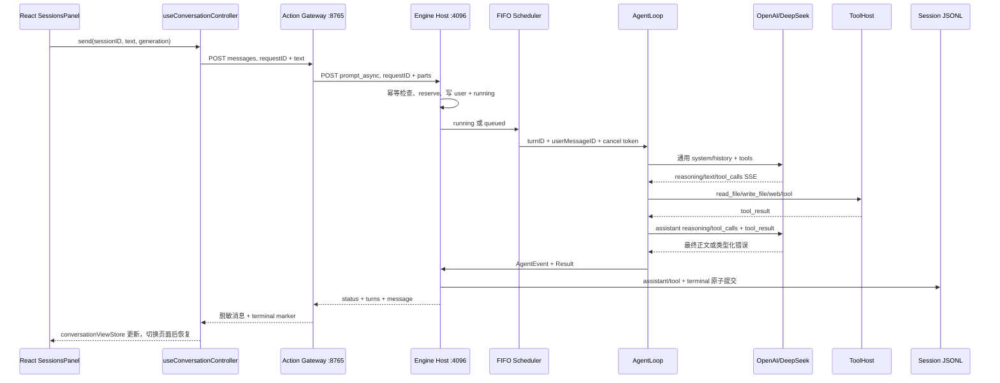

# B 线数据流

## 回合时序

```text
client -> POST /session                         create handle + meta JSONL
client -> POST /session/:id/prompt_async        reserve active slot
host   -> JSONL                                  append user message
host   -> SSE                                    user update + busy status
AgentLoop -> events                              message/tool/text/approval
host   -> SSE + Office queue                     ordered projections
host   -> JSONL                                  assistant/tool messages
host   -> SSE                                    idle + session.idle
```

Office worker 使用单一 `mpsc` 队列，请求超时为 500 ms。它不进行重试，也不会
将 HTTP 失败传播到回合结果。

## B-1 动作映射

| Engine 信号 | Office 动作 |
|---|---|
| 回合开始 | 1 号角色先置为 `idle`，再置为 `thinking` |
| 首个 `web_search/web_fetch/web_extract` | 1 号角色访问 2 号角色 |
| 首个 `read_file/grep/glob` | 1 号角色访问 3 号角色 |
| 首个 `write_file/edit_file/notebook_edit` | 1 号角色访问 4 号角色 |
| 后续匹配工具 | 对应角色置为 `working` |
| `SuggestConfirm` | 6 号角色置为 `working`，task 为 `等待审批` |
| 回合结束/失败/取消 | 活动角色置为 `idle`，5 号角色置为 `working` 并携带结果 task |

每回合 tracker 保证最多产生一次 `desk_visit`。未知工具不会产生访问动作。
`todo_add/todo_update/todo_list` 只在成功更新后发送 `todo.updated` SSE，不属于 Office 工具角色
映射，也不会占用本回合的拜访名额；5 号角色只在回合结束时整理结果。

## 路径策略

OpenPaw 按 `--home`、`OPENPAW_HOME`、平台 home 下的 `.openpaw` 顺序解析 home；
workspace 按 `x-opencode-directory`、查询参数 `directory`、CLI 默认值顺序解析。
AI Office 使用 `OPENPAW_HOME` 和 `OPENPAW_OFFICE_WORKSPACE`，将路径解析为
绝对路径，跳过符号链接，且绝不访问所选根目录之外的路径。Windows、macOS 和
Linux 均采用相同规则。

## Prompt 数据流

```text
HTTP decode
  -> resolve providerID/modelID
  -> build/validate provider
  -> SessionHandle.reserve_turn
       -> reject deleting/active
       -> install new cancel token
       -> begin approval lifecycle
  -> append user JSONL
  -> add user to memory
  -> spawn AgentLoop with (provider, model, cancel token)
```

先校验 provider 再 reserve，可避免错误凭据或 URL 把 session 留在 busy。先落盘 user
再改内存，可避免 append 失败时 REST 历史出现磁盘上不存在的消息。

## 审批与取消时序

```text
AgentLoop       ApprovalManager        HTTP reply/abort        ToolHost
    | request          |                       |                  |
    |----------------->| insert + asked       |                  |
    |                  |<------ once/reject --|                  |
    |<-- response -----|                       |                  |
    | select(tool, cancellation token)         |                  |
    |---------------------------------------------- call -------->|

abort:
    HTTP -> turn_gate -> cancel turn token + abort_all
                         -> drain pending + wake waiter
```

pending、aborted 和 approval token 位于同一临界区。`reserve_turn` 在同一个 turn gate
内创建新 cancellation token 并开始新的审批生命周期，所以 abort 不能落在两步之间。
reply 先于 abort 线性化时，工具执行仍与 cancel token 竞争；abort 先于 reply 时，
pending 已删除且 reply 返回 404。

审批返回 `Approved` 后，AgentLoop 在调用 ToolHost 前执行一次同步取消检查；若此时
回合已被 abort，则生成 `cancelled by user` 工具结果而不调用 ToolHost。实际工具 future
仍通过 biased cancellation select 运行，以便取消已开始但尚未完成的异步调用。

## 删除与恢复时序

```text
DELETE -> AppState.session_lifecycle
       -> SessionHandle.turn_gate
       -> active ? 409
       -> deleting=true
       -> remove from session map
       -> close SessionWriter
       -> unlink JSONL

GET/prompt -> AppState.session_lifecycle -> lazy load -> insert
stale prompt Arc -> reserve_turn sees deleting -> 404
```

如果 unlink 失败，runtime 尝试重新打开 writer、撤销 deleting 并把 handle 放回 map；
不会返回删除成功。摘要扫描不进入此装载路径，只读取 JSONL。

## Office 并行仲裁

```text
session A role 3 claim ---+
                          +--> role owners {A,B} --> no idle when A ends
session B role 3 claim ---+                         idle when B also ends
```

每 session 的 working set 决定下一轮要释放哪些角色；共享 dispatcher 的 owner map
决定释放时能否真正向 gateway 发送 idle。动作本身仍进入同一个 mpsc 队列，保持全局
产生顺序。ToolUseStart 立即执行工具名映射；SuggestConfirm 只增加 6 号状态，不增加
第二次 visit。

## 对话全链路（2026-09-19 走读基线）



### 身份与幂等边界

| 标识 | 创建方 | 生命周期 | 用途 |
| --- | --- | --- | --- |
| `sessionID` | Host | 会话永久 | 隔离消息、工具、取消和 Office 状态；不同 session 可以并行 |
| `requestID` | 浏览器 | 一次逻辑发送 | Gateway/Host 重试幂等；同 session 同键同正文重放原 turn，不同正文冲突 |
| `turnID` | Host | 一轮 | 关联 running/queued/terminal、SSE 和失败投影 |
| `userMessageID` | Host | 一轮 | 把终态绑定到触发该轮的用户消息，避免旧终态关闭新一轮 |
| `generation` | React | 一次页面发送 | 防止旧 monitor、旧页面闭包覆盖当前 UI 状态；不进入 Host 协议 |

同一 session 只允许一个活动回合，重复发送返回 `409 active_turn`；不同 session 由
进程级调度器按默认 `4 running + 32 queued` 运行。Gateway 不应把另一个客户端已经
存在的活动 turn 自动认作当前 requestID 的成功接收，除非 Host 的幂等重放返回同一 turn。

### Provider、工具续轮与失败回滚

DeepSeek 的工具续轮要求把首轮 assistant 的 `reasoning_content`、`tool_calls` 和对应
`role=tool` 结果一起发回第二次请求。本实现只在 DeepSeek 模型或 DeepSeek 地址下发送
该方言字段；普通 OpenAI-compatible 服务不接收 DeepSeek 专用字段。合法 SSE 必须有完整
终止证据；`aborted`、`insufficient_system_resource`、截断 JSON、缺少终止或流内
`service_unavailable` 均进入类型化失败，不能转成空成功。

Host 默认每次模型响应最多 4096 个输出 token；部署可用通用
`OPENPAW_MAX_OUTPUT_TOKENS` 覆盖并传入 `AgentLoop`。Provider 返回
`finish_reason=length`/`StopReason::MaxTokens` 时，Engine 在写入 assistant 之前返回失败，
Host 恢复回合前 checkpoint，禁止把截断正文标记为 completed。Host 不注入本机日期、
星期或旅游问题专用 system prompt；时间类回答仍由模型和已登记工具能力决定。

AgentLoop 执行前复制 session checkpoint。Provider 在工具续轮后失败时恢复 checkpoint，
避免未完成的 assistant/tool 历史污染下一轮；失败终态仍持久化。回滚只能撤销会话上下文，
不能撤销已经执行的写文件或外部请求，因此工具副作用语义仍是 at-least-once，具有副作用的
工具必须自行幂等或由上层 requestID/业务键去重。失败或取消后不得补发不存在的最终
assistant completed 事件。

### 事实源和恢复顺序

1. JSONL 与 Host turn outcome 是持久事实源。
2. Host REST `/turns`、`/message`、`/session/status` 是恢复接口。
3. Gateway system marker 是对 Host terminal 的脱敏投影，不是新的业务事实。
4. `conversationViewStore` 只保存页面缓存和入场前错误，不能替代 Host 持久化。
5. Office 人物动画是旁路投影，失败不得改变 turn；动画也不能作为完成证据。

页面切换或刷新后先读取批量 status，再按活动 session 恢复 monitor，最终用 turns + messages
对账。terminal 已出现但 assistant 正文尚未可见时，应在有界窗口继续读取，不能立即生成
`completed_without_reply`。messages 与 turns 任一暂时失败时，另一路的可用正文不应被
`Promise.all` 一并阻塞；该项仍列入发布前优化清单。
