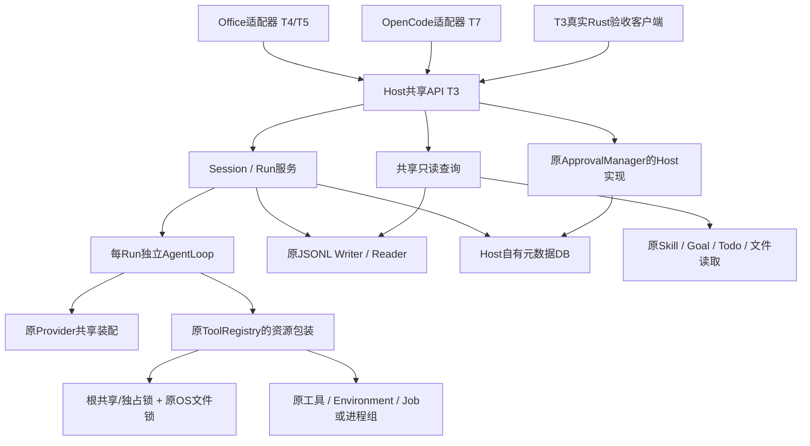
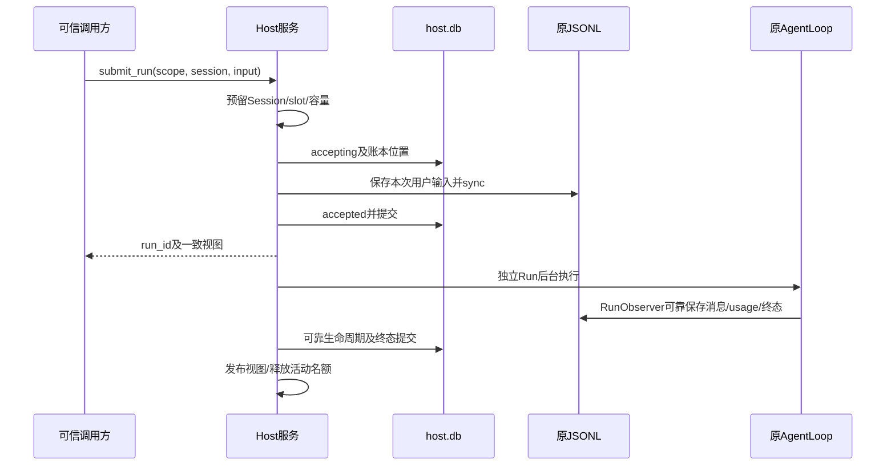

# CHG-2026-0004：T3共享Host运行、审批、资源与恢复

**修订提案 `2026-10-21-r2`，仅新增CLI帮助测试适配范围，待用户审核；r1已获批准并完成首轮实现，本文件不是交付完成单。**目标是让下一阶段Office聊天、任务/白板、确认菜单和人物状态共同引用一套真实Run。T2 PR #6已合入；本阶段只交付可运行Host底座，不宣称Office页面已经接通。与原CHG-2026-0001的r3有限职责补充共同审核、未来同一T3 PR交付，不增加治理Tx或审核总单。

阅读导航：第2节看用途与源码事实；第4节逐文件原因/改法；第6—7节看具体接口和数据；第9节看顺序/框图/失败与平台；第10节看可观察完成标准。文件清单是获批后的允许范围，不能因列出就立即实施。

## 1. 变更审批

| 审批项目 | 内容 |
| --- | --- |
| 项目CHG格式 | openpaw/chg-review-v2 |
| 变更编号 | CHG-2026-0004 |
| 变更标题 | T3共享Host运行、审批、资源与恢复 |
| 当前状态 | 已批准（approved）；本轮交付已通过用户验收并随PR #7实际合入；Windows暂缓未验证，机器closed限制见第12节 |
| 阶段 | T3 |
| 提案版本 | 2026-10-21-r2 |
| 变更类型 | 新增与延展（additive） |
| 风险等级 | 严重（critical） |
| 负责人 | 用户授权开发者（Codex） |
| 必须审核 | 用户或指定非作者审核人 |
| 设计基线 | REQ-OP-008、REQ-OP-009、REQ-OP-002；DES-OP-006、DES-OP-003、DES-OP-004 |
| 目标分支 | merge/ai-ofice-react-overagent |
| 实施基线 | 3a159a41c5440df6ce0cbbedb4edc7b0a87fe428；T2 PR #6实际合入 |
| 实施授权来源 | 用户先前“批准 进行吧”授权r1及0001 r3；解释r1/r2含义后用户明确“好的 批准 继续”，批准本r2测试范围补充 |
| 关联修订 | CHG-2026-0001@2026-10-21-r3 |
| 历史元数据维护 | docs/changes/CHG-2026-0003.md |
| 历史说明维护 | docs/changes/CHG-2026-0002.md |
| 原交付状态 | 首次T3提案，无历史T3交付；0001治理r2实现按原批准保留 |
| 方案审核状态 | approved |
| 方案批准版本 | 2026-10-21-r2 |
| 方案审核人 | 本会话用户 |
| 方案审核时间 | 2026-10-21（Asia/Shanghai，日期精度） |
| 方案审核证据 | 用户在解释第一版和第二次修订及仅增加一个帮助测试文件后，明确“好的 批准 继续”；r1历史批准保留第12节 |
| 方案批准对象 | 3b483099b5b1665bbac4100620821a8ad1443df3:docs/changes/CHG-2026-0004.md |
| 交付验收状态 | approved |
| 交付验收提交 | 4263529059234ae913da3b40a3efe3eb6e9f7f56 |
| 交付验收人 | 本会话用户 |
| 交付验收时间 | 2026-10-21（Asia/Shanghai，日期精度） |
| 交付验收证据 | 用户在收到4263529准确版本、0004与0001共同交付验收材料后明确回复“审批通过”；本轮Windows暂缓安排保留 |
| 验证证据 | docs/verification/CHG-2026-0004/验证记录.md；提案检查与运行验收分开 |
| Linux验证提交 | 4263529059234ae913da3b40a3efe3eb6e9f7f56 |
| Linux验证结果 | passed |
| Linux验证证据 | /media/cheng/新加卷/workSpace/Office/artifacts/t3-evidence-delivery-20261021/report.json；完整26/26，报告SHA256 47cf3e9d0dea6ac06d0b6ee330d6dc46a14c3011ac8391bdf90b39ee4b2c63c1 |
| Windows验证提交 | 未执行；后续补验须记录实际运行提交 |
| Windows验证结果 | 本轮T3按用户明确指示暂缓，未验证、不计通过；保留Windows支持与T8原生验收要求 |
| Windows验证证据 | 2026-10-21本会话用户“windows 说了没有环境，暂时不验证”；原CI配置不skip、不删除 |
| 平台PR状态 | MERGED；用户会话确认PR完成；API reviews为空，不虚构平台Approve |
| 平台PR URL | https://github.com/KunlunMeta-Limited/openpaw/pull/7 |
| 平台PR head | 825a86c624c1c3d0cee4f61584f41f48b5f09f60（GitHub API核实最终head；创建head历史保留于第12节） |
| 平台审核证据 | 本会话用户明确“PR已经完成了”；2026-10-21 API核实MERGED、reviews为空，审核来源与平台合入事实分开 |
| 合入提交 | d11b944073ea3c3bc8cf3dac308e435647e6ee52 |
| 合入时间 | 2026-10-21 19:16:12（Asia/Shanghai）；GitHub mergedAt=2026-10-21T11:16:12Z |
| 当前外部事实 | PR #7已合入merge/ai-ofice-react-overagent；原Windows暂缓未验证，当前允许准备T4具体CHG，未授权其代码 |

## 2. 变更原因

### 用户场景与目标

办公室A读项目、办公室B等待确认写报告时，用户仍应能查看历史和停止A；批准B后执行的必须是看到的最终输入；Host重启不能把报告再写一次。现有T1/T2已使单次引擎和工具可信，但CLI直接持有Session/Writer，没有跨客户端的Session绑定、Run容量/状态、审批记录、根锁和恢复服务。若把这些分别塞进Office/OpenCode路由，会出现两套运行和不一致的取消/审批。T3先补共享底座，T4/T5只做协议映射。

### r2相对已批准r1的唯一实施范围变化

首次实现的完整全feature测试发现：原`crates/openpaw-cli/tests/help_snapshot.rs`只识别默认12个命令及可选sidecar，尚未计入r1明确新增的engine-host。因此全feature实际14个、原断言预期13个；源码审核时漏列了这份必须随新入口延展的既有测试。此为测试适配遗漏，不是原运行时缺陷，不新增D编号或Tx/CHG。

本次仅请求在第4节和第8节增加该**一个现有测试文件**，并在第10节补精确验证方法：复用既有SUBCOMMANDS/帮助关键字断言，以同CLI的feature条件登记两个可选命令，保留默认12项及精确数量/覆盖断言，补Host的`--config`/`--port`帮助检查。默认、仅Host、仅sidecar、双feature分别必须12/13/13/14项。禁止放宽为“至少12项”、忽略测试或删除Host入口换取通过。r1其他方案和0001 r3不变；无新增运行API、依赖、数据结构、权限或Office改动。

既有r1批准仍可追溯29a688c及第12节；r2批准前不修改这份测试，也不将r2首页pending解释成历史r1未获授权。批准后先修此文件并复跑全部26项，再取Windows原生证据、核查M3，之后另行提交准确交付版本供用户验收，不能直接创建PR。

### 当前源码事实与复用结论

- **engine-host/src/lib.rs、Cargo.toml**：仅占位，无HTTP/Run API；新增宿主职责有必要，不搬CLI整段实现
- **llm/src/assembly.rs::assemble_provider**：已有共享模型优先级与Provider构造；直接调用，不再写模型选择逻辑
- **engine/src/run.rs::RunContext/RunObserver；AgentLoop::run_with_context**：可等待保存、明确终态、独立取消；每Run新建AgentLoop，Provider实例可共享
- **core::ApprovalManager、ToolCallContext；tools::ToolRegistry**：直接实现原trait/包装原注册表；完整输入绑定不等于持久一次消费，后者由Host提供
- **store/src/session.rs、sqlite.rs::SessionDb**：JSONL事实及可重建索引可复用；Host新数据库仅保存自身缺失的元数据
- **sandbox::file_lock；tools::exec::Environment**：复用D16锁及T2托管进程/环境；不新增杀进程或沙箱后端
- **memory::SkillManager::list_active**：会触发telemetry生命周期写入，不能用于Host只读查询；使用显式根的FsSkillStore
- **FsSkillStore::list_scope；FsGoalStore::list_all**：现列表有意跳过部分坏文件；新增checked只读入口复用同一解析器，旧调用保持兼容。此为Host要求的能力延展，不将既有容错选择伪列新D缺陷
- **tools::meta::todo::read与fs::read**：Todo结构查询可复用；文件预览提取原有读取校验，避免Host再实现一套文件解析

现阶段未认定新的运行时缺陷编号。实施若复现真实缺陷，先补本CHG的D条目、原因/测试及必要范围；涉及权限、协议、存储或文件范围变化再审，不借能力延展无边界修代码。

### 协议依据和非目标

Office固定提交`b221a44ce22fe08956356b5002d17df59a6a4f50`，本轮已只读复核integration/README及其聊天/HTTP链接；21份来源由contracts/sources.json唯一固定，提案验证再校验哈希。

| 官方协议/真实功能 | T3必须提前提供 | 后续落地，不在本阶段伪造成功 |
| --- | --- | --- |
| chat-integration.md：teamId/conversationId、NDJSON、停止、180秒 | 中性client scope→Session绑定、接受Run、增量视图、取消清理；办公室同槽冲突 | T4实现POST /office/chat、UTF-16限制和v1断开取消；T3无Office聊天路由 |
| office-integration.md：decision.request、confirm/reject/408 | 持久pending、精确binding、一次决定/消费、过期/取消拒绝；等待不持根锁 | T5映射菜单和展示尝试ID，不把HTTP超时当批准 |
| dashboard-integration.md：任务状态及完整快照 | 稳定Run/call、proposed/awaiting/actual running/result与终态的可靠事实 | T4/T5生成完整snapshot/seq、任务/白板/功能人物；T3不发送假任务或动画 |
| office-integration.md：ui.next/ui.respond；detail-v1 | 有作用域、只读且错误可信的历史/工具/Skill/Goal/Todo/文件查询 | T5单领取循环和详情分页；T3不调用Office内部UI/SSE |
| SDK 1.18.15未来attached | 同一Session/Run/Approval/资源服务；断开订阅不默认取消 | T7 DTO、HTTP/SSE、Basic保护与发现标记；不在T3写OpenCode路由 |

总要求对应master第2、6、9.3、10节T3、14.8 M3。Office源码/文档/配置/测试均不修改，无新增Rx。本阶段不做动画系统、目标调度、Skill注入、Node Bridge、永久审批或多Agent；Windows10/11 x64和Linux，macOS不在范围。

## 3. 涉及仓库

| 仓库编号 | PR 或说明 |
| --- | --- |
| openpaw | feat/engine-host-t3，从最新已合入集成基线3a159a4创建；0004业务与0001治理各自批准/验收，共用T3 PR指向merge/ai-ofice-react-overagent。Office只读，不创建Office PR。 |

主工作区仍在原分支且含用户改动。本次隔离工作目录`/tmp/openpaw-t3-20261021`；不将主工作区0003表格排版及m2/m5报告改动搬入或覆盖。

## 4. 允许修改文件

每行说明真实缺口与改法；未列路径不授权。无源码行数上限，按职责拆分。0001治理文件由其自身第4节授权，不在此复制一张文件表；重叠文件双方职责明确如下。全部负责人为用户授权开发者，受保护项目仍需用户/非作者审核。

| 仓库 | 操作 | 文件 | 模块或符号 | 文件负责人 | 为什么必须修改 | 对其他部分的影响 | 必要性 | 具体修改方向与复用方式 | 完成标准与证据 | 共同修改职责 |
| --- | --- | --- | --- | --- | --- | --- | --- | --- | --- | --- |
| openpaw | 新增 | docs/changes/CHG-2026-0004.md | T3主方案及独立审批字段 | 用户授权开发者 | 本阶段首次新增可运行Host，必须先让审核人判断方法、边界和允许文件 | 决定T3实施范围，不代替0001审核 | 必改 | 新增本方案；绑定批准版本、记录技术验证/交付验收/PR/合入四种事实 | 十二节可审核，未发生不伪造结果 | 无 |
| openpaw | 修改 | docs/changes/CHG-2026-0003.md | 首页与第12节追加完成履历 | 用户授权开发者 | 前序T2现已合入，旧首页仍待审核会误阻塞或误导后续 | 不重写T2方案、Windows暂缓与测试历史 | 必改 | 仅更新首页PR/合入事实及追加履历，保留第2—11节和原失败记录 | PR #6、head 5324307、merge 3a159a4和用户确认可对应 | CHG-2026-0001：治理修订原已扩充历史说明；0004仅补T2实际合入元数据 |
| openpaw | 修改 | docs/changes/INDEX.md | 自动索引 | 用户授权开发者 | 新增0004和前序完成后索引必须同步 | 只改变状态汇总 | 必改 | 复用check.py index生成，不手填批准 | 与四份CHG当前状态一致 | CHG-2026-0001：索引新状态口径；0004：新增T3及T2完成事实 |
| openpaw | 修改 | docs/verification/追踪矩阵.md | 自动需求追踪 | 用户授权开发者 | REQ-OP-008/009需要新的实现与验收入口 | 不新增第二份需求主记录 | 必改 | 复用trace生成器，更新真实需求/设计定位 | trace --check无漂移 | CHG-2026-0001：REQ-OP-020；0004：REQ-OP-008/009及查询/启动定位 |
| openpaw | 修改 | docs/requirements/产品需求说明.md | REQ-OP-008/009、只读查询与兼容边界 | 用户授权开发者 | 宿主并发、审批、恢复应对应用户动作和可观察结果 | 不提前宣称Office可用 | 必改 | 补Host接受/冲突/停止/故障/查询条件；实施前仍标待实现 | 需求可逐项对应H01—H12场景 | CHG-2026-0001：仅REQ-OP-020治理；0004：Host产品行为和阶段状态 |
| openpaw | 修改 | docs/design/软件设计说明.md | DES-OP-006及DES-OP-003/004关联 | 用户授权开发者 | 通用描述未确定两种存储、接受窗口及锁顺序 | 不让协议适配器拥有第二套Run/审批 | 必改 | 细化本CHG第9节职责、恢复和持久化顺序；复用T1/T2契约 | 设计指向实际接口和故障场景 | CHG-2026-0001：DES-OP-001；0004：DES-OP-006及核心接口使用说明 |
| openpaw | 修改 | docs/engine-host/master.md | 首页、第10节T3、第14节M2/M3 | 用户授权开发者 | T2合入和T3方案需单一可读入口 | 不更改Office官方协议或扩大Tx | 必改 | 登记T2实际完成及Windows待验；T3任务卡指向0004第6/9/10节 | M2完成有事实，M3待方案审核不写已实现 | CHG-2026-0001：治理流程；0004：前置完成、T3导航/实际进度 |
| openpaw | 修改 | docs/engine-host/handoff.md | T3专项交接入口 | 用户授权开发者 | T4必须取得可直接使用的接口而非只知道模块名 | 原通用治理模板保留 | 必改 | 追加T3配置/错误/游标/查询契约和H场景证据链接 | T4不用再造Host服务 | CHG-2026-0001：通用审核/共同交付；0004：T3实际交接内容 |
| openpaw | 修改 | docs/engine-host/audit.md | 复用矩阵和查询能力缺口 | 用户授权开发者 | 已识别SkillManager查询写入、列表容错与Host真实查询要求的差异 | 不把有意的旧容错语义伪称新增缺陷 | 必改 | 登记源符号、只读checked扩展选择与当前状态；新真实缺陷按D另记 | 复用/扩展/待验证可定位 | 无 |
| openpaw | 新增 | docs/verification/CHG-2026-0004/验证记录.md | 提案、实现、M3核查证据 | 用户授权开发者 | 方案审核和运行验收不能混写 | 不保存用户配置或其他项目数据 | 必改 | 新建计划与实测分离的报告入口；日志在仓库外 | 每项准确来源、命令、退出码可追溯 | 无 |
| openpaw | 新增 | docs/engine-host/host-config.example.toml | 无秘密配置样例 | 用户授权开发者 | CLI启动需要一份可直接填授权根的配置，现无Host配置 | 不自动覆盖既有CLI配置，不放明文密钥 | 必改 | 仅示例Provider类型/密钥环境变量名、home、根、办公室和容量 | Linux/Windows路径示例和启动命令可复现 | 无 |
| openpaw | 修改 | CHANGELOG.md | 新增Host可选功能与边界 | 用户授权开发者 | 使用者需知道新入口、隔离限制和旧CLI兼容 | 不宣传Office聊天/动画已实现 | 必改 | 记录已验收能力；计划阶段不提前写成发布完成 | 与最终M3/能力矩阵一致 | 无 |
| openpaw | 修改 | governance/identifiers.json | 0004标识登记 | 用户授权开发者 | 新方案需要统一编号与权威来源 | 不产生新的治理系统 | 必改 | 仅登记CHG-2026-0004及本方案API/DAT编号；不改校验逻辑 | 无重复/悬空ID | 无 |
| openpaw | 修改 | Cargo.toml | workspace dependencies | 用户授权开发者 | Host要监听HTTP、识别真实根，但核心和默认CLI不应拉入HTTP服务器 | 新依赖仅Host opt-in，MSRV1.88及许可审计必验 | 必改 | 复用tokio/serde/toml/rusqlite等；登记axum 0.8系列和已锁定same-file 1.0.6的直接使用；net/signal仅在Host路径启用 | 默认CLI无axum；lock无无关升级 | 无 |
| openpaw | 修改 | Cargo.lock | Host新增依赖的锁定条目 | 用户授权开发者 | 新增axum的解析必须可重现且经过安全/MSRV检查 | 不手改checksum或放宽deny | 必改 | Cargo产生最小依赖增量；复用现有hyper/tower等，逐项解释新条目 | --locked、deny、双MSRV通过 | 无 |
| openpaw | 修改 | crates/openpaw-engine-host/Cargo.toml | engine-host feature、依赖、测试入口 | 用户授权开发者 | 当前crate没有任何依赖或运行能力 | 空feature默认仍轻量，不创建新工作空间项目 | 必改 | engine-host聚合可选核心/存储/工具/llm/memory/goal/sandbox及既有基础库；显式挂载两个tests子目录入口 | feature关闭无业务依赖，feature启用可测试 | 无 |
| openpaw | 修改 | crates/openpaw-engine-host/src/lib.rs | Host公共出口 | 用户授权开发者 | 占位库无法让Office与SDK共享服务 | 只暴露协议无关契约 | 必改 | 导出Host/配置/命令/查询/订阅；实现入口按feature编译 | T4/T7可直接Rust调用，核心无Office DTO | 无 |
| openpaw | 新增 | crates/openpaw-engine-host/src/types.rs | 作用域、Run/审批/错误/一致视图 | 用户授权开发者 | 现核心没有客户端作用域、宿主状态与恢复结果类型 | 不复制Session/Message定义 | 必改 | 新增Host专属ID关系、错误码和带游标视图；复用core消息/用量 | 状态转换、跨作用域拒绝、序列化可测 | 无 |
| openpaw | 新增 | crates/openpaw-engine-host/src/config.rs | HostConfig校验及共享装配入口 | 用户授权开发者 | 现Provider装配可用，但home/办公室/根/容量无统一配置 | 不从请求读取任意根或密钥 | 必改 | 调用llm::assemble_provider；固定home和真实根、验证完整Basic对、模型/预算/白名单；不改变进程环境 | 错误配置启动失败且诊断不泄密 | 无 |
| openpaw | 新增 | crates/openpaw-engine-host/src/store.rs | Host元数据与RunObserver、恢复 | 用户授权开发者 | JSONL只记录会话事实，缺少绑定/Run/审批/生命周期恢复数据 | 数据库边界见9.3；不复制账本/解析器 | 必改 | 复用SessionReader/Writer及SessionDb索引；新增host.db仅保存宿主元数据；单写actor异步等待提交 | 接受/终态磁盘失败无虚假成功，恢复不重放 | 无 |
| openpaw | 新增 | crates/openpaw-engine-host/src/service.rs | 共享Session/Run服务及订阅 | 用户授权开发者 | AgentLoop没有多客户端注册、容量、后台任务归属 | 默认4容量、同Session/办公室冲突，Run内并行关闭 | 必改 | 短锁预留Session/办公室/容量；保存后启动每Run独立引擎；管理取消/清理和一致游标 | H01/H02/H05/H08/H09，查询不被长任务阻塞 | 无 |
| openpaw | 新增 | crates/openpaw-engine-host/src/approval.rs | 共享ApprovalManager实现与CAS | 用户授权开发者 | 现审批trait可等待，但缺持久pending和一次决定/消费 | 不另建核心审批体系、不自动允许 | 必改 | 实现原ApprovalManager；完整输入绑定、持久CAS、取消/过期/故障拒绝、单次领取授权 | H03/H04/H08；相同call最多执行一次 | 无 |
| openpaw | 新增 | crates/openpaw-engine-host/src/resource.rs | 根身份、共享/独占与OS锁协调 | 用户授权开发者 | 现OS锁是原语，未提供宿主根身份和可取消等待 | 锁顺序见9.5；普通文件锁不冒充隔离 | 必改 | 规范根+same-file识别别名；Tokio公平RwLock配原try_lock_*；拒绝嵌套根，home全生命周期独占 | 共享读可并行、写互斥、跨home同根协调及等待可取消 | 无 |
| openpaw | 新增 | crates/openpaw-engine-host/src/tool_host.rs | 原ToolRegistry的资源/权限包装 | 用户授权开发者 | 原工具无跨Session锁与审批后文件前置校验 | 不复制工具分派/命令/文件内容编辑，T4仍仅开放只读 | 必改 | 包装原ToolHost/Validator与ToolCallContext；获锁重验后调用原主体，开始/结果可靠保存；原Environment注入 | H03/H05/H06/H10；清理完成才释放根锁 | 无 |
| openpaw | 新增 | crates/openpaw-engine-host/src/query.rs | 六类只读查询与预览 | 用户授权开发者 | 协议适配器直接读各Store会重复权限和分页逻辑 | 只查不初始化/生命周期写入，不调度Goal | 必改 | 共享授权根/Session作用域；复用原Session、Todo、checked Skill/Goal和文件读取，统一分页/错误 | H07/H10；目录/文件哈希不变 | 无 |
| openpaw | 新增 | crates/openpaw-engine-host/src/server.rs | loopback监听、health、发现与关闭 | 用户授权开发者 | 当前无可启动Host服务，T4/T7需要同一监听器 | 本期不开放调试执行/审批HTTP；未来适配器直接接服务 | 必改 | axum只提供GET /health和路由装配缝隙；127.0.0.1:0；ready后发现，信号触发取消并等清理 | H11；恢复失败不ready、关闭不遗留工具进程 | 无 |
| openpaw | 新增 | crates/openpaw-engine-host/tests/features/runtime.rs | Host两Session/审批/查询/订阅集成 | 用户授权开发者 | 仅核心单测不能证明共享注册表和锁正确 | 通过显式Cargo入口运行，不扩大核心public | 必改 | 确定性Provider使用真实AgentLoop/ToolRegistry/JSONL；新增H01—H07/H09/H10 | 断言文件字节、Run/call/终态，不只断言返回码 | 无 |
| openpaw | 新增 | crates/openpaw-engine-host/tests/regressions/recovery.rs | 跨进程恢复、存储失败和所有权 | 用户授权开发者 | 内存模拟重启不能覆盖真实OS锁及崩溃窗口 | Linux/Windows分别原生执行，无后台残留 | 必改 | 真实Host子进程夹具，定点屏障kill、相同home拒绝、跨home同根、启动损坏诊断 | H05/H08/H11/H12；副作用计数保持一次 | 无 |
| openpaw | 新增 | crates/openpaw-engine-host/examples/host_smoke.rs | 不依赖Office的可运行T3验收客户端 | 用户授权开发者 | T3没有Office路由仍需展示真实服务而非只交文档 | 不是新后端、不是生产HTTP调试入口 | 必改 | 通过公共Rust API接受两Session、查询、取消和审批；只操作传入隔离临时根 | 一条cargo run命令产生可核对JSONL/文件证据 | 无 |
| openpaw | 修改 | crates/openpaw-cli/src/cli.rs | Command::EngineHost | 用户授权开发者 | 现只有chat/sidecar等命令，无Host入口 | 默认help不变；不让--sidecar静默覆盖Host启动 | 必改 | feature内增加engine-host --config、可选--port；参数结构复用Host配置 | 默认和双feature参数解析通过 | 无 |
| openpaw | 修改 | crates/openpaw-cli/src/main.rs | 命令分派 | 用户授权开发者 | 只有子命令定义不能运行宿主 | 不改原chat或MCP实现 | 必改 | feature分支委托host_cmd；仅Host+sidecar冲突明确拒绝 | 新入口可启动、退出码区分配置/运行错误 | 无 |
| openpaw | 修改 | crates/openpaw-cli/src/lib.rs | feature内host_cmd导出 | 用户授权开发者 | CLI测试需共享入口，现模块无Host | 不移动chat/sidecar代码 | 必改 | 按现有各cmd模块模式导出host_cmd | 默认/全feature均可构建 | 无 |
| openpaw | 新增 | crates/openpaw-cli/src/host_cmd.rs | 启动/信号/日志入口 | 用户授权开发者 | CLI没有承载Host装配和关闭的职责模块 | 不复制Provider选择逻辑，不记录密钥 | 必改 | 读取Host配置并调用Host/server，结构化诊断、Ctrl-C关闭和端口输出 | 非零退出、port0发现、关闭实际完成 | 无 |
| openpaw | 修改 | crates/openpaw-cli/tests/help_snapshot.rs | SUBCOMMANDS、根帮助数量与逐命令帮助断言 | 用户授权开发者 | 已批准新Host命令使旧feature快照少计一项，完整测试实测14与13不符；新入口必须进入既有兼容测试 | 只修改测试；默认12命令和全部旧帮助关键字继续严格核对 | 必改 | 复用现有断言及表，以cfg登记engine-host和sidecar；补Host的--config/--port；按实际feature计算非可选表覆盖，不跳过用例 | 默认/仅Host/仅sidecar/双feature分别精确12/13/13/14，四组合帮助测试及完整26项通过 | 无；r2新增的唯一实施文件，待批准后修改 |
| openpaw | 新增 | crates/openpaw-cli/tests/engine_host_e2e.rs | 真实二进制启动验收 | 用户授权开发者 | 库测试不能验证参数/发现/端口占用和信号 | 临时home和工作区，子进程RAII回收 | 必改 | 沿原CLI e2e子进程模式测试health、配置错误、并存feature和关闭 | H11/H12；Windows不依赖sh或WSL | 无 |
| openpaw | 修改 | crates/openpaw-memory/src/skills/store.rs | FsSkillStore::list_readonly_checked | 用户授权开发者 | manager::list_active会写生命周期；底层list跳过坏文件且跟随链接，不能直接作为真实详情查询 | 新入口附加，不改旧CLI生命周期；不在Host再解析SKILL.md | 必改 | 延展现有底层扫描/解析为checked只读入口，显式根、路径约束及错误透传；保留旧list容错语义 | 坏文件/越界链接明确错误，无目录/遥测写入 | 无 |
| openpaw | 修改 | crates/openpaw-memory/Cargo.toml | 只读查询专用测试入口 | 用户授权开发者 | Cargo不会递归发现tests/features子目录 | 不新增业务依赖 | 必改 | 仅注册read_only_queries功能集成测试；复用原依赖 | 默认/全feature均真正执行 | 无 |
| openpaw | 新增 | crates/openpaw-memory/tests/features/read_only_queries.rs | 技能只读及损坏/路径回归 | 用户授权开发者 | 须证明查询不触发manager副作用且不吞坏数据 | 不使用用户真实配置 | 必改 | 构造临时技能/遥测、时间/字节清单，检查before/after及坏文件/链接 | H07，原skills_e2e保持通过 | 无 |
| openpaw | 修改 | crates/openpaw-goal-ledger/src/store.rs | FsGoalStore::list_readonly_checked | 用户授权开发者 | 旧list_all有意跳过扫描/解析错误，空列表不足以表示Host真实读取结果 | 旧GoalStore列表兼容，新入口不创建事件目录或调度 | 必改 | 同一原解析/扫描逻辑增加checked模式；显式根与链接边界；不复制解析器 | 正常、空、坏文件、读错误区分 | 无 |
| openpaw | 修改 | crates/openpaw-goal-ledger/Cargo.toml | 只读查询专用测试入口 | 用户授权开发者 | 新子目录不显式注册则测试不会运行 | 不改变既有Goal测试 | 必改 | 仅新增read_only_queries测试入口，复用已有临时目录依赖 | 测试在两种feature全量中运行 | 无 |
| openpaw | 新增 | crates/openpaw-goal-ledger/tests/features/read_only_queries.rs | Goal只读与诊断用例 | 用户授权开发者 | 需要验证旧容错列表兼容且Host读取不假空 | 不调用create_goal或目标调度来冒充查询 | 必改 | 坏Markdown、目录错误、链接、只读目录及无.events写入的真实文件测试 | H07，原goal_ledger_e2e保持通过 | 无 |
| openpaw | 修改 | crates/openpaw-tools/src/fs/read.rs | 可复用的有界纯文本读取入口 | 用户授权开发者 | 现read_file输出带行号，直接作为文件预览需重复读/解码/限额 | 不改原工具协议/默认上限，不新写Host文件解析器 | 必改 | 提取现有读取/UTF8/大小校验为可复用入口，允许256KiB预览上限，run仍保持原带行号结果 | 原工具输出回归不变，二进制/越界/大文件拒绝 | 无 |
| openpaw | 修改 | crates/openpaw-tools/tests/regressions/tool_runtime.rs | 只读预览边界回归 | 用户授权开发者 | 共享读取提取可能改变原行为，需沿已有入口回归 | 专用回归入口继续复用 | 必改 | 追加中文/UTF8/256KiB/路径/旧带行号断言，不改原T2断言 | 旧T2回归全绿且新限制实际生效 | 无 |
| openpaw | 修改 | crates/openpaw-cli/Cargo.toml | engine-host相关依赖/feature | 用户授权开发者 | CLI可能需要仅Host模式下的配置或HTTP e2e依赖 | 触发条件：host_cmd/真实HTTP测试无法仅用Host现有导出完成 | 条件 | 只在确需时增加既有toml/reqwest复用或feature连线；不把axum变默认依赖 | 说明实际增量及不使用理由 | 无 |
| openpaw | 修改 | THIRD-PARTY-NOTICES.md | 新Host分发依赖通知 | 用户授权开发者 | 新增直接/传递依赖如触发既有分发义务应同步 | 不放宽许可证或忽略公告 | 条件 | 条件为axum等锁定依赖产生未覆盖的署名/通知义务；遵守现有策略 | 核对实际下载许可证及分发清单 | 无 |

条件文件未使用时保留并注明理由，不通过随意修改使表格“必改”凑齐。新增Host模块只承担核心没有的宿主责任，名称不授权新增第二套核心实现。

## 5. 明确禁止范围

| 仓库 | 禁止路径 | 为什么禁止 |
| --- | --- | --- |
| openpaw | crates/openpaw-core/** | T1/T2契约足够复用，本方案不扩大核心公共API；确需改则补审 |
| openpaw | crates/openpaw-engine/** | 不复制或重写推理循环；不为Host包装需要顺手重构 |
| openpaw | crates/openpaw-sandbox/** | 复用原Job/进程组/环境/锁；T2未验部分保留，不另造执行器 |
| openpaw | crates/openpaw-cli/src/chat.rs | 已有Provider/观察器可调用，不从CLI复制或改旧交互逻辑 |
| openpaw | docs/m2-exit-report.md | 用户原工作区改动，不覆盖或顺手提交 |
| openpaw | docs/m5-exit-report.md | 用户原工作区改动，不覆盖或顺手提交 |
| openpaw | docs/engine-host/contracts/** | T3无外部Office/OpenCode协议变化，冻结来源不漂移 |
| openpaw | governance/vendor/** | 参考框架快照不变，不用修改vendor规避门禁 |
| openpaw | deny.toml | 依赖审计和许可政策不放宽，新增问题须单独说明并审核 |

Office整个工程及两个Kunlun参考工程均只读；不新增macOS、安装器、ARM/WSL要求。AGENTS/CI/治理算法由0001既有批准范围处理，0004不增加新门禁豁免或修改账单。

## 6. API 变化

以下为拟新增Host公开Rust接口的职责/方法名；内部私有组织可在批准范围内迭代，语义/权限/存储实质变化需修订。后续协议适配器直接Rust调用，不经内部HTTP。

| 接口编号 | 类型 | 原始标识符 | 中文名称 | 兼容性 | 功能和边界 |
| --- | --- | --- | --- | --- | --- |
| API-HOST-CONFIG | Rust | HostConfig::load/validate | 宿主显式配置 | 新增，feature内 | 固定home、允许根、Provider、容量及办公室槽；密钥只引用环境变量，不回显 |
| API-HOST-SESSION | Rust | Host::open_session/get_session | 会话创建与绑定 | 新增；复用core::Session | ClientScope由可信适配器构造；已有Session根不可切换，JSONL为消息权威 |
| API-HOST-RUN | Rust | Host::submit_run/get_run/cancel_run | 运行接受与停止 | 新增；调用原AgentLoop | 持久接受后返回；同Session/槽冲突409、容量503；取消请求不等于清理已结束 |
| API-HOST-VIEW | Rust | Host::snapshot_and_subscribe | 一致视图与后续通知 | 新增 | 返回同一revision下视图/游标与通知；落后重取视图，不从丢失广播重建关键事实 |
| API-HOST-APPROVAL | Rust | Host::pending_approvals/decide_approval | 共享审批查询与决定 | 新增；实现原ApprovalManager | 校验作用域、Run/call/输入及pending版本CAS；重复相同结果可读，冲突不再执行 |
| API-HOST-QUERY | Rust | Host::query | 统一只读查询 | 新增 | 历史/工具结果/Skill/Goal/Todo/文件；分页默认5，限额与损坏明确诊断，不触发写入 |
| API-HOST-LIFECYCLE | Rust | Host::shutdown/wait_idle | 优雅关闭 | 新增 | 先拒新Run，关审批，取消，等待实际工具/进程与持久化，最后释放所有权 |
| API-HOST-HEALTH | HTTP | GET /health | 宿主就绪检查 | 新增，loopback | 仅返回ready与schema版本，不暴露Session、路径、密钥或执行入口；T4/T7再装业务路由 |
| API-HOST-SKILLS | Rust | FsSkillStore::list_readonly_checked | 技能严格只读查询 | 新增，旧list语义保留 | 复用原frontmatter解析；坏文件/扫描失败与根外链接明确错误，不写生命周期 |
| API-HOST-GOALS | Rust | FsGoalStore::list_readonly_checked | 目标严格只读查询 | 新增，旧list_goals保留 | 不新建.events、不调度目标；完整扫描错误可诊断，复用旧解析逻辑 |
| API-HOST-TEXT | Rust | fs::read::read_text_bounded | 有界文本读取 | 新增，旧read_file输出保留 | 复用原路径/读取/UTF8校验；Host预览256KiB，非普通文本与越界拒绝 |

Host错误携带稳定kind和可安全显示的信息：invalid_input、not_found、scope_denied、session_busy、slot_busy、capacity_exceeded、approval_conflict、cancelled、timeout、storage_unavailable、interrupted、unsupported；HTTP映射留各适配器。此处409/503是后续映射要求，不表示T3开放业务HTTP。权限必须由作用域和允许根验证，Session/Run ID本身不是凭据。

## 7. 字段变化

JSONL事件版本及Todo文件格式不变。Host元数据schemaVersion=1写新`<home>/engine-host/host.db`；不把它当作可随意删除的缓存。`<home>/index.db`仍是原SessionDb可重建索引，两者备份/恢复策略不同。

| 字段编号 | 所属接口 | 原始字段名 | 中文名称 | 类型 | 必填 | 默认值 | 约束 | 数据来源 | 数据去向 |
| --- | --- | --- | --- | --- | --- | --- | --- | --- | --- |
| API-HOST-CONFIG-F01 | API-HOST-CONFIG | home, roots, slots, max_active_runs | 数据根、授权根、办公室槽与容量 | 显式路径与配置数组及正整数 | 是 | 容量4；默认四个槽可引用同一显式根 | 禁止隐式信任请求目录；配置非空，根必须存在；同根合并身份，嵌套根拒绝 | 用户本机配置 | Host服务和根Store注册表 |
| API-HOST-SESSION-F01 | API-HOST-SESSION | namespace, slot_id, conversation_id, session_id, root_id | 中性客户端绑定 | 稳定字符串 | 是 | 无 | Office适配器将team映射slot；SDK不凭目录改变既有Session；唯一绑定 | 可信适配器与core::Session | host_bindings与JSONL Meta |
| API-HOST-RUN-F01 | API-HOST-RUN | run_id, session_id, state, revision, input_event_offset | 运行事实关联 | 稳定ID、状态、序号、账本位置 | 是 | accepting后提交accepted | 不在host.db再存完整消息；输入位置用于接受窗口对账 | Host接受与RunObserver | host_runs/恢复与共享视图 |
| API-HOST-APPROVAL-F01 | API-HOST-APPROVAL | approval_id, run_id, call_id, tool_name, final_input, status, consumed | 审批绑定与一次消费 | 精确JSON及状态/版本 | 是 | pending、未消费 | 不以截断摘要比较；拒绝/过期/取消不可执行；无永久always | 原ApprovalRequest与用户决定 | host_approvals和执行包装器 |
| API-HOST-VIEW-F01 | API-HOST-VIEW | revision, cursor, run_view, pending_approvals | 一致只读视图 | 单调序号与中性结构 | 是 | 当前已提交版本 | 游标按Host持久事实递增；文本可合并，思考不发布；失效重取快照 | 宿主状态与事件 | T4/T5投影、T7事件转换 |
| API-HOST-HEALTH-F01 | API-HOST-HEALTH | status, schemaVersion | 就绪状态和版本 | 字符串与整数 | 是 | ready、1 | 仅恢复成功并监听后ready；不含配置和业务数据 | Host启动状态 | 本机启动检测 |

`host_events`只记录生命周期、序号与JSONL事件引用；工具执行开始和审批绑定为本来缺失的宿主事实。Run文本展示缓冲有界，完成文本从JSONL原消息恢复，不逐token写盘、不另建权威聊天表。未知schema拒绝写入，先诊断/备份，禁止静默重建host.db。

## 8. 保护路径

| 仓库 | 文件或路径 | 等级 | 负责人 | 为什么需要保护 |
| --- | --- | --- | --- | --- |
| openpaw | docs/changes/CHG-2026-0004.md | L3 | 用户或指定非作者审核人 | Host运行、审批、真实数据与工程兼容；不得降级保护 |
| openpaw | docs/changes/CHG-2026-0003.md | L3 | 用户或指定非作者审核人 | Host运行、审批、真实数据与工程兼容；不得降级保护 |
| openpaw | docs/changes/INDEX.md | L3 | 用户或指定非作者审核人 | Host运行、审批、真实数据与工程兼容；不得降级保护 |
| openpaw | docs/verification/追踪矩阵.md | L3 | 用户或指定非作者审核人 | Host运行、审批、真实数据与工程兼容；不得降级保护 |
| openpaw | docs/requirements/产品需求说明.md | L3 | 用户或指定非作者审核人 | Host运行、审批、真实数据与工程兼容；不得降级保护 |
| openpaw | docs/design/软件设计说明.md | L3 | 用户或指定非作者审核人 | Host运行、审批、真实数据与工程兼容；不得降级保护 |
| openpaw | docs/engine-host/master.md | L4 | 用户或指定非作者审核人 | Host运行、审批、真实数据与工程兼容；不得降级保护 |
| openpaw | docs/engine-host/handoff.md | L3 | 用户或指定非作者审核人 | Host运行、审批、真实数据与工程兼容；不得降级保护 |
| openpaw | docs/engine-host/audit.md | L3 | 用户或指定非作者审核人 | Host运行、审批、真实数据与工程兼容；不得降级保护 |
| openpaw | docs/verification/CHG-2026-0004/验证记录.md | L3 | 用户或指定非作者审核人 | Host运行、审批、真实数据与工程兼容；不得降级保护 |
| openpaw | docs/engine-host/host-config.example.toml | L3 | 用户或指定非作者审核人 | Host运行、审批、真实数据与工程兼容；不得降级保护 |
| openpaw | CHANGELOG.md | L3 | 用户或指定非作者审核人 | Host运行、审批、真实数据与工程兼容；不得降级保护 |
| openpaw | governance/identifiers.json | L4 | 用户或指定非作者审核人 | Host运行、审批、真实数据与工程兼容；不得降级保护 |
| openpaw | Cargo.toml | L3 | 用户或指定非作者审核人 | Host运行、审批、真实数据与工程兼容；不得降级保护 |
| openpaw | Cargo.lock | L3 | 用户或指定非作者审核人 | Host运行、审批、真实数据与工程兼容；不得降级保护 |
| openpaw | crates/openpaw-engine-host/Cargo.toml | L4 | 用户或指定非作者审核人 | Host运行、审批、真实数据与工程兼容；不得降级保护 |
| openpaw | crates/openpaw-engine-host/src/lib.rs | L4 | 用户或指定非作者审核人 | Host运行、审批、真实数据与工程兼容；不得降级保护 |
| openpaw | crates/openpaw-engine-host/src/types.rs | L4 | 用户或指定非作者审核人 | Host运行、审批、真实数据与工程兼容；不得降级保护 |
| openpaw | crates/openpaw-engine-host/src/config.rs | L4 | 用户或指定非作者审核人 | Host运行、审批、真实数据与工程兼容；不得降级保护 |
| openpaw | crates/openpaw-engine-host/src/store.rs | L4 | 用户或指定非作者审核人 | Host运行、审批、真实数据与工程兼容；不得降级保护 |
| openpaw | crates/openpaw-engine-host/src/service.rs | L4 | 用户或指定非作者审核人 | Host运行、审批、真实数据与工程兼容；不得降级保护 |
| openpaw | crates/openpaw-engine-host/src/approval.rs | L4 | 用户或指定非作者审核人 | Host运行、审批、真实数据与工程兼容；不得降级保护 |
| openpaw | crates/openpaw-engine-host/src/resource.rs | L4 | 用户或指定非作者审核人 | Host运行、审批、真实数据与工程兼容；不得降级保护 |
| openpaw | crates/openpaw-engine-host/src/tool_host.rs | L4 | 用户或指定非作者审核人 | Host运行、审批、真实数据与工程兼容；不得降级保护 |
| openpaw | crates/openpaw-engine-host/src/query.rs | L4 | 用户或指定非作者审核人 | Host运行、审批、真实数据与工程兼容；不得降级保护 |
| openpaw | crates/openpaw-engine-host/src/server.rs | L4 | 用户或指定非作者审核人 | Host运行、审批、真实数据与工程兼容；不得降级保护 |
| openpaw | crates/openpaw-engine-host/tests/features/runtime.rs | L4 | 用户或指定非作者审核人 | Host运行、审批、真实数据与工程兼容；不得降级保护 |
| openpaw | crates/openpaw-engine-host/tests/regressions/recovery.rs | L4 | 用户或指定非作者审核人 | Host运行、审批、真实数据与工程兼容；不得降级保护 |
| openpaw | crates/openpaw-engine-host/examples/host_smoke.rs | L4 | 用户或指定非作者审核人 | Host运行、审批、真实数据与工程兼容；不得降级保护 |
| openpaw | crates/openpaw-cli/src/cli.rs | L3 | 用户或指定非作者审核人 | Host运行、审批、真实数据与工程兼容；不得降级保护 |
| openpaw | crates/openpaw-cli/src/main.rs | L3 | 用户或指定非作者审核人 | Host运行、审批、真实数据与工程兼容；不得降级保护 |
| openpaw | crates/openpaw-cli/src/lib.rs | L3 | 用户或指定非作者审核人 | Host运行、审批、真实数据与工程兼容；不得降级保护 |
| openpaw | crates/openpaw-cli/src/host_cmd.rs | L3 | 用户或指定非作者审核人 | Host运行、审批、真实数据与工程兼容；不得降级保护 |
| openpaw | crates/openpaw-cli/tests/help_snapshot.rs | L3 | 用户或指定非作者审核人 | CLI新增feature的旧入口兼容证据；不得削弱命令数量或帮助覆盖断言 |
| openpaw | crates/openpaw-cli/tests/engine_host_e2e.rs | L3 | 用户或指定非作者审核人 | Host运行、审批、真实数据与工程兼容；不得降级保护 |
| openpaw | crates/openpaw-memory/src/skills/store.rs | L3 | 用户或指定非作者审核人 | Host运行、审批、真实数据与工程兼容；不得降级保护 |
| openpaw | crates/openpaw-memory/Cargo.toml | L3 | 用户或指定非作者审核人 | Host运行、审批、真实数据与工程兼容；不得降级保护 |
| openpaw | crates/openpaw-memory/tests/features/read_only_queries.rs | L3 | 用户或指定非作者审核人 | Host运行、审批、真实数据与工程兼容；不得降级保护 |
| openpaw | crates/openpaw-goal-ledger/src/store.rs | L3 | 用户或指定非作者审核人 | Host运行、审批、真实数据与工程兼容；不得降级保护 |
| openpaw | crates/openpaw-goal-ledger/Cargo.toml | L3 | 用户或指定非作者审核人 | Host运行、审批、真实数据与工程兼容；不得降级保护 |
| openpaw | crates/openpaw-goal-ledger/tests/features/read_only_queries.rs | L3 | 用户或指定非作者审核人 | Host运行、审批、真实数据与工程兼容；不得降级保护 |
| openpaw | crates/openpaw-tools/src/fs/read.rs | L4 | 用户或指定非作者审核人 | Host运行、审批、真实数据与工程兼容；不得降级保护 |
| openpaw | crates/openpaw-tools/tests/regressions/tool_runtime.rs | L4 | 用户或指定非作者审核人 | Host运行、审批、真实数据与工程兼容；不得降级保护 |
| openpaw | crates/openpaw-cli/Cargo.toml | L3 | 用户或指定非作者审核人 | Host运行、审批、真实数据与工程兼容；不得降级保护 |
| openpaw | THIRD-PARTY-NOTICES.md | L3 | 用户或指定非作者审核人 | Host运行、审批、真实数据与工程兼容；不得降级保护 |

0001关联修订的治理/CI保护等级以其第8节为准，共同文件取更严格要求；不因本方案尚无代码而降低关键路径风险。

## 9. 影响、数据流和实现

### 9.1 结构与分工

T3代码集中Host crate，CLI只启动；通用只读扩展留原Store/工具。Runtime不依赖Node和Office源码。健康HTTP与内部API分开，禁止为演示添加可绕审批的调试执行路由。

### 9.2 装配和启动

1. `openpaw engine-host --config <host.toml> --port 0`，命令仅engine-host feature可见。仅loopback，默认127.0.0.1；T3不支持公网监听。配置包括home、Provider名/显式模型/可选base_url、凭据环境变量名、允许根、slot映射、容量4、Run预算/流空闲/工具预算、工具白名单。
2. 调用`llm::assemble_provider`，保持T1模型优先级。不每请求改OPENPAW_HOME/CWD，不依赖全局OnceLock切根。home专用Host锁用原OS独占锁，保留FileLockGuard直到关闭完成。根和数据目录验证后再写；配置要求home与授权工作根互不包含；工具只能访问授权根，不能靠grep/glob递归碰到home中的会话/审批/配置。根内原Todo/项目Skill读取仍按各自授权。
3. 创建按真实根缓存的Store/锁，恢复JSONL/元数据/索引；恢复成功才能ready。未知版本、中间损坏、权限错误不能显示空列表。目录不存在的Skill/Goal/Todo返回空属正常，但不能借查询创建目录。
4. 监听port0，输出`openpaw engine host listening on http://127.0.0.1:<port>`；T7再增加其要求的opencode发现标记。GET /health只给无秘密就绪结果。不输出原始配置、密钥/Provider请求头。Basic用户名/密码只设一个时即启动失败，为T7保留配置校验，T3不声称已有OpenCode认证路由。
5. 默认工具仅核实的只读工具及无副作用思考；写文件、Todo变更和shell需显式本机配置并走审批。禁用未配置的网络/clipboard、clarify/plan占位和跨home session_search，不把存在工具当已支持产品行为。T3确定性用例可显式启用获审写工具，T4仍只开放读取。

### 9.3 接受、保存与恢复的准确顺序

每Run独立AgentLoop/RunContext/token/budget，运行内工具并行默认false；Provider可共享。短注册表锁仅预留slot、Session及容量，不跨磁盘/推理/审批持有；不同Session请求可并行。

两个数据库/文件无法假装单一事务：任何接受阶段失败不启动工具；保留诊断并解除内存预留。崩溃残留accepting/accepted通过持久Run关联及JSONL位置对账，未有可靠终态的Run标interrupted，旧审批失效；有完整终态的账本可恢复其已完成事实。不自动重新提交用户输入或重放工具，响应丢失也不声称v1有幂等。

复用SessionWriter/Reader，不按Role过滤，不以消息数组长度推断压缩增量。一个Session的Writer由Host串行持有；spawn_blocking只用于同步磁盘/SQLite，调用方等待完成，不drop后台写入。索引失败可报告降级并按原JSONL重建；host.db是唯一宿主元数据，损坏不删除重建。恢复只在持有home所有权后调用T1尾损备份修复，中间损坏停止受影响恢复且给诊断；严重元数据损坏不ready。

终态展示必须等JSONL及Host关键保存确认；存储故障设置本Run失败锁存并取消后续工具，不能被模型回复覆盖。原ApprovalManager没有Result返回：实现中存储失败先锁存Storage错误/取消，再返回Denied，运行服务最终按故障归Failed，不能当普通用户拒绝后假成功。已发生副作用不重试，只保留可能已提交说明。

### 9.4 审批与真实执行

使用原引擎的Hook后最终输入/分类/ApprovalRequest；Host pending事务保存完整binding后通知展示订阅者。`decide_approval`验证scope、Run、call、输入和pending revision，用数据库条件UPDATE做到只首次生效。相同决定的重复请求可返回原结果，不产生新批准；相反决定/过期返回conflict。审批有效期配置明确，等待可取消，重启的pending/未消费许可全部失效。

批准只表示允许尝试执行。工具包装器从绑定的approved状态原子领取一次消费权，不能重复call；取得根锁后重验原注册表输入/权限/路径及审批前必要文件前置状态；有变化使批准失效，返回需要重新确认，不自动放行旧批准。文件写/edit/notebook/Todo在发起审批前用短共享锁取得存在性/路径/原内容前置视图后释放；获独占锁后比较同一视图。对超出配置允许读取大小的前置文件明确拒绝而不只比较mtime/长度；shell比较声明的根/命令/策略，不承诺追踪任意shell读过的全文件系统。无审批的读取也必须取共享锁并重验路径。

原ToolExecutionObserver在原注册表最终校验后（Todo还在其专用锁后）保存actual running，不能将ToolUseStart映射成running。包装器不提前再发一次开始；结果在等待原执行结束并可靠记录后释放根锁。审批菜单ID、HTTP重试、动画由T5适配，不进入本服务，不以UI回执决定副作用成功。

### 9.5 根身份、锁和取消

先canonicalize既存授权根，same-file识别同一目录别名；不同slot引用同一根共享同一Store/锁。大小写、中文/空格、盘符、junction均测真实路径，不仅to_lowercase。拒绝彼此嵌套的不同授权根，避免两个不同锁保护同一子树；真实相同根可合并。Windows普通命令工作根按T2限本地盘符，UNC/device不支持时明确拒绝，不能偷偷切目录。

进程内公平RwLock→同根OS共享/独占锁→工具自身锁（如Todo），固定顺序；一次工具只作用一个配置根，不新增多根事务。OS锁位于同根固定`.openpaw/engine-host-resource.lock`，不同home的Host也必须协作；原try_lock_*非阻塞，异步退避等待只对WouldBlock重试，其余错误立即报错。home锁只保实例单写，不拿它串行所有Run。

读共享、write/edit/notebook/Todo修改/shell独占；未知工具默认禁用，未知并发类别不能猜安全。等待审批无根锁，等待资源可取消，取消后无副作用。已执行的工具不通过drop future结束，保持cancelling及资源直到进程树/管道/原子提交和可靠保存结束；预算超时和人工取消终态分开。不用普通建议锁宣称防恶意进程或外部编辑器，外部变化靠执行前校验和原隔离能力约束。

### 9.6 可靠事件与六类查询

持久生命周期revision由单写协调器分配，关键事实先保存再发布。snapshot_and_subscribe在同一协调序列取得一致视图和游标，不做“先查再订阅”丢事件窗口。文本增量仅进入有界合并缓冲，队列溢出标记需要重取视图；关键审批/终态从持久状态恢复，不丢弃。订阅drop仅移除订阅；v1断开取消由T4明确调用cancel，SDK断线不取消由T7复用。完整思考不存展示事件。

历史/工具结果复用JSONL，压缩后历史仍来自事实账本；Skill用FsSkillStore显式根checked入口，不调manager；Goal只查checked Store不调resume/ledger写入；Todo复用T2结构读取；文件普通UTF8文本且最多256KiB，链接/重解析点不能逃逸授权根。分页默认5、返回next_cursor和有界文本，scope校验在共享服务完成；不在Host复制SKILL.md/frontmatter/Todo解析器。旧容错列表不改；新增checked API明确区别空目录、损坏、读错误和范围拒绝。

### 9.7 双平台、停止及交接

关闭顺序：拒新Run→关闭pending审批→通知所有Run取消→等待原工具和写入清理→保存终态→停止listener/Store→释放根与home锁。Ctrl-C和服务内部shutdown走同一路径；进程崩溃依恢复规则，不伪报优雅清理。Windows实际Job/cmd、文件占用和原子替换必须原生测，不能只编译；T2暂缓的原生补验保持可追踪，未通过不写已验证。当前方案阶段不请求账单修改或因Windows环境停止起草。

交给T4：HostConfig实例、open_session/submit_run/snapshot_and_subscribe/cancel/查询的真实签名、错误映射、一致视图及Tool状态顺序、可用读取工具表、确定性Provider与启动命令。T4实现Office DTO/NDJSON/messages投影，不重新实现本文服务。T3完成也不代表Office界面可以展示，真实产品里程碑仍为T4/T5。

| 文档 | 章节与处理理由 |
| --- | --- |
| docs/engine-host/master.md | T3任务卡链接本方案6/9/10节；14.1/14.8登记M2完成、M3各阶段真实进度 |
| docs/requirements/产品需求说明.md | REQ-OP-008/009及只读查询边界；按用户动作/真实结果补验收条件 |
| docs/design/软件设计说明.md | DES-OP-006：服务/存储/锁/恢复及API关联；不复制外部Schema |
| docs/engine-host/audit.md | 原模块复用与新增宿主责任、checked查询能力缺口及新增真实D项 |
| docs/engine-host/handoff.md | T4直接使用的签名、错误、状态、测试和启动入口 |
| docs/verification/CHG-2026-0004/验证记录.md | 方案检查、实施与M3核查、准确版本/两平台/失败/人审分列 |
| docs/changes/CHG-2026-0003.md | 仅前序真实审核/合入元数据与追加履历；Windows未执行仍保留 |
| docs/changes/CHG-2026-0001.md | 原治理逻辑已授权；r3只补共同文件职责，分别审核验收、同PR |

## 10. 验收测试

下面复用完整已注册26命令，新增Rust场景通过显式Cargo测试入口自动进入默认/全feature，不另建一套CI。命令模板中的python/base/head由原runner解析；不能只运行Host定向代替完整验证。

| 测试编号 | 执行命令 | 场景和通过条件 |
| --- | --- | --- |
| TEST-FMT | cargo fmt --all -- --check | 当前准确来源真实退出0，日志/工具链/摘要可追踪；不得以未执行或既有ignored当通过 |
| TEST-RUST-DEFAULT | cargo test --locked --workspace | 原回归及本阶段H01—H12真实运行；default/全feature都覆盖显式入口，不只编译 |
| TEST-RUST-ALL | cargo test --locked --workspace --all-features | 原回归及本阶段H01—H12真实运行；default/全feature都覆盖显式入口，不只编译 |
| TEST-CLIPPY-DEFAULT | cargo clippy --locked --workspace --all-targets -- -D warnings | 当前准确来源真实退出0，日志/工具链/摘要可追踪；不得以未执行或既有ignored当通过 |
| TEST-CLIPPY-ALL | cargo clippy --locked --workspace --all-targets --all-features -- -D warnings | 当前准确来源真实退出0，日志/工具链/摘要可追踪；不得以未执行或既有ignored当通过 |
| TEST-FEATURES | cargo build --locked -p openpaw-cli --features engine-host,sidecar | 当前准确来源真实退出0，日志/工具链/摘要可追踪；不得以未执行或既有ignored当通过 |
| TEST-MSRV-DEFAULT | cargo +1.88.0 check --locked --workspace --all-targets | 当前准确来源真实退出0，日志/工具链/摘要可追踪；不得以未执行或既有ignored当通过 |
| TEST-MSRV-ALL | cargo +1.88.0 check --locked --workspace --all-targets --all-features | 当前准确来源真实退出0，日志/工具链/摘要可追踪；不得以未执行或既有ignored当通过 |
| TEST-DEFAULT-TREE | cargo tree --locked -p openpaw-cli --edges normal --prefix none | 当前准确来源真实退出0，日志/工具链/摘要可追踪；不得以未执行或既有ignored当通过 |
| TEST-QUALITY-LINES | cargo run --locked -p xtask -- lines | 当前准确来源真实退出0，日志/工具链/摘要可追踪；不得以未执行或既有ignored当通过 |
| TEST-QUALITY-SCRUB | cargo run --locked -p xtask -- scrub --check | 当前准确来源真实退出0，日志/工具链/摘要可追踪；不得以未执行或既有ignored当通过 |
| TEST-QUALITY-SNAPSHOT | cargo run --locked -p xtask -- snapshot --check | 当前准确来源真实退出0，日志/工具链/摘要可追踪；不得以未执行或既有ignored当通过 |
| TEST-QUALITY-GOLDEN | cargo run --locked -p xtask -- golden | 当前准确来源真实退出0，日志/工具链/摘要可追踪；不得以未执行或既有ignored当通过 |
| TEST-QUALITY-TELEMETRY | cargo run --locked -p xtask -- telemetry | 当前准确来源真实退出0，日志/工具链/摘要可追踪；不得以未执行或既有ignored当通过 |
| TEST-QUALITY-STABILITY | cargo run --locked -p xtask -- stability | 当前准确来源真实退出0，日志/工具链/摘要可追踪；不得以未执行或既有ignored当通过 |
| TEST-QUALITY-SMOKE | cargo run --locked -p xtask -- smoke-offline | 当前准确来源真实退出0，日志/工具链/摘要可追踪；不得以未执行或既有ignored当通过 |
| TEST-DENY | cargo deny --workspace check | 当前准确来源真实退出0，日志/工具链/摘要可追踪；不得以未执行或既有ignored当通过 |
| TEST-CONTRACT-PREPARE | npm run prepare:office | 当前准确来源真实退出0，日志/工具链/摘要可追踪；不得以未执行或既有ignored当通过 |
| TEST-CONTRACT-TYPES | npm run check | 当前准确来源真实退出0，日志/工具链/摘要可追踪；不得以未执行或既有ignored当通过 |
| TEST-CONTRACTS | npm test | 当前准确来源真实退出0，日志/工具链/摘要可追踪；不得以未执行或既有ignored当通过 |
| TEST-GOV | {python} -m unittest discover -s governance/tests -v | 当前准确来源真实退出0，日志/工具链/摘要可追踪；不得以未执行或既有ignored当通过 |
| TEST-GOV-VALIDATE | {python} governance/check.py validate | 当前准确来源真实退出0，日志/工具链/摘要可追踪；不得以未执行或既有ignored当通过 |
| TEST-GOV-INDEX | {python} governance/check.py index --check | 当前准确来源真实退出0，日志/工具链/摘要可追踪；不得以未执行或既有ignored当通过 |
| TEST-GOV-TRACE | {python} governance/check.py trace --check | 当前准确来源真实退出0，日志/工具链/摘要可追踪；不得以未执行或既有ignored当通过 |
| TEST-COMMENTS | cargo run --locked -p xtask -- comments --base {base} --head {head} | 当前准确来源真实退出0，日志/工具链/摘要可追踪；不得以未执行或既有ignored当通过 |
| TEST-GOV-DIFF | {python} governance/check.py pr-check --base {base} --head {head} | 实施/交付阶段分别核对0004与0001批准/范围/交付；方案阶段尚未编码，缺少未来必改实现不能伪造为交付通过 |

### r2帮助测试的专项验证（批准后实施）

沿原`help_snapshot`入口依次执行`cargo test --locked -p openpaw-cli --test help_snapshot`，以及追加`--features engine-host`、`--features sidecar`、`--features engine-host,sidecar`的三个组合；四个命令均须退出0。前两项主全量命令TEST-RUST-DEFAULT/TEST-RUST-ALL继续执行，不新增弱化门禁。此文件实施后再按准确干净head完整运行本节26项，不能仅用四项专项通过替代交付检查。

### 必需行为场景与可观察完成标准

**H01 两Session隔离**：入口 Host features/runtime + 原AgentLoop/慢Provider。完成标准：两Run并行，取消A后B仍完成，token/预算/文本/终态不串线。

**H02 同Session/槽/容量**：入口 同时submit的屏障用例。完成标准：同Session或槽至多一个；全局4满明确capacity错误，不隐式排无限队列；失败预留可释放。

**H03 审批一次决定/执行**：入口 真实ToolRegistry写隔离report.txt。完成标准：提议/等待期间字节不变；批准Hook后的最终输入仅写一次，重复批准/重复调用不再执行。

**H04 拒绝/过期/取消竞争**：入口 可控时钟与CAS竞争。完成标准：只一个有效终态，存储失败不能当批准；审批等待时另一Session可以取得根锁。

**H05 锁/多进程/取消**：入口 Host recovery子进程与同根不同home。完成标准：共享读并行、写独占，等待可取消；进程实际退出和写入提交前无法取得冲突锁。

**H06 工具真实开始/前置变化**：入口 文件被外部更改的确定性屏障。完成标准：不把ToolUseStart当执行；变化后旧授权失效，文件保持外部内容；可靠记录失败零后续副作用。

**H07 六类只读与坏数据**：入口 原Store新checked测试 + Host查询。完成标准：空目录/损坏/权限/越界区别；前后文件清单和内容不变，无telemetry或.events新增；默认五项分页。

**H08 接受/终态/崩溃窗口**：入口 真实JSONL/host.db、定点故障和进程kill。完成标准：接受未保存不启动；重启未完Run interrupted、旧批准失效；副作用计数不因恢复增加；完成事实可对账。

**H09 订阅一致性与慢消费者**：入口 快照/订阅间屏障、队列溢出。完成标准：无“查后订”窗口；落后重取视图/游标不丢审批/终态；断订阅不默认取消。

**H10 作用域/路径/密钥**：入口 不同root/Session请求及子进程环境。完成标准：跨根跨会话拒绝；中文/空格/大小写/junction/链接边界；工具环境、事件、诊断无密钥。

**H11 真实CLI健康和关闭**：入口 CLI engine_host_e2e及Host smoke例子。完成标准：port0可发现、health真实、配置坏拒绝、same home二次启动拒绝；关闭后无残留进程/锁。

**H12 原入口/双平台**：入口 既有26项与Linux/Windows原生过程。完成标准：默认CLI无axum、sidecar共存；Job/cmd/盘符/占用等原生结果单列，未执行不通过。

T3实施后Linux/Windows各在准确干净交付提交执行`python governance/verify.py --suite all --source head --stage implementation --base 3a159a41c5440df6ce0cbbedb4edc7b0a87fe428 --head HEAD --output <仓库外新目录>`；用户验收后delivery门禁再验。方案检查只说明材料结构，不能算H场景验收。示例计划命令：`cargo run --locked -p openpaw-engine-host --features engine-host --example host_smoke -- <隔离临时根>`。真实Provider联网产品验收仍按T8，T3用确定性Provider保证并发/故障可复现，不声称已做真实模型/Office浏览器验收。

## 11. 追踪、兼容和回滚

提案阶段追踪表引用已存在的公共导出/命令入口；其当前尚未实现，具体拟建实现路径见第4节，未创建空实现使检查通过。获批后正文保持版本绑定，实际符号/代码与证据追加第12节及验证记录；需要实质修改方案时再修订审核，不直接改已批准的第2—11节。

| 需求编号 | 设计章节 | 接口编号 | 代码文件或符号 | 测试编号 | 验收证据 |
| --- | --- | --- | --- | --- | --- |
| REQ-OP-008 | DES-OP-006 | API-HOST-RUN | crates/openpaw-engine-host/src/lib.rs::Host::submit_run（计划） | TEST-RUST-ALL | H01/H02/H05，待实施 |
| REQ-OP-005 | DES-OP-006 | API-HOST-APPROVAL | crates/openpaw-engine-host/src/lib.rs::Host::decide_approval（计划） | TEST-RUST-ALL | H03/H04/H06，待实施 |
| REQ-OP-009 | DES-OP-006 | API-HOST-LIFECYCLE | crates/openpaw-engine-host/src/lib.rs::Host::shutdown（计划） | TEST-RUST-ALL | H08/H11，待实施 |
| REQ-OP-014 | DES-OP-006 | API-HOST-QUERY | crates/openpaw-engine-host/src/lib.rs::Host::query（计划） | TEST-RUST-ALL | H07/H10；Office详情映射仍T5 |
| REQ-OP-002 | DES-OP-006 | API-HOST-HEALTH | crates/openpaw-cli/src/cli.rs::Command::EngineHost（计划） | TEST-FEATURES | H11/H12，待实施 |

原Session JSONL、Todo、Skill/Goal格式不迁移，旧CLI和默认feature行为保留。新增Host配置与DB只由opt-in入口使用，旧CLI不能据此协调Host所有权，文档明确勿对同一活跃Session并行写；不同数据home也通过同工作根OS锁协调Host工具。不会宣称能阻止不遵守约定的外部进程。

新增依赖仅Host路径；保留Rust1.88、许可与公告审计，不因新包失败跳过。旧Skill/Goal列表容错语义保留，新checked读取附加；原read_file带行号和默认上限回归不变。Host内部新类型不是Office协议，不改变Schema或SDK类型。

回退：先关闭Host并确认所有工具已清理，备份sessions/及engine-host/host.db与其SQLite一致备份；不在运行时直接拷贝单个WAL文件冒充完整备份。回退二进制/配置可停用engine-host feature，保留新数据。索引仅按JSONL重建，不删除host.db来恢复；未知schema用支持版本读取或从完整备份恢复，禁止自动重放旧Run。原T2安全修复不回退。

M3提PR前核查沿master14.3/14.8逐项定位H场景、当前接口与完整平台结果；0004及0001各自完整验证和用户交付验收后，才创建同一T3 PR。平台审核/合入后分别登记真实事实，才允许T4开工。此轮Windows暂缓仅限T2历史，不在0004自行新增豁免。

## 12. 验证和审批记录

2026-10-21（Asia/Shanghai，日期精度），用户明确“继续 PR已经通过”。只读核实PR #6页面Merged、合入3a159a41c5440df6ce0cbbedb4edc7b0a87fe428、最终head 53243079b5d969486ff72f83102b6e0fd7890f7d；Git提交时间2026-10-21T14:43:18+08:00、页面14:43 GMT+8。页面No reviews，因此审核证据为用户会话确认，不编造GitHub reviewer或Approve事件；26项外部check未启动历史不改写为通过。

本轮在新基线建立feat/engine-host-t3隔离检出，整合此前已批准的0001 r2治理实现；0003/master冲突只保留较新的T2交付事实，并补当前真实合入状态。r3仅补共同文件职责，原算法不改，仍需审核本次有限差异；0004独立r1待审。本轮只生成方案/状态/追踪材料，未新增任何Host运行源码、API实现、依赖解析或业务测试。下一步先提交具体提案版本给用户，不把泛化继续当作已批准全部实现。

提案结构、Office固定来源和现有全量执行结果在专用验证记录追加；H01—H12、Windows及T3 PR尚未发生，不能提前写通过。后续用户批准绑定本次准确提案提交，再登记批准事实后实施。

### 2026-10-21-r1：本轮实施批准登记

2026-10-21（Asia/Shanghai，日期精度），本会话用户在收到具体审核材料后明确“批准 进行吧”，批准2026-10-21-r1；准确方案对象为`29a688c19e3cad4db99afaa7b43ef2242bafcd01:docs/changes/CHG-2026-0004.md`。第2—11节及引言保持批准原文；本节与首页仅登记事实。0004实施共享Host，0001 r3仅补共同文件职责，按既定安排同一T3 PR，未获交付验收、不创建PR、不修改Office。

### T3首轮实现与专项核查登记

批准对象第2—11节及引言保持不变，实际代码位置补登如下，不直接改已批准正文的计划定位：

- 运行入口：service.rs的Host::start/with_provider/open_session/get_session/submit_run/get_run/cancel_run/snapshot_and_subscribe/pending_approvals/decide_approval/wait_idle/shutdown；query.rs的Host::query。类型见types.rs，配置见config.rs。
- 复用：原AgentLoop/RunContext/RunObserver、assemble_provider/resolve_model、ToolRegistry/Environment/ToolExecutionObserver、SessionWriter/Reader/SessionDb、sandbox::file_lock、Todo结构读取。未修改禁止的core/engine/sandbox/chat.rs。
- 延展：原Skill/Goal Store添加严格只读入口，保留旧列表容错；原read_file提取有界纯文本读取，沿原工具测试验证行号/UTF8/大小限制。
- 新增：Host专属注册/绑定/状态、单写元数据、审批一次决定/消费、根公平锁与跨进程协调、六类查询、loopback健康服务、CLI装配及真实集成测试。原有代码缺少跨客户端宿主职责，所以新增有必要；没有第二套引擎、工具或会话解析器。
- 存储：host_roots保留配置根规范路径、host_bindings/runs/approvals/events保存宿主事实，JSONL仍为消息来源，index.db可备份重建。输入接受窗口核对原账本位置；恢复不重放，旧审批失效。存储线程关闭在所有Writer/SQLite句柄实际析构后应答。
- 通知：HostNotice::Changed带revision，Text仅为无ID刷新提示；不能从全局通知泄露其他作用域Run ID。视图逐次验证scope；文本缓冲有界，截断字段明确；可靠事实从原账本/元数据恢复，历史展示剔除Thinking。
- 新依赖：axum 0.8.9及其五个新增传递锁定包，same-file 1.0.6已在原lock中，本次只直接复用。新增依赖仅Host opt-in；不升级其他版本。条件CLI Cargo.toml未使用：Host导出及既有Tokio/serde_json足够。THIRD-PARTY-NOTICES条件未触发新增例外：六个新增包采用既有允许的MIT、MIT/Apache-2.0或MIT AND BSD-3-Clause（matchit，须同时保留两份上游许可证），沿原T8要求分发上游许可证，不修改deny或新增全局许可例外。
- Office所有文件保持只读，无新增Rx；T3不提供Office/OpenCode业务路由或动画。M3未验收、PR未创建，不开始T4。

开发期专项测试已覆盖H01—H11的多项确定性场景及真实子进程崩溃/跨进程锁；运行中发现的新增实现问题在允许文件内修正（包括配置根身份固定、关闭确认不能早于SQLite析构、关键保存失败锁存、历史查询不被工作根写锁阻塞）。不伪列为既有OpenPaw缺陷D。全量/双平台准确结果另记专用验证报告，不能把各轮定向测试当最终准确提交已通过。

### 2026-10-21-r2有限修订待审与首轮完整检查

准确干净head `53e2a1ca7800dd0c7c1774b844bca7e46ccf796b`完整运行26项：25通过；TEST-RUST-ALL退出101，失败于既有help_snapshot数量断言（预期13/实际14）。原报告complete=true、passed=false、source_changed_during_run=false；all-feature测试在此失败后不会继续运行剩余测试，因此不能用其他构建/clippy通过来宣称全部测试执行完毕。报告与日志校验值、专项证据和剩余项见专用验证记录。

r2只在原0004内补第4/8节的help_snapshot文件及第10节验证方法，修正首页当前事实；r1批准对象/批准履历不删除，0001 r3不变。不为本次补漏新建CHG/Tx或独立PR，未改目标测试，也未修改Office。已授权runtime测试额外验证通知640次导致Lagged后仍可恢复持久审批、批准/拒绝/取消竞争；定向10项通过。新增测试fixture首次错误地用EndTurn回复再期待工具，已改为同一tool_use回复流出文本，保留失败记录，不调整业务逻辑凑结果。

M3保持未验收，T3 PR未创建、不开始T4。需要用户明确批准本r2的测试范围后才能继续该文件修改；最终全量/Windows/M3/交付验收流程均不豁免。

### 第二次修订的用户批准登记

2026-10-21（Asia/Shanghai，日期精度），用户在解释r1为第一版方案、r2为同一CHG的第二次修订，且只补一个遗漏CLI帮助测试文件后，明确“好的 批准 继续”。批准对象为`3b483099b5b1665bbac4100620821a8ad1443df3:docs/changes/CHG-2026-0004.md`，据此允许实施第4节help_snapshot.rs及原有T3范围。保留r1及0001 r3批准，不重复审核既有方案。r2介绍/第2—11节保留当时提案语境，当前批准事实以首页及本追加履历为准。本批准为实施授权，不是交付验收、PR审核或合入。

### 第二次修订实施与Host端到端补验

已沿原help_snapshot表和断言补engine-host feature，默认十二项不变；四组合实际均4项测试通过，命令数量12/13/13/14，Host的--config/--port包含在逐命令帮助核查中。切换切片后clippy识别旧contains调用多余借用，删除额外&，未抑制lint。

原r1授权的runtime/recovery进一步补H02同时提交及同办公室不同conversation冲突/名额释放、H08接受持久化故障零工具启动/重启不重放、H10真实目录别名/链接越界（Windows分支使用junction和大小写别名）、H10/H11通过Host真实批准shell并实际创建子孙进程。后者在隔离子进程设置假模型/Basic凭据，工具环境断言无继承；取消与Host关闭分别等待进程消失后才取得独占根锁，并能在旧Host克隆存在时重开同home。Linux定向runtime13项和recovery8项通过（含3项无marker时退出的子进程夹具入口，不能把夹具数当额外产品旅程），CLI帮助四组合各4项通过。新增测试首次误调私有ready方法导致编译失败，删除该断言，改用关闭后锁及home重开观察实际行为，没有为测试扩公共API。未改生产引擎/沙箱/Office。

增量注释检查0缺口，范围检查58文件合规，两项条件文件仍未触发。随后以准确干净提交执行完整26项及既有原生CI；只有实际报告可作为完成证据。M3和用户交付验收尚未通过，不创建T3 PR。

### Linux交付核查与开发分支发布

9ed545c3d9bd8881a95004a2394af5cbfb4d4437干净head完整26/26通过（默认966/全feature1001，原有ignored各2单列），此前两项失败均按批准范围修复，未减弱测试或门禁。M3逐项技术表与报告哈希见验证记录最新节，范围内产物、六类查询、审批/恢复、进程与旧入口已取得Linux证据。0001治理专项29项及共同范围校验通过，仍须独立交付验收。

已push feat/engine-host-t3供既有CI执行，没有创建PR。本次GitHub API无登录404、浏览器加载/连接超时，未核实run ID及Windows状态，不把API/浏览器故障当作Actions计费故障。Windows原生与CLI Ctrl-C证据仍缺失，M3维持未通过；后续验证补齐及用户验收前不提PR、不开始T4。最终文档同步后按准确head重新完整验证，报告入口/tmp/openpaw-t3-r2-final-proof-20261021/report.json。

### 持久证据恢复及本轮Windows暂缓决定

2026-10-21再次继续核查时，原`/tmp/openpaw-t3-20261021`检出及T3临时报告已不存在；没有把缺失日志冒充仍可查阅。Git与远端保留准确提交`bb890da326c59209fd2170a3ff15805e1053ad7e`，据此恢复同一分支到`/media/cheng/新加卷/workSpace/Office/artifacts/openpaw-t3-worktree`，主工作区及Office原有修改不搬入、不覆盖。原报告路径/哈希保留历史意义，当前证据重新产生并存到持久目录。

该准确干净head重新执行原完整26项，全部退出0，源未变，默认966/全feature1001 passed，既有ignored各2另列。报告`/media/cheng/新加卷/workSpace/Office/artifacts/t3-evidence-bb890da-recovery-20261021/report.json`，SHA256 `0a8831ef81eec84d0081a9f1d6bc44c4a7cb350afb3dac6c3d53b88f28bb269e`。未修改源码、依赖清单、测试断言或Office。

用户在本轮Windows证据询问中明确回复“windows 说了没有环境，暂时不验证”。据此T3本轮及同PR的0001治理修订以Linux结果继续技术核查/人工交付验收；这是本轮明确安排，不再以缺少Windows环境阻塞当前交付审核，也不把Windows写作通过。保留全部原生测试/CI、待补Windows Job/cmd/链接/文件占用/CLI Ctrl-C证据及T8双平台产品验收要求；不据此自动豁免后续Tx。

Linux H01—H12与共同治理技术项通过，平台例外已有明确来源，当前可提交交付审核；交付验收、PR审核及合入仍分别pending/未发生。状态登记准确head再完整运行，报告入口`/media/cheng/新加卷/workSpace/Office/artifacts/t3-evidence-delivery-20261021/report.json`，以实际结果为准；本段不预填该次通过或审批事实。

### 2026-10-21：准确交付版本人工验收通过

本会话用户在收到T3本轮技术核查、准确提交`4263529059234ae913da3b40a3efe3eb6e9f7f56`、两份CHG及持久验证记录后明确回复“审批通过”。据此分别登记本修订的交付验收approved，验收人为本会话用户，时间只记2026-10-21（Asia/Shanghai，日期精度），不虚构GitHub账号或平台Approve。Windows本轮暂缓来源保持不变，未执行、不计通过。

验收版本完整26/26通过，原始报告`/media/cheng/新加卷/workSpace/Office/artifacts/t3-evidence-delivery-20261021/report.json`，SHA256 `47cf3e9d0dea6ac06d0b6ee330d6dc46a14c3011ac8391bdf90b39ee4b2c63c1`。本次只补登验收、里程碑及交接事实，不修改代码或已批准方案。PR目标仍为`merge/ai-ofice-react-overagent`；平台PR审核、合入与T3完成尚未发生，不进入T4。登记版本将重新完整验证，实际结果见`/media/cheng/新加卷/workSpace/Office/artifacts/t3-evidence-acceptance-registration-20261021/report.json`。

### T3共同PR已创建（2026-10-21）

GitHub CLI通过本机代理恢复网页登录并由用户完成设备授权后，已创建[PR #7](https://github.com/KunlunMeta-Limited/openpaw/pull/7)，目标`merge/ai-ofice-react-overagent`，来源`feat/engine-host-t3`。平台创建时间2026-10-21 17:26:38（Asia/Shanghai；API原始createdAt=2026-10-21T09:26:38Z），创建head `b5a2c2a2a44902139ad27cf6f2cd9a2b8859e27d`。API核实OPEN、非Draft、reviews为空、mergedAt=null；不将此前交付验收登记成PR批准或已合入。

该创建head的Linux实施完整26/26已通过，交付阶段Windows强制门禁的两项拒绝保留。恢复读取平台后确认本次PR运行[39576997324](https://github.com/KunlunMeta-Limited/openpaw/actions/runs/39576997324)显示failure，抽查fmt作业steps为空，平台注释明确未启动原因是account payments/spending limit；不是已运行代码测试失败，也不计通过。账单设置不改；Windows仍按本轮用户安排暂缓。当前只等待本PR审核/合入，不开始T4。

本轮只补登PR事实及交接，登记head完整验证入口`/media/cheng/新加卷/workSpace/Office/artifacts/t3-pr7-registration-proof-20261021/report.json`，以实际结果为准。平台原始读取保存在仓库外t3-pr7-created-20261021.json、t3-actions-current-20261021.json及t3-pr7-ci-reason-20261021.json。

### T3共同PR实际合入补登（2026-10-21）

本会话用户明确“PR已经完成了”。GitHub API核实[PR #7](https://github.com/KunlunMeta-Limited/openpaw/pull/7)已MERGED，目标merge/ai-ofice-react-overagent；最终head `825a86c624c1c3d0cee4f61584f41f48b5f09f60`，合入 `d11b944073ea3c3bc8cf3dac308e435647e6ee52`；mergedAt=2026-10-21T11:16:12Z，即北京时间19:16:12。API reviews仍为空，不编造平台Approve或审核人账号。原交付验收4263529与方案批准对象不变。

合入head于现场完整Linux implementation阶段复验26/26通过，证据`/media/cheng/新加卷/workSpace/Office/artifacts/live-office-20261021/merged-full-verification/report.json`，SHA256 `7a11a992a5d68bef0ff3a2a602519953ddc3e44cc9260b8d04bd73aa0425ffe2`；Windows仍按本轮明确安排暂缓、未验证。当前检查器closed会强制delivery双平台passed，不能准确表达此批准例外，因此首页机器状态暂保留approved，平台字段如实MERGED；不伪填Windows、不改门禁、不抹去实际合入事实。该口径冲突不等于重新开放已交付代码或否认用户批准。

本补登由T4主CHG-2026-0005明确列入历史元数据维护，仅动首页事实字段及本追加履历；原引言与第2—11节、原失败/审批记录保持。T4只准备具体方案，未实施代码。
