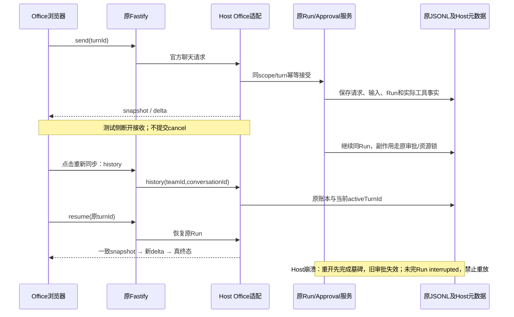

# CHG-2026-0007：T6成员交互、真实多Agent与故障恢复加固

**当前实施增量：2026-10-24-r7-ui-closure，原7bc8152已完成准确全量及生产核查；本轮D68—D70普通多人分工/人物详情续修及证据见第12.30节，新的完整与真实网页结果形成前不标通过。**原T6 r5已按用户批准实施、验收并随[PR #12](https://github.com/KunlunMeta-Limited/openpaw/pull/12)合入`e6a20bd28ae9b1a065f9c98fbec49d356d716235`（2026-10-24 12:57:48 Asia/Shanghai）。本单继续承载T6产品补修及“每团队独立物理workspace”的新增要求，不新建Tx或审核总单。D58/D51/D59/D60/D61是原r5允许范围内已先登记的私有修复；r6已获准确批准；本轮用户授权第12.21节的任务/成员闭环与第12.18节最小依赖，已按批准完成真实迁移，备份/摘要及不变性证据见12.28。Office全部仍不修改。

**审核重点：**第一，原PR已合入，旧“必改”代表原T6交付，不能要求补修PR再修改几十份无关文件；本版第4节改为相对最新集成基线的精确补修/迁移范围，已合入未再变化的文件不制造diff，原27项完整测试不减少。第二，旧四槽共享project是真实历史，不能直接换配置绕过Host校验；迁移要有预检摘要、备份、原事务审计、跨团队隔离和完整回退。第12.12节是完整实施次序/逐文件理由与验收，第6—10节同步契约、数据、保护与完成要求。本轮授权来源见第12.21节；新准确方案对象固化与授权登记分开，旧r5/r6授权与旧准确交付记录独立保留，第12节所有历史提案/失败不删除。

## 1. 变更审批

| 审批项目 | 内容 |
| --- | --- |
| 项目CHG格式 | openpaw/chg-review-v2 |
| 变更编号 | CHG-2026-0007 |
| 变更标题 | T6成员交互、真实多Agent与故障恢复加固 |
| 当前状态 | 已批准（approved）；本轮非Office范围技术核查及用户条件批准落实，补修PR待非作者审核/合入；不把Windows暂缓写成通过 |
| 阶段 | T6 |
| 提案版本 | 2026-10-24-r7-ui-closure |
| 变更类型 | 延展与缺陷修复（additive） |
| 风险等级 | 严重（critical） |
| 负责人 | 用户授权开发者（Codex） |
| 必须审核 | 本会话用户或指定非作者审核人 |
| 设计基线 | REQ-OP-008/009/011/013/014/016/019/020/021/022/023/024/025；DES-OP-003/006/007/008/009/011/012/013 |
| 目标分支 | merge/ai-ofice-react-overagent |
| 实施基线 | e6a20bd28ae9b1a065f9c98fbec49d356d716235；PR #12已合入，补修分支fix/engine-host-t6-followup |
| 实施授权来源 | 原r6准确b8fd7c4批准及本轮用户“PR审核以及CHG审核，在不修改office的情况下，认为通过，暂时继续往下进行”；12.21已先登记逐文件方案。Office仍禁止；不虚构平台Approve |
| 关联修订 | 无 |
| 历史元数据维护 | 无 |
| 历史说明维护 | 无 |
| 原交付状态 | r1仅提案；r2产品审查增量，无T6实现交付；T5 PR #11于2026-10-23 20:46:12合入 |
| 方案审核状态 | approved |
| 方案批准版本 | 2026-10-24-r7-ui-closure |
| 方案审核人 | 本会话用户 |
| 方案审核时间 | 2026-10-24（Asia/Shanghai，日期精度） |
| 方案审核证据 | 原第12.21非Office明确授权持续有效；本轮用户再次明确要求多agent自验证修复、人物点击完善。第12.30先登记原范围内的私有一致性修复，941187c已实际固化；没有新增协议/权限/依赖/持久格式或越出允许文件。不声称用户预先看过该SHA，不代表平台Approve；原0082314等准确历史对象保留 |
| 方案批准对象 | 941187cb63f0fb4c4965cdb4b8207e1b04863b53:docs/changes/CHG-2026-0007.md |
| 交付验收状态 | pending |
| 交付验收提交 | 待本轮准确候选；原46213314bdd6fcd441e6fe49379ffbc9097d1458历史验收保留第12.28节 |
| 交付验收人 | 本会话用户（12.21非Office条件批准）；技术核查由Codex执行，非平台Approve |
| 交付验收时间 | 2026-10-24（Asia/Shanghai，日期精度；用户条件批准；技术时间见实际报告） |
| 交付验收证据 | 本会话用户明确“PR审核以及CHG审核，在不修改office的情况下，认为通过，暂时继续往下进行”；实际Office零修改，授权范围准确e原27/27及生产网页/迁移核查通过。既有授权落实条件，不伪造用户曾预审未来SHA；不覆盖新增未实现能力或平台审核 |
| 验证证据 | docs/verification/CHG-2026-0007/验证记录.md；提案完整核查与未来V01—V10分开 |
| Linux验证提交 | 46213314bdd6fcd441e6fe49379ffbc9097d1458；文档/PR登记后的最终准确候选另以f/full/report.json为准 |
| Linux验证结果 | 准确e干净原27/27、产品73条/0 pageerror；原页面六人物/六成员/任务详情、真实五个不同子角色、原业务白板7/7/100%、追问运行中/终态/刷新/迁移重启保持、42查询及5原生场景通过；三个已有团队同名文件各自读取、18成员资料通过。初次外部汇总打印退出1原日志保留，同Run只读完整复验退出0 |
| Linux验证证据 | /home/cheng/.cache/t6-ui-final-20261024-e/{full/report.json,product/report.json}；/home/cheng/.cache/t6-ui-closure-20261024-a/final-review-e.json及原始trace；最终登记候选另跑/home/cheng/.cache/t6-ui-final-20261024-f，不预填结果 |
| Windows验证提交 | 未执行 |
| Windows验证结果 | 用户已明确暂缓原生验证，未执行、不计通过；保留Windows10/11 x64适配 |
| Windows验证证据 | 本会话既定决定；不再重复请求环境，不适配macOS |
| 平台PR状态 | 原T6 #12 MERGED；本轮补修OPEN，最终head/Ready及最新状态由artifacts/live-office-20261024-t6/pr-followup.json核实；待非作者最终代码审核，不自行合入 |
| 平台PR URL | https://github.com/KunlunMeta-Limited/openpaw/pull/13（本轮补修）；原T6 #12合入履历保留12.11 |
| 平台PR head | 创建时46213314bdd6fcd441e6fe49379ffbc9097d1458；最终push后的准确平台head实时存于pr-followup.json，不以创建head冒充最终head |
| 平台审核证据 | 用户12.21对不修改Office范围作条件确认；本轮平台reviews据实际查询记录，不虚构Approve。原#12 MERGED/mergedAt及旧reviews=[]为独立历史事实 |
| 合入提交 | e6a20bd28ae9b1a065f9c98fbec49d356d716235（原T6/#12）；本轮补修待发生 |

## 2. 变更原因

用户实际使用时会刷新页面、切换办公室、遇到网络断开或服务重启。T5已能联网、审批后写真实报告、展示步骤/人物并查文件，但其53条产品记录只覆盖常规闭环及部分重启，不足以证明每个副作用边界、慢订阅、多页存档和上限都可靠。T6补这些组合，先复用并测试，只有复现缺陷才修原实现；不为了“有代码”重建Host。

只读核查基线为OpenPaw f22cca1及Office d150b96。源码落点：Store::recover先恢复删除墓碑、重建原索引，再以JSONL RunFinished补终态、失效旧审批；Host::snapshot_and_subscribe在单写序列内取得视图和订阅；chat::stream_run已有有界发送/断线退出；projection持久seq+完整内容；actions只有一个领取器；scene已有持久去重；turns已有稳定turn请求映射、分页和8MiB预算。应扩这些原入口，而不是新增第二套状态机、Node bridge或数据库。

协议逐链接依据：Office integration/README.md → office-integration.md的七messages、删除/创建/场景与恢复顺序；dashboard-integration.md的完整快照、引用与容量；message-relay.md的内存缓存、202及重启；chat-integration.md的history/resume/cancel、分页与NDJSON首snapshot。机器约束是固定packages/protocol的schema/office-integration/chat/office-ui及真实server和ChatSession，不根据旧计划编接口。

**已知资料差异：**固定chat-integration.md仍写单连接180秒，但d150b96的ChatSession.receive与服务器转发已移除该固定总时限，history/cancel仍有15秒控制期限；T5已实际运行190秒。T6记录此差异，不修改Office文档，不再把“等待180秒”当故障注入。网络中断使用测试端断开/阻断现有连接后点“重新同步”；自动无感重连是R8候选，未获批准。

替代方案：只重复T5 happy path不能暴露持久边界；复制新聊天服务会造成两套事实；改Office自动重连未获Rx授权。因此选择“扩现有回归与真浏览器故障矩阵→定位最小原模块修复→精确重验”。SDK适配留T7，发布包/原生Windows联合旅程留T8。当前不声称新缺陷已确诊或T6已完成。

### 2.1 r2来自真实页面的新需求与缺口

8765的9次点击证明：app-agent/review-agent/code-agent未绑定，返回scope_denied；已绑定三成员都得到同一个空fields菜单。D50/D51先登记再修，不能删除授权检查。最新纯Demo有人物本地互动/表情菜单和6成员，但Connected controller的onInspect直接return，Host只能提供官方detail-v1业务详情，原位菜单融合归Office R13。白板模板固定字体/对比度归R12。最新Office npm构建通过，792测试790通过2失败（focus），旧基线同机characterWork 4/4，归R14而不是改Host伪造工作态。

当前工具→演员是功能可视化，没有真正委派；core/store遗留sub_agent字段/skill说明不是运行器。用户要每个角色真实执行并交接，因此r2新增共享Host的角色与一层编排能力，复用原每Run AgentLoop，不新写推理循环。准确方案与边界见9.6—9.11；这不是T5审批自动覆盖的私有细节。本轮只执行审查/提案，未向真实会话发模型请求或改生产代码。

## 3. 涉及仓库

| 仓库编号 | PR 或说明 |
| --- | --- |
| openpaw | 唯一开发目录/Office/openpaw；feat/engine-host-t6从已合入f22cca1创建；未来唯一主PR目标merge/ai-ofice-react-overagent。Office只读/隔离构建，不创建Office PR。 |

## 4. 允许修改文件

本表只表示相对e6a20bd的本轮补修/迁移范围；原T6完整范围仍在已批准fc5ebd4及已合入#12可追溯。原已合入且本轮无需修改的文件不再列为“必改”，不为满足表格制造无意义差异，原27项及V/P验收全部保留。以下迁移项已获原r6准确批准，本轮授权及逐文件归并见12.21；条件项只在实际必要时改，不制造diff。只批准本单或旧PR不等于Office授权。

| 仓库 | 操作 | 文件 | 模块或符号 | 文件负责人 | 为什么必须修改 | 对其他部分的影响 | 必要性 | 具体修改方向与复用方式 | 完成标准与证据 |
| --- | --- | --- | --- | --- | --- | --- | --- | --- | --- |
| openpaw | 修改 | docs/changes/CHG-2026-0007.md | T6唯一主CHG | 用户授权开发者 | T5已合入，下一阶段尚无可审核方案 | 仅OpenPaw提案，不授权Office | 必改 | 新增本十二节；分开提案、实现、验证、人审和合入 | 准确Git对象可审；不沿用T5授权 |
| openpaw | 修改 | docs/changes/INDEX.md | 原索引生成器 | 用户授权开发者 | 索引需显示T5合入和T6待审 | 保持官方协议、授权和旧CLI兼容 | 必改 | 运行原check.py index，不手填批准 | index --check通过 |
| openpaw | 修改 | docs/verification/追踪矩阵.md | 原追踪生成器 | 用户授权开发者 | 恢复/容量任务需关联原接口与测试 | 保持官方协议、授权和旧CLI兼容 | 必改 | 运行原check.py trace；提案定位已有入口，不声称新测试已存在 | trace --check通过 |
| openpaw | 修改 | docs/verification/CHG-2026-0007/验证记录.md | 提案与未来T6证据入口 | 用户授权开发者 | 必须区分本次维护、旧T5结果与新T6实测 | 保持官方协议、授权和旧CLI兼容 | 必改 | 新增验证边界、故障矩阵、外部报告导航；不复制配置/媒体 | 新测试未做明确待实施；原始失败保留 |
| openpaw | 修改 | docs/engine-host/master.md | 首页、T6卡、14.1/M6、15.4 | 用户授权开发者 | M5仍待合入且T6旧180秒描述与固定代码矛盾 | 保持官方协议、授权和旧CLI兼容 | 必改 | 补M5合入；T6导航本单9/10节，修正文档与代码时限区别 | 不把T6计划写完成；不复活旧R1四URL |
| openpaw | 修改 | docs/engine-host/handoff.md | 当前交接、同步与产物用途 | 用户授权开发者 | 开发者需从实际合入版本继续 | 保持官方协议、授权和旧CLI兼容 | 必改 | 前置最新T5合入/T6待审说明、当前服务与主目录操作顺序 | 可直接找到原会话、证据和下一阶段审批入口 |
| openpaw | 修改 | docs/requirements/产品需求说明.md | REQ-OP-021—024与当前状态 | 用户授权开发者 | 需求须明确六角色/成员和多Agent，不再把计划当实现 | 保持官方协议、授权和旧CLI兼容 | 必改 | 新增可审核需求和P验收映射；T5改为实际合入事实 | 只登记真实结论/待审方案，精确提案完整验证 |
| openpaw | 修改 | docs/design/软件设计说明.md | DES-OP-011/012与当前状态 | 用户授权开发者 | 父子Run和成员身份是新设计，不可复用T5批准 | 保持官方协议、授权和旧CLI兼容 | 必改 | 写角色目录、一层委派、预算/取消/审批/恢复与Office映射 | 只登记真实结论/待审方案，精确提案完整验证 |
| openpaw | 修改 | docs/engine-host/audit.md | D50/D51与已合入状态 | 用户授权开发者 | 真实点击揭示未被原测试覆盖的产品缺陷 | 保持官方协议、授权和旧CLI兼容 | 必改 | 记录复现/根因/原证据及拟修复，不预先标已解决 | 只登记真实结论/待审方案，精确提案完整验证 |
| openpaw | 修改 | docs/engine-host/office-change-requests.md | R6状态与R12—R16 | 用户授权开发者 | 用户要求集中复审Office差距，不允许实施 | 保持官方协议、授权和旧CLI兼容 | 必改 | 修正已被#11覆盖的旧状态，补原因/文件/影响/验证与成熟度 | 只登记真实结论/待审方案，精确提案完整验证 |
| openpaw | 修改 | docs/verification/CHG-2026-0007/产品差距审查.md | 本轮逐项产品/Demo/框架审查 | 用户授权开发者 | 用户9项需求需要真实证据和已实现/缺口分开 | Office外部协议不变；行为影响见9.6—9.11 | 必改 | 汇总上游、9次点击、Demo对照、全792测试和方案输入；不复制秘密/媒体 | 每个问题有源码/证据/归属与下一阶段 |
| openpaw | 修改 | docs/governance/依赖与资料基线.md | 现行来源版本说明 | 用户授权开发者 | 冻结已批准升级，旧现行文字需同步避免下一开发者误用 | 仅落实12.1—12.3，Office不改，无权限扩张 | 必改 | 仅追加已批准冻结/依赖/部署版本区别，不改治理规则 | 与sources.json/锁文件及实际部署一致 |
| openpaw | 修改 | crates/openpaw-engine-host/src/office/projection.rs | 共同角色目录/真实子任务/稳定assignment | 用户授权开发者 | D58裁剪丢身份、D59已确认成功重试仍被旧失败占位、D61成员只有派发而无生命周期动态，原用户页面/回归可复现 | 默认路径及Office外部协议兼容；新增协作模式按9.7—9.9约束 | 必改 | 按12.21保留最近业务Run，D64正常结束未核验为blocked但真实失败保留；复用原prepare/计划/委派事实；保留六绑定、按精确成功证据替代失败尝试的公开卡片；按12.15从真实子状态补有限成员生命周期动态，完整账本不删 | 100会话64KiB/seq、同角色同步骤重试正反例、原同Run白板和完整回归 |
| openpaw | 修改 | crates/openpaw-engine-host/src/office/details.rs | 成员首页/目标上下文/返回 | 用户授权开发者 | D51主角色状态与D65普通追问后成员结果丢失；缺少可读的任务进度/结果导航 | Office外部协议不变；行为影响见9.6—9.11 | 必改 | 从同scope全部父Run查最近真实委派；复用detail-v1增加任务列表/详情、每页5项、返回和版本校验；执行完成与业务核验分开，不新造task.inspect | 原真实HTTP主成员断言、六人物/侧栏/布局详情，无新Run/越界读取 |
| openpaw | 修改 | crates/openpaw-engine-host/tests/features/office_interactions.rs | 既有host_office_interactions | 用户授权开发者 | 原回归未断言主角色终态说明 | 保持官方协议、授权和旧CLI兼容 | 必改 | 扩原真实HTTP/审批成功场景，断言主成员运行完成及业务进度口径 | 红绿日志、原8入口及完整TEST-RUST-ALL |
| openpaw | 修改 | crates/openpaw-engine-host/src/task_progress.rs | 原工具说明与执行回执 | 用户授权开发者 | D60实际校验已支持成功子委派写证据，说明却要求父Run直接write_file，导致真实模型误报未审批并漏报完成 | 原r5准确允许文件与9.7—9.9职责内私有修正；不变DTO/校验/权限/存储 | 必改 | 对齐既有delegate证据规则；仅给委派回执使用父delegate调用ID的准确说明；扩原inline正反测试 | 普通/委派/失败/关闭回执行为与原证据校验不减，完整套件及原8765真实模型 |
| openpaw | 修改 | crates/openpaw-engine-host/src/service.rs | 既有主子角色系统上下文 | 用户授权开发者 | D60模型将没有看到点击误认作未审批，实际已在共享Approval批准且子写入成功 | 原r5准确允许文件；仅私有提示文字，不增加授权/数据字段 | 必改 | 说明审批由Host执行管线控制、成功工具结果不表示绕过；主角色以成功delegate及Host既有路径校验确认子证据，正文不是批准凭据 | 不靠文字批准、不自动完成、不放宽同父/子/路径；真实一次审批及账本对照 |
| openpaw | 修改 | crates/openpaw-cli/src/cli.rs | Host命令参数 | 用户授权开发者 | 缺少安全离线迁移入口 | 改变本机归属/迁移语义，已批准r6与12.21；Office不改 | 条件 | r6获批且落实12.12迁移时：增加feature下仅本机预检/摘要确认apply参数，默认不写入；复用既有配置读取 | 默认CLI/feature无变化；不加载模型或泄露秘密 |
| openpaw | 修改 | crates/openpaw-cli/src/main.rs | 命令分派 | 用户授权开发者 | 新离线入口须进入唯一Host服务 | 改变本机归属/迁移语义，已批准r6与12.21；Office不改 | 条件 | r6获批且落实12.12迁移时：仅分派迁移命令，不启动HTTP/模型/第二运行循环 | 无feature不引入axum，退出码准确 |
| openpaw | 修改 | crates/openpaw-cli/src/host_cmd.rs | 薄CLI入口 | 用户授权开发者 | 运行装配不适用于离线文件/绑定迁移 | 改变本机归属/迁移语义，已批准r6与12.21；Office不改 | 条件 | r6获批且落实12.12迁移时：调用Host预检/apply服务，复用错误/配置；不得把模型凭据传入 | 预检零写/零网络；失败非零且脱敏 |
| openpaw | 新增 | crates/openpaw-engine-host/src/workspace_migration.rs | 离线迁移协调（新增） | 用户授权开发者 | 当前没有跨文件备份/预检/复制/事务绑定的安全协调职责 | 改变本机归属/迁移语义，已批准r6与12.21；Office不改 | 条件 | r6获批且落实12.12迁移时：复用Root规范化、原OS锁/Store事务，摘要绑定，拒绝链接/覆盖冲突，完整备份及清理清单 | 无活动Run/有效审批，原文件不动、失败可回退；不新建消息库 |
| openpaw | 修改 | crates/openpaw-engine-host/src/lib.rs | 本机导出 | 用户授权开发者 | CLI需要可信迁移API且不能经HTTP绕行 | 改变本机归属/迁移语义，已批准r6与12.21；Office不改 | 条件 | r6获批且落实12.12迁移时：最小预检/apply参数结果接口，中文契约注释；不新增HTTP | 仅本机计划输入；旧Host接口兼容 |
| openpaw | 修改 | crates/openpaw-engine-host/src/store.rs | 绑定与原host_events | 用户授权开发者 | 只能拒绝变根，目前没有合法迁移审计 | 改变本机归属/迁移语义，已批准r6与12.21；Office不改 | 条件 | r6获批且落实12.12迁移时：同事务注册根/团队及后代重绑定/版本化workspace_rebind审计；严格根身份校验保留 | 稳定session/run/turn/call不变，无新表，损坏/半迁移拒绝启动 |
| openpaw | 修改 | crates/openpaw-engine-host/src/query.rs | 产物授权解析 | 用户授权开发者 | 旧JSONL保存原工作根，迁移后不能继续授予旧根 | 改变本机归属/迁移语义，已批准r6与12.21；Office不改 | 条件 | r6获批且落实12.12迁移时：仅依据可信迁移事实映射本团队相对产物，复用Root/普通文本/链接检查 | 跨团队同名文件不能越根；缺失或变化明确报错 |
| openpaw | 修改 | crates/openpaw-engine-host/tests/regressions/recovery.rs | 既有恢复入口 | 用户授权开发者 | 需要实际既有共享团队迁移而非新空目录演示 | 改变本机归属/迁移语义，已批准r6与12.21；Office不改 | 条件 | r6获批且落实12.12迁移时：扩原预检零写、真实父子/文件迁移、失败/重复apply/冲突/链接/完整回退 | 无模型重放、原项目hash不变；原生Windows仍暂缓 |
| openpaw | 修改 | tests/engine-host-contracts/office-product.mjs | 原浏览器入口 | 用户授权开发者 | 现夹具共享根不能证明一团队一工作区 | 改变本机归属/迁移语义，已批准r6与12.21；Office不改 | 条件 | r6获批且落实12.12迁移时：改成不同团队根，对照同名不同内容文件/六成员/父子与会话隔离，不减原断言 | 真Host/浏览器全旅程和原68条至少保留 |
| openpaw | 修改 | tests/engine-host-contracts/office-resilience.mjs | 原产品助手 | 用户授权开发者 | 补迁移与成员/恢复组合 | 改变本机归属/迁移语义，已批准r6与12.21；Office不改 | 必改 | 扩六成员任务详情/返回，普通追问后保留原卡/白板/成员结果；原r5已允许文件内扩D61五成员开始/完成/不重复visit断言；仅r6获批后再扩父子同根、两团队异根及重启/文件详情隔离 | 原68条不减；成员最近动态可见，快照/seq/页面来源/模型请求可追溯 |
| openpaw | 修改 | docs/engine-host/host-config.example.toml | 配置样例 | 用户授权开发者 | 四槽共用project不符合用户新默认目标 | 改变本机归属/迁移语义，已批准r6与12.21；Office不改 | 条件 | r6获批且落实12.12迁移时：改四个独立真实根，说明团队内父子共用；旧共享配置必须先迁移 | Linux/Windows例子，预检/应用/回退可按文档重复 |
| openpaw | 修改 | Cargo.toml | r6最小依赖 | 用户授权开发者 | r6缺少可靠摘要及跨平台可用空间公共依赖 | 无Office/权限/HTTP变化 | 必改 | 固定ring/fs4版本，复用既有锁图，不升级其他包 | 原27项/默认依赖树/MSRV/迁移专项证据 |
| openpaw | 修改 | crates/openpaw-engine-host/Cargo.toml | r6最小依赖 | 用户授权开发者 | 迁移只能在Host启用，不能增加默认CLI依赖 | 无Office/权限/HTTP变化 | 必改 | 两个optional依赖仅engine-host feature启用 | 原27项/默认依赖树/MSRV/迁移专项证据 |
| openpaw | 修改 | Cargo.lock | r6最小依赖 | 用户授权开发者 | 记录唯一新增fs4及精确校验值 | 无Office/权限/HTTP变化 | 必改 | 审查实际锁差异，MSRV/许可证/deny与完整验证 | 原27项/默认依赖树/MSRV/迁移专项证据 |
| openpaw | 修改 | crates/openpaw-cli/tests/help_snapshot.rs | 原CLI精确入口回归 | 用户授权开发者 | r6已批准新增engine-host-workspace，原feature精确清单遗漏 | 仅补已批准命令的严格断言，不新增命令或放宽下限 | 必改 | 保留默认12项及feature精确数量，新增迁移plan/apply帮助关键词 | 默认/Host/sidecar/全feature回归全部通过 |
| openpaw | 修改 | crates/openpaw-engine-host/tests/features/runtime.rs | 原真实主子请求回归 | 用户授权开发者 | 隔离真实DeepSeek将周理任务错误派给research，缺少模型实际收到的人物/角色ID映射断言 | 仅扩既有测试，不新增权限/协议 | 必改 | p04原五子回归核对主角色实际Provider请求包含六位可信目录映射，与独立Session/账本原断言并行 | 先红后绿；真实五个不同角色再验 |

## 5. 明确禁止范围

| 仓库 | 禁止路径 | 为什么禁止 |
| --- | --- | --- |
| openpaw | crates/openpaw-core/** | 不扩公共运行契约，不把Office DTO送入核心 |
| openpaw | crates/openpaw-store/** | 复用原JSONL/索引接口，不在Host复制存储解析器；越界修订再审 |
| openpaw | crates/openpaw-tools/** | 不复制工具主体/改变审批等级；必要修复先说明重审 |
| openpaw | crates/openpaw-sandbox/** | 复用现有进程组/Job，不能未经原模块方案审查扩隔离/进程管理 |
| openpaw | crates/openpaw-llm/** | 不改模型协议/重试/上下文，确定性测试复用原HTTP Provider |
| openpaw | governance/** | 不为Windows暂缓、未授权或测试失败修改门禁 |
| openpaw | .github/** | 不改账单、平台矩阵或跳过作业造绿 |
| openpaw | AGENTS.md | 原主目录/事前审批/清理规则已经存在，本阶段遵守即可 |

Office整个主工程及其文档/源码/测试/配置/锁文件/生成文件均不改；现有两份用户架构文档保持字节不变。OpenPaw原三份用户文档不覆盖、提交或还原；/home/cheng/.openpaw/.env原位读取不复制/打印/修改。故障、压力、崩溃、磁盘错误只在全新隔离home/根/端口执行。实际部署/迁移只允许在确认原8765无活动Run和有效审批、完整备份并通过准确候选验证后优雅停止，按12.12实施/回退；不对用户真实目录做故障注入。参考Kunlun工程不动。禁止删除原失败证据掩盖问题。

## 6. API 变化

Office外部HTTP/NDJSON/Schema不新增字段：继续POST /office/chat四操作、官方messages、detail-v1、employees/tasks/events与v2命令。新delegate_task是Host模型工具，不是Office新路由，也不是对公网开放的SDK接口。输入为角色ID、业务任务、必要的有界上下文和目标标识；role只能可信配置已有项，禁止指定任意根/模型地址/密钥/SessionID。幂等键来自实际父Run+tool call绑定，而非模型可随意覆盖的ID。结果为子Run真实结果与安全引用；失败/取消明确区分。

共享Rust服务增加私有角色/所属解析与委派入口，尽量不改既有公共签名。HostConfig新增可选agents，旧TOML缺省关闭；3处原Rust字面量需补None（service内测试若实际存在则在原允许文件）。子Run查询/审批不得跳过原check_scope：Office先验证父scope，再由持久所属关系解析准确子scope，最后调用原服务；浏览器不给任意子ID操作权。r7落实第12.18节最小依赖：仅engine-host feature启用锁中已有ring=0.17.14及fs4=1.1.0（关闭默认feature，仅查询可用空间），原OS锁不变。Cargo.lock实际只新增fs4一包，复用原ring/rustix/windows-sys，不升级其余依赖；默认CLI依赖隔离、MSRV/deny仍必验。不改原Provider装配。

r6新增feature下仅本机`engine-host-workspace plan`/`apply`命令，具体参数见12.12；不开放远程迁移HTTP。复用原Host根/Session/Run/Store，CLI不装配Provider。工具/Agent无权迁移。dry-run零写零网络，apply绑定预检manifest摘要且必须无活动Run/有效审批及原home独占锁。旧正常启动路径仍拒绝未迁移换根。

## 7. 字段变化

保留schema4和原host_events表，不增加第二任务数据库。新增**版本化Host控制事件payload v1**：配置/归属快照、父run/session/scope、角色ID、委派callId与输入摘要、稳定子任务ID、子session/run引用、状态、创建/结束时刻、预算上限及结果引用。正文和工具事实只存原JSONL；不复制模型密钥/完整历史到这些字段。写入大小/次数有界（每父Run≤12次委派、仅一层），每个生命周期转换先保存后投影。

父子关系与接受是跨阶段持久过程：先登记意图，再创建绑定/接受子Run，再关联结果；Store单写序列阻止同call双建，启动恢复识别中间态。未确定提交的意图不自动执行；已接受或已发生副作用的子Run不重放。字段解析失败必须诊断并阻止虚假完成，不能当空列表。新增配置快照在同协作Run内固定，后续配置变化不改已有角色权限/根。

旧T5不会理解新编排元数据，因此协作开启后的回退不是简单换旧二进制继续跑：先取消/清理全部后代并保存现场，恢复升级前完整home；工作区已写文件独立保留，不自动逆操作。不升级Office存档、不改JSONL/core事件格式。若实现发现必须新表/新核心公开事件，先更新同一0007准确方案重审。

r6只在原host_events新增版本化workspace_rebind可信迁移事实（团队、原/新根、稳定父子Session清单、文件manifest hash与确认对象），原Store事务更新绑定及根登记，不新建表/消息库，不改历史JSONL原workspace_id。可信产物映射只服务该团队，绝不以浏览器任意路径别名扩大根。apply必须先完整home/config备份，普通文件仅复制不移动，不覆盖冲突/不跟随链接；SQL提交前复制失败不能改绑定。恢复必须使用配套完整home/config，不只换二进制。清理、冲突、空间不足与中断恢复精确要求见12.12。

## 8. 保护路径

风险critical，原保护等级和完整测试不降低。

| 仓库 | 文件或路径 | 等级 | 负责人 | 为什么需要保护 |
| --- | --- | --- | --- | --- |
| openpaw | docs/changes/CHG-2026-0007.md | L3 | 用户或指定非作者审核人 | 保留既有范围/权限/事实约束；仅按本单条件与证据审核 |
| openpaw | docs/changes/INDEX.md | L3 | 用户或指定非作者审核人 | 保留既有范围/权限/事实约束；仅按本单条件与证据审核 |
| openpaw | docs/verification/追踪矩阵.md | L3 | 用户或指定非作者审核人 | 保留既有范围/权限/事实约束；仅按本单条件与证据审核 |
| openpaw | docs/verification/CHG-2026-0007/验证记录.md | L3 | 用户或指定非作者审核人 | 保留既有范围/权限/事实约束；仅按本单条件与证据审核 |
| openpaw | docs/engine-host/master.md | L4 | 用户或指定非作者审核人 | 保留既有范围/权限/事实约束；仅按本单条件与证据审核 |
| openpaw | docs/engine-host/handoff.md | L1 | 用户或指定非作者审核人 | 保留既有范围/权限/事实约束；仅按本单条件与证据审核 |
| openpaw | docs/requirements/产品需求说明.md | L3 | 用户或指定非作者审核人 | 保留既有范围/权限/事实约束；仅按本单条件与证据审核 |
| openpaw | docs/design/软件设计说明.md | L3 | 用户或指定非作者审核人 | 保留既有范围/权限/事实约束；仅按本单条件与证据审核 |
| openpaw | docs/engine-host/audit.md | L1 | 用户或指定非作者审核人 | 保留既有范围/权限/事实约束；仅按本单条件与证据审核 |
| openpaw | docs/engine-host/office-change-requests.md | L1 | 用户或指定非作者审核人 | 保留既有范围/权限/事实约束；仅按本单条件与证据审核 |
| openpaw | docs/verification/CHG-2026-0007/产品差距审查.md | L3 | 用户或指定非作者审核人 | 提案范围内最小变更，默认兼容；实施须准确r2批准 |
| openpaw | docs/governance/依赖与资料基线.md | L4 | 用户或指定非作者审核人 | 原12.1—12.3已授权范围；保护等级不降低 |
| openpaw | crates/openpaw-engine-host/src/office/projection.rs | L4 | 用户或指定非作者审核人 | 保留既有范围/权限/事实约束；仅按本单条件与证据审核 |
| openpaw | crates/openpaw-engine-host/src/office/details.rs | L4 | 用户或指定非作者审核人 | 提案范围内最小变更，默认兼容；实施须准确r2批准 |
| openpaw | crates/openpaw-engine-host/tests/features/office_interactions.rs | L4 | 用户或指定非作者审核人 | 保留既有范围/权限/事实约束；仅按本单条件与证据审核 |
| openpaw | crates/openpaw-engine-host/src/task_progress.rs | L4 | 用户或指定非作者审核人 | 原r5范围的D60私有说明修正；原证据/权限与完整验证不降低 |
| openpaw | crates/openpaw-engine-host/src/service.rs | L4 | 用户或指定非作者审核人 | 原r5范围的角色上下文修正，不新增能力授权/协议/持久数据 |
| openpaw | crates/openpaw-cli/src/cli.rs | L4 | 用户或指定非作者审核人 | 本机迁移/文件归属与允许范围须按r6准确审核，不降低profile保护 |
| openpaw | crates/openpaw-cli/src/main.rs | L4 | 用户或指定非作者审核人 | 本机迁移/文件归属与允许范围须按r6准确审核，不降低profile保护 |
| openpaw | crates/openpaw-cli/src/host_cmd.rs | L4 | 用户或指定非作者审核人 | 本机迁移/文件归属与允许范围须按r6准确审核，不降低profile保护 |
| openpaw | crates/openpaw-engine-host/src/workspace_migration.rs | L4 | 用户或指定非作者审核人 | 本机迁移/文件归属与允许范围须按r6准确审核，不降低profile保护 |
| openpaw | crates/openpaw-engine-host/src/lib.rs | L4 | 用户或指定非作者审核人 | 提案范围内最小变更，默认兼容；实施须准确r2批准 |
| openpaw | crates/openpaw-engine-host/src/store.rs | L4 | 用户或指定非作者审核人 | 保留既有范围/权限/事实约束；仅按本单条件与证据审核 |
| openpaw | crates/openpaw-engine-host/src/query.rs | L4 | 用户或指定非作者审核人 | 提案范围内最小变更，默认兼容；实施须准确r2批准 |
| openpaw | crates/openpaw-engine-host/tests/regressions/recovery.rs | L4 | 用户或指定非作者审核人 | 保留既有范围/权限/事实约束；仅按本单条件与证据审核 |
| openpaw | tests/engine-host-contracts/office-product.mjs | L3 | 用户或指定非作者审核人 | 保留既有范围/权限/事实约束；仅按本单条件与证据审核 |
| openpaw | tests/engine-host-contracts/office-resilience.mjs | L3 | 用户或指定非作者审核人 | 保留既有范围/权限/事实约束；仅按本单条件与证据审核 |
| openpaw | docs/engine-host/host-config.example.toml | L4 | 用户或指定非作者审核人 | 本机迁移/文件归属与允许范围须按r6准确审核，不降低profile保护 |
| openpaw | Cargo.toml | L4 | 用户或指定非作者审核人 | 本轮已授权12.18最小依赖；不改默认feature和其他锁图，完整复验 |
| openpaw | crates/openpaw-engine-host/Cargo.toml | L4 | 用户或指定非作者审核人 | 本轮已授权12.18最小依赖；不改默认feature和其他锁图，完整复验 |
| openpaw | Cargo.lock | L4 | 用户或指定非作者审核人 | 本轮已授权12.18最小依赖；不改默认feature和其他锁图，完整复验 |
| openpaw | crates/openpaw-cli/tests/help_snapshot.rs | L4 | 用户或指定非作者审核人 | 已授权r6 CLI命令的原精确回归，不削弱检查器 |
| openpaw | crates/openpaw-engine-host/tests/features/runtime.rs | L4 | 用户或指定非作者审核人 | 原主子请求事实回归扩展，保持五角色/独立账本/权限断言 |

## 9. 影响、数据流和实现

### 9.1 原恢复四包细则（r2总顺序以9.11为准）

1. **续接与多页面（V01/V02）**：扩原HTTP Provider确定性长流，完整运行超过190秒；测试侧在可观察到某个已保存文本/call后切断现有流，保留Run；网页真实点击重新同步，history返回原activeTurnId，resume首snapshot覆盖已知文本，增量接在同Run。刷新/关页/切换只detach；停止走cancel，原Run清理完成前不显示已停止。两独立浏览器context同时读取与停止，核对同Run状态和文本一致；动画各自播放，不要求逐帧相同。
2. **崩溃与副作用（V03—V05）**：复用recovery.rs子进程fixture和原数据目录，外部观察到明确持久边界后硬终止隔离Host；重开原home核对账本/DB/审批/文件。先做接受、审批等待，再做批准待资源、成功写后未终态、JSONL终态已保存而索引未更新、墓碑/清理中断。用Provider门控、外部文件锁/只读DB查询及私有inline回归建立确定性屏障，禁止sleep碰运气宣称命中。若关键边界无法用既有接口命中，仅在原私有模块cfg(test)中注入错误；产品进程用可观察的邻接持久边界，记录两类覆盖的区别，不冒充OS断电语义。
3. **Office确认与容量（V06—V09）**：复用既有Office HTTP夹具和真Fastify；测试端控制“服务已接受但回执丢失”、202缓存、Office重启、旧回执晚到、慢接收/界限/503。请求成功、缓存、页面应用分别对账。容量测试用隔离根与缩短合成内容，不创建100个浏览器页/重编100份Office。
4. **产品复验与交接（V10）**：前面通过后执行原27项完整套件，保留所有原断言；跑真实网页“查资料→审批写报告→网络断开→重新同步/刷新→查看同一文件→停止另一任务”的路径，使用确定性Provider稳定故障时机；最终再在独立演示会话做配置好的真实DeepSeek冒烟，核对实际工具/来源/文件，不依赖模型随机复现所有崩溃。原用户天气会话不做破坏性故障。形成M6核查、用户验收准确提交后才提PR。

### 9.2 交互与恢复顺序

浏览器既有本地档案的CAS冲突和读写异常由Office负责。测试可通过浏览器公开行为/隔离profile注入存储拒绝，验证旧内容保留及提示；不改Office或让Host猜测浏览器写入成功。遇到Office真实缺陷，集中Rx列原因/最小方案/影响，先保留可操作替代，不伪记通过。

### 9.3 必须逐边界核对的事实

**请求已接受、模型尚未调用**：同turn只有一个已记录Run；重启未完者interrupted；自动再跑一次取得回复。

**等待审批或批准后仍等资源**：原审批过期/未消费，不再执行；旧HTTP回复拒绝；已批准就能跨重启继续执行。

**文件原子提交成功、终态未保存**：文件事实保留；Run按可靠事实恢复或中断，旧call不自动重放；回滚已成功写入；对任意外部系统端到端恰好一次。

**JSONL已保存RunFinished、派生状态尚未更新**：复用原Reader恢复真实终态，索引可重建；只凭SQLite旧字段改写事实。

**删除墓碑已保存、物理清理未完**：重开先清理，原scope不复活，其他Session/工作区文件不受影响；清空整个home或删除报告来“修好”。

**旧展示/领取/场景HTTP晚到**：校验原ID、范围、期限/状态；未知不批准，不补播历史动画；UI领取无ACK但可可靠重投每次动作。

普通shell的Host硬崩溃不等同显式取消。现有进程组/Job需要单独实证：隔离测试检查残留并清理，不把“重启不重放”写成“任意崩溃都无残留”。若复现原sandbox需改进，登记D项与准确原模块修订回本单再审，不在Host复制进程管理。对磁盘错误同理：优先SQLite只读/受控失败/原私有边界注入，Linux权限错误验证真实非特权路径，不能root下chmod成功假称失败已覆盖；不填满用户磁盘、不改挂载。

### 9.4 容量、权限与可执行限额

默认全局4活动Run、同Session冲突；第5个明确capacity_exceeded且不生成第二条可运行请求，或按现有已冻结接受规则返回，不新增默默排队。允许根/同办公室并发遵循现有master当前多会话规则，不恢复旧“一办公室一Run”限制。

固定协议：办公室≤100、每间会话≤100，成员≤200、任务≤1000、事件≤500；messages完整UTF-8≤64KiB，Office缓存总8MiB，history页≤8MiB；UI原队列128/60秒、处理超过容量503。先用Schema边界验证，再用真实Office服务验证实际接收/错误与有界投影。100间/每间100会话并不保证任意最长文本同时装进64KiB；在预算内保持完整会话目录和必要引用，任务/事件只裁展示，原账本完整可分页。不得把1000 tasks Schema上限误当当前Host必须生成1000任务。

慢接收者只能丢自己的连接/订阅，不能拖住Store终态和其他会话；恢复时重取一致快照/游标，不能丢审批/终态。压力测试记录运行环境、输入大小、峰值并发、实际耗时与上限结果，不凭机器速度设虚构SLA；每步有有限超时，卡住以失败保存而非无限重试。

### 9.5 主目录与证据管理持续规则

每轮先在/Office/openpaw核对branch/HEAD/status、只读查询前序PR和fetch集成分支。前序已合入才从最新集成基线开下一Tx；本Tx未合入时继续当前开发分支，不reset覆盖、不复制源码到artifacts、不在干净验证检出开发。只选择性提交本单文件，三份用户文档持续以原hash保护。

artifacts按现有路径保存当前运行、用户数据/必要备份、原成功失败证据和清理索引；不为整齐迁移全部绝对证据路径。大debug只保留当前使用的一份，历史程序依记录源码/构建命令重建；当前schema4完整备份与旧v3数据备份保留。隔离Office检出/依赖在准确版本验收后核对进程/dirty再删除，报告、trace/录像/账本不能混删。停用大文本日志可gzip无损归档并核对解压hash，原路径→压缩路径与恢复法入清单；活进程输出不截断。当前依赖t3-tools保留，不能因目录名旧就删掉实际Node/gh。

| 文档 | 章节与处理理由 |
| --- | --- |
| docs/requirements/产品需求说明.md | REQ-OP-009/016/020，仅实施后同步可靠恢复/未覆盖边界，不提前标完成 |
| docs/design/软件设计说明.md | DES-OP-003/006/007/008/009，原职责内最小修复；协议/数据新设计另审 |
| docs/engine-host/master.md | T6/M6/15.4导航本单；M5合入事实与180秒资料差异纠正 |
| docs/engine-host/contracts/README.md | 条件补恢复/错误和资料差异，不改固定Schema/SDK |
| docs/engine-host/handoff.md | 上一PR真实合入、当前服务、下一Tx提案与唯一主目录 |
| docs/engine-host/office-change-requests.md | 只集中补复现/必要扩展，全部Office待统一人工审核，R11仍暂缓 |
| docs/verification/CHG-2026-0006/工作区与产物清理.md | 追溯本轮删除、无损压缩、用途/恢复与进程保护 |

### 9.6 产品修复先行：共同成员目录与精准详情（P02/P03）

真实需求：用户看到哪个人物/左侧成员，就能知道其身份、职责、当前任务和结果。**D50修投影与人物入口不一致，D51修目标上下文丢失**；不是把所有actor请求统一放行。agents.rs维护可信六角色/功能目录，Office投影只转换employee/sceneActorId；人物姓名取官方能力/固定角色配置，当前主角实际为王明，不改Office名字。未启用独立协作时准确标注为功能角色/未启用，不宣称六个模型进程在线；没有工具能力的角色online=false、空闲且不伪造任务。

actor.inspect：校验当前team+conversation有效及删除状态→在本会话目录解析actor对应成员→一个成员进入其详情、多个成员列有界选择→展示身份/职责/可用状态/当前任务/进度和安全结果摘要。员工inspect按employeeId走相同解析，返回同一目标；history/skills/goals等明确标会话范围，工具/子任务可按该成员过滤。dialog.action把目标/分页/数据签名保存在原导航，返回后不能丢失人物；最多8按钮/30字段，每页5项，所有长度用官方单位。

常驻但未启用人物可展示“当前会话未启用该角色、无任务”，不发模型/创建虚假Session；若请求不是可信场景人物或成员不属于当前会话仍scope_denied。空草稿若Office尚未登记，按原契约给可操作说明，不为了点击创建Run或伪造业务快照。跨会话、伪造成员、旧导航、删除/重绑定期间的查询均继续拒绝。仅绑定主助手可查六类数据不再被视作P02/P03通过。

### 9.7 真实六角色：复用原Run而非动画换名（P04/P05）

可信可选agents配置定义六角色（主1+子5），一层委派；缺省关闭，原单Agent/CLI/SDK契约不变。主角色沿原Office Session运行，只有它得到delegate_task薄工具；子角色真实独立Session、AgentLoop、token、usage/预算和原工具宿主，但共享原Provider装配/原Root资源协调。角色工具必须为Host允许工具的子集；默认不加bash。姓名/人物/业务employee/role/session/run/task各有独立ID与映射，不用一个字符串兼任所有实体。

orchestration.rs只编排现Host生命周期；agents.rs只管目录/能力/所属解析。委派调用在普通文件锁前处理，不握工作区锁等子Run；不允许子递归委派、任意切根/换Provider、注入秘密。子任务输入带清晰目标/验收与最小必要父上下文，网页或子结果保持原tool/user角色，不转system。复用原run_system_prompt的可信动态块注入角色职责及本轮真实工具，不复制一套模型消息构造器。

委派流程：父模型真实tool call→验证最终输入与角色权限→原Store持久意图/所属关系→原Host open_session/submit_run接受子Run→记录稳定子任务引用→投影任务/成员/派发事件→等待真实终态→返回有界子结果/失败及引用。一个call重复只关联一个子执行；父多个不同call可明确形成不同任务，不能只按文本去重吞掉有效工作。每父Run最多12次委派，子输出按原Host文本预算有界；完整结果仍在原JSONL。

实现初期使用有界顺序/有限并发：默认全局4活动Run不变，主Run算1，单协作最多2个子Run活动，其余最多12个任务待派发。未占名额前不创建可运行Run；等待可取消，不用不断失败/重试制造Run。不会让多个主Agent各占满名额后永久等子槽：接受协作前预留最小主+子执行容量，或容量不足明确拒绝该协作；配额复用共享Registry，既有独立会话的4Run仍可达。具体选择为预留至少1个子槽，协作最小容量2；max_active_runs=1时拒绝启用协作，不默默改全局上限。预留是现容量内份额，不能多算实际活动Run或抢占其他已接受Run。

首个可展示场景采用资料检索/整理→草稿→验收/来源复核→主Agent汇总/准确写入，五个子角色各有真实调用/输出；依赖未满足时queued，待确认时blocked，实际运行才running，可靠保存及验收后completed。任务百分比由完成工作计数/子结果证据计算，失败不补100%。不把一个主模型写五段对白叫多Agent。

#### 9.7.1 配置和工具的准确提案接口（未实现）

仅可信Host TOML新增可选`[agents]`：`enabled=false`（缺省关闭）、`max_active_children=2`（允许1—2）、`max_delegations=12`（允许1—12）、`max_model_requests=64`（正数、主子总和）、`max_output_tokens=65536`（正数、协作总输出预算）。角色目录固定六个可信ID，按角色可缩小`tools`白名单；缺省继承Host已授权工具的只读子集，写入须显式配置且仍逐次审批。不开放模型/根/密钥覆盖，不从.env或浏览器接收角色权限。未知字段、未知工具/角色、重复actor映射及启用协作但max_active_runs<2启动失败。角色显示绑定可用于单Agent详情，但只有enabled=true才给主角色委派工具；不默认将所有普通Run作为协作Run预留容量，接受时按可信运行模式确定并持久化。

`delegate_task`输入为`role_id`、`title`、`instructions`、`acceptance`以及可选有界`context`；角色不允许主角色自身，每次只委派一个角色，依赖任务的结果由主Agent拿到后再交给下一次委派，不添加第二套工作流DSL。title至多80个Unicode字符，instructions/acceptance/context合计至多16KiB UTF-8；拒绝未知字段和任意Session/root/provider覆盖。稳定幂等ID由父Run+实际callId生成，同ID不同内容冲突。工具结果区分completed/failed/cancelled/interrupted，返回child_run_id、task_id、有界摘要及原查询引用；完整输出走原JSONL/详情，不塞进64KiB快照。

总deadline沿原父run_timeout_secs，子不获得重新计时的完整父预算。Host用原Provider接口的薄包装，在每次模型调用前原子申请调用/输出份额（统计Provider调用，不冒称能数到其内部每次HTTP重试），按实际请求max_tokens预留输出，结束按可信usage结算；同一份预算由父子共享，不各自重置。无usage或流中断时保留已预留额并标用量不完整，不能当0退回；预算不足拒绝下个请求/委派并解释原因。此上限约束调用和输出，不宣称精确限制模型收费或所有输入token。包装仍调用原Provider，不复制HTTP、重试或AgentLoop；测试覆盖两个子并发竞争最后份额。委派等待使用父deadline及原取消，不把普通tool_timeout_secs=300误套为可丢弃的后台子Run；到期后等待原子Run真正结束才返回。协作主Run通过既有RunContext关闭统一的外层工具时限，HostTools对普通工作工具仍逐次施加原tool_timeout_secs、取消并等待清理，只有delegate_task等待使用父deadline；原非协作Run的超时入口不改。测试必须证明普通工具并未因协作获得无限执行时间，不修改核心AgentLoop来绕过300秒。

### 9.8 审批、取消、资源与恢复必须贯穿父子（P06/P07）

子Run所有工具仍走原HostTools/HostApproval和最终输入摘要；角色过滤发生在列工具和执行双入口。父scope只能通过持久所属关系查询/响应其子审批；校验namespace/team/conversation/root/parent链一致，原共享服务最后仍验证准确子binding。Office菜单展示可定位父会话和实际角色，业务approvalId、callId、runId、revision、expires不替换。父批准不等于对子角色永久批准，委派工具不因只读元数据名称绕过真正写入审批。

父停止/超时/Host关闭/会话删除：先禁止新委派→取消待派发→取消所有已接受子Run/审批→等待工具/进程树/文件提交实际清理→保存各子结果与父终态→释放预留容量/资源。不能只drop等待future留孤儿；子失败准确回传，主Agent可在原预算内明确调整，不能无界自重试。单子结束不取消其他会话。

父总deadline统一约束子deadline及等待/审批；原每Run预算独立且有协作总调用/Token额度，实际usage按原记录累计，无用量不能宣称0成本。运行达总时限要取消真实执行并等待清理，不让父工具timeout比子清理先释放资源。启动恢复所有未完父子为interrupted、旧审批失效；不凭派发意图重新执行。删除清理包含子账本/派生引用，但工作区产物不删，根/其他会话不受影响。P07及原V03—V05须以真实子进程/文件hash证明。

### 9.9 交接、气泡、白板与协议绑定（P05/P08）

Office官方dashboard-integration的employees.sceneActorId、tasks.assigneeId及events.task.assigned足够承载业务展示。派发ID来自稳定父/子任务事实，fromEmployeeId是实际主角色、employeeId是目标子角色；任务必须仍存在且分配一致。已有sceneBridge自动visit是唯一交接动画来源，Host不再重复发visit。同人物不访问，刷新首次快照不重播；主Agent等结果时标协调/等待，子角色头顶/工位任务气泡使用原ActorTaskPresentation。

为看到五次真实交接，确定性HTTP Provider以可观察阶段门控真实子Run，录像核对王明走向各人、任务标题/状态与同一次派发ID；这属于可复现模拟模型，仍走真实引擎/工具/Store。真实DeepSeek另跑同类提示词，不人为sleep伪造生产进度。若快任务在投影前完成或页面离线，现Office不会保证播放每次visit，须如实记录，不能靠重复推快照或假running补动画。**严格“走到且确认后才执行”需要Office远端回执，R16仅统计，不纳入未批准能力。**

白板复用task-board-v1：主目标短中文、已完成N/M、当前最多3个子任务的简短标题，完整任务在任务中心/详情；文件路径在详情，不能把长原提示/路径塞满每个标题。短标题不可丢失完整目标，原用户输入保留JSONL。Host不注入字体/CSS或改Office构建产物。R11默认链接、R12字形对比度、R13本地菜单仍未实施；保留这些边界不等于宣称完成全部像素体验。

### 9.10 最新Office适配与框架整理（P01）

已拉取76d774a，26固定资料hash全相同；咖啡/聊天呈现新行为复用上游，不加Host新接口。上游全792测试790通过、focus2失败且可同机对比复现，记录R14，不能将当前冻结sources/运行版本直接改最新后标全量通过。现T6先继续已验证d150b96及不改协议的适配；上游修复后复审准确commit、26hash、完整测试和真实Host浏览器共存，才条件更新sources。R15仅统计过期180秒文字；不得复活旧R1自定义四URL。

框架只整理本次已触及重复的成员映射/父子生命周期：共同目录和协作所属解析留Host共享层，协议DTO仍在office；Registry、审批、查询、Root、JSONL直接复用。没有把projection.rs大文件拆小的行数任务，不为演示新建第二应用/Bridge。全Run/账本扫描等性能风险先在V08测量，有复现再原模块最小修复；新增依赖、数据库表、远程权限、公共核心接口仍先重审。

### 9.11 阶段分配、产物与交接

顺序为P01上游/基线审查→P02/D50共同目录→P03/D51精准详情→P04真实编排/配额/取消→P05角色任务/进度/自动交接→P06审批/权限/删除→原V01—V09及P07故障组合→P08/V10完整浏览器与真实模型交付。工作包是同一T6主CHG/PR内部顺序，不新开Tx、不卡每包单独PR；新发现越界才更新本单准确版本。

每包必须交付代码定位/复用清单、修前或能力缺口说明、测试及证据导航。最终给可直接输入的演示提示词、角色/Run/call/任务/事件/seq对账、画布视频与截图、审批/文件hash、容量与恢复报告。T7继续固定SDK预兼容，复用新共享生命周期但不默认对SDK暴露委派权限；T8补原生/联合发布及尚未完成的场景共存旅程。Office所有Rx仅汇总待统一审核，无Office PR。

### 9.12 r6物理工作区实施顺序

先在原恢复入口构造两个已有共享团队与父/子历史，复用Root/OS独占锁实现只读plan；再实现完整备份、严格普通文件复制及Store单事务审计/重绑定，最后扩可信产物路径与原浏览器夹具。子Run始终复用所属团队根，不每个Agent复制项目。隔离故障/回退和完整套件通过后，确认原页面空闲才按同一manifest迁移；原工作区文件不删除。具体CLI、文件及完成标准见12.12。

### 9.12 r7任务与成员闭环

落实12.21：业务任务仍由原Run/Plan/Delegation派生，同一会话保留当前轮与至多两组近期业务，普通问答结束不擦除最近业务白板。卡片和派发ID稳定；正常Completed但步骤未核验为blocked，真实失败/取消/中断不伪成功，进度不补100%。成员详情从同会话全部父Run按输入接受顺序查本人最近委派，原任务/执行结果/产物保持可信范围。复用detail-v1新增“任务进度与结果”列表（5项/页）、任务详情和返回；原六类查询保留，不增加task.inspect路由或第二任务库。每次导航重验作用域/删除/快照变化。系统说明明确真实写工具由原Host审批，而非额外聊天确认；未派发的成员不显示已工作。

## 10. 验收测试

### 10.1 保留现有完整27项，不替换为定向成功

批准实施后的最终准确候选必须完整执行下列原注册命令；本轮提案也按stage=proposal完整验证，二者分开记录。

| 测试编号 | 执行命令 | 场景和通过条件 |
| --- | --- | --- |
| TEST-FMT | cargo fmt --all -- --check | 原命令/断言保留，真实退出码0；T6旅程纳入既有相应测试入口 |
| TEST-RUST-DEFAULT | cargo test --locked --workspace | 原命令/断言保留，真实退出码0；T6旅程纳入既有相应测试入口 |
| TEST-RUST-ALL | cargo test --locked --workspace --all-features | 原命令/断言保留，真实退出码0；T6旅程纳入既有相应测试入口 |
| TEST-CLIPPY-DEFAULT | cargo clippy --locked --workspace --all-targets -- -D warnings | 原命令/断言保留，真实退出码0；T6旅程纳入既有相应测试入口 |
| TEST-CLIPPY-ALL | cargo clippy --locked --workspace --all-targets --all-features -- -D warnings | 原命令/断言保留，真实退出码0；T6旅程纳入既有相应测试入口 |
| TEST-FEATURES | cargo build --locked -p openpaw-cli --features engine-host,sidecar | 原命令/断言保留，真实退出码0；T6旅程纳入既有相应测试入口 |
| TEST-MSRV-DEFAULT | cargo +1.88.0 check --locked --workspace --all-targets | 原命令/断言保留，真实退出码0；T6旅程纳入既有相应测试入口 |
| TEST-MSRV-ALL | cargo +1.88.0 check --locked --workspace --all-targets --all-features | 原命令/断言保留，真实退出码0；T6旅程纳入既有相应测试入口 |
| TEST-DEFAULT-TREE | cargo tree --locked -p openpaw-cli --edges normal --prefix none | 原命令/断言保留，真实退出码0；T6旅程纳入既有相应测试入口 |
| TEST-QUALITY-LINES | cargo run --locked -p xtask -- lines | 原命令/断言保留，真实退出码0；T6旅程纳入既有相应测试入口 |
| TEST-QUALITY-SCRUB | cargo run --locked -p xtask -- scrub --check | 原命令/断言保留，真实退出码0；T6旅程纳入既有相应测试入口 |
| TEST-QUALITY-SNAPSHOT | cargo run --locked -p xtask -- snapshot --check | 原命令/断言保留，真实退出码0；T6旅程纳入既有相应测试入口 |
| TEST-QUALITY-GOLDEN | cargo run --locked -p xtask -- golden | 原命令/断言保留，真实退出码0；T6旅程纳入既有相应测试入口 |
| TEST-QUALITY-TELEMETRY | cargo run --locked -p xtask -- telemetry | 原命令/断言保留，真实退出码0；T6旅程纳入既有相应测试入口 |
| TEST-QUALITY-STABILITY | cargo run --locked -p xtask -- stability | 原命令/断言保留，真实退出码0；T6旅程纳入既有相应测试入口 |
| TEST-QUALITY-SMOKE | cargo run --locked -p xtask -- smoke-offline | 原命令/断言保留，真实退出码0；T6旅程纳入既有相应测试入口 |
| TEST-DENY | cargo deny --workspace check | 原命令/断言保留，真实退出码0；T6旅程纳入既有相应测试入口 |
| TEST-CONTRACT-PREPARE | npm run prepare:office | 原命令/断言保留，真实退出码0；T6旅程纳入既有相应测试入口 |
| TEST-CONTRACT-TYPES | npm run check | 原命令/断言保留，真实退出码0；T6旅程纳入既有相应测试入口 |
| TEST-CONTRACTS | npm test | 原命令/断言保留，真实退出码0；T6旅程纳入既有相应测试入口 |
| TEST-GOV | {python} -m unittest discover -s governance/tests -v | 原命令/断言保留，真实退出码0；T6旅程纳入既有相应测试入口 |
| TEST-GOV-VALIDATE | {python} governance/check.py validate | 原命令/断言保留，真实退出码0；T6旅程纳入既有相应测试入口 |
| TEST-GOV-INDEX | {python} governance/check.py index --check | 原命令/断言保留，真实退出码0；T6旅程纳入既有相应测试入口 |
| TEST-GOV-TRACE | {python} governance/check.py trace --check | 原命令/断言保留，真实退出码0；T6旅程纳入既有相应测试入口 |
| TEST-COMMENTS | cargo run --locked -p xtask -- comments --base {base} --head {head} | 原命令/断言保留，真实退出码0；T6旅程纳入既有相应测试入口 |
| TEST-GOV-DIFF | {python} governance/check.py pr-check --base {base} --head {head} | 原命令/断言保留，真实退出码0；T6旅程纳入既有相应测试入口 |
| TEST-OFFICE-PRODUCT | node tests/engine-host-contracts/office-product.mjs | 原命令/断言保留，真实退出码0；T6旅程纳入既有相应测试入口 |

### 10.2 T6逐项完成标准：不是本轮已经完成

**V01**：>190秒流；已经显示/保存文本后主动切断当前网络连接；刷新/手动重新同步；同turn/Run、snapshot后delta无缺失重复、detach不取消、无新模型/工具；停止后真实清理；原产品runner真Chromium+Fastify+Host；网络触发时间、截图/trace、HTTP、JSONL、Run ID。

**V02**：两页同会话、跨办公室切换；待审刷新；本地CAS/存储拒绝；独立草稿/明确冲突提示，原档案不被覆盖；同审批唯一有效display/一次消费；可重新进入原Run；原office_interactions及产品runner；两context、无清库截图、审批binding/consumed。

**V03**：已接受、输入保存后、文本保存中、终态分阶段硬停隔离Host并重启；未完interrupted或按原JSONL可靠终态恢复；同turn不生成第二Run；模型/工具不自动重放；recovery.rs子进程；触发屏障、模型请求计数、账本事件/DB、重启日志。

**V04**：待审批、批准等锁、写成功后等待模型时重启/取消；旧审批回执晚到；审批未执行前文件hash不变，旧批失效；已提交文件保留且无重复write，终态与事实相符；原共享审批/工具及临时根；修前/后hash、call ID、一次消费和实际started。

**V05**：删除墓碑后/派生清除中断，重复删除/旧send/resume；原scope不复活、JSONL与索引/派生清理完成；其他会话/用户产物保持；office_delete.rs+产品删除；墓碑阶段/原文件清单/hash/重启history错误。

**V06**：snapshot已接收但响应丢失、同seq重试、旧回执、202、Office停启；同版内容字节不变，applied/cached/ignored分别正确；重启重初始化/完整同步；不补播旧动画；office_sync.rs+真实Office；原请求hash/seq/回执、页面快照和场景ID。

**V07**：慢或停止读的聊天连接、并发取消/查询/其他会话；Store终态可靠落盘；其他Run可完成；慢连接有界退出，可恢复；不是全局阻塞；office.rs/产品网络门控；耗时/排队上限、HTTP/账本/终态与子进程清理。

**V08**：4Run满额第5请求、100办公室/每间100会话、64KiB/8MiB及目录/历史分页边界；超限明确错误，无占错槽/假成功；投影引用闭包/当前审批不丢；完整账本仍能分页且cursor前进；原Schema/office.rs/产品服务；尺寸/数量、失败码、活跃数与完整页对账。

**V09**：ui.next领取后断开/处理到期、503、创建确认丢失；磁盘失败；无ACK边界明确，不自动重放有副作用action；创建占同一预授权槽；存储故障不假done/批准；原UI/创建/恢复回归和真服务；已领取/过期/未知记录、文件hash、原始错误。

**V10**：前述修复后的完整产品演示、真实DeepSeek冒烟及回退演练；原27项全过，V01—V09逐项有真实结果或阻塞；Linux可演示，Windows暂缓不计通过；Office未改；准确提交完整report、截图/trace/录像/真实工具/产物hash、M6核查和备份恢复记录。

对仅能私有inline注入的极窄磁盘/事务边界写明覆盖层级；真网页不代替存储断点，内存fixture不代替网页。故障触发前后的同ID、次数、文件/账本/DB和页面至少两类独立事实对账。真实数据不复制到docs；报告只放脱敏索引/必要hash。若某必需项发现需Office或未列原模块改动，记录阻塞并修订/归档Rx，不能偷偷排除后宣称T6整体完成。

### 10.3 执行与阶段门禁

定向Rust：cargo test --locked -p openpaw-engine-host --features engine-host --test host_recovery；另按上述入口执行host_office/host_office_sync/host_office_interactions/host_office_delete。最终使用governance/verify.py --suite all --source head --stage implementation --base f22cca18d3667ded5dfed35d06085b260cc5a32d --head HEAD --output 仓库外新目录。head必须在干净准确检出，原主目录用户修改不暗中排除；提案阶段将stage改proposal，不能把未批准提案跑成implementation。

Linux本轮执行真实完整套件；Windows原生按用户决定暂缓，保留原平台代码/CI要求，不写passed。云端因账单未启动如实记not-started。delivery检查器原双平台条件不满足时照实保留，不改规则造绿。T6仍须满足原用户指定的Linux当前交付验收、PR非作者审核及真实合入，才可进入T7；Windows发布通过留待原生补验。

### 10.4 产品验收P01—P08（r2新增，均待批准实施）

**P01 上游与基线**：保存观察76d774a/冻结d150b96/部署0df3282三版本；26资料hash一致；最新构建0、792中2失败及新旧4项对照原日志都保留。Office新缺陷/扩展归集中Rx，不修改Office。准确冻结升级须新上游全量与真实Host共存通过，未升级不能声称线上最新。

**P02 六人物**：六个实际actorId逐一点击；同会话已配置角色可见姓名/职责/启用/当前任务或空闲，未启用准确说明。陌生actor/跨team/会话已删仍拒绝。点击不发模型、不创建Run、不额外授予工具；修前D50三拒绝证据保留，修后真实HTTP+截图验证。

**P03 成员详情**：左侧六角色和对应人物进入相同目标，显示真实角色/任务/最近结果及有界查询；A/B成员字段不同，返回/分页保留ID和作用域。旧导航和跨成员伪造引用拒绝；现通用会话六类查询继续通过，不用空fields冒充成员详情。真实网页点击/导出与Host查询相符。

**P04 独立执行**：提示词确实触发主Agent+5子Agent，每子有不同Session/Run/实际Provider请求和原JSONL，完整工具链相符。delegate同call重试不双建；一层/12任务/2活动子上限、全局4容量、max=1拒绝协作和两个主竞争均有回归；等待可取消、不持根锁/泄漏预留。确定性Provider与真实模型证据分开。

**P05 任务/动画/白板**：每个任务对应正确employee/actor/子Run；真实派发生成一次稳定task.assigned，同人物不重复拜访。真浏览器录像可观察王明五次按任务向对应同事交接，每人工作标签可读且来自同一任务。快完成/离线/首次重载不保证动画的边界单独验；无回执不宣称先走到再执行。白板短目标/N/M/最多3步骤、完整信息详情可查；不注CSS，不谎称R11/R12已修。

**P06 权限/审批/结果**：子角色不能调用超白名单或委派；写入前原文件hash不变，父会话收到准确子审批，批准只写一次；拒绝/过期/其他会话审批不能执行。子失败/待审/部分输出不会把目标100%；父/子工具证据不能互相冒用。并发写仍原Root锁，审核字段/结果查询无跨scope泄漏。

**P07 生命周期**：父取消/超时/关闭/删除清全部待派发和活动后代；真实进程/文件提交结束后才终态及释放配额。父/子接受中间态、审批中、写后崩溃都按原V03—V05测，重启不自动重放；旧T5回退用完整升级前备份，不丢原报告/其他Session。无Windows原生结果则保持未验证。

**P08 最终交付**：原27项、V01—V10及P01—P07都有准确结果，原确定性产品保留，另实跑多AgentChromium+真实DeepSeek演示。提示词/录屏/HTTP/JSONL/DB/文件hash能相互追踪，Office/Rx/Windows未实现项清楚。用户验收准确实现版本后才创建唯一T6 PR到集成分支；非作者批准且实际合入才进T7。

r6新增完成要求：在原TEST-RUST-ALL恢复入口验证dry-run零写/活动Run或审批拒绝/计划变更摘要不匹配/复制与事务失败/重复apply/路径链接与冲突/完整回退；在原TEST-OFFICE-PRODUCT验证两个既有团队稳定ID和全部历史、同名不同内容文件隔离、六人物/侧栏/父子根一致及迁移后刷新重启不新增Run。原27项/V01—V10/P01—P08不减少。Windows代码与路径兼容仍保留，但原生按用户决定暂缓且不算通过。

本轮r7额外必验：D64正常Completed未核验blocked/真实失败failed负面；D65普通追问后原卡/白板/成员结果保留；task详情分页/返回/不同成员/越会话/删除；六人物与六侧栏逐一真实网页；真实DeepSeek五子、准确审批、实际报告、白板/任务进度对账、刷新/重启保留；所有异常保存原响应/截图/trace，不把Office阻塞或模拟成功计通过。r6原迁移2专项及双根网页验证保留。

## 11. 追踪、兼容和回滚

| 需求编号 | 设计章节 | 接口编号 | 代码文件或符号 | 测试编号 | 验收证据 |
| --- | --- | --- | --- | --- | --- |
| REQ-OP-009 | DES-OP-009 | 无新增 | crates/openpaw-engine-host/src/store.rs::recover | TEST-RUST-ALL | V03—V05原始报告，当前待实施 |
| REQ-OP-016 | DES-OP-007 | 无新增 | crates/openpaw-engine-host/src/office/chat.rs::stream_run | TEST-OFFICE-PRODUCT | V01/V02/V07；当前待实施 |
| REQ-OP-011 | DES-OP-007 | 无新增 | crates/openpaw-engine-host/src/office/projection.rs::prepare | TEST-OFFICE-PRODUCT | V06/V08完整seq/引用/容量；当前待实施 |
| REQ-OP-013 | DES-OP-008 | 无新增 | crates/openpaw-engine-host/src/office/approvals.rs | TEST-RUST-ALL | V02/V04/V09，当前待实施 |
| REQ-OP-014 | DES-OP-009 | 无新增 | crates/openpaw-engine-host/src/session_delete.rs::delete_session | TEST-RUST-ALL | V05，当前待实施 |
| REQ-OP-020 | DES-OP-001 | 无新增 | governance/check.py | TEST-GOV | 准确方案、完整验证及PR状态独立记录 |
| REQ-OP-021 | DES-OP-011 | 无新增 | crates/openpaw-engine-host/src/office/actions.rs::dispatch | TEST-OFFICE-PRODUCT | P02/P03；本轮只有修前证据，修复待批准 |
| REQ-OP-022 | DES-OP-012 | 无新增外部HTTP | crates/openpaw-engine-host/src/service.rs::execute | TEST-RUST-ALL | P04/P06/P07；当前无委派实现 |
| REQ-OP-023 | DES-OP-007 | 无新增 | crates/openpaw-engine-host/src/office/projection.rs::prepare | TEST-OFFICE-PRODUCT | P05/P08及R11—R16边界，当前待实施 |
| REQ-OP-024 | DES-OP-008 | 无新增 | crates/openpaw-engine-host/src/office/actions.rs::dispatch | TEST-CONTRACTS | P01；新版790/792及既有冻结边界 |

r6新增追踪：REQ-OP-025 → DES-OP-013 → 本机engine-host-workspace plan/apply及原store/query/recovery → TEST-RUST-ALL/TEST-OFFICE-PRODUCT；当前只有方案与既有补修验证，迁移代码/双团队真实隔离证据待批准实施，不能把计划当已完成。

r2新增可选配置和Host控制元数据，兼容/回退按第6/7节；不新增依赖或Office/JSONL协议迁移。继续旧CLI、默认feature隔离和sidecar共存；新测试不扩大运行权限。上线先等原服务空闲并完整备份home/host.db伴随文件/JSONL/index/配置引用，再部署准确已测候选；不复制.env。不改schema时可用原T5程序开原格式数据；若恢复需旧数据，先停止全部写入、完整保留现场，使用同版配套备份，不能只换单个SQLite或重放旧请求。

本轮删除的旧debug可按原commit和cargo命令重建；无损压缩日志可gzip -dk还原，归档资源按清单只在仓库外恢复。当前运行二进制和用户数据保留。下一T7输入为经V01—V10实测的共享服务、故障矩阵/fixtures、准确数据/取消/审批规则及未批准Rx，不带第二套SDK运行状态。

## 12. 验证和审批记录

2026-10-23（Asia/Shanghai）：T5 PR #11已合入f22cca1，用户要求清理artifacts、始终以/Office/openpaw为最新开发目录并继续。已核对进程和五份原用户文件，主目录从集成最新提交创建feat/engine-host-t6。维护行为已获本轮直接授权；本0007 r1是首次T6可审核方案，尚无准确方案批准/生产实现/新增测试/交付验收/PR。Office所有修改仍暂缓，R11保留并请看集中申请单。

本次清理逐项机器记录artifacts/maintenance-20261023-pr11/cleanup.json：删除两份停用ELF、已核实1254份源码的旧Office副本；122份未完全确源资源无损归档保留；三份停用日志gzip后解压hash一致。原成功/失败报告、截图、trace/视频、home/用户文件/备份/配置以及活进程程序未删。清理前2313291899字节，清理后1292400457字节，释放1020891442字节（随后新提案证据会增加少量占用）。不把缓存迁走计为释放空间。

提案准确提交与本轮完整命令/退出码由/home/cheng/.cache/t6-proposal-full-20261023-a/report.json绑定；结果形成前不在本单预填passed。实际V01—V10全部待准确版本批准后实施和实测，旧T5结果不能代替。用户审阅准确已提交提案后在本单第1/12节登记真实决定，批准才开始实施；若扩范围仍修订同一0007而不增Tx/审核总单。

2026-10-23 r2产品审查：用户明确要求新版本、全功能/Demo、人物scope_denied、左侧详情、白板及真实多Agent。已只读完成上游拉取和9次真实点击；Office最新构建通过、全792测试2失败，新旧characterWork分别2/4与4/4。资料26hash不变，当前8765不升级/不发模型。D50/D51和R12—R16已登记，R11仍暂缓。r1无实施批准，不沿用；本次r2扩大为P01—P08+原V01—V10，准确审核后才编码，Office仍不在授权请求中。

原r1准确c1e297a提案完整报告为t6-proposal-full-20261023-b/report.json（27/27），产品t6-proposal-product-20261023-b/report.json（53记录、0 browserErrors），这是原基线回归而非T6功能完成。新r2提案完整报告使用/home/cheng/.cache/t6-product-proposal-full-20261023-r2/report.json，产生后核对退出码；原上游失败保留，不靠修改Office/测试或过滤断言取得绿灯。

r2首次准确603d8cb完整回归已执行27项，其中3项失败：干净检出漏装契约devDependencies，类型命令缺tsc、Schema/SDK与产品启动缺zod/SDK。其余24项退出0；原report为/home/cheng/.cache/t6-product-proposal-full-20261023-r2/report.json，不覆盖。使用原package-lock执行npm ci（无锁文件变化）后，最终提案准确HEAD将重跑全部27项，报告使用-r2b新目录；最终退出码与hash在同证据根final-review.json绑定，不预填通过。上游Office focus2失败独立保留，不能被本项目冻结d150b96的绿灯覆盖。

2026-10-23（日期精度）：用户收到已推送a931e50的准确r2提案、具体新增范围及实施确认请求后，明确“整理之前问题，看是否已经完善，完善功能”。据此登记OpenPaw r2实施授权，先D50/D51再父子Run及产品旅程，不扩大Office权限。批准对象固定a931e50，介绍与第2—11节保留原提案，当前阶段以第1/12节为准。提案27/27和53条是真实既有回归，不冒作本轮实现完成；交付/PR审批仍待发生。

2026-10-23 r2实施进展：共同角色目录/精准详情与真实主子编排已在唯一主目录编码，未改Office/核心crate/依赖/Schema。原Host入口74项测试通过，含五子16次Provider、准确子审批/真实写入、跨会话拒绝、双组容量和取消、共享预算竞争；这只是专项验证。实际浏览器六人物/五交接及原完整27项仍待准确候选实跑，P/V全部完成与交付验收均未登记，未创建PR。具体路径/限制/未完项见本单验证记录，原第2—11节批准提案不改。

2026-10-23 r2完整首验准确947a7f8：27项执行25通过、2失败（scrub源码内部任务编号；第五次真实交接TRAFFIC_BLOCKED），原始报告t6-agents-20261023-a保留。OpenPaw已进一步补精确子文件完成证据、同call输入冲突/幂等、启动协作版本验证、限次/总预算/期限回归；原运行入口现23项通过。Office互阻只登记R17、不实施；浏览器演示拟使用既有关闭闲聊开关，记录该配置而不冒充默认模式通过。下一准确候选完整报告使用t6-agents-20261023-b，未产生前不填绿，M6/交付/PR仍未完成。

### 12.1 附加审核项：Tokio最小补丁升级（2026-10-23-r2-tokio-patch，待批准）

此项不改第2—11节已批准正文，不阻止原r2范围继续实施，但未批准前不得修改Cargo.lock。不是新Tx/新CHG或Office申请。

- 真实触发：准确1f4d6a3完整检查TEST-DENY失败；本轮抓取的RustSec新增RUSTSEC-2026-0386报告tokio1.53.1的AsyncFd I/O安全缺陷，修复区间>=1.53.3（另1.51.6分支）。原947a7f8此前deny通过仅代表当时公告库，不是现在可忽略的理由。详见t6-agents-20261023-b/full/TEST-DENY.stderr.log。
- 最小修改文件：仅Cargo.lock，将已有tokio1.53.1补丁更新为1.53.3及对应checksum；不新增依赖、不改Cargo.toml范围、不改源码接口或deny例外。缓存干净检出已执行cargo update -p tokio --precise 1.53.3 --dry-run退出0，仅显示该一包变化；原锁和主工程尚未改变。证据/home/cheng/.cache/t6-tokio-review-20261023/report.json及dry-run.log。
- 原因/方向：保留原Tokio运行时、共享Run/工具取消代码；采用上游安全修复，不复制调度/IO。不要增加ignore、关闭advisories、固定过期公告库或降低安全门禁。
- 影响：运行时依赖补丁全workspace生效，须核查Linux/Windows条件代码和MSRV1.88；Windows按用户决定仍待原生，不能声明通过。没有JSONL/DB/HTTP/Office协议迁移，不扩大工具权限。
- 验证：批准后原27项完整准确提交全部重跑，deny使用当前公告；默认/全feature、MSRV、取消/进程树/审批/恢复及真Office产品均保留。若需连带更新其他包/源码或MSRV升高，停止该附加项并修订同一0007，不顺手全量升级。
- 回退：还原该锁定包/校验值即可回到原环境，但已知公告重新出现，不作为可发布绿灯；用户数据无迁移。交付与PR审批仍另行发生。
- 审核状态：pending，待本会话用户明确决定本准确小范围；尚未修改Cargo.lock。

2026-10-23再次真实模型对账发现D52汇总不确认/D53计划子卡重复，已在原批准task_progress/projection范围修正并补真实派发/稳定seq回归。真实DeepSeek原执行层报告passed不等于UI交付通过，验证记录明确最终failed/71%原事实。父子进程/崩溃补验及主动断网旅程继续；Tokio补丁仍等第12.1节准确附加批准，无Office改动。

2026-10-23继续实施：准确9d728b1完整c为25/27，六Pixi人物/六侧栏与五次真实交接有浏览器证据；独立真实DeepSeek c在准确程序完成五子Run、一次子write审批、实际文件、最终UI 6/6与100%，D50—D53在该隔离旅程已通过。新增原office.rs未消费HTTP专项通过。主动断网原触发未关闭活连接，保留原失败并改为实际关闭隔离Office转发进程再手动续接；Office源码与用户8765均不动。逐项P/V当前通过/部分/待验已同步专用验证记录，不把新功能成功当整个T6完成。第12.1节安全补丁仍待准确附加批准；不建立公告忽略。

### 12.2 附加审核项：流式展示检查点（2026-10-23-r2-stream-checkpoint，待批准）

**用户场景与修前事实。**模型已向网页输出第一段，Host异常退出后同turn能恢复，但这段字消失。原恢复测试新增实际子进程TextDelta/输入/终态屏障复现D54；live读不是持久化，不据此谎称“已保存”。修前日志t6-recovery-sync-20261023.log保留。原V03需要核对保存中的文本，因此本项不是Office修改，也不新建CHG/Tx。

**选择与必要性。**不加第二消息库/JSONL格式/Provider后端；复用host_runs.data已有RunView.text/text_truncated字段，仅作为最近一个有界展示快照。完整消息、工具和usage继续只以原Session JSONL为事实，恢复模型上下文仍只读JSONL。相比新表/新SessionEvent，此方案不改核心crate、不新增依赖/HTTP字段。它改变此前host_runs持久text总为空的语义，故按AGENTS第5条明确请求新增持久化语义批准，不借原r2授权自行实施。

**准确文件与修改方向。**

| 文件 | 现状/必要性 | 具体修改与完成标准 |
| --- | --- | --- |
| crates/openpaw-engine-host/src/service.rs | delta回调仅写live；不能在同步回调fsync | 复用每Run执行生命周期启动薄检查点工作任务，按固定有限周期/批量合并原live，异步交原单写Store；非逐token写入、无无界队列。结束/失败/取消/关闭均通知停止、等待最终检查点与实际工具清理后才释放运行；存储失败经原Control.fail/cancel使Run明确失败，不虚假成功 |
| crates/openpaw-engine-host/src/store.rs | save_run清空text，重启无live时只能还原完整消息 | 延展原Run元数据读写：检查点≤原4MiB展示预算，按run/session及存活scope精确UPDATE，不能INSERT复活删除；读取以完整JSONL为准，只在检查点是相符更长展示前缀时补未提交尾部。终态已提交完整消息后清冗余检查点；异常中断保存最后可靠检查点但不当成完成消息、不重放工具。未知/不相符数据明确诊断，不能覆盖可信账本 |
| crates/openpaw-engine-host/tests/regressions/recovery.rs | 当前文本硬停丢失的真实失败 | 保留断言，新增SQL实际检查点屏障后kill，再核对原text/同Run/interrupted/零模型请求；输入和完整终态边界保留，不能用live观察冒充落盘 |
| crates/openpaw-engine-host/tests/features/office.rs | history/resume需使用同一展示视图 | 扩原HTTP/恢复用例：部分流检查点后重启的history/resume一致；取消/失败不假done；删除无复活 |
| 原docs需求/设计/audit/master/专用验证/追踪文件 | 需明确展示快照与权威账本的不同 | 同步数据语义、最大丢失窗口、错误/回退与准确证据；不改原第2—11节获批正文，不新增审核单 |

**边界与影响。**检查点批量保存，刚到内存而尚未提交的一小段仍可能在硬停时丢失；不承诺逐token fsync/OS断电零丢失。首期固定最长约1秒检查点周期并保持单个在途Store请求，展示≤4MiB；磁盘慢时延迟如实报告，不宣称硬实时保证。审批/工具/终态仍可靠保存不受降级。保存失败不继续假称正常。已有schema4和字段可读，无迁移；旧Host会忽略检查点，回退展示可能缩短，完整备份/原JSONL与用户产物不丢。Windows条件路径无新增OS API，原生仍暂缓不计通过。

**验收与回退。**真实kill输入/文本检查点/终态边界、同turn恢复、零模型和工具重放、数据库写失败、删除竞争及原父子取消/审批等测试；原27项完整准确候选与真实Office/DeepSeek复验。若需要新数据字段/核心crate/依赖则停下更新本单再审。撤回代码用完整升级前备份和原程序，不把忽略检查点当数据消失已解决。

审核状态pending；待本会话用户明确决定本准确小范围。当前只登记方案和原测试复现，store/service生产逻辑未改。第12.1节Tokio补丁仍独立待审。

### 12.3 新上游适配增量：2026-10-23-r3-upstream-members（提案，待准确批准）

**背景与目标。**用户要求持续核对Office更新和Demo，并完善可展示产品。本轮已只读审查、授权拉取到fa6ae1f78efd5e9d11ea878e29c83b3ec5f1c518（87文件），原863/863测试及build:full退出0。现冻结/8765仍d150b96；26资料10项变化，因此不能直接把最新浏览器叫作已完整适配。成员布局专项真实Chromium六人切换、跨页布局同步及满员禁加通过，只是上游协议/渲染审查，不是新Host执行验收。

**需求与取舍。**新布局继续接收同一完整office.snapshot；默认不在Host增layout配置、不保存第二套成员/任务数据，不强制覆盖用户选中的布局。通过Office已有按钮切换即可，重启后的默认classic遵守原上游规则。employee.create表示请求添加成员，不是给任意姓名/职责授予工具；当前可信六角色且占满六工位，正确结果是入口满员禁用。首期完整支持固定六角色产品，新增动作在合法领取后立即明确拒绝并说明固定角色/权限边界，不能吞掉动作让页面等待60秒。动态成员、改名、隐藏角色、增加第七人或自定义角色权限不在该增量，需另有明确需求再审。

**源码识别的缺口。**dto::ui_action目前对employee.create返回false；Client收到后会将整个领取结果判非法。动作按上游领取语义已被消费，页面只能等待到期。这是新上游兼容缺口，不是旧冻结协议下的Office缺陷；新增D55登记但生产尚未改。正常固定六人页面不会发出此动作，仍要处理未来少成员/异构客户端的合法请求，不能以当前按钮置灰假称后端已支持添加。

- **docs/engine-host/contracts/sources.json**：唯一冻结来源，当前d150b96。经批准后更新fa6ae1f准确commit及26项hash；10变/16不变据原始差异逐项核对，不人为改所有夹具。

- **tests/engine-host-contracts/upstream-office/packages/protocol/src/dashboard.ts、office-ui.ts、office-integration.ts**：原Schema快照为旧版，新增成员/布局类型引用必须闭合。对应上游src同名文件按原工具复制；只更新实际变化3项，其他未变Schema保持原字节；增加布局/成员有效与无效夹具，真实zod检查，不绕过类型。

- **crates/openpaw-engine-host/src/office/dto.rs**：原ui_action严格识别，现拒绝新动作。独立employee.create分支按新版Schema验证id/team/conversation/name/role/sceneActorId，UTF-16/name trim/空role/未知字段均按原协议；不放开其他未知动作，不把姓名当路径或系统提示。

- **crates/openpaw-engine-host/src/office/actions.rs**：原唯一poller/登记/16处理/期限/范围/错误呈现可复用。合法动作进入原handle/作用域检查后返回target=result, success=false、清楚说明固定六角色不支持动态创建；没有新Agent、文件写入或成功快照，不建立第二成员库；断线/过期不重放动作。

- **crates/openpaw-engine-host/src/office/client.rs**：现目录/capabilities校验允许新增字段；不需要为了行数或“有改动”重写。条件项：仅若真实兼容测试证明缺少校验才加原响应结构检查；本增量不增加Host布局控制HTTP或主动layout.set，不持久化Office实例revision到业务seq。

- **crates/openpaw-engine-host/tests/features/office_interactions.rs**：原HTTP夹具覆盖单领取/作用域/结果。补真实employee.create领取与立即拒绝、非法name/role/actor/extra、跨范围、410、不启动模型/不变Session/权限/文件；原六人物详情和审批回归保留。

- **tests/engine-host-contracts/office-resilience.mjs、office-product.mjs**：既有单一产品runner已覆盖主子/网络/存档。增原旅程：切members→选六人→完整档案仍到各自Host详情→运行中布局切换不cancel、不重复Run/审批→刷新/跨页/同布局重复/无效布局→切回classic；最新Office服务实跑原全部旅程，无自建替代前端。

- **tests/engine-host-contracts/office.test.mjs与原fixtures（条件）**：原契约夹具或入口对新结构严格报错才需要延展。使用原入口修正准确fixture，不改通过阈值/跳过旧断言；若真实目录显示无需变更则记不涉及，不制造空差异。

- **原docs/requirements/产品需求说明.md、design/软件设计说明.md、engine-host/master.md、handoff.md、contracts/README.md、audit.md、office-change-requests.md、专用验证/追踪/索引**：人工和agent需看懂最新观察/冻结/部署及实际能力。同步REQ-OP-021—024/现有设计，不新增假完成需求；记录D55与上游R14覆盖；Office所有文件仍禁止修改。

**电商Demo如何利用。**CommerceDemoRun/CommerceSceneQueue的上架→观察→决策→优化/复盘可作为产品故事参考；其交易、指标和对白均是本地预览，不能复制进真实账本假装真实执行。当前产品演示继续用真实五子资料核对/报告验收的已授权目标。若要演示电商任务，只允许主Agent读取用户提供的商品/模拟经营数据，经原委派、真实文件、审批写本地方案；不接店铺、不发布、不扣费，不导入previewExchange/clearPreviewExchanges，不新建业务状态机。真正上架/营销动作需要后续独立业务需求与权限设计，不能把Demo按钮成功当接口已实现。

**逐步实施与PR门禁。**批准该准确增量后：先冻结并跑Schema/原HTTP回归→最小dto/action适配→原真实产品runner加入members旅程→原全部27项准确提交重跑及真实DeepSeek/原本机部署对账→用户验收准确交付再创建本T6唯一PR。不新Tx/CHG；本提案未批准不改来源/生产接口，不因增量提案暂停原r2范围内恢复验证。

**回退与风险。**只改Host适配/夹具和文档，无Office改动/新配置/新依赖/新持久字段；原six-role控制元数据保持。回退对应Host及准确Office构建和配套备份，不混用旧Schema声称新版本兼容。成员增加明确拒绝是能力边界，不等于完整动态成员实现。实例级布局会影响连接该实例的所有页面，必须在隔离服务验证，不向用户8765做压力/切换实验。新增存储/权限/动态角色设计仍须重新审核。Windows原生继续暂缓，不要求macOS。

审核状态pending；该项与第12.1节Tokio补丁、第12.2节展示检查点分别决策，不涉及任何Office修改许可。批准前只登记审查/提案和当前失败证据。

2026-10-23后续核查：原批准范围新增office_sync确认丢失/旧seq回执五项通过；真实kill的accepted/completed/父子pending/written/approved-locked屏障通过，但text阶段命中D54而失败，未删断言。网络产品e轮已实际续接同Run，测试因重初始化后页面选中另一办公室而读错log；f轮通过公开团队/原会话导航后完整产品65条通过，sourceDirty=true，仅为工作区调试不冒作准确交付。单独Chromium原IDB写事务abort→保存警告→原目录/分页/草稿逐字节保持专项通过；真实quota触发尝试未能拒写，保留失败且不宣称磁盘满通过。新增两旅程均纳入原runner，最终准确提交原27项仍须执行。

2026-10-24（Asia/Shanghai，日期精度）准确bfeaff1完整g结束：原27项全部执行，25通过，TEST-RUST-ALL退出101为D54真实部分流硬停丢失，TEST-DENY退出1为Tokio公告；两个失败均未ignore/skip。原Office产品66条passed、sourceDirty=false，含真实五子/六人物、同Run断链续接、原存档保全、seq/202/服务重启；不是仅工作区脚本。0007第12.1—12.3节仍待各自准确增量批准，未创建PR、未升级8765。最终文档版本完整验证以t6-agents-20261024-h仓库外准确报告绑定，不预填结果。

Office独立真Fastify容量专项t6-office-capacity-20261024-b通过：100办公室×100会话、会话101返回400、办公室101返回422、65536字节200/65537字节413、实际8MiB CACHE_FULL返回503且原seq保持。这是上游HTTP容量审查，不冒作Host10000Session负载。首轮a未触发8MiB保留失败。清理10份已停用且Git干净、commit可重建的验证副本/依赖，共4484520331逻辑字节；全部10份报告hash不变，媒体/账本/密钥/用户文件/活服务未删。清单/home/cheng/.cache/t6-cache-maintenance-20261023/cleanup.json。唯一开发源仍/Office/openpaw，三份原用户文档hash不变；Office两用户patch按授权上游合并报告保留。

2026-10-24（Asia/Shanghai，日期精度）本会话用户逐项明确批准三项增量：第12.1节r2-tokio-patch，准确提案blob `8924f88d227c4066e60c174dbc80830819739192`；第12.2节r2-stream-checkpoint，准确提案blob `0561a040f636d3499c38262b0d1817231fea7b3b`；第12.3节r3-upstream-members，准确提案提交 `bfeaff11881790856cf19672e7b297025058d678`。审核人均为本会话用户，证据为本轮三条对应审核答复“批准该最小补丁升级”“批准检查点及 Tokio 最小补丁”“批准第12.3节增量”。三项当前实施授权均为approved；上文pending保留为提案当时状态，不再表示当前待审。

增量范围按第12.1—12.3节准确文件和方法执行，继承原r2全部权限、回归及交付门禁。Cargo.lock仅Tokio补丁及checksum是第5节原禁止范围的已批准最小例外；第12.2节只延展既有Run展示检查点语义；第12.3节允许准确冻结上游、更新实际变化Schema及Host DTO/action和原测试。原第2—11节批准正文不改，不降低检查器，不以授权代替实现/测试完成。Office仍不修改；Windows原生暂缓且不计通过；T6交付验收、PR审核和合入均未发生。

2026-10-24三项实施专项：Tokio锁仅两处版本/checksum；Store/execute有界合并检查点已实现，原Host整套工作区测试退出0（t6-approved-host-20261024-f.log），含真实SQL提交屏障后硬停及官方history/resume、失败取消/删除无复活；fa6ae1f来源26hash及3实际变化Schema核对，原Schema契约13/13通过。实际Zod4.6.5长度按Unicode码点，成员name/role依真实Schema80码点及ECMAScript trim，不沿用§12.3提案里UTF-16假设误拒合法值。该语义校正仍限已批准的新增成员动作，不顺手更改其他历史DTO。新Office真实产品/完整27项/真实模型及原8765升级仍未完成，授权不代替交付。

### 12.4 已授权范围归并登记提案：2026-10-24-r4-record-alignment

三项实质实施已经用户准确批准，旧r2和12.1—12.3的原文、对象与决定完整保留，不重新申请模型/Office/权限或新功能。发现现有governance/check.py的范围检查仅读取第4节、禁止范围仅读取第5节，第12节的独立批准虽有真实证据却无法被其识别；准确be28f9b将出现范围门禁失败，不能降低检查器或伪填新摘要已获人审。

本归并只把12.1的Cargo.lock最小例外、12.3的dto/原契约入口/3份上游Schema移入第4节，补原第8节不降级的保护行；第5节去除与已批准12.1矛盾的Cargo.lock整体禁令，其余禁止项原样保留。增加一份资料基线文档的同步登记，只说明已批准版本，不修改任何治理脚本/命令。原第4节store/service及原测试文件继续承担已批准检查点职责，原第2—11节其他正文不变。用户既有“sa d”编辑仅保留工作区，不纳入提案提交。

新增成员长度的真实Zod码点语义及ECMAScript trim已由原Schema直接验证，原提案UTF-16假设不再作为该新动作的错误判据；其他旧DTO不顺手重构。功能验收、默认CLI/sidecar、原27项、Windows暂缓但未通过及所有Office暂缓边界均不减少。此次只请求归并记录和补充资料基线登记，最终交付验收/PR仍独立。当前r4归并状态pending，不把本地编写视为用户批准；已授权实现/独立验证继续。

2026-10-24验证安排勘误（不改r4提案实质）：工作区新版浏览器a因在五交接中途刷新而清空SceneRuntime首条内存诊断记录，最终4/5失败；保留原每次完成和总数5断言，把布局刷新移到独立慢Run后继续断链。准确be28f9b的原27项已证实TEST-RUST-ALL/TEST-DENY退出0，GOV-DIFF准确报7份未归并文件；不改检查器，本单r4第4/5/8节归并仍待准确批准。

### 12.5 D56新增核心缺陷提案：2026-10-24-r5-core-budget（替代待审r4，待批准）

**真实用户影响和证据。**最新fa6ae1f+准确be28f9b的真实DeepSeek浏览器运行`/home/cheng/.cache/t6-real-model-20261024-approved-a/report.json`最终failed：五个独立子Run均completed、一次真实写入审批及报告存在，但主Run在18次usage/20个真实工具完成后提前终止，原JSONL RunFinished.error为`budget exhausted: iteration budget exhausted`。原失败截图/trace/账本完整保留，不能把五子完成当整个任务完成。用户原8765/.env未改。

**根因。**AgentLoop默认IterationBudget::new_elastic(8,25,1)，但run_inner的`expand(1) && try_consume()`把每一轮都绑定“必须扩容成功”。current_max从8涨到25后，即使consumed尚未达到25也不再消费，随后只使用一次grace，所以实际18次而非正常25+1；固定new(2)甚至只执行一次grace。现有engine_e1预算测试仅assert消息数<12，未发现少执行。此通用缺陷应修原引擎，不在Host另写循环或人为提高预算绕过。

**最小方法和准确文件。**仅`crates/openpaw-engine/src/agent_loop.rs::run_inner`修消费条件：已有额度先try_consume，无额度再按原expand申请并consume，仍不能消费才try_grace。保留预算数值、原API/取消/期限/重试/压缩/审批/存储。`crates/openpaw-engine/tests/engine_e1.rs`复用原echo ToolHost/MockProvider，精确验证固定2+grace=3、弹性8→25+grace=26、零预算边界及在额度内能完成；不能只检查“没有死循环”。已批准的Host runtime原入口补>18次真实只读工具和低group预算拒绝的集成回归，确认原共享64总调用仍生效。上述两核心文件已列第4/8节待审；第5节移除整个engine通配禁令后，原精确允许表继续拒绝所有未列核心文件，并非授权全crate。

**影响、验收与回退。**这是恢复原既定预算语义，原失败过早路径会多执行尚未消费的已配置额度，因此可能比旧bug多产生请求；绝不无限扩展，核心max/grace和父子总调用/输出/期限继续约束。CLI/sidecar/Host共用修复，须原27项全量、固定/弹性精确回归、共享预算/取消及最新真实DeepSeek五角色/审批/报告/UI终态重验；失败/额度不足仍如实报错，不更改Office/.env/Provider重试或持久格式。Windows原生暂缓不计通过。回退原程序及锁定源码即可，数据无迁移，但会重新出现提前结束，不当合格发布版。

**合并审核对象与状态。**r5包含第12.4节纯登记归并（已批准三项保持有效）、一份资料基线版本同步登记及本节D56两核心文件最小例外；不是新Tx/CHG/Office申请。请以r5准确提案决定替代尚待决定的r4登记问题，避免第二次单独归并。当前只输出方案，未修改两核心文件；原三项已批准实现与独立网页/全量验证继续。用户准确批准r5后登记本对象，再实施D56并完整复验；最终交付/PR另审。

### 12.6 批准三项后的独立验证与容量/领取边界（2026-10-24）

三条准确批准已按第12.3节之后的履历登记，不再申请第12.1—12.3节实施授权。本轮继续这些已批准工作和原r2的V08/V09，不修改r5待审两份核心文件，也不修改Office或检查器。r5仍待用户准确决定，不能从本轮三条旧增量批准推断D56已获批。

准确fc5ebd4原27项已全部完成，24通过、3失败：TEST-RUST-ALL的D56实际21次额度内任务提前失败；GOV-VALIDATE/GOV-DIFF因r5方案未批准拒绝。TEST-DENY、clippy及原Office真实产品通过，后者68条、0 browserErrors、sourceDirty=false，六Pixi人物/六侧栏/五次实际交接/六成员布局详情与切换/真实断链同Run续接/原存档与seq/202/重启均有原始证据。报告在`/home/cheng/.cache/t6-agents-20261024-j/{review.json,full/report.json,product/report.json}`。整体不通过，未交付、未建PR，8765仍原T5。

原office_interactions入口新增V09：首次ui.next真实503后恢复；服务端领取消费后中断HTTP响应；SQLite action登记实际ABORT；创建呈现410和服务端应用后503均记unconfirmed；重启重新投同action不得重复分配或再发UI。三个实际Session/槽及持久office_created事实不变，零模型执行。8项入口全部退出0，日志`/home/cheng/.cache/t6-ui-fault-boundaries-20261024-a.log`。这是原Host+真实HTTP故障夹具，不冒充浏览器或有ACK投递。

原office入口新增V08：50个真实完成Run采用JSON编码膨胀文本，关闭后重开Host，经真实history HTTP以limit50请求，确实由8MiB字节预算裁成两页。每页不超过8MiB、50轮全部稳定ID/文字/终态完整、游标前进且不重复，读取不新增Run；原2项入口全部退出0，日志`/home/cheng/.cache/t6-history-bytes-20261024-a.log`。该文本只在临时测试home，不进用户原会话/文档。

100办公室×100真实空Session绑定专项已通过，结果见本节证据；不将空绑定规模冒充10000个模型Run/网页任务展示验收。新增回归尚须随后续准确候选完整复验，不能用上述原fc5ebd4报告覆盖其后工作区差异。Office Rx清单仍暂缓，Windows原生仍未验证。

隔离回退演练已通过：`/home/cheng/.cache/t6-rollback-20261024-c/report.json`。旧T5与T6候选真实loopback Host分别运行，保存完整home后执行真实父/子Run和read_file，恢复升级前home后旧历史与新对话均可继续；工作区预置文件逐项hash不变，4次Provider请求均来自隔离确定性服务。该证据不代表8765部署或Windows通过。

### 12.7 r5准确实施批准（2026-10-24，日期精度）

本会话用户已明确批准r4登记；随后对两条准确指向`fc5ebd4c73353a6c7b8850dd690dadd65cbd9ccc`第12.5节r5的审核请求均回复“批准r5，修复核心预算并归并登记”。据此登记第1节当前方案approved及准确对象；r5包含r4，前述所有pending保留为原提案时点，不再视为当前待审。第2—11节正文、原测试/权限和Office禁止范围不变。

接下来按已批准两核心文件最小范围修复D56，精确回归后执行原27项、最新Office完整浏览器和真实DeepSeek复验。批准是实施授权，不是交付/PR审核；Windows原生暂缓、不计通过，Office工程仍不改。

2026-10-24 r5实施专项：原engine_e1先精确复现3项预算失败（red-b退出101），最小生产修复后原13项全通过；Host原24/10共享限额回归通过。未提高预算、未改Office；准确提交完整27项及真实模型/浏览器将另行实跑，不以专项标最终完成。日志与范围见专用验证记录“r5批准、核心预算修复与专项”。

原r2范围的V05子故障补验完成：原office_delete在单角色与真实父子Session分别命中deleting/cancelling/purging后实际kill，重启父子全部清理且其他会话/项目文件保全；8项原入口通过。仅扩展既有允许测试，不增加生产故障钩子或方案范围；最终准确重验仍必需。

### 12.8 原r2允许范围内D57：漏报开始但有准确完成证据的委派重复卡片

r5真实模型a五子和主Run全部completed、一次审批和实际文件通过，但最终8卡对预期7卡失败，原report/trace/截图全部保留。模型给周理委派前未把对应计划步设in_progress，事后通过原校验以准确delegate call ID确认completed；office_task_assignments只按开始时in_progress绑定，因而遗漏既有真实证据，显示周理步骤和子任务两张卡。

在原r2第9.9节和第4节已允许的store.rs及projection.rs（含原inline回归）内修：仅对原同Run、实际started且当时无步骤绑定的delegate_task，在后续已校验run_progress准确evidenceCallIds出现时补关联；不按标题猜、不挪动已有绑定，不改一般工具动画，不把子成功自动当业务完成。无新文件/公共DTO/权限/依赖/持久格式或预算变化，属于已批准私有实现迭代；不是新Rx或额外待审方案。扩原投影回归精确覆盖有/无开始报告、稳定seq/事件/唯一卡片，再重新完整验证和真实DeepSeek，失败不改断言。

D57修前原inline精确失败（4卡对3卡），修后原27项private测试通过：有/无开始报告但有准确完成证据均合并；无开始/无证据不合并且目标不100%，不按标题猜。具体日志在专用验证记录。本轮真实模型执行成功/产品失败如实保留，最终准确全部重验中。

### 12.9 r5-b真实模型通过及最终候选复验

准确6a6a974真实DeepSeek网页整体passed：主3d8d5132289b46ec8de381788845150c和五子均completed，一次允许本次审批后生成实际报告，5份子JSONL对账、最终7卡/白板6步/100%/零页面错误。具体报告hash、二进制/产物hash、截图trace和原失败见专用验证记录。该模型旅程源代码未再改生产文件；最终候选仅补测试日志前缀/事实记录，外部review.json仍须核对生产对象一致性。

最终干净准确候选原27项（含最新Office完整产品）报告固定新根`/home/cheng/.cache/t6-agents-20261024-l`；形成前不假填通过，最终以full/report.json的准确提交、complete、全部exit_code及product/report.json为准。原k全部执行和scrub失败保留；Windows原生暂缓、Office零修改、8765仍T5，T6交付验收/PR均pending，不进入T7。

### 12.10 准确交付验收及T6 PR登记（2026-10-24，日期精度）

本会话用户在准确`15cc908287124a2f8dfa7c991f914e5d0e95415d`交付汇报后明确回复“审批通过”。据此仅登记交付验收approved；原r5方案批准对象、第2—11节、权限和测试要求全部不变。`/home/cheng/.cache/t6-agents-20261024-l/review.json`已实际核对27/27、68条真实浏览器、五次实际交接、真实DeepSeek一主五子/一次审批/报告与重启后原账本，无新Run或工具重放。原失败均保留。

本轮只做验收/PR状态及关联文档事实同步，不新增功能。PR必须指向`merge/ai-ofice-react-overagent`；PR状态/链接将在真实创建后补登记，平台审核与合入仍待发生，T7未开始。登记形成的新提交仍在干净准确检出完整运行原27项，证据新根`/home/cheng/.cache/t6-pr-20261024-m`；未产生报告前不把旧结果算作新提交通过。Windows原生继续按用户决定暂缓、不计通过；Office工程零修改，Rx全部暂缓；用户8765仍T5/d150b96，未随PR升级。

真实创建结果：`https://github.com/KunlunMeta-Limited/openpaw/pull/12`，OPEN；base=`merge/ai-ofice-react-overagent`，head分支=`feat/engine-host-t6`，创建时head=`15cc908287124a2f8dfa7c991f914e5d0e95415d`，`mergedAt=null`。第1节同步上述平台事实；本次登记提交只更新状态和生成索引，最终head/报告由外部`/home/cheng/.cache/t6-pr-20261024-m/review.json`绑定，避免在提交正文中预填自身SHA。未获得PR审核、未合入，不把M6标整体完成，不开始T7。

### 12.11 原用户页面的T6部署与成员复核（2026-10-24）

用户本轮要求修复原页面人物scope_denied、左侧成员详情和多Agent可见协作，并明确未改Office且不妨碍合并时认为当前PR通过。登记为本会话对当前853b0a1的条件审核确认，不伪造GitHub Approve或实际合入；平台PR #12仍OPEN，T7不开始。

真实浏览器已在8765复现：code-agent/app-agent/review-agent返回target=result及scope_denied，其余三人物仅显示空fields通用菜单；左侧仍旧功能名称。原始证据`/home/cheng/.cache/t6-live-followup-20261024/before/{report.json,trace.zip,actor-*.png}`，查询无send/模型调用。进程/程序hash证实仍T5 0df32826，Office d150b96；不是853b0a1的运行结果。Office远端main已再次只读核对，仍fa6ae1f，无本轮新上游提交。

本轮先落实已批准9.6—9.11及12.3的真实部署职责：复用准确853b0a1完整27/27和68条浏览器报告中的二进制及Office fa6ae1f隔离构建，不修改Office主工程任何文件。先核对无活动Run，优雅关闭，完整备份原home/配置及工作区文件清单；使用原home/根/稳定绑定/官方.env和同一服务密钥，显式启用已批准agents，draft仅增加已有write_file的本次审批路径。新runtime记录程序hash、pid、版本、备份/回退及依赖用途；启动失败恢复原程序及配套home，不手改业务DB。

部署后在同一8765入口实际点击六Pixi人物、六左侧成员，验证当前会话身份/状态/历史返回、新成员布局完整档案；点击不创建Run。另在独立新会话用真实DeepSeek完成一主五子，逐项核对子Session/Run/JSONL、任务/人物状态、派发事件及产物；只对本轮明确目标的新报告执行一次人工菜单批准，不自动批准其他工具请求。动画无到达ACK及默认闲聊互阻边界仍R16/R17，使用公开关闭闲聊开关的证据必须注明，不冒充默认已修。

另发现两个需要分开的核查：现有四槽共享project根，已有office-reserved-2/3各两份绑定，直接换roots/slots会被Host启动校验拒绝，不能静默换根或丢历史；逻辑workspace.id已等于teamId，但独立物理workspace仍需提出准确迁移/回退方案后审核。原投影64KiB裁剪会清空旧会话employees，存在即使T6仍可能再触发点击拒绝/左栏消失的风险；先在原容量测试增加六成员不变量复现，再在已批准projection职责内最小修复及完整重验，不靠删除scope校验。动态成员、真正暂停/改派/手工完成和场景任意控制仍是明确能力缺口，整体功能审查逐项记录，不将明确拒绝当功能已实现。

D58已由原`legacy_snapshot_upgrades_with_new_seq_and_full_catalogue_is_bounded`精确复现：100会话生成真实Run后，原裁剪使部分会话成员数0而非6，red日志`/home/cheng/.cache/t6-live-followup-20261024/d58-red.log`退出101。已批准第4节projection.rs及9.6/9.10职责内最小私有修复：终态老会话的任务/事件仍可裁剪，但始终保留六个id/name/sceneActorId/online绑定；移除可选白板与可选长职责（详情仍从可信角色目录读取），将裁剪目录标题压为24字符，完整原始输入仍在JSONL。使用上游已有可选字段语义，无新DTO/路由/依赖/权限/持久格式；64KiB硬限制、所有会话ID、真实online及稳定seq断言均保留。极端目录仍不可编码时明确容量错误，不返回伪成功；原整体100会话回归要求继续满足。修后完整原27项和真实浏览器重验，新增六成员不变量不移除。

同次人物复核发现D51的状态展示遗漏：已启用协作且主角色的最近Run已完成时，详情仍写“尚无此成员的独立任务”，而实际上主角色正是该Run。仅在原details.rs成员状态分支按原RunState说明主角色的已完成/停止/失败/中断/清理/空闲；子角色解析、原作用域、导航和协议不改。在原office_interactions既有真实HTTP/成功写入用例断言主角色运行已完成，并明确业务进度以任务与白板为准，先红后绿；属于已批准9.6精准详情职责，不增加权限或新状态字段。

原用户页面真实DeepSeek补验发现D59：刘市首次子Run因provider_arguments失败，主Agent显式重委派，第二次成功后以准确delegate call确认同一计划步骤completed。原投影却让第一次失败占据该步骤，第二次成功另建卡，并把所有尝试计入分母，主Run completed而白板failed/71%。原live-team-b及live-reconciled报告均保留失败，不改原“五次”断言假通过。拟仅在已批准projection.rs私有职责及原inline用例中修：只有同父Run、同角色、同既有步骤，且后续成功委派被该步骤的已校验evidenceCallIds明确引用，才以其替代失败尝试的公开卡片/分母；旧失败、独立子Session/JSONL和原派发事件保留。无明确成功证据或不同步骤/角色的失败仍阻塞完成；不按标题猜、不重放执行、不改工具权限、协议或存储格式。先红后绿，再全量及原页面读取同Run证明修复，不重新调用模型掩盖失败。

### 12.12 r6-workspace完整方案（待准确版本审核）：每个团队独立物理workspace及旧共享绑定迁移

**为什么不是直接改配置。**Office的workspace.id已等于teamId；但当前真实配置office-1/预留2/3/4全部指向project。office-1已有18份、2/3各2份绑定。Host::with_provider与Store::open准确拒绝既有绑定/根身份通过配置换根，这是权限不变量，不能删除。用户本轮要求“一个团队空间就是一个workspace”新增独立目录及既有历史归属语义，不能把旧共享配置写成已符合。

**建议目标与范围。**保留office-1的原目录与稳定根project；为预留2/3/4分别配置project-2/3/4及既存、互不包含、规范化后不同的目录。每团队内的所有父/子Session共用该团队根，不给每个Agent复制项目；不同团队新产物隔离。同根并发锁能力及OpenCode后续允许同项目的基础能力保留，不全局禁止共享根。Office工程和协议完全不改。

**准确本机接口。**`openpaw engine-host-workspace plan --config <旧配置> --target-config <目标配置> --team <团队ID列表>`只读两份配置及原元数据/文件，向stdout输出规范化JSON计划与SHA256，不自行创建输出文件或目录；用户可显式重定向保存计划。`openpaw engine-host-workspace apply --config <旧配置> --target-config <目标配置> --plan <计划JSON> --confirm-sha256 <摘要> --backup <全新备份目录>`重新核验完整计划、空闲与独占锁后实施。此本机子命令不启动HTTP、不调用模型、不读取/输出模型密钥值；目标配置中的凭据仍是原环境引用，当前.env不修改/复制。未提供apply命令绝不写业务数据。

**安全实施顺序。**先新增仅本机CLI的迁移预检（默认dry-run，无模型/HTTP监听/文件或DB写入），输出精确team/原根/目标根、受影响Session/父子/请求/审批数量、普通文件清单及hash、冲突/链接/可用空间和计划摘要。显式apply必须匹配该摘要、无活动Run/有效审批、取得原home OS独占锁，并有完整home/配置备份。原用户目录和JSONL事实不改写；按已确认清单复制原先共享可见的普通项目文件至新根（保留来源，不移动；不复制运行锁，未知链接/目标冲突拒绝，不跟随越界链接）。失败不得启动一半迁移的Host。

在原Store单事务中重绑定选定团队及其后代的现有binding.root_id、注册新根，并写原host_events中的版本化workspace_rebind审计事件：old/new/team/受影响稳定ID/文件manifest hash/批准对象；不新增数据库表或消息库。既有JSONL里的原workspace_id是历史事实，不改过去消息；当前Host使用可信迁移事实与绑定解析实际根。启动仍严格拒绝没有迁移事实的配置换根。历史产物预览只能依据该可信团队迁移事实把原路径定位到已核对的新根普通文件；不得接受浏览器给的任意别名或把旧共享根继续授予新团队。读取完整旧聊天无模型重放，未复制/缺失产物明确说明，不伪造存在。

**逐文件方向与必要性（以下尚未授权实施）。**

- **crates/openpaw-cli/src/cli.rs**：现状/原因：只有Host启动，无安全迁移入口；实施/复用：增加engine-host feature下本机迁移命令及config/plan/apply摘要参数；默认只预检；影响/完成标准：旧命令不变；不加载/输出模型密钥。
- **crates/openpaw-cli/src/main.rs**：现状/原因：仅分派原启动；实施/复用：仅分派离线迁移，不启动Host或第二执行循环；影响/完成标准：默认feature不引入Host/axum。
- **crates/openpaw-cli/src/host_cmd.rs**：现状/原因：原模型启动路径不适合离线管理；实施/复用：薄CLI入口调用Host迁移服务，统一退出码及脱敏错误；影响/完成标准：预检零副作用；apply失败明确非零。
- **crates/openpaw-engine-host/src/workspace_migration.rs（新增）**：现状/原因：无跨文件/绑定/备份的离线迁移职责；实施/复用：最小独立协调模块，复用Root规范化、原OS锁、Store事务和文件读写校验；影响/完成标准：无活动运行时执行，摘要绑定、复制提交可回退，不复制存储解析器。
- **crates/openpaw-engine-host/src/lib.rs**：现状/原因：无此可信本机入口；实施/复用：导出最小预检/apply接口，不增加HTTP路由；影响/完成标准：迁移参数只来自本机计划。
- **crates/openpaw-engine-host/src/store.rs**：现状/原因：当前只拒绝变根，无合法迁移审计；实施/复用：原表事务/严格所属校验/版本化host_events解析；保留JSONL事实；影响/完成标准：同团队父子稳定ID、历史、工具与终态不变；损坏拒绝。
- **crates/openpaw-engine-host/src/query.rs**：现状/原因：产物只认原根路径；实施/复用：经可信migration映射解析该团队实际产物，复用Root/链接校验；影响/完成标准：相同相对路径在另一团队不能读取；缺失/变化报错。
- **crates/openpaw-engine-host/tests/regressions/recovery.rs**：现状/原因：有实际崩溃/锁/恢复入口；实施/复用：扩原入口：预检0写、共享→独立、父子、复制/提交失败、重复apply、冲突/链接与重启；影响/完成标准：无运行重放，原项目hash不变，双平台设计；Windows仍暂缓原生。
- **tests/engine-host-contracts/office-product.mjs及office-resilience.mjs**：现状/原因：当前产品夹具共享根；实施/复用：使用各团队独立根并扩同名文件不同内容、人物/详情/父子隔离与旧会话恢复；影响/完成标准：真浏览器和真实Host同根/不同根对照，原断言全部保留。
- **docs/engine-host/host-config.example.toml**：现状/原因：四槽目前示例共用project；实施/复用：主示例改四独立根并说明团队内共用；明确共享为可选显式配置、旧绑定先迁移；影响/完成标准：Linux/Windows路径、启动/迁移/回退可重复。
- **原0007、需求/设计、master、handoff、audit、专用验证、索引/追踪**：现状/原因：当前缺少团队独立物理根约束；实施/复用：把此完整逐文件范围/保护/验收归并进原第4/8/9/10节，新增准确需求/设计追踪和真实状态；影响/完成标准：本次审核包含上述范围归并，避免实施后再单独申请登记；原R5/测试与禁止项不减少。

**验收。**至少两个已存在的团队各保留原conversation/session/run/turn/child ID和全部聊天；读取共同旧资料、在各自新根创建同名不同内容产物，另一团队不可越根；六人物/侧栏/新成员布局在各团队均准确且点击无模型调用；主/五子只共享所属团队workspace；并发/取消/删除不影响别队。真实预检/完整备份/失败回退/中断恢复、原27项及同8765真实浏览器；Windows不以Linux通过替代。

**回退。**保持旧目录不动；停止新Host，恢复完整配套home与旧配置后启动原已验证程序。新根的新增文件先列清单供保留，不因回退删除用户新产物；不能只回退程序而混用迁移后的绑定。该增量涉及本机CLI、文件所有权、可信迁移事件与允许文件范围，按AGENTS第5条需准确人工批准；当前pending，不把本轮“继续完善”伪记为已批准这份具体迁移。原已批准人物修复/部署/多Agent验收继续；不开始T7或改Office。

### 12.13 原T6合入与本轮补修/迁移提案分开（2026-10-24）

本轮工作期间GitHub确认#12已于12:57:48合入e6a20bd，实际head853b0a1、reviews=[]。主目录已fetch并在fix/engine-host-t6-followup合入最新集成，保留原用户四处dirty。原T6代码/文档树与该合入版本一致；后续不推已合入PR，也不制造原T6几十份无意义差异。r5批准下D58/D51/D59私有补修已在3644931形成，补修前先登记第12.11节；原候选a完整运行中遇到PR合入新事实后主动中止，interruption.json与全部日志保留，不计通过。

本r6统一将第12.12节逐文件迁移范围、保护/数据语义/验收正式归并第2—11节，并将原必改清单收敛到相对e6a20bd的真实补修与待审迁移条件文件。当前方案pending，不自填批准；原r5/fc5ebd4和15cc908/853b0a1的历史实施/验收/PR合入仍独立可追溯。待批准r6前不写迁移代码/用户DB，不通过修改治理工具或跳过测试掩盖补修PR范围差异。下一准确候选全27项按proposal、实际集成基线e6a20bd执行，证明已有补修功能及方案结构；它不是r6新迁移已实现/人审通过的证据。

### 12.14 D60真实自然语言验收与原r5范围内说明修复（先登记后修改）

准确583e874原27项全通过、Office真实产品68条。首次部署虽正确持久334/100%，但原页面未确认应用、仍333/71，已完整备份回退；接入真实Chromium接收器后再次部署，同原Run100%/7卡，workspace文件hash未变。六Pixi、六侧栏、六成员布局全部实点通过，无send或新增Run；原失败保留。运行及报告：`/home/cheng/.cache/t6-live-followup-20261024/{deployment.json,live-reconciled-after-patch/report.json}`。

自然语言a试图另写白板计划，精确审批检查拒绝且官方cancel确认stopped，无写入。b澄清白板不是文件后，五角色均独立完成、五运行态详情实际捕获、一次陈书审批、真实报告hash/子账本完整；最终却75%/保存步失败，不能标整体通过。b原报告：`/home/cheng/.cache/t6-live-followup-20261024/live-team-natural-b/report.json`。主Agent文本声称“子写入未审批”与真实批准矛盾，且未提交s4 completed。源码根因是task_progress::spec/with_execution_receipt仍无条件要求父write_file/edit_file，而原Store::delegated_writes和update_with_delegations已准确支持父delegate+成功子真实路径；service角色提示也未说明子审批与父证据分离。没有发现审批被绕过。

仅修原r5准确fc5ebd4第4节已允许的task_progress.rs/service.rs，属于9.7—9.9已授权协作证据/角色上下文内私有细节；在本版第4/8节恢复两份实际需改文件，不以此前“不需改”收敛表否定原授权，也不申请一次重复功能授权。工具说明/回执明确成功delegate可引用其父调用ID，最终仍由原Store验证同父子、成功真实写工具和标题路径；失败/取消/无写证据不升级。主子提示明确Host真实写成功经过原审批/执行管线，模型未看见UI点击不等于未经审批；工具成功不代表内容验收或进度自动完成。无新字段/路由/依赖/权限/数据格式，不改Office，不涉及待审r6迁移。

先在原inline回执测试精确复现说明缺口，再作最小修正，完整27项及原8765真实模型重验；a/b失败/已落盘报告保留，禁止手改原进度涂绿。最终新准确提交以`/home/cheng/.cache/t6-live-final-20261024-c/{full/report.json,product/report.json,review.json}`为入口，报告形成前未通过。本r6迁移仍pending，技术核查不是人工批准，不自行提PR/合入或开始T7。

### 12.15 Demo再审与D61成员动态投影缺口（先登记后修，原r5范围）

2026-10-24再次查询Office远端main仍fa6ae1f，主工程两份用户编辑保持不变，无新上游可拉取。重新阅读integration入口、四协议、公共dashboard/UI Schema、CommerceDemoRun/CommerceOfficeDataSource、memberSelectors和真实静态Demo测试。新版电商Demo是三团队本地脚本，固定模拟经营数据，不是已经接通的店铺能力；不能复制脚本到Host冒充模型或真实销售结果。

**D61复现与原因。**原projection.rs为真实子Run只发布task.assigned；memberSelectors依赖events.employeeId显示各成员最近动态，因此子执行已完成也只有分配记录，缺少Demo已有的开始、等待与完成反馈。运行事实和独立子Session/Run本已存在，不需要Office修改或新事件协议。

**授权和准确范围。**复用原r5准确fc5ebd4第4节允许的office/projection.rs及9.7—9.9真实子任务/状态职责；本节在编码前登记最小私有投影修复及原inline回归扩展。既有Office kind=task.started/task.blocked/task.completed/note、event ID/时间与原完整快照持久化直接复用；不新增DTO、工具、权限、数据库字段、核心接口或依赖。不实施待审r6迁移，不修改Office。本轮其他Demo新能力另作准确待审方案，不从“全部功能”自填其批准。

**具体方法与不变量。**每个稳定委派保留原唯一task.assigned；实际观察到Run已开始才增加一次开始记录，等待人工批准/资源时增加有事实支持的等待记录；已确认业务卡完成才发布task.completed。子Run完成但主步骤未核验时只记“执行结束、待核验”，取消/失败不作完成。第一次观察时间只代表Host观察，摘要明确“观察到/已核验”，不反推历史精确执行时刻、不为已结束的旧Run捏造曾观察到的工作态。原快照保存首次观察时间，重复投影/重启不改变ID/时间或seq；旧已观察阶段保留，引用跟随原准确步骤映射/明确重试，事件只引用仍保留的任务。最多每委派有限种阶段，原500事件/64KiB约束不降低；缩减仍只影响展示。新增非assignment事件不得触发第二次visit，不修改scope校验。

**完成标准。**扩原delegated_business_step回归，保留原卡片、重试正反、旧失败账本和唯一派发断言，增加已核验完成/未核验不完成/失败不完成/重复投影稳定；补真实子运行观察、等待审批与最终成员动态的既有产品入口断言。先红后绿，交付完整27项、同8765六人物/左栏/成员布局实际点击及原成功Run不重放读取；真实模型和既有证据分别注明准确提交，不沿用旧绿灯。Windows仍按用户决定暂缓且不计通过。

### 12.16 最新Demo功能全表及后续实施方向（审查产物，不自行批准新能力）

用户本轮要求全面对照Demo、补齐接口。完整当前结论见专用产品差距审查第11节与master16.7；不能把同名按钮、Schema夹具或本地脚本当成真实能力。本次D61补修仍属原r5；下列新增工具/执行/配置/持久语义在实际编码前，须把准确逐文件方案正式归并本单第2—11节并审核；没有新建Tx/总审核单，未开始T7。

#### A 一团队一独立物理工作区

实施方向：直接按12.12现成完整r6方案执行；先plan，再摘要确认apply、完整备份、原Store事务重绑、可信产物映射；不得手改DB或把root校验删掉

候选位置及复用理由：12.12逐文件表，当前正式第4节的条件项

产物、完成标准及状态：两个已有团队稳定历史/父子引用及同名文件隔离，原根不动、失败完整回退；**r6待准确批准，未编码**

#### B 模型主动问我，选择后继续

实施方向：复用原clarify的question/options/context输入与Communication/NeverParallel分类，在Host运行上下文真正挂起；Office官方decision.request(kind=choice,allowCustom=true)展示2—8普通选项，自定义答案是原工具结果、无执行授权。无选项问题须明确设计其双普通选项（补充/暂不）与custom语义，不能造custom选项；一期先要求2—8选项，纯开放问题继续聊天

候选位置及复用理由：原config.rs允许显式clarify并校验Office存在；tool_host.rs在文件根锁之前处理；新增最小question.rs协调（既有Approval是布尔执行授权，不能直接塞答案）；store.rs复用host_events保存版本化问题控制事实，答案正文只进原JSONL；office/approvals.rs复用菜单传输/期限/恢复但独立问题语义，dto/client需严格校验choice/custom；原office_interactions/office-resilience入口扩回归。新增文件必要性是缺少有类型答案的等待器，不能复制模型循环/Office菜单系统

产物、完成标准及状态：问题ID绑定Run/call/最终输入摘要、父会话作用域及固定期限；回答/取消/过期CAS仅一结果；刷新重开display不延时；回答不执行文件授权，后来写入仍独立审批；子问题在父办公室显示；崩溃中断不自动答/重放；真浏览器普通、自定义、拒绝、过期、重复、跨会话和取消竞争；**方案候选，未实施**

#### C 任务按钮变成真实工作控制

实施方向：复用report_progress计划及稳定stepId，先补可显式建立的待办工作项，再定义task.start接受一个新Run；task.block是请求取消当前所有者并等待清理后保留“待重新执行”的工作项，绝不能写成可恢复暂停；task.assign只允许未执行/已清理工作项转给既有可信角色并生成新委派，保留旧attempt；task.complete仅有原证据且实际Run终态后核验，不允许手动涂100%。可恢复暂停另需安全检查点设计，不在cancel上换名

候选位置及复用理由：原task_progress.rs定义可核验步骤/状态；actions.rs验证taskId/assignee/scope后调用共享服务；service/orchestration.rs复用接受、取消、父子清理与容量；store.rs原host_events保存工作项与attempt关联，projection仅投影；原runtime/office_interactions/recovery及浏览器入口扩真实验证

产物、完成标准及状态：开始真实模型请求、停止实际清理、改派旧所有者不继续、重复按钮不双Run、未知响应可查事实；禁止完成仍在写入的步骤。现Demo通用execute只是内存改status，最新电商Demo甚至canExecute=false，不能复制为产品；**尚缺完整工作项接口与人审，未实现**

#### D 六工位成员配置与添加

实施方向：固定六可信role和工具子集继续复用，配置可选初始启用成员集合；已满六人的现部署禁加是正确容量，不需要伪造第七人。若用户确需点击添加，只有预授权但尚未占工位的角色可激活；name/role是显示描述不能变成system权限或任意Agent；先持久幂等创建成员/快照新seq，再ui.respond成功

候选位置及复用理由：原agents.rs与config.rs分开角色授权/可展示成员；store.rs原host_events版本化创建归属；office/actions/workspaces/projection/details解析同一目录；原office_interactions/契约/浏览器测试验证上游employee.create一致姓名/职责/actor和SNAPSHOT_REQUIRED。无需修改Office

产物、完成标准及状态：两个浏览器同工位并发至多一次；跨会话占位不释放；最多6；未知角色/越权不激活；重启六绑定一致。当前六人已预置，**添加不可用是明确功能边界，候选未实施**

#### E 每人的开始/等待/完成动态

实施方向：本轮D61复用原真实子Run/计划与Office已有事件种类，补成员最近动态；不额外发visit、不把子执行结束当业务核验通过

候选位置及复用理由：原r5已批准projection.rs及既有inline/office-resilience测试；无新增模块/协议/存储

产物、完成标准及状态：真浏览器五成员活动时间线，准确运行/审批/子账本；不重复动画、不改变无事实seq；**本轮实施与准确全量验证**

#### F Demo电商场景成为可重演产品故事

实施方向：使用授权根内明确标注的商品/经营样本，真实主子读取→撰写上架方案→B的用户决策→真实产物及二次样本分析。模型可以算79×9=711等实际输入，不可把模拟24小时说成真实经过或商店已上架；选暂停/拒绝不生成后续经营结果。先完成A/B，再以既有Provider/工具/进度实现，不加电商专用第二AgentLoop

候选位置及复用理由：原浏览器验收入口扩一个标注样本故事；演示使用说明新增输入文件/提示词/预期产物和限制。若将来真实店铺发布/扣费，另审具体平台适配、凭据、幂等及撤销，不能从Demo授权推导生产店铺写权限

产物、完成标准及状态：三个实际团队可独立读样本/写不同报告，串并行依赖可查、两次真实选择；普通/优惠/暂停结果不同；没有模拟数据冒充实际经营；**依赖A/B，尚未实现真实故事**

#### G 原生场景与产品共存、交付

实施方向：Office原生移动、拜访、表情、会议、家具、focus、插件、编辑布局/撤销/导出保持唯一运行时；Host不复制地图/动画。先实测不发模型的原生控件，再在确定性长Run下验证布局切换/活动停止不改真实Run、作用域/快照/审批保持；完成T8启动脚本/备份/发布

候选位置及复用理由：复用原Office和当前产品浏览器入口，所有测试产物在仓库外；不改Office文件，不提前进入未审核T8代码范围。R16/R17强交接/闲聊冲突仅台账，Host不能造回执

产物、完成标准及状态：原生控件/画布/公开导出与Run事实对照；Windows原生仍暂缓、不适配macOS；**原生Demo实测本轮进行，其余T8未完成**

#### H 其余展示/管理能力

实施方向：system继续未知-1；若要真实CPU/内存/网络先定主机或进程口径、采样间隔及跨平台数据源，不引入假数。Skill/Goal/Todo查询不等于注入/管理/调度；附件要先定义允许类型、大小、路径/URL授权及Provider能力；OpenCode路由仍按T7固定SDK

候选位置及复用理由：相关需求/设计/接口逐项审核后再定位已有原模块；不能在本轮全仓重构或默认新增依赖。OfficeR9/R10只在证实现前端不能承载时修订申请

产物、完成标准及状态：不支持项如实说明，未知指标不伪零，附件不静默丢弃，真实SDK测试不以类型夹具替代；**明确缺口，尚未实施**

次序是A→B→C/D（依赖与范围先复审）→F，E与原已批准补修先行，G原生只读验证可独立做。每项实施前精确文件/权限/数据和测试正式纳入本单，完成后再准确交付审核/PR；不因为本轮要求“所有功能”自动批准候选的未知公共接口。Office申请仍只统一统计，详见唯一Rx台账。

### 12.17 原r5投影范围内D62：容量裁剪删除正在审批的成员卡（先登记后修）

准确632a617/g原27项、69条隔离浏览器通过并部署。原8765新DeepSeek验收LIVE-TEAM-af508f0a失败：实际菜单存在，等待10秒仍无陈书blocked动态，未批准写入；原cancel成功stopped，文件未产生，原失败和diagnosis保存。新会话fc0794fa排序靠后且快照接近64KiB，旧while先逆ID删除所有len>1的tasks，不判断活动状态/新旧；周理和陈书委派卡被弹出，关联events也被删除。原100会话测试只有单卡终态，未覆盖活动步骤，因此未暴露；不是放宽审批或改Office能解决。

准确文件仍仅原r5已允许的office/projection.rs及其既有inline容量回归，沿原D58/9.7—9.9快照预算与成员身份职责迭代，无新协议、权限、数据、依赖/配置或迁移。保留64,000字节整消息预算和原六身份/100目录/seq/overflow断言；容量回归换用原MockProvider：100真实旧Run后在现有conv-099提交新真实report_progress两步骤及write_file，等待原持久Approval后prepare，断言活动三卡及等待态保留、文件不存在、旧目录仍100且无事实seq稳定；取消清理后也保留最新目标，拒绝第101会话仍原行为。先精确红例，再修预算循环按原revision优先缩旧终态会话；保留活动业务卡/引用，不按字符串顺序丢活动项。目录和全部不可裁剪活动最低内容仍超限则明确protocol_error，不能发送不完整局部快照或伪造成功。

正文第2—11节的r6迁移提案不变、不自行批准；D62为原r5范围内最小缺陷修复。最终新准确报告使用t6-live-final-20261024-h，原g完整绿灯只证明其隔离旅程，真实模型失败如实保留，不能标整体交付完成。新自然语言验收以原持久计划的实际步骤ID/数目与原委派证据校验“一目标+已声明步骤”，不把模型额外列了统筹准备的一步误当重复卡；不得隐藏缺步骤/假完成/失败执行。Office不改、Windows原生暂缓。

### 12.18 r6实施批准与摘要/空间查询实现审查

本会话用户于2026-10-24准确批准b8fd7c46bf4a1f94c51eb309e5f2a6d910de56cb第2—11节和12.12节r6-workspace。第1节已登记真实批准；提案介绍及第2—11节保留批准时正文，不改写其历史“待审”文字制造新批准对象。迁移实施、实际迁移用户目录、交付验收、PR合入分开记录。

**实施发现的最小依赖增量（待审核，尚未添加）。**原r6要求SHA256计划/文件摘要及Linux/Windows可用空间核验，但现有Host没有这两个公共实现。不能用DefaultHasher冒充SHA256，也不手写加密算法、借shell解析路径，或将Linux的sha256sum/df和Windows的PowerShell变成未声明运行依赖。建议在原Host可选feature直接复用锁中已有ring=0.17.14的digest接口，并使用fs4=1.1.0（MSRV1.75，MIT/Apache-2.0，关闭默认feature）只调用available_space；原资源锁仍调用已有sandbox，绝不引入第二套锁。

准确范围仅在原允许文件基础上增加Cargo.toml（统一固定版本）、crates/openpaw-engine-host/Cargo.toml（仅engine-host可选依赖）、Cargo.lock（解析并逐项审查实际新增传递包），以及既有依赖与资料基线文档。ring是当前reqwest/rustls已使用的同一版本，不新增ring包；fs4的确切传递差异以锁文件干运行记录为准，若出现额外不兼容/许可证/安全问题先报告，不静默升级其他包。默认CLI/无Hostfeature依赖树不得激活这两项，原MSRV、deny、全27项及迁移负面测试全部保留；不增加Office/网络协议或授权、不改原OS锁/核心crate。批准后在本单第4/6/8节归并这三个manifest/lock文件及保护等级，并以本节准确对象记录依赖授权，不能凭r6“无新依赖”自行添加。原已批准D62及r6其他不依赖该增量的实现继续。

D62定向红例：d62-red.log，原预算在真实pending审批时仅剩1卡，预期3卡，退出101。最小修后d62-green.log同一测试退出0，100会话/六身份/64,000字节/无新事实seq稳定/取消后保留最新3卡/101拒绝均实际执行。日志目录/home/cheng/.cache/t6-live-followup-20261024；g真实模型失败仍保留，不计本轮交付完成。

### 12.19 原r5投影范围内D63：一轮连续委派后补报步骤产生重复卡（先登记后修）

准确6db0c08的原27项、69条浏览器均通过并已部署；原8765真实DeepSeek h已实际完成五角色、一次陈书审批及报告落盘，但最终8张预期卡出现10张，整体验收失败。原始报告、账本、截图和trace保留在`/home/cheng/.cache/t6-live-followup-20261024/live-team-natural-h/`。不是读写/审批失败，不删已保存报告，也不把失败改成passed。

原事实表明：主模型先把research设为in_progress，随后同一回复调用research/organize两次真实delegate，之后分别用各自准确call ID完成research/checklist；review/audit也出现同样顺序。office_task_assignments为两次调用保留了相同开始步骤；projection只允许首个占该卡，后一个即使已有准确已核验的独立步骤证据仍生成额外delegation卡。

仅在原r5允许的office/projection.rs内修私有展示关联：保留原开始调用关联作为未核验回退；同Run已校验completed步骤若唯一明确引用该真实delegate call，则业务展示采用此准确关联。不同角色、同父、步骤及call精确匹配，不按标题/调用顺序猜；同一步多子仍保留真实额外卡，冲突证据不猜。原assign事件ID及occurredAt保持不变，细化taskId不新增派工事件、不重播拜访；原JSONL、host_events、审批、权限和协议均不改。已有失败重试依旧要求同角色/同一步及明确成功证据，不吞旧失败历史。

扩原inline投影测试，真实执行一条父Run及两个不同角色子Run，同一模型回复连续delegate，之后分别补准确完成证据；先红复现4卡而非3卡，后绿验证一个目标+两业务卡、角色与事件引用正确、两个实际委派仍保留、无新事实seq稳定。原D59失败/重试/未核验负面、D62容量断言全部保留。随后完整27项及原8765真实模型重新验收，未完成不称整体验收通过。属于已批准r5业务卡/真实委派投影职责内私有修复，无新公共字段、依赖、数据语义或Office修改；r6迁移与12.18依赖审核仍独立。

D63实际定向结果：原实现红例4卡/应3卡退出101；最小修后28条Host lib全部退出0，新增歧义证据不猜关联，原未核验/失败重试/D62容量/场景不重播用例均保留。证据d63-red.log、d63-green-lib2.log；新准确完整候选另跑，当前不把h真实模型失败标成通过。

D63准确2b8853d完整i2复验在TEST-GOV-TRACE失败：REQ-OP-025批准状态已同步需求，但漏运行原trace生成器，追踪矩阵仍写待审；不是产品成功证据。其他已完成项及浏览器最终结果保留原report，不能把该轮标为27/27。按原第4节已允许的docs/verification/追踪矩阵.md运行原check.py trace，只同步状态，不修改检查器/批准对象/权限/测试标准；修正后新准确i3重新执行原27项。最初i准备命令使用了错误revision而在checkout退出128，完整prepare.json和日志保留，不算测试执行。r6依赖仍待12.18单独批准，未添加。

### 12.20 D63准确复验、真实模型失败与r6实施边界（2026-10-24）

准确`7fa88745696f893ae7789a2e0d08c5ef164dfcd1`的干净源i3完整27项全部通过，真实Office/确定性Provider浏览器69条断言通过、浏览器错误0；另在该干净源执行implementation阶段pr-check通过。证据根为`/home/cheng/.cache/t6-live-final-20261024-i3`，完整命令/退出码和产品截图分别见`full/report.json`、`product/report.json`。这些结果只覆盖该提交，**不覆盖当前主目录尚未提交的r6迁移实现或本节记录更新**。

该程序已在原8765/41949服务部署，Office进程及源码不改，官方模型.env原位只读。首次部署因未确认页面快照而完整回滚，失败home、回滚记录保留；准备真实浏览器接收页面后再次部署成功，未降低8卡/100%的核查标准。原h同一Run在不发新聊天、不重放模型或工具的情况下恢复准确8卡/100%；六画面人物、六经典侧栏及六成员布局档案共18入口真实点击通过。部署与原会话报告在`/home/cheng/.cache/t6-live-followup-20261024/deployment.json`及`live-reconciled-after-timeline-i/report.json`。

两轮新的真实DeepSeek验收均未全部通过，不以确定性旅程代替真实模型结果：

- **i轮**：五角色均有真实独立Session/Run及执行完成记录，五位工作态详情已点击，陈书在文件不存在时经一次准确审批写入报告；但周理额外成功调用一次`glob`列出本轮简报目录，超出本次仅允许指定工具/两文件的验收边界。因此原`live-team-natural-i/report.json`保持failed，`diagnosis.json`保留准确调用和结果；不放宽断言、不删失败或产物。
- **j轮**：显式说明工具边界后，模型只委派三位成员，陈书先返回草稿、主角色再以聊天询问是否保存，未发起Host工具审批，也未继续后两角色。本轮未写报告、未代答确认，`live-team-natural-j/report.json`保持failed。这是本次自然语言执行未完成的事实，不能将模型返回正常结束等同五角色业务目标已完成；不能通过补造工具调用或进度将其计通过。

上述失败均保留截图、trace、账本及准确turn的取消清理记录。汇总`/home/cheng/.cache/t6-live-final-20261024-i3/review-partial.json`核对27/27、69条、18入口、两轮失败、所有原工作区文件hash不变、三份原用户文档和两份Office用户文档hash不变、无残留活动Run；新增仅i简报/报告和j简报。该汇总明确是**部分验证，不是最终交付通过或PR授权**，未创建新PR。

r6已按第12.18节登记用户准确批准；主目录现有CLI/Store/query/迁移协调/测试代码仍是未接通及未编译验证的WIP，不得用它替换当前演示或声称迁移已完成。SHA256和可用空间实现需第12.18节最小依赖增量批准，当前manifest/锁文件尚未修改。已复核原数据、链接/重解析点、计划大小、完整备份和SQL提交后回执失败边界；`r6-wip-review-v3.json`保存当时文件hash。未对用户数据执行plan/apply迁移，不开始T7。Office所有Rx仍暂缓，见唯一台账第8节；Windows原生未执行、不计通过。

### 12.21 r7-ui-closure：用户授权下的任务/成员/进度闭环（先登记后编码）

**授权。**用户于2026-10-24（Asia/Shanghai，日期精度）明确“PR审核以及CHG审核，在不修改office的情况下，认为通过，暂时继续往下进行”，并要求逐项真实网页异常修复、自审核和复验。覆盖已披露r6、第12.18节最小依赖增量和以下OpenPaw UI任务范围；不重复申请相同非Office批准，不伪造平台Approve、不自动合入，Office任何文件仍不改。新增未知公共协议或跨根权限不在此范围。

**现状与方案。**

- **原office/projection.rs与inline回归**：只选同Session最新Run，新追问覆盖团队任务/白板。改用原Run/计划/委派重建有界近期任务，稳定ID/所属人/终态不丢；普通问答不能清空最近业务白板。分开当前目标与历史，不跨目标混算100%。完成标准：真实父子完成→后续普通问答→重启仍可查；原失败/取消/待审、seq/100会话/64000字节断言保留
- **原office/details.rs、必要时actions.rs**：只找最新父Run导致成员结果消失；从可信同会话各父Run查每位成员最近委派。复用detail-v1/dialog.action增加任务列表及详情，展示姓名/职责/任务/执行状态/业务核验/结果与产物；不新造task.inspect协议。完成标准：六人物、六侧栏、成员布局对应同一事实；每次导航重验team/session/task/删除，分页不越权
- **原service.rs/task_progress.rs**：复核真实多人协作说明和步骤证据。明确写工具由Host发起准确审批，避免额外文本确认造成半途结束；提前结束如实显示已完成/未核验/失败，不凭最终文本补造五人工作。完成标准：新自然语言任务真实委派五角色、独立账本与准确审批；进度不因措辞伪完成、不放宽权限
- **已批准迁移协调/CLI/Store/query/样例，以及根Cargo.toml、Host Cargo.toml、Cargo.lock**：落实r6与12.18：仅Host可选依赖ring=0.17.14及fs4=1.1.0（关闭默认feature），原OS锁不换；摘要/空间不用shell或自写加密。完成标准：精确锁差异、MSRV/deny/默认依赖隔离；临时目录预检零写/备份/事务失败/回退测试，未验收前不迁移用户数据
- **原office_interactions/recovery/office-product/office-resilience**：扩原入口：任务详情/分页/跨范围、普通追问后保持成员结果、任务中心/白板/两布局一致，全部可见菜单逐项列结果。完成标准：完整原27项、新真实网页/DeepSeek证据；原i/j等失败保留，Windows继续用户暂缓
- **原需求/设计/master/handoff/audit/验证/索引/追踪/资料/Rx台账**：同步实际需求、范围和证据；附加申请只登记，不改Office；不新建CHG或总审核单。完成标准：每项可定位准确代码与实际证据，不把本轮授权写成技术验证通过

**Office边界。**源码确认首页flowTasks过滤completed；AI员工面板条目为无点击处理div；任务卡展开是前端本地行为，当前没有task.inspect协议。分别在Rx登记前端保留完成项/员工面板点击问题，不用Host伪报running修复。Host可完善summary及原成员detail-v1导航，无法修改前端过滤/CSS/点击处理。

**审批与验证顺序。**本轮非Office具体范围已获上述用户明确授权，先记录本节再编码；第4/6/8节归并准确范围并保留原保护等级/批准历史，检查器不修改。新提案对象与实际授权来源分开记录，不倒填旧r6批准。全部技术检查与真实网页通过后才提PR；仍有Office阻塞或自然语言任务未完成时明确残留，不承诺“全功能零问题”，不开始T7。

### 12.22 本轮授权与准确方案对象登记

用户本轮不修改Office的明确实施授权见12.21；统一第2—11节/逐文件范围、最小依赖、任务详情与状态规则已于本轮实际固化为`73d0f5ba220ee9fdbf2cf79c9b352bd2e791d73d`。现登记r7-ui-closure approved，方案对象为该提交:本CHG，不声称用户在对象形成前已审核其Git SHA，不新增权限。原r6准确b8fd7c4与12.18、原r5/#12授权历史继续保留；无Office修改、平台Approve、自行合入或新交付技术通过。D64红绿、D65红绿、任务详情及迁移专项在外部本轮证据根；完整准确候选和真实模型仍待验。

### 12.23 r7完整首验发现的原CLI回归遗漏

准确1262e2c首轮完整报告保留在t6-ui-final-20261024-a：TEST-RUST-ALL首先因原help_snapshot只计一个Host可选命令而失败；已批准r6实际有engine-host和engine-host-workspace两个。按本轮用户全功能非Office修复授权，在修改前将原tests/help_snapshot.rs补入第4/8节；只同步精确数量及增加plan/apply帮助断言，默认12项和禁越权规则不变，不改检查器。scrub对D65断言文字里的项目编号报命中，去除运行源码测试字符串中的内部编号，不关闭规则。当前r7方案对象将在修复固化后重绑定，不沿用旧对象掩盖本次准确文件清单。

第12.23节精确CLI回归文件归并于`b117aee6e7b8458ac48b09649e54624814d09aba`形成实际新方案对象；用户本轮同一非Office闭环授权继续适用，补登记当前第2—11节一致对象，不修改检查器、不倒填历史批准或交付成功。

### 12.24 D66：真实人物与角色ID缺少明确模型映射

准确1262e2c隔离真实DeepSeek仍只让四位不同子角色参与：五次真实派发中“周理：读简报整理验收清单”错误使用research，实际又运行李研。原工具schema提供research/organize等英文枚举，但主角色system只给本人身份，没有完整中文人物对应表。原失败isolated-real/ui/report.json、五真实账本及一次批准报告保留，不用五次委派冒充五位参与。

在修改前登记：仅在本轮已允许service.rs主角色system内复用agents::ROLES逐条提供姓名->role_id及职责，禁止模型用任务标题给其他role改名；不从普通用户文本猜身份、不改审批/目录/DTO。第4/8节新增原tests/features/runtime.rs p04请求回归，先红证明当前真实Provider请求缺少完整映射，再修后绿；随后同样提示词新隔离真实网页重验，原权限与五子独立账本断言不减。用户本轮非Office全功能审查/修复授权适用，无Office修改，不重复请求相同范围。

原a浏览器新增任务详情断言在click后立即读取旧dialog，截图显示“等待后端处理”而非错误内容；修为等待详情特有“返回任务列表”按钮后才核对原字段，不删除断言或增加固定sleep。a的三个失败原报告保留。

### 12.25 本轮真实角色缺陷后的准确对象登记

本轮用户明确授权不修改Office下的任务/成员/多智能体审查修复，适用已先登记的12.24最小目录映射与原请求回归；实际方案对象现形成于`e7755fd9af5cd9aa66cae760d61f2bc834f3fca8`，第2—11节与当前一致。登记该准确对象并保留原用户授权来源，不声称用户曾预先审核未来SHA。D66红绿、最新30条私有回归及Host clippy通过；完整27项和真实DeepSeek新轮仍待验，不标交付通过，不自批准或合入。Office零修改，所有Rx仍暂缓。

### 12.26 真实五角色、42入口结果及完整c轮未通过（不提前部署）

准确4445f15的c轮已完整执行27项，26通过，最后TEST-OFFICE-PRODUCT在原office-resilience追问后切成员处失败；截图显示陈书任务列表晚到，并非成员越界或业务失败。按12.23既有异步响应方案，仅补原脚本等待准确任务列表、成员目录及关闭状态，保留所有进度/结果/所属断言。自动部署守卫真实拒绝，8765仍7fa8874，不将部分绿灯部署。a/b/c原报告、截图和trace均保留。

隔离真实DeepSeek准确4445f15：一主五个不同角色全部真实完成、一次准确审批写新报告。原ui/report.json保留外部脚本返回未等待而失败；ui-recheck保留response.finished在UI已完成时挂起的原trace，未重发任务；ui-recheck2只对相同父Run及已经完成的一次普通追问验收，六人物任务详情、8张任务卡、白板6/6/100%、刷新后结果及全部子账本hash不变通过。menu-matrix共42项真实查询、分页/返回/陈书产物预览通过，零send、Run集合前后相同。不是重新跑模型掩盖失败。独立临时结果不能替代原8765验收；d轮完整准确候选和主页面真实模型仍待执行。

证据根/home/cheng/.cache/t6-ui-closure-20261024-a/isolated-real-c，完整报告/home/cheng/.cache/t6-ui-final-20261024-c。Office远端再次确认fa6ae1f，零Office修改；R19/R20请用户查看集中申请单第8节，其他活跃Rx仍全部暂缓。

### 12.27 D67：普通追问运行中临时清空业务白板（先登记后修）

准确3090d23已完成干净完整27/27、产品73条并部署原8765；原页面真实DeepSeek已完成一主五个不同子角色、一次准确审批写报告、六成员详情及8张真实业务卡、白板7/7/100%。原live-real-d在后续普通追问白板断言失败，失败报告/trace保留，不将本轮真实验收记通过。只等send响应headers及尚未出现的停止按钮hidden存在验收竞态；实际projection也因最新Run未终态而无条件接管白板，在无新业务计划或工具事实时把原目标/完成步骤临时重置成追问0%，确属用户可见缺陷。后续已只读核对两Run均completed，无活动Run，不重跑原五人写报告任务掩盖失败。

仅在已批准office/projection.rs与原inline回归修正私有白板选择：最新Run已有真实计划/委派/业务工具则接管；尚无新业务事实时保留最近业务白板，无历史时仍展示当前Run。不从用户措辞猜任务、不伪造进度；原任务列表仍准确显示当前运行状态。原真实双角色测试复用MockProvider增加可控暂停包装，在首次运行、普通追问运行中、追问终态和新业务计划接管分别断言；先红复现运行中重置再最小修绿，原卡片/成员/seq/预算负例不减。外部真实浏览器改按准确turnId对应Run终态及可见结果等待，不使用可能挂起的response.finished，不以删除断言解决竞态。

同步原需求/设计/master/交接/验证当前入口及保持规则，仍属12.21用户准确授权的非Office闭环范围，无新增协议/数据格式/权限/依赖。新准确候选完整27项重验，部署后在原已完成同一团队会话进行一次有明确目的的普通追问，实际检查运行中/结束/刷新/重启及五子账本不变，保留全部旧失败。Office零修改，Windows暂缓；r6真实迁移须等当前真实验收通过且空闲后再按已批准方案备份执行。

### 12.28 r7真实闭环、生产迁移与补修PR（2026-10-24）

用户12.21非Office范围条件批准已落实；此处登记技术事实，不把平台检查或作者自审当非作者Approve。准确4621331的e轮干净原27项均退出0、产品73条/0 pageerror；原生产3090d23实际执行的DeepSeek父Run dd9bf732022b465aa3ac6f90e4e5a3c2的一主五个不同子角色、一次陈书审批、真实报告及账本保留，不重跑五人任务覆盖旧失败。4621331只改投影及回归，原309五人执行事实不重放；e新普通问答准确Run 058ea009fd40427aa923ba4153cfba8f，运行中/结束后均保持原7/7/100%白板及八张业务卡；原JSONL准确Run片段再次核实零工具。刷新和真实Host迁移重启后六Pixi/六侧栏/六成员布局及各自任务详情通过，五子账本hash不变，页面error和超时浮窗0。

初次live-recheck-e全部功能断言及报告保存已通过，但最后console汇总读取已删除report.members字段，Node退出1。原日志/报告/trace及harness-exit.json保留，不把进程退出写成0；改正汇总字段后live-post-migration-e对相同已完成业务及问答作完整只读复验退出0、零send，没有重放模型。原live-real-d运行中白板失败也保留。HTTP410中的REQUEST_CLOSED符合Office多页面首成功回执协议，缺正文项保留未分类，不称零HTTP异常。

r6真实数据迁移已按准确批准执行：主office-1根不改，reserved-2/3/4使用各自独立根，第四槽尚未激活。原CLI plan/apply、完整home/配置备份及摘要475daf8b2245662f61c9e6e569b7561a8daf4221db9fe55fff93eea4a91de0f9绑定，原Store事务重绑两个已存在团队各2条binding；原Session/Run/turn/审批数据及所有JSONL/原工作区文件hash不变。失败回退仍由原事务/完整备份保证；本次成功演练不冒充生产曾发生失败回退。实际备份和回执见runtime-t6.json的migration，不能把路径丢失改记成功。

原网页三个已有团队各读同一相对路径的不同真实标记，每个只显示自己根内容；每队六侧栏成员共18资料可打开，点击前后Run集合一致。六成员各七类查询共42入口（含分页/返回/文件预览）退出0，零send；原生拜访、专注/停止、状态、会议、家具及八插件/协议导出退出0，Run集合与业务快照前后相同。原生场景动作是可见演示，不赋予它业务完成/取消语义；交接验收关闭本地空闲闲聊，R17仍未修。

证据总表/home/cheng/.cache/t6-ui-closure-20261024-a/final-review-e.json逐项绑定原报告hash、Office/用户文件不变及全部失败；e完整结果只证明准确4621331。文档/PR登记后的新准确候选必须执行f轮原27项，结果由实际report判断，不用旧绿灯盖新提交。本轮PR信息以第1节和pr-followup.json为准；不合入、不开始T7。Office Rx全部暂缓，Windows原生未执行、云端13作业因账单未启动，不记通过。

### 12.29 准确状态介绍与既有授权绑定

第12.21用户对本轮非Office范围的明确条件批准、原r6批准及原D64—D67职责均未扩大。0082314仅将介绍和第1节登记为实际已完成的Linux网页/迁移/PR事实，并同步原需求设计/交接/差距清单，未修改第2—11节的方法、权限、测试或任何生产Rust/Cargo/测试对象。由于原治理摘要也绑定介绍，现登记0082314为准确对象，不能沿用旧对象掩盖状态文字变化；不声称用户预先看过未来SHA。完整f轮在当前登记提交另跑；形成实际报告前不标新提交通过，原e和生产闭环证据继续只证明其准确范围。

### 12.30 普通多人提示词与人物点击的继续闭环（先登记后修）

用户本轮明确要求“多agent还存在问题，自己验证和修复”“点击UI人物继续优化，实现功能”。沿用第12.21已批准的非Office范围及本单原允许文件，继续修现有私有投影、成员导航和角色说明；不新增协议、权限、依赖或持久格式，不修改Office，不将新的技术检查当平台Approve。当前主目录/生产均7bc8152，PR #13待审；用户四项工作区编辑保持原样。

**修前实测。**在原8765新建专用会话，输入普通自然语言“请王明组织全体五位同事一起制定长沙两日游方案，每人根据自己的职责给出建议，王明最后汇总；请在界面展示分工和进度。只作基于常识的方案，不联网，不读写任何文件，不运行命令。每人简短回复即可。”实际形成research/organize/draft/review/audit五个不同子Run，主Run为978340405817464881afae1ff12b047f。原始截图、trace、账本和发送内容位于`/home/cheng/.cache/t6-agent-followup-20261024/natural-before`，结果标captured而非全功能通过。脚本主Run结束后仅等待1.8秒即取快照，仍取到运行中旧投影；后续独立读取原Host投影已completed/100%，不得把该时序误判为终态永远无法同步。

- **D68：模型把五人派工合为一个业务步骤，五个委派开始都关联该步骤；投影把总步骤交给第一位同事，导致其真实执行结束后仍显示其他同事尚未完成的总进度。** 原`office/projection.rs::prepare`：先统计实际委派到步骤的明确关系，只有唯一对应才合并卡片；多人共同步骤保留主角色负责，逐个委派保留自身稳定身份、状态、结果及派工事件。复用原JSONL/计划/委派，不写另一份任务库；原inline测试扩一对一、多对一、同call多步、失败替代及重复投影。只改展示关联，不自动确认未核验业务；每位真实子任务均有自己的可查询任务，不能把另一个人的结果挂到第一人名下。旧失败/Run/事件保留，不额外派工或重播动画；先红后绿

- **D69：人物菜单只给原始子Run状态，缺少直接业务进度和刷新，任务列表切换引用后旧按钮可能继续打开同ID但不同执行者。** 原`office/details.rs::render/task_views`：复用同一可信任务视图，将姓名职责、当前业务任务、已确认进度、实际执行状态与最近结果放在首页；增加原detail-v1内的刷新选项，不超过8按钮。子任务导航同时核验taskId/childTaskId，变化时明确重新打开。复用原范围校验及分页；原`office_interactions.rs`与inline回归扩菜单/刷新/空闲/跨域/结果。不添加“重新执行/暂停”等虚假控制；刷新只查询、零模型/工具副作用；未核验不冒充已完成。人物/侧栏同身份、同任务、同进度，原六类入口与任务入口保持可用

- **D70：普通分工中审查角色没有收到前一位草稿正文，实际只返回审查框架，主角色却把该子执行结束当作已验收成稿。** 原`service.rs`主角色system说明：明确子角色不共享父历史；依赖前序结果时，必须通过现有delegate_task的context/instructions传入实际结果，再按acceptance核对；未拿到材料只能说未核验。原`tests/features/runtime.rs`核对真实Provider收到这条说明。仅修原私有上下文说明，不添加自动复制历史/跨团队访问或新工具。不用模型一句“完成”作为交付证明；普通自然语言再次通过真实网页执行，对账实际委派context及审查输出，若仍无材料则继续修验，不标成功

**验证顺序。**先在上述原回归入口复现失败，再修最小实现；保持原27项及73条断言，扩多人共用一步和人物首页/刷新断言，不弱化既有审批/取消/恢复/权限测试。真实网页使用普通提示词重新执行，捕获五人工作态/人物点击、每位任务详情、最终快照与主子账本，再对同一任务做只读刷新/普通追问核对保留。修前captured及任何新失败均不覆盖；快照终态使用实际可观察条件等待，不靠固定sleep当同步保证。完成后原主CHG/需求设计/验证/里程碑同步准确事实，独立完整测试和原生产备份部署后才更新现有PR。Office全部Rx继续暂缓；Windows原生按用户安排暂缓，不计通过，不适配macOS。

第12.30实施细化：开始关联不视为独占身份，核验前保留独立子卡；只有显式准确的一对一完成证据才合并。多人共同步骤继续归主角色。子执行结束/业务待核验分开显示，不生成虚假的已核验完成事件，未核验子结果时主目标不得100%。这是原私有投影一致性修复，不改变审批/权限或任何外部字段。
