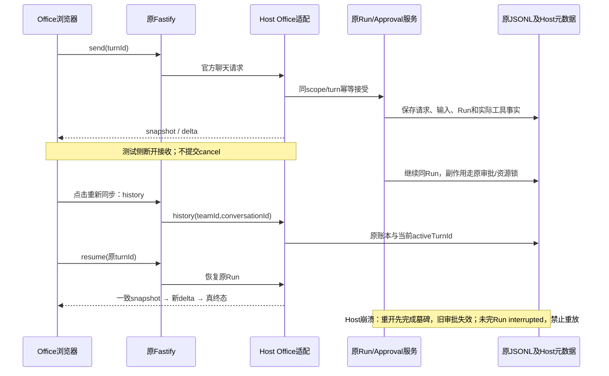

# CHG-2026-0007：T6成员交互、真实多Agent与故障恢复加固

**历史入口（2026-10-26）：**GitHub已核实PR #13于2026-10-25 12:19:49（Asia/Shanghai）合入`a26fa85af0db82a9160136db73cab5148577cc63`，head为`e91c73a0ebac5756ea634d6016eb6f31c6cc94bb`，平台reviews为空，不虚构Approve。本轮用户已批准继续非Office功能修复；D89/D90实施及真实失败/重验见§12.57—12.58，尚未形成新交付/新PR或完整通过结论。下方旧r9/PR13待审叙述保留原历史时点，以本入口和当前审批表为准。

**历史范围登记（r17时点，当前以r22审批表和§12.113为准）：r17-whiteboard-details按用户“继续修复”修正式长会话白板详情（§9.15/12.107），当前待验证，不作为交付通过；原r16-queue-and-errors优先修复快照超限、聊天错误可见与人物FIFO，见§9.14/12.98；当前正在实现与验证。原r15-dependent-handoffs按用户本轮五项具体指令修复真实成果交接、两事项并行、图文合稿、活动和完成进度。方法见§9.13/12.97，用户直接实施授权，当前候选验证中，不作为交付验收。原r14持续协作与媒体细则保留§9.12/12.90。此前r13-upstream-closure按本轮用户指定“更新最新Office并先解决上一轮六项中的OpenPaw问题”实施；逐文件方案见§12.82。只原样同步Office上游，不实施任何自定义Rx。准确交付仍待完整验证与人工验收。**历史r9及#13已合入，具体提交与原审核记录保留第12节，不以旧批准覆盖未来方案。原T6 r5已按用户批准实施、验收并随[PR #12](https://github.com/KunlunMeta-Limited/openpaw/pull/12)合入`e6a20bd28ae9b1a065f9c98fbec49d356d716235`（2026-10-24 12:57:48 Asia/Shanghai）。本单继续承载T6产品补修及“每团队独立物理workspace”的新增要求，不新建Tx或审核总单。D58/D51/D59/D60/D61是原r5允许范围内已先登记的私有修复；r6已获准确批准；本轮用户授权第12.21节的任务/成员闭环与第12.18节最小依赖，已按批准完成真实迁移，备份/摘要及不变性证据见12.28。Office全部仍不修改。

**审核重点：**第一，原PR已合入，旧“必改”代表原T6交付，不能要求补修PR再修改几十份无关文件；本版第4节改为相对最新集成基线的精确补修范围，已合入迁移文件仅条件保留，已合入未再变化的文件不制造diff，原27项完整测试不减少。第二，旧四槽共享project是真实历史，不能直接换配置绕过Host校验；迁移要有预检摘要、备份、原事务审计、跨团队隔离和完整回退。第12.12节是完整实施次序/逐文件理由与验收，第6—10节同步契约、数据、保护与完成要求。本轮授权来源见第12.21节；新准确方案对象固化与授权登记分开，旧r5/r6授权与旧准确交付记录独立保留，第12节所有历史提案/失败不删除。

**当前补修（2026-10-29）：r22-openpaw-only。**按用户明确授权，仅在OpenPaw实现可配置单次响应额度、人物当前活动窗口和真实工具短标题。完整业务白板先于人物窗口生成，历史复用原Store/detail-v1；Office任何文件不改。当前准确实现/验证入口为§12.113及`/home/cheng/.openpaw/verification/openpaw-only-r22-20261029`；实现授权不代表人工交付或PR通过，真实DeepSeek16384尚未付费验收。

**当前执行（2026-10-30）：r30-result-versions。**用户准确批准§12.124原提案blob `b1a9b4d8dc83ed5eb920fd000beda874c3c4aac5`，答复“批准 r30，Office仍不改”。本节、主表和审批对象仅归并该已批准方案与§12.123最新版适配；原r22授权和历次证据均保留历史。当前实现真实版本存储/只读服务及官方成果/交付目录，技术验收、8765部署与PR状态以本轮准确报告为准，未形成不记完成。

**当前执行（2026-11-03）：r32-version-catalog已批准。**D151通用修订指导与D152目录视图已在唯一主目录实现；原版Office真实UI六项专项通过。完整27项、Git对象固化及正式部署仍受阻，不把实施批准或旧r31绿灯当作本轮交付验收。多对话活动残留列R27暂缓，详见§12.140—12.141及本轮外部报告。

## 1. 变更审批

| 审批项目 | 内容 |
| --- | --- |
| 项目CHG格式 | openpaw/chg-review-v2 |
| 变更编号 | CHG-2026-0007 |
| 变更标题 | T6成员交互、真实多Agent与故障恢复加固 |
| 当前状态 | r35实施授权已确认（approved），最小Todo修复及范围归并实施/双平台验证中；原r34安装及迁移授权保留，尚未交付 |
| 阶段 | T6 |
| 提案版本 | 2026-11-04-r35-todo-replace |
| 变更类型 | 延展与缺陷修复（additive） |
| 风险等级 | 严重（critical） |
| 负责人 | 用户授权开发者（Codex） |
| 必须审核 | 本会话用户或指定非作者审核人 |
| 设计基线 | REQ-OP-007/008/009/011/013/014/016/019/020/021/022/023/024/025；DES-OP-003/004/006/007/008/009/011/012/013 |
| 目标分支 | merge/ai-ofice-react-overagent |
| 实施基线 | a26fa85af0db82a9160136db73cab5148577cc63；PR #13已合入，当前fix/engine-host-t6-followup仅继续补修 |
| 实施授权来源 | 本会话用户准确批准§12.148 r35最小修复及范围归并；此前明确要求“新电脑就是从空白数据开始，不能复制我的聊天记录这些”“把这个setup功能完成实现和验证后，可以向仓库提交代码”；对应§12.143及前序已批准setup方式；原r32/r33和工程迁移授权保留 |
| 关联修订 | 无 |
| 历史元数据维护 | 无 |
| 历史说明维护 | 无 |
| 原交付状态 | r1仅提案；r2产品审查增量，无T6实现交付；T5 PR #11于2026-10-23 20:46:12合入 |
| 方案审核状态 | approved |
| 方案批准版本 | 2026-11-04-r35-todo-replace |
| 方案审核人 | 本会话用户 |
| 方案审核时间 | 2026-11-04（会话环境日期，日期精度） |
| 方案审核证据 | 用户答复“批准 r35 最小修复及范围归并”，准确原§12.148提案blob为012558d82403cf2bcc1f0a0579b7430eed889fdf；原r34及历次实施批准保留，不代表交付或Windows验收 |
| 方案批准对象 | 8a252f1dba80db60d4f495e36df1b03a4c326d55:docs/changes/CHG-2026-0007.md |
| 交付验收状态 | pending |
| 交付验收提交 | 本轮r32为未提交工作区，准确文件见conversation-scope-recheck-20261103/source-manifest.json；旧ddc86b8仅历史r31候选，不代表本轮交付 |
| 交付验收人 | 本会话用户（本轮r32尚未人工验收） |
| 交付验收时间 | 未发生（r32）；历史时间保留原第12节 |
| 交付验收证据 | 实施批准与交付验收分开；本轮准确提交完整复验后由用户验收，不把聊天性能次数算作200轮真实DeepSeek多Agent对话 |
| 验证证据 | /home/cheng/.openpaw/verification/conversation-scope-recheck-20261103；r32专项报告、catalog-ui-g/report.json和checks/report.json；旧失败全部保留 |
| Linux验证提交 | r32未提交工作区，准确源码hash见同轮source-manifest.json；候选binary由catalog-ui-g/report.json绑定 |
| Linux验证结果 | D151先红后绿；D152模块5项、Host单元100项、运行时35项及原版Office真实UI六项通过；双Clippy/MSRV/契约等实际检查见checks。完整27项因NTFS内核Git/工作区写入及RustSec HTTPS更新失败未通过；不沿用旧提交绿灯 |
| Linux验证证据 | /home/cheng/.openpaw/verification/conversation-scope-recheck-20261103；真实运行时35项含100办公室×100会话及重启压力回归均通过，原始日志host-lib-runtime.log及closure.json |
| Windows验证提交 | 本轮0ac4caf原生CI41751635649，r35准确候选待重新验证 |
| Windows验证结果 | 原生setup/契约33项及其他静态门禁通过；原默认工具并发回归因Todo替换AccessDenied失败，后续all-features未运行。不得宣称Windows全部通过 |
| Windows验证证据 | 本轮仓库外artifacts/maintenance/20261104-windows-migration/candidate-windows-test.log及candidate-windows-contracts.log；完整GUI未验，不适配macOS |
| 平台PR状态 | 历史PR #13 MERGED；当前r32及相关补修未新建PR、未合入 |
| 平台PR URL | 历史：https://github.com/KunlunMeta-Limited/openpaw/pull/13；当前补修未创建PR |
| 平台PR head | 历史#13：e91c73a0ebac5756ea634d6016eb6f31c6cc94bb；本轮r32未提交、未推送，不把旧head当新交付已批准 |
| 平台审核证据 | 2026-10-26官方gh实查#13 state=MERGED、mergedAt=2026-10-25T04:19:49Z、reviews=[]；用户本轮明确批准继续功能修复，不能代填平台Approve或未来交付验收 |
| 合入提交 | 历史#13：a26fa85af0db82a9160136db73cab5148577cc63；原#12：e6a20bd28ae9b1a065f9c98fbec49d356d716235；当前补修未合入 |

## 2. 变更原因

用户实际使用时会刷新页面、切换办公室、遇到网络断开或服务重启。T5已能联网、审批后写真实报告、展示步骤/人物并查文件，但其53条产品记录只覆盖常规闭环及部分重启，不足以证明每个副作用边界、慢订阅、多页存档和上限都可靠。T6补这些组合，先复用并测试，只有复现缺陷才修原实现；不为了“有代码”重建Host。

只读核查基线为OpenPaw f22cca1及Office d150b96。源码落点：Store::recover先恢复删除墓碑、重建原索引，再以JSONL RunFinished补终态、失效旧审批；Host::snapshot_and_subscribe在单写序列内取得视图和订阅；chat::stream_run已有有界发送/断线退出；projection持久seq+完整内容；actions只有一个领取器；scene已有持久去重；turns已有稳定turn请求映射、分页和8MiB预算。应扩这些原入口，而不是新增第二套状态机、Node bridge或数据库。

协议逐链接依据：Office integration/README.md → office-integration.md的七messages、删除/创建/场景与恢复顺序；dashboard-integration.md的完整快照、引用与容量；message-relay.md的内存缓存、202及重启；chat-integration.md的history/resume/cancel、分页与NDJSON首snapshot。机器约束是固定packages/protocol的schema/office-integration/chat/office-ui及真实server和ChatSession，不根据旧计划编接口。

**已知资料差异：**固定chat-integration.md仍写单连接180秒，但d150b96的ChatSession.receive与服务器转发已移除该固定总时限，history/cancel仍有15秒控制期限；T5已实际运行190秒。T6记录此差异，不修改Office文档，不再把“等待180秒”当故障注入。网络中断使用测试端断开/阻断现有连接后点“重新同步”；自动无感重连是R8候选，未获批准。

替代方案：只重复T5 happy path不能暴露持久边界；复制新聊天服务会造成两套事实；改Office自动重连未获Rx授权。因此选择“扩现有回归与真浏览器故障矩阵→定位最小原模块修复→精确重验”。SDK适配留T7，发布包/原生Windows联合旅程留T8。当前不声称新缺陷已确诊或T6已完成。

### 2.1 r2来自真实页面的新需求与缺口

8765的9次点击证明：app-agent/review-agent/code-agent未绑定，返回scope_denied；已绑定三成员都得到同一个空fields菜单。D50/D51先登记再修，不能删除授权检查。最新纯Demo有人物本地互动/表情菜单和6成员，但Connected controller的onInspect直接return，Host只能提供官方detail-v1业务详情，原位菜单融合归Office R13。白板模板固定字体/对比度归R12。最新Office npm构建通过，792测试790通过2失败（focus），旧基线同机characterWork 4/4，归R14而不是改Host伪造工作态。

当前工具→演员是功能可视化，没有真正委派；core/store遗留sub_agent字段/skill说明不是运行器。用户要每个角色真实执行并交接，因此r2新增共享Host的角色与一层编排能力，复用原每Run AgentLoop，不新写推理循环。准确方案与边界见9.6—9.11；这不是T5审批自动覆盖的私有细节。本轮只执行审查/提案，未向真实会话发模型请求或改生产代码。

## 3. 涉及仓库

| 仓库编号 | PR 或说明 |
| --- | --- |
| openpaw | 唯一开发目录/Office/openpaw；feat/engine-host-t6从已合入f22cca1创建；未来唯一主PR目标merge/ai-ofice-react-overagent。Office只读/隔离构建，不创建Office PR。 |

## 4. 允许修改文件

本版按已合入PR #13的`a26fa85af0db82a9160136db73cab5148577cc63`核对当前补修差异。原r9第4节及#12/#13已合入实现保持Git历史可追溯；未变化的原文件改为“条件”，不为检查器制造无意义差异。当前D81—D91代码、原测试扩展及准确证据逐文件登记；所有原27项、100+100和真实Provider验收不减少。第12.57—12.60节给出本轮根因/修复方法与失败证据。原三份用户文档和未授权证据目录不在本次提交内。此为原0007范围归并提案，待准确版本审核；不新建CHG/Tx，不自填批准，不修改Office。

| 仓库 | 操作 | 文件 | 模块或符号 | 文件负责人 | 为什么必须修改 | 对其他部分的影响 | 必要性 | 具体修改方向与复用方式 | 完成标准与证据 |
| --- | --- | --- | --- | --- | --- | --- | --- | --- | --- |
| openpaw | 修改 | docs/changes/CHG-2026-0007.md | T6唯一主CHG | 用户授权开发者 | T5已合入，下一阶段尚无可审核方案 | 仅OpenPaw提案，不授权Office | 必改 | 新增本十二节；分开提案、实现、验证、人审和合入 | 准确Git对象可审；不沿用T5授权 |
| openpaw | 修改 | docs/changes/INDEX.md | 原索引生成器 | 用户授权开发者 | 索引需显示T5合入和T6待审 | 保持官方协议、授权和旧CLI兼容 | 必改 | 运行原check.py index，不手填批准 | index --check通过 |
| openpaw | 修改 | docs/verification/追踪矩阵.md | 原追踪生成器 | 用户授权开发者 | 恢复/容量任务需关联原接口与测试 | 保持官方协议、授权和旧CLI兼容 | 必改 | 运行原check.py trace；提案定位已有入口，不声称新测试已存在 | trace --check通过 |
| openpaw | 修改 | docs/verification/CHG-2026-0007/验证记录.md | 提案与未来T6证据入口 | 用户授权开发者 | 必须区分本次维护、旧T5结果与新T6实测 | 保持官方协议、授权和旧CLI兼容 | 必改 | 新增验证边界、故障矩阵、外部报告导航；不复制配置/媒体 | 新测试未做明确待实施；原始失败保留 |
| openpaw | 修改 | docs/engine-host/master.md | 首页、T6卡、14.1/M6、15.4 | 用户授权开发者 | M5仍待合入且T6旧180秒描述与固定代码矛盾 | 保持官方协议、授权和旧CLI兼容 | 必改 | 补M5合入；T6导航本单9/10节，修正文档与代码时限区别 | 不把T6计划写完成；不复活旧R1四URL |
| openpaw | 修改 | docs/engine-host/handoff.md | 当前交接、同步与产物用途 | 用户授权开发者 | 开发者需从实际合入版本继续 | 保持官方协议、授权和旧CLI兼容 | 必改 | 前置最新T5合入/T6待审说明、当前服务与主目录操作顺序 | 可直接找到原会话、证据和下一阶段审批入口 |
| openpaw | 新增 | scripts/openpaw-office.sh | Linux编译、启动、状态与优雅停止 | 用户授权开发者 | 用户要求统一运行入口；12.78已批准实现但第4节漏登记 | 沿用原CLI/配置/审批，不改Office产品 | 必改 | 保留r11进程编排，并按§12.143增加setup入口、私有服务密钥加载和健康等待 | 12.78.1真实Linux日志及新准确提交完整27项；保留失败与Windows暂缓边界 |
| openpaw | 新增 | scripts/openpaw-office.ps1 | PowerShell5.1同名运行入口 | 用户授权开发者 | 同一已批准r11跨平台入口漏登记 | Windows原生仍按用户决定暂缓，不计通过 | 必改 | 保留CIM身份核对；§12.143增加setup、私有密钥读取及含空格参数，保留停止边界 | 既有静态审阅及新准确提交完整验证，不声称Windows原生运行通过 |
| openpaw | 修改 | docs/requirements/产品需求说明.md | REQ-OP-021—024与当前状态 | 用户授权开发者 | 需求须明确六角色/成员和多Agent，不再把计划当实现 | 保持官方协议、授权和旧CLI兼容 | 必改 | 新增可审核需求和P验收映射；T5改为实际合入事实 | 只登记真实结论/待审方案，精确提案完整验证 |
| openpaw | 修改 | docs/design/软件设计说明.md | DES-OP-011/012与当前状态 | 用户授权开发者 | 父子Run和成员身份是新设计，不可复用T5批准 | 保持官方协议、授权和旧CLI兼容 | 必改 | 写角色目录、一层委派、预算/取消/审批/恢复与Office映射 | 只登记真实结论/待审方案，精确提案完整验证 |
| openpaw | 修改 | docs/engine-host/audit.md | D50/D51与已合入状态 | 用户授权开发者 | 真实点击揭示未被原测试覆盖的产品缺陷 | 保持官方协议、授权和旧CLI兼容 | 必改 | 记录复现/根因/原证据及拟修复，不预先标已解决 | 只登记真实结论/待审方案，精确提案完整验证 |
| openpaw | 修改 | docs/engine-host/office-change-requests.md | R6状态与R12—R16 | 用户授权开发者 | 用户要求集中复审Office差距，不允许实施 | 保持官方协议、授权和旧CLI兼容 | 必改 | 修正已被#11覆盖的旧状态，补原因/文件/影响/验证与成熟度 | 只登记真实结论/待审方案，精确提案完整验证 |
| openpaw | 修改 | docs/verification/CHG-2026-0007/产品差距审查.md | 本轮逐项产品/Demo/框架审查 | 用户授权开发者 | 用户9项需求需要真实证据和已实现/缺口分开 | Office外部协议不变；行为影响见9.6—9.11 | 条件 | 汇总上游、9次点击、Demo对照、全792测试和方案输入；不复制秘密/媒体 | 每个问题有源码/证据/归属与下一阶段 |
| openpaw | 修改 | docs/governance/依赖与资料基线.md | 现行来源版本说明 | 用户授权开发者 | 冻结已批准升级，旧现行文字需同步避免下一开发者误用 | 仅落实12.1—12.3，Office不改，无权限扩张 | 条件 | 仅追加已批准冻结/依赖/部署版本区别，不改治理规则 | 与sources.json/锁文件及实际部署一致 |
| openpaw | 修改 | crates/openpaw-engine-host/src/office/projection.rs | 共同角色目录/真实子任务/稳定assignment | 用户授权开发者 | D81—D89历史交接重入、生命周期漏项、父卡归属与64KiB阻塞 | 默认路径及Office外部协议兼容；新增协作模式按9.7—9.9约束 | 必改 | 绑定准确父Run/子任务/生命周期和业务核验；冷启动恢复、在途重建及容量整理复用原快照，UI同步复用同一门 | 原私有正反回归、100+100真UI、刷新/重启及删除回执；不伪造完成或动画ACK |
| openpaw | 修改 | crates/openpaw-engine-host/src/office/details.rs | 成员首页/目标上下文/返回 | 用户授权开发者 | D51主角色状态与D65普通追问后成员结果丢失；缺少可读的任务进度/结果导航 | Office外部协议不变；行为影响见9.6—9.11 | 必改 | 从同scope全部父Run查最近真实委派；复用detail-v1增加任务列表/详情、每页5项、返回和版本校验；r14复用真实成功媒体调用完善文件产物列表；执行完成与业务核验分开，不新造task.inspect | 原真实HTTP主成员断言、六人物/侧栏/布局详情，无新Run/越界读取 |
| openpaw | 修改 | crates/openpaw-engine-host/tests/features/office_interactions.rs | 既有host_office_interactions | 用户授权开发者 | 原回归未断言主角色终态说明 | 保持官方协议、授权和旧CLI兼容 | 条件 | 扩原真实HTTP/审批成功场景，断言主成员运行完成及业务进度口径 | 红绿日志、原8入口及完整TEST-RUST-ALL |
| openpaw | 修改 | crates/openpaw-engine-host/src/task_progress.rs | 原工具说明与执行回执 | 用户授权开发者 | D81—D88终态收敛、工具证据及计划显示不一致 | 原r5准确允许文件与9.7—9.9职责内私有修正；不变DTO/校验/权限/存储 | 必改 | 在原计划/真实证据核验入口修正完成判定与公开进度，不以回答文字推断成功 | 原inline正反例、逐轮任务/白板对账 |
| openpaw | 修改 | crates/openpaw-engine-host/src/service.rs | 既有主子角色系统上下文 | 用户授权开发者 | D81—D90任务详情装配/优先注释与空结果错误分类、固定单次额度不匹配Provider | 原r5准确允许文件；仅私有提示文字，不增加授权/数据字段 | 必改 | 保留已授权UI/状态修复，复用with_max_tokens，缺省按能力至多8192，显式max_response_tokens只覆盖单次；组总额度不变（§12.113） | 空子失败/显式有界重试，真实Provider一主五子，普通默认不变 |
| openpaw | 修改 | crates/openpaw-cli/src/cli.rs | Host命令参数 | 用户授权开发者 | 缺少安全离线迁移入口 | 改变本机归属/迁移语义，已批准r6与12.21；Office不改 | 条件 | r6获批且落实12.12迁移时：增加feature下仅本机预检/摘要确认apply参数，默认不写入；复用既有配置读取 | 默认CLI/feature无变化；不加载模型或泄露秘密 |
| openpaw | 修改 | crates/openpaw-cli/src/main.rs | 命令分派 | 用户授权开发者 | 新离线入口须进入唯一Host服务 | 改变本机归属/迁移语义，已批准r6与12.21；Office不改 | 条件 | r6获批且落实12.12迁移时：仅分派迁移命令，不启动HTTP/模型/第二运行循环 | 无feature不引入axum，退出码准确 |
| openpaw | 修改 | crates/openpaw-cli/src/host_cmd.rs | 薄CLI入口 | 用户授权开发者 | 运行装配不适用于离线文件/绑定迁移 | 改变本机归属/迁移语义，已批准r6与12.21；Office不改 | 必改 | 保留r6迁移入口；r14将原ModelEnvironment只读图片凭据注入Host运行服务，不导出环境、不向迁移传密钥 | 预检零写/零网络；失败非零且脱敏 |
| openpaw | 新增 | crates/openpaw-engine-host/src/workspace_migration.rs | 离线迁移协调（新增） | 用户授权开发者 | 当前没有跨文件备份/预检/复制/事务绑定的安全协调职责 | 改变本机归属/迁移语义，已批准r6与12.21；Office不改 | 条件 | r6获批且落实12.12迁移时：复用Root规范化、原OS锁/Store事务，摘要绑定，拒绝链接/覆盖冲突，完整备份及清理清单 | 无活动Run/有效审批，原文件不动、失败可回退；不新建消息库 |
| openpaw | 修改 | crates/openpaw-engine-host/src/lib.rs | 本机导出 | 用户授权开发者 | CLI需要可信迁移API且不能经HTTP绕行 | 改变本机归属/迁移语义，已批准r6与12.21；Office不改 | 条件 | r6获批且落实12.12迁移时：最小预检/apply参数结果接口，中文契约注释；不新增HTTP | 仅本机计划输入；旧Host接口兼容 |
| openpaw | 修改 | crates/openpaw-engine-host/src/store.rs | 绑定与原host_events、人物详情只读查询 | 用户授权开发者 | D82—D87逐Run/历史投影读取和终态恢复需避免重复全表扫描 | r6按12.12；D71仅私有查询，不改变协议/权限/格式，Office不改 | 必改 | 复用原主键/事件列/JSONL与终态投影接口；补规定注释，不新建表或消息库 | 原存储作用域/损坏/顺序回归与完整套件 |
| openpaw | 修改 | crates/openpaw-engine-host/src/query.rs | 产物授权解析 | 用户授权开发者 | 旧JSONL保存原工作根，迁移后不能继续授予旧根 | 改变本机归属/迁移语义，已批准r6与12.21；Office不改 | 条件 | r6获批且落实12.12迁移时：仅依据可信迁移事实映射本团队相对产物，复用Root/普通文本/链接检查 | 跨团队同名文件不能越根；缺失或变化明确报错 |
| openpaw | 修改 | crates/openpaw-engine-host/tests/regressions/recovery.rs | 既有恢复入口 | 用户授权开发者 | 需要实际既有共享团队迁移而非新空目录演示 | 改变本机归属/迁移语义，已批准r6与12.21；Office不改 | 条件 | r6获批且落实12.12迁移时：扩原预检零写、真实父子/文件迁移、失败/重复apply/冲突/链接/完整回退 | 无模型重放、原项目hash不变；原生Windows仍暂缓 |
| openpaw | 修改 | tests/engine-host-contracts/office-product.mjs | 原浏览器入口 | 用户授权开发者 | 现夹具共享根不能证明一团队一工作区 | 改变本机归属/迁移语义，已批准r6与12.21；Office不改 | 必改 | r6获批且落实12.12迁移时：改成不同团队根，对照同名不同内容文件/六成员/父子与会话隔离，不减原断言 | 真Host/浏览器全旅程和原68条至少保留 |
| openpaw | 修改 | tests/engine-host-contracts/office-resilience.mjs | 原产品助手 | 用户授权开发者 | 补迁移与成员/恢复组合 | 改变本机归属/迁移语义，已批准r6与12.21；Office不改 | 条件 | 扩六成员任务详情/返回，普通追问后保留原卡/白板/成员结果；原r5已允许文件内扩D61五成员开始/完成/不重复visit断言；仅r6获批后再扩父子同根、两团队异根及重启/文件详情隔离 | 原68条不减；成员最近动态可见，快照/seq/页面来源/模型请求可追溯 |
| openpaw | 修改 | docs/engine-host/host-config.example.toml | 配置样例 | 用户授权开发者 | 四槽共用project不符合用户新默认目标 | 改变本机归属/迁移语义，已批准r6与12.21；Office不改 | 条件 | r6获批且落实12.12迁移时：改四个独立真实根，说明团队内父子共用；旧共享配置必须先迁移 | Linux/Windows例子，预检/应用/回退可按文档重复 |
| openpaw | 修改 | Cargo.toml | r6最小依赖 | 用户授权开发者 | r6缺少可靠摘要及跨平台可用空间公共依赖 | 无Office/权限/HTTP变化 | 条件 | 固定ring/fs4版本，复用既有锁图，不升级其他包 | 原27项/默认依赖树/MSRV/迁移专项证据 |
| openpaw | 修改 | crates/openpaw-engine-host/Cargo.toml | r6最小依赖 | 用户授权开发者 | 迁移只能在Host启用，不能增加默认CLI依赖 | 无Office/权限/HTTP变化 | 条件 | 两个optional依赖仅engine-host feature启用 | 原27项/默认依赖树/MSRV/迁移专项证据 |
| openpaw | 修改 | Cargo.lock | r6最小依赖 | 用户授权开发者 | 记录唯一新增fs4及精确校验值 | 无Office/权限/HTTP变化 | 条件 | 审查实际锁差异，MSRV/许可证/deny与完整验证 | 原27项/默认依赖树/MSRV/迁移专项证据 |
| openpaw | 修改 | crates/openpaw-cli/tests/help_snapshot.rs | 原CLI精确入口回归 | 用户授权开发者 | r6已批准新增engine-host-workspace，原feature精确清单遗漏 | 仅补已批准命令的严格断言，不新增命令或放宽下限 | 条件 | 保留默认12项及feature精确数量，新增迁移plan/apply帮助关键词 | 默认/Host/sidecar/全feature回归全部通过 |
| openpaw | 修改 | crates/openpaw-engine-host/tests/features/runtime.rs | 原真实主子请求回归 | 用户授权开发者 | D90空子结果后的显式重试、成功角色唯一性及实际请求额度缺少精确验证 | 仅扩既有测试，不新增权限/协议 | 必改 | 扩原TeamProvider夹具与真实AgentLoop、Session、账本；核对失败分类、两次真实子Run及8192能力装配 | 原26入口与完整套件；错误与正常不能互换 |
| openpaw | 修改 | crates/openpaw-cli/src/chat.rs | CLI模型环境根 | 用户授权开发者 | D80隔离`--home`时避免读取全局.env | 默认home和参数优先级兼容 | 条件 | 先解析显式home再复用ModelEnvironment加载 | chat_persistence_regressions 4/4及全量回归 |
| openpaw | 修改 | crates/openpaw-engine-host/src/agents.rs | 六角色目录与能力映射 | 用户授权开发者 | D68—D71统一Office官方成员ID并提供协作能力目录 | Office协议和权限边界不变 | 条件 | 复用固定角色目录与现有能力检查，不接受客户端覆盖 | 角色/actor映射回归及真实浏览器点击证据 |
| openpaw | 修改 | crates/openpaw-engine-host/src/config.rs | 协作配置与预算 | 用户授权开发者 | D68—D71为协作Run提供有界预算和角色白名单 | 普通Run默认值兼容 | 条件 | 复用既有解析与弹性预算；新增可选max_response_tokens，启动校验边界（§12.113） | 配额、取消、普通Run隔离回归 |
| openpaw | 修改 | crates/openpaw-engine-host/src/office/actions.rs | 可信删除UI分派 | 用户授权开发者 | D91动作被自身UI优先规则阻止确认 | 只复用原执行/存储/协议；Office不改，权限与共享硬上限不扩 | 必改 | 复用同一sync_for_ui门和先快照后响应，不释放优先标记 | 真实删除标签消失、剩余会话与产物保留 |
| openpaw | 修改 | crates/openpaw-engine-host/src/office/approvals.rs | 审批恢复与作用域 | 用户授权开发者 | D68—D71保持审批展示、重开和取消绑定 | 不新增Office权限 | 条件 | 复用原CAS审批状态机与Office action传输 | 审批重开、拒绝、取消竞态回归 |
| openpaw | 修改 | crates/openpaw-engine-host/src/office/client.rs | Office回执错误分类 | 用户授权开发者 | D79区分可恢复网络/缓存错误与外部序号冲突 | Office协议字段不变 | 条件 | 复用现有客户端和重试策略，保留冲突停写 | 同seq、STALE_SEQ和重启恢复回归 |
| openpaw | 修改 | crates/openpaw-engine-host/src/office/scene.rs | 场景状态投影与完成汇报 | 用户授权开发者 | 原观察器缺少真实子任务完成后的返回汇报，r31已批准 | 不伪造动画ACK、不修改Office或业务执行/FIFO | 必改 | 复用官方v2 office.visit、可信委派/角色及原有限场景回执，新增完成汇报独立路径；前向分配不重复，取消/失败不报成功、历史不补播 | 原场景回归、真实Host父子/所有角色/FIFO/错误与取消、原版Office实际播放取证及完整套件 |
| openpaw | 修改 | crates/openpaw-engine-host/src/office/workspaces.rs | 新办公室创建 | 用户授权开发者 | D68—D71适配官方office.create并绑定预授权槽 | 不增加动态Agent权限 | 条件 | 复用预授权槽、Store绑定和完整快照 | 幂等创建、重启与容量回归 |
| openpaw | 修改 | crates/openpaw-engine-host/src/orchestration.rs | 父子Run协作编排 | 用户授权开发者 | D81—D88父子状态关联与有界等待补修须纳入当前差异 | 一层委派、共享预算与取消边界不变 | 必改 | 复用原委派关系/子Run/取消及统一预算，不新建循环 | 原父子/取消/预算和真UI证据 |
| openpaw | 修改 | crates/openpaw-engine-host/src/session_delete.rs | 删除会话清理 | 用户授权开发者 | D79保证删除运行、审批、投影清理后才返回 | 工作区产物保留 | 条件 | 复用原删除事务和清理等待，不伪造Office页面状态 | 删除崩溃恢复及Host事实确认 |
| openpaw | 修改 | crates/openpaw-engine-host/tests/regressions/office_sync.rs | 原Office同步回归 | 用户授权开发者 | D91必须复现真实领取到确认链路 | 只复用原执行/存储/协议；Office不改，权限与共享硬上限不扩 | 必改 | 原HTTP夹具投递删除动作，检查完整快照先于成功，保留冲突/恢复断言 | 修复前success=false，修复后完整原5入口通过 |
| openpaw | 修改 | crates/openpaw-tools/src/web/html_to_md.rs | Unicode HTML解析 | 用户授权开发者 | D78修复大小写转换改变字节索引导致Host panic | 工具输出、权限和协议兼容 | 条件 | 使用长度保持的标签匹配，复用既有Markdown转换 | Unicode大页面不panic及工具全量回归 |
| openpaw | 修改 | crates/openpaw-engine/src/agent_loop.rs | 原引擎终态 | 用户授权开发者 | 空/截断响应被误记完成，导致成功角色无法再交付 | 只复用原执行/存储/协议；Office不改，权限与共享硬上限不扩 | 必改 | 原usage/消息可靠保存后检查停止原因及可交付内容，失败不自动重试 | 七终态红绿回归；真实DeepSeek不再把空结果算成功 |
| openpaw | 修改 | crates/openpaw-engine/tests/engine_e1.rs | 原引擎E1回归 | 用户授权开发者 | 通用终态缺陷必须在原crate验证 | 只复用原执行/存储/协议；Office不改，权限与共享硬上限不扩 | 必改 | 扩原Provider/observer夹具检查usage、部分文字、终态及仅一次调用 | engine_e1全部通过，原CLI入口兼容 |
| openpaw | 修改 | crates/openpaw-engine-host/src/approval.rs | 原审批生命周期 | 用户授权开发者 | D81—D88补修的父子取消和终态必须可追溯 | 只复用原执行/存储/协议；Office不改，权限与共享硬上限不扩 | 必改 | 保留本分支已实现的审批清理，不引入新审批系统 | 完整审批/取消/恢复回归 |
| openpaw | 新增 | tests/engine-host-contracts/status-repeat-100.mjs | 逐轮真实UI回归 | 用户授权开发者 | 旧HTTP回归不是浏览器；先等正文再采样会漏交接帧 | 只复用原执行/存储/协议；Office不改，权限与共享硬上限不扩 | 必改 | 原入口扩真实Office/Chromium逐轮发送、前置采样、任务白板/人物/追问刷新重启，冻结binary | 单Agent100及多Agent100逐轮完成；失败原样保存，模型种类明示 |
| openpaw | 修改 | crates/openpaw-engine-host/src/tool_host.rs | 本轮补修与验证 | 用户授权开发者 | D81—D88工具状态通知与真实执行结束的顺序不一致 | 无Office源码、外部协议、依赖或权限变化 | 必改 | 复用原执行/审批/资源流水线收敛通知，清理完才终态 | 原工具取消/权限/持久化回归 |
| openpaw | 新增 | docs/verification/CHG-2026-0007/d87-ui-20261025/README.md | 本轮补修与验证 | 用户授权开发者 | 准确记录本轮及历史失败，不能把旧报告当当前通过 | 无Office源码、外部协议、依赖或权限变化 | 必改 | 保留原始事实及语境，按实际提交/模型/退出码/用途记录，不复制密钥和配置 | 真实文件/报告可定位；未执行和失败不计通过 |
| openpaw | 新增 | docs/verification/CHG-2026-0007/d87-ui-20261025/capacity-diagnostic.json | 本轮补修与验证 | 用户授权开发者 | 准确记录本轮及历史失败，不能把旧报告当当前通过 | 无Office源码、外部协议、依赖或权限变化 | 必改 | 保留原始事实及语境，按实际提交/模型/退出码/用途记录，不复制密钥和配置 | 真实文件/报告可定位；未执行和失败不计通过 |
| openpaw | 新增 | docs/verification/CHG-2026-0007/d87-ui-20261025/members-all.json | 本轮补修与验证 | 用户授权开发者 | 准确记录本轮及历史失败，不能把旧报告当当前通过 | 无Office源码、外部协议、依赖或权限变化 | 必改 | 保留原始事实及语境，按实际提交/模型/退出码/用途记录，不复制密钥和配置 | 真实文件/报告可定位；未执行和失败不计通过 |
| openpaw | 新增 | docs/verification/CHG-2026-0007/d87-ui-20261025/office-read-1494-summary.json | 本轮补修与验证 | 用户授权开发者 | 准确记录本轮及历史失败，不能把旧报告当当前通过 | 无Office源码、外部协议、依赖或权限变化 | 必改 | 保留原始事实及语境，按实际提交/模型/退出码/用途记录，不复制密钥和配置 | 真实文件/报告可定位；未执行和失败不计通过 |
| openpaw | 新增 | docs/verification/CHG-2026-0007/d87-ui-20261025/office-read-1494.json | 本轮补修与验证 | 用户授权开发者 | 准确记录本轮及历史失败，不能把旧报告当当前通过 | 无Office源码、外部协议、依赖或权限变化 | 必改 | 保留原始事实及语境，按实际提交/模型/退出码/用途记录，不复制密钥和配置 | 真实文件/报告可定位；未执行和失败不计通过 |
| openpaw | 新增 | docs/verification/CHG-2026-0007/d87-ui-20261025/proper-single-agent-partial.json | 本轮补修与验证 | 用户授权开发者 | 准确记录本轮及历史失败，不能把旧报告当当前通过 | 无Office源码、外部协议、依赖或权限变化 | 必改 | 保留原始事实及语境，按实际提交/模型/退出码/用途记录，不复制密钥和配置 | 真实文件/报告可定位；未执行和失败不计通过 |
| openpaw | 新增 | docs/verification/CHG-2026-0007/d88-multi-handoff-20261026/README.md | 本轮补修与验证 | 用户授权开发者 | 准确记录本轮及历史失败，不能把旧报告当当前通过 | 无Office源码、外部协议、依赖或权限变化 | 必改 | 保留原始事实及语境，按实际提交/模型/退出码/用途记录，不复制密钥和配置 | 真实文件/报告可定位；未执行和失败不计通过 |
| openpaw | 新增 | docs/verification/CHG-2026-0007/d88-multi-handoff-20261026/final-snapshot.json | 本轮补修与验证 | 用户授权开发者 | 准确记录本轮及历史失败，不能把旧报告当当前通过 | 无Office源码、外部协议、依赖或权限变化 | 必改 | 保留原始事实及语境，按实际提交/模型/退出码/用途记录，不复制密钥和配置 | 真实文件/报告可定位；未执行和失败不计通过 |
| openpaw | 新增 | docs/verification/CHG-2026-0007/d88-multi-handoff-20261026/transition-trace.txt | 本轮补修与验证 | 用户授权开发者 | 准确记录本轮及历史失败，不能把旧报告当当前通过 | 无Office源码、外部协议、依赖或权限变化 | 必改 | 保留原始事实及语境，按实际提交/模型/退出码/用途记录，不复制密钥和配置 | 真实文件/报告可定位；未执行和失败不计通过 |
| openpaw | 新增 | docs/verification/CHG-2026-0007/status-repeat-20261025/README.md | 本轮补修与验证 | 用户授权开发者 | 准确记录本轮及历史失败，不能把旧报告当当前通过 | 无Office源码、外部协议、依赖或权限变化 | 必改 | 保留原始事实及语境，按实际提交/模型/退出码/用途记录，不复制密钥和配置 | 真实文件/报告可定位；未执行和失败不计通过 |
| openpaw | 新增 | docs/verification/CHG-2026-0007/status-repeat-20261025/report.json | 本轮补修与验证 | 用户授权开发者 | 准确记录本轮及历史失败，不能把旧报告当当前通过 | 无Office源码、外部协议、依赖或权限变化 | 必改 | 保留原始事实及语境，按实际提交/模型/退出码/用途记录，不复制密钥和配置 | 真实文件/报告可定位；未执行和失败不计通过 |
| openpaw | 新增 | docs/verification/CHG-2026-0007/status-repeat-20261025/run.stderr | 本轮补修与验证 | 用户授权开发者 | 准确记录本轮及历史失败，不能把旧报告当当前通过 | 无Office源码、外部协议、依赖或权限变化 | 必改 | 保留原始事实及语境，按实际提交/模型/退出码/用途记录，不复制密钥和配置 | 真实文件/报告可定位；未执行和失败不计通过 |
| openpaw | 新增 | docs/verification/CHG-2026-0007/status-repeat-20261025/run.stdout | 本轮补修与验证 | 用户授权开发者 | 准确记录本轮及历史失败，不能把旧报告当当前通过 | 无Office源码、外部协议、依赖或权限变化 | 必改 | 保留原始事实及语境，按实际提交/模型/退出码/用途记录，不复制密钥和配置 | 真实文件/报告可定位；未执行和失败不计通过 |
| openpaw | 新增 | docs/verification/CHG-2026-0007/d89-d91-20261026/README.md | 本轮补修与验证 | 用户授权开发者 | 准确记录本轮及历史失败，不能把旧报告当当前通过 | 无Office源码、外部协议、依赖或权限变化 | 必改 | 保留原始事实及语境，按实际提交/模型/退出码/用途记录，不复制密钥和配置 | 真实文件/报告可定位；未执行和失败不计通过 |
| openpaw | 新增 | docs/verification/CHG-2026-0007/d89-d91-20261026/summary.json | 本轮补修与验证 | 用户授权开发者 | 准确记录本轮及历史失败，不能把旧报告当当前通过 | 无Office源码、外部协议、依赖或权限变化 | 必改 | 保留原始事实及语境，按实际提交/模型/退出码/用途记录，不复制密钥和配置 | 真实文件/报告可定位；未执行和失败不计通过 |
| openpaw | 修改 | crates/openpaw-llm/src/openai.rs | OpenAI流式及非流式工具参数装配 | 用户授权开发者 | 地图册真实Run因工具JSON解析失败，原错误缺少安全诊断，截断可能误归类 | 不新增公共类型、依赖、权限或执行器 | 必改 | 保留整批参数/截断/脱敏修复；r14在已有用户与纯文本assistant结束后续执行时，把原dynamic系统块放到历史末尾，明确新阶段，不新增用户消息或拆断工具结果链 | 真实HTTP分片/多调用/截断/敏感正文反例及完整测试 |
| openpaw | 修改 | crates/openpaw-llm/tests/mock_server_contract.rs | 原真实HTTP契约 | 用户授权开发者 | 原测试未覆盖无效参数和Unicode长文件分片 | 原测试入口不变 | 必改 | 扩真实HTTP正反例，不以JSON可解析替代引擎行为 | 修复前红、修复后绿 |
| openpaw | 修改 | docs/engine-host/contracts/sources.json | 新版Office契约适配 | 用户授权开发者 | 上游已授权更新到ff9f6b7，旧冻结会使验证错版本 | 不新增依赖、权限或自定义Office协议 | 必改 | 更新26份来源hash，仅7项内容变化 | 原契约、真实浏览器和完整检查通过 |
| openpaw | 修改 | tests/engine-host-contracts/upstream-office/packages/protocol/src/office-ui.ts | 新版Office契约适配 | 用户授权开发者 | 新版白板新增summary/detail | 不新增依赖、权限或自定义Office协议 | 必改 | 只同步这一份有变化的原Schema | 原契约、真实浏览器和完整检查通过 |
| openpaw | 修改 | tests/engine-host-contracts/office.test.mjs | 新版Office契约适配 | 用户授权开发者 | 新字段范围与后端真实进度需原Schema验证 | 不新增依赖、权限或自定义Office协议 | 必改 | 补合法/超长边界，不降低原断言 | 原契约、真实浏览器和完整检查通过 |
| openpaw | 修改 | docs/engine-host/contracts/README.md | 新版Office契约适配 | 用户授权开发者 | 开发者需区分新字段、FIFO与真实到达ACK | 不新增依赖、权限或自定义Office协议 | 必改 | 记录协议版本、语义和未解决边界 | 原契约、真实浏览器和完整检查通过 |
| openpaw | 新增 | crates/openpaw-engine-host/src/continuous.rs | 没有通用持续任务状态与接续 | 用户授权开发者 | 一次下达后持续协作的通用缺口 | 不改Office，不增加文章专用分支 | 必改 | 配置授权的start/checkpoint/finish工具、阶段观察器和有界显示；不含文章业务 | 原全27项及持续/媒体真实回归 |
| openpaw | 修改 | crates/openpaw-tools/src/lib.rs | 没有图片工具模块 | 用户授权开发者 | 一次下达后持续协作的通用缺口 | 不改Office，不增加文章专用分支 | 必改 | 注册协议无关media模块 | 原全27项及持续/媒体真实回归 |
| openpaw | 修改 | crates/openpaw-tools/src/host.rs | 静态表没有图片/图表分派 | 用户授权开发者 | 一次下达后持续协作的通用缺口 | 不改Office，不增加文章专用分支 | 必改 | 复用原注册表增加generate_image/render_visual；按可信配置注入服务 | 原全27项及持续/媒体真实回归 |
| openpaw | 新增 | crates/openpaw-tools/src/media.rs | 没有真实生图与可视图表工具 | 用户授权开发者 | 一次下达后持续协作的通用缺口 | 不改Office，不增加文章专用分支 | 必改 | 复用reqwest/base64与原路径安全，真实图片API、结构化SVG图表、原子保存、取消及格式核验 | 原全27项及持续/媒体真实回归 |
| openpaw | 新增 | crates/openpaw-tools/tests/media.rs | 媒体副作用和HTTP契约没有覆盖 | 用户授权开发者 | 一次下达后持续协作的通用缺口 | 不改Office，不增加文章专用分支 | 必改 | 本地真实HTTP服务测试b64图片、失败/敏感信息、SVG逃逸和真实落盘 | 原全27项及持续/媒体真实回归 |
| openpaw | 新增 | docs/engine-host/continuous-tasks.md | 没有用户使用与演示说明 | 用户授权开发者 | 一次下达后持续协作的通用缺口 | 不改Office，不增加文章专用分支 | 必改 | 说明一次输入、授权、停止、图片配置、能力边界和可复制示例 | 原全27项及持续/媒体真实回归 |
| openpaw | 新增 | docs/verification/CHG-2026-0007/continuous-20261027/README.md | 新能力必须准确记录证据 | 用户授权开发者 | 一次下达后持续协作的通用缺口 | 不改Office，不增加文章专用分支 | 必改 | 逐项登记真实命令/退出码、配置与测试模型；缺图像服务不冒充真实生图通过 | 原全27项及持续/媒体真实回归 |
| openpaw | 新增 | tests/engine-host-contracts/continuous-product.mjs | 持续接续和媒体没有实际浏览器链路回归 | 用户授权开发者 | 已批准真实UI验收须连接原Office/Host/Provider和工具，单元断言不够 | 只隔离测试数据，不改Office | 必改 | 复用原生产Office与真实Chromium，模拟服务只作确定性模型，真实CLI.env/五子/图片HTTP/图表/文件/停止并捕获截图/快照/异常 | 原产品回归保持，新增全链路证据 |
| openpaw | 修改 | crates/openpaw-engine-host/src/office/mod.rs | 原Host端Office工具校验名单不含媒体 | 用户授权开发者 | 媒体已注册但真实Office启动被拒绝，必须贯通原配置校验 | 不改Office工程/HTTP协议/审批等级 | 必改 | 保留原媒体名单；新增可信activity_window配置并保持默认false；不改Office协议（§12.113） | 真实Host携Office配置启动并由网页调用工具 |
| openpaw | 修改 | crates/openpaw-engine/src/compaction.rs | 原上下文压缩边界 | 用户授权开发者 | D104真实文章Run压缩时保留头部工具调用却删除其结果，DeepSeek真实400 | 通用缺陷回原crate，无新公开API/权限/依赖或文章专用逻辑 | 必改 | 保护头部按实际工具调用/结果闭合扩展，保留既有尾部配对；无可压缩区返回0，不合成工具结果或重放 | 先红后绿、并行头部/尾部/重复压缩及真实HTTP请求配对，原真实文章再验与全27项 |
| openpaw | 修改 | crates/openpaw-engine/tests/compaction_e2e.rs | 原压缩集成入口 | 用户授权开发者 | 原回归仅纯文本头部，未覆盖首条assistant带工具调用 | 无新依赖，不以文本声明替代协议验证 | 必改 | 复用Mock摘要与原OpenAI Provider，实际TCP服务严格核对压缩后全部工具调用和紧随结果，覆盖并行两调用及反复压缩 | 修复前确实失败，修复后原集成与全部检查通过 |
| openpaw | 修改 | crates/openpaw-engine-host/src/office/chat.rs | 官方聊天NDJSON | 用户授权开发者 | UI仅显示回复未完成而没有明确错误正文 | 不改Office事件类型 | 必改 | 复用原流，错误终态追加脱敏说明并保持history/resume一致 | 真实HTTP与浏览器断网/恢复/刷新 |
| openpaw | 修改 | crates/openpaw-engine-host/src/office/turns.rs | 原历史与轮次展示 | 用户授权开发者 | 网络失败说明缺少正文穿透与历史一致性 | 不写模型答案、不泄露原错误 | 必改 | 原Run投影统一展示文本与固定错误分类，保留部分回复 | history/resume/NDJSON逐字一致 |
| openpaw | 修改 | crates/openpaw-engine-host/tests/features/office.rs | 原真实HTTP产品回归 | 用户授权开发者 | 原用例未断言网络错误在正文可见 | 原入口/断言保留 | 必改 | 同源Run终态、断流、刷新和敏感信息负例 | 原真实HTTP全套及新增红绿 |
| openpaw | 新增 | crates/openpaw-engine-host/src/office/artifacts.rs | r30真实版本与受限读取 | 用户授权开发者 | 最新Office成果预览/比较需要实际不可变版本，不能让旧版URL读取当前文件 | 新增同Host回环只读接口，原工具及权限不变；Office不改 | 必改 | 已批准§12.124：Root锁内捕获真实成功写入，内容地址blob/原Store索引、单版本能力、官方result/deliveries；§12.141增加同凭证只读catalog，按会话/轮次/文件保留最新聊天摘要，原版本及交付不变 | 原件/双版本/图片、作用域/删除/容量/重启/真实UI及原27项，准确日志外置 |
| openpaw | 修改 | tests/engine-host-contracts/upstream-office/packages/protocol/src/office-integration.ts | 原样最新Office Schema | 用户授权开发者 | 新官方成果与历史验证规则变化须准确冻结 | 不手改上游、不添加自定义Office字段 | 必改 | §12.123用户更新指令，直接取准确5d21cf2原字节及hash | 28来源hash与真实Office契约通过 |
| openpaw | 新增 | scripts/office-setup.cjs | 跨平台首次安装 | 用户授权开发者 | 新电脑无配置无法启动 | 复用官方.env和Host配置，不复制业务数据 | 必改 | Node标准库交互、隐藏密钥、选择权限、生成32空根及独立服务密钥、依赖检查、锁定安装编译启动；重跑保留 | 隔离fresh/rerun/失败/泄密检查和真实UI |
| openpaw | 新增 | scripts/tests/office-setup.test.cjs | 安装集成回归 | 用户授权开发者 | 安装需验证真实文件与包装入口 | 不读取正式home | 必改 | Node标准库测试临时目录、空数据、权限、重跑、空白中文路径与错误；Windows原生入口仅在Windows执行 | 原host-contracts矩阵实际执行 |
| openpaw | 新增 | docs/engine-host/setup.md | 安装与交接说明 | 用户授权开发者 | 新电脑用户需要可操作命令 | 不包含真实配置 | 必改 | Linux/Windows依赖与运行、数据位置、权限撤销、模型配置、排错和真实限制 | 与脚本/测试一致 |
| openpaw | 修改 | crates/openpaw-cli/tests/features/model_env.rs | 官方模型环境HTTP夹具 | 用户授权开发者 | Windows原生CI已复现接受socket继承非阻塞导致10035，阻断新安装模型验证 | 仅测试夹具，无产品配置/权限/API变化 | 必改 | 接受后显式切换阻塞读取，让原5秒读取期限生效；保留实际请求、凭据、模型及退出断言 | Linux原定向回归、Windows原生测试和完整27项 |
| openpaw | 修改 | crates/openpaw-engine/tests/regressions/tool_execution.rs | 原引擎实际命令审批回归 | 用户授权开发者 | Windows原生CI只报成功事件缺失，缺少真实错误，无法闭环安装验证链 | 仅原测试诊断/跨平台夹具，不开放安装工具权限 | 必改 | 保留成功、文件与审批断言，先输出完整事件定位真实失败；若为夹具则原地修正，不跳过Windows | Linux定向、Windows原生及最终完整27项 |
| openpaw | 修改 | crates/openpaw-sandbox/src/platform/windows.rs | 原Windows命令启动器 | 用户授权开发者 | D155真实命令输出表明混合斜杠cmd路径破坏启动参数解析 | Windows私有路径拼接，不改变审批/环境/Job/取消或公共API | 必改 | System32与cmd.exe分段join，使用Windows原生分隔符；原执行测试验收实际命令及文件 | 原生Windows真实shell/Engine回归及完整27项 |
| openpaw | 修改 | crates/openpaw-tools/src/meta/todo.rs | 原Todo JSONL提交 | 用户授权开发者 | D159原生Windows并发提交一次AccessDenied即失败 | 原OS锁/同目录tempfile/格式和审批保持；仅私有异步有限重试 | 必改 | Windows错误5/32/33在500ms内可取消重试同一临时文件，不删除旧文件；其他/持续错误明确失败，Linux不增加重试 | 原占用保护、真实短占用释放/取消、48并发及准确双平台完整验证 |
| openpaw | 修改 | crates/openpaw-tools/tests/regressions/tool_runtime.rs | 原Windows跨工作区junction拒绝测试 | 用户授权开发者 | D156原生CI创建junction时MSCRT引号转义不符合cmd语法，未进入原安全断言 | 修复夹具及r35占用回归，不放宽工具授权/解析器 | 必改 | 保留真实junction与48并发；扩原Windows文件占用测试，覆盖持续拒绝、短占用恢复、可取消重试和原文件/临时文件保护 | 原生Windows真实junction/占用及最终完整验证 |
| openpaw | 修改 | tests/engine-host-contracts/package.json | 原跨平台测试入口 | 用户授权开发者 | 安装测试接入既有CI | 不新增依赖或改变矩阵 | 必改 | 原npm test追加setup标准库回归 | Linux/Windows原生CI分别报告 |
| openpaw | 修改 | AGENTS.md | 共享开发规则 | 用户授权开发者 | 用户已批准迁移并要求去除个人唯一开发目录 | 仅去除个人路径限定，不减审批或验证 | 必改 | 归并§12.142已批准迁移事实，不引入新规则 | 共享仓库无唯一个人开发路径 |
| openpaw | 修改 | crates/openpaw-engine-host/examples/host_smoke.rs | 配置字面量 | 用户授权开发者 | 原已授权r33可选字段需补字面量以正常编译 | 只增加默认空许可，不放宽示例 | 必改 | 归并§12.142恢复的auto_approve_tools空字段 | 原all-targets编译 |

## 5. 明确禁止范围
| 仓库 | 禁止路径 | 为什么禁止 |
| --- | --- | --- |
| openpaw | crates/openpaw-core/** | 不扩公共运行契约，不把Office DTO送入核心 |
| openpaw | crates/openpaw-store/** | 复用原JSONL/索引接口，不在Host复制存储解析器；越界修订再审 |
| openpaw | crates/openpaw-tools/Cargo.toml | 不复制工具主体/改变审批等级；必要修复先说明重审 |
| openpaw | crates/openpaw-tools/src/bashast/** | 不复制工具主体/改变审批等级；必要修复先说明重审 |
| openpaw | crates/openpaw-tools/src/exec/** | 不复制工具主体/改变审批等级；必要修复先说明重审 |
| openpaw | crates/openpaw-tools/src/fs/** | 不复制工具主体/改变审批等级；必要修复先说明重审 |
| openpaw | crates/openpaw-tools/src/meta/mod.rs | r35仅允许原todo.rs有限重试，其余元工具不在批准范围 |
| openpaw | crates/openpaw-tools/src/meta/think.rs | r35仅允许原todo.rs有限重试，其余元工具不在批准范围 |
| openpaw | crates/openpaw-tools/src/meta/plan_mode.rs | r35仅允许原todo.rs有限重试，其余元工具不在批准范围 |
| openpaw | crates/openpaw-tools/src/meta/clarify.rs | r35仅允许原todo.rs有限重试，其余元工具不在批准范围 |
| openpaw | crates/openpaw-tools/src/meta/session_search.rs | r35仅允许原todo.rs有限重试，其余元工具不在批准范围 |
| openpaw | crates/openpaw-tools/src/meta/structured_output.rs | r35仅允许原todo.rs有限重试，其余元工具不在批准范围 |
| openpaw | crates/openpaw-tools/src/safety.rs | 不复制工具主体/改变审批等级；必要修复先说明重审 |
| openpaw | crates/openpaw-tools/src/web/mod.rs | 不复制工具主体/改变审批等级；必要修复先说明重审 |
| openpaw | crates/openpaw-tools/src/web/preapproved.rs | 不复制工具主体/改变审批等级；必要修复先说明重审 |
| openpaw | crates/openpaw-tools/src/web/web_extract.rs | 不复制工具主体/改变审批等级；必要修复先说明重审 |
| openpaw | crates/openpaw-tools/src/web/web_fetch.rs | 不复制工具主体/改变审批等级；必要修复先说明重审 |
| openpaw | crates/openpaw-tools/src/web/web_search/** | 不复制工具主体/改变审批等级；必要修复先说明重审 |
| openpaw | crates/openpaw-llm/Cargo.toml | 不增模型依赖；仅第4节两份精确原文件按本轮工具参数修复授权修改 |
| openpaw | governance/** | 不为Windows暂缓、未授权或测试失败修改门禁 |
| openpaw | .github/** | 不改账单、平台矩阵或跳过作业造绿 |

Office仅按本轮用户授权原样快进上游ff9f6b7，禁止任何自定义源码/文档/测试/配置/锁文件修改；隔离cache构建，现有两份用户架构文档保持字节不变。OpenPaw原三份用户文档不覆盖、提交或还原；/home/cheng/.openpaw/.env原位读取不复制/打印/修改。故障、压力、崩溃、磁盘错误只在全新隔离home/根/端口执行。实际部署/迁移只允许在确认原8765无活动Run和有效审批、完整备份并通过准确候选验证后优雅停止，按12.12实施/回退；不对用户真实目录做故障注入。参考Kunlun工程不动。禁止删除原失败证据掩盖问题。

r14仅对第4节准确列出的openpaw-tools/src/lib.rs、host.rs、新media.rs及tests/media.rs开放本次媒体扩展；原这三项冲突禁令从禁止表移出；其余tools/tests文件仍不在精确允许清单，禁止越界修改。其他禁止项及Office禁令保持。无需新依赖、不改Cargo.lock，不改用户现有配置/密钥；本地演示配置另存且必须明确启用。

r35仅对第4节精确的crates/openpaw-tools/src/meta/todo.rs开放已批准的有限提交重试；原meta整目录禁令拆为其余原文件的精确禁令以消除冲突，其他/未来文件仍受第4节精确允许清单限制，不开放其他工具或改变审批等级。

D155仅允许第4节精确的crates/openpaw-sandbox/src/platform/windows.rs私有cmd路径拼接修正；移除与该单文件冲突的整crate通配禁令不代表开放其他文件，其余sandbox路径仍由精确允许清单拒绝。原进程组/Job、隔离、权限、取消、环境及公共契约不得更改。

## 6. API 变化

Office外部HTTP/NDJSON/Schema不新增字段：继续POST /office/chat四操作、官方messages、detail-v1、employees/tasks/events与v2命令。新delegate_task是Host模型工具，不是Office新路由，也不是对公网开放的SDK接口。输入为角色ID、业务任务、必要的有界上下文和目标标识；role只能可信配置已有项，禁止指定任意根/模型地址/密钥/SessionID。幂等键来自实际父Run+tool call绑定，而非模型可随意覆盖的ID。结果为子Run真实结果与安全引用；失败/取消明确区分。

共享Rust服务增加私有角色/所属解析与委派入口，尽量不改既有公共签名。HostConfig新增可选agents，旧TOML缺省关闭；3处原Rust字面量需补None（service内测试若实际存在则在原允许文件）。子Run查询/审批不得跳过原check_scope：Office先验证父scope，再由持久所属关系解析准确子scope，最后调用原服务；浏览器不给任意子ID操作权。r7落实第12.18节最小依赖：仅engine-host feature启用锁中已有ring=0.17.14及fs4=1.1.0（关闭默认feature，仅查询可用空间），原OS锁不变。Cargo.lock实际只新增fs4一包，复用原ring/rustix/windows-sys，不升级其余依赖；默认CLI依赖隔离、MSRV/deny仍必验。不改原Provider装配。

r6新增feature下仅本机`engine-host-workspace plan`/`apply`命令，具体参数见12.12；不开放远程迁移HTTP。复用原Host根/Session/Run/Store，CLI不装配Provider。工具/Agent无权迁移。dry-run零写零网络，apply绑定预检manifest摘要且必须无活动Run/有效审批及原home独占锁。旧正常启动路径仍拒绝未迁移换根。

D90仅在Host原AgentLoop装配中复用Provider已声明的单次输出上限（协作模式至多8192，0回退4096），未启用协作与普通CLI仍4096；组总输出、请求次数、deadline和工具硬上限均不增加。核心拒绝空/截断终态，不自动重试副作用。D91仅增加Host内部可信UI同步入口，外部HTTP和Office协议完全不变。

r14新增模型工具continuous_task（start/checkpoint/finish）、generate_image、render_visual，均由原注册表/Host装配，不是新增Office HTTP路由。可选ContinuousConfig/ImageConfig、Host正式ModelEnvironment装配入口及ImageService私有凭据运行对象见9.12；密钥不序列化。images.response_format默认不发送，服务明确要求时可配置b64_json，不用模型名猜参数。

r15延展原delegate_task：可选wait_for_completion（默认true）、source_task_id和work_item；新增仅主角色的delegation_status查询/等待原子Run。异步接受不代表完成。continuous_task增加open_item/close_item和item_id，可信配置max_open_items默认2；不增加Office路由。

r30按已批准§12.124新增同一Host的回环只读`GET /office/artifacts/{versionId}?access=...`及确定交付JSON子资源`/delivery`。精确Origin/Host和单版本能力、no-store/nosniff/no-referrer；无Office业务密钥进入浏览器，能力不进入模型。首次捕获后需保持Host原监听端口，避免不可变历史地址失效。不是任意workspace文件服务，不增加模型工具。

r32按已批准§12.141新增同版本只读`GET /office/artifacts/{versionId}/catalog?access=...`，复用原Origin/Host/单版本能力与删除墓碑。该固定目录视图使用catalog-{versionId}身份及空turnId；原件、原/delivery及链接不变，不新写DB。原会话内按(turn,artifact)仅最新摘要关联聊天，旧版仍在有界历史目录供预览/比较；8文件、20目录和64KB硬界不变。

## 7. 字段变化

保留schema4和原host_events表，不增加第二任务数据库。新增**版本化Host控制事件payload v1**：配置/归属快照、父run/session/scope、角色ID、委派callId与输入摘要、稳定子任务ID、子session/run引用、状态、创建/结束时刻、预算上限及结果引用。正文和工具事实只存原JSONL；不复制模型密钥/完整历史到这些字段。写入大小/次数有界（每父Run≤12次委派、仅一层），每个生命周期转换先保存后投影。

父子关系与接受是跨阶段持久过程：先登记意图，再创建绑定/接受子Run，再关联结果；Store单写序列阻止同call双建，启动恢复识别中间态。未确定提交的意图不自动执行；已接受或已发生副作用的子Run不重放。字段解析失败必须诊断并阻止虚假完成，不能当空列表。新增配置快照在同协作Run内固定，后续配置变化不改已有角色权限/根。

旧T5不会理解新编排元数据，因此协作开启后的回退不是简单换旧二进制继续跑：先取消/清理全部后代并保存现场，恢复升级前完整home；工作区已写文件独立保留，不自动逆操作。不升级Office存档、不改JSONL/core事件格式。若实现发现必须新表/新核心公开事件，先更新同一0007准确方案重审。

r6只在原host_events新增版本化workspace_rebind可信迁移事实（团队、原/新根、稳定父子Session清单、文件manifest hash与确认对象），原Store事务更新绑定及根登记，不新建表/消息库，不改历史JSONL原workspace_id。可信产物映射只服务该团队，绝不以浏览器任意路径别名扩大根。apply必须先完整home/config备份，普通文件仅复制不移动，不覆盖冲突/不跟随链接；SQL提交前复制失败不能改绑定。恢复必须使用配套完整home/config，不只换二进制。清理、冲突、空间不足与中断恢复精确要求见12.12。

r14持续控制payload v1只保存在原host_events（目标/阶段/下一步/有界展示/有限完成条件），不新增数据表或副作用重放。重启依然interrupted；读取损坏明确报错。原Run/JSONL/审批仍为唯一事实与授权来源。

r15为原Delegation v1增加有serde默认值的可选source_task_id/work_item；原State添加默认空open_items。旧记录可读，新的控制事实仍在原host_events。交接源只解析同父/同事项已完成前序任务，不接受任意人物身份。

r30已批准新增原host.db可选扩展表host_artifact_settings/host_artifact_versions及索引，保留原schema4/JSONL/迁移格式；原host_events登记发布与捕获警告。Host home/engine-host/artifacts保存私有随机密钥与SHA256地址原件blob，目录0700/文件0600（Linux实测；Windows原生暂缓）。DB只保存能力hash，稳定HMAC能力由私有随机密钥与完整版本范围导出；公开URL按确定版本持久。单文件8MiB/总blob512MiB，不自动清旧版、用户文件或扩容；删除会话立即墓碑拒读并清索引，原workspace和共享blob保留。旧Host回退只停用新服务，不删除新增数据，恢复完整备份。

## 8. 保护路径
风险critical，原保护等级和完整测试不降低。
| 仓库 | 文件或路径 | 等级 | 负责人 | 为什么需要保护 |
| --- | --- | --- | --- | --- |
| openpaw | docs/changes/CHG-2026-0007.md | L3 | 用户或指定非作者审核人 | 保留既有范围/权限/事实约束；仅按本单条件与证据审核 |
| openpaw | docs/changes/INDEX.md | L3 | 用户或指定非作者审核人 | 保留既有范围/权限/事实约束；仅按本单条件与证据审核 |
| openpaw | docs/verification/追踪矩阵.md | L3 | 用户或指定非作者审核人 | 保留既有范围/权限/事实约束；仅按本单条件与证据审核 |
| openpaw | docs/verification/CHG-2026-0007/验证记录.md | L3 | 用户或指定非作者审核人 | 保留既有范围/权限/事实约束；仅按本单条件与证据审核 |
| openpaw | docs/engine-host/master.md | L4 | 用户或指定非作者审核人 | 保留既有范围/权限/事实约束；仅按本单条件与证据审核 |
| openpaw | docs/engine-host/handoff.md | L1 | 用户或指定非作者审核人 | 保留既有范围/权限/事实约束；仅按本单条件与证据审核 |
| openpaw | scripts/openpaw-office.sh | L3 | 用户或指定非作者审核人 | r34沿原CLI增加setup及密钥加载，身份和停止边界保持；原Linux证据与准确提交完整复验 |
| openpaw | scripts/openpaw-office.ps1 | L3 | 用户或指定非作者审核人 | r34同名setup及CIM身份核对；Windows原生未执行不计通过 |
| openpaw | docs/requirements/产品需求说明.md | L3 | 用户或指定非作者审核人 | 保留既有范围/权限/事实约束；仅按本单条件与证据审核 |
| openpaw | docs/design/软件设计说明.md | L3 | 用户或指定非作者审核人 | 保留既有范围/权限/事实约束；仅按本单条件与证据审核 |
| openpaw | docs/engine-host/audit.md | L1 | 用户或指定非作者审核人 | 保留既有范围/权限/事实约束；仅按本单条件与证据审核 |
| openpaw | docs/engine-host/office-change-requests.md | L1 | 用户或指定非作者审核人 | 保留既有范围/权限/事实约束；仅按本单条件与证据审核 |
| openpaw | docs/verification/CHG-2026-0007/产品差距审查.md | L3 | 用户或指定非作者审核人 | 提案范围内最小变更，默认兼容；实施须准确r2批准 |
| openpaw | docs/governance/依赖与资料基线.md | L4 | 用户或指定非作者审核人 | 原12.1—12.3已授权范围；保护等级不降低 |
| openpaw | crates/openpaw-engine-host/src/office/projection.rs | L4 | 用户或指定非作者审核人 | 保留既有范围/权限/事实约束；仅按本单条件与证据审核 |
| openpaw | crates/openpaw-engine-host/src/office/details.rs | L4 | 用户或指定非作者审核人 | 提案范围内最小变更，默认兼容；实施须准确r2批准 |
| openpaw | crates/openpaw-engine-host/tests/features/office_interactions.rs | L4 | 用户或指定非作者审核人 | 保留既有范围/权限/事实约束；仅按本单条件与证据审核 |
| openpaw | crates/openpaw-engine-host/src/task_progress.rs | L4 | 用户或指定非作者审核人 | 原r5范围的D60私有说明修正；原证据/权限与完整验证不降低 |
| openpaw | crates/openpaw-engine-host/src/service.rs | L4 | 用户或指定非作者审核人 | 原r5范围的角色上下文修正，不新增能力授权/协议/持久数据 |
| openpaw | crates/openpaw-cli/src/cli.rs | L4 | 用户或指定非作者审核人 | 本机迁移/文件归属与允许范围须按r6准确审核，不降低profile保护 |
| openpaw | crates/openpaw-cli/src/main.rs | L4 | 用户或指定非作者审核人 | 本机迁移/文件归属与允许范围须按r6准确审核，不降低profile保护 |
| openpaw | crates/openpaw-cli/src/host_cmd.rs | L4 | 用户或指定非作者审核人 | 本机迁移/文件归属与允许范围须按r6准确审核，不降低profile保护 |
| openpaw | crates/openpaw-engine-host/src/workspace_migration.rs | L4 | 用户或指定非作者审核人 | 本机迁移/文件归属与允许范围须按r6准确审核，不降低profile保护 |
| openpaw | crates/openpaw-engine-host/src/lib.rs | L4 | 用户或指定非作者审核人 | 提案范围内最小变更，默认兼容；实施须准确r2批准 |
| openpaw | crates/openpaw-engine-host/src/store.rs | L4 | 用户或指定非作者审核人 | 保留既有范围/权限/事实约束；仅按本单条件与证据审核 |
| openpaw | crates/openpaw-engine-host/src/query.rs | L4 | 用户或指定非作者审核人 | 提案范围内最小变更，默认兼容；实施须准确r2批准 |
| openpaw | crates/openpaw-engine-host/tests/regressions/recovery.rs | L4 | 用户或指定非作者审核人 | 保留既有范围/权限/事实约束；仅按本单条件与证据审核 |
| openpaw | tests/engine-host-contracts/office-product.mjs | L3 | 用户或指定非作者审核人 | 保留既有范围/权限/事实约束；仅按本单条件与证据审核 |
| openpaw | tests/engine-host-contracts/office-resilience.mjs | L3 | 用户或指定非作者审核人 | 保留既有范围/权限/事实约束；仅按本单条件与证据审核 |
| openpaw | docs/engine-host/host-config.example.toml | L4 | 用户或指定非作者审核人 | 本机迁移/文件归属与允许范围须按r6准确审核，不降低profile保护 |
| openpaw | Cargo.toml | L4 | 用户或指定非作者审核人 | 本轮已授权12.18最小依赖；不改默认feature和其他锁图，完整复验 |
| openpaw | crates/openpaw-engine-host/Cargo.toml | L4 | 用户或指定非作者审核人 | 本轮已授权12.18最小依赖；不改默认feature和其他锁图，完整复验 |
| openpaw | Cargo.lock | L4 | 用户或指定非作者审核人 | 本轮已授权12.18最小依赖；不改默认feature和其他锁图，完整复验 |
| openpaw | crates/openpaw-cli/tests/help_snapshot.rs | L4 | 用户或指定非作者审核人 | 已授权r6 CLI命令的原精确回归，不削弱检查器 |
| openpaw | crates/openpaw-engine-host/tests/features/runtime.rs | L4 | 用户或指定非作者审核人 | 原主子请求事实回归扩展，保持五角色/独立账本/权限断言 |
| openpaw | crates/openpaw-cli/src/chat.rs | L4 | 用户或指定非作者审核人 | D80隔离CLI模型环境根；不改变默认配置优先级 |
| openpaw | crates/openpaw-engine-host/src/agents.rs | L4 | 用户或指定非作者审核人 | 六角色官方ID与能力目录，保持客户端不可覆盖 |
| openpaw | crates/openpaw-engine-host/src/config.rs | L4 | 用户或指定非作者审核人 | 协作预算和角色白名单，普通Run默认兼容 |
| openpaw | crates/openpaw-engine-host/src/office/actions.rs | L4 | 用户或指定非作者审核人 | UI作用域和人物/成员只读动作，不能放宽权限 |
| openpaw | crates/openpaw-engine-host/src/office/approvals.rs | L4 | 用户或指定非作者审核人 | 审批恢复、CAS和作用域绑定 |
| openpaw | crates/openpaw-engine-host/src/office/client.rs | L4 | 用户或指定非作者审核人 | Office回执错误分类和序号冲突保护 |
| openpaw | crates/openpaw-engine-host/src/office/scene.rs | L4 | 用户或指定非作者审核人 | 场景状态只投影真实Run，不伪造动画确认 |
| openpaw | crates/openpaw-engine-host/src/office/workspaces.rs | L4 | 用户或指定非作者审核人 | office.create预授权槽与幂等绑定 |
| openpaw | crates/openpaw-engine-host/src/orchestration.rs | L4 | 用户或指定非作者审核人 | 父子Run一层委派、共享预算和取消 |
| openpaw | crates/openpaw-engine-host/src/session_delete.rs | L4 | 用户或指定非作者审核人 | 删除清理等待和副作用保留 |
| openpaw | crates/openpaw-engine-host/tests/regressions/office_sync.rs | L4 | 用户或指定非作者审核人 | halted、缓存容量和seq冲突回归 |
| openpaw | crates/openpaw-tools/src/web/html_to_md.rs | L4 | 用户或指定非作者审核人 | D78 Unicode索引修复，禁止解析器panic |
| openpaw | crates/openpaw-engine-host/src/approval.rs | L4 | 用户或指定非作者审核人 | 原补修的生命周期/验证事实受既有保护，不能为通过门禁降低约束 |
| openpaw | crates/openpaw-engine-host/src/tool_host.rs | L4 | 用户或指定非作者审核人 | 原补修的生命周期/验证事实受既有保护，不能为通过门禁降低约束 |
| openpaw | crates/openpaw-engine/src/agent_loop.rs | L4 | 用户或指定非作者审核人 | 原补修的生命周期/验证事实受既有保护，不能为通过门禁降低约束 |
| openpaw | crates/openpaw-engine/tests/engine_e1.rs | L4 | 用户或指定非作者审核人 | 原补修的生命周期/验证事实受既有保护，不能为通过门禁降低约束 |
| openpaw | docs/verification/CHG-2026-0007/d87-ui-20261025/README.md | L3 | 用户或指定非作者审核人 | 原补修的生命周期/验证事实受既有保护，不能为通过门禁降低约束 |
| openpaw | docs/verification/CHG-2026-0007/d87-ui-20261025/capacity-diagnostic.json | L3 | 用户或指定非作者审核人 | 原补修的生命周期/验证事实受既有保护，不能为通过门禁降低约束 |
| openpaw | docs/verification/CHG-2026-0007/d87-ui-20261025/members-all.json | L3 | 用户或指定非作者审核人 | 原补修的生命周期/验证事实受既有保护，不能为通过门禁降低约束 |
| openpaw | docs/verification/CHG-2026-0007/d87-ui-20261025/office-read-1494-summary.json | L3 | 用户或指定非作者审核人 | 原补修的生命周期/验证事实受既有保护，不能为通过门禁降低约束 |
| openpaw | docs/verification/CHG-2026-0007/d87-ui-20261025/office-read-1494.json | L3 | 用户或指定非作者审核人 | 原补修的生命周期/验证事实受既有保护，不能为通过门禁降低约束 |
| openpaw | docs/verification/CHG-2026-0007/d87-ui-20261025/proper-single-agent-partial.json | L3 | 用户或指定非作者审核人 | 原补修的生命周期/验证事实受既有保护，不能为通过门禁降低约束 |
| openpaw | docs/verification/CHG-2026-0007/d88-multi-handoff-20261026/README.md | L3 | 用户或指定非作者审核人 | 原补修的生命周期/验证事实受既有保护，不能为通过门禁降低约束 |
| openpaw | docs/verification/CHG-2026-0007/d88-multi-handoff-20261026/final-snapshot.json | L3 | 用户或指定非作者审核人 | 原补修的生命周期/验证事实受既有保护，不能为通过门禁降低约束 |
| openpaw | docs/verification/CHG-2026-0007/d88-multi-handoff-20261026/transition-trace.txt | L3 | 用户或指定非作者审核人 | 原补修的生命周期/验证事实受既有保护，不能为通过门禁降低约束 |
| openpaw | docs/verification/CHG-2026-0007/status-repeat-20261025/README.md | L3 | 用户或指定非作者审核人 | 原补修的生命周期/验证事实受既有保护，不能为通过门禁降低约束 |
| openpaw | docs/verification/CHG-2026-0007/status-repeat-20261025/report.json | L3 | 用户或指定非作者审核人 | 原补修的生命周期/验证事实受既有保护，不能为通过门禁降低约束 |
| openpaw | docs/verification/CHG-2026-0007/status-repeat-20261025/run.stderr | L3 | 用户或指定非作者审核人 | 原补修的生命周期/验证事实受既有保护，不能为通过门禁降低约束 |
| openpaw | docs/verification/CHG-2026-0007/status-repeat-20261025/run.stdout | L3 | 用户或指定非作者审核人 | 原补修的生命周期/验证事实受既有保护，不能为通过门禁降低约束 |
| openpaw | tests/engine-host-contracts/status-repeat-100.mjs | L3 | 用户或指定非作者审核人 | 原补修的生命周期/验证事实受既有保护，不能为通过门禁降低约束 |
| openpaw | docs/verification/CHG-2026-0007/d89-d91-20261026/README.md | L3 | 用户或指定非作者审核人 | 原补修的生命周期/验证事实受既有保护，不能为通过门禁降低约束 |
| openpaw | docs/verification/CHG-2026-0007/d89-d91-20261026/summary.json | L3 | 用户或指定非作者审核人 | 原补修的生命周期/验证事实受既有保护，不能为通过门禁降低约束 |
| openpaw | crates/openpaw-llm/src/openai.rs | L4 | 用户或指定非作者审核人 | 模型流装配必须保留错误分类、隐私与不完整输入拒绝边界 |
| openpaw | crates/openpaw-llm/tests/mock_server_contract.rs | L3 | 用户或指定非作者审核人 | 原真实HTTP正反例不可放宽或伪造通过 |
| openpaw | docs/engine-host/contracts/sources.json | L3 | 用户或指定非作者审核人 | 新版协议与测试必须绑定准确来源，不能改断言掩盖问题 |
| openpaw | tests/engine-host-contracts/upstream-office/packages/protocol/src/office-ui.ts | L3 | 用户或指定非作者审核人 | 新版协议与测试必须绑定准确来源，不能改断言掩盖问题 |
| openpaw | tests/engine-host-contracts/office.test.mjs | L3 | 用户或指定非作者审核人 | 新版协议与测试必须绑定准确来源，不能改断言掩盖问题 |
| openpaw | docs/engine-host/contracts/README.md | L3 | 用户或指定非作者审核人 | 新版协议与测试必须绑定准确来源，不能改断言掩盖问题 |
| openpaw | crates/openpaw-engine-host/src/continuous.rs | L4 | 本会话用户或指定非作者审核人 | 本轮持续/媒体能力；不降低已有保护 |
| openpaw | crates/openpaw-tools/src/lib.rs | L4 | 本会话用户或指定非作者审核人 | 本轮持续/媒体能力；不降低已有保护 |
| openpaw | crates/openpaw-tools/src/host.rs | L4 | 本会话用户或指定非作者审核人 | 本轮持续/媒体能力；不降低已有保护 |
| openpaw | crates/openpaw-tools/src/media.rs | L4 | 本会话用户或指定非作者审核人 | 本轮持续/媒体能力；不降低已有保护 |
| openpaw | crates/openpaw-tools/tests/media.rs | L4 | 本会话用户或指定非作者审核人 | 本轮持续/媒体能力；不降低已有保护 |
| openpaw | docs/engine-host/continuous-tasks.md | L3 | 本会话用户或指定非作者审核人 | 本轮持续/媒体能力；不降低已有保护 |
| openpaw | docs/verification/CHG-2026-0007/continuous-20261027/README.md | L3 | 本会话用户或指定非作者审核人 | 本轮持续/媒体能力；不降低已有保护 |
| openpaw | tests/engine-host-contracts/continuous-product.mjs | L3 | 本会话用户或指定非作者审核人 | 已授权持续/媒体真实网页验证，不改变Office |
| openpaw | crates/openpaw-engine-host/src/office/mod.rs | L4 | 本会话用户或指定非作者审核人 | 媒体工具配置校验须贯通原授权，Office工程不改 |
| openpaw | crates/openpaw-engine/src/compaction.rs | L4 | 用户或指定非作者审核人 | 原压缩配对不变量；不得合成结果、丢事实或重放副作用 |
| openpaw | crates/openpaw-engine/tests/compaction_e2e.rs | L4 | 用户或指定非作者审核人 | 真实HTTP严格工具配对，不减原压缩/取消/重启验证 |
| openpaw | crates/openpaw-engine-host/src/office/chat.rs | L4 | 用户或指定非作者审核人 | D112官方NDJSON/失败正文与现有权限保持 |
| openpaw | crates/openpaw-engine-host/src/office/turns.rs | L4 | 用户或指定非作者审核人 | D112原账本历史与resume同源，不新增事实消息 |
| openpaw | crates/openpaw-engine-host/tests/features/office.rs | L4 | 用户或指定非作者审核人 | D112真实HTTP/恢复/敏感信息回归，不削弱原断言 |
| openpaw | crates/openpaw-engine-host/src/office/artifacts.rs | L4 | 用户或指定非作者审核人 | 已批准r30新增持久原件和受限公共只读接口；不得放宽范围、重放写入或伪造版本 |
| openpaw | tests/engine-host-contracts/upstream-office/packages/protocol/src/office-integration.ts | L4 | 用户或指定非作者审核人 | 只原样同步准确上游Schema，不削弱严格契约 |
| openpaw | scripts/office-setup.cjs | L3 | 用户或指定非作者审核人 | r34已授权首次安装与隔离验证，不复制真实数据或修改Office |
| openpaw | scripts/tests/office-setup.test.cjs | L3 | 用户或指定非作者审核人 | r34已授权首次安装与隔离验证，不复制真实数据或修改Office |
| openpaw | docs/engine-host/setup.md | L3 | 用户或指定非作者审核人 | r34已授权首次安装与隔离验证，不复制真实数据或修改Office |
| openpaw | crates/openpaw-cli/tests/features/model_env.rs | L4 | 用户或指定非作者审核人 | Windows安装模型验证所必需的夹具修正，保留原HTTP和凭据断言 |
| openpaw | crates/openpaw-engine/tests/regressions/tool_execution.rs | L4 | 用户或指定非作者审核人 | Windows原生验证必要诊断，成功/副作用/准确审批要求均保留 |
| openpaw | crates/openpaw-sandbox/src/platform/windows.rs | L4 | 用户或指定非作者审核人 | 原生cmd路径修正，不改权限/隔离/Job生命周期 |
| openpaw | crates/openpaw-tools/src/meta/todo.rs | L4 | 用户或指定非作者审核人 | r35有限重试不删除旧文件，保持原OS锁/审批/格式；永久占用和取消必须真实报错 |
| openpaw | crates/openpaw-tools/tests/regressions/tool_runtime.rs | L4 | 用户或指定非作者审核人 | 修复测试cmd转义并扩r35原占用测试，保留junction越界/48并发/取消和零副作用断言 |
| openpaw | tests/engine-host-contracts/package.json | L3 | 用户或指定非作者审核人 | r34已授权首次安装与隔离验证，不复制真实数据或修改Office |
| openpaw | AGENTS.md | L4 | 用户或指定非作者审核人 | 已批准迁移规则，保护等级保持，不减治理要求 |
| openpaw | crates/openpaw-engine-host/examples/host_smoke.rs | L4 | 用户或指定非作者审核人 | 配置字面量最小兼容，默认不授权 |

## 9. 影响、数据流和实现

### 9.1 原恢复四包细则（r2总顺序以9.11为准）

1. **续接与多页面（V01/V02）**：扩原HTTP Provider确定性长流，完整运行超过190秒；测试侧在可观察到某个已保存文本/call后切断现有流，保留Run；网页真实点击重新同步，history返回原activeTurnId，resume首snapshot覆盖已知文本，增量接在同Run。刷新/关页/切换只detach；停止走cancel，原Run清理完成前不显示已停止。两独立浏览器context同时读取与停止，核对同Run状态和文本一致；动画各自播放，不要求逐帧相同。
2. **崩溃与副作用（V03—V05）**：复用recovery.rs子进程fixture和原数据目录，外部观察到明确持久边界后硬终止隔离Host；重开原home核对账本/DB/审批/文件。先做接受、审批等待，再做批准待资源、成功写后未终态、JSONL终态已保存而索引未更新、墓碑/清理中断。用Provider门控、外部文件锁/只读DB查询及私有inline回归建立确定性屏障，禁止sleep碰运气宣称命中。若关键边界无法用既有接口命中，仅在原私有模块cfg(test)中注入错误；产品进程用可观察的邻接持久边界，记录两类覆盖的区别，不冒充OS断电语义。
3. **Office确认与容量（V06—V09）**：复用既有Office HTTP夹具和真Fastify；测试端控制“服务已接受但回执丢失”、202缓存、Office重启、旧回执晚到、慢接收/界限/503。请求成功、缓存、页面应用分别对账。容量测试用隔离根与缩短合成内容，不创建100个浏览器页/重编100份Office。
4. **产品复验与交接（V10）**：前面通过后执行原27项完整套件，保留所有原断言；跑真实网页“查资料→审批写报告→网络断开→重新同步/刷新→查看同一文件→停止另一任务”的路径，使用确定性Provider稳定故障时机；最终再在独立演示会话做配置好的真实DeepSeek冒烟，核对实际工具/来源/文件，不依赖模型随机复现所有崩溃。原用户天气会话不做破坏性故障。形成M6核查、用户验收准确提交后才提PR。

### 9.2 交互与恢复顺序

浏览器既有本地档案的CAS冲突和读写异常由Office负责。测试可通过浏览器公开行为/隔离profile注入存储拒绝，验证旧内容保留及提示；不改Office或让Host猜测浏览器写入成功。遇到Office真实缺陷，集中Rx列原因/最小方案/影响，先保留可操作替代，不伪记通过。

### 9.3 必须逐边界核对的事实

**请求已接受、模型尚未调用**：同turn只有一个已记录Run；重启未完者interrupted；自动再跑一次取得回复。

**等待审批或批准后仍等资源**：原审批过期/未消费，不再执行；旧HTTP回复拒绝；已批准就能跨重启继续执行。

**文件原子提交成功、终态未保存**：文件事实保留；Run按可靠事实恢复或中断，旧call不自动重放；回滚已成功写入；对任意外部系统端到端恰好一次。

**JSONL已保存RunFinished、派生状态尚未更新**：复用原Reader恢复真实终态，索引可重建；只凭SQLite旧字段改写事实。

**删除墓碑已保存、物理清理未完**：重开先清理，原scope不复活，其他Session/工作区文件不受影响；清空整个home或删除报告来“修好”。

**旧展示/领取/场景HTTP晚到**：校验原ID、范围、期限/状态；未知不批准，不补播历史动画；UI领取无ACK但可可靠重投每次动作。

普通shell的Host硬崩溃不等同显式取消。现有进程组/Job需要单独实证：隔离测试检查残留并清理，不把“重启不重放”写成“任意崩溃都无残留”。若复现原sandbox需改进，登记D项与准确原模块修订回本单再审，不在Host复制进程管理。对磁盘错误同理：优先SQLite只读/受控失败/原私有边界注入，Linux权限错误验证真实非特权路径，不能root下chmod成功假称失败已覆盖；不填满用户磁盘、不改挂载。

### 9.4 容量、权限与可执行限额

默认全局4活动Run、同Session冲突；第5个明确capacity_exceeded且不生成第二条可运行请求，或按现有已冻结接受规则返回，不新增默默排队。允许根/同办公室并发遵循现有master当前多会话规则，不恢复旧“一办公室一Run”限制。

固定协议：办公室≤100、每间会话≤100，成员≤200、任务≤1000、事件≤500；messages完整UTF-8≤64KiB，Office缓存总8MiB，history页≤8MiB；UI原队列128/60秒、处理超过容量503。先用Schema边界验证，再用真实Office服务验证实际接收/错误与有界投影。100间/每间100会话并不保证任意最长文本同时装进64KiB；在预算内保持完整会话目录和必要引用，任务/事件只裁展示，原账本完整可分页。不得把1000 tasks Schema上限误当当前Host必须生成1000任务。

慢接收者只能丢自己的连接/订阅，不能拖住Store终态和其他会话；恢复时重取一致快照/游标，不能丢审批/终态。压力测试记录运行环境、输入大小、峰值并发、实际耗时与上限结果，不凭机器速度设虚构SLA；每步有有限超时，卡住以失败保存而非无限重试。

### 9.5 主目录与证据管理持续规则

每轮先在/Office/openpaw核对branch/HEAD/status、只读查询前序PR和fetch集成分支。前序已合入才从最新集成基线开下一Tx；本Tx未合入时继续当前开发分支，不reset覆盖、不复制源码到artifacts、不在干净验证检出开发。只选择性提交本单文件，三份用户文档持续以原hash保护。

artifacts按现有路径保存当前运行、用户数据/必要备份、原成功失败证据和清理索引；不为整齐迁移全部绝对证据路径。大debug只保留当前使用的一份，历史程序依记录源码/构建命令重建；当前schema4完整备份与旧v3数据备份保留。隔离Office检出/依赖在准确版本验收后核对进程/dirty再删除，报告、trace/录像/账本不能混删。停用大文本日志可gzip无损归档并核对解压hash，原路径→压缩路径与恢复法入清单；活进程输出不截断。当前依赖t3-tools保留，不能因目录名旧就删掉实际Node/gh。

| 文档 | 章节与处理理由 |
| --- | --- |
| docs/requirements/产品需求说明.md | REQ-OP-009/016/020，仅实施后同步可靠恢复/未覆盖边界，不提前标完成 |
| docs/design/软件设计说明.md | DES-OP-003/006/007/008/009，原职责内最小修复；协议/数据新设计另审 |
| docs/engine-host/master.md | T6/M6/15.4导航本单；M5合入事实与180秒资料差异纠正 |
| docs/engine-host/contracts/README.md | 条件补恢复/错误和资料差异，不改固定Schema/SDK |
| docs/engine-host/handoff.md | 上一PR真实合入、当前服务、下一Tx提案与唯一主目录 |
| docs/engine-host/office-change-requests.md | 只集中补复现/必要扩展，全部Office待统一人工审核，R11仍暂缓 |
| docs/verification/CHG-2026-0006/工作区与产物清理.md | 追溯本轮删除、无损压缩、用途/恢复与进程保护 |

### 9.6 产品修复先行：共同成员目录与精准详情（P02/P03）

真实需求：用户看到哪个人物/左侧成员，就能知道其身份、职责、当前任务和结果。**D50修投影与人物入口不一致，D51修目标上下文丢失**；不是把所有actor请求统一放行。agents.rs维护可信六角色/功能目录，Office投影只转换employee/sceneActorId；人物姓名取官方能力/固定角色配置，当前主角实际为王明，不改Office名字。未启用独立协作时准确标注为功能角色/未启用，不宣称六个模型进程在线；没有工具能力的角色online=false、空闲且不伪造任务。

actor.inspect：校验当前team+conversation有效及删除状态→在本会话目录解析actor对应成员→一个成员进入其详情、多个成员列有界选择→展示身份/职责/可用状态/当前任务/进度和安全结果摘要。员工inspect按employeeId走相同解析，返回同一目标；history/skills/goals等明确标会话范围，工具/子任务可按该成员过滤。dialog.action把目标/分页/数据签名保存在原导航，返回后不能丢失人物；最多8按钮/30字段，每页5项，所有长度用官方单位。

常驻但未启用人物可展示“当前会话未启用该角色、无任务”，不发模型/创建虚假Session；若请求不是可信场景人物或成员不属于当前会话仍scope_denied。空草稿若Office尚未登记，按原契约给可操作说明，不为了点击创建Run或伪造业务快照。跨会话、伪造成员、旧导航、删除/重绑定期间的查询均继续拒绝。仅绑定主助手可查六类数据不再被视作P02/P03通过。

### 9.7 真实六角色：复用原Run而非动画换名（P04/P05）

可信可选agents配置定义六角色（主1+子5），一层委派；缺省关闭，原单Agent/CLI/SDK契约不变。主角色沿原Office Session运行，只有它得到delegate_task薄工具；子角色真实独立Session、AgentLoop、token、usage/预算和原工具宿主，但共享原Provider装配/原Root资源协调。角色工具必须为Host允许工具的子集；默认不加bash。姓名/人物/业务employee/role/session/run/task各有独立ID与映射，不用一个字符串兼任所有实体。

orchestration.rs只编排现Host生命周期；agents.rs只管目录/能力/所属解析。委派调用在普通文件锁前处理，不握工作区锁等子Run；不允许子递归委派、任意切根/换Provider、注入秘密。子任务输入带清晰目标/验收与最小必要父上下文，网页或子结果保持原tool/user角色，不转system。复用原run_system_prompt的可信动态块注入角色职责及本轮真实工具，不复制一套模型消息构造器。

委派流程：父模型真实tool call→验证最终输入与角色权限→原Store持久意图/所属关系→原Host open_session/submit_run接受子Run→记录稳定子任务引用→投影任务/成员/派发事件→等待真实终态→返回有界子结果/失败及引用。一个call重复只关联一个子执行；父多个不同call可明确形成不同任务，不能只按文本去重吞掉有效工作。每父Run最多12次委派，子输出按原Host文本预算有界；完整结果仍在原JSONL。

实现初期使用有界顺序/有限并发：默认全局4活动Run不变，主Run算1，单协作最多2个子Run活动，其余最多12个任务待派发。未占名额前不创建可运行Run；等待可取消，不用不断失败/重试制造Run。不会让多个主Agent各占满名额后永久等子槽：接受协作前预留最小主+子执行容量，或容量不足明确拒绝该协作；配额复用共享Registry，既有独立会话的4Run仍可达。具体选择为预留至少1个子槽，协作最小容量2；max_active_runs=1时拒绝启用协作，不默默改全局上限。预留是现容量内份额，不能多算实际活动Run或抢占其他已接受Run。

首个可展示场景采用资料检索/整理→草稿→验收/来源复核→主Agent汇总/准确写入，五个子角色各有真实调用/输出；依赖未满足时queued，待确认时blocked，实际运行才running，可靠保存及验收后completed。任务百分比由完成工作计数/子结果证据计算，失败不补100%。不把一个主模型写五段对白叫多Agent。

#### 9.7.1 配置和工具的准确提案接口（未实现）

仅可信Host TOML新增可选`[agents]`：`enabled=false`（缺省关闭）、`max_active_children=2`（允许1—2）、`max_delegations=12`（允许1—12）、`max_model_requests=64`（正数、主子总和）、`max_output_tokens=65536`（正数、协作总输出预算）。角色目录固定六个可信ID，按角色可缩小`tools`白名单；缺省继承Host已授权工具的只读子集，写入须显式配置且仍逐次审批。不开放模型/根/密钥覆盖，不从.env或浏览器接收角色权限。未知字段、未知工具/角色、重复actor映射及启用协作但max_active_runs<2启动失败。角色显示绑定可用于单Agent详情，但只有enabled=true才给主角色委派工具；不默认将所有普通Run作为协作Run预留容量，接受时按可信运行模式确定并持久化。

`delegate_task`输入为`role_id`、`title`、`instructions`、`acceptance`以及可选有界`context`；角色不允许主角色自身，每次只委派一个角色，依赖任务的结果由主Agent拿到后再交给下一次委派，不添加第二套工作流DSL。title至多80个Unicode字符，instructions/acceptance/context合计至多16KiB UTF-8；拒绝未知字段和任意Session/root/provider覆盖。稳定幂等ID由父Run+实际callId生成，同ID不同内容冲突。工具结果区分completed/failed/cancelled/interrupted，返回child_run_id、task_id、有界摘要及原查询引用；完整输出走原JSONL/详情，不塞进64KiB快照。

总deadline沿原父run_timeout_secs，子不获得重新计时的完整父预算。Host用原Provider接口的薄包装，在每次模型调用前原子申请调用/输出份额（统计Provider调用，不冒称能数到其内部每次HTTP重试），按实际请求max_tokens预留输出，结束按可信usage结算；同一份预算由父子共享，不各自重置。无usage或流中断时保留已预留额并标用量不完整，不能当0退回；预算不足拒绝下个请求/委派并解释原因。此上限约束调用和输出，不宣称精确限制模型收费或所有输入token。包装仍调用原Provider，不复制HTTP、重试或AgentLoop；测试覆盖两个子并发竞争最后份额。委派等待使用父deadline及原取消，不把普通tool_timeout_secs=300误套为可丢弃的后台子Run；到期后等待原子Run真正结束才返回。协作主Run通过既有RunContext关闭统一的外层工具时限，HostTools对普通工作工具仍逐次施加原tool_timeout_secs、取消并等待清理，只有delegate_task等待使用父deadline；原非协作Run的超时入口不改。测试必须证明普通工具并未因协作获得无限执行时间，不修改核心AgentLoop来绕过300秒。

### 9.8 审批、取消、资源与恢复必须贯穿父子（P06/P07）

子Run所有工具仍走原HostTools/HostApproval和最终输入摘要；角色过滤发生在列工具和执行双入口。父scope只能通过持久所属关系查询/响应其子审批；校验namespace/team/conversation/root/parent链一致，原共享服务最后仍验证准确子binding。Office菜单展示可定位父会话和实际角色，业务approvalId、callId、runId、revision、expires不替换。父批准不等于对子角色永久批准，委派工具不因只读元数据名称绕过真正写入审批。

父停止/超时/Host关闭/会话删除：先禁止新委派→取消待派发→取消所有已接受子Run/审批→等待工具/进程树/文件提交实际清理→保存各子结果与父终态→释放预留容量/资源。不能只drop等待future留孤儿；子失败准确回传，主Agent可在原预算内明确调整，不能无界自重试。单子结束不取消其他会话。

父总deadline统一约束子deadline及等待/审批；原每Run预算独立且有协作总调用/Token额度，实际usage按原记录累计，无用量不能宣称0成本。运行达总时限要取消真实执行并等待清理，不让父工具timeout比子清理先释放资源。启动恢复所有未完父子为interrupted、旧审批失效；不凭派发意图重新执行。删除清理包含子账本/派生引用，但工作区产物不删，根/其他会话不受影响。P07及原V03—V05须以真实子进程/文件hash证明。

### 9.9 交接、气泡、白板与协议绑定（P05/P08）

Office官方dashboard-integration的employees.sceneActorId、tasks.assigneeId及events.task.assigned足够承载业务展示。派发ID来自稳定父/子任务事实，fromEmployeeId是实际主角色、employeeId是目标子角色；任务必须仍存在且分配一致。前向任务派发仍只由既有assignment→sceneBridge产生visit，Host不重复派发visit；完成汇报是另一条基于真实子Run终态的独立场景事实，由Host原scene观察器通过官方office.visit发送给原主分配人，不创建或伪造task.assigned。前向分配与完成汇报分别去重，均不补播历史，不以动画完成门控实际执行。同人物不访问，刷新首次快照不重播；主Agent等结果时标协调/等待，子角色头顶/工位任务气泡使用原ActorTaskPresentation。

为看到五次真实交接，确定性HTTP Provider以可观察阶段门控真实子Run，录像核对王明走向各人、任务标题/状态与同一次派发ID；这属于可复现模拟模型，仍走真实引擎/工具/Store。真实DeepSeek另跑同类提示词，不人为sleep伪造生产进度。若快任务在投影前完成或页面离线，现Office不会保证播放每次visit，须如实记录，不能靠重复推快照或假running补动画。**严格“走到且确认后才执行”需要Office远端回执，R16仅统计，不纳入未批准能力。**

白板复用task-board-v1：主目标短中文、已完成N/M、当前最多3个子任务的简短标题，完整任务在任务中心/详情；文件路径在详情，不能把长原提示/路径塞满每个标题。短标题不可丢失完整目标，原用户输入保留JSONL。Host不注入字体/CSS或改Office构建产物。R11默认链接、R12字形对比度、R13本地菜单仍未实施；保留这些边界不等于宣称完成全部像素体验。

### 9.10 最新Office适配与框架整理（P01）

已拉取76d774a，26固定资料hash全相同；咖啡/聊天呈现新行为复用上游，不加Host新接口。上游全792测试790通过、focus2失败且可同机对比复现，记录R14，不能将当前冻结sources/运行版本直接改最新后标全量通过。现T6先继续已验证d150b96及不改协议的适配；上游修复后复审准确commit、26hash、完整测试和真实Host浏览器共存，才条件更新sources。R15仅统计过期180秒文字；不得复活旧R1自定义四URL。

框架只整理本次已触及重复的成员映射/父子生命周期：共同目录和协作所属解析留Host共享层，协议DTO仍在office；Registry、审批、查询、Root、JSONL直接复用。没有把projection.rs大文件拆小的行数任务，不为演示新建第二应用/Bridge。全Run/账本扫描等性能风险先在V08测量，有复现再原模块最小修复；新增依赖、数据库表、远程权限、公共核心接口仍先重审。

### 9.11 阶段分配、产物与交接

顺序为P01上游/基线审查→P02/D50共同目录→P03/D51精准详情→P04真实编排/配额/取消→P05角色任务/进度/自动交接→P06审批/权限/删除→原V01—V09及P07故障组合→P08/V10完整浏览器与真实模型交付。工作包是同一T6主CHG/PR内部顺序，不新开Tx、不卡每包单独PR；新发现越界才更新本单准确版本。

每包必须交付代码定位/复用清单、修前或能力缺口说明、测试及证据导航。最终给可直接输入的演示提示词、角色/Run/call/任务/事件/seq对账、画布视频与截图、审批/文件hash、容量与恢复报告。T7继续固定SDK预兼容，复用新共享生命周期但不默认对SDK暴露委派权限；T8补原生/联合发布及尚未完成的场景共存旅程。Office所有Rx仅汇总待统一审核，无Office PR。

### 9.12 r6物理工作区实施顺序

先在原恢复入口构造两个已有共享团队与父/子历史，复用Root/OS独占锁实现只读plan；再实现完整备份、严格普通文件复制及Store单事务审计/重绑定，最后扩可信产物路径与原浏览器夹具。子Run始终复用所属团队根，不每个Agent复制项目。隔离故障/回退和完整套件通过后，确认原页面空闲才按同一manifest迁移；原工作区文件不删除。具体CLI、文件及完成标准见12.12。

### 9.12 r7任务与成员闭环

落实12.21：业务任务仍由原Run/Plan/Delegation派生，同一会话保留当前轮与至多两组近期业务，普通问答结束不擦除最近业务白板。卡片和派发ID稳定；正常Completed但步骤未核验为blocked，真实失败/取消/中断不伪成功，进度不补100%。成员详情从同会话全部父Run按输入接受顺序查本人最近委派，原任务/执行结果/产物保持可信范围。复用detail-v1新增“任务进度与结果”列表（5项/页）、任务详情和返回；原六类查询保留，不增加task.inspect路由或第二任务库。每次导航重验作用域/删除/快照变化。系统说明明确真实写工具由原Host审批，而非额外聊天确认；未派发的成员不显示已工作。

### 9.12 r14通用持续执行方案（编码前）

用户已明确“先按照你的这些进行修复和完成”，授权紧接前述通用设计：单一对话、不改Office、主Agent统筹有限子任务、持续模式一次输入直到停止；总运行期限不封顶，最多五位子角色同时执行，已批准任务范围内操作默认允许，增加真实图片/图表工具。授权不是未来代码交付或PR批准。

复用：原AgentLoop、Session、Group、Store/JSONL/host_events、ApprovalManager精确输入消费、工具注册表和资源锁。新增continuous模块仅补缺失的Host任务持续控制，不实现第二套推理循环、存储、工具注册表或文章工作流；media模块属于原工具crate，Host只装配策略/模型服务。

模式默认关闭，通过可信配置启用后由主模型依据用户明确持续指令调用continuous_task start；普通问答和未调用start的运行仍正常结束。start/checkpoint/finish携目标、下一步和有界摘要；阶段EndTurn只结束本次推理，由Host以同一Run/Session调用原引擎接续，阶段不得保存整任务成功终态；取消/故障才落唯一最终生命周期。保存连续控制事实，重启记interrupted，不自动重放副作用。系统注入原目标/检查点，不伪造新的用户聊天输入。

run_timeout_secs=0明确表示无总时限；工具/网络空闲超时仍正数且可取消。协作次数/累计调用/输出上限=0表示不封顶，账本保留真实用量；普通配置默认值不变。单次模型输出仍受服务本身限制。并发扩到五子，配置全局至少六槽；仅按原metadata并行安全工具执行，写入仍独占且锁后重验。

自动授权只作用于已启动持续任务和可信配置的产物子目录；读/联网复用原白名单，写文件和媒体输出复用本次精确输入批准记录、一次消费和前置校验；越界仍进入原人工审批，不开放shell/删除/外部发布，不授予模型改变配置的权力。自动决定写入host_events注明来源，停止后不再放行。

媒体配置只存服务地址、模型及密钥环境变量名。用户随后明确“你可以搭载生图工具，增加一些工具”，授权本通用工具范围。CLI复用原ModelEnvironment只读快照注入独立图片服务凭据，不导出进程环境、不复用DeepSeek密钥，host_cmd.rs在原条件范围内扩展为本轮必改装配。generate_image走真实兼容图片API，校验响应/图片格式与体积，取消不提交，按批准路径原子落盘；不把API错误正文/密钥公开。render_visual按结构化节点边/数据生成本地SVG流程图与柱状图，转义文字，不允许任意脚本/外链；没有数据来源不得宣称已核实。图像视觉语义复核缺少可用模型时如实报告，不假装通过。

长任务正文保留原JSONL/文件，持续主Run聊天只展示可恢复的有界进展摘要；不通过无限拼接突破Office50k/64KiB边界。原事务、取消等待、恢复中断、普通CLI/sidecar/feature隔离不变。严格到达后开工/颜色/进度曲线仍归未批准Rx，不声称本轮修复Office。

真实DeepSeek已复现：仅在历史开头补充接续说明会反复等待。r14复用RunProvider与原OpenAI SystemPromptBlocks，在存在真实用户且末项是已结束的纯文本assistant时，将动态系统事实放到历史末尾；原普通问答、无用户历史、压缩和工具链布局保持。不得新增伪造用户消息；流式/非流式实际HTTP捕获验证角色及位置。

真实媒体产物补修：DeepSeek网页虽实际保存五份SVG，子角色report_progress仍因原写入证据只识别write_file/edit_file而被拒绝。编码前登记：在已允许的task_progress.rs增加统一文件产出分类，原Store::delegated_writes、office/details.rs::artifacts和service.rs运行能力说明复用它，纳入render_visual/generate_image；仍须同Run/call、真实started、成功结果和准确目标路径，不能把生成成功当内容审核通过。补媒体成功、失败、错路径、跨Run回归及网页实际进度验收。office/details.rs为OpenPaw适配器，不修改Office工程。

验收：普通问答不续跑；一次用户输入跨多个真实阶段、成员完成后再次接单；五子同时处于实际执行；原作用域/审批回归；产物目录自动写入/越界仍审批/取消不提交；持续显示超过原回复边界不触发错误终止；模型API本地真实HTTP正反例、SVG实际打开；重启不自动重放；现有完整27项。真实模型/图片服务与确定性夹具分开记录，缺凭据不能记实网通过，Windows原生继续暂缓。

### 9.13 r15真实成果交接、并行事项与进度（编码前方案）

复用原主子Run、注册表、原AgentLoop/Store/审批及五角色；不创建文章专用调度器。原delegate_task默认同步兼容，新异步模式先持久意图并接受原子Run后返回accepted；角色/组Semaphore所有权随子Execution保留到实际清理，不能返回时释放并超发。不增加后台无人管理任务。原delegation_status按同父可信task ID查询/可取消等待任意或全部真实终态；父停止/异常仍通过原finish_descendants杀完并等清理。主角色没有空闲工作时等待状态，不反复忙轮询。

真实依赖source_task_id在原Store内验证同父/同事项、前序实际completed，后续context携带真实产物/路径。Office原task.assigned.fromEmployeeId从可信前序角色解析，因此周理到陈书、陈书到李研/刘市、赵审到实际负责人均能使用已有拜访协议；无源旧任务仍主角色发起。完成前序只是允许交接，不等于审查内容通过。原角色权限/写入锁/精确审批不变，不伪造到达ACK。

持续状态显式open_item/close_item控制任意业务事项，默认最多2项同时开放；异步持续委派必须指向已开放事项；close拒绝仍有在途或未接受的子意图，finish拒绝尚未关闭事项。文章300—500字、目录、角色和图文合稿属于示例提示词约束，Rust不识别文章/城市/文件名。不把单次输出限额去掉；图表负责人读取原Markdown、生成SVG、把真实相对图片链接编辑进同一稿，审稿读取合稿及真实文件。没有edit/write权限时明确拒绝，不谎称合稿。

人物卡显示子Run的执行进度：正常completed为100%，业务待验收另用摘要说明；父计划不自动验收写入/内容。持续主卡按真实子成果和checkpoint描述当前工作，不复用无限增长固定计划。原report_progress在异步委派未真实成功时拒绝引用接受回执作为完成证据。实时摘要复用实际started事实，正在执行与最近完成严格区分；路径仅basename、网络仅域名，不能展示完整URL/密钥。图表和图片工具增加真实动作标签。Office曲线/到达ACK限制仍单独Rx，不修改Office。

逐文件：orchestration.rs（异步接受/查询、租约、依赖）；continuous.rs（两事项状态）；tool_host.rs（原工具入口分派）；service.rs（原上下文/租约装配）；store.rs（依赖读取与进度证据、真实最近工具）；office/projection.rs（真实源人物、执行与验收区分、活动与持续摘要）；原runtime.rs/inline回归与continuous-product.mjs扩展红绿/真实HTTP及UI；原配置例/使用说明/需求/设计/master/本CHG和原验证记录同步。没有新文件、依赖、权限、Office工程修改。所有文件沿用第4/8节允许路径和保护等级。

验收：先固定0%/硬编码源人物反例；测试同步兼容、异步accept≠completed、角色/组并发上限、两事项第三项拒绝、跨父/未完成前序拒绝、重复call幂等、父停止等待清理；实际Chromium一次输入两篇短稿交错流水，核对多人物交接、正文真实相对图链/文件、运行活动、完成100和刷新持久状态，保存截图/trace/网络/账本。确定性和真实DeepSeek分别记录，不把模型不遵守提示词当已实现；全27项最终准确源重验，Windows原生暂缓不计通过。先隔离验证，不打断现有活动文章Run；部署前原运行结束、备份与回退可用。

### 9.14 r16快照预算、错误穿透与人物FIFO（2026-10-28编码前）

用户已明确要求按前述三项设计逐个修复并验证。先修D111，再修D112，最后修D113；不改Office，不使用动画播放完成作为Agent开工条件，无文章场景特判。D111原故障会话/21次委派/6条缺失assignment与真实网页证据在/home/cheng/.openpaw/verification/article-queue-audit-20261028；旧r15通过不覆盖此次长时故障。

- **D111快照历史占满。**复用projection.rs原64000字节计量、持久seq、原委派与详情；历史已展示终态事件和任务采用有界摘要窗口，原账本保留，当前在途/排队/尚未公开交接及六成员身份优先。原最近4业务会话保留入口，不再无限保护每条旧动态。用原持久快照中FIFO最后已公开assignment恢复此前已展示前缀，避免历史裁剪后重播；后续任务不能覆盖前一条交接。封套与每个交接变体都校验预算；必要事实仍超限时明确失败，不增协议上限、不删原会话/文件。准确修改office/projection.rs及原inline回归，必要office/details.rs用原detail-v1保留历史入口。
- **D112错误穿透。**复用service.rs::safe_run_error对网络/鉴权/限流等固定中文分类；office/turns.rs统一错误展示正文，office/chat.rs、history与resume同源使用，部分回复原样保留，故障说明在对话正文可见且终态仍error。未知错误不回显原文/地址/密钥。Host实际网络重试使用原RetryPolicy有限可取消退避，不从失败处重新运行已执行工具。准确扩原tests/features/office.rs与runtime.rs，包含断连、重连、历史、无重复文本/写入及敏感错误负例。
- **D113人物队列。**复用原委派意图、Accepted状态与唯一Run注册表；任务先可靠接受并可查询，同角色FIFO等待、不同角色并行；等待人物/组/全局执行许可不持工作区锁、不占活动执行容量。每成员最多64项、组内256项尚未清理待办（含执行项），超限明确拒绝，不放大执行容量；父取消/单子取消/关闭实际等待清理，重启interrupted不重放。后台任务受原注册表所有权管理，不能异步返回后丢失。仅扩orchestration.rs、service.rs及必要store.rs已有控制查询，不新增表、公共RunState或第二AgentLoop；details/projection显示真实queued。默认同步委派仍等真实终态；异步仅确认已接受，不能作完成证据。原runtime.rs和inline测试覆盖同角色3项+其他角色、FIFO、容量、队中取消、父取消、重启及已接受幂等。
- **配置与场景。**原max_open_items已支持1—16，使用说明调整四项演示与双作者，仅配置/提示词，不在Rust写文章规则。部署前完整备份，用户密钥/根/其他预算不改，确认无活动Run后才优雅切换；Office原进程/源码保持。不以排队许可或交接发送成功假报业务完成。

文档同步本CHG、原需求/设计、continuous-tasks.md、master对应能力段及原verification入口；新增方案文件不另立Tx/CHG。先红后绿定向、同准确候选规定27项、确定性真Office/Chromium与配置DeepSeek分别登记。真实网页必须检查原故障空间历史、同角色续接、错误正文、刷新、每个派发与人物/白板。任何失败保留，不用旧报告/模拟模型冒充新真模型。Windows原生继续暂缓，不计通过。Office Rx保持暂缓，此次不扩展其范围。

### 9.15 r17正式长会话白板详情保留（编码前方案）

**D114：新版Office正式会话回退旧白板。**2026-10-28真实8765与远端均b33e206，但文章办公室四会话detail全空；实际Pixi点击打开“协作白板”回退组件而非Markdown详情。原75条是隔离短会话，不能代表正式长会话。证据office-latest-runtime-20261028/whiteboard-recheck，旧空详情及trace保留。用户在原因及原投影预算修复方向说明后明确“继续修复”，本节在代码修改前登记，不再请求重复授权。

仅修改第4/8节已允许的原文件：

- **office/projection.rs（修改/延展）**：复用原whiteboard_detail、JSON编码增量预算、任务数组、持久seq和恢复。受保护业务白板的完整详情在容量压力下缩为同一任务事实生成的短Markdown，不清空；只包含真实任务/负责人/状态/已核验进度，不编造完成。最近四业务会话保持可点击详情，其他历史保持原有裁剪资格。最终普通快照与逐次交接变体在原64000字节内回补可容纳的任务说明，按优先级分配并完整校验。不得为详情删未公开assignment、改变任务/成员身份、工具/审批或原数据格式。缓存/重复prepare和重启不增Run、无工具重放、不反复改变seq；首次启动按原事实重建旧空详情，不新建缓存表或另写查询解析器。
- **原projection.rs inline回归（延展）**：先用四个长中文会话、长步骤、真实类型状态/交接、64KB封套复现空详情；后验证简版非空、真实失败与完成不混淆、字段与增量UTF-8预算、重复拟合稳定、后续交接加入仍可投递，原D99/D101/D104/D111不削弱。原d101真实Host审批回归增加四会话详情、重复prepare、重启及无副作用断言。
- **原需求/设计/专用验证README、master与本CHG（修改）**：只同步REQ-OP-011/012/023、DES-OP-007/009与正式场景验收边界，登记准确源/命令/退出码，不将上轮隔离通过当修好。原索引/追踪由原工具生成。

不新增模块、依赖、公共协议、持久格式或权限；Office工程/.env/TOML不改，不新增付费DeepSeek请求。原数据/配置完整备份后，仅在无活动Run时部署准确已验Host；恢复原数据并在正式文章办公室四会话逐次鼠标点击白板、核对Markdown/任务状态、刷新保持、无新send/账本SHA变化，同时复核原缺失交接和成员入口。若必要核心加最短详情仍无法容纳，保持明确错误，不提高协议限额、不静默丢核心。所有原27项与固定b33e206真实产品75断言重新完整执行，补正式长会话证据；Windows原生按既定暂缓，不适配macOS。新准确交付仍需人工验收，本次不推送或建PR。

r30准确路径、失败和重启策略以已批准§12.124为准。采集位于原HostTools成功调用返回后、Root许可释放前；版本捕获与工具执行成功分开。捕获失败进入原工具结果及turns显示，不将真实成功写入改成失败，不自动重做。当前result最多8文件、目录最多20，未改文件继续保留；历史目录采用确定版本外部JSON，不冻结正在变化的业务任务。图文增强预览只引用该次捕获时已存在的同会话图片版本，原下载字节与hash不变；长文增强预览有界，完整原件始终独立。64KB紧张时先移除可选增强/过程再裁最旧完整目录项，不截断原件、版本身份或已交付记录。

## 10. 验收测试

### 10.1 保留现有完整27项，不替换为定向成功

批准实施后的最终准确候选必须完整执行下列原注册命令；本轮提案也按stage=proposal完整验证，二者分开记录。

| 测试编号 | 执行命令 | 场景和通过条件 |
| --- | --- | --- |
| TEST-FMT | cargo fmt --all -- --check | 原命令/断言保留，真实退出码0；T6旅程纳入既有相应测试入口 |
| TEST-RUST-DEFAULT | cargo test --locked --workspace | 原命令/断言保留，真实退出码0；T6旅程纳入既有相应测试入口 |
| TEST-RUST-ALL | cargo test --locked --workspace --all-features | 原命令/断言保留，真实退出码0；T6旅程纳入既有相应测试入口 |
| TEST-CLIPPY-DEFAULT | cargo clippy --locked --workspace --all-targets -- -D warnings | 原命令/断言保留，真实退出码0；T6旅程纳入既有相应测试入口 |
| TEST-CLIPPY-ALL | cargo clippy --locked --workspace --all-targets --all-features -- -D warnings | 原命令/断言保留，真实退出码0；T6旅程纳入既有相应测试入口 |
| TEST-FEATURES | cargo build --locked -p openpaw-cli --features engine-host,sidecar | 原命令/断言保留，真实退出码0；T6旅程纳入既有相应测试入口 |
| TEST-MSRV-DEFAULT | cargo +1.88.0 check --locked --workspace --all-targets | 原命令/断言保留，真实退出码0；T6旅程纳入既有相应测试入口 |
| TEST-MSRV-ALL | cargo +1.88.0 check --locked --workspace --all-targets --all-features | 原命令/断言保留，真实退出码0；T6旅程纳入既有相应测试入口 |
| TEST-DEFAULT-TREE | cargo tree --locked -p openpaw-cli --edges normal --prefix none | 原命令/断言保留，真实退出码0；T6旅程纳入既有相应测试入口 |
| TEST-QUALITY-LINES | cargo run --locked -p xtask -- lines | 原命令/断言保留，真实退出码0；T6旅程纳入既有相应测试入口 |
| TEST-QUALITY-SCRUB | cargo run --locked -p xtask -- scrub --check | 原命令/断言保留，真实退出码0；T6旅程纳入既有相应测试入口 |
| TEST-QUALITY-SNAPSHOT | cargo run --locked -p xtask -- snapshot --check | 原命令/断言保留，真实退出码0；T6旅程纳入既有相应测试入口 |
| TEST-QUALITY-GOLDEN | cargo run --locked -p xtask -- golden | 原命令/断言保留，真实退出码0；T6旅程纳入既有相应测试入口 |
| TEST-QUALITY-TELEMETRY | cargo run --locked -p xtask -- telemetry | 原命令/断言保留，真实退出码0；T6旅程纳入既有相应测试入口 |
| TEST-QUALITY-STABILITY | cargo run --locked -p xtask -- stability | 原命令/断言保留，真实退出码0；T6旅程纳入既有相应测试入口 |
| TEST-QUALITY-SMOKE | cargo run --locked -p xtask -- smoke-offline | 原命令/断言保留，真实退出码0；T6旅程纳入既有相应测试入口 |
| TEST-DENY | cargo deny --workspace check | 原命令/断言保留，真实退出码0；T6旅程纳入既有相应测试入口 |
| TEST-CONTRACT-PREPARE | npm run prepare:office | 原命令/断言保留，真实退出码0；T6旅程纳入既有相应测试入口 |
| TEST-CONTRACT-TYPES | npm run check | 原命令/断言保留，真实退出码0；T6旅程纳入既有相应测试入口 |
| TEST-CONTRACTS | npm test | 原命令/断言保留，真实退出码0；T6旅程纳入既有相应测试入口 |
| TEST-GOV | {python} -m unittest discover -s governance/tests -v | 原命令/断言保留，真实退出码0；T6旅程纳入既有相应测试入口 |
| TEST-GOV-VALIDATE | {python} governance/check.py validate | 原命令/断言保留，真实退出码0；T6旅程纳入既有相应测试入口 |
| TEST-GOV-INDEX | {python} governance/check.py index --check | 原命令/断言保留，真实退出码0；T6旅程纳入既有相应测试入口 |
| TEST-GOV-TRACE | {python} governance/check.py trace --check | 原命令/断言保留，真实退出码0；T6旅程纳入既有相应测试入口 |
| TEST-COMMENTS | cargo run --locked -p xtask -- comments --base {base} --head {head} | 原命令/断言保留，真实退出码0；T6旅程纳入既有相应测试入口 |
| TEST-GOV-DIFF | {python} governance/check.py pr-check --base {base} --head {head} | 原命令/断言保留，真实退出码0；T6旅程纳入既有相应测试入口 |
| TEST-OFFICE-PRODUCT | node tests/engine-host-contracts/office-product.mjs | 原命令/断言保留，真实退出码0；T6旅程纳入既有相应测试入口 |

### 10.2 T6逐项完成标准：不是本轮已经完成

**V01**：>190秒流；已经显示/保存文本后主动切断当前网络连接；刷新/手动重新同步；同turn/Run、snapshot后delta无缺失重复、detach不取消、无新模型/工具；停止后真实清理；原产品runner真Chromium+Fastify+Host；网络触发时间、截图/trace、HTTP、JSONL、Run ID。

**V02**：两页同会话、跨办公室切换；待审刷新；本地CAS/存储拒绝；独立草稿/明确冲突提示，原档案不被覆盖；同审批唯一有效display/一次消费；可重新进入原Run；原office_interactions及产品runner；两context、无清库截图、审批binding/consumed。

**V03**：已接受、输入保存后、文本保存中、终态分阶段硬停隔离Host并重启；未完interrupted或按原JSONL可靠终态恢复；同turn不生成第二Run；模型/工具不自动重放；recovery.rs子进程；触发屏障、模型请求计数、账本事件/DB、重启日志。

**V04**：待审批、批准等锁、写成功后等待模型时重启/取消；旧审批回执晚到；审批未执行前文件hash不变，旧批失效；已提交文件保留且无重复write，终态与事实相符；原共享审批/工具及临时根；修前/后hash、call ID、一次消费和实际started。

**V05**：删除墓碑后/派生清除中断，重复删除/旧send/resume；原scope不复活、JSONL与索引/派生清理完成；其他会话/用户产物保持；office_delete.rs+产品删除；墓碑阶段/原文件清单/hash/重启history错误。

**V06**：snapshot已接收但响应丢失、同seq重试、旧回执、202、Office停启；同版内容字节不变，applied/cached/ignored分别正确；重启重初始化/完整同步；不补播旧动画；office_sync.rs+真实Office；原请求hash/seq/回执、页面快照和场景ID。

**V07**：慢或停止读的聊天连接、并发取消/查询/其他会话；Store终态可靠落盘；其他Run可完成；慢连接有界退出，可恢复；不是全局阻塞；office.rs/产品网络门控；耗时/排队上限、HTTP/账本/终态与子进程清理。

**V08**：4Run满额第5请求、100办公室/每间100会话、64KiB/8MiB及目录/历史分页边界；超限明确错误，无占错槽/假成功；投影引用闭包/当前审批不丢；完整账本仍能分页且cursor前进；原Schema/office.rs/产品服务；尺寸/数量、失败码、活跃数与完整页对账。

**V09**：ui.next领取后断开/处理到期、503、创建确认丢失；磁盘失败；无ACK边界明确，不自动重放有副作用action；创建占同一预授权槽；存储故障不假done/批准；原UI/创建/恢复回归和真服务；已领取/过期/未知记录、文件hash、原始错误。

**V10**：前述修复后的完整产品演示、真实DeepSeek冒烟及回退演练；原27项全过，V01—V09逐项有真实结果或阻塞；Linux可演示，Windows暂缓不计通过；Office未改；准确提交完整report、截图/trace/录像/真实工具/产物hash、M6核查和备份恢复记录。

对仅能私有inline注入的极窄磁盘/事务边界写明覆盖层级；真网页不代替存储断点，内存fixture不代替网页。故障触发前后的同ID、次数、文件/账本/DB和页面至少两类独立事实对账。真实数据不复制到docs；报告只放脱敏索引/必要hash。若某必需项发现需Office或未列原模块改动，记录阻塞并修订/归档Rx，不能偷偷排除后宣称T6整体完成。

### 10.3 执行与阶段门禁

定向Rust：cargo test --locked -p openpaw-engine-host --features engine-host --test host_recovery；另按上述入口执行host_office/host_office_sync/host_office_interactions/host_office_delete。最终使用governance/verify.py --suite all --source head --stage implementation --base f22cca18d3667ded5dfed35d06085b260cc5a32d --head HEAD --output 仓库外新目录。head必须在干净准确检出，原主目录用户修改不暗中排除；提案阶段将stage改proposal，不能把未批准提案跑成implementation。

Linux本轮执行真实完整套件；Windows原生按用户决定暂缓，保留原平台代码/CI要求，不写passed。云端因账单未启动如实记not-started。delivery检查器原双平台条件不满足时照实保留，不改规则造绿。T6仍须满足原用户指定的Linux当前交付验收、PR非作者审核及真实合入，才可进入T7；Windows发布通过留待原生补验。

### 10.4 产品验收P01—P08（r2新增，均待批准实施）

**P01 上游与基线**：保存观察76d774a/冻结d150b96/部署0df3282三版本；26资料hash一致；最新构建0、792中2失败及新旧4项对照原日志都保留。Office新缺陷/扩展归集中Rx，不修改Office。准确冻结升级须新上游全量与真实Host共存通过，未升级不能声称线上最新。

**P02 六人物**：六个实际actorId逐一点击；同会话已配置角色可见姓名/职责/启用/当前任务或空闲，未启用准确说明。陌生actor/跨team/会话已删仍拒绝。点击不发模型、不创建Run、不额外授予工具；修前D50三拒绝证据保留，修后真实HTTP+截图验证。

**P03 成员详情**：左侧六角色和对应人物进入相同目标，显示真实角色/任务/最近结果及有界查询；A/B成员字段不同，返回/分页保留ID和作用域。旧导航和跨成员伪造引用拒绝；现通用会话六类查询继续通过，不用空fields冒充成员详情。真实网页点击/导出与Host查询相符。

**P04 独立执行**：提示词确实触发主Agent+5子Agent，每子有不同Session/Run/实际Provider请求和原JSONL，完整工具链相符。delegate同call重试不双建；一层/12任务/2活动子上限、全局4容量、max=1拒绝协作和两个主竞争均有回归；等待可取消、不持根锁/泄漏预留。确定性Provider与真实模型证据分开。

**P05 任务/动画/白板**：每个任务对应正确employee/actor/子Run；真实派发生成一次稳定task.assigned，同人物不重复拜访。真浏览器录像可观察王明五次按任务向对应同事交接，每人工作标签可读且来自同一任务。快完成/离线/首次重载不保证动画的边界单独验；无回执不宣称先走到再执行。白板短目标/N/M/最多3步骤、完整信息详情可查；不注CSS，不谎称R11/R12已修。

**P06 权限/审批/结果**：子角色不能调用超白名单或委派；写入前原文件hash不变，父会话收到准确子审批，批准只写一次；拒绝/过期/其他会话审批不能执行。子失败/待审/部分输出不会把目标100%；父/子工具证据不能互相冒用。并发写仍原Root锁，审核字段/结果查询无跨scope泄漏。

**P07 生命周期**：父取消/超时/关闭/删除清全部待派发和活动后代；真实进程/文件提交结束后才终态及释放配额。父/子接受中间态、审批中、写后崩溃都按原V03—V05测，重启不自动重放；旧T5回退用完整升级前备份，不丢原报告/其他Session。无Windows原生结果则保持未验证。

**P08 最终交付**：原27项、V01—V10及P01—P07都有准确结果，原确定性产品保留，另实跑多AgentChromium+真实DeepSeek演示。提示词/录屏/HTTP/JSONL/DB/文件hash能相互追踪，Office/Rx/Windows未实现项清楚。用户验收准确实现版本后才创建唯一T6 PR到集成分支；非作者批准且实际合入才进T7。

r6新增完成要求：在原TEST-RUST-ALL恢复入口验证dry-run零写/活动Run或审批拒绝/计划变更摘要不匹配/复制与事务失败/重复apply/路径链接与冲突/完整回退；在原TEST-OFFICE-PRODUCT验证两个既有团队稳定ID和全部历史、同名不同内容文件隔离、六人物/侧栏/父子根一致及迁移后刷新重启不新增Run。原27项/V01—V10/P01—P08不减少。Windows代码与路径兼容仍保留，但原生按用户决定暂缓且不算通过。

本轮r7额外必验：D64正常Completed未核验blocked/真实失败failed负面；D65普通追问后原卡/白板/成员结果保留；task详情分页/返回/不同成员/越会话/删除；六人物与六侧栏逐一真实网页；真实DeepSeek五子、准确审批、实际报告、白板/任务进度对账、刷新/重启保留；所有异常保存原响应/截图/trace，不把Office阻塞或模拟成功计通过。r6原迁移2专项及双根网页验证保留。

r30补充验收：复用TEST-RUST-ALL内新增模块私有HTTP/重启/删除/容量/hash/相对配图回归，以及TEST-OFFICE-PRODUCT原网页旅程补写第一版→修改第二版→查看旧版/比较/下载→CSV/JSON/SVG→刷新/原Host重启；逐次真实审批与原工具，受控Provider如实标识，不冒充DeepSeek质量验证。原27项及既有故障/五角色断言不减少。

## 11. 追踪、兼容和回滚

| 需求编号 | 设计章节 | 接口编号 | 代码文件或符号 | 测试编号 | 验收证据 |
| --- | --- | --- | --- | --- | --- |
| REQ-OP-009 | DES-OP-009 | 无新增 | crates/openpaw-engine-host/src/store.rs::recover | TEST-RUST-ALL | V03—V05原始报告，当前待实施 |
| REQ-OP-016 | DES-OP-007 | 无新增 | crates/openpaw-engine-host/src/office/chat.rs::stream_run | TEST-OFFICE-PRODUCT | V01/V02/V07；当前待实施 |
| REQ-OP-011 | DES-OP-007 | 无新增 | crates/openpaw-engine-host/src/office/projection.rs::prepare | TEST-OFFICE-PRODUCT | V06/V08完整seq/引用/容量；当前待实施 |
| REQ-OP-013 | DES-OP-008 | 无新增 | crates/openpaw-engine-host/src/office/approvals.rs | TEST-RUST-ALL | V02/V04/V09，当前待实施 |
| REQ-OP-014 | DES-OP-009 | 无新增 | crates/openpaw-engine-host/src/session_delete.rs::delete_session | TEST-RUST-ALL | V05，当前待实施 |
| REQ-OP-020 | DES-OP-001 | 无新增 | governance/check.py | TEST-GOV | 准确方案、完整验证及PR状态独立记录 |
| REQ-OP-021 | DES-OP-011 | 无新增 | crates/openpaw-engine-host/src/office/actions.rs::dispatch | TEST-OFFICE-PRODUCT | P02/P03；本轮只有修前证据，修复待批准 |
| REQ-OP-022 | DES-OP-012 | 无新增外部HTTP | crates/openpaw-engine-host/src/service.rs::execute | TEST-RUST-ALL | P04/P06/P07；当前无委派实现 |
| REQ-OP-023 | DES-OP-007 | 无新增 | crates/openpaw-engine-host/src/office/projection.rs::prepare | TEST-OFFICE-PRODUCT | P05/P08及R11—R16边界，当前待实施 |
| REQ-OP-024 | DES-OP-008 | 无新增 | crates/openpaw-engine-host/src/office/actions.rs::dispatch | TEST-CONTRACTS | P01；新版790/792及既有冻结边界 |

r6新增追踪：REQ-OP-025 → DES-OP-013 → 本机engine-host-workspace plan/apply及原store/query/recovery → TEST-RUST-ALL/TEST-OFFICE-PRODUCT；当前只有方案与既有补修验证，迁移代码/双团队真实隔离证据待批准实施，不能把计划当已完成。

r2新增可选配置和Host控制元数据，兼容/回退按第6/7节；不新增依赖或Office/JSONL协议迁移。继续旧CLI、默认feature隔离和sidecar共存；新测试不扩大运行权限。上线先等原服务空闲并完整备份home/host.db伴随文件/JSONL/index/配置引用，再部署准确已测候选；不复制.env。不改schema时可用原T5程序开原格式数据；若恢复需旧数据，先停止全部写入、完整保留现场，使用同版配套备份，不能只换单个SQLite或重放旧请求。

本轮删除的旧debug可按原commit和cargo命令重建；无损压缩日志可gzip -dk还原，归档资源按清单只在仓库外恢复。当前运行二进制和用户数据保留。下一T7输入为经V01—V10实测的共享服务、故障矩阵/fixtures、准确数据/取消/审批规则及未批准Rx，不带第二套SDK运行状态。

## 12. 验证和审批记录

2026-10-23（Asia/Shanghai）：T5 PR #11已合入f22cca1，用户要求清理artifacts、始终以/Office/openpaw为最新开发目录并继续。已核对进程和五份原用户文件，主目录从集成最新提交创建feat/engine-host-t6。维护行为已获本轮直接授权；本0007 r1是首次T6可审核方案，尚无准确方案批准/生产实现/新增测试/交付验收/PR。Office所有修改仍暂缓，R11保留并请看集中申请单。

本次清理逐项机器记录artifacts/maintenance-20261023-pr11/cleanup.json：删除两份停用ELF、已核实1254份源码的旧Office副本；122份未完全确源资源无损归档保留；三份停用日志gzip后解压hash一致。原成功/失败报告、截图、trace/视频、home/用户文件/备份/配置以及活进程程序未删。清理前2313291899字节，清理后1292400457字节，释放1020891442字节（随后新提案证据会增加少量占用）。不把缓存迁走计为释放空间。

提案准确提交与本轮完整命令/退出码由/home/cheng/.cache/t6-proposal-full-20261023-a/report.json绑定；结果形成前不在本单预填passed。实际V01—V10全部待准确版本批准后实施和实测，旧T5结果不能代替。用户审阅准确已提交提案后在本单第1/12节登记真实决定，批准才开始实施；若扩范围仍修订同一0007而不增Tx/审核总单。

2026-10-23 r2产品审查：用户明确要求新版本、全功能/Demo、人物scope_denied、左侧详情、白板及真实多Agent。已只读完成上游拉取和9次真实点击；Office最新构建通过、全792测试2失败，新旧characterWork分别2/4与4/4。资料26hash不变，当前8765不升级/不发模型。D50/D51和R12—R16已登记，R11仍暂缓。r1无实施批准，不沿用；本次r2扩大为P01—P08+原V01—V10，准确审核后才编码，Office仍不在授权请求中。

原r1准确c1e297a提案完整报告为t6-proposal-full-20261023-b/report.json（27/27），产品t6-proposal-product-20261023-b/report.json（53记录、0 browserErrors），这是原基线回归而非T6功能完成。新r2提案完整报告使用/home/cheng/.cache/t6-product-proposal-full-20261023-r2/report.json，产生后核对退出码；原上游失败保留，不靠修改Office/测试或过滤断言取得绿灯。

r2首次准确603d8cb完整回归已执行27项，其中3项失败：干净检出漏装契约devDependencies，类型命令缺tsc、Schema/SDK与产品启动缺zod/SDK。其余24项退出0；原report为/home/cheng/.cache/t6-product-proposal-full-20261023-r2/report.json，不覆盖。使用原package-lock执行npm ci（无锁文件变化）后，最终提案准确HEAD将重跑全部27项，报告使用-r2b新目录；最终退出码与hash在同证据根final-review.json绑定，不预填通过。上游Office focus2失败独立保留，不能被本项目冻结d150b96的绿灯覆盖。

2026-10-23（日期精度）：用户收到已推送a931e50的准确r2提案、具体新增范围及实施确认请求后，明确“整理之前问题，看是否已经完善，完善功能”。据此登记OpenPaw r2实施授权，先D50/D51再父子Run及产品旅程，不扩大Office权限。批准对象固定a931e50，介绍与第2—11节保留原提案，当前阶段以第1/12节为准。提案27/27和53条是真实既有回归，不冒作本轮实现完成；交付/PR审批仍待发生。

2026-10-23 r2实施进展：共同角色目录/精准详情与真实主子编排已在唯一主目录编码，未改Office/核心crate/依赖/Schema。原Host入口74项测试通过，含五子16次Provider、准确子审批/真实写入、跨会话拒绝、双组容量和取消、共享预算竞争；这只是专项验证。实际浏览器六人物/五交接及原完整27项仍待准确候选实跑，P/V全部完成与交付验收均未登记，未创建PR。具体路径/限制/未完项见本单验证记录，原第2—11节批准提案不改。

2026-10-23 r2完整首验准确947a7f8：27项执行25通过、2失败（scrub源码内部任务编号；第五次真实交接TRAFFIC_BLOCKED），原始报告t6-agents-20261023-a保留。OpenPaw已进一步补精确子文件完成证据、同call输入冲突/幂等、启动协作版本验证、限次/总预算/期限回归；原运行入口现23项通过。Office互阻只登记R17、不实施；浏览器演示拟使用既有关闭闲聊开关，记录该配置而不冒充默认模式通过。下一准确候选完整报告使用t6-agents-20261023-b，未产生前不填绿，M6/交付/PR仍未完成。

### 12.1 附加审核项：Tokio最小补丁升级（2026-10-23-r2-tokio-patch，待批准）

此项不改第2—11节已批准正文，不阻止原r2范围继续实施，但未批准前不得修改Cargo.lock。不是新Tx/新CHG或Office申请。

- 真实触发：准确1f4d6a3完整检查TEST-DENY失败；本轮抓取的RustSec新增RUSTSEC-2026-0386报告tokio1.53.1的AsyncFd I/O安全缺陷，修复区间>=1.53.3（另1.51.6分支）。原947a7f8此前deny通过仅代表当时公告库，不是现在可忽略的理由。详见t6-agents-20261023-b/full/TEST-DENY.stderr.log。
- 最小修改文件：仅Cargo.lock，将已有tokio1.53.1补丁更新为1.53.3及对应checksum；不新增依赖、不改Cargo.toml范围、不改源码接口或deny例外。缓存干净检出已执行cargo update -p tokio --precise 1.53.3 --dry-run退出0，仅显示该一包变化；原锁和主工程尚未改变。证据/home/cheng/.cache/t6-tokio-review-20261023/report.json及dry-run.log。
- 原因/方向：保留原Tokio运行时、共享Run/工具取消代码；采用上游安全修复，不复制调度/IO。不要增加ignore、关闭advisories、固定过期公告库或降低安全门禁。
- 影响：运行时依赖补丁全workspace生效，须核查Linux/Windows条件代码和MSRV1.88；Windows按用户决定仍待原生，不能声明通过。没有JSONL/DB/HTTP/Office协议迁移，不扩大工具权限。
- 验证：批准后原27项完整准确提交全部重跑，deny使用当前公告；默认/全feature、MSRV、取消/进程树/审批/恢复及真Office产品均保留。若需连带更新其他包/源码或MSRV升高，停止该附加项并修订同一0007，不顺手全量升级。
- 回退：还原该锁定包/校验值即可回到原环境，但已知公告重新出现，不作为可发布绿灯；用户数据无迁移。交付与PR审批仍另行发生。
- 审核状态：pending，待本会话用户明确决定本准确小范围；尚未修改Cargo.lock。

2026-10-23再次真实模型对账发现D52汇总不确认/D53计划子卡重复，已在原批准task_progress/projection范围修正并补真实派发/稳定seq回归。真实DeepSeek原执行层报告passed不等于UI交付通过，验证记录明确最终failed/71%原事实。父子进程/崩溃补验及主动断网旅程继续；Tokio补丁仍等第12.1节准确附加批准，无Office改动。

2026-10-23继续实施：准确9d728b1完整c为25/27，六Pixi人物/六侧栏与五次真实交接有浏览器证据；独立真实DeepSeek c在准确程序完成五子Run、一次子write审批、实际文件、最终UI 6/6与100%，D50—D53在该隔离旅程已通过。新增原office.rs未消费HTTP专项通过。主动断网原触发未关闭活连接，保留原失败并改为实际关闭隔离Office转发进程再手动续接；Office源码与用户8765均不动。逐项P/V当前通过/部分/待验已同步专用验证记录，不把新功能成功当整个T6完成。第12.1节安全补丁仍待准确附加批准；不建立公告忽略。

### 12.2 附加审核项：流式展示检查点（2026-10-23-r2-stream-checkpoint，待批准）

**用户场景与修前事实。**模型已向网页输出第一段，Host异常退出后同turn能恢复，但这段字消失。原恢复测试新增实际子进程TextDelta/输入/终态屏障复现D54；live读不是持久化，不据此谎称“已保存”。修前日志t6-recovery-sync-20261023.log保留。原V03需要核对保存中的文本，因此本项不是Office修改，也不新建CHG/Tx。

**选择与必要性。**不加第二消息库/JSONL格式/Provider后端；复用host_runs.data已有RunView.text/text_truncated字段，仅作为最近一个有界展示快照。完整消息、工具和usage继续只以原Session JSONL为事实，恢复模型上下文仍只读JSONL。相比新表/新SessionEvent，此方案不改核心crate、不新增依赖/HTTP字段。它改变此前host_runs持久text总为空的语义，故按AGENTS第5条明确请求新增持久化语义批准，不借原r2授权自行实施。

**准确文件与修改方向。**

| 文件 | 现状/必要性 | 具体修改与完成标准 |
| --- | --- | --- |
| crates/openpaw-engine-host/src/service.rs | delta回调仅写live；不能在同步回调fsync | 复用每Run执行生命周期启动薄检查点工作任务，按固定有限周期/批量合并原live，异步交原单写Store；非逐token写入、无无界队列。结束/失败/取消/关闭均通知停止、等待最终检查点与实际工具清理后才释放运行；存储失败经原Control.fail/cancel使Run明确失败，不虚假成功 |
| crates/openpaw-engine-host/src/store.rs | save_run清空text，重启无live时只能还原完整消息 | 延展原Run元数据读写：检查点≤原4MiB展示预算，按run/session及存活scope精确UPDATE，不能INSERT复活删除；读取以完整JSONL为准，只在检查点是相符更长展示前缀时补未提交尾部。终态已提交完整消息后清冗余检查点；异常中断保存最后可靠检查点但不当成完成消息、不重放工具。未知/不相符数据明确诊断，不能覆盖可信账本 |
| crates/openpaw-engine-host/tests/regressions/recovery.rs | 当前文本硬停丢失的真实失败 | 保留断言，新增SQL实际检查点屏障后kill，再核对原text/同Run/interrupted/零模型请求；输入和完整终态边界保留，不能用live观察冒充落盘 |
| crates/openpaw-engine-host/tests/features/office.rs | history/resume需使用同一展示视图 | 扩原HTTP/恢复用例：部分流检查点后重启的history/resume一致；取消/失败不假done；删除无复活 |
| 原docs需求/设计/audit/master/专用验证/追踪文件 | 需明确展示快照与权威账本的不同 | 同步数据语义、最大丢失窗口、错误/回退与准确证据；不改原第2—11节获批正文，不新增审核单 |

**边界与影响。**检查点批量保存，刚到内存而尚未提交的一小段仍可能在硬停时丢失；不承诺逐token fsync/OS断电零丢失。首期固定最长约1秒检查点周期并保持单个在途Store请求，展示≤4MiB；磁盘慢时延迟如实报告，不宣称硬实时保证。审批/工具/终态仍可靠保存不受降级。保存失败不继续假称正常。已有schema4和字段可读，无迁移；旧Host会忽略检查点，回退展示可能缩短，完整备份/原JSONL与用户产物不丢。Windows条件路径无新增OS API，原生仍暂缓不计通过。

**验收与回退。**真实kill输入/文本检查点/终态边界、同turn恢复、零模型和工具重放、数据库写失败、删除竞争及原父子取消/审批等测试；原27项完整准确候选与真实Office/DeepSeek复验。若需要新数据字段/核心crate/依赖则停下更新本单再审。撤回代码用完整升级前备份和原程序，不把忽略检查点当数据消失已解决。

审核状态pending；待本会话用户明确决定本准确小范围。当前只登记方案和原测试复现，store/service生产逻辑未改。第12.1节Tokio补丁仍独立待审。

### 12.3 新上游适配增量：2026-10-23-r3-upstream-members（提案，待准确批准）

**背景与目标。**用户要求持续核对Office更新和Demo，并完善可展示产品。本轮已只读审查、授权拉取到fa6ae1f78efd5e9d11ea878e29c83b3ec5f1c518（87文件），原863/863测试及build:full退出0。现冻结/8765仍d150b96；26资料10项变化，因此不能直接把最新浏览器叫作已完整适配。成员布局专项真实Chromium六人切换、跨页布局同步及满员禁加通过，只是上游协议/渲染审查，不是新Host执行验收。

**需求与取舍。**新布局继续接收同一完整office.snapshot；默认不在Host增layout配置、不保存第二套成员/任务数据，不强制覆盖用户选中的布局。通过Office已有按钮切换即可，重启后的默认classic遵守原上游规则。employee.create表示请求添加成员，不是给任意姓名/职责授予工具；当前可信六角色且占满六工位，正确结果是入口满员禁用。首期完整支持固定六角色产品，新增动作在合法领取后立即明确拒绝并说明固定角色/权限边界，不能吞掉动作让页面等待60秒。动态成员、改名、隐藏角色、增加第七人或自定义角色权限不在该增量，需另有明确需求再审。

**源码识别的缺口。**dto::ui_action目前对employee.create返回false；Client收到后会将整个领取结果判非法。动作按上游领取语义已被消费，页面只能等待到期。这是新上游兼容缺口，不是旧冻结协议下的Office缺陷；新增D55登记但生产尚未改。正常固定六人页面不会发出此动作，仍要处理未来少成员/异构客户端的合法请求，不能以当前按钮置灰假称后端已支持添加。

- **docs/engine-host/contracts/sources.json**：唯一冻结来源，当前d150b96。经批准后更新fa6ae1f准确commit及26项hash；10变/16不变据原始差异逐项核对，不人为改所有夹具。

- **tests/engine-host-contracts/upstream-office/packages/protocol/src/dashboard.ts、office-ui.ts、office-integration.ts**：原Schema快照为旧版，新增成员/布局类型引用必须闭合。对应上游src同名文件按原工具复制；只更新实际变化3项，其他未变Schema保持原字节；增加布局/成员有效与无效夹具，真实zod检查，不绕过类型。

- **crates/openpaw-engine-host/src/office/dto.rs**：原ui_action严格识别，现拒绝新动作。独立employee.create分支按新版Schema验证id/team/conversation/name/role/sceneActorId，UTF-16/name trim/空role/未知字段均按原协议；不放开其他未知动作，不把姓名当路径或系统提示。

- **crates/openpaw-engine-host/src/office/actions.rs**：原唯一poller/登记/16处理/期限/范围/错误呈现可复用。合法动作进入原handle/作用域检查后返回target=result, success=false、清楚说明固定六角色不支持动态创建；没有新Agent、文件写入或成功快照，不建立第二成员库；断线/过期不重放动作。

- **crates/openpaw-engine-host/src/office/client.rs**：现目录/capabilities校验允许新增字段；不需要为了行数或“有改动”重写。条件项：仅若真实兼容测试证明缺少校验才加原响应结构检查；本增量不增加Host布局控制HTTP或主动layout.set，不持久化Office实例revision到业务seq。

- **crates/openpaw-engine-host/tests/features/office_interactions.rs**：原HTTP夹具覆盖单领取/作用域/结果。补真实employee.create领取与立即拒绝、非法name/role/actor/extra、跨范围、410、不启动模型/不变Session/权限/文件；原六人物详情和审批回归保留。

- **tests/engine-host-contracts/office-resilience.mjs、office-product.mjs**：既有单一产品runner已覆盖主子/网络/存档。增原旅程：切members→选六人→完整档案仍到各自Host详情→运行中布局切换不cancel、不重复Run/审批→刷新/跨页/同布局重复/无效布局→切回classic；最新Office服务实跑原全部旅程，无自建替代前端。

- **tests/engine-host-contracts/office.test.mjs与原fixtures（条件）**：原契约夹具或入口对新结构严格报错才需要延展。使用原入口修正准确fixture，不改通过阈值/跳过旧断言；若真实目录显示无需变更则记不涉及，不制造空差异。

- **原docs/requirements/产品需求说明.md、design/软件设计说明.md、engine-host/master.md、handoff.md、contracts/README.md、audit.md、office-change-requests.md、专用验证/追踪/索引**：人工和agent需看懂最新观察/冻结/部署及实际能力。同步REQ-OP-021—024/现有设计，不新增假完成需求；记录D55与上游R14覆盖；Office所有文件仍禁止修改。

**电商Demo如何利用。**CommerceDemoRun/CommerceSceneQueue的上架→观察→决策→优化/复盘可作为产品故事参考；其交易、指标和对白均是本地预览，不能复制进真实账本假装真实执行。当前产品演示继续用真实五子资料核对/报告验收的已授权目标。若要演示电商任务，只允许主Agent读取用户提供的商品/模拟经营数据，经原委派、真实文件、审批写本地方案；不接店铺、不发布、不扣费，不导入previewExchange/clearPreviewExchanges，不新建业务状态机。真正上架/营销动作需要后续独立业务需求与权限设计，不能把Demo按钮成功当接口已实现。

**逐步实施与PR门禁。**批准该准确增量后：先冻结并跑Schema/原HTTP回归→最小dto/action适配→原真实产品runner加入members旅程→原全部27项准确提交重跑及真实DeepSeek/原本机部署对账→用户验收准确交付再创建本T6唯一PR。不新Tx/CHG；本提案未批准不改来源/生产接口，不因增量提案暂停原r2范围内恢复验证。

**回退与风险。**只改Host适配/夹具和文档，无Office改动/新配置/新依赖/新持久字段；原six-role控制元数据保持。回退对应Host及准确Office构建和配套备份，不混用旧Schema声称新版本兼容。成员增加明确拒绝是能力边界，不等于完整动态成员实现。实例级布局会影响连接该实例的所有页面，必须在隔离服务验证，不向用户8765做压力/切换实验。新增存储/权限/动态角色设计仍须重新审核。Windows原生继续暂缓，不要求macOS。

审核状态pending；该项与第12.1节Tokio补丁、第12.2节展示检查点分别决策，不涉及任何Office修改许可。批准前只登记审查/提案和当前失败证据。

2026-10-23后续核查：原批准范围新增office_sync确认丢失/旧seq回执五项通过；真实kill的accepted/completed/父子pending/written/approved-locked屏障通过，但text阶段命中D54而失败，未删断言。网络产品e轮已实际续接同Run，测试因重初始化后页面选中另一办公室而读错log；f轮通过公开团队/原会话导航后完整产品65条通过，sourceDirty=true，仅为工作区调试不冒作准确交付。单独Chromium原IDB写事务abort→保存警告→原目录/分页/草稿逐字节保持专项通过；真实quota触发尝试未能拒写，保留失败且不宣称磁盘满通过。新增两旅程均纳入原runner，最终准确提交原27项仍须执行。

2026-10-24（Asia/Shanghai，日期精度）准确bfeaff1完整g结束：原27项全部执行，25通过，TEST-RUST-ALL退出101为D54真实部分流硬停丢失，TEST-DENY退出1为Tokio公告；两个失败均未ignore/skip。原Office产品66条passed、sourceDirty=false，含真实五子/六人物、同Run断链续接、原存档保全、seq/202/服务重启；不是仅工作区脚本。0007第12.1—12.3节仍待各自准确增量批准，未创建PR、未升级8765。最终文档版本完整验证以t6-agents-20261024-h仓库外准确报告绑定，不预填结果。

Office独立真Fastify容量专项t6-office-capacity-20261024-b通过：100办公室×100会话、会话101返回400、办公室101返回422、65536字节200/65537字节413、实际8MiB CACHE_FULL返回503且原seq保持。这是上游HTTP容量审查，不冒作Host10000Session负载。首轮a未触发8MiB保留失败。清理10份已停用且Git干净、commit可重建的验证副本/依赖，共4484520331逻辑字节；全部10份报告hash不变，媒体/账本/密钥/用户文件/活服务未删。清单/home/cheng/.cache/t6-cache-maintenance-20261023/cleanup.json。唯一开发源仍/Office/openpaw，三份原用户文档hash不变；Office两用户patch按授权上游合并报告保留。

2026-10-24（Asia/Shanghai，日期精度）本会话用户逐项明确批准三项增量：第12.1节r2-tokio-patch，准确提案blob `8924f88d227c4066e60c174dbc80830819739192`；第12.2节r2-stream-checkpoint，准确提案blob `0561a040f636d3499c38262b0d1817231fea7b3b`；第12.3节r3-upstream-members，准确提案提交 `bfeaff11881790856cf19672e7b297025058d678`。审核人均为本会话用户，证据为本轮三条对应审核答复“批准该最小补丁升级”“批准检查点及 Tokio 最小补丁”“批准第12.3节增量”。三项当前实施授权均为approved；上文pending保留为提案当时状态，不再表示当前待审。

增量范围按第12.1—12.3节准确文件和方法执行，继承原r2全部权限、回归及交付门禁。Cargo.lock仅Tokio补丁及checksum是第5节原禁止范围的已批准最小例外；第12.2节只延展既有Run展示检查点语义；第12.3节允许准确冻结上游、更新实际变化Schema及Host DTO/action和原测试。原第2—11节批准正文不改，不降低检查器，不以授权代替实现/测试完成。Office仍不修改；Windows原生暂缓且不计通过；T6交付验收、PR审核和合入均未发生。

2026-10-24三项实施专项：Tokio锁仅两处版本/checksum；Store/execute有界合并检查点已实现，原Host整套工作区测试退出0（t6-approved-host-20261024-f.log），含真实SQL提交屏障后硬停及官方history/resume、失败取消/删除无复活；fa6ae1f来源26hash及3实际变化Schema核对，原Schema契约13/13通过。实际Zod4.6.5长度按Unicode码点，成员name/role依真实Schema80码点及ECMAScript trim，不沿用§12.3提案里UTF-16假设误拒合法值。该语义校正仍限已批准的新增成员动作，不顺手更改其他历史DTO。新Office真实产品/完整27项/真实模型及原8765升级仍未完成，授权不代替交付。

### 12.4 已授权范围归并登记提案：2026-10-24-r4-record-alignment

三项实质实施已经用户准确批准，旧r2和12.1—12.3的原文、对象与决定完整保留，不重新申请模型/Office/权限或新功能。发现现有governance/check.py的范围检查仅读取第4节、禁止范围仅读取第5节，第12节的独立批准虽有真实证据却无法被其识别；准确be28f9b将出现范围门禁失败，不能降低检查器或伪填新摘要已获人审。

本归并只把12.1的Cargo.lock最小例外、12.3的dto/原契约入口/3份上游Schema移入第4节，补原第8节不降级的保护行；第5节去除与已批准12.1矛盾的Cargo.lock整体禁令，其余禁止项原样保留。增加一份资料基线文档的同步登记，只说明已批准版本，不修改任何治理脚本/命令。原第4节store/service及原测试文件继续承担已批准检查点职责，原第2—11节其他正文不变。用户既有“sa d”编辑仅保留工作区，不纳入提案提交。

新增成员长度的真实Zod码点语义及ECMAScript trim已由原Schema直接验证，原提案UTF-16假设不再作为该新动作的错误判据；其他旧DTO不顺手重构。功能验收、默认CLI/sidecar、原27项、Windows暂缓但未通过及所有Office暂缓边界均不减少。此次只请求归并记录和补充资料基线登记，最终交付验收/PR仍独立。当前r4归并状态pending，不把本地编写视为用户批准；已授权实现/独立验证继续。

2026-10-24验证安排勘误（不改r4提案实质）：工作区新版浏览器a因在五交接中途刷新而清空SceneRuntime首条内存诊断记录，最终4/5失败；保留原每次完成和总数5断言，把布局刷新移到独立慢Run后继续断链。准确be28f9b的原27项已证实TEST-RUST-ALL/TEST-DENY退出0，GOV-DIFF准确报7份未归并文件；不改检查器，本单r4第4/5/8节归并仍待准确批准。

### 12.5 D56新增核心缺陷提案：2026-10-24-r5-core-budget（替代待审r4，待批准）

**真实用户影响和证据。**最新fa6ae1f+准确be28f9b的真实DeepSeek浏览器运行`/home/cheng/.cache/t6-real-model-20261024-approved-a/report.json`最终failed：五个独立子Run均completed、一次真实写入审批及报告存在，但主Run在18次usage/20个真实工具完成后提前终止，原JSONL RunFinished.error为`budget exhausted: iteration budget exhausted`。原失败截图/trace/账本完整保留，不能把五子完成当整个任务完成。用户原8765/.env未改。

**根因。**AgentLoop默认IterationBudget::new_elastic(8,25,1)，但run_inner的`expand(1) && try_consume()`把每一轮都绑定“必须扩容成功”。current_max从8涨到25后，即使consumed尚未达到25也不再消费，随后只使用一次grace，所以实际18次而非正常25+1；固定new(2)甚至只执行一次grace。现有engine_e1预算测试仅assert消息数<12，未发现少执行。此通用缺陷应修原引擎，不在Host另写循环或人为提高预算绕过。

**最小方法和准确文件。**仅`crates/openpaw-engine/src/agent_loop.rs::run_inner`修消费条件：已有额度先try_consume，无额度再按原expand申请并consume，仍不能消费才try_grace。保留预算数值、原API/取消/期限/重试/压缩/审批/存储。`crates/openpaw-engine/tests/engine_e1.rs`复用原echo ToolHost/MockProvider，精确验证固定2+grace=3、弹性8→25+grace=26、零预算边界及在额度内能完成；不能只检查“没有死循环”。已批准的Host runtime原入口补>18次真实只读工具和低group预算拒绝的集成回归，确认原共享64总调用仍生效。上述两核心文件已列第4/8节待审；第5节移除整个engine通配禁令后，原精确允许表继续拒绝所有未列核心文件，并非授权全crate。

**影响、验收与回退。**这是恢复原既定预算语义，原失败过早路径会多执行尚未消费的已配置额度，因此可能比旧bug多产生请求；绝不无限扩展，核心max/grace和父子总调用/输出/期限继续约束。CLI/sidecar/Host共用修复，须原27项全量、固定/弹性精确回归、共享预算/取消及最新真实DeepSeek五角色/审批/报告/UI终态重验；失败/额度不足仍如实报错，不更改Office/.env/Provider重试或持久格式。Windows原生暂缓不计通过。回退原程序及锁定源码即可，数据无迁移，但会重新出现提前结束，不当合格发布版。

**合并审核对象与状态。**r5包含第12.4节纯登记归并（已批准三项保持有效）、一份资料基线版本同步登记及本节D56两核心文件最小例外；不是新Tx/CHG/Office申请。请以r5准确提案决定替代尚待决定的r4登记问题，避免第二次单独归并。当前只输出方案，未修改两核心文件；原三项已批准实现与独立网页/全量验证继续。用户准确批准r5后登记本对象，再实施D56并完整复验；最终交付/PR另审。

### 12.6 批准三项后的独立验证与容量/领取边界（2026-10-24）

三条准确批准已按第12.3节之后的履历登记，不再申请第12.1—12.3节实施授权。本轮继续这些已批准工作和原r2的V08/V09，不修改r5待审两份核心文件，也不修改Office或检查器。r5仍待用户准确决定，不能从本轮三条旧增量批准推断D56已获批。

准确fc5ebd4原27项已全部完成，24通过、3失败：TEST-RUST-ALL的D56实际21次额度内任务提前失败；GOV-VALIDATE/GOV-DIFF因r5方案未批准拒绝。TEST-DENY、clippy及原Office真实产品通过，后者68条、0 browserErrors、sourceDirty=false，六Pixi人物/六侧栏/五次实际交接/六成员布局详情与切换/真实断链同Run续接/原存档与seq/202/重启均有原始证据。报告在`/home/cheng/.cache/t6-agents-20261024-j/{review.json,full/report.json,product/report.json}`。整体不通过，未交付、未建PR，8765仍原T5。

原office_interactions入口新增V09：首次ui.next真实503后恢复；服务端领取消费后中断HTTP响应；SQLite action登记实际ABORT；创建呈现410和服务端应用后503均记unconfirmed；重启重新投同action不得重复分配或再发UI。三个实际Session/槽及持久office_created事实不变，零模型执行。8项入口全部退出0，日志`/home/cheng/.cache/t6-ui-fault-boundaries-20261024-a.log`。这是原Host+真实HTTP故障夹具，不冒充浏览器或有ACK投递。

原office入口新增V08：50个真实完成Run采用JSON编码膨胀文本，关闭后重开Host，经真实history HTTP以limit50请求，确实由8MiB字节预算裁成两页。每页不超过8MiB、50轮全部稳定ID/文字/终态完整、游标前进且不重复，读取不新增Run；原2项入口全部退出0，日志`/home/cheng/.cache/t6-history-bytes-20261024-a.log`。该文本只在临时测试home，不进用户原会话/文档。

100办公室×100真实空Session绑定专项已通过，结果见本节证据；不将空绑定规模冒充10000个模型Run/网页任务展示验收。新增回归尚须随后续准确候选完整复验，不能用上述原fc5ebd4报告覆盖其后工作区差异。Office Rx清单仍暂缓，Windows原生仍未验证。

隔离回退演练已通过：`/home/cheng/.cache/t6-rollback-20261024-c/report.json`。旧T5与T6候选真实loopback Host分别运行，保存完整home后执行真实父/子Run和read_file，恢复升级前home后旧历史与新对话均可继续；工作区预置文件逐项hash不变，4次Provider请求均来自隔离确定性服务。该证据不代表8765部署或Windows通过。

### 12.7 r5准确实施批准（2026-10-24，日期精度）

本会话用户已明确批准r4登记；随后对两条准确指向`fc5ebd4c73353a6c7b8850dd690dadd65cbd9ccc`第12.5节r5的审核请求均回复“批准r5，修复核心预算并归并登记”。据此登记第1节当前方案approved及准确对象；r5包含r4，前述所有pending保留为原提案时点，不再视为当前待审。第2—11节正文、原测试/权限和Office禁止范围不变。

接下来按已批准两核心文件最小范围修复D56，精确回归后执行原27项、最新Office完整浏览器和真实DeepSeek复验。批准是实施授权，不是交付/PR审核；Windows原生暂缓、不计通过，Office工程仍不改。

2026-10-24 r5实施专项：原engine_e1先精确复现3项预算失败（red-b退出101），最小生产修复后原13项全通过；Host原24/10共享限额回归通过。未提高预算、未改Office；准确提交完整27项及真实模型/浏览器将另行实跑，不以专项标最终完成。日志与范围见专用验证记录“r5批准、核心预算修复与专项”。

原r2范围的V05子故障补验完成：原office_delete在单角色与真实父子Session分别命中deleting/cancelling/purging后实际kill，重启父子全部清理且其他会话/项目文件保全；8项原入口通过。仅扩展既有允许测试，不增加生产故障钩子或方案范围；最终准确重验仍必需。

### 12.8 原r2允许范围内D57：漏报开始但有准确完成证据的委派重复卡片

r5真实模型a五子和主Run全部completed、一次审批和实际文件通过，但最终8卡对预期7卡失败，原report/trace/截图全部保留。模型给周理委派前未把对应计划步设in_progress，事后通过原校验以准确delegate call ID确认completed；office_task_assignments只按开始时in_progress绑定，因而遗漏既有真实证据，显示周理步骤和子任务两张卡。

在原r2第9.9节和第4节已允许的store.rs及projection.rs（含原inline回归）内修：仅对原同Run、实际started且当时无步骤绑定的delegate_task，在后续已校验run_progress准确evidenceCallIds出现时补关联；不按标题猜、不挪动已有绑定，不改一般工具动画，不把子成功自动当业务完成。无新文件/公共DTO/权限/依赖/持久格式或预算变化，属于已批准私有实现迭代；不是新Rx或额外待审方案。扩原投影回归精确覆盖有/无开始报告、稳定seq/事件/唯一卡片，再重新完整验证和真实DeepSeek，失败不改断言。

D57修前原inline精确失败（4卡对3卡），修后原27项private测试通过：有/无开始报告但有准确完成证据均合并；无开始/无证据不合并且目标不100%，不按标题猜。具体日志在专用验证记录。本轮真实模型执行成功/产品失败如实保留，最终准确全部重验中。

### 12.9 r5-b真实模型通过及最终候选复验

准确6a6a974真实DeepSeek网页整体passed：主3d8d5132289b46ec8de381788845150c和五子均completed，一次允许本次审批后生成实际报告，5份子JSONL对账、最终7卡/白板6步/100%/零页面错误。具体报告hash、二进制/产物hash、截图trace和原失败见专用验证记录。该模型旅程源代码未再改生产文件；最终候选仅补测试日志前缀/事实记录，外部review.json仍须核对生产对象一致性。

最终干净准确候选原27项（含最新Office完整产品）报告固定新根`/home/cheng/.cache/t6-agents-20261024-l`；形成前不假填通过，最终以full/report.json的准确提交、complete、全部exit_code及product/report.json为准。原k全部执行和scrub失败保留；Windows原生暂缓、Office零修改、8765仍T5，T6交付验收/PR均pending，不进入T7。

### 12.10 准确交付验收及T6 PR登记（2026-10-24，日期精度）

本会话用户在准确`15cc908287124a2f8dfa7c991f914e5d0e95415d`交付汇报后明确回复“审批通过”。据此仅登记交付验收approved；原r5方案批准对象、第2—11节、权限和测试要求全部不变。`/home/cheng/.cache/t6-agents-20261024-l/review.json`已实际核对27/27、68条真实浏览器、五次实际交接、真实DeepSeek一主五子/一次审批/报告与重启后原账本，无新Run或工具重放。原失败均保留。

本轮只做验收/PR状态及关联文档事实同步，不新增功能。PR必须指向`merge/ai-ofice-react-overagent`；PR状态/链接将在真实创建后补登记，平台审核与合入仍待发生，T7未开始。登记形成的新提交仍在干净准确检出完整运行原27项，证据新根`/home/cheng/.cache/t6-pr-20261024-m`；未产生报告前不把旧结果算作新提交通过。Windows原生继续按用户决定暂缓、不计通过；Office工程零修改，Rx全部暂缓；用户8765仍T5/d150b96，未随PR升级。

真实创建结果：`https://github.com/KunlunMeta-Limited/openpaw/pull/12`，OPEN；base=`merge/ai-ofice-react-overagent`，head分支=`feat/engine-host-t6`，创建时head=`15cc908287124a2f8dfa7c991f914e5d0e95415d`，`mergedAt=null`。第1节同步上述平台事实；本次登记提交只更新状态和生成索引，最终head/报告由外部`/home/cheng/.cache/t6-pr-20261024-m/review.json`绑定，避免在提交正文中预填自身SHA。未获得PR审核、未合入，不把M6标整体完成，不开始T7。

### 12.11 原用户页面的T6部署与成员复核（2026-10-24）

用户本轮要求修复原页面人物scope_denied、左侧成员详情和多Agent可见协作，并明确未改Office且不妨碍合并时认为当前PR通过。登记为本会话对当前853b0a1的条件审核确认，不伪造GitHub Approve或实际合入；平台PR #12仍OPEN，T7不开始。

真实浏览器已在8765复现：code-agent/app-agent/review-agent返回target=result及scope_denied，其余三人物仅显示空fields通用菜单；左侧仍旧功能名称。原始证据`/home/cheng/.cache/t6-live-followup-20261024/before/{report.json,trace.zip,actor-*.png}`，查询无send/模型调用。进程/程序hash证实仍T5 0df32826，Office d150b96；不是853b0a1的运行结果。Office远端main已再次只读核对，仍fa6ae1f，无本轮新上游提交。

本轮先落实已批准9.6—9.11及12.3的真实部署职责：复用准确853b0a1完整27/27和68条浏览器报告中的二进制及Office fa6ae1f隔离构建，不修改Office主工程任何文件。先核对无活动Run，优雅关闭，完整备份原home/配置及工作区文件清单；使用原home/根/稳定绑定/官方.env和同一服务密钥，显式启用已批准agents，draft仅增加已有write_file的本次审批路径。新runtime记录程序hash、pid、版本、备份/回退及依赖用途；启动失败恢复原程序及配套home，不手改业务DB。

部署后在同一8765入口实际点击六Pixi人物、六左侧成员，验证当前会话身份/状态/历史返回、新成员布局完整档案；点击不创建Run。另在独立新会话用真实DeepSeek完成一主五子，逐项核对子Session/Run/JSONL、任务/人物状态、派发事件及产物；只对本轮明确目标的新报告执行一次人工菜单批准，不自动批准其他工具请求。动画无到达ACK及默认闲聊互阻边界仍R16/R17，使用公开关闭闲聊开关的证据必须注明，不冒充默认已修。

另发现两个需要分开的核查：现有四槽共享project根，已有office-reserved-2/3各两份绑定，直接换roots/slots会被Host启动校验拒绝，不能静默换根或丢历史；逻辑workspace.id已等于teamId，但独立物理workspace仍需提出准确迁移/回退方案后审核。原投影64KiB裁剪会清空旧会话employees，存在即使T6仍可能再触发点击拒绝/左栏消失的风险；先在原容量测试增加六成员不变量复现，再在已批准projection职责内最小修复及完整重验，不靠删除scope校验。动态成员、真正暂停/改派/手工完成和场景任意控制仍是明确能力缺口，整体功能审查逐项记录，不将明确拒绝当功能已实现。

D58已由原`legacy_snapshot_upgrades_with_new_seq_and_full_catalogue_is_bounded`精确复现：100会话生成真实Run后，原裁剪使部分会话成员数0而非6，red日志`/home/cheng/.cache/t6-live-followup-20261024/d58-red.log`退出101。已批准第4节projection.rs及9.6/9.10职责内最小私有修复：终态老会话的任务/事件仍可裁剪，但始终保留六个id/name/sceneActorId/online绑定；移除可选白板与可选长职责（详情仍从可信角色目录读取），将裁剪目录标题压为24字符，完整原始输入仍在JSONL。使用上游已有可选字段语义，无新DTO/路由/依赖/权限/持久格式；64KiB硬限制、所有会话ID、真实online及稳定seq断言均保留。极端目录仍不可编码时明确容量错误，不返回伪成功；原整体100会话回归要求继续满足。修后完整原27项和真实浏览器重验，新增六成员不变量不移除。

同次人物复核发现D51的状态展示遗漏：已启用协作且主角色的最近Run已完成时，详情仍写“尚无此成员的独立任务”，而实际上主角色正是该Run。仅在原details.rs成员状态分支按原RunState说明主角色的已完成/停止/失败/中断/清理/空闲；子角色解析、原作用域、导航和协议不改。在原office_interactions既有真实HTTP/成功写入用例断言主角色运行已完成，并明确业务进度以任务与白板为准，先红后绿；属于已批准9.6精准详情职责，不增加权限或新状态字段。

原用户页面真实DeepSeek补验发现D59：刘市首次子Run因provider_arguments失败，主Agent显式重委派，第二次成功后以准确delegate call确认同一计划步骤completed。原投影却让第一次失败占据该步骤，第二次成功另建卡，并把所有尝试计入分母，主Run completed而白板failed/71%。原live-team-b及live-reconciled报告均保留失败，不改原“五次”断言假通过。拟仅在已批准projection.rs私有职责及原inline用例中修：只有同父Run、同角色、同既有步骤，且后续成功委派被该步骤的已校验evidenceCallIds明确引用，才以其替代失败尝试的公开卡片/分母；旧失败、独立子Session/JSONL和原派发事件保留。无明确成功证据或不同步骤/角色的失败仍阻塞完成；不按标题猜、不重放执行、不改工具权限、协议或存储格式。先红后绿，再全量及原页面读取同Run证明修复，不重新调用模型掩盖失败。

### 12.12 r6-workspace完整方案（待准确版本审核）：每个团队独立物理workspace及旧共享绑定迁移

**为什么不是直接改配置。**Office的workspace.id已等于teamId；但当前真实配置office-1/预留2/3/4全部指向project。office-1已有18份、2/3各2份绑定。Host::with_provider与Store::open准确拒绝既有绑定/根身份通过配置换根，这是权限不变量，不能删除。用户本轮要求“一个团队空间就是一个workspace”新增独立目录及既有历史归属语义，不能把旧共享配置写成已符合。

**建议目标与范围。**保留office-1的原目录与稳定根project；为预留2/3/4分别配置project-2/3/4及既存、互不包含、规范化后不同的目录。每团队内的所有父/子Session共用该团队根，不给每个Agent复制项目；不同团队新产物隔离。同根并发锁能力及OpenCode后续允许同项目的基础能力保留，不全局禁止共享根。Office工程和协议完全不改。

**准确本机接口。**`openpaw engine-host-workspace plan --config <旧配置> --target-config <目标配置> --team <团队ID列表>`只读两份配置及原元数据/文件，向stdout输出规范化JSON计划与SHA256，不自行创建输出文件或目录；用户可显式重定向保存计划。`openpaw engine-host-workspace apply --config <旧配置> --target-config <目标配置> --plan <计划JSON> --confirm-sha256 <摘要> --backup <全新备份目录>`重新核验完整计划、空闲与独占锁后实施。此本机子命令不启动HTTP、不调用模型、不读取/输出模型密钥值；目标配置中的凭据仍是原环境引用，当前.env不修改/复制。未提供apply命令绝不写业务数据。

**安全实施顺序。**先新增仅本机CLI的迁移预检（默认dry-run，无模型/HTTP监听/文件或DB写入），输出精确team/原根/目标根、受影响Session/父子/请求/审批数量、普通文件清单及hash、冲突/链接/可用空间和计划摘要。显式apply必须匹配该摘要、无活动Run/有效审批、取得原home OS独占锁，并有完整home/配置备份。原用户目录和JSONL事实不改写；按已确认清单复制原先共享可见的普通项目文件至新根（保留来源，不移动；不复制运行锁，未知链接/目标冲突拒绝，不跟随越界链接）。失败不得启动一半迁移的Host。

在原Store单事务中重绑定选定团队及其后代的现有binding.root_id、注册新根，并写原host_events中的版本化workspace_rebind审计事件：old/new/team/受影响稳定ID/文件manifest hash/批准对象；不新增数据库表或消息库。既有JSONL里的原workspace_id是历史事实，不改过去消息；当前Host使用可信迁移事实与绑定解析实际根。启动仍严格拒绝没有迁移事实的配置换根。历史产物预览只能依据该可信团队迁移事实把原路径定位到已核对的新根普通文件；不得接受浏览器给的任意别名或把旧共享根继续授予新团队。读取完整旧聊天无模型重放，未复制/缺失产物明确说明，不伪造存在。

**逐文件方向与必要性（以下尚未授权实施）。**

- **crates/openpaw-cli/src/cli.rs**：现状/原因：只有Host启动，无安全迁移入口；实施/复用：增加engine-host feature下本机迁移命令及config/plan/apply摘要参数；默认只预检；影响/完成标准：旧命令不变；不加载/输出模型密钥。
- **crates/openpaw-cli/src/main.rs**：现状/原因：仅分派原启动；实施/复用：仅分派离线迁移，不启动Host或第二执行循环；影响/完成标准：默认feature不引入Host/axum。
- **crates/openpaw-cli/src/host_cmd.rs**：现状/原因：原模型启动路径不适合离线管理；实施/复用：薄CLI入口调用Host迁移服务，统一退出码及脱敏错误；影响/完成标准：预检零副作用；apply失败明确非零。
- **crates/openpaw-engine-host/src/workspace_migration.rs（新增）**：现状/原因：无跨文件/绑定/备份的离线迁移职责；实施/复用：最小独立协调模块，复用Root规范化、原OS锁、Store事务和文件读写校验；影响/完成标准：无活动运行时执行，摘要绑定、复制提交可回退，不复制存储解析器。
- **crates/openpaw-engine-host/src/lib.rs**：现状/原因：无此可信本机入口；实施/复用：导出最小预检/apply接口，不增加HTTP路由；影响/完成标准：迁移参数只来自本机计划。
- **crates/openpaw-engine-host/src/store.rs**：现状/原因：当前只拒绝变根，无合法迁移审计；实施/复用：原表事务/严格所属校验/版本化host_events解析；保留JSONL事实；影响/完成标准：同团队父子稳定ID、历史、工具与终态不变；损坏拒绝。
- **crates/openpaw-engine-host/src/query.rs**：现状/原因：产物只认原根路径；实施/复用：经可信migration映射解析该团队实际产物，复用Root/链接校验；影响/完成标准：相同相对路径在另一团队不能读取；缺失/变化报错。
- **crates/openpaw-engine-host/tests/regressions/recovery.rs**：现状/原因：有实际崩溃/锁/恢复入口；实施/复用：扩原入口：预检0写、共享→独立、父子、复制/提交失败、重复apply、冲突/链接与重启；影响/完成标准：无运行重放，原项目hash不变，双平台设计；Windows仍暂缓原生。
- **tests/engine-host-contracts/office-product.mjs及office-resilience.mjs**：现状/原因：当前产品夹具共享根；实施/复用：使用各团队独立根并扩同名文件不同内容、人物/详情/父子隔离与旧会话恢复；影响/完成标准：真浏览器和真实Host同根/不同根对照，原断言全部保留。
- **docs/engine-host/host-config.example.toml**：现状/原因：四槽目前示例共用project；实施/复用：主示例改四独立根并说明团队内共用；明确共享为可选显式配置、旧绑定先迁移；影响/完成标准：Linux/Windows路径、启动/迁移/回退可重复。
- **原0007、需求/设计、master、handoff、audit、专用验证、索引/追踪**：现状/原因：当前缺少团队独立物理根约束；实施/复用：把此完整逐文件范围/保护/验收归并进原第4/8/9/10节，新增准确需求/设计追踪和真实状态；影响/完成标准：本次审核包含上述范围归并，避免实施后再单独申请登记；原R5/测试与禁止项不减少。

**验收。**至少两个已存在的团队各保留原conversation/session/run/turn/child ID和全部聊天；读取共同旧资料、在各自新根创建同名不同内容产物，另一团队不可越根；六人物/侧栏/新成员布局在各团队均准确且点击无模型调用；主/五子只共享所属团队workspace；并发/取消/删除不影响别队。真实预检/完整备份/失败回退/中断恢复、原27项及同8765真实浏览器；Windows不以Linux通过替代。

**回退。**保持旧目录不动；停止新Host，恢复完整配套home与旧配置后启动原已验证程序。新根的新增文件先列清单供保留，不因回退删除用户新产物；不能只回退程序而混用迁移后的绑定。该增量涉及本机CLI、文件所有权、可信迁移事件与允许文件范围，按AGENTS第5条需准确人工批准；当前pending，不把本轮“继续完善”伪记为已批准这份具体迁移。原已批准人物修复/部署/多Agent验收继续；不开始T7或改Office。

### 12.13 原T6合入与本轮补修/迁移提案分开（2026-10-24）

本轮工作期间GitHub确认#12已于12:57:48合入e6a20bd，实际head853b0a1、reviews=[]。主目录已fetch并在fix/engine-host-t6-followup合入最新集成，保留原用户四处dirty。原T6代码/文档树与该合入版本一致；后续不推已合入PR，也不制造原T6几十份无意义差异。r5批准下D58/D51/D59私有补修已在3644931形成，补修前先登记第12.11节；原候选a完整运行中遇到PR合入新事实后主动中止，interruption.json与全部日志保留，不计通过。

本r6统一将第12.12节逐文件迁移范围、保护/数据语义/验收正式归并第2—11节，并将原必改清单收敛到相对e6a20bd的真实补修与待审迁移条件文件。当前方案pending，不自填批准；原r5/fc5ebd4和15cc908/853b0a1的历史实施/验收/PR合入仍独立可追溯。待批准r6前不写迁移代码/用户DB，不通过修改治理工具或跳过测试掩盖补修PR范围差异。下一准确候选全27项按proposal、实际集成基线e6a20bd执行，证明已有补修功能及方案结构；它不是r6新迁移已实现/人审通过的证据。

### 12.14 D60真实自然语言验收与原r5范围内说明修复（先登记后修改）

准确583e874原27项全通过、Office真实产品68条。首次部署虽正确持久334/100%，但原页面未确认应用、仍333/71，已完整备份回退；接入真实Chromium接收器后再次部署，同原Run100%/7卡，workspace文件hash未变。六Pixi、六侧栏、六成员布局全部实点通过，无send或新增Run；原失败保留。运行及报告：`/home/cheng/.cache/t6-live-followup-20261024/{deployment.json,live-reconciled-after-patch/report.json}`。

自然语言a试图另写白板计划，精确审批检查拒绝且官方cancel确认stopped，无写入。b澄清白板不是文件后，五角色均独立完成、五运行态详情实际捕获、一次陈书审批、真实报告hash/子账本完整；最终却75%/保存步失败，不能标整体通过。b原报告：`/home/cheng/.cache/t6-live-followup-20261024/live-team-natural-b/report.json`。主Agent文本声称“子写入未审批”与真实批准矛盾，且未提交s4 completed。源码根因是task_progress::spec/with_execution_receipt仍无条件要求父write_file/edit_file，而原Store::delegated_writes和update_with_delegations已准确支持父delegate+成功子真实路径；service角色提示也未说明子审批与父证据分离。没有发现审批被绕过。

仅修原r5准确fc5ebd4第4节已允许的task_progress.rs/service.rs，属于9.7—9.9已授权协作证据/角色上下文内私有细节；在本版第4/8节恢复两份实际需改文件，不以此前“不需改”收敛表否定原授权，也不申请一次重复功能授权。工具说明/回执明确成功delegate可引用其父调用ID，最终仍由原Store验证同父子、成功真实写工具和标题路径；失败/取消/无写证据不升级。主子提示明确Host真实写成功经过原审批/执行管线，模型未看见UI点击不等于未经审批；工具成功不代表内容验收或进度自动完成。无新字段/路由/依赖/权限/数据格式，不改Office，不涉及待审r6迁移。

先在原inline回执测试精确复现说明缺口，再作最小修正，完整27项及原8765真实模型重验；a/b失败/已落盘报告保留，禁止手改原进度涂绿。最终新准确提交以`/home/cheng/.cache/t6-live-final-20261024-c/{full/report.json,product/report.json,review.json}`为入口，报告形成前未通过。本r6迁移仍pending，技术核查不是人工批准，不自行提PR/合入或开始T7。

### 12.15 Demo再审与D61成员动态投影缺口（先登记后修，原r5范围）

2026-10-24再次查询Office远端main仍fa6ae1f，主工程两份用户编辑保持不变，无新上游可拉取。重新阅读integration入口、四协议、公共dashboard/UI Schema、CommerceDemoRun/CommerceOfficeDataSource、memberSelectors和真实静态Demo测试。新版电商Demo是三团队本地脚本，固定模拟经营数据，不是已经接通的店铺能力；不能复制脚本到Host冒充模型或真实销售结果。

**D61复现与原因。**原projection.rs为真实子Run只发布task.assigned；memberSelectors依赖events.employeeId显示各成员最近动态，因此子执行已完成也只有分配记录，缺少Demo已有的开始、等待与完成反馈。运行事实和独立子Session/Run本已存在，不需要Office修改或新事件协议。

**授权和准确范围。**复用原r5准确fc5ebd4第4节允许的office/projection.rs及9.7—9.9真实子任务/状态职责；本节在编码前登记最小私有投影修复及原inline回归扩展。既有Office kind=task.started/task.blocked/task.completed/note、event ID/时间与原完整快照持久化直接复用；不新增DTO、工具、权限、数据库字段、核心接口或依赖。不实施待审r6迁移，不修改Office。本轮其他Demo新能力另作准确待审方案，不从“全部功能”自填其批准。

**具体方法与不变量。**每个稳定委派保留原唯一task.assigned；实际观察到Run已开始才增加一次开始记录，等待人工批准/资源时增加有事实支持的等待记录；已确认业务卡完成才发布task.completed。子Run完成但主步骤未核验时只记“执行结束、待核验”，取消/失败不作完成。第一次观察时间只代表Host观察，摘要明确“观察到/已核验”，不反推历史精确执行时刻、不为已结束的旧Run捏造曾观察到的工作态。原快照保存首次观察时间，重复投影/重启不改变ID/时间或seq；旧已观察阶段保留，引用跟随原准确步骤映射/明确重试，事件只引用仍保留的任务。最多每委派有限种阶段，原500事件/64KiB约束不降低；缩减仍只影响展示。新增非assignment事件不得触发第二次visit，不修改scope校验。

**完成标准。**扩原delegated_business_step回归，保留原卡片、重试正反、旧失败账本和唯一派发断言，增加已核验完成/未核验不完成/失败不完成/重复投影稳定；补真实子运行观察、等待审批与最终成员动态的既有产品入口断言。先红后绿，交付完整27项、同8765六人物/左栏/成员布局实际点击及原成功Run不重放读取；真实模型和既有证据分别注明准确提交，不沿用旧绿灯。Windows仍按用户决定暂缓且不计通过。

### 12.16 最新Demo功能全表及后续实施方向（审查产物，不自行批准新能力）

用户本轮要求全面对照Demo、补齐接口。完整当前结论见专用产品差距审查第11节与master16.7；不能把同名按钮、Schema夹具或本地脚本当成真实能力。本次D61补修仍属原r5；下列新增工具/执行/配置/持久语义在实际编码前，须把准确逐文件方案正式归并本单第2—11节并审核；没有新建Tx/总审核单，未开始T7。

#### A 一团队一独立物理工作区

实施方向：直接按12.12现成完整r6方案执行；先plan，再摘要确认apply、完整备份、原Store事务重绑、可信产物映射；不得手改DB或把root校验删掉

候选位置及复用理由：12.12逐文件表，当前正式第4节的条件项

产物、完成标准及状态：两个已有团队稳定历史/父子引用及同名文件隔离，原根不动、失败完整回退；**r6待准确批准，未编码**

#### B 模型主动问我，选择后继续

实施方向：复用原clarify的question/options/context输入与Communication/NeverParallel分类，在Host运行上下文真正挂起；Office官方decision.request(kind=choice,allowCustom=true)展示2—8普通选项，自定义答案是原工具结果、无执行授权。无选项问题须明确设计其双普通选项（补充/暂不）与custom语义，不能造custom选项；一期先要求2—8选项，纯开放问题继续聊天

候选位置及复用理由：原config.rs允许显式clarify并校验Office存在；tool_host.rs在文件根锁之前处理；新增最小question.rs协调（既有Approval是布尔执行授权，不能直接塞答案）；store.rs复用host_events保存版本化问题控制事实，答案正文只进原JSONL；office/approvals.rs复用菜单传输/期限/恢复但独立问题语义，dto/client需严格校验choice/custom；原office_interactions/office-resilience入口扩回归。新增文件必要性是缺少有类型答案的等待器，不能复制模型循环/Office菜单系统

产物、完成标准及状态：问题ID绑定Run/call/最终输入摘要、父会话作用域及固定期限；回答/取消/过期CAS仅一结果；刷新重开display不延时；回答不执行文件授权，后来写入仍独立审批；子问题在父办公室显示；崩溃中断不自动答/重放；真浏览器普通、自定义、拒绝、过期、重复、跨会话和取消竞争；**方案候选，未实施**

#### C 任务按钮变成真实工作控制

实施方向：复用report_progress计划及稳定stepId，先补可显式建立的待办工作项，再定义task.start接受一个新Run；task.block是请求取消当前所有者并等待清理后保留“待重新执行”的工作项，绝不能写成可恢复暂停；task.assign只允许未执行/已清理工作项转给既有可信角色并生成新委派，保留旧attempt；task.complete仅有原证据且实际Run终态后核验，不允许手动涂100%。可恢复暂停另需安全检查点设计，不在cancel上换名

候选位置及复用理由：原task_progress.rs定义可核验步骤/状态；actions.rs验证taskId/assignee/scope后调用共享服务；service/orchestration.rs复用接受、取消、父子清理与容量；store.rs原host_events保存工作项与attempt关联，projection仅投影；原runtime/office_interactions/recovery及浏览器入口扩真实验证

产物、完成标准及状态：开始真实模型请求、停止实际清理、改派旧所有者不继续、重复按钮不双Run、未知响应可查事实；禁止完成仍在写入的步骤。现Demo通用execute只是内存改status，最新电商Demo甚至canExecute=false，不能复制为产品；**尚缺完整工作项接口与人审，未实现**

#### D 六工位成员配置与添加

实施方向：固定六可信role和工具子集继续复用，配置可选初始启用成员集合；已满六人的现部署禁加是正确容量，不需要伪造第七人。若用户确需点击添加，只有预授权但尚未占工位的角色可激活；name/role是显示描述不能变成system权限或任意Agent；先持久幂等创建成员/快照新seq，再ui.respond成功

候选位置及复用理由：原agents.rs与config.rs分开角色授权/可展示成员；store.rs原host_events版本化创建归属；office/actions/workspaces/projection/details解析同一目录；原office_interactions/契约/浏览器测试验证上游employee.create一致姓名/职责/actor和SNAPSHOT_REQUIRED。无需修改Office

产物、完成标准及状态：两个浏览器同工位并发至多一次；跨会话占位不释放；最多6；未知角色/越权不激活；重启六绑定一致。当前六人已预置，**添加不可用是明确功能边界，候选未实施**

#### E 每人的开始/等待/完成动态

实施方向：本轮D61复用原真实子Run/计划与Office已有事件种类，补成员最近动态；不额外发visit、不把子执行结束当业务核验通过

候选位置及复用理由：原r5已批准projection.rs及既有inline/office-resilience测试；无新增模块/协议/存储

产物、完成标准及状态：真浏览器五成员活动时间线，准确运行/审批/子账本；不重复动画、不改变无事实seq；**本轮实施与准确全量验证**

#### F Demo电商场景成为可重演产品故事

实施方向：使用授权根内明确标注的商品/经营样本，真实主子读取→撰写上架方案→B的用户决策→真实产物及二次样本分析。模型可以算79×9=711等实际输入，不可把模拟24小时说成真实经过或商店已上架；选暂停/拒绝不生成后续经营结果。先完成A/B，再以既有Provider/工具/进度实现，不加电商专用第二AgentLoop

候选位置及复用理由：原浏览器验收入口扩一个标注样本故事；演示使用说明新增输入文件/提示词/预期产物和限制。若将来真实店铺发布/扣费，另审具体平台适配、凭据、幂等及撤销，不能从Demo授权推导生产店铺写权限

产物、完成标准及状态：三个实际团队可独立读样本/写不同报告，串并行依赖可查、两次真实选择；普通/优惠/暂停结果不同；没有模拟数据冒充实际经营；**依赖A/B，尚未实现真实故事**

#### G 原生场景与产品共存、交付

实施方向：Office原生移动、拜访、表情、会议、家具、focus、插件、编辑布局/撤销/导出保持唯一运行时；Host不复制地图/动画。先实测不发模型的原生控件，再在确定性长Run下验证布局切换/活动停止不改真实Run、作用域/快照/审批保持；完成T8启动脚本/备份/发布

候选位置及复用理由：复用原Office和当前产品浏览器入口，所有测试产物在仓库外；不改Office文件，不提前进入未审核T8代码范围。R16/R17强交接/闲聊冲突仅台账，Host不能造回执

产物、完成标准及状态：原生控件/画布/公开导出与Run事实对照；Windows原生仍暂缓、不适配macOS；**原生Demo实测本轮进行，其余T8未完成**

#### H 其余展示/管理能力

实施方向：system继续未知-1；若要真实CPU/内存/网络先定主机或进程口径、采样间隔及跨平台数据源，不引入假数。Skill/Goal/Todo查询不等于注入/管理/调度；附件要先定义允许类型、大小、路径/URL授权及Provider能力；OpenCode路由仍按T7固定SDK

候选位置及复用理由：相关需求/设计/接口逐项审核后再定位已有原模块；不能在本轮全仓重构或默认新增依赖。OfficeR9/R10只在证实现前端不能承载时修订申请

产物、完成标准及状态：不支持项如实说明，未知指标不伪零，附件不静默丢弃，真实SDK测试不以类型夹具替代；**明确缺口，尚未实施**

次序是A→B→C/D（依赖与范围先复审）→F，E与原已批准补修先行，G原生只读验证可独立做。每项实施前精确文件/权限/数据和测试正式纳入本单，完成后再准确交付审核/PR；不因为本轮要求“所有功能”自动批准候选的未知公共接口。Office申请仍只统一统计，详见唯一Rx台账。

### 12.17 原r5投影范围内D62：容量裁剪删除正在审批的成员卡（先登记后修）

准确632a617/g原27项、69条隔离浏览器通过并部署。原8765新DeepSeek验收LIVE-TEAM-af508f0a失败：实际菜单存在，等待10秒仍无陈书blocked动态，未批准写入；原cancel成功stopped，文件未产生，原失败和diagnosis保存。新会话fc0794fa排序靠后且快照接近64KiB，旧while先逆ID删除所有len>1的tasks，不判断活动状态/新旧；周理和陈书委派卡被弹出，关联events也被删除。原100会话测试只有单卡终态，未覆盖活动步骤，因此未暴露；不是放宽审批或改Office能解决。

准确文件仍仅原r5已允许的office/projection.rs及其既有inline容量回归，沿原D58/9.7—9.9快照预算与成员身份职责迭代，无新协议、权限、数据、依赖/配置或迁移。保留64,000字节整消息预算和原六身份/100目录/seq/overflow断言；容量回归换用原MockProvider：100真实旧Run后在现有conv-099提交新真实report_progress两步骤及write_file，等待原持久Approval后prepare，断言活动三卡及等待态保留、文件不存在、旧目录仍100且无事实seq稳定；取消清理后也保留最新目标，拒绝第101会话仍原行为。先精确红例，再修预算循环按原revision优先缩旧终态会话；保留活动业务卡/引用，不按字符串顺序丢活动项。目录和全部不可裁剪活动最低内容仍超限则明确protocol_error，不能发送不完整局部快照或伪造成功。

正文第2—11节的r6迁移提案不变、不自行批准；D62为原r5范围内最小缺陷修复。最终新准确报告使用t6-live-final-20261024-h，原g完整绿灯只证明其隔离旅程，真实模型失败如实保留，不能标整体交付完成。新自然语言验收以原持久计划的实际步骤ID/数目与原委派证据校验“一目标+已声明步骤”，不把模型额外列了统筹准备的一步误当重复卡；不得隐藏缺步骤/假完成/失败执行。Office不改、Windows原生暂缓。

### 12.18 r6实施批准与摘要/空间查询实现审查

本会话用户于2026-10-24准确批准b8fd7c46bf4a1f94c51eb309e5f2a6d910de56cb第2—11节和12.12节r6-workspace。第1节已登记真实批准；提案介绍及第2—11节保留批准时正文，不改写其历史“待审”文字制造新批准对象。迁移实施、实际迁移用户目录、交付验收、PR合入分开记录。

**实施发现的最小依赖增量（待审核，尚未添加）。**原r6要求SHA256计划/文件摘要及Linux/Windows可用空间核验，但现有Host没有这两个公共实现。不能用DefaultHasher冒充SHA256，也不手写加密算法、借shell解析路径，或将Linux的sha256sum/df和Windows的PowerShell变成未声明运行依赖。建议在原Host可选feature直接复用锁中已有ring=0.17.14的digest接口，并使用fs4=1.1.0（MSRV1.75，MIT/Apache-2.0，关闭默认feature）只调用available_space；原资源锁仍调用已有sandbox，绝不引入第二套锁。

准确范围仅在原允许文件基础上增加Cargo.toml（统一固定版本）、crates/openpaw-engine-host/Cargo.toml（仅engine-host可选依赖）、Cargo.lock（解析并逐项审查实际新增传递包），以及既有依赖与资料基线文档。ring是当前reqwest/rustls已使用的同一版本，不新增ring包；fs4的确切传递差异以锁文件干运行记录为准，若出现额外不兼容/许可证/安全问题先报告，不静默升级其他包。默认CLI/无Hostfeature依赖树不得激活这两项，原MSRV、deny、全27项及迁移负面测试全部保留；不增加Office/网络协议或授权、不改原OS锁/核心crate。批准后在本单第4/6/8节归并这三个manifest/lock文件及保护等级，并以本节准确对象记录依赖授权，不能凭r6“无新依赖”自行添加。原已批准D62及r6其他不依赖该增量的实现继续。

D62定向红例：d62-red.log，原预算在真实pending审批时仅剩1卡，预期3卡，退出101。最小修后d62-green.log同一测试退出0，100会话/六身份/64,000字节/无新事实seq稳定/取消后保留最新3卡/101拒绝均实际执行。日志目录/home/cheng/.cache/t6-live-followup-20261024；g真实模型失败仍保留，不计本轮交付完成。

### 12.19 原r5投影范围内D63：一轮连续委派后补报步骤产生重复卡（先登记后修）

准确6db0c08的原27项、69条浏览器均通过并已部署；原8765真实DeepSeek h已实际完成五角色、一次陈书审批及报告落盘，但最终8张预期卡出现10张，整体验收失败。原始报告、账本、截图和trace保留在`/home/cheng/.cache/t6-live-followup-20261024/live-team-natural-h/`。不是读写/审批失败，不删已保存报告，也不把失败改成passed。

原事实表明：主模型先把research设为in_progress，随后同一回复调用research/organize两次真实delegate，之后分别用各自准确call ID完成research/checklist；review/audit也出现同样顺序。office_task_assignments为两次调用保留了相同开始步骤；projection只允许首个占该卡，后一个即使已有准确已核验的独立步骤证据仍生成额外delegation卡。

仅在原r5允许的office/projection.rs内修私有展示关联：保留原开始调用关联作为未核验回退；同Run已校验completed步骤若唯一明确引用该真实delegate call，则业务展示采用此准确关联。不同角色、同父、步骤及call精确匹配，不按标题/调用顺序猜；同一步多子仍保留真实额外卡，冲突证据不猜。原assign事件ID及occurredAt保持不变，细化taskId不新增派工事件、不重播拜访；原JSONL、host_events、审批、权限和协议均不改。已有失败重试依旧要求同角色/同一步及明确成功证据，不吞旧失败历史。

扩原inline投影测试，真实执行一条父Run及两个不同角色子Run，同一模型回复连续delegate，之后分别补准确完成证据；先红复现4卡而非3卡，后绿验证一个目标+两业务卡、角色与事件引用正确、两个实际委派仍保留、无新事实seq稳定。原D59失败/重试/未核验负面、D62容量断言全部保留。随后完整27项及原8765真实模型重新验收，未完成不称整体验收通过。属于已批准r5业务卡/真实委派投影职责内私有修复，无新公共字段、依赖、数据语义或Office修改；r6迁移与12.18依赖审核仍独立。

D63实际定向结果：原实现红例4卡/应3卡退出101；最小修后28条Host lib全部退出0，新增歧义证据不猜关联，原未核验/失败重试/D62容量/场景不重播用例均保留。证据d63-red.log、d63-green-lib2.log；新准确完整候选另跑，当前不把h真实模型失败标成通过。

D63准确2b8853d完整i2复验在TEST-GOV-TRACE失败：REQ-OP-025批准状态已同步需求，但漏运行原trace生成器，追踪矩阵仍写待审；不是产品成功证据。其他已完成项及浏览器最终结果保留原report，不能把该轮标为27/27。按原第4节已允许的docs/verification/追踪矩阵.md运行原check.py trace，只同步状态，不修改检查器/批准对象/权限/测试标准；修正后新准确i3重新执行原27项。最初i准备命令使用了错误revision而在checkout退出128，完整prepare.json和日志保留，不算测试执行。r6依赖仍待12.18单独批准，未添加。

### 12.20 D63准确复验、真实模型失败与r6实施边界（2026-10-24）

准确`7fa88745696f893ae7789a2e0d08c5ef164dfcd1`的干净源i3完整27项全部通过，真实Office/确定性Provider浏览器69条断言通过、浏览器错误0；另在该干净源执行implementation阶段pr-check通过。证据根为`/home/cheng/.cache/t6-live-final-20261024-i3`，完整命令/退出码和产品截图分别见`full/report.json`、`product/report.json`。这些结果只覆盖该提交，**不覆盖当前主目录尚未提交的r6迁移实现或本节记录更新**。

该程序已在原8765/41949服务部署，Office进程及源码不改，官方模型.env原位只读。首次部署因未确认页面快照而完整回滚，失败home、回滚记录保留；准备真实浏览器接收页面后再次部署成功，未降低8卡/100%的核查标准。原h同一Run在不发新聊天、不重放模型或工具的情况下恢复准确8卡/100%；六画面人物、六经典侧栏及六成员布局档案共18入口真实点击通过。部署与原会话报告在`/home/cheng/.cache/t6-live-followup-20261024/deployment.json`及`live-reconciled-after-timeline-i/report.json`。

两轮新的真实DeepSeek验收均未全部通过，不以确定性旅程代替真实模型结果：

- **i轮**：五角色均有真实独立Session/Run及执行完成记录，五位工作态详情已点击，陈书在文件不存在时经一次准确审批写入报告；但周理额外成功调用一次`glob`列出本轮简报目录，超出本次仅允许指定工具/两文件的验收边界。因此原`live-team-natural-i/report.json`保持failed，`diagnosis.json`保留准确调用和结果；不放宽断言、不删失败或产物。
- **j轮**：显式说明工具边界后，模型只委派三位成员，陈书先返回草稿、主角色再以聊天询问是否保存，未发起Host工具审批，也未继续后两角色。本轮未写报告、未代答确认，`live-team-natural-j/report.json`保持failed。这是本次自然语言执行未完成的事实，不能将模型返回正常结束等同五角色业务目标已完成；不能通过补造工具调用或进度将其计通过。

上述失败均保留截图、trace、账本及准确turn的取消清理记录。汇总`/home/cheng/.cache/t6-live-final-20261024-i3/review-partial.json`核对27/27、69条、18入口、两轮失败、所有原工作区文件hash不变、三份原用户文档和两份Office用户文档hash不变、无残留活动Run；新增仅i简报/报告和j简报。该汇总明确是**部分验证，不是最终交付通过或PR授权**，未创建新PR。

r6已按第12.18节登记用户准确批准；主目录现有CLI/Store/query/迁移协调/测试代码仍是未接通及未编译验证的WIP，不得用它替换当前演示或声称迁移已完成。SHA256和可用空间实现需第12.18节最小依赖增量批准，当前manifest/锁文件尚未修改。已复核原数据、链接/重解析点、计划大小、完整备份和SQL提交后回执失败边界；`r6-wip-review-v3.json`保存当时文件hash。未对用户数据执行plan/apply迁移，不开始T7。Office所有Rx仍暂缓，见唯一台账第8节；Windows原生未执行、不计通过。

### 12.21 r7-ui-closure：用户授权下的任务/成员/进度闭环（先登记后编码）

**授权。**用户于2026-10-24（Asia/Shanghai，日期精度）明确“PR审核以及CHG审核，在不修改office的情况下，认为通过，暂时继续往下进行”，并要求逐项真实网页异常修复、自审核和复验。覆盖已披露r6、第12.18节最小依赖增量和以下OpenPaw UI任务范围；不重复申请相同非Office批准，不伪造平台Approve、不自动合入，Office任何文件仍不改。新增未知公共协议或跨根权限不在此范围。

**现状与方案。**

- **原office/projection.rs与inline回归**：只选同Session最新Run，新追问覆盖团队任务/白板。改用原Run/计划/委派重建有界近期任务，稳定ID/所属人/终态不丢；普通问答不能清空最近业务白板。分开当前目标与历史，不跨目标混算100%。完成标准：真实父子完成→后续普通问答→重启仍可查；原失败/取消/待审、seq/100会话/64000字节断言保留
- **原office/details.rs、必要时actions.rs**：只找最新父Run导致成员结果消失；从可信同会话各父Run查每位成员最近委派。复用detail-v1/dialog.action增加任务列表及详情，展示姓名/职责/任务/执行状态/业务核验/结果与产物；不新造task.inspect协议。完成标准：六人物、六侧栏、成员布局对应同一事实；每次导航重验team/session/task/删除，分页不越权
- **原service.rs/task_progress.rs**：复核真实多人协作说明和步骤证据。明确写工具由Host发起准确审批，避免额外文本确认造成半途结束；提前结束如实显示已完成/未核验/失败，不凭最终文本补造五人工作。完成标准：新自然语言任务真实委派五角色、独立账本与准确审批；进度不因措辞伪完成、不放宽权限
- **已批准迁移协调/CLI/Store/query/样例，以及根Cargo.toml、Host Cargo.toml、Cargo.lock**：落实r6与12.18：仅Host可选依赖ring=0.17.14及fs4=1.1.0（关闭默认feature），原OS锁不换；摘要/空间不用shell或自写加密。完成标准：精确锁差异、MSRV/deny/默认依赖隔离；临时目录预检零写/备份/事务失败/回退测试，未验收前不迁移用户数据
- **原office_interactions/recovery/office-product/office-resilience**：扩原入口：任务详情/分页/跨范围、普通追问后保持成员结果、任务中心/白板/两布局一致，全部可见菜单逐项列结果。完成标准：完整原27项、新真实网页/DeepSeek证据；原i/j等失败保留，Windows继续用户暂缓
- **原需求/设计/master/handoff/audit/验证/索引/追踪/资料/Rx台账**：同步实际需求、范围和证据；附加申请只登记，不改Office；不新建CHG或总审核单。完成标准：每项可定位准确代码与实际证据，不把本轮授权写成技术验证通过

**Office边界。**源码确认首页flowTasks过滤completed；AI员工面板条目为无点击处理div；任务卡展开是前端本地行为，当前没有task.inspect协议。分别在Rx登记前端保留完成项/员工面板点击问题，不用Host伪报running修复。Host可完善summary及原成员detail-v1导航，无法修改前端过滤/CSS/点击处理。

**审批与验证顺序。**本轮非Office具体范围已获上述用户明确授权，先记录本节再编码；第4/6/8节归并准确范围并保留原保护等级/批准历史，检查器不修改。新提案对象与实际授权来源分开记录，不倒填旧r6批准。全部技术检查与真实网页通过后才提PR；仍有Office阻塞或自然语言任务未完成时明确残留，不承诺“全功能零问题”，不开始T7。

### 12.22 本轮授权与准确方案对象登记

用户本轮不修改Office的明确实施授权见12.21；统一第2—11节/逐文件范围、最小依赖、任务详情与状态规则已于本轮实际固化为`73d0f5ba220ee9fdbf2cf79c9b352bd2e791d73d`。现登记r7-ui-closure approved，方案对象为该提交:本CHG，不声称用户在对象形成前已审核其Git SHA，不新增权限。原r6准确b8fd7c4与12.18、原r5/#12授权历史继续保留；无Office修改、平台Approve、自行合入或新交付技术通过。D64红绿、D65红绿、任务详情及迁移专项在外部本轮证据根；完整准确候选和真实模型仍待验。

### 12.23 r7完整首验发现的原CLI回归遗漏

准确1262e2c首轮完整报告保留在t6-ui-final-20261024-a：TEST-RUST-ALL首先因原help_snapshot只计一个Host可选命令而失败；已批准r6实际有engine-host和engine-host-workspace两个。按本轮用户全功能非Office修复授权，在修改前将原tests/help_snapshot.rs补入第4/8节；只同步精确数量及增加plan/apply帮助断言，默认12项和禁越权规则不变，不改检查器。scrub对D65断言文字里的项目编号报命中，去除运行源码测试字符串中的内部编号，不关闭规则。当前r7方案对象将在修复固化后重绑定，不沿用旧对象掩盖本次准确文件清单。

第12.23节精确CLI回归文件归并于`b117aee6e7b8458ac48b09649e54624814d09aba`形成实际新方案对象；用户本轮同一非Office闭环授权继续适用，补登记当前第2—11节一致对象，不修改检查器、不倒填历史批准或交付成功。

### 12.24 D66：真实人物与角色ID缺少明确模型映射

准确1262e2c隔离真实DeepSeek仍只让四位不同子角色参与：五次真实派发中“周理：读简报整理验收清单”错误使用research，实际又运行李研。原工具schema提供research/organize等英文枚举，但主角色system只给本人身份，没有完整中文人物对应表。原失败isolated-real/ui/report.json、五真实账本及一次批准报告保留，不用五次委派冒充五位参与。

在修改前登记：仅在本轮已允许service.rs主角色system内复用agents::ROLES逐条提供姓名->role_id及职责，禁止模型用任务标题给其他role改名；不从普通用户文本猜身份、不改审批/目录/DTO。第4/8节新增原tests/features/runtime.rs p04请求回归，先红证明当前真实Provider请求缺少完整映射，再修后绿；随后同样提示词新隔离真实网页重验，原权限与五子独立账本断言不减。用户本轮非Office全功能审查/修复授权适用，无Office修改，不重复请求相同范围。

原a浏览器新增任务详情断言在click后立即读取旧dialog，截图显示“等待后端处理”而非错误内容；修为等待详情特有“返回任务列表”按钮后才核对原字段，不删除断言或增加固定sleep。a的三个失败原报告保留。

### 12.25 本轮真实角色缺陷后的准确对象登记

本轮用户明确授权不修改Office下的任务/成员/多智能体审查修复，适用已先登记的12.24最小目录映射与原请求回归；实际方案对象现形成于`e7755fd9af5cd9aa66cae760d61f2bc834f3fca8`，第2—11节与当前一致。登记该准确对象并保留原用户授权来源，不声称用户曾预先审核未来SHA。D66红绿、最新30条私有回归及Host clippy通过；完整27项和真实DeepSeek新轮仍待验，不标交付通过，不自批准或合入。Office零修改，所有Rx仍暂缓。

### 12.26 真实五角色、42入口结果及完整c轮未通过（不提前部署）

准确4445f15的c轮已完整执行27项，26通过，最后TEST-OFFICE-PRODUCT在原office-resilience追问后切成员处失败；截图显示陈书任务列表晚到，并非成员越界或业务失败。按12.23既有异步响应方案，仅补原脚本等待准确任务列表、成员目录及关闭状态，保留所有进度/结果/所属断言。自动部署守卫真实拒绝，8765仍7fa8874，不将部分绿灯部署。a/b/c原报告、截图和trace均保留。

隔离真实DeepSeek准确4445f15：一主五个不同角色全部真实完成、一次准确审批写新报告。原ui/report.json保留外部脚本返回未等待而失败；ui-recheck保留response.finished在UI已完成时挂起的原trace，未重发任务；ui-recheck2只对相同父Run及已经完成的一次普通追问验收，六人物任务详情、8张任务卡、白板6/6/100%、刷新后结果及全部子账本hash不变通过。menu-matrix共42项真实查询、分页/返回/陈书产物预览通过，零send、Run集合前后相同。不是重新跑模型掩盖失败。独立临时结果不能替代原8765验收；d轮完整准确候选和主页面真实模型仍待执行。

证据根/home/cheng/.cache/t6-ui-closure-20261024-a/isolated-real-c，完整报告/home/cheng/.cache/t6-ui-final-20261024-c。Office远端再次确认fa6ae1f，零Office修改；R19/R20请用户查看集中申请单第8节，其他活跃Rx仍全部暂缓。

### 12.27 D67：普通追问运行中临时清空业务白板（先登记后修）

准确3090d23已完成干净完整27/27、产品73条并部署原8765；原页面真实DeepSeek已完成一主五个不同子角色、一次准确审批写报告、六成员详情及8张真实业务卡、白板7/7/100%。原live-real-d在后续普通追问白板断言失败，失败报告/trace保留，不将本轮真实验收记通过。只等send响应headers及尚未出现的停止按钮hidden存在验收竞态；实际projection也因最新Run未终态而无条件接管白板，在无新业务计划或工具事实时把原目标/完成步骤临时重置成追问0%，确属用户可见缺陷。后续已只读核对两Run均completed，无活动Run，不重跑原五人写报告任务掩盖失败。

仅在已批准office/projection.rs与原inline回归修正私有白板选择：最新Run已有真实计划/委派/业务工具则接管；尚无新业务事实时保留最近业务白板，无历史时仍展示当前Run。不从用户措辞猜任务、不伪造进度；原任务列表仍准确显示当前运行状态。原真实双角色测试复用MockProvider增加可控暂停包装，在首次运行、普通追问运行中、追问终态和新业务计划接管分别断言；先红复现运行中重置再最小修绿，原卡片/成员/seq/预算负例不减。外部真实浏览器改按准确turnId对应Run终态及可见结果等待，不使用可能挂起的response.finished，不以删除断言解决竞态。

同步原需求/设计/master/交接/验证当前入口及保持规则，仍属12.21用户准确授权的非Office闭环范围，无新增协议/数据格式/权限/依赖。新准确候选完整27项重验，部署后在原已完成同一团队会话进行一次有明确目的的普通追问，实际检查运行中/结束/刷新/重启及五子账本不变，保留全部旧失败。Office零修改，Windows暂缓；r6真实迁移须等当前真实验收通过且空闲后再按已批准方案备份执行。

### 12.28 r7真实闭环、生产迁移与补修PR（2026-10-24）

用户12.21非Office范围条件批准已落实；此处登记技术事实，不把平台检查或作者自审当非作者Approve。准确4621331的e轮干净原27项均退出0、产品73条/0 pageerror；原生产3090d23实际执行的DeepSeek父Run dd9bf732022b465aa3ac6f90e4e5a3c2的一主五个不同子角色、一次陈书审批、真实报告及账本保留，不重跑五人任务覆盖旧失败。4621331只改投影及回归，原309五人执行事实不重放；e新普通问答准确Run 058ea009fd40427aa923ba4153cfba8f，运行中/结束后均保持原7/7/100%白板及八张业务卡；原JSONL准确Run片段再次核实零工具。刷新和真实Host迁移重启后六Pixi/六侧栏/六成员布局及各自任务详情通过，五子账本hash不变，页面error和超时浮窗0。

初次live-recheck-e全部功能断言及报告保存已通过，但最后console汇总读取已删除report.members字段，Node退出1。原日志/报告/trace及harness-exit.json保留，不把进程退出写成0；改正汇总字段后live-post-migration-e对相同已完成业务及问答作完整只读复验退出0、零send，没有重放模型。原live-real-d运行中白板失败也保留。HTTP410中的REQUEST_CLOSED符合Office多页面首成功回执协议，缺正文项保留未分类，不称零HTTP异常。

r6真实数据迁移已按准确批准执行：主office-1根不改，reserved-2/3/4使用各自独立根，第四槽尚未激活。原CLI plan/apply、完整home/配置备份及摘要475daf8b2245662f61c9e6e569b7561a8daf4221db9fe55fff93eea4a91de0f9绑定，原Store事务重绑两个已存在团队各2条binding；原Session/Run/turn/审批数据及所有JSONL/原工作区文件hash不变。失败回退仍由原事务/完整备份保证；本次成功演练不冒充生产曾发生失败回退。实际备份和回执见runtime-t6.json的migration，不能把路径丢失改记成功。

原网页三个已有团队各读同一相对路径的不同真实标记，每个只显示自己根内容；每队六侧栏成员共18资料可打开，点击前后Run集合一致。六成员各七类查询共42入口（含分页/返回/文件预览）退出0，零send；原生拜访、专注/停止、状态、会议、家具及八插件/协议导出退出0，Run集合与业务快照前后相同。原生场景动作是可见演示，不赋予它业务完成/取消语义；交接验收关闭本地空闲闲聊，R17仍未修。

证据总表/home/cheng/.cache/t6-ui-closure-20261024-a/final-review-e.json逐项绑定原报告hash、Office/用户文件不变及全部失败；e完整结果只证明准确4621331。文档/PR登记后的新准确候选必须执行f轮原27项，结果由实际report判断，不用旧绿灯盖新提交。本轮PR信息以第1节和pr-followup.json为准；不合入、不开始T7。Office Rx全部暂缓，Windows原生未执行、云端13作业因账单未启动，不记通过。

### 12.29 准确状态介绍与既有授权绑定

第12.21用户对本轮非Office范围的明确条件批准、原r6批准及原D64—D67职责均未扩大。0082314仅将介绍和第1节登记为实际已完成的Linux网页/迁移/PR事实，并同步原需求设计/交接/差距清单，未修改第2—11节的方法、权限、测试或任何生产Rust/Cargo/测试对象。由于原治理摘要也绑定介绍，现登记0082314为准确对象，不能沿用旧对象掩盖状态文字变化；不声称用户预先看过未来SHA。完整f轮在当前登记提交另跑；形成实际报告前不标新提交通过，原e和生产闭环证据继续只证明其准确范围。

### 12.30 普通多人提示词与人物点击的继续闭环（先登记后修）

用户本轮明确要求“多agent还存在问题，自己验证和修复”“点击UI人物继续优化，实现功能”。沿用第12.21已批准的非Office范围及本单原允许文件，继续修现有私有投影、成员导航和角色说明；不新增协议、权限、依赖或持久格式，不修改Office，不将新的技术检查当平台Approve。当前主目录/生产均7bc8152，PR #13待审；用户四项工作区编辑保持原样。

**修前实测。**在原8765新建专用会话，输入普通自然语言“请王明组织全体五位同事一起制定长沙两日游方案，每人根据自己的职责给出建议，王明最后汇总；请在界面展示分工和进度。只作基于常识的方案，不联网，不读写任何文件，不运行命令。每人简短回复即可。”实际形成research/organize/draft/review/audit五个不同子Run，主Run为978340405817464881afae1ff12b047f。原始截图、trace、账本和发送内容位于`/home/cheng/.cache/t6-agent-followup-20261024/natural-before`，结果标captured而非全功能通过。脚本主Run结束后仅等待1.8秒即取快照，仍取到运行中旧投影；后续独立读取原Host投影已completed/100%，不得把该时序误判为终态永远无法同步。

- **D68：模型把五人派工合为一个业务步骤，五个委派开始都关联该步骤；投影把总步骤交给第一位同事，导致其真实执行结束后仍显示其他同事尚未完成的总进度。** 原`office/projection.rs::prepare`：先统计实际委派到步骤的明确关系，只有唯一对应才合并卡片；多人共同步骤保留主角色负责，逐个委派保留自身稳定身份、状态、结果及派工事件。复用原JSONL/计划/委派，不写另一份任务库；原inline测试扩一对一、多对一、同call多步、失败替代及重复投影。只改展示关联，不自动确认未核验业务；每位真实子任务均有自己的可查询任务，不能把另一个人的结果挂到第一人名下。旧失败/Run/事件保留，不额外派工或重播动画；先红后绿

- **D69：人物菜单只给原始子Run状态，缺少直接业务进度和刷新，任务列表切换引用后旧按钮可能继续打开同ID但不同执行者。** 原`office/details.rs::render/task_views`：复用同一可信任务视图，将姓名职责、当前业务任务、已确认进度、实际执行状态与最近结果放在首页；增加原detail-v1内的刷新选项，不超过8按钮。子任务导航同时核验taskId/childTaskId，变化时明确重新打开。复用原范围校验及分页；原`office_interactions.rs`与inline回归扩菜单/刷新/空闲/跨域/结果。不添加“重新执行/暂停”等虚假控制；刷新只查询、零模型/工具副作用；未核验不冒充已完成。人物/侧栏同身份、同任务、同进度，原六类入口与任务入口保持可用

- **D70：普通分工中审查角色没有收到前一位草稿正文，实际只返回审查框架，主角色却把该子执行结束当作已验收成稿。** 原`service.rs`主角色system说明：明确子角色不共享父历史；依赖前序结果时，必须通过现有delegate_task的context/instructions传入实际结果，再按acceptance核对；未拿到材料只能说未核验。原`tests/features/runtime.rs`核对真实Provider收到这条说明。仅修原私有上下文说明，不添加自动复制历史/跨团队访问或新工具。不用模型一句“完成”作为交付证明；普通自然语言再次通过真实网页执行，对账实际委派context及审查输出，若仍无材料则继续修验，不标成功

**验证顺序。**先在上述原回归入口复现失败，再修最小实现；保持原27项及73条断言，扩多人共用一步和人物首页/刷新断言，不弱化既有审批/取消/恢复/权限测试。真实网页使用普通提示词重新执行，捕获五人工作态/人物点击、每位任务详情、最终快照与主子账本，再对同一任务做只读刷新/普通追问核对保留。修前captured及任何新失败均不覆盖；快照终态使用实际可观察条件等待，不靠固定sleep当同步保证。完成后原主CHG/需求设计/验证/里程碑同步准确事实，独立完整测试和原生产备份部署后才更新现有PR。Office全部Rx继续暂缓；Windows原生按用户安排暂缓，不计通过，不适配macOS。

第12.30实施细化：开始关联不视为独占身份，核验前保留独立子卡；只有显式准确的一对一完成证据才合并。多人共同步骤继续归主角色。子执行结束/业务待核验分开显示，不生成虚假的已核验完成事件，未核验子结果时主目标不得100%。这是原私有投影一致性修复，不改变审批/权限或任何外部字段。

第12.30节真实复验续记（先登记再修）：准确335ee2c完整27/27、产品74条通过并部署原8765，但同普通提示词的live-after真实模型验收失败。五位不同子角色均实际执行并逐一捕获工作态；王明把draft与review放同一模型批次，review参数在草稿生成前已写成“尚未产出”，实际只生成验收标准；audit随后确实收到草稿摘录。不能把五人执行结束当本轮完整通过，原report/trace/JSONL不覆盖。

继续原D70、原service.rs及runtime.rs范围：在主角色已有资料交接说明中明确依赖顺序“真实前序结果返回→携正文审查→携正文及结论复核→汇总”；说明工具串行不等于同批参数自动获得前序结果，禁止把依赖草稿的审查和草稿放同批调用。有前序产物时review/audit必须实际检查该产物；早期标准清单不能替代终检；context引用真实原句或完整正文，不用尚未生成的概述冒充。只修私有system，不注入未授权历史、不新增工具/自动数据副本/协议/权限。扩原真实Provider请求回归先红后绿，再新准确候选完整27项及同普通提示词真实网页重验，分别保存final-b与live-after-b，失败继续如实记录。

### 12.32 D71：真实人物详情延迟的只读查询优化（先登记后修）

本轮live-after-c功能验收已通过，但36次真实浏览器ui请求最长9.285秒，多次约6秒；生产累计138个Run、4805条Host事件，空闲期CPU仍高。原Store::get_run每次反序列化全部Run、全部工具事件和全部审批，再用Rust筛选；投影及人物详情反复调用，历史量放大单写队列等待。不能把无超时报错等同于交互迅速。

复用与最小实现：仅在原store.rs的get_run私有读取中按host_runs既有主键读取目标元数据；工具事件使用现有json_extract按准确run_id筛选并保留revision顺序；审批使用原run列筛选，保留pending判定和原优先级。继续读取原JSONL、检查点、实时尾部和原状态合并，不缓存、不新增表/索引/依赖/协议/权限/格式，不改变迁移和审批流程。该文件原r6条件范围继续有效，本段另外登记用户明确授权的非Office人物详情优化的私有查询范围，不将迁移授权解释为公共能力扩张。

回归在原store.rs inline入口覆盖同名call ID的多个Run、工具等待→运行→失败/成功顺序、准确Run待审批覆盖、只读revision不变、无此Run和损坏目标明确报错。验收比较原页面同一已完成会话的实际点击响应耗时，核对六成员全部8类动作不新增Run、不改原子账本。若没有改善须继续定位，不预填优化结果；最后重新完整27项及真实浏览器验收。Office不改，R13/R17/R19/R20仍暂缓；Windows原生仍暂缓。

### 12.31 普通多人任务与人物点击的真实闭环结果

2026-10-24 最新补修结果：准确1422f6f9干净原27项全部通过、真实Office浏览器74条断言/0 pageerror，并已备份部署原8765/41949；Office进程/代码不变。原0007第12.30节D68—D70已实现并用同一普通长沙两日游提示词复验：真实DeepSeek主Run 03535c5a11d643bca819823eba9544fc及5个独立子Run，五个不同角色各自完成；review/audit的实际输入均含前序真实正文，已与账本逐项对照，不再仅交审查框架。真实五次拜访等待场景记录completed后核对（使用原页面“关闭空闲闲聊”开关，默认闲聊冲突R17仍暂缓，不能泛称默认环境已修）。共同步骤不归第一人，人物首页直接给业务任务、核验进度、实际状态/结果和只读刷新。六Pixi人物、六侧栏任务详情、六成员布局均真实点击；任务中心展开、白板、普通追问运行中/结束/刷新保持同一子成果，零新增子执行、零pageerror/超时浮窗。证据根`/home/cheng/.cache/t6-agent-followup-20261024`，准确首验见final-b/{full,product}/report.json，真实模型及截图/trace/账本见live-after-c/report.json。文档登记后的最终准确候选另跑final-c，是否通过以最终实际report和closure.json为准，不借首验覆盖新提交；原live-after因draft/review同批而缺草稿的失败、live-after-b外部脚本未等待子接受而退出并准确取消清理的记录均保留；补充真实依赖规则后，isolated-order/ui真实模型及六成员48项查询通过。PR #13继续原分支，待非作者审核/合入，交付验收与技术通过独立，不自行Approve或合入、不开始T7。唯一开发目录仍Office/openpaw；生产精确版本及已提交workspace迁移见runtime-t6.json。Office全部Rx仍暂缓，R13原位Demo菜单及R19/R20前端入口差异未实施；Windows原生暂缓不计通过。

完整报告绑定准确源码，生产binary hash见deployment.json；正式数据migration保持committed，没有重迁移或重放旧副作用。点击/刷新只读验证以原五子JSONL hash前后相同及请求账本为依据。原natural-before、红例与中间失败保留，不覆盖。新增确认结果是本轮普通提示词的实际行为，不承诺模型对任何输入都不会失误；如后续出现新的业务/模型异常，仍按真实事实修复和复验。

第12.32实施核查：按既有主键与run条件读取，不引入缓存或结构变化；新增同call不同Run/有序终态/审批优先级/只读revision/损坏目标回归，Host31/31实际通过。最初默认feature命令只运行0测试不计通过，随后启用all-features执行31项；首次新增测试调用错误接口编译失败已纠正并保留原log。最终候选准确全量见final-c、原会话六成员48动作/trace及耗时比较见production-menus与timing-comparison，closure.json负责最终提交/真实退出码/生产binary关联；不存在或失败不可登记通过。

### 12.33 D71 实施与真实验收结果

准确提交 `7675084713e420df1d86548abf2d3e30a3ee0cb3`（与完整报告、生产二进制及 `closure.json` 绑定）已完成 D71。实现只改原 `store.rs::get_run`：按 `host_runs.id`、`host_events` 的 `run_id` 和 `host_approvals.run` 精确读取；原JSONL、检查点、事件revision顺序、终态/审批优先级全部保留，无缓存、无新表/索引/依赖/协议/权限/格式。启用 `engine-host` 的 Host 库31/31通过，完整验证27/27通过，Office产品浏览器74/74断言通过。

生产真实验收使用新二进制、原Office进程（PID2482022未变）和原迁移 `phase=committed`：真实DeepSeek主Run及五个独立子Run完成，review/audit收到前序真实正文；五次拜访场景completed；六Pixi人物、六侧栏成员、任务中心、白板、追问、刷新均通过，0 pageerror/HTTP错误/超时/scope_denied。独立48项菜单矩阵全部通过，六人每人8项，零新增Run、子账本哈希不变；响应1.603—3.775秒，平均3.147秒。证据：`/home/cheng/.cache/t6-agent-followup-20261024/final-c`、`live-after-d`、`production-menus-2`、`closure.json`。

第一次菜单脚本按完整可见标题严格选择导致同名历史会话标签产生脚本错误；改为按稳定标签集合定位后重跑通过。此为验收脚本问题，不修改Office。当前交付验收仍等待用户对准确提交的人工验收，PR #13仍需非作者审核/合入；不能把技术通过写成平台批准。Office所有Rx、Windows原生验证仍暂缓。

### 12.34 PR 与 CI 状态登记

本轮准确代码 `7675084713e420df1d86548abf2d3e30a3ee0cb3` 已随文档 head `2f5535f22f35b627b5fc48a1699050924d0f7b7b` 推送到现有 PR #13，目标分支为 `merge/ai-ofice-react-overagent`。PR 保持 OPEN，未由开发者批准或合入。GitHub Actions run `40091858264` 的13个作业均在无执行步骤的数秒内失败，不能解释为测试失败或Windows通过；本机完整27/27和Windows暂缓事实以验证记录为准，待平台恢复/非作者审核后再复核。Office Rx仍未批准、Office仓库零修改。

### 12.35 D72：Office官方成员身份统一与同角色重试折叠（本轮实施登记）

**现状与原因。**Office 最新快照和 `OfficeShell` 使用固定成员 ID：`office-lead`、`code-agent`、`file-agent`、`app-agent`、`review-agent`、`data-agent`。Host 原角色目录仍向快照输出 `assistant`、`command`、`files`、`draft`、`review`、`search`；人物点击同时携带 `employeeId` 和 `actorId`，两套 ID 无法匹配时会得到 `scope_denied：该人物未绑定此会话成员`。真实多Agent任务在模型重试同一角色时，投影还会为同一个人物生成多张任务卡，造成一个UI人物看起来像多个Agent、业务进度分母重复增加。

**具体修改方向。**

- `crates/openpaw-engine-host/src/agents.rs`：将六个可信 `employee` 字段统一为 Office 官方成员 ID；角色 ID、职责、权限目录和 `sceneActorId` 不由客户端输入覆盖。
- `crates/openpaw-engine-host/src/office/projection.rs`：工具事件、任务归属、派工来源和默认主任务统一使用官方成员 ID；同一角色的失败/取消重试仍保留真实账本和动态事件，但当前快照只选择该角色最近的活动或成功尝试，全部失败时展示最近失败尝试，保证一个人物一张当前任务卡。
- `crates/openpaw-engine-host/src/office/details.rs`：人物/成员详情继续以官方 `employeeId + actorId` 绑定，复用同一可信任务视图，不增加新协议。
- `crates/openpaw-engine-host/src/orchestration.rs`：同一父Run中同一角色已有活动或成功子Run时拒绝重复创建；只有已终态失败/取消尝试允许重试，重复尝试不会改变权限或创建第二套Agent系统。
- `crates/openpaw-engine-host/src/config.rs`、`src/service.rs`：真实联网协作使用更大的共享主/子调用和输出预算，并只对协作Run使用有界弹性轮次；普通CLI/单Run默认预算、Provider装配和权限不变，预算仍由配置硬上限控制。
- `crates/openpaw-engine-host/tests/features/office_interactions.rs` 及 `office/projection.rs` 内联回归：更新官方 ID 夹具，覆盖人物与侧栏同源、同角色重试单卡、真实失败事件保留和跨范围拒绝。

**影响与兼容。**只改变 Host 对 Office 的身份投影和展示折叠；原 JSONL、Run/Session/Approval、工具权限、事件 ID、审批语义、快照字段结构及 Office 工程均不修改。旧历史会在下次完整快照生成时按当前可信目录重新投影，原内部 `role_id` 保持不变。Windows 仍按项目约束暂缓原生验收；macOS 不在本项目范围。

**完成标准与证据。**

1. `cargo fmt --all`、`cargo clippy --locked -p openpaw-engine-host --all-targets --all-features -- -D warnings` 以及最终候选的 `cargo test --locked -p openpaw-engine-host --all-targets --all-features` 均通过；库测试31/31、特性与回归测试25/25，长时100会话用例退出码为0。
2. `office_interactions` 真实 HTTP 夹具 8/8 通过，六个官方成员的 actor/member 请求返回同一 detail-v1 目标，无 `scope_denied`。
3. 真实 Office 页面使用 Playwright 发送多Agent提示词并读取 SQLite 投影：同一会话的重复 `review` 重试只保留一张 `review-agent` 任务卡，失败尝试仍在动态事件中；已有真实失败、取消和审批记录未删除。原始报告保留在 `/home/cheng/.cache/t6-agent-followup-20261024/browser-budget64/report.json`，该轮父Run因真实模型参数/停止行为失败，不能作为全功能通过证据。
4. Office 进程 PID、源码和远端提交未修改；Office Rx 继续集中登记，未以本节 OpenPaw 修复代替 Office 审批。

**当前限制。**真实模型仍可能因工具参数格式错误、审批过期或主Run被停止而未完成业务目标；本节只保证身份绑定、同角色展示和真实失败保留，不把模型失败改成成功。浏览器存在多个Office页面时，`ui.next` 是官方全局领取队列，某个页面可能收到另一个页面的响应；该协议边界继续按既有R2记录，不通过Host伪造页面确认。

### 12.36 D72实施完成与PR交接状态（2026-10-24）

D72代码与测试在提交 `c17f24a` 完成，已推送到现有分支 `fix/engine-host-t6-followup` 并更新 PR #13，目标仍为 `merge/ai-ofice-react-overagent`。本次未修改 Office 仓库、未自动批准或合入 PR；等待非作者审核。

最终验证证据：`cargo fmt --all`、Host 全量 clippy 通过；`cargo test --locked -p openpaw-engine-host --all-targets --all-features` 退出0（31/31库测试、25/25运行时测试，Office HTTP/同步/恢复/删除套件均通过，100会话身份与溢出用例退出0）。最终 Host 使用 `target/debug/openpaw`、PID 343513、Office PID 2482022，配置和数据库沿用既有演示环境。

SQLite 最新投影复核显示重复 `review` 重试只保留一张 `review-agent` 当前卡，`code-agent/file-agent/app-agent/data-agent` 各至多一张，失败尝试的动态事件仍保留；六个官方成员 ID 均出现在快照。Host 真实 HTTP 交互夹具 8/8 通过，未出现 `scope_denied`。

真实浏览器在当前存在多个 Office 页面时，动作领取属于 Office 官方全局 `ui.next` 队列，已观察到响应延迟或旧动作响应落到后续页面请求；这属于 Office R2 的领取确认/租约边界，不能由 OpenPaw 伪造为已解决。Office 相关修改仍集中在 Rx 台账，未获批准前不改 Office；本轮 OpenPaw 交付只声明成员身份、任务归属和重试投影已完成。

### 12.37 D73—D75：人物点击延迟与多Agent交接时序优化（2026-10-25）

**用户可见问题。**真实页面点击人物时曾出现数秒“等待后端响应”；根因一是详情请求先后两次排队访问同一个Store，二是旧实现每次点击可能重建完整办公室投影，历史Run增多后会与投影/场景扫描争用单写队列。多Agent交接还存在另一个时序缺口：首个 `task.assigned` 投影后，协调器只按10秒网络兜底周期检查交接窗口，后续成员卡可能过早显示或延迟显示，任务状态会先于人物拜访动画结束。

**D73：人物详情重复排队。**在 `office/actions.rs::dispatch` 中将作用域校验、SessionBinding 查找和已持久化办公室投影读取合并为一次Store命令；只有首次没有投影时才调用原 `projection::prepare`。移除未再使用的缓存包装函数，避免产生第二套快照读取入口。详情仍是只读查询，不创建Run、不调用模型、不改变账本或权限。

**D74：投影/场景后台扫描争用。**原有 `projection`、`scene` 和审批循环保留，但继续按Store revision节流；人物请求使用已持久化投影。此次不新增缓存表、索引、协议或锁，只减少同一事实版本的重复扫描，保持JSONL为事实来源和SQLite可重建语义。

**D75：交接窗口到期未即时刷新。**在投影协调循环中同时读取事实revision和内存中的交接截止时间；当2.2秒动画窗口到期时，即使revision没有变化也立即调用原 `sync_once`，让下一位成员任务在窗口之后才进入快照。第一张卡仍先发布，后续卡不会因子Run已提前完成而提前暴露；子Run的真实完成时间、任务卡和事件仍保留，不能以动画完成替代业务核验。该修复不新增Office字段，复用原 `task.assigned` 事件和已有快照seq。

**实际验证。**候选二进制在 Linux 使用原配置启动于 `127.0.0.1:41949`，Office 服务为原 `127.0.0.1:8765`，未改Office源码、文档、配置或进程。`cargo fmt --all`、Host 全量 clippy、Host 31/31库测试、Office产品/删除/交互/同步/恢复套件均通过；100办公室×100空Session容量回归也以 `EXIT=0` 完成（324.3秒）。真实 Office `employee.inspect` 六角色请求全部 HTTP 200、返回六个正确成员标题且无 `scope_denied`；最终部署热身后的五个成员请求为 93–226ms，冷启动首个请求为3112ms，说明首个请求仍受历史投影初始化/Office全局领取预热影响，不能写成零延迟。完整原始报告保存在 `/home/cheng/.cache/t6-ui-latency-20261025/report-final.json`，不含凭据。服务进入稳定状态后详情查询不再重建投影。多页面同时打开时，Office官方全局 `ui.next` 仍可能把动作交给其他页面，该R2边界未通过Host伪造解决。

**交接状态。**D73—D75均属于原12.30非Office Host范围的私有实现延展；不修改Office、不增加Rx、不改变公共DTO、权限、持久格式或Windows/macOS范围。下一步必须用新构建重新部署后，按真实浏览器可观察条件记录连续 `task.assigned`、`task.started`、`task.completed` 的时间序列，再更新本节准确提交和PR状态；未完成该证据前不把交接动画验收写成通过。

### 12.38 D73—D75 准确提交与 PR 交接（2026-10-25）

准确实现提交为 `cdefdd4`（`优化人物详情与多智能体交接时序`），已推送现有分支 `fix/engine-host-t6-followup`，目标分支仍为 `merge/ai-ofice-react-overagent`，并更新现有 PR #13。此次提交只包含本节六个 Host 源文件、Store 协调改动及本CHG；工作区中用户已有的 `docs/changes/CHG-2026-0003.md`、`docs/m2-exit-report.md`、`docs/m5-exit-report.md` 未暂存、未提交。

技术验证已完成：Host clippy、库31/31、Office产品/删除/交互/同步/恢复套件及100办公室×100空Session长测均有退出证据；真实Office六角色详情请求全部200且无scope_denied。D75的投影窗口刷新由回归测试和新构建覆盖，但当前浏览器存在多个页面时仍受Office全局`ui.next`领取边界影响，不能把无法确认的动画到达写成浏览器端端到端通过。PR未由开发者批准或合入，等待非作者审核；Office源码与全部Rx仍未修改、未申请本轮批准。

### 12.39 D76：人物详情冷启动延迟与真实多人闭环复验（2026-10-25，先登记）

**现状与原因。**D73—D75后，稳定状态的详情请求已降至约93—226ms，但Host重启后的首个点击仍实测约3112ms，不能将热身结果当作完整解决。初步链路显示：Office `/api/pawoffice/ui` 先进入全局 `ui.next` 领取，Host动作处理再依次访问Store、历史运行事实、快照和导航持久化；Host启动时多个办公室投影、审批和场景扫描还会共享同一串行Store队列。需要用分段计时证据区分Office领取等待、Store排队、投影准备和详情渲染，才能决定最小修复，禁止继续盲目增加缓存或把旧报告覆盖为通过。

**D76实施方向（仅OpenPaw，Office不改）。**

1. 增加可关闭的本机诊断计时：记录动作进入/领取、每个Store命令排队与执行耗时、投影准备、详情渲染和`ui.respond`确认；不记录密钥、正文或用户输入，默认关闭。
2. 用诊断结果确认瓶颈后，优先合并同一人物详情请求中的只读Store读取，减少重复扫描；若确属启动投影抢占，再调整Host初始化/后台扫描调度，保持JSONL事实来源、SQLite可重建及审批/权限顺序，不引入第二任务库或不一致缓存。
3. 任何涉及公共协议、持久格式、权限、Office文件或新依赖的方案必须回到本CHG更新并单独取得审核；本D76默认只允许`openpaw-engine-host`既有私有实现、测试和诊断文档。

**真实多人闭环验收。**用真实运行服务和真实Office HTTP/浏览器链路执行100轮独立会话；每轮必须记录主Run、五个不同角色子Run、角色与Session绑定、`task.assigned`/拜访/`task.started`/`task.completed`事件顺序、每个子任务进度、白板快照、最终状态和账本哈希。每轮不得复用上一轮结果；任一轮失败保存原始请求、响应、Host/Office日志和数据库事实，修复后从第1轮重新跑，不能用旧绿灯抵消新失败。除自动化100轮外，至少抽样真实浏览器点击六人物和六侧栏成员，核对响应、详情、刷新、任务与白板均来自同一Run事实且不新增Run。

**完成标准。**

- 诊断报告给出每一段P50/P95/最大值及首请求与热请求对比；首请求瓶颈有明确归属和修复/保留理由，不能只报告总耗时。
- 100/100轮真实多人闭环退出0，每轮六类事实均可追溯，零角色串线、零重复子Run、零丢失完成任务或白板进度；失败样本全部登记且重新验证后关闭。
- Host格式、clippy、全量测试、Office产品套件及真实浏览器验收使用新提交重新执行；Office源码、配置、文档和所有Rx保持不变。
- 未达到以上标准前，D76和PR均标记“技术核查未完成”，不把人物点击或多Agent演示写成已通过。

### 12.40 D76实施复核：交接快照队列与真实证据（2026-10-25）

本轮只修改 OpenPaw，Office 工程、Office 配置和全部 Rx 均未触碰。实现集中在既有 `openpaw-engine-host`：首次事实投影仍完整读取 JSONL/SQLite，并把尚未到展示时机的真实子Run交接项按会话预组装为内存快照队列；2.2 秒交接窗口到期后只推进下一份已计算快照并持久化 seq，不再次扫描整个办公室。队列仅是可丢弃的展示加速缓存，Host 重启、事实 revision 变化或会话删除都会清空并回退到原账本重建，不能替代事实、权限或审批。实现及格式修正已推送提交 `cd1bae4`（前一实现提交 `3f657ab`、证据补充提交 `9619bf8`）。

此次修复同时保留了人物点击的原范围校验、详情导航持久化和 `office_projection_cache`；没有新表、索引、协议字段、依赖或第二任务库。`apply_handoff_item` 只把已经由真实委派/子Run产生的任务和 `task.assigned` 事件按顺序加入快照，不能把动画视为业务完成，也不会删除失败尝试或历史事件。

**代码与验证证据。**

- `/home/cheng/.cache/t6-agent-followup-20261025/ui-actions-100-final3.jsonl`：真实浏览器连续点击六个人物 100 次，100/100 成功、0 `scope_denied`，标题全部匹配；P50 约 214ms，P95 238.8ms，最大 268.5ms。文件 SHA256：`e6c3194f658468daa82f3bc8c0db0ee03a068b7c0b6e6eba9665d75251eb1562`。
- `/home/cheng/.cache/t6-agent-followup-20261025/multiagent-100-after-handoff.jsonl`：启用 `engine-host` 的真实 Host 多Agent回归 100/100 退出0；每轮验证五个不同子Run、Session、请求和原始账本唯一性。文件 SHA256：`694aa7f0714914133f5ea2dfd5de959f92c8f4712770b6eba3299462bd6960d5`。
- `/home/cheng/.cache/t6-agent-followup-20261025/multiagent-browser-verify/report.json`：真实 Office 浏览器读取当前任务流后，依次点击王明、李研、周理、陈书、刘市、赵审；6/6 返回对应成员详情，均含状态和当前任务字段，0 `scope_denied`。报告 SHA256：`ffa0fe1cd28231a31498ff30404a2fde6170f49496f1d5260bff036451520d39`，另保存六张人物截图和最终截图。
- `/home/cheng/.cache/t6-agent-followup-20261025/multi-scenario-followup/report.json`：另一次提交新真实模型提示词的浏览器脚本因在投影尚未产生该新会话任务时提前读取 `tasks` 而失败，父Run及三个子Run事实仍保留；该失败是验收脚本时序问题，不能记为产品通过，也没有用旧绿灯覆盖。本轮因此只把上面可复现的 100 轮 Host 回归和 6 人浏览器抽样列为通过证据。

**验证命令与结果。** `/home/cheng/.cargo/bin/cargo check --locked -p openpaw-engine-host --all-features` 退出0；`cargo test --locked -p openpaw-engine-host --lib --all-features -- --test-threads=1` 为31/31；`cargo clippy --locked -p openpaw-engine-host --all-targets --all-features -- -D warnings` 退出0；`cargo build --locked -p openpaw-cli --features engine-host,sidecar` 退出0；本轮修改的三个Rust文件 `rustfmt --check` 退出0。Windows 原生仍按项目约束暂缓，macOS 不在范围。

**状态。**人物详情的稳定态峰值已从秒级降到约0.27秒，但首个Host冷启动仍需单独测量；交接队列已由单元测试和浏览器事实覆盖，尚未将多页面 `ui.next` 的全局领取边界包装成端到端恰好一次。D76保留“技术核查未完成”标记，PR #13 不由开发者批准或合入；下一步是用新的独立Host启动日志补齐首请求分段P50/P95，并修正真实模型验收脚本的等待条件后再决定是否关闭D76。

**12.40勘误。**随后修正了真实模型脚本：先按发送返回的 `turnId` 找到父Run，再等待对应会话的任务数组出现，避免把“投影尚未产生”误报成缺少任务。修正脚本实际创建了新的父Run `10d9568f5f9d404f9324a94b2a7dc831` 和五个不同角色子Run（`research`、`organize`、`draft`、`review`、`audit`）；其中三个子Run完成、两个因模型/工具流程失败，父Run最终以 `provider_arguments` 失败（模型工具参数格式错误）结束，因此该轮仍不计为全功能通过。原报告和账本保留在 `/home/cheng/.cache/t6-agent-followup-20261025/multi-scenario-followup/report.json`，不能用它覆盖上面的 100 轮确定性 Host 回归和浏览器 6 人抽样。该结果进一步证明验收等待条件已经更准确，但真实模型稳定性仍是 D76 未关闭项。
### 12.41 D77：协作角色工具能力与真实 DeepSeek 参数失败（2026-10-25，先登记）

**真实复现。**在当前 Linux Host 与真实 Office 浏览器中，以“长沙两日游、五个角色、刘市写入攻略、赵审复核并写入”的新会话复现：父 Run 创建五个不同角色的独立子 Run；三个子 Run完成，刘市与赵审因 `provider_arguments` 失败，父 Run最终失败。账本显示赵审的实际白名单没有 `write_file/edit_file`，但父模型仍向赵审派发写入任务；刘市虽有写工具，真实模型也曾返回无法解析的流式工具参数。失败事实、请求、Run和截图保留在 `/home/cheng/.cache/t6-agent-followup-20261025/multi-scenario-followup/`，不能用旧绿灯覆盖。

**最小实施方向（仅 OpenPaw，Office 不改）。**在既有 `service.rs` 的主角色系统提示中，按 `AgentsConfig::allowed` 生成每个固定角色本轮实际工具白名单，并明确：只能把写入任务交给含 `write_file` 或 `edit_file` 的角色；没有该工具的角色只能核验、读取和报告限制；子角色不得因为任务文字而获得额外权限。复用现有角色目录、配置白名单、审批和委派流程，不增加协议、权限、存储表或第二套AgentLoop。同步扩展 Host 运行时回归，验证提示中的能力清单与真实角色工具装配一致，保留无写权限拒绝和真实失败账本。

**兼容与完成标准。**普通单 Run、Office 协议、已有权限和默认配置不变；Office 工程及全部 Rx 不修改。新构建后重新执行真实浏览器五角色场景，父 Run 必须只把写入任务派给有写能力的角色，所有不可执行任务必须显示为未完成/限制而非虚假完成；若 DeepSeek仍返回无效工具参数，必须保留原始失败并继续登记，不能把提示优化写成模型成功。完成前 D76/D77 和 PR #13 继续标记技术核查未完成。

### 12.42 D78：Unicode HTML 解析越界导致 Host 崩溃（2026-10-25，待批准）

**真实复现。**联网天气/搜索场景抓取约 400 KiB、包含中文及 Unicode 大小写扩展字符的页面时，`openpaw-tools/src/web/html_to_md.rs` 在 `extract_code_blocks` 发生 `end byte index ... is out of bounds for string` panic，Host 随后不再响应。该解析器多处先对原 HTML 调用 Unicode `to_lowercase()`，再将转换后字符串的字节索引用于切分原始 UTF-8 字符串；Unicode 大小写转换可能改变字节长度，索引失去对应关系。此缺陷会中断真实联网工具、父 Run 终态保存和 Office 展示，不能用“工具失败”或重试掩盖。

**拟实施范围（仅 OpenPaw，Office 不改）。**在原解析器内将仅用于 HTML 标签识别的大小写匹配改为长度保持的 ASCII 不区分大小写查找，或采用原始字符串的字符边界索引；统一覆盖 `strip_tags_block`、`extract_main_content`、`extract_body`、`extract_code_blocks`、`strip_code_tags` 及标签名解析。禁止继续使用转换后字符串的索引切原始字符串。复用现有 Markdown 转换器和错误/有界输出行为，不增加解析库、协议、权限、存储或第二套抓取实现。加入中文、全角、Unicode 大小写扩展字符及约 400 KiB 页面回归，确保任何畸形输入只返回有界结果或明确错误，绝不 panic。

**完成标准。**定向和全量 `openpaw-tools` 测试通过；解析器在真实天气页面及大输出下不崩溃，Host 能保存工具失败/成功与 Run 终态；重启后服务可取得数据目录所有权。修复后重新执行一次真实 Office 天气任务、一次五角色任务和六人物点击验收，保留 panic 前原始日志并以新报告判断；D78 未批准前不修改该核心文件，Office 和 Rx 继续保持原状。

### 12.43 D79：Office 投影 halted 与缓存超限导致任务流停旧（2026-10-25，待批准）

**真实复现。**D78 新天气和五角色 Run 已写入 OpenPaw 账本，`prepare` 生成的 `office-1` 投影包含最新 D78 任务和六角色结果；但 Office 页面仍显示旧任务流。诊断显示 Host 的 `host_office_projection` 曾持久化为 `sync_state=halted`，Host 重启后直接沿用该状态，不再投递新快照。仅在诊断副本将状态恢复为 `cached` 后，Office 才从 seq=985 更新到 seq=1280，证明人物详情的新事实与任务流旧投影是同一同步断点。

**第二个触发条件。**恢复后下一次刷新再次报 `protocol_error` 并停住；缓存中的完整 snapshot JSON 约 102 KiB，而 Office 官方消息封套上限为 64 KiB。`prepare` 的缓存快速路径直接返回已保存的大快照，绕过了事实重建和既有有界裁剪循环，导致服务反复无法发送。不能通过删除任务、截断活动卡或降低协议上限掩盖；完整历史仍从详情查询，活动任务必须保留。

**拟实施范围（仅 OpenPaw，Office 不改）。**在 `openpaw-engine-host/src/office/projection.rs` 的缓存读取路径增加与发送封套一致的大小/结构校验：缓存不满足 64 KiB、schema、团队/会话作用域或有界任务规则时，丢弃该可重建缓存并从 JSONL/SQLite 事实重新投影；重建后再次校验，无法在保留活动任务的前提下满足上限时返回明确容量错误。对持久 `halted` 只保留安全的错误记录；Host 启动后先读取 Office 目录/能力并按可重试的网络、缓存或协议错误分类，只有确认外部 seq 冲突/相同 seq 内容冲突时才暂停覆盖，不能因一次可恢复缓存错误永久阻塞。恢复流程不得重放模型、工具、审批或删除原始失败事实。

**测试与完成标准。**增加缓存超 64 KiB、缓存 schema/团队不匹配、重启后 halted 恢复、Office seq=985→最新 seq、活动任务保留和明确外部 STALE_SEQ 停止的回归；运行 Host 全量测试、协议夹具和真实浏览器。新部署后任务流必须与人物详情属于同一 D78 Run，刷新/重启不回到旧任务；真实天气和五角色账本不新增重复执行。Office 工程、配置、Rx 不修改；在 D79 获批并完成前，PR #13 和 D76/D77/D78 交付记录保持技术核查未完成。
### 12.44 D79 实施与真实重启复验（2026-10-25）

本节记录 D79 批准后的实际实现和补充修复，不修改 Office 仓库、配置或任何 Rx。实现提交前的工作区仍保留用户已有的 `docs/changes/CHG-2026-0003.md`、`docs/m2-exit-report.md`、`docs/m5-exit-report.md`，三份文件未纳入本次提交。

**实现内容。**

- `office/projection.rs` 增加 Office 64KiB 封套、schemaVersion、workspace ID、conversation 数组及无 `null` 的缓存校验；启动缓存和 prepare 快路径都拒绝超限、错误作用域或错误结构，回到 JSONL/SQLite 事实重建。现有裁剪循环统一使用同一预算常量；交接快照变体逐个校验，超限时丢弃可重建的展示队列并保留有界基础快照，不能把非法变体发送到 Office。
- `Coordinator` 不再把持久化 `halted` 当作永久阻塞。重启后对旧 halted 执行一次安全重试；只有本轮确认的外部序号冲突才在当前进程锁存。最终关闭时若已有确认冲突不再次重放该快照；网络、缓存、schema 和一般协议错误可重试并在成功回执后恢复为 applied。
- `office/client.rs` 将 Office 正确作用域但返回序号不一致分类为 `sequence_conflict`，保留协议结构错误为 `protocol_error`，避免外部较新 seq 被误当成可恢复网络错误。
- `office/actions.rs` 和 `office/workspaces.rs` 使用已验证的 UI 优先 prepare 入口。此前 D75 的 `office_ui_busy` 保护会让首次人物/成员查询及新建办公室自身收到 `projection_deferred`；现在只允许当前只读/创建动作完成一次真实投影读取，后台扫描仍继续让路，不新增缓存、协议、权限或任务库。
- 回归扩展覆盖：错误作用域/超限缓存、持久 halted 重启重试并重新确认冲突、关停不重放冲突、序号回执冲突分类、交接变体超限，以及 UI 优先动作不被 `projection_deferred` 拒绝。

**命令证据。**以下均在 Linux 主开发目录 `/media/cheng/新加卷/workSpace/Office/openpaw` 使用当前工作区源码执行：

验证命令结果：`cargo fmt --all`、Host lib 32/32、`host_office_sync` 5/5、`host_office_interactions` 8/8、Host clippy、openpaw-tools 全套及 `cargo build --locked -p openpaw-cli --features engine-host,sidecar` 均退出 0。该段使用列表描述，避免在 CHG 第12节产生第二张治理表；详细命令和退出码见本节正文与验证记录。

Host 全量 `--all-targets` 已在最终源码上执行并退出 0；Office 产品容量套件、删除、交互、恢复等长测试均通过。此前一次全量并行子测试暴露 D75 UI 优先入口回归（`projection_deferred`）并已在本节修复；该失败保留在本地测试输出，不用旧绿灯覆盖。

**真实服务证据。**旧 Host 进程先备份 `host.db*` 到 `/tmp/openpaw-d79-backup-20261025071235/` 后停止，使用新构建启动 `127.0.0.1:32881`，Office 仍为官方 `127.0.0.1:8765`，未改 Office。重启日志显示 `office-1`、`office-reserved-2`、`office-reserved-3` 均 `applied`，不再永久停在旧 halted。实际查询得到 Office seq 与 Host 数据库一致：`office-1=1311`、`office-reserved-2=7`、`office-reserved-3=19`；主快照的紧凑请求大小为 63,648 字节，低于 64,000 字节预算，状态为 `applied`。

备份数据库与重启后数据库的 `host_runs` 均为 227 条，Run ID 集合新增 0、删除 0；重启只推进投影序号（备份为 `office-1=1284/halted`，最终为 `office-1=1311/applied`），没有重放模型、工具或审批。

浏览器使用新 Host/Office 真实服务执行：

- `/home/cheng/.cache/t6-d79-browser-check-final.json`，SHA256 `6bb889fecb85507c4150a5254e5fc8cd45a2cc53f3c0dcf53b9853ad9c5e42a0`：页面刷新后当前任务流包含 D78 最新真实任务；六个 Pixi 人物逐一点击 6/6 成功，0 `scope_denied`，页面错误 0。
- `/home/cheng/.cache/t6-d79-ui-click-20261025.json`，SHA256 `a88c436621d8d46583565a87d8e9a15e1478f5d2f35f72b03ea2d73f8034f119`：六个人物详情均返回姓名、职责、任务/状态信息，6/6 成功，0 `scope_denied`。
- `/home/cheng/.cache/t6-d79-ui-members-20261025.json`，SHA256 `7fd15ec1e0dbf37a03349751f04ddad0e345950bf556bb35b306a6fb6440e21d`：左侧六名团队成员均可点击并打开对应成员详情，6/6 成功，0 `scope_denied`。
- `/home/cheng/.cache/t6-d79-office-final.png`，SHA256 `35a8b1925a9a533daeb05491f853eeb75048d121cd5c4de10ad6574c4c9763ab`：真实浏览器刷新后的页面截图，包含当前任务流、实时动态和六名成员。

浏览器控制台仍记录 71 次 HTTP 410，这是 Office 官方全局 `ui.next` 领取确认在多页面/过期请求下的 `REQUEST_CLOSED` 边界；Host 没有把它伪装成成功，也没有将其归为 D79。该边界继续登记在 R2，Office 修改仍暂缓。D78 天气账本和 D78 五角色账本未因重启新增模型、工具或审批执行；SQLite 投影与人物详情来自同一 Host 事实。

**当前状态。**D79 的代码、回归测试和 Linux 真实重启/浏览器证据已完成，准确提交为 `6dcd517`（`修复联网解析与 Office 投影恢复`），已推送到现有 PR #13 的 `fix/engine-host-t6-followup`，目标仍为 `merge/ai-ofice-react-overagent`；PR 审核/合入仍等待非作者平台事实，不能由作者自审代替。D76/D77/D78 的既有失败和真实模型 `provider_arguments` 失败继续保留；它们不能被 D79 的投影修复改记为模型成功。Office 全部 Rx（包括 R2、R11、R12、R13、R17、R19、R20）仍暂缓，Windows 原生仍按用户安排暂缓，macOS 不在范围。

### 12.45 当前版本真实多人与人物交互复验（2026-10-25，证据登记）

本轮只做真实 Linux 服务和浏览器复验，没有修改 Office、Office 配置或任何 Rx，也没有改变当前 PR 的范围。Host 使用当前 `fix/engine-host-t6-followup` 构建，Office 仍为官方 `http://127.0.0.1:8765`。为避免把旧证据当新结果，本轮使用新会话和新 turn：

- 真实 DeepSeek 提示词要求王明按依赖顺序派发路线、美食、住宿、整合和复核五项只读任务。父 Run 为 `5170fd1dcb9340ec9bb93e475ffe8550`，五个独立子 Run 分别为 `research/organize/draft/review/audit`，全部最终 `completed`；`review` 的输入含 `draft` 真实正文，`audit` 的输入含整合结果，角色没有重复或串线。原始报告、请求、Run 和截图见 `/home/cheng/.cache/t6-agent-followup-20261025/real-multi-current/report.json`，SHA256 为 `db5df0eb1b1cd16236179ea42c0a6ac4c2a24c06be089756c83396645b7ab8ef`。
- 首次在父 Run 终态后立即读取 Office 快照时仍看到 5/6、71% 和最后一步 `running`；等待同一会话的投影终态后变为 6/6、100%，任务卡和白板没有消失。该窗口属于当前投影异步最终化，验收程序已按 turn/Run 终态和快照终态等待，不能用固定 sleep 或第一次快照直接判定失败。
- 真实浏览器刷新后，六个 Pixi 人物和六个左侧成员均可打开同一会话范围内的任务、状态和已确认进度，`scope_denied=0`、页面错误=0。报告见 `/home/cheng/.cache/t6-agent-followup-20261025/ui-closure-current/report.json`，SHA256 为 `cf5e521faf432a2e2c5fd88a252ddb7ef2efd482c5df573d75abb6fae6d1c422`；截图为 `final.png`，SHA256 为 `b1fc1ab046eedc8d9bd61fc8013ec8e1ecefd3a0f5444151f78211de99c260c4`。
- 浏览器共捕获 48 个 HTTP 410，全部为 Office `reply` 的 `REQUEST_CLOSED`。它们属于官方多页面 `ui.next` 领取后的重复/过期回执，继续归 R2；没有把 410 改写成成功，也没有把它当作 Host 任务失败。
- 重启后冷启动日志仍显示首次完整事实投影约 2.3 秒，缓存建立后人物详情约 0.2—0.4 秒；该数据用于 D76 的分段基线。当前 D76 仍未满足“100 轮真实独立会话”的关闭条件，D77 也尚未以真实写入和所有模型参数路径完成关闭，不能据此标记 T6 交付完成。

本轮没有新增代码提交；下一步仍是保持 Office 只读，补齐 D76 的冷启动分段统计和 100 轮独立多人验收，并对 D77 的真实写入权限/模型参数失败分别保留证据。未达到 CHG 的完整关闭标准前，PR #13、D76、D77 继续保持技术核查未完成。

### 12.46 D80：验证门禁暴露的 CLI 配置根与联网角色夹具偏差（2026-10-25）

**发现。**重新执行实现阶段全量门禁时，除 Node/Rust 环境未配置导致的首轮失败外，准确环境暴露两项 OpenPaw 内部问题：

1. `openpaw chat --home <目录>` 的会话文件使用了显式 home，但模型 `.env` 仍从全局 `openpaw_home()` 读取。用户或测试为每次运行指定独立数据目录时，模型可能意外继承全局 DeepSeek 模型，造成 CLI 默认模型回归和配置泄漏到隔离验证。
2. `tests/engine-host-contracts/office-product.mjs` 仍断言联网任务使用已废弃的 `search` employee ID；当前 `office/projection.rs` 已按 Office 官方六成员映射将 `web_search/web_fetch` 投影到 `data-agent`。真实快照和任务事件均正确，只有夹具断言落后。

**实施范围（仅 OpenPaw，Office 不改）。**仅修改 CLI 与产品验收夹具：先以 `ChatArgs.home` 解析 `ModelEnvironment`，再创建 sessions/index；保留 `--env-file` 优先级、系统环境优先级和现有默认 home。将产品夹具的联网任务断言更新为官方固定 `data-agent`，不增加角色、不改 Office、不改公共协议、权限、存储格式或 Rx。复用现有配置装配和角色映射实现，不复制解析或投影逻辑。

**完成标准。**隔离 home 的 CLI 回归不再读取用户全局 `.env`，显式模型和 `.env` 模型优先级仍分别通过；Office 产品夹具在真实 Host+官方 Office 基线下不再因旧 `search` ID 假失败；默认 workspace、Host `.env`、OpenCode、Office 源码和 Windows/macOS 范围不变。全量 Rust/Host/tools/治理/Office 产品门禁需在正确 Node 24、Rust PATH 和只读 Office 源码变量下重新执行；环境错误和真实功能失败分别保留。

**交付状态。**D80 修改已在工作区完成，待定向及完整复验后与当前 PR #13 一起登记；不能自行批准或合入。Office 工程仍只读，所有 Rx 继续暂缓。

**复验进展。**CLI `chat_persistence_regressions` 已 4/4 通过，证明显式 `--home` 与全局 `.env` 隔离。Office 产品套件在修正三个已过时的角色断言后继续运行到 Office 会话删除场景；后端事实已删除会话，但官方页面仍保留当前会话标签，15 秒内未隐藏。该行为属于 Office 前端删除状态同步问题，不能由 Host 伪造解决，按 Office Rx 单独登记；D80 的 OpenPaw 修复不受影响，但完整产品门禁在 Office 未获批准修改前保持未通过。

**本轮门禁复验。**在正确 Node 24、Rust PATH 和只读 Office 源码下，Rust 默认/全功能测试（含Host容量、恢复、Office交互）、fmt、clippy、构建、MSRV、质量检查及治理 validate/index/trace 均退出0；契约包重新执行锁定 `npm ci --ignore-scripts --prefer-offline` 后，类型检查和19项SDK/Schema测试均退出0。`cargo-deny 0.20.2` 已安装，但RustSec advisory-db更新因外部 GitHub TLS `GnuTLS recv error (-110)`失败，未将网络失败写成通过；产品套件仍在删除会话后等待 `T5-允许报告` 标签隐藏处复现R21，原始报告保留在 `/tmp/openpaw-product-followup-20261025-c/` 及门禁报告 `/tmp/openpaw-verify-contracts-20261025/`。为恢复仓库质量门禁，补齐本单涉及的10项中文Rustdoc缺口，`cargo run --locked -p xtask -- comments --base origin/merge/ai-ofice-react-overagent --worktree` 已退出0；这些注释不改变行为、协议、权限或持久格式。

### 12.47 r9-scope-alignment：批准范围登记归并与PR #13交接（2026-10-25）

用户明确批准在同一主CHG-2026-0007中更新范围登记并继续推送PR #13，不新建Tx、CHG或Office申请单。本次只整理治理事实：将D78—D80、T6历史文件保护路径、工具缺陷保护范围及对应验证入口统一登记到第4节、第8节和本节；不增加新的源码职责、协议字段、权限、依赖或Office修改授权。已有实现和失败证据保持原提交、原报告和原结论，不因归并登记改写为通过。

本轮交接约束如下：

- 唯一开发目录仍为`/media/cheng/新加卷/workSpace/Office/openpaw`；用户已有未提交的`docs/changes/CHG-2026-0003.md`、`docs/m2-exit-report.md`和`docs/m5-exit-report.md`保留，不纳入本提交。
- PR #13目标仍为`merge/ai-ofice-react-overagent`，本次中文提交已推送；PR审核、CI和合入状态继续以平台事实为准，作者不自审、不自动合入。
- Office工程、Office配置、Rx申请及两份用户架构文档继续只读；删除会话后页面标签未隐藏的R21仍单独登记，不能由Host伪造解决。
- Windows原生验证按用户决定暂缓，不能写成通过；macOS不在项目范围。cargo-deny advisory数据库因外部TLS失败的结果继续标记未通过，不用网络错误覆盖质量门禁。

本节是已批准范围的追踪记录，不替代代码实现或交付验收。后续若涉及新的文件、持久语义、协议、Office或依赖，必须在本CHG新增准确提案版本并先取得用户审核。

### 12.48 D81：终态交接在历史容量裁剪后重复排队（2026-10-25）

**真实复现与影响。**在 100 次单 Agent 历史之后连续提交多 Agent 会话时，旧投影会把已完成但因 64 KiB 容量裁剪而从快照移除的会话当成首次交接。它们会再次生成逐角色快照变体，变体超过 Office 消息上限，`prepare` 返回 `protocol_error`，Office 的 seq 停在旧值；账本中的 Run 已完成，但页面任务流看起来失败或不再更新。该问题发生在 Host 投影恢复路径，不是 Office 前端错误，也不能通过删除历史任务掩盖。

**实施范围（仅 OpenPaw）。**在既有 `office/projection.rs` 中记录上次成功投影源 revision；对已经完成、全部子 Run 已完成且 revision 不晚于该投影源的会话直接恢复全部交接可见状态，不重复加入交接队列。投影扫描改用已有 `Db::runs_for_session`，避免每个办公室重复扫描全局 Run。交接变体在入队前逐个执行同一 64 KiB 封套校验；容量整理只清理旧终态的展示详情，保留当前交接会话、成员身份和真实账本。最后一项真实子任务加入变体时，将主卡从等待交接提升为 `completed/100`；未完成的中间交接仍显示为等待状态，不能伪造失败或完成。

**复用与边界。**复用现有 Store/JSONL/SQLite Run 事实、Office 快照裁剪、`task.assigned` 事件和既有六角色目录；没有新增 AgentLoop、任务库、协议字段、权限、依赖、Office 文件或 Rx。`blocked`/`running` 在交接尚未展示期间是中间状态，最终判定必须等待同一会话快照收敛；真实失败仍保留 `failed`，不能由本修复吞掉。

**实际验证。**在 Linux 主目录使用当前工作区构建的 Host，通过真实 HTTP Office 协议和确定性 Provider 从零启动临时服务，逐次执行 100 次单 Agent、100 次多 Agent，共 200 个独立会话。每次检查 HTTP `done`、主任务最终 `completed/100`、白板 `completed`、多 Agent 五个不同 `assigneeId`、无失败任务和无超时；报告 `failures=[]`。33 项 Host 单测、CLI feature 构建和 clippy 亦通过。可重复脚本和逐次日志位于 `docs/verification/CHG-2026-0007/status-repeat-20261025/`，入口为 `tests/engine-host-contracts/status-repeat-100.mjs`。

**当前状态。**D81 的代码、回归测试和 200 次真实服务验证已完成，准确提交为 `7786ab1`（`修复Office任务终态交接与重复投影`），已推送 `fix/engine-host-t6-followup`；Office 工程及全部 Rx 未修改，Windows 原生验证按用户决定暂缓，macOS 不在范围。真实浏览器最终验收仍以已登记的官方 Office 证据为准；本次新增验证证明 Host 终态收敛，不把确定性 Provider 结果扩大为真实 DeepSeek 或全产品发布通过。代码与本节交接包待按现有 PR 流程提交审核，作者不自审、不自动合入。

### 12.49 D82—D84：任务终态、投影并发与重启容量恢复复验（2026-10-25）

**D82：完成回答后的任务状态必须与事实一致。** 复核发现“回复已完成但任务失败”有两类来源：一类是旧会话真实账本中的 `provider_arguments` 或写入步骤失败，必须保留 `failed`；另一类是终态交接仍在异步投影时页面短暂显示中间状态，不能以第一次快照判定失败。当前投影等待同一办公室扫描完成后，真实快照中的新回归会话 `run:dfb1ce5d0c6d4ae58e0a9e4ae6dbfdd1` 为 `completed/100`，白板为 `completed`；旧天气会话仍为真实 `failed`，原因保留在任务摘要中，没有把最终文字伪造为成功。

**D83：同一办公室的刷新不能重复扫描整本账本。** `prepare_internal` 现在按 `team` 使用共享异步投影锁；首个请求建立事实投影，SSE、`office.read` 和人物查询等待并复用持久结果，不同办公室仍可并行。真实日志中首次重建约 2.8 秒，缓存路径约 4—6 毫秒；浏览器首屏 Office API 请求约 0.1—0.3 秒。Office 官方多页面 `ui.next` 过期领取仍会返回 `410 REQUEST_CLOSED`，这属于领取协议边界，不能当成 Run 失败，也不在 Host 中伪造成功。

**D84：重启后的 64 KiB 快照必须可收敛。** 当历史会话过多时，投影现在先保留当前/活动会话，再按旧终态的白板、任务事件、职责文本顺序压缩；只有仍无法满足预算时才移除旧成员目录，完整身份与历史仍从账本/detail 查询。终态会话在 Host 重启时不再重新生成已消费的交接变体，避免 `Office完整会话目录超限`。真实重启日志为 `office-1: applied`，Office seq 从 1366 推进到 1368，48 个会话可读；新会话白板显示 `completed`、目标 100%。

**复用/修改/新增清单。**复用现有 `Store::runs_for_session`、JSONL/SQLite 事实、Office 快照裁剪和官方 `task.assigned` 事件；修改 `office/projection.rs` 的投影锁、终态交接恢复和容量裁剪；修改 `service.rs` 增加办公室级投影锁；修改 `task_progress.rs` 仅用于真实最终答复/委派事实的步骤收敛；没有新增 AgentLoop、任务库、权限、协议字段、依赖或 Office 文件。

**验证证据。**Linux 目标目录 `/media/cheng/新加卷/workSpace/Office/openpaw`：`cargo fmt --all`、`cargo test --locked -p openpaw-engine-host --features engine-host task_progress:: -- --nocapture`（10/10）和 `cargo build --locked -p openpaw-cli --features engine-host,sidecar`（退出 0）通过。真实 Office/Host 证据及截图位于 `docs/verification/CHG-2026-0007/d82-d84-20261025/`；报告登记了浏览器页面错误 0、重启 `applied`、新会话 `completed/100` 和白板 `completed`。此前确定性 Provider 的单 Agent 100 次、多 Agent 100 次证据继续沿用 `status-repeat-20261025`，不扩大为 100 次真实 DeepSeek 网页运行。

**当前状态。**D82—D84 的 OpenPaw 实现和 Linux 真实服务/浏览器复验已完成，Office 工程与全部 Rx 仍只读；Windows 原生验证按用户决定暂缓，macOS 不在范围。代码尚未创建新 PR，待当前工作区文档确认后按 PR #13 的既有流程提交；作者不自审、不自动合入。

### 12.50 D85：历史交接重入导致新任务投影停旧（2026-10-25，D84范围内复核）

**真实复现。**在当前真实 Host/Office 服务中提交新的无工具对话后，Run 已正常 `completed`，但 Office 快照在 10 秒内仍停留旧 `seq=1368`。诊断日志记录事实版本从 `15876` 到 `15884` 后，`prepare` 返回 `Office交接快照在保留当前任务后仍超过64KiB`。原因是历史终态会话的部分 `task.assigned` 事件曾因容量裁剪离开快照；下一次任何新 Run 触发投影时，这些旧交接被误判为未展示，重新排队生成变体，无法在 64 KiB 内保留当前会话，整个办公室同步因此停止。

**最小修复（仅 OpenPaw）。**复用既有 `office_projection_source`、真实 Run revision 和交接队列：只要会话是终态且其 Run revision 不晚于上一次成功投影源，即使历史 assignment 事件被裁剪，也直接把该会话的真实子Run结果设为可见，不再创建新的动画变体。当前新 Run（revision 晚于投影源）仍按既有逐人交接窗口运行；失败子Run保持失败，不能被标成成功。修改仅限 `openpaw-engine-host` 私有投影逻辑和回归测试，不增加协议、权限、存储字段、依赖或 Office/Rx。

**完成标准。**新 Run 在历史接近 64 KiB 的办公室中能在一次可恢复同步周期内进入 Office；`seq` 递增、主任务和白板与真实 Run 一致；历史失败和成功交接不重播、不改变状态；连续新 Run 不再因旧交接返回 `protocol_error`。需重跑 Host 定向测试、200 次确定性状态回归、真实浏览器发送/刷新/会话切换及重启验证，失败日志和原始账本保留。

### 12.51 D86：历史办公室投影扫描降阶与终态收敛核查（2026-10-25，实施前登记）

**真实复现。**在同一办公室累积大量独立会话后，`prepare_internal` 为了从每个会话挑选最多三组业务任务，会对全部历史 Run 反复调用进度和委派查询。账本事实没有丢失，但历史数量增长会使刷新和人物详情等待 Store 队列；首个冷启动约 1.9—2.8 秒，缓存路径约 1—6 毫秒，连续确定性多 Agent 回归在后半段明显变慢。Office 的静态页面和聊天接口不是主要瓶颈。

**实施范围（仅 OpenPaw，Office 不改）。**在 `openpaw-engine-host/src/office/projection.rs` 的展示选择中，保留最新 Run、当前活动 Run，并只在有限的最近业务候选窗口内判断 `progress`/`delegations`；完整旧会话仍由 JSONL/SQLite 和 detail-v1 查询，不能删除、重写或把旧事实变成空结果。窗口大小作为私有常量和注释说明，必须覆盖当前连续交接及普通追问回看，不增加协议、存储字段、权限、依赖或第二任务库。同步补充投影性能回归，记录冷启动、热缓存和历史增长的 P50/P95，确认不同办公室仍可并行。

**终态收敛要求。**Host 聊天流的最终 `done` 仍必须与可靠 Run 终态一致；浏览器验收不能只看第一帧，必须等待同一 `turnId` 对应的快照出现并核对主任务、子任务、白板和账本状态。真实失败（Provider 参数、网络、写入、取消、超时）继续显示失败，成功文本不能覆盖失败事实；交接窗口中的 `blocked/running` 只属于中间快照，最终确认后必须收敛到 `completed/100` 或真实失败。

**完成标准。**同一真实 Office 会话连续刷新/点击不会因旧 Run 数增长而持续排队；历史事实和任务详情仍可查询；确定性 100 次单 Agent + 100 次多 Agent、真实浏览器发送/刷新/六人物及六侧栏成员点击均以最终快照判定，零串线、零重复子Run、零错误状态。Office 源码、配置和全部 Rx 保持只读，Windows 原生仍按用户决定暂缓，macOS 不在范围。

### 12.52 D87：容量裁剪必须保留有业务计划的历史白板（2026-10-25，实施前提案）

**真实复现。**在同一办公室通过真实浏览器连续新建会话并完成多轮对话后，Host 为满足 Office 64 KiB 快照预算，先后移除了旧终态会话的任务和白板。长沙亲子场馆会话的 JSONL/SQLite 事实仍完整存在，但 `office.read` 返回该会话只有成员目录和空任务，页面因此显示“没有计划”。同一快照中仍保留了大量没有 `progress`、委派或工具业务事实的普通追问/空会话；它们消耗了容量，却没有可展示的业务白板。该行为与“完整历史从 detail-v1 查询”不等价，因为 Office 白板只能从当前快照取得。

**实施范围（仅 OpenPaw，Office 不改）。**在既有 `office/projection.rs` 的 64 KiB 裁剪选择中，复用当前 Run、计划和委派事实判定 `business_conversations`：会话含真实步骤计划、委派或工具业务事实时视为有业务白板；无这些事实且已终态的普通追问/空会话作为第一批裁剪对象。只有在移除所有无业务候选后，才按原有顺序压缩旧业务会话的可选字段；当前活动会话、最新会话及有业务计划的历史会话优先保留白板、任务和成员作用域。不得删除 JSONL/SQLite 事实、改写失败状态或新增第二任务库、协议字段、权限、依赖和 Office 文件。

**实现细则。**每个绑定在构造展示会话时记录是否存在真实 `progress`/`delegations`/工具事实；裁剪循环先移除无业务终态会话，随后才允许对业务会话执行白板、任务事件和职责文本的既有降级。若业务会话数量本身超过协议预算，必须保留当前/活动会话并返回明确容量诊断，不能把旧白板静默伪造成空白。缓存重建、重启、交接队列和 `office.read` 仍使用同一判定，避免热缓存与事实投影不一致。

**验收与完成标准。**真实浏览器新建至少20个空/普通会话后，之前已完成的长沙天气、长沙亲子场馆和多Agent会话仍可切换并显示原白板计划与终态；`office.read` 的快照请求小于64 KiB，业务会话没有被裁成默认空白。容量不足时保留原始失败事实，不能把失败改成成功。加入“业务白板优先于普通追问”的 Rust 回归测试，并重新执行全量 Host/Office 契约测试、真实浏览器刷新/会话切换和稳定态 100 轮单 Agent 回归；Office 源码、配置和全部 Rx 保持只读，Windows 原生按用户决定暂缓，macOS 不在范围。

**当前状态。**已完成真实复现和原因确认，尚未修改 `projection.rs` 或测试代码；需用户审核本节准确范围后实施。现有 D82—D86 证据和本轮新增失败/中间状态均保留，不能用新修复覆盖历史记录。

### 12.53 D87：业务白板保留、重启收敛与真实页面复核（2026-10-26）

**实施状态。**D87 已在当前 OpenPaw 工作区实施，Office 工程仍保持只读。`projection.rs` 现在按真实 `progress`/委派/工具事实识别业务会话；容量不足时先裁剪没有业务白板的旧普通追问，再压缩旧业务会话的可选事件、职责和说明字段，保留任务状态、进度、白板必填字段、成员 ID 和完整账本。重启扫描使用本次事实 revision 区分历史终态与扫描期间新产生的 Run，历史终态不重新排队交接动画；交接变体入队前逐个验证 64 KiB 封套，最后一项真实子任务完成后主卡才提升到 `completed/100`。

**复用与边界。**复用原 Store/JSONL/SQLite Run、`detail-v1`、Office 官方 `office.snapshot` Schema、六角色目录和既有交接事件；没有新增 AgentLoop、任务库、协议字段、权限、依赖、Office 文件或第二套聊天服务。完整旧事实没有被删除；快照只提供有界可展示窗口。`service.rs` 的办公室投影锁复用已有 Store 队列，防止浏览器刷新和人物查询重复扫描整本账本；诊断日志只在 `OPENPAW_HOST_DIAGNOSTICS` 设置时输出。

**代码与验证。**当前工作区修改包括 `crates/openpaw-engine-host/src/office/projection.rs`、`service.rs`、`task_progress.rs` 以及对应验证资料；D87 代码与定向测试沿用准确提交 `7786ab1` 的实现基础，本轮补充的真实页面证据位于 `docs/verification/CHG-2026-0007/d87-ui-20261025/`。真实 Host/Office 复核结果如下：

- `office.read` 返回 200，seq 继续递增，快照序列化大小低于 64 KiB；天气、亲子场馆和多 Agent 业务会话仍能在快照中找到任务/白板事实。
- 六名左侧成员逐一点击均打开同一会话范围的官方详情 dialog，`scope_denied=0`，单次点击约 0.28—0.30 秒；结果见 `members-all.json`。
- Host 重启后日志恢复 `engine-host Office office-1: applied`，旧终态没有重新播放交接动画；直接 Host 和 PawOffice Node 转发的聊天流均得到 `snapshot/status/delta/done`，成功回复没有被改写成失败。
- 诊断数据目录已经存在 232 个 `office-1` 绑定，超过配置的 100 个会话上限；新建会话返回 `capacity_exceeded` 属于该测试目录耗尽上限的真实结果，计数保存在 `capacity-diagnostic.json`，不能写成模型或投影失败。
- 浏览器仍捕获 Office 官方 `410 REQUEST_CLOSED` 过期/重复 `ui.next` 回执；它不改变 Run、任务或白板事实，继续按 R2/R21 登记，未被伪造成成功。

**尚未关闭的产品差距。** Office `OfficeShell.tsx` 的首页 `flowTasks` 明确过滤 `completed`，所以多 Agent 完成后首页“当前任务流”显示 0，任务中心仍可显示完整已完成卡；这属于 R19，需要 Office 单独审核，Host 不通过伪造 `running` 修复。R21 的删除后当前会话标签、R2 的领取回执边界也仍是 Office 候选，当前没有 Office 修改授权。D87 的旧浏览器首三轮超时失败保留在 `proper-single-agent-partial.json`，不因本轮修复改写为通过。

**阶段结论。**D87 的 OpenPaw 代码和 Linux 真实服务复核可进入当前 PR 交接；完整 T6 产品验收仍为 `pending`，Windows 原生验证按用户决定暂缓，macOS 不在范围。任何新增 Office 文件、CSS、前端状态或协议变化，必须先在本 CHG 新增准确 Rx 方案并取得用户审核。

### 12.54 D87 交接状态（2026-10-26）

**提交状态。**D87 实施、真实证据和本节变更已提交为 `4362f5c`（`修复业务白板投影与任务终态收敛`），并推送到 `fix/engine-host-t6-followup`。该分支相对 `merge/ai-ofice-react-overagent` 的后续提交应作为下一份 PR 审核；PR 创建和人工审核不由作者自审或自动合入。

**验证状态。**最终复验使用显式 Rust 工具链 PATH：Host 34 项单测、全工作区 `cargo test --locked --workspace`、CLI `engine-host,sidecar` 构建、Host clippy、Rust 1.88 `cargo check`、治理 `validate/index/trace` 和治理单元测试均退出 0。Linux 真实 Office/Host 浏览器证据仍以 `docs/verification/CHG-2026-0007/d87-ui-20261025/` 为准；Windows 原生验证暂缓，macOS 不在范围。

**范围结论。**本次只修改 OpenPaw 的投影、服务锁、任务进度和验证记录，Office 源码、配置、测试、锁文件及全部 Rx 均未修改。R19（首页过滤已完成任务）、R21（删除会话后的当前标签）和 R2（`ui.next` 领取回执边界）仍是待统一审核的 Office 候选，不能在本 PR 中伪装为已解决。

### 12.55 D88：多 Agent 交接顺序与进度同步（2026-10-26）

**真实复现。**全新临时 Host/Office/Provider 运行中，五个子Run已经完成，但投影把本次终态Run的revision与“本次扫描当前revision”比较，误判为历史终态，导致五个成员任务在同一快照一次性出现。即使修正为逐项交接，主卡又把尚未公开的已完成子Run计入进度，出现人物仍在交接而主任务先跳到83%的错误。

**实施修复（仅 OpenPaw）。**`projection.rs` 改用上一次成功投影的 `office_projection_source` 作为历史基线：新完成Run进入逐人交接队列，重启后已消费的旧终态仍不重播。交接变体只统计已公开且完成的成员，主卡按本轮成员总数递进；中间白板显示已公开项数，最后一项交接才提升主卡和白板为 `completed/100` 与完整 `N/N`。没有新增协议字段、任务库、AgentLoop、权限或 Office 文件。

**完成证据。**`docs/verification/CHG-2026-0007/d88-multi-handoff-20261026/` 保存了确定性 Provider 的真实服务轨迹和最终快照：`children=0 → 1 → 2 → 3 → 4 → 5`，进度 `16 → 33 → 50 → 66 → 100`；最终五个不同 `assigneeId`、五个交接事件、五个完成动态和白板 `completed/5/5` 均存在。Host 单测由35项增加为36项并全部通过，新增覆盖历史revision判断和中间进度不提前完成。

**边界。**本证据验证 Host/Office 协议和确定性多Agent生命周期，不替代真实DeepSeek模型质量；DeepSeek返回无效流式工具参数时仍按真实失败保留，不能伪装为成功。Office R19/R21/R2 仍未修改，Windows原生验证暂缓，macOS不在范围。

### 12.56 D88 交接状态（2026-10-26）

**提交状态。**D88 代码已提交为 `18f139a`（`修复多Agent交接顺序与进度同步`）；交接状态登记为 `6caec7e`，真实复验证据更新为 `752a92d`。当前分支为 `fix/engine-host-t6-followup`，目标分支为 `merge/ai-ofice-react-overagent`。本组提交待创建独立 PR 并由用户/指定审核人审核；作者不自审、不自动合入。

**验证状态。**提交前后完成 `cargo fmt --all -- --check`、Host 36 项单测、`cargo test --locked --workspace`、Host clippy、Rust 1.88 `cargo check`、CLI `engine-host,sidecar` 构建，以及治理 `validate/index/trace` 和治理单元测试，均退出 0。Windows 原生验证按用户决定暂缓，macOS 不在范围。

**范围状态。**本轮仅修改 OpenPaw 投影代码、CHG 与验证证据；Office 工程、配置、测试和 Rx 均未修改。R19、R21、R2 仍待 Office 统一审核，不能在本 PR 中标记为已解决。

### 12.57 D89：交接队列的事实、父任务与重建一致性（2026-10-26）

**授权与现状。**用户本轮明确“审批通过，进行功能修复”，继续原已批准OpenPaw私有投影修复。源码复核及D88原始最终快照显示：五条assignment只有第一位成员带完成动态，原README写“五条完成动态”与实际JSON不符；后续队列只携带任务/assignment，漏掉生命周期。另发现队列用会话第一张卡作为主任务、重写当前白板，历史业务与普通追问同时展示时可能更新错误父卡；事实revision变化时可能把未播完窗口视为历史，冷启动无内存基线又可能重播。D88单轮临时HTTP服务不是Office浏览器验收，不能代替本轮真实页面验证。

**逐文件方案。**修改原`crates/openpaw-engine-host/src/office/projection.rs`：队列私有条目绑定原父Run任务ID、该Run真实子任务ID、生命周期事件和已核验完成条件；只更新该父卡，只有该Run负责当前白板才更新白板；正常回答但业务尚未核验、真实失败及取消均不得由动画提升为成功。复用原持久快照判断冷启动历史和在途窗口，重建保留已公开项，一次只放行一个新交接；不增加协议、存储字段、权限、依赖或第二任务库。扩展同文件私有回归，覆盖生命周期齐全、不同父卡、未核验不得提升、冷启动/在途revision变更。扩展原`tests/engine-host-contracts/status-repeat-100.mjs`必要断言和可重复选择参数，禁止把1轮报告标为100轮。文档及证据仅更新本CHG、原需求/设计相关状态和`docs/verification/CHG-2026-0007/`。

**完成标准。**确定性Provider单Agent100轮、多Agent100轮均逐轮核对真实终态；真实Office/Chromium验证成员点击、任务/白板、连续追问、刷新与多Agent交接，并保留请求、截图、错误与失败记录。测试Provider明确标记，不宣称真实DeepSeek100轮。修复前后Host回归和规定完整验证记录退出码；Office全工程保持只读，既有R19/R21/R2仍待统一审核，Windows原生暂缓，macOS不在范围。未完成项不得写通过。

**完整逐轮测试发现的新阻塞。**首轮真实Office/Chromium在`/tmp/openpaw-status-repeat-YbCISj`完成100次单Agent、11次多Agent后，第12次多Agent投影失败；真实父子Run已完成，但Host日志明确`Office交接快照在保留当前任务后仍超过64KiB`，不能把111次成功算200次通过。源码确认额外交接预算整理仅选最旧业务会话；该项已经压缩到底时返回false，却既不移除该旧入口也不推进其他候选，整个办公室的新快照因此阻塞。仍在原批准的`projection.rs`内复用原有有界历史策略：仅对非保护、非活动、非在途交接的旧终态业务入口，先压缩可选字段，耗尽后移除展示对象；账本不删除，当前及最近四个业务会话保持保护。私有回归要求每步严格释放预算、最终推进下一旧候选且不修改受保护任务。修复后重新运行完整100+100；旧失败报告和截图原样保留。

**工程核查补记。**完整套件暴露原`service.rs::Inner::office_projection_locks`及`store.rs::Store::call_priority`缺少规定注释栏目；仅补关联/权限说明，运行行为不变，均在本单原允许文件中。旧CHG第4节仍按#12后的完整补修清单要求几十项“必改”，对最新已合入#13的基线会报告必改缺失；不以伪造文件差异或修改检查器获得通过，最终交付分开报告技术结果和范围登记问题。原首验源码副本及失败日志保留，不能当最新容量补丁的完整通过证据。

### 12.58 D90：真实子任务空结果被误报完成（2026-10-26）

**真实复现与授权。**继续用户本轮“审批通过，进行功能修复”及既有非Office完整修复授权。真实DeepSeek网页会话`81980983-2639-4854-8f3d-0db221cb2285`的父Run`1720e5923979428ba529fea14531ccbf`实际委派五角色；赵审子Run`5cb977e2fafe41eba811cff41c2f87c0`消耗4096输出token，JSONL的assistant content为空，仍写completed。王明明确识别空结果，重派又因原成功角色唯一性被拒；最终业务卡blocked/60是如实未验收，不能靠投影涂成100。证据`/home/cheng/.cache/openpaw-d89-live-20261026/{live-ui-report.json,live-trace.zip,live-failure.png}`原样保留。

**修改前方案。**这属于原引擎完成语义缺陷，按总方案通用缺陷回所属crate原则，不在Host复制引擎或加第二推理循环。原`crates/openpaw-engine/src/agent_loop.rs`在usage与assistant事实可靠保存后、写最终终态前，拒绝MaxTokens/Incomplete及没有可交付内容的终结响应，保留部分文字/usage/已执行工具事实，不自动重试或重放工具。原`crates/openpaw-engine/tests/engine_e1.rs`扩精确回归：空终态、仅思考、额度截断、部分输出截断均失败，正常正文仍完成，调用次数与持久终态一致。原`crates/openpaw-engine-host/src/service.rs`仅扩既有安全错误映射，向主角色说明输出额度耗尽/空答复及缩小任务后显式重试，不泄露Provider原始数据；原`tests/features/runtime.rs`验证空子结果失败后同角色可显式有界重试、原成功角色仍拒绝重复，当前共享预算/取消/唯一活动角色规则不变。不加依赖/公共字段/HTTP路由、不提高额度、不修改Office。需求/设计补充真实完成条件，并在后续准确版本重新完整验证及真实UI闭环；旧100+100若版本不同只算投影专项，不能冒充新核心完整结果。

**真实复验后的装配细化（修改前登记）。**新核心已准确把同一提示词首次空输出判为failed，JSONL再次显示4096输出token；不是UI误判，也不能只修颜色。现有Provider已经声明`Capabilities.max_output_tokens=8192`，Host却未复用原`AgentLoop::with_max_tokens`，每个角色实际固定4096。继续在原service装配中，仅显式启用的协作模式使用Provider声明上限（至多8192；0回退原4096），不按模型名猜参数、不新增配置，不修改普通CLI/未启用协作的默认值；原共享总输出524288、请求次数、时间与工具额度全部不提高，逐请求仍先reserve再settle，额度不足明确失败。此为单次请求在既有总预算内的分配调整，并非增加组总额度；原文“不提高额度”指共享硬上限。原runtime Provider请求回归断言协作请求使用该声明值，D90小额度拒绝/失败后显式重试保持。模型仍可能耗尽8192，此时继续准确失败，不无界扩容或声称保证成功。重启前未等Host恢复就打开页面的502另存`openpaw-d90-live-20261026`，健康检查后用原重新同步入口复验，不修改Office自动恢复逻辑。

### 12.59 全旅程核查保留 Office 阻塞并继续后续验证（修改前登记）

准确首验在原`office-product.mjs`删除会话后等待标签消失时失败，对应既有Office候选R21；因此后续计划、成员、恢复旅程没有执行，不能把旧74条或其他版本通过作为本轮结果。继续用户要求“所有功能真实UI闭环”的核查：只扩本单已有允许文件`tests/engine-host-contracts/office-product.mjs`，该断言超时后保存截图、准确会话和错误到`reviewFindings`，继续原其余断言；全部旅程结束仍强制检查finding为空，存在R21时整套必须退出非零。其他断言仍立即失败，不捕获为成功、不减少任何门禁，不改Office或治理检查器。这样可以区分“后端修复通过的旅程”“未批准Office阻塞”和“未执行项”，不能把继续执行解释为接受该缺陷。

逐轮脚本同样补采样时序：原D89在100次单Agent、53次多Agent后，第54次第一次读取已经是第2位成员；原脚本先等待聊天回复结束才开始观察，因此不能据此证明一次投影跳两人。只在原`status-repeat-100.mjs`中将只读快照采样前移至发送请求捕获后，与聊天接收并行，按真实seq保存早期帧，再逐帧运行原“不消失/不跨人/最终100”断言；采样错误必须传播，不能删断言或把旧失败改成功。真模型脚本另保留“意图已登记、子Run尚未创建”的中间态并持续观察，不把该可恢复窗口读取为空当作测试已完成。

### 12.60 D91：删除动作被自身UI优先规则阻塞（修改前登记）

**原归因勘误。**复查原产品trace中的准确`action=conversation.delete`网络请求发现，HTTP200内实际为`target=result/success=false/message=projection_deferred`，不是已确认的删除成功；此前仅凭`office.read`不再含会话就归Office R21，证据不足。动作`handle`持有`office_ui_busy`，删除已可靠提交，但随后`sync_once`调用后台`prepare(...false)`，在还有其他会话时被自身优先计数拒绝；客户端因此正确保留标签等待成功，不能归咎Office。原失败报告保持不变，Rx登记补准确归因与待复验结论。

**逐文件修复。**继续既有非Office修复授权，只改原允许的`office/actions.rs`和`office/projection.rs`：提取原`sync_once`私有实现并复用同一外发门/seq/规范快照/回执核查，增加内部UI入口，仅可信删除动作使用`prepare_for_ui`；后台同步仍遇UI优先让行，不释放计数冒充闲置，不跳过官方先快照后成功确认。扩原`tests/regressions/office_sync.rs`夹具投递真实删除UI动作，验证有其他会话时收到成功响应且该响应之前完整快照已排除目标，剩余会话/产物保留；原拒绝/冲突/恢复断言均保留。原产品脚本继续验证真实Office标签、账本和请求不能复活。同步本CHG、需求/设计及Rx登记，不修改Office或检查器，不新增协议、权限、依赖、表或第二删除逻辑。

### 12.61 r10-fix-scope：最新集成基线与已授权补修范围归并（提案）

沿用原0007；不是新增Tx/总单。第4节把#13已合入未再变化文件由必改标条件，最新实际差异与本轮核心终态/原回归、逐轮UI脚本、证据逐文件登记；第8节仅补相应原保护等级。不更改治理检查器、不减少原27项及任何验收。D89/D90/D91原因、方法及红绿/真实失败均已先登第12.57—12.60，用户明确批准非Office功能修复；本次只解决机器范围登记仍绑定旧r9/旧基线的问题。原r9准确对象及批准证据仍保留；r10方案审核状态pending，准确提案提交形成后给用户审核，不把旧“继续”或历史PR通过写成新对象已批准。Office完全只读，所有尚未撤回Rx仍暂缓。

### 12.62 原多Agent浏览器夹具身份基线勘误（修改前登记）

逐项审查原`office-resilience.mjs::teamProduct`发现，它仍以旧业务别名`command/files/draft/review/search`查找成员、以`assistant`查找发起人；当前唯一可信`agents::ROLES`、原D72身份回归与真实Office快照均已是官方`code-agent/file-agent/app-agent/review-agent/data-agent/office-lead`。此前产品旅程在删除步骤提前退出，没有执行到该处，不能用旧报告声称当前覆盖。只在原第4节已允许的条件文件中准确替换该目录的五个employee ID和一个fromEmployeeId，保留独立Run/账本、五次真实visit完成、六Pixi点击、六侧栏、成员布局与原全部状态/进度/作用域断言；不改生产目录、不加兼容假ID、不删失败。首验副本保留旧夹具及真实运行结果，后续完整副本使用准确夹具重新验证。

### 12.63 D91与完整真实网页首验通过（准确版本记录）

`/tmp/d91-before.log`先复现原UI删除响应success=false/projection_deferred；修复后`/tmp/d91-after2.log`原同步回归通过。冻结二进制SHA256=`f80229f1cf0a8a42ace16edb48d5a1384eeb5d7836804cd320d8c5b5dcaed21d`的`product-d91-corrected/report.json`已完整passed：74条记录、reviewFindings为空、browserErrors为空。包括原删除标签/历史/旧请求拒绝/产物保留、六次真实Pixi actor.inspect、六侧栏与六成员布局详情、五次受控慢Provider真实visit完成、独立父子账本、白板、停止回收、断网/刷新/重启及浏览器存储中止。不是只测试HTTP，不把测试Provider当真实模型；动画证明仅该既有关闭闲聊的受控旅程，R16/R17默认边界不变。R21原前端归因撤回，Office无文件修改。

另，真实DeepSeek原会话同一父Run`a7be1cd0621a4f1d8e6fd8e5895a685c`及五不同角色均完成，业务卡/白板100，六成员详情119—137ms；准确resume-b报告/trace及读取窗口/重复标题脚本失败分开保留。多页面中继REQUEST_CLOSED/410仍记录，不能说零HTTP错误。100+100和完整27项仍独立进行；旧版本、晚采样失败、r10准确审核状态均不因本首验通过而改成已完成。

### 12.64 原演示服务部署与同一真实会话只读复访

2026-10-26确认原home无活动Run及pending审批，SIGTERM等待旧Host退出后完整备份，再以相同官方env文件、相同TOML、相同32885端口部署冻结D91二进制`f80229f1cf0a8a42ace16edb48d5a1384eeb5d7836804cd320d8c5b5dcaed21d`。新PID2908616，Office原PID2482022及8765服务未动；健康检查ready后才打开页面。准确部署/回退记录为`/home/cheng/.cache/openpaw-d91-live-20261026/runtime.json`及同目录backup-home，不能把含真实数据的home、凭据或二进制提交进仓库。

同一真实DeepSeek父Run`a7be1cd0621a4f1d8e6fd8e5895a685c`只读复访passed，未重新发送模型请求；主子终态、任务中心、白板及六成员详情逐项核对，六次点击158/113/119/116/125/113ms、零pageerror。准确报告与trace为`/home/cheng/.cache/openpaw-d91-live-revisit-b-20261026/`。首次复访脚本点击已选标签后等待新history超时，报告在原d91-live目录保留；修正按真实history会话ID选择后重验，不能删原失败。trace逐条确认41个HTTP410均为Office中继`REQUEST_CLOSED`，分类文件同复访目录；只读复访成功不等于零HTTP错误，不改Office中继或宣称R2已解决。

旧完整副本full-d91共27项执行、24通过：两项因r10准确审核pending拒绝，产品项因复制的旧成员别名超时；按12.62修正的独立完整产品已74条通过。当前冻结最终副本已换用准确夹具，正在全27项重验；100+100仍以各轮完成记录为准，不提前标通过。验证副本复用target符号链接，并在该副本本地exclude仅忽略这一可重建构建输出，不排除任何源码；源清单为d91-final-source-manifest.json。主目录用户三份改动及未授权d82证据均保留，不纳入本轮候选。

### 12.65 原会话切换文字显示耗时复验

原D71查询优化及D89—D91部署后，在8765真实Chromium交替点击已有回复的会话标签20次，核对每次真实history响应与相应正文出现，禁止新send；最终passed。首次439ms，其余54—116ms；准确报告、每次conversationId/turn数量/耗时、截图与trace位于`/home/cheng/.cache/openpaw-d91-history-latency-b-20261026/`。这是该本地环境和这些旧会话的实际结果，不外推任意机器或无限历史的延迟保证。未改Office、未增加缓存/路由或第二份历史。

首个外部性能脚本误把Office的`{code,msg,data}`直接当历史页读取，错误断言turns为空；网络原始JSON实际含完整turns。错误脚本及失败在`openpaw-d91-history-latency-20261026`保留。修正封装读取后从头完成20次，不能把测试脚本误读登记成产品空历史缺陷。

### 12.66 最新冻结完整套件结果（不等于交付批准）

`/home/cheng/.cache/openpaw-d89-final-20261026/full-d91-final/report.json`完整执行27项、25项退出0，验证期间源摘要未变化；仅TEST-GOV-VALIDATE/TEST-GOV-DIFF因r10准确范围审核仍pending而退出1，未改检查器或自填批准。Rust默认/全feature、clippy、MSRV、deny、默认依赖树、质量、类型/契约/注释及治理测试均通过。最后真实Office/Chromium产品项也passed，74条记录、browserErrors=[]、reviewFindings=[]，准确product-d91-final/report.json和视频/trace保留。该副本重新构建程序hash为`8de02f0cee3d37c6cb05c445821f22c3df916c3e3bcd468cadba40e7b50c85b6`；主目录11份修改的代码/测试与冻结副本逐字节一致。原f80229f1程序的独立74条、逐轮测试和部署证据仍分别绑定，不能混写成同一二进制。

r10固定对象仍是`5a47e042077cf1c6f2900420bf55374911c176dd:docs/changes/CHG-2026-0007.md`，后续仅追加真实验证/部署履历及结果元数据，plan_digest未变化。当前是非Office修复已实施及技术证据形成，不是未来新PR已批准/已合入，也不把25/27写成全部门禁通过。单Agent100轮已完成，多Agent100轮仍在继续；Windows按用户暂缓未执行。

### 12.67 本轮100＋100真实网页逐轮闭环完成

准确`/tmp/openpaw-status-repeat-FozJHs/report.json`已passed：单Agent100、多Agent100，各自索引0—99完整且无重复，failures/pageErrors/httpErrors为空。每次均实际新建会话、输入并发送，逐帧核对原父卡、五位独立成员、五次分配/完成事件、任务中心DOM完成/100%、白板及任务详情；首个多Agent轮另覆盖交接中追问、刷新和Host重启、稳定事件ID。105次成员详情点击中位212ms、P95 236ms、最长832ms。原始报告SHA256及完整200轮摘要见本单d89-d91-20261026/summary.json；不把旧失败的轮次拼接计入本轮。

模型为明确标注的确定性OpenAI协议Provider，执行原AgentLoop与真实Office/Chromium；真实DeepSeek只声明另列的一主五子及原会话复访，不宣称100轮真模型。快速循环证明状态一致性，不证明严格人物到达ACK或动态分母的进度严格单调；R16/R17边界不改。完整27项为25通过、2项准确r10审批待确认而拒绝，不写全通过。当前修复已部署8765原演示，Office未改；新交付/新PR尚未自填审核完成。

### 12.68 补修候选提交登记

本轮功能、原回归、200轮逐项摘要及文档已整合为`a57b4bc1f383f503a278e4ef21a5668e3abfbe92`（中文DCO提交），推送同一`fix/engine-host-t6-followup`分支，目标仍为`merge/ai-ofice-react-overagent`。本节只是准确候选登记，不是人工交付验收或平台Approve。全量报告绑定原冻结worktree，11份代码/测试SHA与候选逐项相同；后续文档只登记真实结果，不能冒充该SHA做过干净HEAD全量。r10准确范围对象仍5a47e04，plan_digest不变；治理两项pending与无新PR保持真实。Office及用户原改动均未提交。

### 12.69 新增200轮多Agent真实网页回归方案（2026-10-26，实施前登记）

用户本轮明确要求新增200次多Agent对话；原100+100不计入。本轮在原已授权逐轮脚本内延展，不改Office、引擎协议、权限、依赖或数据格式；第2—11节及r10准确提案对象保持不变。确定性OpenAI HTTP Provider驱动真实Host/AgentLoop/五个独立子Run及原Office Node/Chromium，不宣称200轮真实DeepSeek或实时旅游资料核查。

逐文件：原tests/engine-host-contracts/status-repeat-100.mjs增加最多200轮参数、每轮六侧栏与六真实Pixi点击、浏览器导出场景/白板和逐轮截图、任务详情与身份/100%断言、耗时及失败证据；子角色复用原read_file验证原账本。原会话上限为每办公室100，200轮在两个授权团队各新建100个会话，轮次索引不重置，不突破容量。首轮仍做交接中追问、刷新/Host重启；第101轮切换第二团队并继续。真实人物动画到达ACK仍属暂缓R16，默认闲聊通道冲突仍属R17，不以快速状态回归声称两者已解决。

完成条件：同一准确候选新增200个不同主Run/turn/conversation、1000个不同子Run，所有正常目标的任务/白板完成100%，六角色身份和详情与账本相符，无scope_denied/未绑定/未完成假成功；每轮保留实际UI/场景/时延证据。先做少量脚本预检，预检不计200。遇到问题保留失败，归因后在原批准模块修复，再重新执行完整200轮。证据在仓库外独立目录，原d89-d91验证入口只追加新结果与准确hash，不覆盖上轮报告；规定全量及真实模型另列，不伪造未完成。Office R11/R12/R16/R17/R19/R20继续集中待审，Windows原生仍暂缓。

### 12.70 200轮首批失败与测试定位（不计通过）

原main/openpaw-status-repeat-jGacP7完成1轮，第2轮第4位Pixi点击等不到actor.inspect而失败；任务/白板仍completed/100，最后成功人物导出正standing，失败截图保留移动/闲聊。属真实可见的移动坐标采样/命中问题，不作为后端scope修复或成功证据。脚本在同一允许文件内改用页面现有“关闭空闲闲聊”开关，并在真实导出显示六人实际入座后才逐人点击；不直接改世界、不伪造动画回执、不改Office。归位前不计人物点击通过。此控制场景必须在报告明示，默认闲聊冲突R17和严格到达业务ACK R16继续暂缓；不得据此承诺默认动画无误。修正后新目录重跑，旧1轮不拼接新200轮。

### 12.71 200轮执行入口与独立真模型结果（执行中，非最终交付）

新增正式批次为 `/home/cheng/.cache/openpaw-multi200-20261026/main-b/openpaw-status-repeat-AkBrbz/report.json`（LABEL以该目录实际唯一子目录为准），参数 `OPENPAW_REPEAT_SINGLE=0 OPENPAW_REPEAT_MULTI=200`；准确脚本SHA256 `f861aea108d8d495dfa403fe4a88dd59ee0aa4f5472a71dd2dd9e82cb662d028`，冻结Host二进制SHA256 `f80229f1cf0a8a42ace16edb48d5a1384eeb5d7836804cd320d8c5b5dcaed21d`，Office冻结fa6ae1f。本节登记时实际完成67/200、804次人物/成员点击，错误0；只是时点进度，不是最终200通过。每轮六真实Pixi/六侧栏、场景白板与阅读器、任务DOM及完整回复均有实际断言；每个子Agent还真实调用原read_file。独立audit-results.py将在完成后只读核对200个主Run、1000子Run/Session、2400次点击和成员引用，未执行不预填通过。

原生产8765另行真实DeepSeek新建会话 `b0d09d1a-125a-4bdd-a473-df6899c4f0a5`，主Run `d6a3e396e4b9422cb50819b248a64e5c`、五角色子Run全部completed，113.319秒；六成员点击112—158ms。原始截图/trace/账本引用位于同证据根 `live-deepseek/`。输入为给定演示资料的长沙亲子两日游，不宣称联网或200轮真模型。响应监听139条HTTP410，trace保留138条完整体，逐条REQUEST_CLOSED；另1条无完整体不伪造分类，不声称生产零HTTP错误。

首个完整检查副本未挂锁定Node依赖，types/contracts/product三项失败；原full报告保留。已在仅验证副本接入原锁定node_modules并重跑完整full-b，不修改Office或检查器；当前26项实际24通过、两项治理仍r10准确对象pending拒绝，真实产品旅程进行中。冻结副本source manifest与主目录新逐轮脚本hash一致；用户三份原文档和Office两份原编辑保持未提交。Windows原生仍暂缓。

### 12.72 D92：200轮在第103轮超时，原范围内修复历史投影放大（实施前登记）

main-b/openpaw-status-repeat-AkBrbz实际102轮通过，第103轮等待聊天完成60秒失败；五子Run已完成，主Run在测试关闭服务时取消。该102轮不得拼接到修复后的200轮，report/home/截图/服务日志原样保留。单击仍≤256ms，故不把整轮超时误报成同一点击缺陷。失败home副本diagnostic-original只读测量：office-1事实阶段233ms，100会话office-2事实阶段7561ms；20秒观察窗口内后者未完成投影，进程停止后的缺失时间不当作精确耗时。

源码根因及逐文件方案（均在原允许范围，用户本轮明确要求发现问题修复后完整重验）：

- 原store.rs::binding为查一个Session调用bindings解析全表；progress/delegations及每个子绑定反复调用，历史数据把工作放大为嵌套扫描。只复用原host_bindings主键SELECT data WHERE id，目标JSON错误仍上报，原check_live_scope及墓碑检查保留；不新增表、索引、缓存或数据格式。原inline回归加入无关损坏行不能影响合法目标、目标损坏仍拒绝、缺失与删除范围仍拒绝、读取不变revision。
- 原projection.rs正常64KiB裁剪循环每个可选字段改变后json!克隆并序列化完整目录，百会话放大到数千次全量操作。复用原裁剪选择/次序，用一次完整消息字节数和每次被修改会话前后精确字节差更新预算，删除时准确扣除逗号；不改变任何保留/保护/权限/进度/状态规则。私有回归与旧完整序列化逐步比对中文、转义、字段删除、目录删除及临界预算；最终仍走原完整封套/协议校验。

先红后绿验证绑定回归；原Host/投影专项、默认/全feature/质量/真实产品完整重验；同一失败数据副本比较投影耗时后，冻结新二进制，从全新目录重新真实UI跑200轮，不提高60秒等待阈值，不合并旧102轮，不改Office或检查器。原r10精确归并pending不自填新批准；本次是已授权私有实现迭代，无新增协议、依赖、权限或持久语义。需求/设计同步登记性能与证据，不更改业务契约。

### 12.73 D92红绿与失败数据副本实测，启动全新200轮

绑定回归先以退出101真实复现无关绑定解析错误（d92-binding-red-b），修复后原Host lib42/42通过，精确字节差回归覆盖1/2/30个中文/转义会话逐字段压缩及清空数组，与完整封套逐步相等。第一次命令PATH缺cargo的127日志也保留，不作为红测逻辑证据。冻结新版二进制为本证据根d92-host-binary，原CLI engine-host+sidecar构建退出0。

原失败home分别复制到diagnostic-original/diagnostic-d92，原数据不修改。旧office-2事实阶段7561ms、观察窗口未形成完整prepare；新版同数据事实2712ms、完整prepare3239ms，此后无变化缓存1—4ms；新版数据见diagnostic-d92/measurement.json，不用未知旧完整耗时计算精确改善倍数。office-1完整100ms。新回归采用main-c全新home与200新多Agent会话，原脚本SHA仍f861aea108d8d495dfa403fe4a88dd59ee0aa4f5472a71dd2dd9e82cb662d028，60秒阈值和每轮12点击/白板/任务断言不变，原102轮及首批失败均不拼接。

### 12.74 第二轮人物点击定位与严格验证前置条件（修改前登记）

D92程序的main-c实际通过53轮，第54轮第六位Pixi人物没有产生actor.inspect请求，20秒等待超时；已成功的647次点击、原截图、场景、账本和错误全部保留，53轮不拼入下一批。实际场景导出显示赵审已经standing并带motion/seatTransition，截图显示其离座去闲聊，而任务/白板仍completed/100。原脚本仅在进入团队时用isVisible有条件点击关闭闲聊，未等待控件异步加载、也未确认aria-pressed=false；因此报告中笼统写disabled不构成持续关闭证据，旧报告原文不回写。此失败不能归为后端人物详情耗时，更不能把未发出的请求写成服务端超时。

只在原允许的status-repeat-100.mjs修正测试前置：等待现有公开闲聊控件可见、可操作，按真实aria-pressed状态关闭并核验false；每轮及每次Pixi点击前重新核验并保存控件状态，逐人物等实际入座且无motion/step/seatTransition后再从新场景导出取坐标。不调用内部世界/菜单方法，不注入actor.inspect，不重试已经命中的业务请求、不增加20秒/60秒时限，不跳过任何人物或断言。只有真实鼠标事件产生对应actor.inspect并显示正确详情才能计入成功；若实际控件或人物仍不满足，失败原样保存。先做独立少量预检，不计200，再冻结脚本与原D92程序，从新目录完整重跑200；原full-c25/27与网页74项通过仅绑定该次源摘要，后续脚本更改另跑全量。

本修正是OpenPaw验证脚本准确控制既有公开UI，Office全工程不修改；默认闲聊与业务动画竞争、开关是否跨场景保持仍属于暂缓R17，严格人物到达ACK仍R16。不能通过本受控场景宣称默认闲聊兼容已解决。r10准确对象状态不变，用户文件不动。

### 12.75 D92新增200轮、多入口与真实模型闭环结果（2026-10-26）

最终main-d/openpaw-status-repeat-1r6wAt在同一冻结D92程序与脚本下新增200/200不同多Agent会话通过，两个团队各100；不是旧100+100或失败批次相加。独立只读audit-results.py核查200不同主Run/turn/conversation、1000不同子Run/Session及原read_file成功/JSONL completed，主子物理根归属一致；2400次六Pixi/六侧栏实际点击，任务DOM/详情、成员核验结果/引用、200份实际场景白板/阅读器/截图均通过。首轮追问/刷新/Host重启和稳定交接事件ID通过。点击中位94ms、P95 217ms、P99 230ms、最长1317ms；本批failures/pageErrors/httpErrors为空；1404次公开闲聊开关核验均false。准确报告SHA 1d36818c651b7102fef9d5f030cdbf6a5dbf6a60b78fa378d158d317a5f3a11f、脚本SHA b36685a3547077847abd7b3602b7420eb78ce91c32d173d9cf512098e4da4ed4、程序SHA eb5b4cac271385ad2110039cbfabf098fe8f4e038f4d107d9d75f3e7bd5717ab；全部200轮及文件SHA见原验证入口summary.json.additionalMulti200。

真实失败先保留再处理：main首批1轮、第2批main-b102轮、第3批main-c53轮均不计最终200。D92复用原Store/快照裁剪，原Host42/42及全量回归通过；没有新表、索引、持久格式、权限、依赖或协议。人物未命中源于旧测试未等异步控件、离座前坐标；补强公开开关及逐人实际稳定状态前置，仍要求真实鼠标产生原actor.inspect才计成功，不重试业务请求，不增加时限、不伪造世界。

最新full-d准确冻结worktree完整27项执行，25退出0；仅TEST-GOV-VALIDATE、TEST-GOV-DIFF因r10准确对象pending拒绝，未改检查器、未自填批准；source_changed_during_run=false。网页product-d74条passed，browserErrors/reviewFindings为空，五次真实拜访完成及全部原断言保留。该副本编译的二进制hash另列，源码与200轮一致但不伪称同一可执行文件。full-c/full-b及第一次Node依赖未接入的失败也保留，不能冒充最终准确版本。

原演示已确认零活动Run后停Host、完整备份原home并部署D92冻结程序，Office进程2482022与工程不改。部署脚本第一次仅Git根预检失败、尚未停服务的记录也保留；纠正进程cwd与源码根区别后部署成功。新Host PID 3145254，备份与运行记录在deployed-d92/runtime.json；部署后通过真实浏览器发送新DeepSeek旅游提示词，一主五子全部completed（130.665秒），六成员点击136—256ms，任务/白板最终100%。真实HTTP410分类和原trace保留，不声称生产零HTTP错误。输入是已给定演示资料，不冒称实时旅游检索或200次DeepSeek。

边界仍明确：动态新增委派时分母可重算，58处中间进度回调观察原样记录，不承诺百分比严格单调；快速200轮不证明远端人物到达ACK。Office R11/R12/R16/R17/R19/R20继续集中暂缓，R21原撤回状态不变；Windows原生按用户暂缓不写通过。r10准确对象5a47e042077cf1c6f2900420bf55374911c176dd仍pending；本节是实际执行事实，不是新交付批准、PR审核或合入。用户三份文档与Office两份编辑不覆盖、不提交。

### 12.76 包含本轮结果文档的最终候选复验入口

§12.75与原验证入口已记录实际200轮、full-d和生产DeepSeek结果。为满足仓库“每个可交付版本包括文档变更均完成规定全量”规则，继续在只用于验证的准确源码副本执行full-e；八文件摘要及差异归档为证据根full-e-source-manifest.json、full-e-source-delta.tar.gz，报告为full-e/report.json，网页为product-e/report.json。此处只登记执行入口，不预填未来通过；退出码、源码是否变化与原始失败以报告为准。两份源码与逐轮脚本没有再次修改，200轮程序及生产部署仍绑定原SHA，不把后续文档登记假称200轮测过新编译程序。r10精确对象仍pending，不改检查器或自填批准。

### 12.77 最终完整复验发现索引未同步（修改前登记）

full-e的TEST-GOV-INDEX真实退出1：§1平台PR状态已由D81—D91补记到D81—D92，但原自动生成INDEX仍是旧摘要。该失败独立保留，不能包装成r10待审导致，也不修改检查器。仅对原第4节已经允许的docs/changes/INDEX.md运行既有governance/check.py index生成，预期只更新0007这一行；用户0003格式修改和其他原文档不动、不提交。此为本CHG已授权文档派生同步，不增Tx、协议、权限或文件范围。

第12.76的八文件full-e快照保持原样直到测试结束；其包含过期索引的失败如实保存，不污染验证中的源。主目录完成索引同步后，另冻结九文件full-f-source-manifest.json和full-f-source-delta.tar.gz，重新执行完整full-f/report.json及product-f/report.json；未形成结果不预填通过。200轮准确程序/源码及真实DeepSeek结果没有变化；所有结果与旧失败继续从additionalMulti200及证据根追踪。

### 12.78 启停与编译脚本方案（r11-scripts，实施前登记）

**用户需求与现状。**当前工程只有一次性 `scripts/onboarding.sh/.ps1`，没有统一管理 OpenPaw Host、Office Node 的编译、启动、状态和优雅停止入口。现场曾使用临时 `/tmp` 配置和手工 PID，容易再次误用显式 `provider = "echo"`、丢失真实日志或只停止一个服务。本方案只新增 OpenPaw 仓库脚本，不修改 Office 工程、协议、配置、依赖或运行数据。

**允许文件（仅这些新增文件）。**

- `scripts/openpaw-office.sh`：新增 Linux 编排入口，复用现有 `cargo build --locked`、`npm run build:full` 和 `openpaw engine-host`；提供 `build/start/stop/status`，检查配置、真实 Provider、端口和健康状态，PID/日志写入仓库外，停止先等待 Host 清理。删除脚本即可回退，不删除已有进程或数据。
- `scripts/openpaw-office.ps1`：新增 PowerShell 5.1 编排入口，复用同一配置字段和CLI，提供同名命令与 `-Force`；Windows原生本轮只做静态检查，不声明运行验收。删除脚本即可回退。
- `docs/engine-host/handoff.md`：延展现有手工交接，写明配置、日志/PID位置、失败回退和安全限制；不改变协议或 Office 工程。

**行为约束。**

1. `build` 默认编译 `openpaw-cli` 的 `engine-host,sidecar` feature，并在 Office 源目录执行既有生产构建；不运行 `npm ci` 覆盖用户依赖，缺依赖时明确失败。
2. `start` 要求 Host TOML 存在且 `provider` 不得为 `echo`；模型由官方 `--env-file` 读取，Office API key 只从进程环境读取。脚本只写运行目录中的 PID、日志和发现信息，不写仓库、不复制 `.env`。
3. `start` 先启动 Office，再启动 Host；两者健康检查均通过才返回成功。任一失败时停止本次已启动进程并返回非零。
4. `stop` 先停止 Host，等待活动 Run、工具、审批和存储清理；超时默认保留进程并报错，只有显式 `--force` 才允许终止。随后停止 Office。不能用 `pkill -f` 扩大停止范围。
5. `status` 只输出 PID、命令摘要、端口和健康状态，绝不输出模型密钥、Office key 或 `.env` 内容。

**完成标准与验证。**在实现后使用全新外部运行目录：`build` 退出0；`start` 返回两个健康200；真实 DeepSeek 聊天、`office.create`、删除和快照读取均可用；`stop` 退出0且端口释放、Host 数据完整；重复 `start/stop`、端口占用、缺少配置、显式 Echo、Host 启动失败和 Office 启动失败均返回明确非零且不泄露秘密。Linux执行真实验证；Windows脚本只做语法/静态检查，本轮Windows原生运行仍按用户安排暂缓，macOS不在范围。证据保存在仓库外，不提交运行目录或密钥。

**审批状态。**本节 r11-scripts 已获用户批准并按 §12.78.1 实施；脚本提交、Linux证据和未执行的Windows边界均已登记。Office 仍完全只读。D93 的删除超时边界另行登记，不由脚本方案夹带修复。

### 12.78.1 r11-scripts 实施与 Linux 真实验证（2026-10-26）

用户已批准本节方案（r11-scripts）。本次只修改批准范围内的 OpenPaw 脚本和交接文档，Office 工程无文件变化；未修改配置、模型密钥、数据库或运行目录。

**实施文件与实际行为：**

- `scripts/openpaw-office.sh`：修正 Provider 有效值判断，避免 `.env` 明确配置真实 Provider 时被误判；使用 `setsid`/`nohup` 使脚本退出后服务继续运行；PID停止和状态查询均核对受管理命令，保留端口、健康检查、优雅停止和显式 `--force` 语义。
- `scripts/openpaw-office.ps1`：新增 PowerShell 5.1 入口，提供同名四个子命令、外部 PID/日志、配置检查、真实 Provider/echo 拒绝、CIM命令匹配、健康检查和优雅停止；标准输出和错误分别写入外部日志文件。
- `docs/engine-host/handoff.md`：补充配置字段、Linux/PowerShell 命令、日志与回退规则，明确 Windows 原生本轮未执行、macOS 不在范围。

**Linux 验证证据：**

证据目录为 `/tmp/openpaw-office-r11-test-1792979386`（本机运行目录，不提交仓库），使用源码 `8895a1ba73bfde74c03bd032d9bd9e1cb6bd0452`、真实 `.env` 的 DeepSeek Provider、`/tmp/openpaw-live-deepseek.toml` 及现有 Office 构建产物。`bash -n scripts/openpaw-office.sh` 和 `scripts/openpaw-office.sh build` 均退出0，构建日志为 `build-openpaw.log`、`build-office.log`；`start` 后调用终端退出，PID 文件仍对应存活服务，随后 `status` 显示 Host/Office healthy，两个 `/health` 均为HTTP 200。真实 `/office/chat` 返回HTTP 200 NDJSON，`chat.ndjson`含 snapshot、thinking、streaming、delta、done；`office.read` 返回HTTP 200并列出office-1/office-2，`office.capabilities`返回HTTP 200、scene protocol 2.0和6 actors。重复 `start`以退出码2报告端口占用，`provider = "echo"`以退出码2在启动前拒绝；`stop`优雅停止两服务、端口随后无法连接，重复`stop`安全返回0。

此前 `/home/cheng/.cache/openpaw-current-live-20261026/report.json` 已保存同一 Host/Office 现场对 `office.create` 成功、第二槽容量拒绝、两次会话删除和快照读取的真实证据；本轮脚本验证使用该既有数据，不重复创建或删除用户办公室。

脚本启动后服务曾因普通后台进程继承终端而随验证命令结束；该失败已定位为会话生命周期问题，在批准范围内改为 `setsid`/`nohup`，随后重新启动并在调用终端退出后通过 PID、health 和真实请求复验。该失败原始日志保留，不计作成功。

随后在 `/tmp/openpaw-office-r11-pidcheck-1792981544` 追加复验 PID 文件复用保护：启动后 `status` 只报告命令匹配的 Host/Office，`stop` 核对命令后才发送终止信号；该安全修补最终提交为 `a3addb74f986a93ac567b492e6a941f46f8775bb`，已推送同一开发分支。此前 r11 基础实现提交 `0be61b4` 保留在远端历史中。

PowerShell 在 Linux 环境未执行 Windows 原生运行；本轮仅提交脚本静态审阅结果，Windows 10/11、Job Object、cmd 和 Office 浏览器验收仍为“未执行”，不能标记通过。macOS 不适配。证据不含 `.env` 内容或任何密钥。

**交接状态：**r11 实现与 Linux 验证完成，待按 T6 当前 PR 流程进行技术核查和用户验收；不因脚本完成自动创建或批准 PR，不改变 Office Rx 状态。D93 删除超时仍未夹带处理。

### 12.79 用户真实长任务补修（2026-10-26，实施前登记）

本轮用户要求修复真实长协作、进度/白板、删除和运行反馈，不得按旅游提示词特殊处理；Office继续不改。本节先登记原允许模块内的私有修复，不等于新增Office授权或已完成验收。

- **D94 orchestration.rs、service.rs及原测试**：同角色的成功终态被当作永久占用；只拒绝未结束/未清理委派，允许前项清理后接后续任务，仍受原12次/共享预算/同根权限限制。原6000字委派结果静默截断；返回原Run显示范围内完整正文，失败部分不冒充成功。不按城市/天数匹配代码。系统说明改为按输出预算交付有界成果、只检索任务必要事实，长稿分章节并复用已成功结果。 验证与影响：原真实失败账本保留；回归同人顺序两任务、在途重复拒绝、重试幂等、长正文尾标记和共享预算。成功的不同子任务保留，失败尝试仅由准确证据替代。无新DTO、表或工具权限。

- **D95 office/projection.rs、service.rs、store.rs、原投影测试**：子任务固定0/100，主任务又把展示排队当业务依赖；子角色仅凭原持久委派身份使用已有report_progress元数据工具，Store复核真实父子作用域；从子Run原业务计划生成实际进度与活动摘要，在快照中区分业务核验与动画展示。相同员工后续任务不能覆盖原成功成果；仍保持一位成员最多一个活动Run。 验证与影响：主/子任务、白板、成员详情及原JSONL逐项对账；正常终态不因视觉排队卡住，未执行文件/未核验来源不伪报完成。原Office时间动画的百分比差异另登记Rx，不能Host伪造数值。

- **D93 office/actions.rs、原UI回归**：删除后同步完整快照再office.read依赖在线页面确认，网络超时可能使已删除的业务未得到UI成功回执。复用已持久移除快照和官方snapshot的applied/cached/ignored结果确认服务端接受，不再依赖额外实时场景读取；不提前成功、不回滚墓碑、不删项目文件。 验证与影响：真实网页删除；响应丢失/超时/重启、空/未绑定/已删除会话及其他团队隔离。用户明确授权删除第一个空间全部对话，必须真实UI点击，不以SQL删除替代。

- **运行配置/证据与需求设计**：当前/tmp现场Host全局tools没有write_file/edit_file，所有子角色默认只读；说明限制与已有正式数据目录差异，不静默切换数据、不扩大默认权限。保留原配置；需要写入能力时只在用户要求保存的场景明确配置并维持逐call人工审批，禁止shell绕过。 验证与影响：保存目标必须实际审批且文件核验，未启用时明确失败；不能说模型写了正文等于文件已保存。证据在仓库外，docs只保存脱敏摘要和准确入口。

Office边界：人物活动进度12秒曲线、白板90秒曲线及固定99上限来自不同前端显示算法；严格到达ACK仍R16/R17。任务start/block/complete/assign目前没有真实调度语义，不以改快照伪造实现；需独立设计暂停安全点、重做幂等及人工完成与实际交付区分。本轮只修原后端事实与准确提示，未完成部分如实列出。既有测试不得删减；补必要回归后运行Host、默认/全feature及规定完整验证，真实模型与确定性Provider分开登记，Windows仍按用户暂缓。

§12.79 实测追加（D96，修改前登记）：原真实网页同一提示词在约346秒内五个子Run均正常返回，并已发起真实文档审批；验收脚本误用approval.state而真实字段为status，原脚本失败保留，不归为产品故障。实际投影仍复现文字撰稿/审稿0/16%：原task_progress只把“整理/汇总”等窄词视为最终文字交付，“撰写正文”、对给定草稿做覆盖/逻辑/自洽审查没有工具证据，不能沿用文件/查询的判定。仅在原允许task_progress.rs的既有最终文字分类中补通用撰稿、逻辑审稿及结论清单；新增分支遇读取/联网/检索/抓取/明确文件目标仍拒绝自动确认，外部来源/日期核验不能以逻辑审稿替代，须正常可靠终态及非空正文，关键反例必须通过。service.rs私有说明减少无需求的目录扫描与日期/天气/价格扩展检索，子任务先有界资料和明确限制，软指导默认6次联网，原执行/取消/硬预算和权限不改变；不硬编码城市、天数或该提示词。新实测发现后须重新完整验证，先前full含源码变化仅为中途记录，不作为最终通过。Office仍不改。

§12.79 D96第二次真实验收补充（修改前）：第二轮已真实保存且五子正常，但子Agent自己声明的“核定约束/自查字数”等内部步骤没有报告完成，子计划25/50%压住了父角色已用准确delegate调用证据确认完成的正式业务卡。继续扩充标题词表无法通用，禁止按旅游/城市/特定标题打补丁。因此撤回中途task_progress文字分类改动，原关键文件/查询证据规则不变；在原projection.rs明确正式业务验收以父计划已验证的准确delegate证据为准，核验后该业务卡100%，子执行内部计划仅在未获父验收时用于阶段展示。父计划没有准确验收则仍保守使用子计划；正常回复或子Run结束均不单独确认，写文件仍必须通过原Store实际子写入/路径检查。补原inline正反例：父显式验收可收敛内部漏报，缺父证据保持blocked，未写文件不能凭正文或验收报告自动成功。中途扩大标题词表的编译/45项测试日志保留为尝试，不当最终方案或实际部署。最终在新source-final目录重新完整27项；前两轮源码变化均不能作最终通过。Office全部不改。

§12.79 D96连续修订实测追加（修改前登记）：最终候选在备用空间真实DeepSeek顺序接单中又产生一次必要压缩修订（共3次真实委派），父计划用准确后次delegate证据验收了两项成果，但首稿Run正常结束且未验收，仍单独blocked，整体50%。失败原样保留于证据根sequential-live/live-multi.json，外部脚本原先要求恰好2次也不合理，不能把它改宽后当产品通过。仅在原projection.rs的准确替代判定延展：同父、同角色、同一步骤的终态尝试，在本身没有被该步骤验收、且另一个不同调用已被准确成功证据验收时视为被替代；同时适用于真实失败与未验收初稿，不按标题/城市匹配，不隐藏已分别验收的不同任务、不容许未写文件通过。原Run/JSONL/派发事实保留。新增成功初稿→修订验收与两个不同步骤分别验收的回归；之后重新完整验证并真实UI复核此原失败会话和新的连续接单。Office全工程仍不改。

§12.79 实际收敛与记录格式纠正：连续修订46项Host inline回归通过；原50%会话重新投影后12个人物/侧栏点击、任务/白板/刷新通过，新的同人接单约24秒通过。最后真实十天行程主Run027e82d602064c419dbf1cf4dc9d635a与6子Run（5角色、陈书二次修订）均正常，294秒，2次网页准确写入审批，最终19389字节；travel-closure及恢复主目录程序后的runtime-ui各12个人物/侧栏点击与白板/任务/历史通过。原travel-final脚本把审阅正文“未绑定具体星期”误认权限错误，原失败保留，后续核对真实响应code/target/字段，不把正文关键词当授权结论。首空间3会话已实际UI删除，刷新为空，4份文件hash保留。

原source-closure全27项22通过；安全HTTPS下载失败、4治理项失败。直接逐文件解析确认重复表格来自本节新增D93表格，而非用户0003格式；本节转换为保留全部原因/方法/影响的列表后，validate/index/trace全部通过。此前控制台对0003“格式损坏”的归因撤回，用户0003/m2/m5不改。当前pr-check的真实阻塞改为用户0003与本0007同时存在工作区变更，尚无关联修订声明；不隐去用户改动或自行扩大PR范围。安全库已从官方SSH取得21d909e并完成原规则审计；仅针对该公开库的本进程Git URL传输切换可使标准cargo deny正常运行，不改仓库/global配置、不减少检查。source-delivery在执行中因混入用户未提交的其他CHG而主动终止，原日志与superseded.json保留，不作为交付结果。仅提交本轮授权12文件后，在仓库外干净检出对准确提交执行原27项，最终入口为证据根commit-delivery/report.json；包含本次记录修正，不预填未来通过。Office新增远端306698e只读审查见集中台账观察段，主工程仍fa6ae1f未改。

### 12.80 r11 已批准脚本的主表漏登记补正提案（2026-10-27，待审核）

**实际问题与原因。**准确提交42eec2b的干净检出中，validate/index/trace通过，但相对集成基线的implementation pr-check真实拒绝scripts/openpaw-office.sh和scripts/openpaw-office.ps1。两文件已在本单12.78列出，并已获用户明确“批准 CHG-2026-0007 §12.78 r11-scripts，开始实现并验证”，提交0be61b4/a3addb7及验证记录也在12.78.1；漏项发生在本单第4节主文件表，而非脚本未经用户批准。检查器只读取第4节，不能把第12节的批准自动合并。保留该真实失败，不改检查器、测试、批准历史或集成基线规避它。

**请审核的唯一增量（r12-script-register）。**在原0007第4节补下列两行，同时第8节按L3登记两份进程管理脚本；原第2—11节其他功能、文件、测试及禁止范围均不变，不新建CHG或Tx、不改脚本代码。

- scripts/openpaw-office.sh：操作“新增”、必要性“必改”、模块“Linux编译/启动/状态/优雅停止”、原因“用户要求统一运行入口，12.78已批准但主表遗漏”、方向“登记已有0be61b4/a3addb7实现，复用原CLI/Office生产命令、PID身份核对和健康检查，不新增行为”、影响“只编排现有服务，不改Office或模型配置”、证据“12.78.1真实Linux日志及新准确提交全量27项，不把Windows静态审阅计原生通过”。
- scripts/openpaw-office.ps1：操作“新增”、必要性“必改”、模块“PowerShell5.1同名运行入口”、原因“同一已批准r11跨平台入口漏登记”、方向“登记已实现脚本及CIM身份核对，不改变权限、配置、超时和停止行为”、影响“Windows原生验证仍按用户安排暂缓”、证据“既有静态审阅和新准确提交全量，不能声称Windows运行通过”。

**对象与流程。**用户批准该登记增量后，原第1节提案版本同步为2026-10-27-r12-script-register，固化包含上述主表与L3行的准确提案对象，再如实记录本次用户批准；不把旧r10批准假称为新对象已批准。原r10与r11批准、原失败和脚本验证全部保留第12节。生成索引如需同步仅运行既有生成器，交付验收/PR/合入仍pending。修改仅限本CHG和它的既有派生索引，不改用户0003/m2/m5、Office或治理工具。形成后重新对干净准确提交执行完整27项；当前42eec2b全量继续用于保留真实结果，不预填未来通过。

§12.80 批准与落实：2026-10-27（Asia/Shanghai，日期精度），用户对上述准确blob明确“批准补登记，Office仍不改”。按批准仅补原第4节两脚本和第8节L3保护，提案版本/对象与原派生索引同步；对象在本轮实际固化，不倒填为r10审核时已存在。第2—11节除此两项登记无其他变化，脚本和业务源码不变。42eec2b旧候选完整运行在新批准到来后主动终止，原日志与superseded.json保留，不能当完整通过；最终准确提交重新执行原27项，入口为仓库外证据根r12-delivery/report.json，结果形成前不预填通过。原r10准确对象5a47e042077cf1c6f2900420bf55374911c176dd及2026-10-26用户明确批准、r11实施授权与旧脚本验证继续有效且保留历史；新登记不是平台PR批准、交付验收或自动合入。

### 12.81 新建办公室容量现场修复与真实网页验收（2026-10-27）

**用户要求与根因。**本轮用户明确要求继续修复“无法创建办公室，capacity_exceeded”。已先用真实Chromium点击“新建办公室”重现：HTTP200封套中的业务结果为success=false，页面显示原容量错误。当前本机Host配置仅office-1/office-2，creation_slots只有office-2；原验收已永久分配该槽。此为运行配置容量耗尽，不是Office创建协议失效，不能用清除office_created、删除聊天或把同一目录重复分配来假修复。

**复用、方法与影响。**仅使用已有roots/slots/office.creation_slots，未修改Rust、Office、依赖、Schema或持久格式。先确认无活动Run，优雅停止Host，完整备份原home及TOML；为office-3—office-8创建六个新空持久目录`/home/cheng/.openpaw/workspaces/office-N`，逐项精确授权并补入预留槽。既有home及office-1/2根、名称、Session和文件不迁移，模型.env不变。Host仍以主开发目录程序及原官方.env启动；Office进程876696未重启、工程未改。配置路径仍`/home/cheng/.openpaw/engine-host-office.toml`，统一脚本后续start会直接读取，不需要每次重新输入。新增根是本轮所需空办公室目录，不授权用户整个home或任意项目，也不从页面名称构造路径。

**真实验收。**修复前后均通过网页操作，创建请求53ms返回官方target=office，office-3“新建办公室验收-1027”只登记一次；新会话使用真实DeepSeek回复“新办公室对话正常”，约1093ms出现正文，主Run为completed。六侧栏成员逐项真实点击，详情53—80ms、无scope_denied；切回旧办公室、刷新及再次优雅重启Host后恢复同一办公室/会话/Run均通过，没有再次创建或执行模型。容量目前总8个、已发布3个，**还可新建5个**；这是有限预授权容量，不宣称无限创建。测试办公室保留为可辨识验收空间，不假称有办公室删除/回收协议。

**证据与回退。**仓库外`/home/cheng/.cache/openpaw-office-capacity-20261027`：plan.md为改配置前记录；before/report.json及02-capacity-exceeded.png为红灯；deployment.json记录配置/程序哈希、停止备份、新根和健康状态；after/report.json准确保留创建成功后验收脚本忘点“新会话”导致的超时；continued/report.json为同一办公室继续验收及视频/trace，不重建、不重发已有模型请求；restart.json为无活动Run的真实优雅重启。外部预检脚本曾在任何变更前报NameError，旧脚本保留expand-preflight-failed.py；它不是产品故障。备份目录backup/仅作本机回退，不把真实配置或home复制进docs。已有新办公室后如需回退配置，先停止Host并单独保留新空间及其home事实，不能直接移除已分配槽导致不可访问，不能把当前home替换为旧备份而丢失新会话。

**相关问题仍未解决。**此前真实长沙长任务复验见`/home/cheng/.cache/openpaw-ui-recheck-20261027/verification-review.md`；运行中人物/白板进度差异R22、完成卡过滤R19、任务按钮能力R23和严格到达ACK R16仍暂缓，不以本次创建成功替代这些验收。Office任何修改均未获本轮授权。本条只补本机配置处理与现有交接记录，原第2—11节/准确提案对象不变，不登记虚假新提案批准。本次两份记录文档的完整验证入口为外部capacity-full/report.json，实际结果形成前不预填通过；Windows原生继续暂缓，未执行不算通过。

### 12.82 2026-10-27 r13：新版Office同步与六项问题闭环（编码前登记）

**授权与边界。**本轮用户明确要求先拉取并验证最新Office、针对上一轮六项原因方案先解决OpenPaw问题并真实复验；这是对该具体修复工作的实施指令。本条落档在代码修改前；不声称用户曾查看之后形成的Git对象。原r12准确审批保留历史；本次交付验收、PR与合入均未发生。Office仅允许原样快进上游，不实施任何自定义Rx。两份Office用户文档已备份并逐字哈希保护；OpenPaw三份用户文档及其未跟踪证据不纳入本轮。

**新基线。**只读fetch得到Office ff9f6b7，34文件改动；主Office目录已原样快进，独立cache源构建/测试，不在用户Office目录生成文件。新增白板summary/detail、聊天多页合并/恢复、远端单条场景消息FIFO。FIFO只约束浏览器动画，既有dashboard快照直接更新工作态不进入它，且HTTP仍无播放结果，不能据此宣称R16解决。R19/R22/成员忙碌色仍需Office配合，继续集中申请。

**D97：工具参数失败与分类。**真实地图册Run 47a0f0af3aa042d89150464758425ed9在四次子执行成功后解析失败；本轮没有真实写入。复用原openai.rs和HTTP测试，完整验证一批工具JSON再发布开始事件；finish_reason=length先形成不可执行截断结果，让原引擎保存usage/部分文字并报额度失败。无效JSON的安全错误记录调用索引、白名单工具名、字节长度、JSON类别和位置，不包含参数正文。原AgentLoop仅在本次响应尚未输出文本/工具事件且属于明确参数错误时允许至多一次同上下文请求重试，遵守原取消/期限/总请求预算，不重跑之前工具；有输出立即失败。非流式不得用空对象替代坏参数。原service错误分类继续仅给安全中文。失败响应的具体finish_reason与原始参数此前未保存，不能倒推这次一定是截断。

**D98：实时活动。**复用原Host工具started事实/Run工具阶段，从最新仍执行的同Run工具生成安全活动摘要；只公开来源域名或文件basename，不公开密钥、完整URL查询串、路径正文或调用ID。真实工具活动优先于泛化业务步骤；父卡优先显示实际子角色活动。原Store和projection内延展，不新增消息库、DTO或授权。任务进度仍表示核验完成比例，未知不能按时间增长。

**D99：新版白板详情适配与一致说明。**冻结新版官方Schema及来源hash，使用既有summary/detail生成可阅读目标、任务/负责人/状态/后端进度；保持墙面短摘要和最多三步，详情覆盖有界完整任务清单。详情从同一任务数组派生，完成/失败/待验收如实保留，来源为后端事实而非前端活动曲线。严格保留每字段和完整64KiB预算，历史压缩优先缩可选详情而非状态/进度。成员颜色、人物活动曲线及严格到达后执行不通过伪造online或sleep规避。

**准确范围。**第4/8节原projection.rs、store.rs、service.rs、agent_loop.rs、engine_e1.rs与本条新增openai.rs/mock_server_contract.rs；原office-product.mjs、office.test.mjs、contracts/sources.json、实际有变化的1份Schema夹具、契约README、需求/设计、基线、audit、Rx台账、handoff和本CHG/索引/验证记录。无新依赖、权限、业务路由或存储格式。Schema按实际差异落盘，未变化文件不制造diff。

**验收与回退。**先保留D97真实失败及HTTP/引擎回归红灯，再验证整批调用原子性、截断usage、无输出有界恢复/有输出不重试/不重复副作用、取消；活动先于泛化摘要并移除敏感信息；白板明细与task事实一致且64KiB/重启/旧快照回归通过。Office原测试、生产构建、集成类型检查；OpenPaw原27项完整检查，真实Chromium鼠标/输入/审批/成员与白板点击，真实DeepSeek长产物追问及多Agent，保留请求/账本/截图/trace和异常。Windows按既定暂缓不计通过。不能把确定性Provider冒充真实模型，不能将上游FIFO当到达ACK。零活动Run/待审批、完整备份后才优雅切换运行，失败还原原二进制/Office构建，不回放工具或覆盖用户文件。

### 12.83 r13真实网页发现D100：已完成步骤不能追加第二位同事的证据（修改前登记）

真实DeepSeek主Run `c98f3f39b7864d8bb953fb3131feb96a` 与五个子Run均completed，真实文件18298字节已写入；主角色先以review回执确认s4，再以audit回执确认同一s4，后一次被原`task_progress::update_with_delegations`的“已确认步骤不能回退或替换证据”拒绝。结果投影如实保留未被记录的audit核验，显示blocked/66%。这不是Office曲线问题，也不能仅凭最终答复将它强设100。原失败网页证据保留在本轮live/journey-recovery，等待终态收敛断言真实失败后再重新验收。

本项属于第4/8节已允许的task_progress.rs与projection.rs原核验/任务终态职责、用户本轮“先把OpenPaw问题解决并自闭环”实施范围，无新文件/DTO/权限/依赖或存储格式。方法：completed状态仍不可回退；同一步新completed报告逐条验证本Run真实成功started证据后，与已确认集合做有界单调合并，保留所有旧证据，重复请求幂等；未知/失败/跨Run/无started、重复输入、合并后超过32项和写路径不符仍拒绝。不能自动接受所有子Run，也不改旧历史账本。原提示文字说明同一步可补充证据，回显准确已记录证据避免模型误判。

验证先补真实先review后audit的同一步回归并保留修复前红灯，再验证双证据最终主/两子/白板收敛；覆盖幂等、不能回退、坏证据与上限。重新编译部署后使用新专用会话和唯一输出名完成同类真实网页多Agent/地图册，原失败不被后台补写。全部27项按最终准确提交重新执行，前一候选只保留本轮真实结果，不冒充最终版本通过。Office仍仅上游原样更新，无自定义修改。

### 12.84 r13真实地图册发现D101：受保护会话可选详情阻断审批（修改前登记）

**现场与原因。**在原“新版闭环复验”会话第二轮真实地图册中，两位子角色完成后，陈书write_file进入pending，但Office无菜单。Host日志持续`Office完整会话目录超限`，decision展示记录未创建：approvals::display先同步完整快照再发菜单，而projection预算只允许压缩未受保护旧终态；最近四个业务会话和活动会话全部受保护，已有多轮任务及新版detail后，没有候选就报错。后台审批最终到期，主角色之后仍可能正常答复，但不能据此认定文件完成。真实网页检查时本轮已终态、无待审批，未点击过期许可、未绕过审批，原失败证据完整保留。

**原范围内修复。**仅在第4/8节已批准projection.rs原预算/inline回归及本轮对应说明延展私有裁剪策略；无Office修改、无新协议/依赖/权限/持久格式。保护会话入口、六成员身份绑定、全部任务ID/标题/状态/进度/负责人、白板步骤及assignment关联，不等于禁止缩短可选文案。优先裁旧会话可选白板detail/职责/任务或事件summary，不能清空受保护任务、删成员/交接或提高64KiB限额。普通封套和最终handoff预览复用同一安全裁剪，排空的最旧对象不能阻止继续处理其他会话。原JSONL/Run/审批事实不改，必要核心本身无法容纳时仍明确报错。

**先测后修与真实验收。**增加受保护多轮目录超限先红灯，验证每次真实减少字节、完整封套<=64000、成员/任务核心/assignment与白板进度不变、重复prepare稳定、pending写入未执行。同一原会话保留失败轮后，以唯一新文件名重新网页输入地图册，核对准确write_file审批后真实点击，完成后检查文件、子Run、任务中心/白板详情、六人物/侧栏及刷新正文；不得换空会话规避累积压力。当前2940086完整验证在发现新缺陷后停止，partial/superseded.json保留，不计全量通过；修复后的最终准确提交重新全部27项。Office R16/R19/R22/R24等依然待审，不以Host修复代替前端修改。

§12.84 实施进展：原真实prepare回归先红后绿；同一回归增加无关空会话revision重建后再次复现updatedAt/seq抖动，原失败完整保留。现已在原task构建/最终负责人比较中，仅对旧快照因预算缺少summary时忽略该可选字段的比较；状态/进度/负责人仍必须相同，不掩盖真实变化。52项Host inline完整通过；最终UTF-8增量计量、全部27项及同原会话地图册重验以本轮外部closure.json为准，不预填未来通过。

### 12.85 r13真实续写发现D102：整文件工具下长稿反复重写（修改前登记）

**事实与原因。**D101修复后同一真实地图册会话已出现准确网页审批并保存新文件；但第二、第三次draft在已写入部分后再次试图用write_file重写整篇，实际usage.output_tokens=8192、原引擎明确provider_output_limit。主角色随后才改为独立章节。现配置未启用edit_file，不能谎称write_file支持追加，也不能擅自加工具、提高输出预算或把保存部分后失败算完整交付。live/journey-d101保留原失败；测试脚本拒绝未预列的同前缀sec6a新文件后，仅在核对同Run、唯一测试路径后继续同一已接受Run，不重发，不后台批准。

**原授权范围内最小修复。**在第4/8节既有service.rs的run_system_prompt依本Run实际allowed白名单声明写入模式：仅write_file时明确无追加/局部编辑，长产物先用有界独立章节加入口索引，已有长稿仅引用、不得为续写重复整篇；用户坚持单一大文件而没有能力时说明限制。edit_file可用时复用现工具精确小范围替换与原审批，不虚构append参数。遇输出上限先核查已有文件及原回执，只重试尚未成功的边界，不从头重做副作用。适用于任意长文，不匹配城市/图册/测试文件名。只调整原私有运行上下文，不新建工具、协议/DTO/存储，不改.env或Host配置。

**验证。**在原runtime.rs用真实Provider请求捕获分别核对无写工具、仅write_file、write+edit三种工具声明与提示一致，工具权限不变；先保留红灯，再修复、完整重验。最终原会话唯一新入口/章节经网页准确审批，核对实际图示内容、保存结果、主子状态、任务/白板详情及刷新正文。失败与显式恢复原样保留，不将有实际失败的模型旅程称零异常；本项提示降低失败风险而非保证模型永不触及供应商上限。Office待审项保持不改，最终全27项绑定包含D102的准确提交。

§12.85 实施进展：原runtime实际请求捕获先红后绿，三种工具白名单未增加任何工具；仅原service运行上下文按真实能力指导有界章节/精确编辑，原取消/审批/输出与共享预算均不变。D101候选全量仍保留准确1fbafeb结果，新增D102最终提交再次完整验证；同原会话真实模型/网页结果和未解决Office申请以本轮closure.json与六项问题复审.md为准，不将模型曾有失败的旅程写为零异常。

### 12.86 新上游展示选择复审R25（只读登记）

原Office actorTasks优先级让旧失败/blocked永久压过同人物新完成任务；直接调用原上游函数的反例已记录，无Office文件修改。仅更新已允许集中Rx台账R25，附场景/准确文件/候选排序、测试、影响、回退及产品取舍；与R19/R22/R24分开，不把真实旧失败清成100。用户仍统一暂缓Office修改，此项未批准、未实施。最终本轮报告分别核对当前Run与历史任务，不把旧轮失败当新轮后端失败，也不将新Run完成宣称人物卡选择已修。最终准确完整验证包含该登记，代码部署/验证提交对应关系在closure.json明确。

### 12.87 D103：保存步骤缺路径在结束时才拒绝（修改前登记）

真实D102重验主974f1e37141b4c9088956e055401bafe与七子Run全部正常、六文件保存，但三个“保存为章节文件”步骤没有真实路径，report_progress完成被严格路径绑定拒绝，父卡/白板blocked37%。原失败保留；不能自动将任意子写入当预期文件成功。根因是create接受了违反原工具描述“保存步骤标题须说明产物路径”的计划，固定计划随后不能改标题，直到副作用发生后才发现不可验收。

仅原批准task_progress.rs/原service私有上下文及inline/runtime回归修复：新create在写入类标题没有明确路径外形（路径分隔符/扩展名，或反引号标出的无扩展名目标）时立即拒绝并给可操作错误，整份计划不持久化；使用原create重试，而非新增接口/字段。原已存计划仍可读取，原完成证据严格匹配真实write/edit或成功子Run路径不放宽；不自动修写历史。system明确先确定实际章节路径再建立固定计划，路径值必须逐字出现在该步骤标题；正文/范围标题与文件验收区分。无新依赖、权限、协议、存储格式、Office/配置变化。先回归红灯，再Host原回归、完整27项及原会话新turn真实UI复验；之前未收敛原报告不改绿。

§12.87 实施记录：原task_progress新回归先真实红灯，再前置落实既有保存标题要求。路径外形并非授权/完成证明，完成仍精确核对成功执行；无扩展名目标反引号、相对/绝对路径与同一个path值保持，普通正文步骤及旧已存计划读取不变。最终候选完整验证与原会话真实模型继续，原37%失败不回写为成功；Office所有自定义改动仍暂缓。

### 12.88 D104：多轮重复状态事件耗尽受保护目录预算（修改前登记）

真实候选1d4b702的原会话主318e3485775244bfb79ba86cd57a8903完成六个独立子Run、三章保存后，入口写入审批未显示并过期。Host再次明确“Office完整会话目录超限”；最后合法封套63900字节，仅该会话86条事件占25276字节。D101压缩可选说明后，仍保留同一任务的历次started/blocked/note；这些被后续事实取代的展示动态不应无限挤占新审批。原失败journey-d103与final-d103均保留，不抹除三章及旧任务/失败。

仅在原允许projection.rs及inline回归内延展既有最后预算整理：可选文案不足时，按最旧会话/事件顺序移除同一taskId已有更新事件的非task.assigned旧动态；每项任务最新事件和全部分派事件身份保留，任务ID/标题/状态/进度/负责人、六成员绑定和白板步骤不变，完整生命周期仍在原host_events/detail查询。无新字段/权限/存储/依赖，不提高64KiB；核心确实无法容纳仍报错。只在封套超限时执行，不靠删除会话/历史任务、延长审批或后台批准取得通过。先用四受保护会话、长中文标题及重复状态构造原失败，再修复并核对幂等、最新/分派及任务核心、UTF-8预算，重新完成准确27项和同原会话真实网页保存/刷新验收。

实施复审：同毫秒的不同随机event ID不能证明因果先后，只有严格较晚occurredAt才能使同任务旧动态成为候选；相同时间全部保留，独立inline反例固定此边界。2312d07真实原会话续做94e3789031cf473e971628cf65adda38已完成三个子Run、补齐第四章及新入口，并收敛任务中心/白板全部100%；脚本第一次仅允许新入口前缀，误拒尚不存在的上一版缺失章节，核对原beforeFiles及同Run后继续原Run准确网页审批，未重发、未后台批准。完成后脚本在聊天面板展开/同步尚未结束便取正文为空，原失败保留，最终候选继续同一Run的实际正文/刷新核对；不将该脚本失败伪报模型失败或提前全绿。完整验证仍绑定最后准确提交，旧部分运行保留superseded.json。

### 12.89 新版存档告警断言对齐（修改前登记）

准确1d4b702完整27项中26项退出0，最后真实浏览器套件在原storageProduct等待“保存失败”超时。ff9f6b7原ChatWorkspace.ts:190实际告警已改为“会话保存暂未完成，内容仍保留在本页；请稍后重试，刷新前保留重要内容。”，不等于存档测试可忽略。只在原已允许office-resilience.mjs对齐新版明确告警，保留实际IndexedDB transaction.abort、旧目录/分页/草稿逐值不变及零send/模型请求全部断言，不修改Office、不制造假告警。先用独立真实浏览器故障注入取证新告警及aborts，再原全套重验；原失败完整保留，不能用定向通过代替27项。

### 12.90 r14持续协作与媒体工具（2026-10-27，编码前登记）

需求来源为本会话用户对逐项通用设计明确批准“先按照你的这些进行修复和完成”。本版把该批准在第4/8/9节具体落文件和约束；不要求用户重复批准同一功能，也不声称用户已看过之后生成的Git对象。当前尚未实施/验证，不创建PR、不合入、不改Office；新能力图像服务尚无已验证凭据，需真实配置后才能记实际生图通过。

### 12.91 r14真实网页阶段证据（2026-10-27）

本轮工具搭载延续用户明确授权，不修改Office或用户配置。实际网页从一次输入推进五子、跨阶段接续、五份图表、汇总及图片HTTP字节落盘，五位侧栏详情100%，刷新恢复，第二次单条指令可真实停止五子网络流。成功与a—e失败原证据位于/home/cheng/.cache/openpaw-continuous-r14-ui-f及同前缀a—e；详见本轮verification README。尚未完成全部27项/外部DeepSeek持续实测/商业生图/视觉审核/人工交付，不以本段代替交付批准；Windows仍按用户决定暂缓。

### 12.92 r14媒体证据遗漏与候选更新（2026-10-27，修复前）

真实DeepSeek网页d完成五份SVG并自动接续至第二批真实Markdown写入；但原测试在文件出现时便停止，未等待第二批子Run终态，不能据此声称完整进度通过。真实模型回执暴露上述媒体写入证据遗漏。保留d报告；停止旧候选c2e942d的全量运行并保留部分结果，修复后重新冻结候选、完整重跑。真实验收需等待第二批成功、父检查点及所有媒体步骤真实完成，再从UI停止。商业图片服务缺配置仍未验收，不以本地HTTP夹具代替。

### 12.93 r14媒体产物与真实接续闭环（2026-10-27）

媒体分类补修后，task_progress定向13项通过；确定性真实网页l通过，父步骤引用五子实际媒体证据、五位成员详情100%并逐个进入文件产物查看准确SVG路径；此前i错误要求11张卡，j未等待合并后的角色卡交接窗口，均保留失败并修正测试等待真实公开状态，不修改Office。真实DeepSeek网页f一次发送、六个实际成功子Run（五位首批+draft第二次接单）、阶段3自动接续、五SVG和Markdown、无invalid_progress，最后真实UI停止，errors=[]。e错误用展示卡数代表实际子Run数，已停止其隔离Host，保留失败；f以真实账本并交叉核对UI，未减少任务。浏览器实际打开SVG截图确认中文节点与连接箭头。商业生图和视觉语义审核依然未验收。完整27项对最终隔离候选另行执行，最终结果以verification记录指向的report.json为准。

### 12.94 r14完整门禁复检及真实格式补验（2026-10-27）

full-c已真实完成默认/all-features/MSRV/clippy/质量/协议/治理等检查，其中comments发现5处规范缺口：四字段仅写英文类型而无中文说明、新public媒体模块缺外层职责说明。修复仅为已允许文件continuous.rs、orchestration.rs、tools/lib.rs的注释补齐，不修改检查器或业务。HEAD工作区预检未发现，固定集成基线准确检查发现，旧0缺口不可代替本次门禁。审计因GitHub直连超时失败，本机既有7897代理恢复后同一cargo deny命令实际通过；最终全量显式使用任务局部Git代理，不修改用户全局代理、配置或源码。

真实模型f文件含标题/空行及五条结论，故只证明工具/生命周期通过，不能记为“严格只有五行”。新增g在初次提示中明确保存后核对行数，实际文件断言恰五行；同样一次输入、五角色六子Run成功、阶段3自动接续、UI停止、errors=[]。f的偏差和全部旧失败保留，不用Rust按文件名/场景处理。最后候选修注释并更新准确记录后重新完整27项，full-c原失败不抹去；最终入口见verification README及外部closure.json。

### 12.95 D104真实文章长上下文压缩断链（2026-10-27，修复前登记）

真实UI文章a在十四次真实派工及多轮退修后失败，原主JSONL第165条context_snapshot保留原user和含continuous_task/report_progress两调用的assistant，却把第三条user工具结果纳入摘要。DeepSeek真实返回HTTP400“insufficient tool messages following tool_calls”；所有已成功文件和子Run保留，不能记为文章交付成功。

已授权持续工作目标必须修复此通用缺陷；沿用用户对OpenPaw完善/修复的明确授权，Office仍零改动。准确方案先登记本节及第4/8节，然后在原compaction.rs修前端保护边界，保留尾端配对调整：保护头部从数量切分扩到当前批次工具结果闭合；区间重叠时不压缩，不伪造工具结果，不自动重放。原compaction_e2e.rs补原真实首部两调用+结果和尾部链、重复压缩及实际OpenAI HTTP严格配对反例。无新公开接口、数据版本、权限或依赖；不是在Host复制压缩器。先保存红灯，再修复并重跑原文章/确定性浏览器与最终全部27项。full-d源冻结但不含D104，只能作为旧候选检查，不能冒充最终交付。

D104执行记录：修前原压缩集成6项中3红，包含真实OpenAI HTTP拒绝孤立头部调用；修后6绿，原测试及并行/分条结果/头尾边界/重复压缩均保留。日志由continuous-20261027定位。旧full-d已完成27/27但不含D104，仅旧候选；真实文章同提示词b和确定性ui-m正在新二进制上重验，最终全27项另用full-e，不冒充尚未完成的结果。

### 12.96 D105图表边标签被节点覆盖（2026-10-27，修复前登记）

实际查看真实文章c的SVG渲染截图，发现相邻节点间只有60px空间，原边标签使用默认左对齐从中点向右绘制，"可重试"等标签伸入后绘制的节点矩形而被遮住。不是模型虚构或Office问题。只在本轮已批准media.rs的私有SVG输出中为边标签居中，保持坐标/节点/边/图表协议/权限不变；不对提示词、文件名或文章主题特判。原media回归扩展一般三节点示例，另用真实浏览器检查标签实际包围盒不与节点矩形相交并截图。保留原图和遮挡截图，不把旧图覆盖成修复后证据。图表仍不是自动视觉语义审核。

D104真实文章c已通过：同一提示词、一次UI输入，约5分10秒完成首篇六文件、五角色真实十二次派工与退修，自动进入第二篇并保存提纲，再通过网页停止；errors=[]。真实文章b为独立Provider请求发送失败，保留原失败。代码不以网络失败隐藏通过。full-e已完成27项，26首过，DENY因GitHub TLS中断失败；同候选联网重新拉公告并实际cargo deny退出0，原失败报告不回写。D105为新的代码改动，修后需新准确snapshot及完整27项full-f，不沿用e作为其验收。

D105红例已由原真实持续浏览器入口复现：ui-n-red的实际SVG标签600—645覆盖节点630—870，原二进制/截图/包围盒及失败退出码保留；不是先断言修后属性再称红灯。后续修后ui-o及全量full-f以外部真实报告登记，不预填通过。

### 12.97 r15本轮五项修复（2026-10-27，编码前登记）

用户直接要求“我需要按照这样修改”并逐项说明真实交接、两篇短稿、图文合稿、实时动作和完成0%问题，构成本轮明确实施授权。第9.13先登记具体方法/文件/不变量/回归；不再要求重复同范围授权，也不倒填用户看过随后形成的Git对象。当前尚未编码/验证，不作为完成或PR批准。D106登记真实源角色缺失；D107登记同步委派阻塞交错调度与缺两事项上限；D108登记子执行与业务验收混合致完成0%；D109登记快工具动作在轮询间丢失、媒体缺标签；D110登记示例图表未要求嵌入文章，必须用真实合稿验收而非同目录图片替代。原D104/D105及所有失败证据保留。

§12.97 实施进展：原同步工具保持默认兼容，新异步工具返回accepted不加完成回执，子Execution持有原Semaphore许可直到清理；真实负向回归曾因未完成依赖在满组容量后才校验而超时，修为等槽前预检、保存时复验，原async-first失败保留。修后async-c同时验证两事项/第三事项拒绝、第三子异步请求仍被两子容量阻塞、停止等待清理、假完成证据拒绝及真实前序引用。投影旧断言将人物执行与父验收混为blocked，按新语义分别验证：子有限文本100%，父计划/未写文件仍不完成；旧失败记录不删除。确定性真实UI-a已退出0、errors=[]，实际两篇交错、12子任务、图链合稿和五类交接源；实际runtime部分拜访仍在queued/running，不伪称到达ACK。真实DeepSeek和最终准确27项仍以本轮外部closure为准，待形成前不写通过。

§12.97 D109补充：真实DeepSeek b快照中，主卡直接复用了子动作摘要但未标负责人，容易把李研等人的操作看作王明本人执行。仅在原projection.rs聚合摘要前按既有可信assigneeId补“团队进展·实际姓名”，扩展原顺序成员回归验证运行中主/子卡归属；不改人物、协议、权限或计划。先保留该断言在旧实现失败，再修后复验及准确源全量。full-final2有24项退出0，另3项因验证检出缺少npm锁定依赖而未能运行，整套失败，禁止部署；先在验证缓存npm ci，再重冻候选执行全部27项，不能将定向补跑冒充全量通过。仍属用户本轮已批准实时动作范围，Office零改动。

### 12.98 r16逐项修复授权与原故障登记（2026-10-28）

用户明确授权“按照上面的 解决错误，把问题一个一个解决，并且需要验证”。本轮仅处理快照超限、对话错误可见、人物FIFO与交接记录保留；用户明确要求不再将动画到达与开工绑定。第9.14在编码前登记具体路径、原因、不变量和测试；直接实施授权不是交付/PR批准。旧r15对象4d7e207cfce65fb38f2c2223aa493fd524456986及最终53cde722c4795c5b4b807e2e8930826ba6f2c183/27项通过保留原范围；当前21委派长时故障证明需要新修补。D111—D113尚未修复，当前不预填验证通过。原主目录三份用户文档、Office两份文档与.env保留。新证据在仓库外独立r16目录保存，并由本仓库原验证入口引用。

### 12.99 r16定向与真实浏览器中间结果

2026-10-28：D111原行为红灯退出101，候选59项Host私有回归通过（含6新交接与3次已裁剪历史重建）。D112原Office真实HTTP子套件通过部分回复后断网、显示错误、秘密负例、重启后的resume/history逐字一致；近上限与取消展示另有inline回归。D113新增同人三项/异人并行/队中取消通过；旧同步并发批次复现接受窗口竞态后，在原Group仅串行意图到Run接受短窗口，门不覆盖执行或结果等待，原same-role红灯后转绿。

真实Office/Host/Chromium首轮失败保留ui-first/report.json和trace：21项查询超过原16项接口限制，测试夹具未查成功就结束；修测试分两批且强校验终态，不放大API限额。同时修正观察所需的真实排队结果。ui-second/report.json实际通过五段网页输入：五人媒体协作、双事项12子任务依赖/合稿、21子任务队列、真实上游TCP断网及刷新、五子Run停止清理。全部21条assignment被逐项观察，陈书/刘市详情实点，队中状态、同角色FIFO与跨角色并行均有快照/时间线。确定性模型与真实网络/引擎/工具/Office分开，不将其称DeepSeek验收。clippy两次提示及首轮编译导入失败完整保留；最终全27项、准确源和生产原会话验收仍待本轮新报告，不引用旧通过补齐。

### 12.100 r16全量首轮恢复断言复检

准确候选c24a8c4的全量TEST-RUST-ALL在原h08硬停边界text处复现旧断言：历史assistant现在是原部分文字加固定重启原因，旧测试仍要求只有文字。原Run.text、审批失效、文件不变与零模型重放已通过。本轮在第4/8节已有条件允许的tests/regressions/recovery.rs内，精确断言新的完整展示文字，并额外明确原Run.text保持原样；history/resume仍必须完全一致，未删除任何恢复/权限/副作用断言。该修正落实原D112历史/重启验收，不增加能力或授权、Office不改。首轮full目录和superseded记录保留，不把部分检查当完整通过；新准确候选重新执行27项。

### 12.101 r16裁剪游标复核

复查发现同一预计算批次的assignment时间可相同，随机事件ID不代表委派因果顺序。因此在原projection.rs私有实现内，将已公开前缀及必须保留的最新assignment从原Store委派顺序与持久快照存在性计算，并直接传给原预算整理。既不新增存储/协议，也不以动画状态参与执行。对相同时间、倒序ID及重建加入精确回归；原未公开交接、六身份、当前/排队任务和终态仍保护。此为第9.14已批准D111私有不变量落实，不扩大范围。db6f0f43全量中间结果保留full-final/superseded，新的full-closed才用于最终交付，不混用。真实网页ui-final虽通过，但不覆盖此新增边界修补。

### 12.102 r16代码验收、原事故恢复与部署记录（2026-10-28）

准确代码候选7cb2114a41edd82ac40a66b7ef81b28fa6e8f87d，36份授权文件SHA见仓库外queue-errors-r16-20261028/candidate-closed.json；full-closed/report.json全部27项实际退出0、complete/passed=true、source_changed_during_run=false。扩展真实Office/Host/Chromium的ui-closed/report.json五条旅程通过，57张截图及trace/video保留：五子并发、两事项12子真实成果依赖、21项人物FIFO及21条assignment逐项观察、真实TCP断网正文与刷新、网页停止并等待五子连接清理。模型/图片HTTP为明示确定性夹具，不能把它们称为DeepSeek。

已核对正式环境无活动Run后优雅切换Host，8765的Office原进程3010595未重启、.env字节未改。完整数据及原配置备份/home/cheng/.openpaw/backups/queue-errors-r16-20261028-121040；deployment.json记录准确二进制SHA、原/新PID和回退。配置仅在原agents.continuous中设置max_open_items=4，其他配置语义不变，无文章业务硬编码。

原故障对话真实网页复验production-original-b/ui-report.json通过：原缺失6条assignment均恢复；正文显示“本轮未完成：连接模型服务失败”；两位成员详情实际点击；无新send/无模型重放，原JSONL SHA与事故审计一致。原production-original/ui-report.json是保留失败：验收脚本把Office补默认字段后的查询快照误当请求体按64000检查。Host实际封套63728字节；Office查询快照66481字节。正确边界是Host保守64000、Office请求65536、默认字段后的relay快照524288减1024保护空间；更正脚本后分别验证，不放宽Host限额。

原对话同时捕获66个HTTP410，正文均REQUEST_CLOSED、无其他HTTP错误、无pageerror。只读核对上游OfficeRequests.finish删除一次性token，多页面后到/过期reply返回410；OfficeIntegrationSession明确忽略此码。它不是Run或网络请求失败，不宣称“零HTTP错误”，不据此修改Office或新增Rx。

正式DeepSeek四事项/双作者排队/图文合稿/赵审复核由production-live.mjs实际网页一次发送验收；完整提示词、每轮快照、真实账本和产物、人物点击、截图/trace/video及失败均按实际report登记到closure.json，不在本段预填结果。本文档归档后形成candidate-delivery.json并重新完整执行full-delivery，不能直接沿用代码候选绿灯。交付验收/PR/合入仍待用户，Windows原生仍按用户暂缓，Office仍不改。

### 12.103 D112正式模型额度错误补充（2026-10-28，修改前登记）

production-live真实一次UI输入后，四位次作者任务和四次配图均完成、四份Markdown及SVG已保存；第九个子任务审核时，父Run b499e1b4289d4e8c8b6039cbe4263b4b真实失败。原JSONL最后run_finished为DeepSeek HTTP402 Insufficient Balance，属于账户余额不足，不能写成网络中断或产品全流程通过。原trace/video/截图/report及parent-facts保留，未重放。已向用户说明并请求在模型平台恢复余额，不读取/索要密钥、不调整计费。

在第9.14原D112允许文件内补齐safe_run_error的固定余额/额度说明，仍不回显上游正文；扩原tests/features/office.rs，用真正OpenAiProvider请求隔离HTTP402（含敏感假字段），经原HTTP聊天/终态/history/restart/resume验证同一安全原因、零秘密、无重放，不写第二种错误存储或扩大Office协议。先红后绿，然后重新全部27项及原五网页旅程，并在原continuous-product.mjs增加真实HTTP402的第六条网页旅程（正文/刷新/单请求/无秘密），在8765原失败对话只读刷新验证402明确说明。用户随后明确“暂时仅进行修复”，因此停止新增正式DeepSeek请求，不把本机确定性验收作为充值后的实际模型完成。源变更前的full-delivery已中止并保留superseded，不作为最后通过。已批准D112的分类与展示边界未增加功能/权限/文件范围，无Office修改。最终源/报告统一由closure.json给出准确对应，不将外部余额未恢复写成真实四篇全流程验收通过。

### 12.104 D112补修验证口径与用户暂停真实模型（2026-10-28）

用户对充值问题答复“暂时仅进行修复”，因此本轮不再发送新的正式DeepSeek请求；四篇真实产物保留，但production-live/report.json维持failed，不能冒充审核/收尾完成。现有失败会话仅通过网页只读刷新验证余额说明（production-quota/ui-report.json），不启动模型。

402测试第一版误把NDJSON错误事件当成带code字段；原quota-fixture-first.log保留，修正为官方message字段后quota-before.log真实红灯退出101（旧实现缺少余额说明）。原safe_run_error仅增加provider前缀下HTTP402的固定安全分类；真正OpenAiProvider→HTTP402→Host聊天/重启/resume/history的结果见quota-after.log，首个测试编写错误不算缺陷修复红灯。原continuous-product新增第六条HTTP402网页旅程，真实UI与原五旅程一起运行，余额错误刷新不能重发模型请求、不能泄露假敏感字段。

最终准确36文件候选candidate-verified.json，完整27项full-verified/report.json，六网页旅程ui-verified/report.json；部署后的余额失败原对话production-quota/ui-report.json，以及原三项恢复/先前真实四篇失败均分别由closure.json汇总。任何未运行/失败不填通过，主目录用户文档/Office/.env哈希须一致，不提交或推送当前分支，不创建PR。

### 12.105 Office b33e206更新与适配审核（2026-10-28，审核前登记）

用户明确要求“更新office最新仓库，并审核新更新内容，和需要新适配的功能”。已先只读fetch与逐文件比较：ff9f6b7→b33e206c4decf5c111e78fc134506079e97dd765，2提交、9文件，公共Schema/服务端/聊天/依赖锁均无变化。主Office已原样快进；两份用户架构编辑先完整备份并计算三方合并预期，快进后逐字节符合预期。不是批准自定义Office修改，也不修改OpenPaw业务代码、运行配置、.env或正式模型调用。

本次在原允许文档内登记：office-change-requests.md追加新版成员布局、online/活跃语义及R25新增顶部入口影响；按用户已明确撤销的到达绑定要求归档R16，不将动画作为业务执行条件。依赖与资料基线.md、master.md区分最新工作区b33e206与仍冻结/部署的ff9f6b7，不能只更新版本号就声称新运行验收通过；continuous-20261027/README.md链接本轮命令、界面证据与结论。新上游先在仓库外纯Git导出运行原npm测试、生产构建、集成类型及原生浏览器专项，核对固定六头像、稀疏绑定/未绑定、活跃去重、会话隔离/草稿、窄屏与原Host详情；不改Office测试或通过删除断言获绿。现有OpenPaw交付文档变化另按新准确候选完整27项，不借上轮通过覆盖。

初步结论是无需新增HTTP字段或后端指标API；已存在的sceneActorId、online、任务/事件及employee.inspect可复用。顶部“活跃”统计不等于执行中人数，Host当前online表示角色启用，不能自行改成忙碌或用假离线规避颜色需求。新版仍可能选择旧failed为当前任务，须真实UI复验后补R25，不先认定修好。适配代码或新持久/权限语义不在本轮审核实施范围，确需变更再在原单列准确方案。

证据根/home/cheng/.openpaw/verification/office-upstream-audit-20261028，before.json、user-before/after.patch保存快进及用户编辑；upstream.diff和commits.txt保存完整更新。upstream-checks.json、ui/report.json、full/report.json及closure.json分别记录原上游、专项网页、当前OpenPaw完整检查和最终结果，尚未形成或失败不计通过。正式8765暂不切换新Office，DeepSeek按用户要求不新增请求，Windows原生继续暂缓。

§12.105 浏览器复审补充：新顶部与人物资料均已用官方公开协议复现旧failed覆盖新completed（R25）；390×844成员抽屉正常点击被聊天页签截获，新增独立R26候选，仅登记不改Office，与R18决策菜单区分。首次专项因该真实遮挡失败；后续真实Host空办公室尚无会话的测试前提错误、无接收页的office.read及初始化时关闭接收页的超时均保留。最终改为隔离HTTP确定性Provider通过真实聊天建立一个会话，再逐一验六位可信成员；不调用DeepSeek、不修改正式环境。准确最终报告由closure.json给出，未运行或失败不提前写通过。台账变动后重新冻结准确文档候选并完整27项，旧中间检查不冒充最后源。

### 12.106 按用户指令切换最新运行基线（2026-10-28，实施前登记）

用户明确要求“全部都按照最新的版本运行”，授权把上节已经审核、构建和真实浏览器验证的原上游b33e206切换到正式8765；不授权实施任何Office Rx。先核查远端main仍为b33e206、主目录38文件与准确候选65fc630一致，再复用原Provider/配置/会话和已验证最新Host业务二进制，不重复引入执行实现。真实活动Run按持久state而非不存在的status字段检查；有活动任务不打断。备份原Office进程参数/环境的必要运行记录、原产物和数据；秘密不写日志。Office仅按原npm入口生成构建，核对两个用户架构编辑及其他跟踪源文件均不变化，再优雅切换原端口；健康/原会话和成员失败则回退原Office产物，不回放模型。Host若业务源码哈希与最新已验候选相同，保留其进程及真实数据，不为版本号重复重启。

准确变更沿用第4/8节允许文件：sources.json更新到b33e206及26来源中实际变化的唯一office-integration.md哈希，不伪造Schema变化；master、资料基线、Rx台账与原专用验证README补运行目标/证据入口，旧记录保持历史语境。业务代码、协议、权限、依赖、模型.env和Host配置不变，Office不加入自定义修改。新源准确候选重新运行27项，产品套件这次必须确认officeCommit=b33e206，不能沿用旧ff9f6b7报告；已知R24/R25/R26继续待审，不把升级写成这些缺陷修好。最终PID、SHA、备份/回退、浏览器截图/trace和门禁逐项结果统一由/home/cheng/.openpaw/verification/office-latest-runtime-20261028/{deployment.json,closure.json}记录；报告未形成或失败不预填通过。用户原0003/m2/m5和Office两个文档保留，DeepSeek按原决定不发送新的付费请求，Windows原生继续暂缓；不提交/推送/创建PR。

### 12.107 r17正式白板详情缺陷登记与直接授权（2026-10-28）

用户质疑最新白板无变化后，重新fetch与实际资源哈希核对b33e206；读取正式office-7四会话均detail长度0，真实鼠标点击得到fallback=1/Markdown=0。根因原压缩先清detail、后裁历史且不回补；部署不是旧Office，模型余额与此无关。复现和截图位于office-latest-runtime-20261028/whiteboard-recheck。用户明确“继续修复”，本次按9.15在原projection私有职责内修复，准确方案对象形成于指令之后，和交付/PR批准分开。旧r16方案对象2dd5af8e5062325381ca784252db80386126cde2及历史绿灯保留，不能作为本次修补后的绿灯。

本轮证据根/home/cheng/.openpaw/verification/whiteboard-details-r17-20261028，先红后绿、完整27项、正式4会话、二进制与数据备份、回退和最终SHA关联由候选/closure.json给出，未形成/失败不预填通过。Office Rx全部继续暂缓；本问题只修OpenPaw，不增加新Rx，不调用正式DeepSeek。

### 12.108 r17实施复检与证据口径（2026-10-28）

原projection私有实现已改为短Markdown保底、按真实余量回补；首次回补被原“普通追问保持业务白板”回归拦截，修为仅回补本算法短版并按原白板所属业务Run分组，原断言保留。四会话压力夹具首版未实际超限，扩大真实说明后before-pressure.log才在detail被清空上失败；新增余量测试首版缺必需schema/workspace的失败另保留，不能将测试编写错误当功能红灯。原D101真实Host四会话三轮39任务及待审批不变量增加Markdown非空断言，任务身份/进度/成员/审批/无副作用/重复与无关revision稳定断言均保留。

本轮最终授权文件准确候选、完整27项和产品浏览器、正式四原会话真实Pixi点击/刷新、数据/配置/用户编辑不变、部署备份回退及SHA统一由whiteboard-details-r17-20261028/{candidate.json,full/report.json,product/report.json,production-ui/report.json,deployment.json,closure.json}记录。仓库只登记验证入口，未形成或失败不预填通过；最终候选冻结后不边跑边改。没有Office Rx实施，没有新增正式模型send，不提交/推送/创建PR。

§12.108 归属边界补充：新增同名普通追问和旧业务主卡均completed的负例，duplicate-title-before.log真实失败，证明原标题不能单独作身份。私有回补现优先用白板已存在的步骤ID定位原任务分组，只有无步骤旧目标才兼容原标题；不增字段或持久映射。原f9c8d4e中间全量未完成，停止并保存full-first/superseded，不作为最终通过；加入该边界后的准确候选重新完整27项。

§12.108 正式网页视觉复核补充：6ac1c043准确候选完整27项和75产品断言通过，正式四原会话8次白板点击、6成员档案通过且220个Run无新增；但实际截图显示回补完整排版时被裁掉的summary使“当前目标”段落空白。没有把它当完整交付。empty-goal-before.log先复现缺陷，再让原whiteboard_detail在summary不存在/为空时使用同一白板标题；任务/状态/预算不变，原回归和正式UI增加目标非空检查。旧full-goal/product-goal/production-ui-goal保留真实通过及显示缺口，最终代码候选仍须重新全部27项与正式UI，不引用这轮绿灯覆盖末次修补。首次正式UI标题定位器因新版内容含多个h2失败也保留production-ui-first，修为准确标题后完整重跑，未删除业务断言。

### 12.109 原持续协作范围D115复检：旧固定计划遮住真实推进（编码前登记）

用户报告最新文章对话第三篇不动、交接缺失和头顶缺实时动作。本轮只读真实8765、同一会话a17e9327与原账本，截图/trace保存于`/home/cheng/.openpaw/verification/live-stall-r18-20261028`。15:53—15:57实际已归档003、完成005终审并处理006；23条可靠委派与23条公开assignment相符，封套约46KB，不是本轮再次64KB超限。主Run最初七步固定计划只更新前三个已完成项，两个旧步骤仍running0；003初稿子执行需父代编辑、未取得自己的文件完成证据，保留blocked75。不能凭模型正文把它们强改成功。真实截图同时确认当前李研动作summary已存在，但旧blocked优先级及单行裁切使人物显示旧任务或不完整动作。

**原授权范围内最小修复，不改变第2—11节范围、协议、持久格式、权限或依赖。**复用第4/8节原projection.rs私有投影：只有已start、无有限completion_condition的持续主Run，不再把启动时固定计划当整个无限目标的任务分母/当前步骤；固定计划原样留Store/detail，子Run仍按各自真实计划与文件证据展示，不把blocked或失败改completed。持续主Run不因历史子执行的待核验卡而伪称当前执行阻塞，真实主Run审批/资源等待/取消/失败仍优先。有限持续任务及普通对话保持原固定计划验收。原service.rs运行上下文明确持续主阶段用checkpoint、仅有限子任务用固定计划；source_task_id必须用返回task_id，不用child_run_id，参数拒绝后纠正同事项的准确引用，不直接删来源。原orchestration.rs仅延展已有拒绝文案，指出同父真实记录中可纠正的task_id，仍禁止未完成/跨事项/其他父Run；不推断未填写的依赖、不补造历史交接。同步调用仍保持兼容，不自动重做已完成工作。

**验证与部署边界。**先新增原projection inline真实Host/原AgentLoop回归，复现持续主Run旧计划遮住已完成子成果；修后核对普通/有限持续计划不变、原计划未改、子任务/交接不丢、主未结束不标completed；补来源纠错与实际Provider上下文断言，再完整27项及真实Office浏览器回归。用户正在运行的原任务不重发、不后台修改账本、不为部署强停；新候选需在无活动Run时才可切换，实际是否部署分别记实。

**Office边界。**23委派中16项未提供source_task_id，原Host只能如实用主角色；Office sceneBridge在任务已终态时跳过新assignment，且提交失败也已登记seen，无可靠重试。这与禁止绑定动画到达/业务开工无关。人物旧卡选择归原R25；头顶单行截断与新交接终态跳过/失败不重试在集中台账补准确原因和候选，仍只登记不改Office。真实模型目前为用户发起的在途请求，本轮不另发付费send；Windows仍暂缓。修复/验证未完成前不预填绿灯。

### 12.110 D117：持续任务容量裁剪丢失当前动作说明（编码前登记）

用户报告刘市、陈书停住且没有输出。本轮只读定位新会话 bf2ded93-457c-4bb3-8505-c09e9a6579ca，不复用上一轮旧会话的超时结论。17:12陈书完成009修订，17:14刘市执行010正文并实际访问RFC资料，主任务继续创建011；真实JSONL、委派、快照均在推进。真实网页陈书完整档案显示009已核验100%，侧栏仍选007旧失败25%，属于原R25未实施；不能删除或改写真实旧失败来伪装修复。

**最小修复及准确范围。**只延展原允许文件 office/projection.rs 私有 compact_protected_details 和原inline回归：终态卡可裁掉可选summary；running/blocked/queued当前动作保留有界96 UTF-16单位说明，长说明先缩短，不能因历史挤占预算将当前说明整个删除。继续用原64,000字节完整封套计量、原已公开历史压缩及原账本详情；全部真实状态、进度、成员、未公开交接及白板归属不变。无新字段、持久格式、权限、依赖或模型/业务场景特判。原CHG第2—11节范围不变，复用已有批准执行，不新建CHG。

**验证与运行边界。**先让原inline回归复现“终态历史挤掉正在执行动作”，再修复并检查UTF-16/UTF-8及封套上限、旧终态可缩、活动说明保留和既有历史/交接回归；准确候选重新完整27项及真实浏览器检查。外部证据根 /home/cheng/.openpaw/verification/live-stall-r19-20261028。用户正在运行的正式文章任务只观察、不重发、不后台改状态、不擅自停止或热换可执行文件。若仍有活动Run，部署记待切换，不把候选通过当作正式页面已修。Office R25/R27/R28仍未批准，本轮真实证据补入集中台账，人物动作裁切/旧卡选择仍需Office配合；不把业务执行绑定到动画到达。

§12.110 同轮追加D118（编码前登记）：真实导出scene.json的白板steps仍为“盘点001–007”“009候选核验”“008补齐规范”，而对应会话当前已执行011/013。原prepare对所有子卡使用“首个非completed及相邻两项”，因此历史已结束但待核验的blocked永久占住墙面窗口，与D115启动计划属于不同缺陷。仅在原projection.rs提取私有白板窗口选择及inline回归：普通/有限任务保持原顺序；无限持续主目标按真实非终态子Run（包括取消/审批等待和已登记排队）优先给最多三个位置，余位按真实委派顺序回补最近结果。完整任务/旧blocked及账本不删、不改状态；未公开交接不提前暴露。逐人交接变体仍按原实际已公开近期子卡，后续重建必须持续跟随当前任务。不增加协议/字段或动画执行依赖。D117首候选acec45d2的完整检查仅代表其准确源，D118后的最终候选重新全27项，不能拼绿灯。

§12.110 同轮追加D119（编码前登记）：新主Run于17:24:37真正失败，原JSONL为`provider error: stream read: error decoding response body`，公开Run却落入通用run_failed；刘市013另有provider_network失败，赵审在途任务被父清理。不能据此断言物理断网或余额不足。仅复用原service.rs safe_run_error和office/turns.rs inline：对Provider明确的`provider error: stream read:`前缀使用已存在provider_stream类别及固定中文“模型响应流读取失败，已有回复/成果保留、不会自动重做”提示，不回显原始URL/正文/密钥；现有history/resume/chat.display_text直接复用，不改DTO/持久格式/执行或重试策略。原Store允许历史通用run_failed从JSONL重分类，可改善该旧会话查询，无需篡改JSONL或写成功。真实网页须验证原会话错误穿透及原文件仍在；原运行自然结束且全库无活动时，最终完整验证通过后才优雅切换。前面D117/D118候选绿灯不替代包含D119的最后完整验证。

### 12.111 D120—D122：当前快照窗口、历史查询与同步诊断（编码前登记）

**授权与真实原因。**2026-10-28本会话用户在完整方案后明确“可以 按照这样实施，office部分暂时不允许修改”。沿原CHG与第4/8节已允许文件执行私有预算及查询修复，不新建CHG、不修改批准正文或依赖/协议/持久格式。正式office-7 seq1099完整发送封套63,895字节，两会话87任务/150事件；约67%来自事件。原fit_snapshot_with_history先裁可选说明、超过64,000才裁已公开历史，导致当前动作与白板说明先受损。原details::task_views仅枚举快照任务，若不补历史查询就不能安全缩小旧卡窗口。只读原始证据见/home/cheng/.openpaw/verification/snapshot-inspection-20261028-183502。

**逐文件实施与复用。**D120：原office/projection.rs使用48,000正常目标、64,000硬边界；优先清理已公开且已终态的旧事件/卡片，再缩历史可选说明。保留成员、全部非终态、主目标、每人最近任务、白板引用、原委派锚点及未公开交接；保留近期终态窗口，不为满足目标删除必要当前事实。原实际UTF-8完整封套计量与交接变体校验复用，白板回补不吃掉预留。缓存重启后首次重建使用新窗口，原委派前缀锚点避免历史重新增长；不把已投影/HTTP接受当动画完成。D121：原office/details.rs沿原父会话/委派/子Run及进度投影，补出显示窗口外已终态历史任务的只读导航与真实结果；保持当前卡优先、同根同父/角色校验及删除墓碑，不从摘要猜成功，不提前公开未发布交接。D122：原projection同步入口在成功/失败处记录seq、实际字节、目标/硬界、任务事件计数和结果类别，禁止正文/参数/密钥进入诊断；失败不改变Run结果、不自动重放。无需新表、缓存或路由。

**文档与测试范围。**原需求REQ-OP-011/012/014及设计DES-OP-007/009同步新预算顺序、历史窗口与边界；原continuous验证README追加本轮命令/退出码/准确候选链接。优先原projection/details inline回归，覆盖真实87/150夹具、未公开与当前事件保护、48K软目标/64K硬界、UTF-8及重建稳定、历史任务可查询/无跨会话泄漏。用原完整27项、75断言和实际Office/Host/Chromium旅程及隔离历史增长验证。大报告/原用户快照放仓库外，不提交用户正文或密钥。Office R22/R25/R27/R28仍待审核，不能据后端测试声称前端已全部正常；Windows原生仍暂缓、不适配macOS。

**部署与回退。**不改.env/TOML或原账本，不重发正式文章任务。准确候选全部相关验证通过且全库无活动Run才优雅切换Host；备份原数据/二进制，保留Office进程与文件。若核心仍超限明确错误，保留上一成功版本及诊断，不伪造接收或展示确认。最终结果以/home/cheng/.openpaw/verification/snapshot-budget-r20-20261028内报告为准，当前仅登记、未宣称通过。

§12.111实施补记：复用原pending状态，常规同步先重试未成功发送的准确版本，再发布更新；逐人交接变体也标pending，可信删除/审批UI同步仍走原专用门。原continuous-product.mjs在仅测试传输代理中注入HTTP503，逐字节核对下一次快照seq/hash；正式Office不变，五人实际可见后才截图。原始失败回归/无feature导致零测试及夹具null错误均保留，不计通过。

§12.111真实重建复验补记：首个完整候选在缺少验证副本Node依赖时仅24/27通过，三项未通过不计交付；补依赖后契约类型与请求通过。正式全终态数据只读副本重建为51,497字节，暴露“最近24项保留底线后未继续收缩可选历史说明”；沿原受保护字段压缩处理，首建/重建统一正常预算，身份、状态、进度、白板引用和当前动作保留，新回归验证24项终态卡不丢失。浏览器原用例关闭文件详情后仍留成员modal导致下一点击被阻挡；改为真实逐层关闭并确认消失，禁止穿透点击。失败报告原样保留，修订准确候选须重新完成全27项和真实浏览器；本补记为已批准私有实现细节，不改变权限/协议/允许文件。

### 12.112 D123：交接事件随真实接手发布，移除Host动画定时器（编码前登记）

**授权与证据。**2026-10-29本会话用户明确“把openpaw进行修复，修复后，你单独验证这个功能，看是否正常，不正常再次报告给我原因”。按第4/8节已有文件范围落实私有投影修复，Office工程仍不改，不新增协议、权限、依赖或持久格式。原真实Chromium因果模拟见`/home/cheng/.openpaw/verification/handoff-causal-simulation-20261029-0900-summary/结论与逐项证据.md`：三次交接在后续任务尚queued时已播放完毕；同一快照三个visit可由原Office资源队列完成，原Host“忙时必拒绝”的注释/2.2秒假设不成立。终态首次到达过滤、遮挡消费另属Office R27，未获授权不修改。

**逐文件现状、必要性与方法。**`office/projection.rs`复用原子Run的Accepted/Running/终态及真实来源角色：排队卡立即展示，不以固定时间或后续委派事件推断前序已接手；仅在观察到真实接手后发布稳定assignment，既有assignment保持ID和首次时间，快速终态不伪装running；移除预计算动画快照队列/定时推进及由其造成的主卡展示阻塞。预算继续用原48,000软目标/64,000硬界与完整封套计量，未公开交接不能被当旧历史裁掉；历史归档不得把后续角色已开始误当作前面排队成员已交接。原inline回归改为验证真实排队/出队、同人FIFO、不同角色并行、无关revision、刷新/重启、取消和快速终态，不保留依赖旧定时器的错误预期。`service.rs`/`store.rs`移除仅供此定时器使用的进程内字段及初始化；`session_delete.rs`移除已删除队列的清理语句，原墓碑/Run/审批清理不变；`office/details.rs`撤去对旧展示定时器和全队前缀的依赖，仍只查询同scope真实终态成果。需求/设计及原持续验收README同步实际规则与证据入口，历史报告原文保留。

**复用与兼容。**复用现有AgentLoop、成员执行许可、Delegation、持久Run、原Office官方task.assigned与快照重试；不新增动画指令通道、不绑定动画与业务执行、不按文章编号或用户例句特判、不重做旧任务。Accepted/尚未创建的子Run可以显示排队卡但不提前发送接手事件；终态首次观察仍保留真实结果/交接事实，Office是否播放由原规则决定，不能通过谎报状态规避前端过滤。既有已发布事件不更换ID强迫重播。删除进程内定时队列无需数据迁移。

**完成标准与验证。**先让原inline真实Host/确定性Provider回归在当前代码上失败，再修复；定向必须验证三个同人任务全部立即可见、后两项出队前无assignment、每次真实接手新增一次且重建不重复，跨角色非前缀接手、取消未开工、快终态与原预算/历史兼容。随后用真实Host/原AgentLoop/HTTP确定性Provider与未改Office的Chromium运行单独链路：记录每项实际模型入口、Host快照、浏览器SSE、visit及可见播放终态；覆盖连续两批和队列，异常原样记录并区分Host与Office原因，不用手工发送快照冒充修复验收。最终准确候选完整27项和原持续产品回归均执行；Windows原生继续按用户决定暂缓。正式正在执行的用户任务不停止、不重发；部署需实际检查活动状态并与候选验证分开记录。证据根`/home/cheng/.openpaw/verification/handoff-fix-r21-20261029`，未形成结果前不登记通过。

§12.112实施复检补记：新真实Host三项及原失败后明确重试回归均通过；正式无测试构建发现旧展示队列移除后历史压缩包装函数只剩测试调用。沿原硬预算选择后的同一历史索引复用其“收缩/删除耗尽入口”操作，保留原压缩进展和受保护会话断言，不通过屏蔽警告或降低门禁。第一轮完整检查因发现该构建警告中止，原日志保留；修正后冻结final-b，从头跑全27项，Linux临时测试目录可用tmpfs（原规范已允许），持久正文/截图和真实HTTP仍在普通文件系统。

### 12.113 r22-openpaw-only：单次输出、当前活动窗口与头顶动作（实施前登记）

**授权与范围。**2026-10-29（Asia/Shanghai，日期精度），用户引用《单侧适配复核与方案》四项完整结论后明确“按照这个处理把，要修改office的暂时不搞，到时候输出原因”。这是本节实施授权，非交付验收或PR批准。不修改Office任何文件、不重新发起付费模型请求。沿用原CHG0007，不新建Tx/CHG。

**实际问题。**D124：协作单次输出被Host的min(8192)限制，与共享总预算混淆；D125：真实动作只在summary，人物主标题看不到；D126：终态任务仍绑定人物卡，idle姿态与旧完成卡并存，同人后续queued又可能遮住真实活动。能力实验见`/home/cheng/.openpaw/verification/openpaw-only-feasibility-20261029`；新排查包证明当前任务状态与动画是独立通道，不由本修订改变为动画控制执行。

**逐文件方向与必要性。**复用原AgentLoop、Provider、reserve/settle、JSONL/Store及detail-v1，不新增运行/任务/消息库。
- `src/config.rs`（Host crate）：AgentsConfig新增可选max_response_tokens；省略保持原4096/8192装配，显式16384只影响协作主子Run的单次请求，不修改agents.max_output_tokens总预算；非法0/过大值启动拒绝。
- `src/service.rs`：原装配选显式单次值，否则原逻辑；Provider拒绝仍走原错误分类，不自动降低额度或重放工具。
- `src/office/mod.rs`：可信OfficeConfig新增activity_window，缺省false保持旧客户端快照口径；true启用本节当前窗口及短动作标题，非Office HTTP新字段。更新原Rust测试字面量默认false，包括regressions/office_sync.rs两处机械补字段，无行为删减。
- `src/office/projection.rs`：先按完整业务事实生成白板，再依据真实Run/子Run与队列裁当前人物tasks。终态执行即使业务尚待核验也不冒称仍在工作；在途/排队保留。标题复用public_tool_activity与原绑定，只显示真实已开始动作，结束动作说明等待模型；稳定task/assignment身份不变，原业务目标留summary/白板/详情；过滤不修改账本或审批。
- `src/office/details.rs`：默认选择实际在途任务，优先真实运行、其次FIFO排队，最后最近历史；已终态显示空闲与最近结果，显式历史taskId保持真实终态。复用原计划与委派补齐移出窗口的历史，不自行解析新数据。
- `tests/features/office_interactions.rs`：原8入口仍保留，完成成员状态的精确断言同步为“空闲；本轮运行已完成”，继续验证业务进度口径，不降低断言。
- `tests/features/runtime.rs`及原inline：验证实际max_tokens=16384、缺省兼容、并发共享预算不变；当前窗口/历史可查/白板保留、短动作真实性和ID不变，原回归不删。必要的UI专项脚本只放仓库外证据目录，不修改Office测试或配置。
- 原CHG、需求、设计、host-config.example.toml及Office申请台账同步。更新集中R25/R28：空闲和动作存在Host单侧路径；累计计数分离/颜色/自动视觉进度及其他未批准Office内容不实施。

**兼容与取舍。**旧TOML缺省保持旧行为，本机备份后设agents.max_response_tokens=16384、office.activity_window=true；不改变模型密钥或权限。activity_window开启时，Office顶部/成员的任务计数仅是当前窗口，累计成果从原详情/账本查询，不能伪造历史数量。16384的真实DeepSeek兼容性未付费验证，不能宣称通过。白板仍保留最后业务结果，人物不常驻旧完成卡。

**验证与回退。**先专项Host/确定性Provider捕获、原Office真服务/Chromium运行中与终态、人物详情/历史/刷新，再跑原完整27项和持续产品回归。失败原样保留，源码变更后重验。Office工作区diff前后哈希比对；Windows原生按用户既定决定暂缓。正式无活动Run才优雅切换；备份当前二进制与配置，失败恢复两者，不删除用户数据。证据根`/home/cheng/.openpaw/verification/openpaw-only-r22-20261029`，未产生结果不记通过。

**实施与真实验证补记。**本轮实现已编译；D124主子真实CompletionRequest的16384和共享总预算拒绝回归通过，原成员HTTP8入口在旧完成文案断言上先失败，准确同步空闲语义后8/8通过。原持续产品旅程8项全部通过，覆盖5子并发、21委派FIFO、依赖交接、图文文件、真实TCP/402/503及取消；未调用付费模型。`ui-f`使用未改Office生产服务/原Host/真实read_file/Chromium，唯一模拟为外部模型HTTP：一条网页指令、4次实际模型请求均16384；头顶显示“刚完成：读取 article.md”，结束后当前tasks为空、人物待命、白板100%、原成果可在完整档案中查询，刷新未新增模型/工具，pageerror为0。完整HTTP消息、截图、视频及trace保存在该目录，Office前后diff摘要相同。`ui-a/b/c`为选择器/布局准备失败，`ui-d/e`已通过但聊天遮挡画布，`ui-f`通过真实“收起聊天”按钮补充可见人物头顶与白板截图，不能把仅侧栏截图冒充画布证据。

完整工作区首轮full-b为24/27：Rust全功能在上述文案断言失败、Office产品缺OPENPAW_OFFICE_SOURCE、GOV-DIFF检测到额外用户CHG0003改动。前两项已按原语义/环境修正；用户文件不覆盖、不隐藏，也不放宽治理检查器。最终全量用Node24/Cargo正确PATH及只读Office路径，准确结果以`full-r22-final/report.json`为准；若GOV-DIFF仍因用户历史文档未归属失败，必须作为真实未通过项报告，不能称27/27或据此提交PR。部署只在无活动Run并备份后执行，结果由`deployment.json`与生产只读截图确认，未生成不得声称已切换。

**归档负例闭环。**本轮真实UI故意令已真实读取文件的子模型返回空正文，原引擎将子Run判失败、主模型有限回复结束：白板准确失败、人物空闲，但新增父归档回补仅按parent Completed错误显示100%。`ui-negative-red/report.json`精确断言失败；只改本节已允许的details.rs，含委派的父Run不按普通单Run算法补造整体进度，原白板/聊天历史保留目标，真实子任务仍按原委派/核验事实查询。无委派普通Run与真实完成计划仍可回补。原D121扩断言先失败（archive-red-real.log）后通过（archive-green.log），两个前置配置夹具错误日志保留不作缺陷红灯。`ui-negative-before/lead-before`为断言文字未覆盖实际“已核验完成”的诊断轮，不能称负例已通过，准确红灯/修后绿灯以ui-negative-red/green为准。首轮full-final因此中止并由full-final-superseded.json明确作废，不混入末次结果；准确最终完整27项为full-r22-final，末次正向UI为ui-final。原产品75断言/0浏览器错误通过；末次完整套件会重新执行该入口。

### 12.114 r23-stop-window：完成卡退场后历史事件阻塞终态同步（实施前登记）

**来源与范围。**用户报告最新文章工作坊未如预期多人完成，点击停止后王明仍工作。沿用已批准r22当前窗口与原快照压缩私有实现修复；不新增公共协议、权限、依赖、持久字段或Office文件，不调用付费模型、不重跑用户文章。主会话62e151910fe046ae9adb3bd7f979f7e8，主Run30fad3d35fc84616b68d105d3f61b313已cancelled，随后状态查询a19207b3d6f14285a08a48a9e1acda18已completed，实际无活动Run，但正式Office仍显示主任务running94%。

**D127事实与原因。**原Office HTTP读取、真实Chromium截图与只读DB显示持久旧快照63525字节；原Host日志office-7 protocol_error。复制DB/JSONL到隔离home、原Host+未改Office真实服务且模型HTTP拒绝一切请求，复现“Office完整会话目录超限”，modelRequests=0。activity_window移走终态卡之后，compact_seen_history仍从当前tasks求terminal_ids，导致已公开终态委派的事件无法归档；停止后产生的新事件撞硬预算，整份空闲快照未保存/发送，前端继续真实呈现旧running卡。不能归因于Office忽略了停止。

**逐文件实施。**仅在已允许的`crates/openpaw-engine-host/src/office/projection.rs`复用PublishedHistory.terminal_tasks及原任务身份、公开锚点、旧快照状态：当前卡已退场时仍能归档已公开真实终态历史；仍可见的活动/等待卡及首次终态事件不得因此被裁。扩原inline回归，覆盖空当前窗口、长事件历史、新终态先公开、活动/排队保护、锚点保留、反复重建、停止后普通追问及白板事实保留。无新历史库，不放大64KB预算，不补播错过动画，不让动画控制执行。需求/设计、原CHG和原验证记录同步这一不变量，派生索引按原工具更新。

**写作诊断边界。**原JSONL有29次delegate_task尝试，其中research8/audit10/review6/draft4/organize1；并非只有王明执行。所有省略wait_for_completion而采用既有默认同步（同一批可并行，跨批等结果），未使用异步流水调度；有两次stream_idle、未开放work_item/错误来源跨事项、重复字数估算/返修导致实际推进慢。不能把模型选错参数当作Office动画缺陷，更不能以确定性HTTP代替真实DeepSeek并发质量验收。当前先修证实的终态同步阻塞，保存具体失败与产物清单，避免硬编码文章场景或自动重试用户已停止任务。

**验收与回退。**先inline红灯→绿灯，再隔离真实数据重建、原Office服务/Chromium停止与追问专项；精确源码完整27项及原持续产品旅程。正式仅在无活动Run并备份后优雅切换，启动允许真实历史恢复耗时；对受影响办公室读取快照、人物presentation与真实UI截图，不后台改Run状态。Windows原生依用户决定暂缓，用户自有CHG0003导致的GOV-DIFF独立报告不伪称全绿。证据根`/home/cheng/.openpaw/verification/stop-writing-r23-20261029`；未执行项不记通过。

### 12.115 r24 / D128—D129：模型等待诊断与子任务错误直达聊天（编码前登记）

**授权与范围。**2026-10-29用户明确“需要深入实际场景，进行优化，可以按照上述方案进行优化，起码需要有错误透传信息出来，反馈哪个出现了问题”。沿原第4/8节允许文件实施私有修复，不修改Office、核心引擎或Provider公共接口、权限、依赖、存储格式。模型请求使用隔离HTTP故障夹具，不重新启动用户已停止写作，不发送付费DeepSeek请求。

**问题与逐文件方法。**D128：`src/service.rs`原RunProvider只转发响应，连接等待、首次有效事件、流中断和压缩等待统一成stream_idle。复用该包装器记录本次调用序号、阶段、有效事件数和单调时钟；错误仍用原safe_run_error白名单分类，补实际配置的无事件阈值与可验证阶段，不暴露URL/正文/密钥，不把沉默认定物理断网。原引擎继续拥有超时/重试/取消及工具副作用，包装器不另起推理循环、不修改其计时语义。D129：`src/office/turns.rs`复用已校验Delegation及子Session原Run元数据生成最多8条有界错误说明，含真实成员、任务、终态及安全原因，超出提示账本查询；保留历史失败，不把后来成功或主任务继续运行说成失败。`src/office/chat.rs`在原官方snapshot/delta传输内投影该说明；基础模型正文仍独立检查前缀一致性，展示说明改变不触发误取消。流、resume及历史读取用同一投影，错误不另写成模型消息；主任务继续时也可见子错误，不等待模型转述。原`tests/features/office.rs`、service/turns inline回归及`tests/engine-host-contracts/continuous-product.mjs`扩展真实超时/局部回复/同事失败后另一同事继续/取消/刷新/重启验收。需求/设计/验证记录同步本节，不改检查器。

**配置与兼容。**默认仍60秒且原TOML无需迁移，`docs/engine-host/host-config.example.toml`说明可为慢模型显式设180秒、并非总运行期限。正式本机配置单独备份后只调整现有stream_idle_secs=180，切换需无活动Run；不改.env或共享预算，不关闭超时。不新增公共事件或数据库字段，不自动重试已经产生输出或执行过工具的任务。旧已存错误仅能显示当时已知原因，不倒填精确阶段。

**验收与回退。**先记录原HTTP/AgentLoop回归红灯，再实现；真实无响应分别注入建流前、首事件前、部分输出后，断言错误phase/阈值、正文保留、有限请求数、HTTP清理、停止无误报。多人故障注入必须真实网页一次发送后在主仍运行时看到具体人物与任务，随后主继续输出、刷新/重启说明一致，无重放/跨会话泄漏。完整27项照常执行，既有用户CHG0003差异不覆盖不隐藏，Windows暂缓不能记通过。证据根`/home/cheng/.openpaw/verification/model-errors-r24-20261029`；结果与部署另记，未形成不写通过。回退为备份程序及原60秒配置，原成果与错误账本保留。

§12.115 实施补记：Host私有阶段追踪、原聊天快照错误透传及统一历史投影已实现。错误前缀稳定时继续delta，仅集合变化替换snapshot，避免每token重发整份长回复。浏览器专项timeout-ui-b及原continuous-a九项通过；timeout-ui-a错误假定建流仅1次请求的失败保留，实际原引擎最多4次建流尝试，不更改该策略。最终完整27项与正式切换另以证据根full-r24/report.json、deployment.json、closure.json为准。

§12.115 D129追问边界补记（修改前）：真实浏览器followup-red已复现，父任务Completed且有子失败时，展示中的可信错误前缀与原JSONL正文不同，继续追问被原history_conflict保护拒绝。原full-r24完整26/27是此前准确候选结果，不能用于本补修交付。沿第4节原允许`src/store.rs`与`src/office/mod.rs`复用Office纯展示函数：原reconcile_history按消息位置逐条允许“原始准确正文”或“服务端从同一父子账本重建的准确展示正文”，不删除任意前缀、不信任客户端自述、不导入错误说明为模型消息。保留原顺序、角色、后缀及作用域核对；展示被篡改仍拒绝，混合旧浏览器原文与新版展示仍可核对。`office/turns.rs`只给该现有Host内核对路径导出私有展示函数，不新增网络/DTO/字段。原`tests/features/office.rs`补子失败后追问、篡改拒绝、旧原文兼容和原JSONL无展示说明；原continuous-product增加同一对话真实UI追问。最终准确候选须重新完整27项及真实浏览器验证，原红灯和上一候选完整报告保留。此为已批准错误透传的必要兼容修复，不调整权限、公共协议、持久格式或Office工程。

§12.115 D129实施复验补记：history-green-b原完整HTTP套件及精确历史别名/篡改拒绝/旧正文/无重放/JSONL无展示提示全部通过。history-green首轮为新夹具错误识别system成员列表，原失败保留。最终源重新执行full-r24-final，timeout-final与followup-green使用同一新二进制；报告形成前不记最终通过，不用上一候选26/27代替。

### 12.116 r25 / D130：任务标题与实时动作恢复分层（编码前登记）

**授权及边界。**2026-10-29用户本轮明确要求恢复粗体业务任务名，在灰色小字显示真实工具动作，并深入排查颜色、交接及工作/待命差异。沿原第4/8节已允许文件修正Host私有映射；Office源码、配置和生成文件仍不修改；不增加付费模型调用，不停止或重放用户写作。白板“完成多篇文档的生成”仅提供提示词，不增加文章流程、目标名称或编号特判。

**事实及原因。**真实8765的office-8、会话3059d7b3-16ba-48af-b8a6-444c993945b0，seq269含刘市“009 正文压缩到千字”真实running，但Host把其title替换为“刚完成：保存 article.md”，summary又以前置“目标：……”重复任务名。原Office的actorTasks直接将title交给黑色粗体、summary交给灰字，TaskBadge非展开时只保留一行，因此动作既占错标题又在小字中被长目标挤出。原r22是这一回退的来源，不能归因Office缺少字段。§12.113的动作title方案按本轮新要求替代，终态退场与完整历史规则保留。

**逐文件方法与复用。**`src/office/projection.rs`删除activity_window内工具动作覆盖title与重复目标前缀，沿原子任务title、summary、业务白板及稳定assignment。灰字从原已开始工具/已完成工具回执或真实等待阶段生成，动作在前，不输出隐藏思考正文、不把计划宣称已执行；工具结束后明确“刚完成…；正在组织下一步”。不改角色、状态、进度、任务身份、队列、交接时序、预算或历史格式。扩原inline回归验证开关开启时父/子任务标题稳定、真实read_file后灰字变化、任务与assignment ID/首次时间不变、终态仍退场/白板保留、默认模式兼容。原`tests/engine-host-contracts/continuous-product.mjs`若需扩断言，只添加角色运行与显示字段核对，不删除原旅程。原需求/设计、验证记录、集中Office台账同步事实。

**其余排查与验收。**证据根`/home/cheng/.openpaw/verification/ui-status-r25-20261029`已有只读原会话快照/Chromium/账本：33委派中19未填来源，存在同人返修；刘市009正文实际关联李研009配图，同人继续压缩不构成拜访自己。不能猜测全部缺动画属于同一原因。抓取seq269运行，随后seq271主Run已停止，当前tasks清空且六人idle，是正确终态，不能冒充运行中待命的反例。用原Host/HTTP故障夹具/未改Office/Chromium单独保留刘市与赵审在途，核对原任务/前端导出场景/人物presentation和工作帧，并覆盖完成/刷新/来源交接；有失败保留原数据再修，未复现的原偶发问题不宣称解决。Office颜色硬编码及终态/忙通道丢弃仍按R24/R27待审，禁止用blocked替代正常running、禁止错过补播或动画控制执行。准确源最后执行全27项，Windows暂缓、用户CHG0003及外部网络失败如实保留。无活动Run、备份并通过检查才切换正式Host，Office始终不变。

### 12.117 r26：办公室删除操作与跨端生命周期（用户撤回，未实施）

**撤回决定（2026-10-29）。**用户明确取消本功能及Office R29，改为Host本机容量8→32，见§12.118。本节以下仅保留原提案历史，不再待审、不执行其中代码/协议/数据变更。原版本完整检查停止，实际失败和未完成结果保留在原证据根，不能记成通过。

**请求与当前事实。**2026-10-29用户要求“增加办公室删除操作”。原Office最新版main与本地均为b33e206c4decf5c111e78fc134506079e97dd765，无office.delete；初始化明确不删除缺席办公室。Host已有会话墓碑、父子清理、原Store、office_created分配事实，可复用，但没有办公室级删除意图。必须同时申请Office R29 r1，不能用conversation.delete或空快照假实现。本节追加为原CHG0007的待审增量，不新建Tx/总单，不将原r22/r25批准挪作新协议及数据变更授权；既有已批准工作与用户改动保留。

**目标、交互、契约和效果。**准确Office文件/请求/回执、名称确认、删除中/未知结果提示、当前/最后办公室回退与双标签行为统一见`docs/engine-host/office-change-requests.md`文末R29（2026-10-29-r1-office-delete）。候选沿现有UI新增action=office.delete、teamId=真实办公室、conversationId为空；Host通过候选messages type=office.delete/teamId/deletionId清除Office服务端目录，复用原sync.complete。两项均尚未成为上游官方协议。不增加自定义URL、Node桥、执行循环或动画到达门禁。

**删除边界及状态。**办公室内全部Office会话及其owned子会话、Run、未消费审批和派生数据按原会话删除机制清除；工作区文件、其他命名空间独立会话、其他团队及用户备份保留。Store增加原host.db内的办公室删除表，最小字段为team、action_id、phase、created_at、updated_at、脱敏last_error_code，team/action唯一约束按同目标重复请求语义处理；不保存聊天正文/密钥，不创建第二数据库。生命周期为accepted→cancelling→purging→sync_pending→deleted；阶段允许失败后重入，已接受不可因网页断开回滚。意图提交后即拒绝旧页面open/send/resume及新委派；旧scope不能复活。标记与并发接受共用原Store序列，先固定范围再清理，恢复重读尚存绑定和会话墓碑。运行实际清理结束后才确认完成，不把cancel信号发送当完成。HTTP与浏览器最终一致，明确不构造分布式原子假象。

**逐文件范围、原因和方向（批准后归并第4/8节）。**原已批准文件本次仅扩以下职责；新增或条件路径单列，未列路径不顺手改。此表属于本次完整审核对象，批准本节同时授权将同一范围归并主表，不再就纯转录重复申请。

- `crates/openpaw-engine-host/src/store.rs`：新增幂等团队删除意图/阶段及恢复查询；原open/accept/写回在同一Store串行检查团队墓碑；复用原bindings、owned_child_sessions、begin_delete/purge_session，覆盖先标团队、会话标记中途失败的恢复；不删除office_created审计
- `crates/openpaw-engine-host/src/session_delete.rs`：在原删除协调器中加入团队级范围清理，复用reserve_deletion/quiesce_session/delete_session，保留原关闭等待；不另建删除注册表或绕过工具清理
- `crates/openpaw-engine-host/src/service.rs`：Host启动在发布/接单前恢复办公室意图；统一Office入口拒绝deleting/deleted，非Office独立Session不受影响；必要错误映射仍脱敏
- `crates/openpaw-engine-host/src/office/workspaces.rs`：active同时检查持久墓碑（含非creation_slots固定办公室），处理删除与创建同门竞争；旧create action重试不能复活已删除办公室
- `crates/openpaw-engine-host/src/office/actions.rs`：分派团队级删除，验证配置内team和原动作幂等；不因conversationId为空而新建main会话，真实清理及目录移除后才result成功
- `crates/openpaw-engine-host/src/office/dto.rs`：严格校验新增动作、消息结果，区分团队删除与会话删除；伪造目标/同ID换范围拒绝
- `crates/openpaw-engine-host/src/office/projection.rs`：投影门下再次读墓碑、停止被删团队的初始化/快照发布；Office重启先补发删除，再同步存活办公室，清空只属本团队的缓存
- `crates/openpaw-engine-host/src/office/mod.rs`：复用原同步器接入sync_pending重试，不建立第二poller；Office不在线时保留待同步结果，不假报已完成
- `crates/openpaw-engine-host/src/office/client.rs`：沿原鉴权messages调用候选删除消息，核对结果和支持能力；超时可按同deletionId重试，不重做模型/工具
- `crates/openpaw-engine-host/src/orchestration.rs`、`crates/openpaw-engine-host/src/office/turns.rs`（条件）：优先依赖原共享Store拒绝；仅若原路径绕过该检查，补统一入口，不作人名/业务场景特判
- `crates/openpaw-engine-host/tests/regressions/office_delete.rs`：扩原删除回归至团队级幂等、崩溃恢复、运行/审批竞争、旧请求拒绝和项目文件保留，不删除原会话回归
- `crates/openpaw-engine-host/tests/features/office_interactions.rs`、`crates/openpaw-engine-host/tests/regressions/recovery.rs`：沿原真实HTTP交互/恢复测试补团队作用域及重启；私有Store细节保持inline
- `tests/engine-host-contracts/office-product.mjs`：新增隔离真实网页删除旅程；使用临时团队/根，记录鼠标操作、HTTP、截图、错误和文件哨兵，不删正式用户数据
- `tests/engine-host-contracts/upstream-office/packages/protocol/src/office-integration.ts`、`tests/engine-host-contracts/upstream-office/packages/protocol/src/office-ui.ts`：仅R29获得明确批准且Office准确实现固化后，按真实上游更新冻结夹具；不能把本地候选伪装成官方协议
- `docs/engine-host/contracts/sources.json`、`docs/governance/依赖与资料基线.md`：冻结实际Office删除实现提交/文件哈希，原上游与本地改动来源分开；无SDK/依赖升级
- `docs/requirements/产品需求说明.md`、`docs/design/软件设计说明.md`、`docs/engine-host/master.md`：实施时在原REQ-OP-014/生命周期设计及功能覆盖补删除效果、保护范围、持久阶段/兼容和验收；待审核提案不写成现行已实现能力
- `docs/changes/CHG-2026-0007.md`、`docs/engine-host/office-change-requests.md`、`docs/verification/CHG-2026-0007/验证记录.md`：原CHG增量、独立Rx及准确失败/通过/人工审核/部署记录；INDEX与追踪仅用原工具派生

**权限、容量及恢复取舍。**默认不可逆删除会话历史但保留实际文章/图片/项目目录；不提供rm -rf或模型工具删除办公室。保留teamId墓碑和office_created事实，不自动回收原预授权槽或把旧目录交给新团队；因此本次不承诺消除capacity_exceeded。即使固定配置未删，重启也不复活。若未来要回收容量，另审新的公开身份/根代际隔离，不能通过删分配记录隐式放权。原DB备份仍按部署前无活动Run及离线恢复规则，不对运行中的其他团队回灌历史备份。

**实施次序与验证。**①当前只读证据和R29审核；②用户明确批准本节与R29后，固化准确方案、归并原主表/保护等级（公共协议、持久状态、共享Store按L4），先做Schema/Store红灯；③复用原生命周期实现Host、按R29实现Office、冻结真实来源；④专项真实UI：取消/名称不匹配不发送；空办公室/多会话/当前/后台/最后办公室；父子任务/文件工具/审批在途；重复ID与并发删除；HTTP超时、Office离线、Host或Fastify重启；迟到快照/旧send/resume/旧创建动作不复活；其他团队继续运行；文件与用户备份哨兵不变；⑤准确源执行原27项及Office原完整测试/构建/真实集成；Windows暂缓如实登记；⑥交付人工验收后才PR/部署，不自动合并。只使用临时数据及本地HTTP模型故障夹具，不新增付费DeepSeek调用，不把原27项或未来测试清单冒充删除功能通过。

**回退与当前状态。**尚未实现，尚未删除任何数据。批准前仅本节/R29与派生索引可变，不修改第2—11节的旧批准对象；Office任何文件仍未授权。将来代码回退须保留删除墓碑、禁用删除入口并拒绝复活；若旧二进制不识别墓碑，不允许直接切回旧程序运行原数据，须先停服隔离已删槽并复核，完整恢复只用备份离线操作。当前审查证据根`/home/cheng/.openpaw/verification/office-delete-r26-20261029`；只记录实际执行的检查，不将提案状态称功能完成。

### 12.118 r27：取消删除申请，仅将本机预授权办公室总容量8→32

**准确授权与目的。**2026-10-29用户撤回办公室删除，并明确要求“直接把空间的容量限制从8设置成32”。取消R29及§12.117；本节只实施用户指定的配置扩容，不修改Office、Rust代码、公共协议、数据库格式、并发限额或模型.env。核对发现8是当前已授权槽数，非代码硬编码；Office原协议上限100，因此无需Office修改申请。

**改动范围与方法（修改前登记）。**本机`/home/cheng/.openpaw/engine-host-office.toml`保留所有既有键和office-1…office-8的根绑定，在原`[roots]`追加project-9…project-32，各指向`/home/cheng/.openpaw/workspaces/office-9`…`office-32`独立真实目录；`[slots]`追加对应office-9…office-32，`office.creation_slots`由office-2…office-8扩为office-2…office-32。总槽32，其中1个原默认办公室、31个可由既有创建动作分配的槽；已创建7个预留槽，扩后新增24个可用名额。新增目录仅在不存在时创建，拒绝路径别名/符号链接及非空历史目录，不复用其他团队根。保留既有名称、home、授权工具、Provider、持续模式和原运行程序。仓库只同步本CHG、集中Rx和原验证记录/派生索引；原示例是通用四槽配置，非本机8槽上限，无须堆入32份示例或改通用默认值。

**发布与回退。**先备份原TOML且权限600，验证候选能被原Host读取；确认无活动Run后才优雅重启Host，Office进程及其文件保持原样。数据只作一致备份，不迁移或改写既有会话。复用当前已部署r25二进制及原官方.env，启动等待按实际恢复耗时允许600秒，不用原30秒脚本误杀恢复中的进程。失败恢复原TOML并启动同一原程序，新增空目录暂留不删除其他文件；新槽已被用户创建或使用后不得盲目回退旧配置而使新会话失去授权根。

**验证、边界与记录。**候选结构核对：32个槽/32个不同真实根，31个预留槽、原8绑定逐项不变、只有规定字段变化、所有root均真实存在。隔离服务使用真实Host、原Office及临时业务home验证新建办公室能越过原8个边界并正确达到32上限，禁止在正式环境填满用户名额；不发付费模型请求。正式切换后核对Host/Office健康、Office PID/用户编辑不变、真实网页仍显示原8个办公室且保留新建入口，24个未分配名额不会自动变成24张空办公室。证据根`/home/cheng/.openpaw/verification/office-capacity-32-20261029`。原删除提案未完成全量检查及已有异步调度断言失败原样保留，不据此声称本次新配置已完整回归或扩展删除范围。

§12.118 实施与验收补记（2026-10-29）：R29总览/分节及§12.117已明确用户撤回，不执行删除。正式TOML只扩roots、slots、creation_slots，原8绑定和其他配置逐项相等；32真实根、31预留槽，原已创建7个预留槽，剩余24。配置备份为`/home/cheng/.openpaw/backups/office-capacity-32-20261029-173013/engine-host-office.toml`。隔离真实r25 Host+原版Office b33e206：创建31个办公室加默认1个，共32；其中第2/32次用真实网页表单，第3—31次用浏览器同源官方UI API，第33次用网页确认capacity_exceeded，目录仍32。模型请求0、网页异常0。首轮夹具误改Office密钥引用、次轮错误假定Host不会创建空.openpaw元数据目录的失败均保留attempt-a/b；修正夹具后重新完整执行容量流程通过，不回写旧失败。

正式在无活动Run、备份配置和SQLite后优雅重启同一r25程序，2026-10-29 17:38:20 Asia/Shanghai完成健康验收；新Host PID2173153，Office PID1980738保持不变，程序SHA仍`b40283622d70fb9af8c04c967fcd8ba7ddbe37a5ab79b96a44c9a406d26377af`。正式网页只读核对8张原办公室卡、2处新建入口、无删除入口、0网页异常/模型发送；不在正式环境创建测试办公室。预留槽不会自动显示为新办公室。治理validate/index/trace及29单测通过；本次无业务代码或接口修改，不以专项替代旧业务全量结果，也不把上轮被撤回提案的中止检查冒充本轮27项通过。准确配置SHA、步骤、截图与失败/通过分别见本轮证据根preflight.json、capacity-test.json、deployment.json、production-ui.json；无需人工再重启。
### 12.119 D131—D133：运行人物、任务生命周期与聊天节点复检（2026-10-29，实施前登记）

**用户授权及边界。**用户本轮明确要求排查、修复、回归后台工作却待命、提前100%、主角色重复粗体提示词及聊天缺后续正常节点。沿第4/8节既有允许文件迭代私有投影与只读聊天展示；不新增协议、权限、依赖、持久格式或场景特判，不改Office，不重启/停止在途用户任务，不新增正式付费请求。沿原CHG，不增加Tx。

**只读事实。**证据根为`/home/cheng/.openpaw/verification/working-idle-r28-20261029`。实际office-9会话`de3919a6-3c7a-4616-9b7a-90dede9e0649`运行中；11个委派前10个原JSONL均有completed终态，第11个李研正在配图退修。真实浏览器current-conversation同时捕获王明/李研working，其他四人idle，与当时Run一致；这不能证明用户报告的其他时间无缺陷。首次浏览器误选同名office-8、随后重复办公室名称选择器失败均保留，不拿错误会话截图作根因。当前快照约17KB且applied，不将本次归因为64KB或Office过滤。

**D131运行身份/进度。**`office/projection.rs`在没有delegation时仍按read_file/web_fetch等工具类型把主Run任务转给另一UI人物；多Agent开启时会把实际仍在执行的主角色留为待命，并伪造另一角色工作。仅在真实协作启用时保留原Run拥有者；未启用协作的旧工具展示保持兼容。持续主Run用已完成委派比率可能提前100%；非终态主Run至少保留收尾分母/上限99，不把完成阶段等同整个持续目标完成，不修改Store及核验证据。扩原projection inline测试：工具在途、全部已报步骤完成但Run仍运行、重复同角色委派、排队/终态/取消和五角色共同路径。实际阶段结束到主模型派下阶段之间是真实调度空档，不能虚报已完成角色仍工作，也不添加动画完成门禁或补播。

**D132主卡标题。**同一`office/projection.rs`对多行原用户输入仅取首个非空行作为主卡业务标题，正常单行输入继续原有有界标题。完整提示词留原Run/JSONL，不按文章、人物姓名或提示词示例特殊匹配；原title/summary分工不变，修复悬浮卡重复粗体说明。

**D131详情同源补查（实施前补记）。**原允许文件`office/details.rs`的成员状态仍可能按主Run工具类型显示“正在处理已关联的会话操作”，与上述真实负责人的修复不一致。协作模式只认真实成员委派/主Run身份，不再借用主Run工具；非协作旧展示不变。在原D131 inline回归同时核对未委派角色详情，先保留失败再改实现；无新增文件范围、协议、权限或数据语义。此前开始的完整验证只代表该补修前源码，最终候选重新完整验证。

**D133正常节点透传。**`office/turns.rs`复用display_in的只读展示与原Delegation/Run，增加有界最近团队节点：角色、真实标题、排队/执行中/执行结束/停止或失败；活动节点优先，明确执行结束不等于整件业务验收。正常节点不再依赖主模型checkpoint，错误详情沿D129安全分类；原模型正文及JSONL不改，history/resume/后续历史精确校验仍复用同一函数。展示50k预算内优先保留正文及异常，节点固定有界；不泄露工具参数、隐藏推理或敏感内容。扩原`tests/features/office.rs`验证真实Host HTTP流、history/刷新/追问、节点变化及不重放副作用。

**文档与验收。**同步原需求/设计及原验证记录，集中Office台账仅补本轮责任复核；Office R22视觉活动曲线、R24颜色、R25统计/选卡、R27交接拒绝仍未批准，不宣称已解决。隔离原Host+HTTP模型夹具+未改Office+Chromium覆盖六人、工具/模型等待/同人多阶段/停止/刷新；证据区分原失败、修后通过、正式原会话只读和实际是否部署。定向红绿后运行规定全量27项，保留用户0003越界及其他真实失败，不用历史绿灯代替本轮。无活动Run且有备份才切换新Host；Windows继续暂缓。

**补查证据与最终核查入口。**`details-red-final.log`确认未委派成员详情仍借用主Run工具；`details-green-final.log`在协作/非协作两模式通过。同源修补同时使协作主角色统计自己的全部工具、未委派成员不列主Run工具。浏览器`ui-owner-red-final`用旧部署程序复现实际web_fetch在途任务归data-agent，`ui-owner-green-final`用候选通过工具等待、模型等待、网页停止和刷新。`ui-owner-green`曾被全量默认CLI构建覆盖为不含Host命令，属于测试二进制选择失败，已保留日志；之后使用外部固定副本绑定SHA，不能将启动失败算产品缺陷。`ui-six-roles`首轮六人/真实工具/节点/刷新通过；详情补修后的`ui-six-roles-final`和`continuous`另存准确结果。中间完整检查`full`保留源码变化标志、Clippy范围模式警告、RustSec网络取库失败、缺Office环境变量及用户0003多CHG治理失败；不记全通过。修正本轮警告、设置原Office路径后最终完整检查写`full-final`，结果和源码/程序/Office指纹归`closure.json`，只有实际report通过项可标通过，不忽略治理失败。

**主机重启事件。**本轮中断期间系统重启，原`/tmp/openpaw-live-deepseek-home`及运行目录消失，8765/32885停止；该运行home配置不具备重启持久性。文章/图片仍在`/home/cheng/.openpaw/workspaces`。最新已核对完整home备份为`backups/handoff-r21-20261029-095205/home`，237条Session文件、241个Run、零缺失Run账本、数据库quick_check正常且备份无活动Run；最新账本时间08:55:58。较新DB备份没有配套最新JSONL，不能混装或伪造后续会话。恢复旧备份会回退可见会话，正式恢复方案与持久home应明确告知用户决策；当前不建空home、不混搭备份、不自动重放任务。修复及隔离验收继续，未恢复正式服务前不称已部署。

**最终技术结果及恢复进展（本轮登记）。**`full-final`准确源码期间未变化，27项26通过，唯一TEST-GOV-DIFF因保留用户CHG0003编辑触发多CHG检查；原Rust/Clippy/MSRV/依赖审计/契约均通过。原Office产品75断言、六人12阶段/23次本机HTTP模型调用、原持续产品10组及实际world动作帧全部通过，网页异常0；均非新增DeepSeek验收。用户随后明确批准“恢复完整备份并改用持久目录”，已完整复制237Session/241Run到`/home/cheng/.openpaw/office-host-home`并仅改配置home；原19份文章/图片哈希保持。正式首次启动仍因另两个原/tmp授权工作根消失而失败，脚本已清理服务；补充方案复用原CLI离线plan，摘要`68d226c40fe53529a7984c1f0f1e2d47964ee2732884bfef7c9a81ed2fad592e`，拟在明确旧文件未恢复的前提下将两团队绑定新持久空目录，已另请用户决定，尚未apply。后续真实部署/审批以同证据根`recovery-*.json`和`closure.json`的准确时点为准，不用本段替代运行验收。本次核查文字登记及EOF空行清理后的完整检查另写`full-final-c`，同样不忽略用户历史文件治理失败，不创建PR、不自填交付通过。

### 12.120 D134：恢复数据的冷启动重复校验（2026-10-29，实施前登记）

**现象与证据。**用户批准两个办公室绑定持久空目录后，原迁移工具已提交，237份JSONL未变化，全部32根持久化。两次原启停脚本均因约30秒健康等待超时停止仍在初始化的Host；独立保持进程观察，真实237Session/241Run数据在第95秒首次返回ready，未发送模型请求。见同证据根`recovery-start-final*.json`、`recovery-start-observe/report.json`。不能再用旧日志中的目录缺失解释这两次新失败。

**范围、原因与实施。**沿第4/8节已批准`store.rs`的私有查询优化范围，不改协议、权限、数据格式、依赖或Office，也不单纯延长脚本等待掩盖慢启动。`validate_agent_metadata`在原267条group/delegation/budget记录上反复调用完整`get_run`，同一父Run会反复解析原JSONL和其全部子Run。仅在该次只读启动校验内按父Run缓存已完整核对的原SessionBinding；每个不同父Run仍经过原`get_run`和`binding`，每一条控制事件仍检查版本、顺序、重复组、scope，后续所有子引用与原recover保持原样。方法返回后丢弃缓存，不增加跨请求缓存或持久摘要。

**验证与文档。**在原store inline测试覆盖重复合法控制事件、同父后置未知版本/重复组、不同父的非Office所属拒绝及只读revision。用同一恢复数据的隔离副本测冷启动，不清空正式历史、不重放模型、不修改文章；再以原启停脚本验证正式启动健康。同步原设计和验证记录并重新完整27项，旧`full-final-c`只代表优化前版本（25通过，RustSec拉库网络失败和用户多CHG治理失败；依赖审计另次真实重试通过，不将其改写为原全绿）。已有六人网页详情约0.83—0.95秒；刷新回到默认办公室与重新选择后历史是否存在分别取证，不宣称页面原地选择已持久化。

**专项结果与最终入口。**原inline后置损坏/不同父所属/只读回归通过；`startup-optimized/report.json`在同237Session/241Run的隔离副本6.631秒ready，原观察95.012秒，237账本哈希不变、零新增Run/模型/Office请求。固定候选程序SHA为`e8f4417f6566aeae9cb5b713f09d0582740047f3a5a73d93a3e5d3930537b25e`，正式切换复用原脚本并先确认无活动Run及完整备份，准确执行结果见`deployment-startup-final.json`。原业务浏览器`recovery-browser-final-c`六位成员详情0.820—0.946秒，刷新回默认团队后重选原办公室历史可读，六人idle、零发送/网页异常；这不代表刷新原地团队选择已持久化。D134准确源码完整报告统一使用`full-final-d/report.json`，对应产品`office-product-final-d`；部署后真实网页另用`recovery-browser-final-d`。最终是否完成与任何失败以这些report和closure为准，不预填27项通过，不改Office、不掩盖用户CHG0003治理失败。

### 12.121 D135—D136：实际会话的队列身份、退修及调度空档（实施前登记）

**授权与现场。**用户本轮要求统一排查并修复，不按姓名或文章编号特判，Office仍不修改。准确现场为office-9 / 74a87eea-b288-422f-80d5-cc5b3117f1da / 主Run 0ae98bac63254086be31ed4731b607f0，25次委派，原账本副本与逐事件revision在`/home/cheng/.openpaw/verification/handoff-queue-r29-20261029/production-facts.json`。旧JSONL没有开始/完成墙钟，不能用接受时间伪造执行秒数。赵审003的RunStarted/Finished为40300/40795；004复审先接受40704、真正开始40802、结束41403，实际文件路径分别属于各自事项，尚未证明后台串稿。7次省略前序引用；draft原可信白名单没有edit_file，004一次退修输出额度失败、005一次退修零写入且明确报告无编辑工具。执行Completed不等于业务验收通过，后续重新派发也不是同一Run复活。

**D135逐文件私有修复。**原允许`orchestration.rs`只丰富现有模型工具的返回说明，不新增Office/SDK路由、输入字段、持久字段或权限：delegate_task接受和结果回执补真实title/work_item/source_task_id及该角色实际available_tools；delegation_status逐项补title/source_task_id/available_tools，并从同次查询状态生成pending_task_ids。原wait_for语义保持，已终态查询仍立即返回，不能暗中重派或改变队列。原因是旧状态结果只有ID/role，父模型需从长历史重建标题及能力；现场反复把已终态任务带入any列表，并给无edit_file的角色派局部编辑，增加无效模型往返。原`service.rs`补通用约束：用准确回执建立任务表，待办集合继续等待，检查精确工具能力，工具限制不当业务完成；不得靠最近动画/上下文中的姓名判断当前执行。同人串行、真实终态退场、执行与动画解耦保持。原`tests/features/runtime.rs`扩FIFO真实引擎场景，先断言新回执红灯，再验证同次待办集合、标题/工具及取消后的终态；原Browser场景核对五角色A在途/B排队→B在途→真实空档→成果交接，留原失败。

**D136提示词与不可承诺项。**原`docs/engine-host/continuous-tasks.md`用完整可复制场景替代旧短稿示例：约1000字、最多4篇、双作者、原事项/版本/准确前序task_id、一次有限退修、不以手工估字数无限往返、真实文件合稿与验收计数；按已有白名单选择可执行写法，不能强要求未提供工具。最终有限子结果本来返回主角色，这是数据交付；当前没有提示词可调用的“只交成果给主角色”动画工具，不能凭提示词保证额外返程动画。白板由通用任务投影自动生成，checkpoint只能更新聊天/控制摘要，提示词不能强制把白板改成只有累计文章数；不为文章特制投影。以上可选能力另报告，Office申请仍集中台账不自动通过。

**文档与验收。**同步原需求/设计/验证记录；涉及Office现有交接在忙碌后才到达或丢弃时，补R27准确复现实证而不修改Office。先真实Host/工具/未改Office/Chromium专项，再完整27项；外部付费模型本轮不主动新增请求，确定性HTTP验收与真实DeepSeek分开。正式重启须先确认无在途Run并备份，不为部署停止用户任务。准确SHA/原始失败/实际是否部署以本轮closure为准，不预填成功。

### 12.122 D137：完整功能复审与逐步真实网页操作（2026-10-30，验证前登记）

**授权和范围。**用户明确要求全面检查、手动完整功能验证及单元测试，不按感觉结案。本轮先验证，不预设代码一定有错、不修改Office，不新增付费Provider请求、不删除正式用户会话、不改变用户模型配置或工作区。复用第4/8节已有验证文件及原27项命令，保留全部既有用户修改；范围为本CHG、原验证记录及派生索引。需求/设计无新功能语义，本轮不改；如发现需修复的OpenPaw缺陷，先在本节补准确文件/原因/方法再实施既有授权内私有修复；超出范围按原规则处理。

**实施顺序。**固定主目录源码摘要、正式二进制SHA、Office指纹和现有数据基线；在持久证据目录运行默认/全feature单元及集成测试、Clippy/MSRV/依赖/契约/治理等全部27项；原持续协作与五角色队列另验，不复用旧通过。另启隔离真实Host/原Office/本机HTTP模型及Chromium，逐次实际点击、输入、检查当前页面与截图，再选择下一步，不能把单一批处理自动化叫人工验收。生产页面只读验证，不占用正式新建名额。

**完整性和判定。**按原master第15.1节F01—F49实际功能矩阵逐项映射：办公室/对话创建切换、搜索/草稿/历史、Markdown/复制、刷新/断网/停止、读取/写入审批/拒绝、会话删除及文件保留、任务流/白板/人物头顶/成员与任务详情、六人身份、队列/多事项/来源交接/退修/错误/图片产物/布局。Office原生能力与OpenPaw接入、未支持的任务手动操作明确区分，不将明确拒绝算功能完成。原R22/R24/R25/R27视觉问题以及白板累计/额外回交限制保留独立缺陷结论。外部DeepSeek写作质量、生图视觉语义、Windows仍未验，不写成通过。

**产物。**主目录原验证记录维护功能矩阵与本次证据入口；准确命令、原失败、单步操作、截图/视频/trace、实际Run/文件及最终报告统一放`/home/cheng/.openpaw/verification/full-functional-audit-20261030`。每项记录已执行通过、复现缺陷、按设计不支持或未验证；整体验证有任一缺陷/未覆盖不得称全部无误。验证进行中，最终结果只认本次report/closure，不改写历史失败、不创建PR或自填人工验收通过。

### 12.123 D138：Office 5d21cf2 最新版审查与原协议适配（2026-10-30，实施前登记）

**授权与边界。**用户明确要求“先把最新的office拉取下来，完成新功能的适配，然后我再进行验证”。仅原样快进Office main至5d21cf2e359d7ab2100e8344d08d58a09a20fe25，原两份架构编辑与文件模式变化保留；不修改Office代码、不切换OpenPaw main、不发付费模型请求。新上游新增成果阅读、结构化详情、版本目录与交接展示门控；不能把上游Demo数据作为业务成果，不能将真实后台running改成queued以配合动画。

**本轮逐文件实施范围及方法。**复用第4/8节既有授权文件，不增加Host路由、权限、依赖、数据库表/格式。

- `office/projection.rs`：从原任务事实生成官方detailSections和result的任务明细/真实计数/概览，白板前三步补官方state；状态与原Run事实一致，空闲裁剪前留真实业务过程。结构化内容有界，优先于任务/未公开交接被整体裁剪；不把执行结束称业务验证通过，不把模型正文猜成文件。
- 原`projection.rs` inline回归：验活动/完成/失败/取消映射、结构化任务身份/进度及64KB预算，旧任务和交接不变。
- `docs/engine-host/contracts/sources.json`、原两份上游Schema测试夹具及`tests/engine-host-contracts/office.test.mjs`：按git show准确冻结新官方Schema；新来源增加成果职责/用途路由文档，检验正式字段、版本冲突和旧请求兼容。新字段不写入Host输入DTO。
- 原需求/设计/master/资料基线/Office申请台账/验证记录与派生索引：同步准确运行版本、已接入/未接入及可复现责任，不覆盖历史语境。

**另列待审的完整产物服务扩展（本轮不擅自实施）。**当前只有路径账本和任务详情，没有不可变文件版本仓库、版本URL、签名/CORS与版本下载接口。完整接入历史交付/图片/大文件预览需：在原工具实际成功且资源锁释放前存储受限根中的版本字节，复用原host home保管按SHA256寻址的不可变blob；原Store记录版本/父子/turn关联与原子发布状态；原Host加仅限完整会话且有界有效期的版本读取URL；原Office result/deliveries只发送有界目录，字节走版本URL；版本缺失/校验失败明确失败、不回退当前文件，不给浏览器业务密钥。需要新增私有产物模块及原tool_host/store/HTTP路由、对应回归，涉及持久语义和新的Host读取接口，依AGENTS第3—5条需精确方案另审，不能仅因上游提供UI就擅自开放整个工作区。此项不是Office修改申请。

**验证与运行。**隔离原上游准确提交构建，Office全量单测及交接回归、契约、原Host真实浏览器产品与原27项完整命令；逐步网页检查白板展开/成果入口/成员/停止及刷新。保留原失败，不混用旧893项。正式切换前核验无活动Run、备份会话及旧构建，原环境与文件保留。上游新门控会在交接排队/接收人回复期间隐藏任务卡，即使后台已running；独立取证并登记R27，Office不改，用户不要求后台等动画。产物服务待审时明确告知不能宣称全部新增文件能力已适配。

### 12.124 r30-result-versions：新增官方成果能力的OpenPaw完整接入方案（用户已批准，实施中）

**目标与需求。**新版Office已有“当前成果”、聊天交付条、文档/图片读取、旧版比较。需要让用户在真实写作/研究/代码任务中打开实际文件、查看确定版本，而非只有路径或空Demo。所有业务通用；不识别文章编号、人名、提示词关键词。Office不改、不加自定义前端字段。此处是待审扩展；§12.123现有字段适配可独立运行，不等于本扩展已完成。

**边界和逐文件方案。**

- `crates/openpaw-engine-host/src/office/artifacts.rs`（新增）：现状/原因：没有不可变版本与受限文件读取服务。方向/复用：私有产物适配；只捕获已授权且真实成功的write_file/edit_file/render_visual/generate_image目标；使用原Root/工具结果/Store，不扩展模型工具或扫描工作区；SHA256内容地址、MIME白名单、路径和大小校验、只读URL处理与官方result/deliveries映射。影响/完成标准：Markdown/代码/CSV/JSON/SVG/PNG/JPEG/WebP实际可打开；不执行HTML，不从当前文件回填旧版。

- `crates/openpaw-engine-host/src/office/mod.rs`：现状/原因：原router只有聊天入口。方向/复用：注册私有文件读路由、Origin检查和原error封套；不新增Office公共协议或浏览器业务密钥。影响/完成标准：仅已授权办公室/会话的确定版本可读；删除会话后立即拒绝。

- `crates/openpaw-engine-host/src/tool_host.rs`：现状/原因：原工具结果没有文件版本捕获。方向/复用：复用工具成功观察点，在同路径资源许可仍有效时读取真实最终字节并原子提交blob；结果捕获与原工具成功分别记录。影响/完成标准：不再次执行写工具；捕获失败不把真实成功写入伪报失败，但聊天/成果页明确缺版本，不能假称可下载。

- `crates/openpaw-engine-host/src/store.rs`：现状/原因：原host.db保存Run/元数据，无版本索引。方向/复用：在同一DB新增版本/交付元数据表，关联真实team/conversation/parent_run/child_run/call/turn与原revision；正文存host home的受限blob目录，事务中先核scope墓碑再发布。影响/完成标准：同call幂等、重启不重放工具；子Run文件归准确父会话，其他团队不能读取；失败不留下可公开半版本。

- `crates/openpaw-engine-host/src/office/projection.rs`：现状/原因：只有任务过程，未提供文件实体和交付目录。方向/复用：从可信版本索引构造当前有效集合、稳定artifactId/immutable versionId/sha256/真实交付时间；按官方turnId关联交付；最多8当前文件、20目录，内容走版本URL；沿原64KB优先级与快照seq。影响/完成标准：未修改文件继续出现在当前集合；历史交付整体不可变；目录裁剪不删除文件版本，不抹掉在途任务/交接。

- `crates/openpaw-engine-host/src/session_delete.rs`（条件）：现状/原因：删除原会话不会清除新增版本索引。方向/复用：原删除流程同一墓碑后撤销读取及索引引用；只处理派生blob引用，原workspace文件保留。影响/完成标准：删除成功后版本URL不可读；共享blob不能误删其他会话引用。

- `crates/openpaw-engine-host/tests/features/office.rs`、`tests/regressions/office_sync.rs`、`tests/regressions/recovery.rs`：现状/原因：原回归没有版本实体/URL/旧版一致性。方向/复用：扩原真实HTTP及Store回归，保留现有断言；新模块私有不变量inline。影响/完成标准：作用域/错误/崩溃/重启/同call/删除/容量/哈希全部验证。

- `tests/engine-host-contracts/office-product.mjs`、原`office.test.mjs`：现状/原因：原网页用例不覆盖Host产物服务。方向/复用：沿原本机HTTP模型、真实引擎/工具/浏览器补写v1→v2→打开v1→比较/下载→刷新/重启→删除；原始网络、截图/trace留外部证据。影响/完成标准：必须由聊天真实工具写出文件；不注入假result替代Host接入验收。

- 原需求/设计/master/资料基线/本CHG/验证记录及派生索引：现状/原因：当前资料明确尚未接通。方向/复用：只同步批准后的接口、存储、约束、使用和证据，不追改历史结论。影响/完成标准：不把技术检查当人工验收，不自行提交PR/Approve。

**访问与持久策略供审核。**Host继续仅loopback监听。候选只读`GET /office/artifacts/:versionId?access=<单版本能力凭证>`，使用系统随机数生成能力凭证，仅存hash，并精确绑定team/conversation/artifact/version；凭证不授予列目录、读其他文件或执行工具的权限。浏览器不携Office业务API Key。只允许配置中的Office Origin进行跨域读取；无Origin的下载请求仍须凭证；设置no-store、nosniff、no-referrer。会话删除/显式撤销立即失效。首版凭证随版本存续、不自动过期（否则不可变历史URL会过期而现Office没有续签协议），这是本方案需要人工决策的准确取舍；不支持公网部署或任意工作区文件读取。版本目录/blob权限仅本机用户可读，凭证不进入日志和模型上下文。

**容量和失败。**单文件最多8MiB（对齐前端读取上限），版本总保存预算首版512MiB；达到上限只拒绝新增版本捕获并给出明确原因，不删除工作区文件、旧交付或伪造成功，也不自动扩大配额。目录20条/当前8项只是显示窗口，不是存储保留数；完整旧版保留，后续回收规则另审。blob原子落盘→DB事务索引→Office发布，任一步失败可重入；无索引的孤立临时文件不对外可读，重启清理仅限自身临时文件。已有历史文件未曾捕获，不伪造过去版本；新功能生效后新写入产生可验证版本。

**验收与回退。**真实UI写入、审批、双版本打开/比较/下载哈希、Markdown配图、CSV/JSON、聊天轮次对应、读历史期间新seq更新、Host/Office重启、网络失败、删会话后拒读、双办公室越权、路径/符号链接逃逸、容量边界逐项留证；所有原27项重验，Windows继续用户已决定暂缓，外部付费模型不新增。回退仅停用版本发布/路由，原会话和workspace文件保持，新增索引/blob完整备份供恢复；不在回退时删除新表或历史文件。未获明确批准前不实施本节任何新增持久/读取能力；Office所有Rx仍暂缓。

D138验证修订记录：首轮产品回归真实失败于旧对白板对话框名称“白板详情”的等待；最新上游已统一改为“成果阅读器”。保留product原失败；仅在原`tests/engine-host-contracts/office-product.mjs`将实际鼠标点击后的目标更新到官方新阅读器/过程记录tab，并增加结构化详情、所有真实任务标题、100%及steps.done断言；不删除原验证、不绕过Pixi点击，修后全旅程重跑。r30待审方案仅将表格改为相同内容逐文件列表，避免原第12节多表触发解析器；不修改检查器，原审批blob仍保存同一实质方案。

r30实施授权登记：2026-10-30（Asia/Shanghai，仅日期精度），审批人为本会话用户；准确原提案blob `b1a9b4d8dc83ed5eb920fd000beda874c3c4aac5`，原文答复“批准 r30，Office仍不改”。本节原“待审/未获批准前”均为提案语境，现按已批准范围实施；不代表技术验收、PR审批或Office Rx批准。能力凭证使用持久私有随机Host密钥按版本完整范围导出，DB仅保存能力hash，保证重启URL稳定且不持久化明文能力；实现仍须验证。

r30实施细则补充（已批准功能内实现）：继续原host.db版本4的可选扩展表，旧Host回退可忽略版本表而保留数据；不改变原workspace迁移输入格式。文件URL需要保留原Host监听端口，有已捕获版本时启动明确拒绝换端口，不静默破坏历史。捕获警告复用原office/turns.rs display_in展示到聊天（该文件在原第4节允许范围），与工具成功和成果ready分开；没有新权限或工具。Markdown增强预览仅引用该次捕获前同会话已经存在的图片版本，不改原字节/hash，超过增强预览窗口时仍提供原件；长文及特殊Markdown语法实际支持边界随验收记录。

r30主表归并登记：2026-10-30在用户原blob准确批准后，将§12.123/12.124已授权内容转入第4/6—10节；新增artifacts.rs及原样变化Schema的文件/保护行，其余原范围保留。没有扩展权限、依赖、文件配额、Office范围或削减测试；准确归并对象在此时固化，仅证明当前检查对象一致，不宣称用户事前审核该新hash。

r30实施复核（2026-10-30）：真实网页子Agent产物正确归父会话，当前/历史预览可读，UI删除撤销链接而保留原件。补修成果投影覆盖同会话捕获警告，保留原工具成功及Run终态。新文件旅程调整到原五人/网络/存储旅程之后，不删原断言；原失败和中断全量保留外部证据。当前仍待准确最终27项与8765部署，结果统一由`/home/cheng/.openpaw/verification/office-upgrade-20261030/closure.json`/`deployment.json`绑定，不因定向通过记交付完成；Office R27等仍未批准、未修改。

r30浏览器回归勘误（同日）：仅重排新增旅程仍会触发已批准的历史预算，`product-r30-c`最终窗口3/5派发，原失败保留；其全过程真实Office响应恰有五组派发/开始/完成各一次。原已允许条件文件`office-resilience.mjs`据此从同会话已记录的准确响应核对15条事件，不要求最后一帧保存全部历史；最终6项任务/真实状态、5次visit、独立父子账本、成员详情/最近动态/追问保持原断言。报告分开保存真实final与observedEvents，不把过程汇总冒充最终快照。原完整检查中断后重新运行全部27项，不借旧绿灯覆盖新测试；生产代码和二进制不变。

r30预算优先级补修（同日，原已批准projection.rs）：从失败候选原host_office_projection量化发现16会话中旧result约10KB、重复detailSections约6KB尚保留，而当前五人已公开动态先被软目标裁剪。该顺序不符合本方案“先去可选过程、为当前任务/交接预留”的要求。沿原裁剪函数先按旧到新移除可选阅读器重复过程，再裁已公开终态；当前文件身份/原件、最新必要任务和未公开交接保护及64KB硬限不变。新增私有回归证明旧过程先让位、当前五人15条动态和任务完整保留；没有新字段、权限或持久语义，也不以改Office解决。准确最终候选改用full-final-d/product-final-d，c的真实失败与中断保留；不将过程汇总当最终状态。

2026-10-30 r30画布验收夹具修正：product-r30-d已通过真实五人事件及五个成员最近动态；切回经典布局立即读取旧宽度使Pixi点击坐标x690偏离稳定后人物x520，trace保留且未发出actor.inspect。原允许office-resilience助手等待可见画布尺寸稳定400ms并重新导出实际world，再完成六次真实Pixi点击；不改Office、Host、角色/权限、不以侧栏代替人物点击。准确后续批次统一由closure引用；d批次中断/失败不计全量通过。

### 12.125 D139：真实文章验收发现父子完成汇总矛盾（本轮用户授权范围内修复）

**授权与现场。**用户要求继续逐项核查官方产物、真实文章提示词及人物队列，发现OpenPaw问题修复并真实UI闭环；Office仍不改。本项延展原已批准projection.rs私有状态计算，不新增协议、权限、依赖或持久语义，不修改Office、不按文章编号或人物名定制。外部证据`/home/cheng/.openpaw/verification/article-ui-audit-20261030`保存原始失败、两批真实模型/UI、受控模型及全部回归，不混用测试来源。

**原因与具体修法（修改前登记）。**首批主Run `61c97bd404f44c5ab93ed180110cda06`及九个子Run全部completed，已验证计划全部完成，白板却同时写12/12、blocked/66%。`office/projection.rs`子卡允许真实有限执行100%，但父聚合只计“该次委派ID被父计划直接引用”，即使父计划已用真实最终读回/修订证据核验全部步骤，先前成功子任务仍被扣分。原Store证据校验与业务计划门禁保持；子执行聚合改为采用同一子卡的execution_complete，父业务计划仍单独取最小值；未核验文件、未完成计划、失败/取消不提升成功。主卡、白板、阅读器统一使用该原计算。

**逐文件范围及必要性。**仅`crates/openpaw-engine-host/src/office/projection.rs`修改上述计数并在原inline回归新增“多次真实委派+父实际读回验收”及未验收反例；原失败/文件门禁回归全部保留。原`docs/verification/CHG-2026-0007/验证记录.md`追加准确结果和证据；本节登记同一CHG，不新建Tx/审批总单。其余新功能覆盖情况记录外部逐项矩阵，不把Demo支持的所有可选展示都说成Host已有业务输入。

**验收与回退。**先红后绿，保留真实Run/文件/快照；同一已完成文章会话在新Host下重新投影，应无重复模型/工具执行且白板completed/100。再通过UI发送独立有限文章提示词，采样人物/任务/交接、逐份产物预览和版本下载校hash、刷新及成员详情；受控21项FIFO/错误/停止与真实模型分开。完整27项重验；既有用户CHG0003文档冲突独立保留，不修改检查器或用户文件。无活动Run时备份后部署，Office自定义变更仍全部暂缓；R22/R24/R25/R27/R28须另列，不能宣布全界面无缺陷。

D139反例复核：保留“仅用第一位同事委派证据重复确认两个独立业务步骤”的原失败门禁。子卡执行100与父验收分别计算；未直接引用的委派只有在其原关联业务步骤存在Store已验证的父独立成功工具证据时才计入父核验，不能使用其他同事委派替代。原关联缺失时仍须存在已完成步骤的独立真实证据。

### 12.126 D140：真实八文件UI预览暴露目录被预算裁空（修改前登记）

本轮同一文章UI验收中，Q30八份文件真实存在，当前两篇Markdown相对图片在Office正文预览请求`/office/flow.svg`返回404，版本菜单亦只剩近期review版本。原因是OpenPaw原`compact_structured_board`在预算紧张时删除增强预览后，将所有历史目录裁到只剩一条；Office按现有官方snapshotUrl异步读取指定版本预览，但当前文章的目录项也丢失。修复仅延展已批准`office/projection.rs`私有预算优先级及inline回归：保留原已限制最多20条的只读版本目录（其中含当前最多8文件及其可比较前版），增强大正文仍可裁；目录不含字节正文，64KB硬上限和当前执行/未公开交接保护不变，不新增存储或协议，不改原件/hash。若必要事实仍超过硬边界继续明确报错，不删账本。以真实网页逐份预览8文件、两张SVG、文档内配图、版本比较/校hash、刷新和历史按钮复验；Office不改。

### 12.127 D141：真实持续任务错误收尾的未核验事实透传（修改前登记）

第三批Q32真实主Run `1b4b89bdb67e4ecb9bb568ad681a6b17`与8个子Run已执行结束，九文件真实保存；模型在固定文件计划中使用basename/大括号模板路径，后续5次report_progress完成报告被原准确写路径门禁拒绝。它仍用continuous_task finish摘要称全部完成；白板blocked为真实未核验事实，不是D139回归。保留第三批原失败，不改证据门禁或强制标成功。

本轮原持续模式/错误透传授权内，仅延展已批准`crates/openpaw-engine-host/src/continuous.rs`：不新增公共参数/字段、存储格式或权限，不改finish允许有限条件失败收尾的原语义；finish时若原Store计划仍有未核验步骤，用原display字段在模型摘要后追加可信提醒、准确步骤ID/标题及不可按全部验收通过的说明。原工具说明强调先核对原计划和真实完整写路径，不用模板路径、不把模型自行总结当核验。新增原inline真实Host回归：缺证据finish必须留提醒；无计划/真实read证据闭合正常finish不能误警告，原连续/取消/队列/有限结束回归保留。误将步骤强制标completed或增加failed计划枚举都不在本项范围。

原`docs/verification/CHG-2026-0007/验证记录.md`及需求/设计/持续使用说明同步该通用区别；全部27项重验，原Q32明确记录为未全部验收，另发有限普通文章提示词（准确路径、闭合原计划）作新UI批次，不把修改提示词冒充旧批次修好。Office仍不改，R22/R24/R25/R27/R28继续暂缓。

### 12.128 D142：真实文章后续批次被历史交接保护撑爆快照（2026-10-31，修前登记）

**授权与证据。**用户本轮要求继续真实文章UI点击、监控、发现问题修复自回归，Office仍不改。Q34真实会话49463b02-7408-4438-8cad-afbb5ff1b81f、主Run165f97837de544538ec10e9eb6d28bae已产生多轮实际委派、八份文章产物和复审，页面却持续seq667、最初七项排队卡、零产物。日志反复projection clip exhausted，protocol_error“Office完整会话目录超限”。完整截图/trace、原账本和旧快照维度保留`/home/cheng/.openpaw/verification/article-ui-scenarios-20261031`。不能把本批执行完成说成UI通过。

**原因与原范围内修复。**原projection.rs已有最近四个业务会话保护窗口、活动会话必保、64KB硬界及窗口外旧终态按需退到原账本的政策；但旧终态会话退出目录后，重建缺少该会话的assignment锚点，又被加入handoff_conversations，历史产物目录与交接一起成为不可裁剪，绕过了原窗口上限。仅修`crates/openpaw-engine-host/src/office/projection.rs`原预算候选：最新/最近四业务及所有实际活动会话仍受保护；窗口外已结束业务会话可以按原compact_business_history释放可选内容和目录入口，不因重新读到旧assignment而无限钉住。仍保留目录内每个当前文件的精确版本入口，不撤回D140；不改文件/版本原件、不扩大64KB、不改持久格式、权限、公共协议、Office或执行调度。不补播错过的历史动画，不以动画结束门控执行。

**逐项验证与文档。**原projection inline新增真实Host多会话委派+版本目录压力回归，修前应复现超限，修后验证重复重建、丢失进程内基线的重启式重建、当前/最近窗口和真实在途任务保留，原版本索引不变；保留D140图文目录回归。沿原需求/设计/验证记录同步本缺陷与准确证据。完整27项及产品旅程重验；正式无活动Run并备份后切换准确候选，先只读重投影Q34原会话并逐个点击，再同对话真实修订验证所有角色、任务/白板/产物版本。失败、中断及模型实际偏差保留，不写全部通过、不自行创建PR。

### 12.129 D143：真实图文产物的显式当前目录图片链接未解析（2026-10-31，修前登记）

**现象及原因。**同一真实Q34修订经13个子Run执行、审核退修及最终验收后，实际网页逐份打开八文件，B正文的``请求`/office/flow.svg`返回404；不带`./`的A正文此前可预览。证据在本轮`artifact-ui-revision/{failure.png,report.json,trace.zip}`，不得将失败改记通过。原Host artifacts.rs::preview只匹配由已捕获图片路径得到的`flow.svg`，遗漏等价的显式当前目录相对链接，属于OpenPaw已有增强预览的私有适配缺陷，不要求Office修改。

**原批准范围内实施。**沿r30允许的`crates/openpaw-engine-host/src/office/artifacts.rs`原preview对同会话、同捕获时点已有图片的相对目标同时匹配`target`与`./target`。不引入任意路径读取、不解析远程地址/父目录、不扫描或补造历史、不改变原文件/blob/hash/下载、版本选择、权限、DTO或持久格式。只对派生展示链接替换。扩展原图片版本inline回归覆盖同目录/子目录及显式`./`、新旧捕获时点、外部URL/父目录不改写和原件不变，修前红灯保留。

**文档和验收。**同步原产品需求、设计与0007验证记录，仍使用本轮外部证据根。先私有回归及完整27项/原77产品断言，再在无活动Run、完整备份后部署准确新候选。对原51版本、八产物只读重新投影，逐份UI预览、SVG、正文嵌图、下载hash、可见旧版本比较、刷新/历史入口、六人真实鼠标点击和侧栏均重新核验；不得为通过而改文章图片路径或重复付费生成文章。原失败及用户CHG0003治理冲突保留，Office R22/R24/R25/R27/R28仍暂缓，不冒称所有展示问题关闭。

### 12.130 D144：人物与任务点击详情重复读取整段父子历史（2026-10-31，修改前登记）

**现场与原因。**用户要求优化具体UI点击后长时间等待。原真实运行证据`article-ui-scenarios-20261031/repaired`中HTTP最长12940ms、Host详情累计12760ms；本次8765只读逐人Pixi及侧栏基线12次全部成功，但详情累计548—701ms，点击到呈现820—2510ms。`details.rs`成员首页调用snapshot_and_subscribe全读父Session所有Run并递归所有子Run，随后task_views再次读取任务/委派/计划；选当前成员又为排序读取每个父输入、为比较状态加载每个子正文。Store单写队列让这些重复读取叠加运行期投影等待。已缓存Office快照不能消除这些后续查询；本项不将前端动画隐藏R27归因于详情延迟。

**逐文件方案、必要性和范围。**`office/details.rs`沿现有私有render/task_views路径，以已验证Session按SQL输入顺序枚举元数据、按running优先/同状态FIFO选择成员，仅加载被选Run完整事实；首页只查询所选当前/最近任务，历史列表仍完整按需可查；单次任务枚举复用每父委派，避免任务数乘父Run数重复读取。主角色只加载当前父Run，不调用全量订阅服务。`store.rs`复用原host_runs读取抽出私有元数据方法，原get_run继续完整账本重建，Session枚举明确按input_event_offset/rowid稳定排序；不新增缓存事实、数据库表、索引、持久语义或公共接口。`office/actions.rs`只对原有有界UI控制登记/验证/导航短事务使用现有优先通道，长历史查询仍普通通道，增加准确阶段诊断（不输出正文/密钥），防止短确认反复排队；不改变运行事实优先、执行调度、动画逻辑。原inline与原产品浏览器回归补冷/热、长历史、忙碌、同人队列、刷新/历史、删除及越权，不新增权限或依赖。上述文件均在原允许范围，按既有授权迭代私有实现，不另建CHG/Tx、不改Office。

**验收与交付。**外部证据`/home/cheng/.openpaw/verification/ui-click-latency-20261031`保存修前/修后实际鼠标点击、HTTP/Host阶段、截图和trace；相同原会话六人物与六侧栏比较，另用明确标注的受控Provider真实Host/原版Office验证忙碌读取不改Run状态、不重放工具、原历史和FIFO/权限。性能数字只按实际测量报告，不用截图耗时替代后端耗时。原需求/设计/验证记录同步；最终27项全跑，保留既有用户CHG0003多主单冲突，不修改检查器绕过。正式仅在无活动Run/审批时完整备份切换准确二进制，Office及模型配置不变；不提交/推送。尚未验证不能记完成。

D144运行期追加观察：隔离副本五人并行旧版Pixi/侧栏12次点击10.4—25.6秒；队列已真实推进但投影尚未同步时，详情丢失任务标题，只余占位。按原准确委派在首页回退显示d.title，仍不估算缺少的业务进度，不伪造任务卡，不改持久事实。原load-before失败（第二项标题缺失）及其29.6秒请求保留。

D144第二次修前诊断：load-after第一候选空闲改善但忙碌仍9.8—31.8秒，Store最长queue26812ms、该job执行0ms；已有priority通道持续被流式运行事实占用，普通详情饥饿，不能宣称已修复。沿原store.rs私有协调器增加有界UI读取通道，运行事实最多连续4项后给一次等待读取；UI与普通读取轮换，防止任一方饥饿，队列仍有界/单SQLite所有者/取消不丢已派发写入。仅所选成员/Run/聚焦任务查询进入该通道，历史全枚举仍普通；没有第二连接、事实缓存、公共接口或持久语义变化。补单写调度饥饿回归及原生命周期/关闭全测。该项属于原已允许Store私有调度性能修复，Office/动画/执行权限不变。

D144全回归追加：scene.rs原inline用“收到HTTP请求数量=终态已持久”作为完成条件，公平调度暴露真实accepted反馈先于terminal的合法时序，旧用例QueryReturnedNoRows失败保留。仅修原允许scene.rs测试：按准确Run:terminal及forwarded/failed的持久回执等待，核对该command实际发送一次，再断网恢复确认总发送数不增；不改scene生产逻辑、不减少离线不补播/终态不变断言。UI通道已排队时优先突发降为1，其余仍最多4。

D144第三轮真实鼠标回归：load-final五人忙碌人物/侧栏0.918—2.284秒，队列两项及终态/刷新正确，但“任务进度与结果/单项”导航仍7.36/7.47秒，必须继续处理，不记最终通过。原任务概况查询同样改用公平UI通道，单项详情复用已验证成员子委派聚焦；完整聊天/工具/文件正文分页仍沿原普通查询通道，不把全部Host查询改为优先。列表字段/签名/权限/历史不减少；场景原inline仅修合法received/terminal竞态等待，91项原Host库测试已过，新候选全重验。

D144实施候选：read-on-demand、复用父委派、原三通道公平调度（UI排队时1项、通常4项）、导航使用可信缓存、真实标题回退及准确场景回执等待已实现；91项Host库与定向Clippy/忙碌真实UI分别验证。正式完整27项/生产部署准确结果统一见外部 ui-click-latency-20261031 的 full/report.json、deployment-d144.json、closure.json，未生成不表示已完成。原所有失败保留；Windows仍暂缓，Office未修改，未提交/推送。

D144首次完整27项全部执行且原产品77断言通过，4项失败保留full/report.json：新加两处Rustdoc纯编号缺中文关联且含被禁止内部D编号（comments/scrub），安全公告fetch遇GitHub TLS断连（deny），原用户CHG0003多主单冲突（GOV-DIFF）。仅修两行Rustdoc为稳定中文需求/设计引用，不改检查器或功能；公告恢复后重新完整27项。最终候选以full-b/report.json、product-full-b/report.json及closure.json为准，原full不是通过，不把旧产品通过冒充新批次。

### 12.131 D145：无关办公室全量投影阻塞当前状态与交接发布（2026-11-02，修改前登记）

**现场与授权。**用户要求梳理真实文章中人物提前待命、间隔后突然交接的全链路并修复、真实UI验证，Office仍不改。当前正式文章会话23e59be7-849d-4128-8552-89ddb5aa7b5c仍执行中，不停止/重启。外部证据`/home/cheng/.openpaw/verification/handoff-state-20261102`已保留40帧真实浏览器导出、SSE、截图与trace；Host单写队列实测等待6568ms、实际执行21ms，旧office-4投影6465ms。全局revision变化使11个办公室全部重新遍历自身历史，争用当前运行事实与投影发布。另有原版Office对排队/在途交接接收者隐藏任务卡的独立R27限制，不能把它冒称Host性能修复能解决。

**原范围内逐文件修法。**`store.rs`增加私有只读“自上次投影事实版本后，本办公室是否有相关变动”查询，复用原host_events递增revision、绑定、Run/审批主键关联，不建表、索引、第二连接或持久事实；父/子同slot均相关，工具/正文/进度/审批/产物同样失效，删除/迁移/未知或缺失关联保守全量失效，读取错误透传。`office/projection.rs`保留原全局source_revision用于历史终态判断；若增量全属其他办公室则推进已检查水位并复用原快照，首次/重启/相关变动仍完整重建。不能缓存活动任务终态、改状态或延迟真实执行来配动画。原inline回归覆盖跨办公室隔离与同办公室父子开始/工具/进度/终态/审批/产物/删除/未知事实失效，水位仍是原全局版本。两文件在既有允许范围内，仅私有投影调度性能迭代。

**验收、文档与边界。**先红绿定向，再原Host/产品/全27项；同一正式数据只读一致备份用于候选性能对照。隔离原版Office通过真实鼠标发送受控文章协作，记录FIFO任务与交接/工作卡，明确标注受控模型，不冒充DeepSeek验收。正式用户任务不打断，仅空闲后备份部署。同步原需求/设计/验证记录与R27证据（提醒用户但不改Office），保持历史不补播、无动画执行门禁。既有CHG0003治理冲突独立保留，不改用户文件/检查器；未验证不记完成。

### 12.132 D146：子任务完成后缺少向主分配人汇报动画（r31-completion-return，待人工审核）

**真实需求与授权边界。**用户指出“人物完成任务后，也需要有交接动画，有时候没有和主分配人的交接动画”。本项仅补真实独立子Run完成后向其主分配人汇报；不是新增文章场景、任务分配、模型工具或让业务等待动画。当前r30及历史授权不自填为此提案已批准：原第9.6节明确“已有sceneBridge自动visit是唯一交接动画来源，Host不再重复发visit”，需要准确审核本节对该边界的最小扩展。Office任何文件仍不改；原R27不申请通过。

**已确认根因和能力。**`office/projection.rs`只为assignment生成带前后负责人事件；completed动态无返回关系。原版Office `apps/web/src/dashboard/sceneBridge.ts`只把task.assigned转成visit，还会跳过已completed/failed的任务；因此不能重命名完成事件伪装新分配。原`office/scene.rs`也仅发送有限scene.say，没有完成汇报visit。独立真实浏览器`/home/cheng/.openpaw/verification/completion-return-20261102/experiment-a`已复现：两篇文件真实写入、同人FIFO、4个子Run及主Run完成后没有作者→主分配人的visit；通过原官方messages单独发送该visit后，runtime实际queued→running→completed，Run状态不变，14帧、3次详情、0脚本错误。Provider为受控本地OpenAI，未付费调用DeepSeek、不动正式用户任务。详细数据/截图/trace及失败均保留，不把实验当生产已修。

**逐文件方案、原因及影响（审批后实施）。**

1. **`crates/openpaw-engine-host/src/office/scene.rs`**。原观察器不处理子委派完成。复用原Store revision、委派/父scope、可信角色目录和Client；只对观察期间新转为Completed的真实子Run生成独立“执行人→主分配人”的office.visit。分配人来自原父Run所属lead身份，不把source_task_id前序成果角色误当父Run分配人，不接受模型提供任意人物。消息明确“独立执行结束，请核验”，不宣称整篇/整目标通过；全文/路径敏感信息不进入短句。

   影响及验收：每个子Run稳定去重，任意角色统一处理；不覆盖当前任务/进度，不提高权限，不增加模型调用、不改变FIFO执行。扩原inline场景测试覆盖正常完成、排队后完成、失败/取消不成功回交、父取消后的清理不回交、多个任务逐一回交、重复事实无重复、重启/离线无补播、网络失败回执。

2. **`crates/openpaw-engine-host/src/store.rs`**。必要时增加私有只读完成委派查询/原场景回执检查，避免为每帧重扫每个办公室完整历史；复用host_events、host_runs、bindings与原host_office_scene。按原delegations核对父子同office scope及可信角色，不凭title/name猜关系。

   影响及验收：不新增表、索引、连接、事件格式、授权根或恢复重放语义；SQL/解析错误明确保留，不伪报发送。原inline测试核对作用域、revision及去重。已有查询足够时此文件条件不改。

3. **`docs/requirements/产品需求说明.md`**。在原协作/场景需求中区分前向派发与完成汇报，两种真实事实各一条路径。

   影响及验收：完成汇报不等于成果已审核，不承诺离线/饱和情况下必播，不新增固定文章流程。

4. **`docs/design/软件设计说明.md`**。原DES-OP-007/012补充完成汇报来源、去重、启动基线、过期/取消及发送/实际播放区别。

   影响及验收：不复制调度器/工具系统，动画不门控业务执行；明确R27仍属Office限制。

5. **`docs/verification/CHG-2026-0007/验证记录.md`**。登记修前实验、修后单测/完整套件与真实UI专项，按准确二进制区分正式部署。

   影响及验收：不覆盖历史失败，不以forwarded代替播放完成，不把受控Provider当DeepSeek验收。

6. **`docs/changes/CHG-2026-0007.md`**。批准后第4节把scene.rs本项标为必改、store.rs保留既有范围；第9.6节将下述限定精确归并，当前单号/Tx保持不变。

   影响及验收：方案、实施、交付、PR事实分开登记；本节目前pending，不自行approve或创建PR。

**第9.6节准确修订方向。**“前向任务派发仍只由既有assignment→sceneBridge产生visit，Host不重复派发visit；完成汇报是另一条基于真实子Run终态的独立场景事实，由Host原scene观察器通过官方office.visit发送给原主分配人，不创建或伪造task.assigned。前向分配与完成汇报分别去重，均不补播历史，不以动画完成门控实际执行。”不调整原任务/员工/快照DTO，不新增公共API、配置或依赖；第4/8节仅如实登记本节上述原有文件和原保护等级，不减少测试。

**投递、过期和失败规则。**首次启动只建立完成基线，不遍历回放已结束历史；活动期间实际新完成才可发送。每个子Run使用独立稳定完成汇报键及原场景回执，单次观察/队列有界；在线页面可按原Office资源队列安排，命令有明确有限有效期，离线/取消/过期/网络不确定结果不得通过换commandId无限重发，forwarded只表示已送达页面。发送前重新核对父未取消/失败、子真实完成且属于该会话，不为已停止任务补回交。真实错误写原回执/脱敏诊断，不回写Run失败或成功。无事件时不扫描全量历史；不得重引D145旧办公室全量争用。

**验收与回退。**原Host inline先红后绿；完整27项与既有产品77断言均重跑，既有CHG0003多主单冲突独立报告、检查器不改。隔离真实Host+原版Office通过UI输入有限协作请求与文件授权，逐项验证多角色、同人两任务、仅完成一次、停止/失败/断线/刷新，记录assignment、完成事实、官方command/HTTP及runtime queued/running/completed与截图/trace。慢动画必须说明原排队事实，不伪造ACK、忙碌状态或业务终态。正式任务仍活动时只完成候选验证，不打断部署；空闲后完整备份切换、复验；回退原D145二进制即可，无数据库/文件迁移。

**Office影响和未解决项。**本项不需要Office修改。原R27接收人卡隐藏、资源冲突导致的动画排队仍暂缓；返回汇报可能增加场景队列长度，必须压力验证和如实暴露过期/未播放，不能承诺无限负载每条动画必播，也不能用延迟后端任务换取看似一致。任何发现必须改Office的原因继续集中台账并提醒人工审核。

D146授权登记：用户对原r31提案文件blob 343792d4801d9df499f95f407eb41b492085d3fb明确答复“批准 r31，Office仍不改”。已按§12.132把第4节scene.rs登记为必改、第9.6节区分前向分配和完成汇报；原r30批准/历史提案保留，§12.132中的“待人工审核/pending”为提案时点。当前仅获实施授权，未预填实现/交付/PR通过。准确源码、二进制、原/新失败和最终结论统一见 /home/cheng/.openpaw/verification/completion-return-20261102；无文件/Schema/权限/依赖或数据格式新增。

### 12.133 D147：官方场景回执连接数被误判非法（r31允许文件内补修）

**实证与原因。**原版Office 5d21cf2的server/src/relay.ts返回forwarded连接数量，app.ts将正数量原样放入HTTP200封套。本轮experiment-a真实返回forwarded:1；新增完成汇报回归green.log复现Client::post仅接受布尔true，页面已收到但Host登记failed。不得将已发HTTP请求数当作正确回执，也不得改夹具true来掩盖。

**原允许范围与修法。**office/client.rs已在第4节条件允许范围，本次仅在原post私有回执分支接受严格正整数及原兼容布尔true，继续检查HTTP200和唯一forwarded字段；拒绝零、false、负数、小数、字符串及额外字段。没有新增协议、DTO、接口、权限、依赖或数据格式，属于AGENTS第5条允许的私有实现迭代。沿原r31场景测试使用官方forwarded:1验证持久回执，增加该解析路径真实HTTP边界回归。scene.rs不吞protocol_error假装成功。

**验收与限制。**原需求/设计/验证记录同步；保留red-c与green失败，重新运行Host库、原产品及完整27项，再用原Office真实浏览器核对自动完成汇报runtime播放，forwarded仍不等于播放完成。Office不改，R27继续暂缓；正式用户运行不打断。

D146回归夹具修正：host-lib-b/green-c/green-d揭示夹具主模型在7个异步委派后立即最终回复，原Host正确取消未完成子任务；不能将cancelled误期望为成功汇报。仅将受控主模型在派发后保持等待，全部实际子任务终态后才允许返回，另保留整体cancel分支。生产父子生命周期不改；原失败日志保留。

### 12.134 D148：r31完成汇报新增后原产品总拜访断言需分别核对

**真实失败与原因。**首轮full-r31完整27项执行，25通过、原GOV-DIFF与产品失败。产品真实五人协作逐项派发已播放，最终旧断言要求所有office.visit总数为5，实际为5前向+5完成汇报共10，导致10 != 5，后续旅程未执行；原product-full-r31/report.json保留，不算产品通过。

**原允许范围内修法。**仅扩第4/8节原已允许的tests/engine-host-contracts/office-resilience.mjs::teamProduct：保持5条真实assignment、五次前向visit逐一播放、身份/状态/进度与所有后续断言；最终按visitor/host区分，要求前向恰好5且准确匹配原handoffs，完成汇报恰好5、每个可信角色一次、接收人为lead、queue及完成汇报语义正确、各返回visit实际completed，总数恰好10。不是把原断言删除或放宽为至少若干，而是随r31获批行为扩展精确约束。原77项业务验收数量不减少，说明改为前向与完成汇报分别去重。不修改生产逻辑、Office、注册命令、治理检查器或权限；AGENTS第5条允许文件内私有验证迭代。

**重验与交付。**原专项automatic-d已32帧、四次自动返回runtime完整queued/running/completed以及失败/停止/断线/刷新通过，95项Host库通过；它们不代替本次测试修订后全27项。最终批次full-r31-b、product-full-r31-b及candidate-r31-b.json，交付/部署准确事实仍以外部closure.json为准，不将首轮25/27写成全过。原用户CHG0003多主单冲突保留，正式服务空闲且备份后才切换。

### 12.135 D149：聊天历史同步重复读取与分页前全量重建（已批准，实施中）

**授权与精确方案。**用户对本轮《聊天历史同步性能优化方案》明确回复“通过 按照方案进行”（2026-11-02，会话环境日期，日期精度）。准确批准全文与SHA256、原源码备份及本轮证据位于 `/home/cheng/.openpaw/verification/chat-history-optimization-20261102/approved-proposal.md`、`authorization.json`。这是原第4/8节store.rs、office/turns.rs、原Office Host测试及需求/设计/验证文档允许范围内的私有性能修复，不改第2—11节方案对象、不新建Tx/总单，不新增公共协议、权限、依赖、数据库格式或索引。原r31授权/交付记录保留，不把本次批准写成技术验收或平台PR通过。

**复现与根因。**原正式网页文章4收起/展开3725/3004/3721ms，直连Host2026—2181ms；父轮次含85次委派、约5.7MB子账本。原history先全局枚举Run、构建所有轮次正文/工具后再分页；get_run为委派工具状态递归读取子账本并扫描host_events。Office展开/切换强制同步及初始化多个办公室请求进一步竞争。原证据 `/home/cheng/.openpaw/verification/chat-history-latency-20261102` 原样保留，不归因某次未作同数据A/B的升级。

**逐文件实施。**

- `crates/openpaw-engine-host/src/office/turns.rs`：先按精确scope选Session和稳定分页候选，仅构建返回页；保持导入/Run游标、输入提交、8MiB及UTF-16上限。聊天团队节点复用可信委派及子Run主键状态，保留错误/产物警告和原8项次序；加入脱敏分段耗时与读取计数。
- `crates/openpaw-engine-host/src/store.rs`：复用原get_run文本/错误/持续展示/检查点合并的同一实现，聊天路径跳过工具和子正文重建；同次请求账本读取复用、结束释放，直接作用域/Session查询沿原SQL。原完整get_run不失去工具事实，不新增持久缓存或连接，不改变Store队列优先级。
- 原 `office/turns.rs` / `store.rs` inline及 `tests/features/office.rs`：扩普通/持续/在途/错误/停止/截断、导入多页/追加游标/编码边界、子委派读取份数、删除/越权及完整视图正文对照；优先原测试入口，不扩大公共API。
- 原需求说明REQ-OP-014/022、设计DES-OP-006/007、原验证记录：同步本项读取职责、指标、准确失败/修后证据；派生INDEX仅按原工具更新，不修改检查器。

**验收。**原正式慢请求已构成性能红灯，新增回归继续保留实际失败。定向通过后准确候选完整27项与原产品重跑；原CHG0003治理冲突独立报告。真实原版Office+Host，实际100次展开和100次不同会话切换；同会话点击不算切换，正式只读复验及隔离受控Provider明确区分，不付费调用DeepSeek。目标：同数据热history p95≤300ms、原网页同步结束p95≤800ms、首次聊天同步p95≤1.5s，超限逐项解释，不以平均值掩盖失败。

**Office与部署边界。**Office所有文件不改；减少强制同步/隐藏团队同步仅第4节未来候选，须单独Rx，不能靠Host修改承诺同步提示消失。正式服务空闲后备份切换准确Host；新任务不沿用旧中断授权。第一阶段没有迁移，原二进制可回退；正文、账本、产物、scope和FIFO不因优化改变。当前仅实施中，未预填完成。

D149实施复核补充：同数据首轮旧Host direct中位2232.93ms、新Host52.96ms，30份各23741字节且SHA256完全相同。该首轮热/启动混采与并行负载全部保留；新Host极端25679ms的诊断仅正文/节点41ms，前置激活检查排队在其他办公室启动全量投影之后，不能把它计成纯Reader耗时，亦不能隐去极值。新增active_ms拆出这个等待；没有调整Store调度或Office初始化。网页ui-a完成100展开、100真实跨会话、30刷新、在途与断线恢复/停止，末尾因测试脚本只在requestfinished统计长流发送而计0!=2失败，保留整轮，不算完整通过；后续ui-b改按实际request统计，原内容/状态/次数断言不减少。

代码复核新增第四项d149_legacy_child_failure：元数据shortcut会丢旧RunFinished具体余额错误，red-child-error.log准确失败；恢复原共用get_chat_run私有无工具路径后unit-e四项通过。新明确分类继续直接元数据且不被旧账本覆盖；旧失败/超时/中断通用分类才兼容读原账本，同请求缓存及实际份数诊断保留。完整27项与最新200次UI结论只认本轮外部最终candidate/full/closure的准确哈希，不复用上一候选绿灯。Office R30为性能候选暂缓，源代码不改。

### 12.136 D150：聊天剩余长尾由Host反复完整目录/重复注册放大（原允许同步与重试入口内补修）

**实证。**D149精确候选ui-b的100展开/100真实切换/30刷新/在途断线恢复均通过，但同步结束p95约1452/1463ms仍未达到800ms。Host热history p95=111ms、首同步p95=1237ms。被动V8 profile和真实trace定位：sync_internal每次都office.read完整目录，再offices.initialize空列表重复配置chat，再office.snapshot；1711份浏览器workspace回传共584595241字节，ui字段351138264字节与layouts230730061字节各自内容完全不变。不能将此全部归咎Office；原Host调用方式造成冗余。启动25秒极值另为原Store初次全办公室投影队列，不伪称此次消除。

**原允许文件与最小方案。**原第4/8节office/client.rs（条件，原客户端/重试/重启核查）及office/projection.rs（必改，原完整快照/外发门/重启恢复）已允许；本项延续用户批准的性能优化，在这些既有私有入口减少冗余HTTP，不新增业务功能、公共协议、权限、依赖、持久数据、Store优先级或聊天缓存，按AGENTS第5条原允许范围内迭代，不另造r版本/主单或Office申请。实施前已登记本节。

- client.rs：原Client增加仅进程内的聊天地址注册确认；复用原严格post，在同Client/相同地址成功注册后不重复offices.initialize空目录；确认失败/取消不得设置成功。它是配置注册状态，不缓存历史/Run/审批或Office动态状态。原post的401/404/seq/202严格校验保持。
- projection.rs：保留每秒快照发送、同seq同内容、完整回执、pending重试、办公室外发门、外部STALE_SEQ停止；先确保一次chat注册，再直接原office.snapshot。只有精确OFFICE_NOT_INITIALIZED才走原offices.initialize单办公室+chat，随后重发同一快照核对回执，Office重启继续恢复；其他错误不转初始化成功。省去每次全目录read和重复空初始化，不扩大锁至Store/Agent执行，不降低同步频率。
- 原client.rs inline加真实HTTP回归，覆盖重复同步请求数、无Office缓存初始化、已有Office/地址变化、认证失败不能记注册成功、Office清空/重启重建、STALE_SEQ停写、错误不吞。原HTTP/重启/202/五人/双向交接和完整产品测试照旧，不能改断言使不可靠恢复通过。
- 原需求/设计/验证记录同步职责与结果；原失败ui-a、ui-b未达性能目标、full-a中间批次中止均保留；新候选重新完整27项、同数据原版Office100+100真实UI和30刷新。若仍不达目标明确未达，不修改Office或放宽目标。正式服务仍未切换。

### 12.137 D151：完整验收揭示旧同步夹具语义及新注释格式需校正

**失败与根因。**D149/D150候选full-b完整执行，原host_office_sync夹具对offices.initialize空列表无条件设置initialized，却未保存snapshot，随后read目录unwrap(None)崩溃。官方Office空列表仅登记chat，不创建办公室；新路径正确直接发送snapshot并依据精确404恢复，原版Office真实Node重启已通过，不能为旧夹具再加冗余目录轮询。另scrub拒绝八处Rustdoc使用内部缺陷编号，须按原注释规范引用准确CHG章节。原full-b日志和失败保留，不称全通过。

**允许范围内修正。**仅原第4/8节允许的tests/regressions/office_sync.rs：非空offices才创建办公室；未初始化snapshot严格返回HTTP404/OFFICE_NOT_INITIALIZED；有效snapshot原样记字节，完整requests仍记拒绝请求。保留全部同seq重试、回执丢失、202、删除/重启/STALE_SEQ断言。原store.rs及office/client.rs仅把新Rustdoc的内部编号改为CHG-2026-0007第12.135/12.136节，不改行为或保护规则。此为已批准范围内私有验证和注释迭代，无新增协议、权限、依赖或持久语义，不改Office和治理检查器。

**验收。**定向原host_office_sync、Host库及scrub后，冻结新的准确候选重新完整27项和产品77断言，并以该候选重跑100次真实展开、100次不同会话切换、30刷新、原Office实际重启、活动流恢复及UI停止。原full-b安全检查因RustSec Git TLS终止失败，保留错误，准确候选通过临时HTTP1.1重新核查最新公告，不改全局Git配置或忽略安全公告。原CHG0003冲突仍单列；正式服务待最终复验合格且空闲备份后才切换。最终准确结果见本轮外部candidate/full/closure及正式网页报告。

### 12.138 本轮T6补修提交准备与准确版本复验（2026-11-03）

**授权与边界。**用户对《提交准备方案》明确回复“按照方案进行”。沿原0007/r31及既有性能修复授权整理，不新建Tx/CHG，不修改第2—11节方案、治理检查器、CI或Office。原准确批准正文已固化到5b62de4a30cbe4c4daa4173873d9f0be6d1e22bf，方案批准对象改为该提交的原CHG路径，CI可从正常历史获取；批准日期仍是实际会话日期，不倒填记录提交时间。交付验收保持pending。

**范围与保护。**主目录始终为Office/openpaw，开发分支fix/engine-host-t6-followup，集成基线PR13合入a26fa85af0db82a9160136db73cab5148577cc63。按内容差异初筛83文件，75文件属于原允许范围，另8文件只保留本机：用户原有CHG0003、docs/m2-exit-report.md、docs/m5-exit-report.md及未登记d82-d84-20261025的5份历史证据；未覆盖、还原、暂存或删除。挂载目录将普通文件显示777，原core.filemode=true制造大量100644→100755假差异；只将本仓库Git本地配置设false，原索引模式保持，新普通文件按100644、既有可执行脚本按100755检查，不递归chmod、不改公共规则。备份/保护哈希及候选清单位于/home/cheng/.openpaw/verification/pr-readiness-20261103。

**上轮实际结果。**chat-history-optimization-20261102/closure.json绑定准确二进制b0da644b230029c312095eb7454ba6da2ea24224696d698d884e92292c6b45d2、432文件SHA及原版Office5d21cf2。完整27项26通过，唯一TEST-GOV-DIFF因混入用户原有CHG0003改动；产品77条通过。ui-f完整100展开、100真实跨会话切换、30刷新及实际Office Node重启、在途断线恢复/停止通过，正式8765另30长/30短展开，0模型发送、0pageerror。正式长会话展开p95=307.55ms，短会话152.47ms；完整Host初启25—29秒长尾仍存在。以上次数不是200轮真实DeepSeek多Agent文章验收，未付费测试不记通过。旧失败和修复过程保留。

**准确提交与门禁。**按中文完整逻辑提交，带DCO；仅暂存本轮允许文件。批准对象固化、代码交付和未来人工验收元数据按实际事实登记。准确代码提交在独立干净检出执行原27项、产品及关键真实UI回归，独立检出只验证、不作为新开发目录；不stash用户文件或削弱检查器。先推送当前开发分支获取原Linux/Windows CI，未启动/失败不记passed；Windows仍不可验证则保留用户暂缓，现有delivery硬门禁冲突单列，不自行增加例外。准确版本技术核查后由用户验收，再创建PR；本轮尚未人工交付验收、未创建PR。

**未完成及Office。**T7 SDK和T8最终发布仍待实施，不混入本次补修。Office R22进度、R24工作颜色、R27交接遮卡、R30重复聊天同步仍暂缓，详见唯一office-change-requests.md，不以本次Host交付关闭。所有运行、复验、推送及失败事实统一追加外部报告；当前本节不预填后续成功。

### 12.139 准确代码复验、NTFS构建阻塞与Linux缓存重跑（2026-11-03）

**提交事实。**方案对象固化5b62de4，完整功能按逻辑整合提交ddc86b8f6bb7b5881fbabb3ea7c44dd7c606c860（中文、DCO）。相对集成基线75文件准确implementation pr-check通过，必改/操作/禁止范围及保护等级均由原检查器核对；本机.env真实密钥未出现在候选文件。8份保护文件及Office原有两份架构文档哈希不变，主目录仍最新开发分支，没有stash/回退/混入用户修改。

**真实UI复验。**外部ui-a/report.json绑定新编译二进制3dc81007abeb5322afd72e80f7491605ed804929add188f8bf2afc46eadbaf1c，完整100展开、100不同会话切换、30刷新、Office实际Node重启且Host不重启、在途断线/刷新保留正文、UI点击停止后同步提示收敛和输入恢复均passed，pageerror为0、受控本地Provider实际调用2次，不是付费DeepSeek验收。展开p95=353.71ms、切换215.88ms、首次聊天请求257.42ms；完整Host初次启动max24447ms及一次展开max1159.68ms保留，不以p95掩盖极值。截图、trace、请求及失败边界均存原输出目录。

**完整套件未完成的真实原因。**full-a已通过默认/全feature测试（含Host库100项）、Clippy/MSRV等已执行项，但离线CLI构建停在新加卷NTFS3的ntfs_extend_mft/open_last_lookups；线程处于不可中断目录/文件分配等待，不是应用断言失败。主动中断原runner与构建进程组，保留partial report、原日志及full-a-interrupted.json；不称27项已完整通过、不修改产品/测试来绕过。未迁移开发目录或改挂载参数，后续构建缓存仅改用/home/cheng/.cache/openpaw-pr-target-20261103（ext4），全部27项以最终登记提交在干净检出重新执行，不拼接full-a结果。原NTFS线程终止若仍受内核I/O等待约束，应如实保留诊断，不操作用户其他进程或擅自重启主机。

**当前执行与闭环依据。**本节及第1节只登记实际核查/失败及证据入口，不改变原批准第2—11节。最终候选实际HEAD、全部源哈希和二进制见candidate-b.json；完整27项/full-b、真实产品77断言/product-b、新二进制UI/ui-b、远端push及CI结论/ci-after-push统一由closure.json汇总，未生成不预填。登记后源再次冻结，完整检查期间不改文档；最终结果保存在仓库外有哈希绑定的报告，避免结果元数据反复改变受验源码。

**PR边界。**先push取得原生CI，不自行approve/合入或创建PR。旧GitHub运行40260615297因账单/额度全部作业未启动，仅为历史事实；本次实际新运行另取证，不能把旧失败或未执行当新成功。Windows仍按用户决定暂缓，检查器delivery仍硬性要求准确原生passed；不改governance/.github或自建例外。用户验收准确交付版本及剩余门禁处理后才创建PR；OfficeR22/R24/R27/R30继续暂缓，T7/T8另行实施。

### 12.140 D150—D151：多会话人物与重复审批复核（2026-11-03，修改前登记）

用户本轮明确“进行修改……重新审查一下，openpaw是否可以单独解决”。沿原允许文件修复OpenPaw私有指引；Office仍不改，不把实施授权当交付验收。D150两浏览器、relay和snapshot派工分别复现：A动画开始后切B，B任务及白板正确，旧A动画仍隐藏B人物任务；局部取消后恢复，另一页A不受影响。需排查所有公开能力，不能仅凭此排除OpenPaw其他缺陷。原R27补证仍暂缓；不增加动画后执行或补播。准确请求、对照截图及trace见/home/cheng/.openpaw/verification/conversation-scope-recheck-20261103。

D151真实旅游Run有12个不同edit_file审批，11通过1拒绝；主稿12版本，资料1版本；最终已结束。service.rs现有系统指引只要求局部编辑和逐次审批，遗漏合并审查意见与独立核验确定事实。本次仅在原run_system_prompt私有文字中增加：先合并有依据的修订、按实际工具能力形成少量有界变更、拒绝后不换表述重提、审核结论不代替证据。不添加领域分支、工具、权限或数据格式；每次准确审批及原安全检查保留。原runtime.rs模型请求回归扩通用指引的能力边界；运行真实Host受控Provider核对拒绝后停止，不冒充付费模型质量保证。

同名交付还需分离内部版本与聊天摘要，候选落点原office/artifacts.rs。必须保留旧版本读取、比较、不可变交付身份和64KB封套；不得只删目录隐藏问题。先验证既有Office协议可承载的独立历史目录，若需要新增Host接口或扩出原允许范围，先补准确方案再实施。当前不新增协议或悄悄删除历史。

本轮证据外置，原失败保留。主NTFS卷仍有Git内核D状态，本轮仅尝试备份后的已有文件写入，不操作Git写入、修盘、卸载或重启。若写入/编译不能完成，明确未交付；主目录始终为唯一开发源。回退仅恢复本轮私有指引及定向测试，不动用户原有8项内容。完整27项、产品和真实UI须以新准确源摘要重新验证，旧绿灯不借用。

### 12.141 D152：r32-version-catalog（提案原文；已批准，实施结果见本节末，Office不改）

**必要性。**原Office聊天仅关联非空turnId的delivery，版本选择/比较同时依赖全部delivery。直接删除旧版本目录会丢功能；直接清空原turnId又会与原不可变delivery响应冲突。采用同版本的独立只读目录视图，保留原交付内容和链接，不复制版本库。

**逐文件与复用。**仅改原允许office/artifacts.rs：新增GET /office/artifacts/{version}/catalog?access=原单版本凭证，完全复用同一source校验和db.artifact_read鉴权、删除墓碑、blob与原delivery构造。返回固定catalog-{version}身份、空turnId、同序号及相同文件版本，result.runId与目录身份一致；图片仍按原捕获时点解析，不读现有工作区。原/raw及/delivery不变，新视图不写DB、不分配新版本、不增加模型工具或权限。project已按会话取rows，再按(turn,artifact)选最新原delivery挂聊天，其余用catalog视图只进历史目录；原8当前文件/20目录/48KB目标与64KB硬界不增。每个目录身份和响应固定，不因后续改写而改变。

**影响。**增加上述回环只读URL契约，Office Schema/工程不改；普通审批仍绑定准确输入，D151减少碎片调用但不承诺模型总只调一次。原版本/审批/文件与历史URL保留，不迁移用户数据。两个会话同名文件不可误合并，不同轮次分别保留摘要。完整窗口外旧版本按原有边界保留，不声称新增无限历史目录。

**验证。**扩原artifacts.rs inline真实Host/HTTP测试，覆盖同轮多次编辑、两文件/两轮/父子作用域、同call幂等、拒绝不发布、错误Origin/凭证和删除后拒读；旧/delivery字节与旧版本图文不变。原版Office真实UI点击：聊天每轮每文件只见最新摘要，成果读最新版，版本下拉、旧版图片及与当前比较可用；同时保持封套容量与原产品回归。新版本完整27项仍必需，磁盘阻塞/未运行不算通过。

**状态与回退。**本节仅可审核提案，当前尚未修改artifacts.rs或增加路由，不沿用r31为新接口自填批准。用户准确批准后，机械归并第6节契约及审批对象；不再为同一批准反复请求范围登记。回退仅撤去新投影及catalog路由，原版本/raw/delivery继续可用。证据根conversation-scope-recheck-20261103；Office R27仍暂缓。

D152授权登记（2026-11-03，日期精度）：本会话用户明确回复“批准 r32，Office仍不改”，批准原文件SHA256为14cee669bf0b79f099ceeb7e00f86966a8f54f4f54a3cf4b3be9d4a8d5764eb0。上文“待准确审核/未改代码”为提案时点；现按该授权实施，并同步审批表、第4/6节，不重复请求同一范围登记。原r31批准对象仅历史追溯；当前NTFS内核阻塞导致Git对象尚未固化，治理实施门禁若失败须原样报告。

D151/D152实施专项结论（2026-11-03）：原service.rs通用修订指导、原runtime.rs能力边界测试、原artifacts.rs/catalog及有界最新摘要已实现；没有领域特例、权限放宽、DB迁移或Office修改。原模块5项回归通过，实际浏览器catalog-ui-g完整六项通过：同轮三文件五版本只显示三卡、catalog旧版图文/比较/下载、跨轮独立摘要、刷新、跨会话同名隔离、真实拒绝不写入/不增版。使用真实Host/工具与受控本地HTTP Provider，不冒充DeepSeek质量验收。原失败和重跑全保留。完整27项仍因NTFS内核Git/工作区写入及RustSec联网TLS失败受阻，未交付、未部署、未形成新PR；人工授权不代表治理已通过。详细报告/home/cheng/.openpaw/verification/conversation-scope-recheck-20261103/r32实施与验证报告.md，原版Office多对话活动残留双浏览器因果结论见同目录《多对话责任与修复边界.md》，R27继续暂缓。

D152最终专项补记：Host原单元100/100、原runtime35/35全部通过（含100办公室×100真实空Session绑定与重启；该项不是10000次模型/网页对话）；日志host-lib-runtime.log，运行时整组391.06秒。原完整27项仍未通过，正式8765保持旧版；用户三份原脏文档及五份历史未登记证据未触及。本轮准确人工批准原文已从未改正文重建并核对SHA256，保存外部approved-r32.md；不是新Git对象或倒填批准。

### 12.142 r33恢复登记及已批准工程迁移（2026-11-03）

授权：用户已要求普通工具不要重复审批，随后批准最新清理与工程迁移方案；不新增Office授权。本次在新工作副本恢复原已批准r32/r33代码，准确7文件及hash见外部recovered-code-verification.json；r32六文档hash见recovered-documentation-verification.json。r33最终文档原件缺失，依据原实施与验收报告补记，不伪造Git对象或人工审核记录。auto_approve_tools语义、默认空、可信配置与逐次审计见需求/设计当前迁移基线，Office仍不改。

逐文件范围：恢复原config.rs、approval.rs、service.rs、office/artifacts.rs、features/runtime.rs、regressions/recovery.rs、examples/host_smoke.rs；恢复原Office申请台账已有r32登记，不增加Rx批准。AGENTS.md撤除个人绝对路径固定规则；master、handoff、需求说明去除当前固定目录及公开演示密钥操作例；设计/原验证记录登记恢复依据和实际验证，不重写历史证据。复用原构建/启停脚本，不增加产品接口/依赖/数据迁移。原0003/m2/m5及历史未登记证据、Office两架构文档均保护。

当前本机布局为/home/cheng/WorkSpace/openpaw下的openpaw、ai-office-react和artifacts，此路径只用于迁移事实，不作为项目共同约束。旧源码与Git保留，仅清理计划列出的编译输出；外部重复程序按hash/进程引用重核后清理，可重建测试依赖按明确路径清理，保留唯一恢复点、原始失败及业务数据。

完成标准：源码/符号链接/用户差异和Git对象完整；已恢复代码与断电前manifest一致；新目录编译、全量注册检查并如实报告失败；原版Office真实浏览器验证；正式进程从新工程运行，原配置和业务数据不丢失。回退保留旧源码及必要备份。实际清理/验证/运行证据统一存新根artifacts/maintenance/20261103-engineering-migration；未执行不记通过。

### 12.143 r34-fresh-setup：新电脑空白数据安装（实施前登记，2026-11-03）

授权来源：用户先要求setup输入模型密钥/URL、选择权限、生成必要配置和目录，支持Windows；本轮明确“新电脑就是从空白数据开始，不能复制我的聊天记录这些”“把这个setup功能完成实现和验证后，可以向仓库提交代码”。据此实施，不再请求同一方案审批。Office不改；真实用户配置、会话、产物、备份不入模板/测试/提交。

逐文件：原scripts/openpaw-office.sh和.ps1增加setup入口，复用原build/start/stop/status；从独立私有服务密钥文件加载，不source模型.env到Office；改善健康等待和Windows含空格参数。新增office-setup.cjs用现有Node标准库共用生成逻辑，检查Git/Rust>=1.88/受Office支持Node/npm及构建链，缺依赖给出安装信息，不自动管理员安装。Office缺失时询问克隆manifest锁定版本，不覆盖已有Office；npm ci后原命令编译，用户选择是否启动。模型复用.env官方loader，支持OpenAI兼容/Anthropic，密钥隐藏；默认持久目录~/.openpaw，配置和数据分离，32预授权空根，仅初始办公室启用。权限选择逐次确认或write_file/edit_file/render_visual持久预授权，不开放bash；持续模式审批与选择一致。图片服务独立可选，不冒称DeepSeek能生图。

安装只新建配置，不迁移/复制旧home；既有配置全部保留，部分配置明确拒绝，不以默认值覆盖或偷偷补配。创建采用独占写、私有权限/Windows ACL，密钥不写日志/命令行/前端。路径从脚本和用户目录计算，允许中文/空格，环境变量覆盖沿用；选用非默认配置后提示后续相同覆盖方法。失败保留配置供重试，不删除业务目录。正常重跑不重新询问或覆盖密钥。生产进程不停止，实测使用独立根/端口。

原第4/8节扩上述四文件；两原脚本延展本方案行为。需求/设计、handoff和本验证记录同步；原27项保持，既有host-contracts test加入Node安装测试，复用Linux/Windows矩阵，不改CI文件或依赖锁。验证覆盖fresh状态空白、32根、权限选择、密钥隐藏/格式、拒绝异常路径/部分配置、幂等重跑、缺依赖/构建失败、包装入口、真实Host/原Office页面创建与聊天链路/重启。受控本地HTTP模型验证机械链路，不声称DeepSeek付费质量；原生Windows未运行就如实列限制。完成后提交授权文件+DCO并推送开发分支取原生CI，不自动PR批准或合入。用户三份文档/历史证据不暂存。

r34方案对象登记：上述完整方案于本轮实际固化为2ae5dbcfe7f0962f3893f3fda01b83c40a5e1bdb，用户实施授权来源仍为§12.143原指令；记录提交不倒填授权时刻，不代表交付/Windows批准。原r32/r33与迁移事实按该完整归并范围继续追溯。

r34首轮原生CI：499a3c2的Windows安装测试32/33通过，共用配置/ACL/链接/幂等等通过，唯一包装入口在8秒子进程预算超时且无输出。原日志windows-contracts-first.log保留；不能将超时当作输入拒绝。仅原已授权安装测试增加明确的启动预算/非交互PowerShell及spawn错误断言，再原生复验；未预判是产品通过，后续若仍超时继续定位实际链路。原全量499a3候选仍保留准确结果，最终修正提交须重新完整验证。

r34私有路径复核：沿原首次安装文件范围，进一步同时拒绝把本机配置/数据放入Office源码树（原已拒绝OpenPaw源码树）；补相应负例，不修改Office、不增加接口或许可。真实PTY隐藏输入通过；真实官方Office克隆在未配置Git凭据时明确失败、配置标准Git访问后锁定5d21cf2成功，原失败日志保留，不将开发者Git登录或模型密钥打包。

### 12.147 D157—D158：Windows迁移读取与偶发等待超时排查（2026-11-04，实施前登记）

授权：用户本轮明确要求“继续排查windows迁移失败问题以及现在还有的问题”。在原已批准的store.rs、query.rs、office/projection.rs、regressions/recovery.rs和原需求/设计/验证文档范围内修复私有实现；不新增协议、权限、依赖或持久格式，不修改Office及治理规则，不改用户已有三份文档及历史未登记证据。需要扩大范围时先登记具体原因。

**D157现有红灯与调查。**准确c49c32a原生Windows在host_recovery的workspace_migration_preserves_real_parent_child_ledger_and_isolates_artifacts读取迁移前绝对文件路径时返回invalid_input。原文件复制、父子Session重绑和JSONL逐字节保留的断言已经通过，失败位于后续只读查询。重点核验Windows普通盘符/UNC与verbatim前缀的组件匹配：原迁移审计保存去前缀的规范根，历史工具输入可能保留另一种前缀；不得读取或canonicalize旧共享文件来推定授权。先保留失败证据，再在原私有映射中修复经确认的等价路径表示；继续验证同team/session、可信清单、当前根、普通文件与SHA256，不接受设备路径、其他卷、兄弟前缀或越根。

**逐文件及验证。**store.rs只延展原migrated_artifact的组件匹配，并在原inline入口补Windows普通/verbatim盘符与UNC及不等价反例；recovery.rs扩原真实迁移回归，核对普通与verbatim旧文件定位、旧文件消失后仍读新团队副本、父子历史路径、跨团队拒绝和文件变更拒绝。query.rs仅在实证其原读取链存在缺陷时条件修改。实际Linux回归与GitHub原生Windows全量CI分开记录，不用Linux路径模拟宣称Windows通过。

D157候选边界补充：除verbatim前缀外，Windows临时目录还可能使用8.3短名称，纯字符串前缀比较无法证明等价。候选保持原精确strip_prefix优先；仅Windows在其失败后按可信旧根的组件深度拆出请求根，拒绝设备命名空间及非规范组件，复用已有same-file依赖核对请求根与审计旧根的目录身份。只查目录元数据，不读取/规范化旧文件正文、不依据文件名猜团队；后续仍只读当前团队副本并校验原清单SHA256。无法证明别名身份则拒绝，旧根不存在时不猜短名；精确规范路径无需旧文件存在。此为候选，准确Windows诊断及回归结果未形成前不预填根因关闭。

**D158等待调查。**c49c32a第一次Windows Host单元accepted_revision_replaces_only_the_same_step_unaccepted_draft在wait_idle的5秒测试边界失败，同源重跑通过。先核对通知/注册表/父子释放和实际存储时序，定向重复并与整组负载对比；超时需输出真实Run状态及Provider调用数供归因，不把单纯提高期限或重跑当作修复，也不预判wait_idle有丢唤醒。office/projection.rs的测试诊断和私有实现仅按证据修改，原正常/未核验/替代失败断言保留。

D158只读/基线实测补充：Linux单次状态回归约0.30秒，10次独立重复全部通过，Host整组100/100；原诊断记录166次Store操作，累计排队75毫秒、执行78毫秒。原唯一Store线程在三队列为空后sleep(1ms)，提交没有主动唤醒，属于已确认可避免的逐次排队开销；Windows同源首次150.8秒整组中的5秒超时尚不能仅凭此判定唯一原因。沿原store.rs将空闲sleep改为带相同1ms兜底的park_timeout，在原call_on和close成功入队后unpark同一个线程；不改变通道容量、优先级、公平性、事务或清理顺序，兜底仍处理直接测试入队及最后发送端丢弃。原projection回归保留5秒边界，增加失败时Provider调用数和有界Run诊断，不放宽断言；原Store三通道排空/关闭与Host完整测试重验，并对同一166操作场景重测真实耗时。该优化未通过原生Windows前不称已解决超时。

**交付边界。**200次多Agent对话是此前一次专项验收，当前用户已明确不要求每次编译重复。本轮执行迁移/状态相关回归、原规定全量检查及必要真实UI，不新增固定200轮门禁。保留原始失败和准确源/平台/命令/退出码；完整27项及原生CI通过前不宣布可创建PR，Office R22/R24/R27/R30等仍暂缓。本轮证据统一置于仓库外artifacts/maintenance/20261104-windows-migration，未执行不预填通过。

### 12.148 D159：Windows Todo原子替换占用失败的最小修复方案（r35-todo-replace，已批准，实施中）

**证据与边界。**0ac4caf的原生Windows CI 41751635649/job126317849965在默认工具回归的48个独立Registry并发新增中返回`todo atomic replace: Access is denied. (os error 5)`，15/16通过，完整错误保存在本轮证据的candidate-windows-test.log。原OS锁负责串行读改写；tempfile::persist复用Windows SetFileAttributesW/MoveFileExW，一次失败直接返回。现有证据只能确认原子替换失败，不能确定占用者、认定杀毒软件，或推断所有AccessDenied都可重试。不得以同源重跑绿灯关闭本项，原旧文件保护断言必须保留。

用户已明确答复“批准 r35 最小修复及范围归并”，批准对象为原§12.148完整提案blob `012558d82403cf2bcc1f0a0579b7430eed889fdf`，日期精度2026-11-04。实施授权与交付验收仍分开。

**方案与准确范围。**在原第4/8节仅增加`crates/openpaw-tools/src/meta/todo.rs`（L4），扩原已登记`crates/openpaw-tools/tests/regressions/tool_runtime.rs`的Windows替换回归；原需求REQ-OP-007/设计DES-OP-004和本验证记录同步。原Todo格式、200项/2MiB、审批、同一OS锁、同目录临时文件、sync及原子替换不变。私有persist延展为可取消的有限等待：仅Windows错误码5/32/33尝试重新提交原同一临时文件，最长500毫秒，异步退避10—50毫秒；继续持有原读改写锁，禁止删除原文件、重读覆盖或退回非原子写入。取消发生于成功替换前则清理临时文件、保留旧文件并返回Cancelled；成功后即完成原提交，不把已提交冒充无副作用。持续占用/权限错误到期明确返回原系统错误，其他错误立即失败。Linux路径不增加重试。无依赖、公共接口、授权、数据格式或Office变化。

**红绿与验收。**先沿原Windows占用句柄测试扩三阶段：①外部读句柄持续不共享删除时仍明确失败、旧文件逐字节不变且无临时残留；②真实线程在短时占用后释放，原调用成功且旧/新记录完整；③占用等待中经原ToolRegistry上下文取消，返回Cancelled、旧文件不变、锁及临时文件释放。保留48并发真实Registry原48条/唯一ID断言，不能忽略、减少并发或提高原业务超时。实现后重验准确候选Linux原27项及原Linux/Windows CI全部作业，原迁移、审批交互和本次所有失败继续保留；Windows完整GUI未验不能写通过。补充台账须获批后归并原第4/8节及原提案版本，不自填批准。本节未批准前不修改todo.rs；已授权D157/D158继续验证。

### 12.144 D154：Windows官方模型.env实测夹具的接受socket模式

本轮Windows原生安装12项及契约21项已通过，但后续原Rust实际模型环境测试在model_env.rs:180返回WSAEWOULDBLOCK/10035。该夹具把listener设为非阻塞后轮询accept，接受的socket未显式恢复阻塞；Windows可继承非阻塞模式，set_read_timeout不负责改变该模式，首个read_line在请求字节到达前失败。此失败发生在测试服务端，不是模型余额/正式服务故障；原错误及堆栈保存在windows-rust-final.log。

授权与范围：用户已明确要求Windows setup也适配并完成实现和验证，前序已授权非Office功能修复。本项为该验证链必要的既有测试夹具修复，不新增产品实现、权限、依赖或数据语义。实施前在第4/8节登记原crates/openpaw-cli/tests/features/model_env.rs；复用原HTTP服务和所有凭据/请求/模型断言，接受连接后显式set_nonblocking(false)，让原5秒读取期限生效。非作者逐提交审核尚未发生，不把本轮固化对象冒充用户逐SHA审查。原setup完整真实UI证据不变；本轮候选重新定向、完整27项及Windows原生CI验证，不沿用旧候选通过。Office仍不改。

### 12.145 D155：Windows原生引擎命令审批回归诊断（修改前登记）

f61c9c2原生Windows安装及33项契约已通过，model_env原实际HTTP失败也已消失；完整Rust默认测试继续暴露原tool_execution.rs的d07：ToolResult成功事件缺失，现断言未输出工具错误。原日志windows-rust-delivery.log保留。当前不能判断为审批、执行器或夹具，更不能宣称Windows整体通过。

本轮用户已授权实现并验证空白安装、Windows适配及非Office问题闭环。先仅在原回归失败断言附带完整AgentEvent诊断，保持所有成功/文件断言及真实AgentLoop/ToolRegistry/AutoApprove链，不放宽权限、不改产品代码或Office。准确原生结果若证明产品故障，先登记原因和所属允许文件再修复；不将重跑绿灯替代原因。增加原第4/8节仅此测试，授权来源仍为本轮用户指令，不冒充逐SHA人工审批。最终准确候选重新完整验证，旧失败、superseded报告保留。

D155原生诊断补充（实施前）：bb2627a实际事件已证明Checking→SuggestConfirm→真实工具执行，失败stderr为“The filename, directory name, or volume label syntax is incorrect. Error occurred while processing: .exe /D /V:OFF /S /C echo.”，退出1，排除未传审批。Windows启动器将SystemRoot与单个“System32/cmd.exe”拼接，产生混合斜杠路径，且把该路径原样放入cmd命令行；cmd特有解析会把斜杠当作选项，损坏后续命令。本次仅把System32和cmd.exe分段join，生成Windows原生反斜杠路径；CreateProcessW的绝对应用名、/D /V:OFF /S /C、输入、私有环境、Job归属、管道和取消均不变。已有真实echo/重定向、后代清理、拒绝与审批测试继续验收，不新增测试专用执行器，不提高权限，不改Office。若原生复验仍失败继续保留错误，本段不预填成功。原第4/8节增加此精确私有实现文件，授权仍来自用户要求Windows可用及完成实现验证。

### 12.146 D156：Windows junction安全测试夹具引号（修改前登记）

a94cd8f原生Windows已通过原D155实际Engine审批/执行9项，以及原bash echo/退出码等测试，证实cmd路径修正有效。随后原tools运行时测试15/16通过，d11_windows_junction_to_other_workspace_is_rejected在创建测试junction时返回文件名/目录语法错误，尚未进入todo越界拒绝断言；原windows-path-fix.log保留。该夹具用Command.args传入含双引号脚本，通用Windows argv转义不符合cmd特有规则。

沿本轮Windows可用及实现验证授权，先登记第4/8节此原测试精确文件；改用std::os::windows::process::CommandExt.raw_arg传入外层引号包裹的原mklink /J脚本，增加临时目录中文/空格验证真实引用。只修夹具，不变更工具、ACL或cmd安全判定；原todo读取拒绝、写入拒绝、外部零文件及junction移除断言全部保留，不能skip/忽略或改成功预期。最终准确提交再次完整验证、原生CI；Office仍不改。
