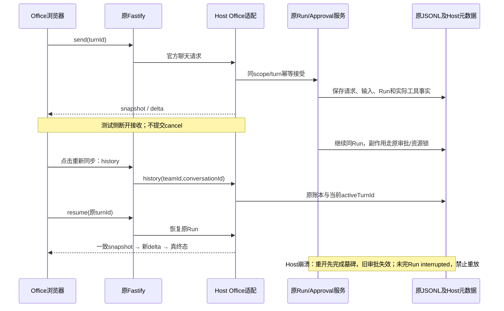

# CHG-2026-0007：T6故障恢复、官方续接与容量加固

**可审核提案2026-10-23-r1，待人工批准；本轮仅文档/清理/主目录同步，不实施T6生产或测试代码。**T5 PR #11已实际合入。本阶段让“查资料→确认写报告→查看结果”的产品在断网、崩溃和重复操作后仍可信。继续使用固定Office d150b96的官方四聊天操作与messages；不恢复旧R1四URL，不修改Office。本单第9节是实施方案，第10节V01—R10是完成标准，master的T6/M6统一导航本单。

## 1. 变更审批

| 审批项目 | 内容 |
| --- | --- |
| 项目CHG格式 | openpaw/chg-review-v2 |
| 变更编号 | CHG-2026-0007 |
| 变更标题 | T6故障恢复、官方续接与容量加固 |
| 当前状态 | 待审核（review）；提案及已授权维护，无T6实现授权 |
| 阶段 | T6 |
| 提案版本 | 2026-10-23-r1 |
| 变更类型 | 延展与缺陷修复（additive） |
| 风险等级 | 严重（critical） |
| 负责人 | 用户授权开发者（Codex） |
| 必须审核 | 本会话用户或指定非作者审核人 |
| 设计基线 | REQ-OP-008/009/011/013/014/016/019/020；DES-OP-003/006/007/008/009 |
| 目标分支 | merge/ai-ofice-react-overagent |
| 实施基线 | f22cca18d3667ded5dfed35d06085b260cc5a32d；T5 PR #11已合入 |
| 实施授权来源 | 用户授权PR合入后同步主目录、清理无用产物并继续；本单新T6方案仅起草未获编码授权 |
| 关联修订 | 无 |
| 历史元数据维护 | docs/changes/CHG-2026-0006.md |
| 历史说明维护 | 无 |
| 原交付状态 | 首次T6提案，无T6历史交付；T5 PR #11于2026-10-23 20:46:12合入 |
| 方案审核状态 | pending |
| 方案批准版本 | 待审核 |
| 方案审核人 | 待审核 |
| 方案审核时间 | 待审核 |
| 方案审核证据 | 待审核；泛化继续不替代本准确新方案批准 |
| 方案批准对象 | 待用户审核本次已提交提案对象后登记 |
| 交付验收状态 | pending |
| 交付验收提交 | 待实施与准确提交验证 |
| 交付验收人 | 待审核 |
| 交付验收时间 | 待审核 |
| 交付验收证据 | 待发生 |
| 验证证据 | docs/verification/CHG-2026-0007/验证记录.md；提案完整核查与未来V01—R10分开 |
| Linux验证提交 | 本轮提案准确提交由外部report.json绑定，T6实现尚无 |
| Linux验证结果 | 提案待本轮完整实测；T6功能验收未执行 |
| Linux验证证据 | /home/cheng/.cache/t6-proposal-full-20261023-a/report.json（产生后核对，不预记通过） |
| Windows验证提交 | 未执行 |
| Windows验证结果 | 用户已明确暂缓原生验证，未执行、不计通过；保留Windows10/11 x64适配 |
| Windows验证证据 | 本会话既定决定；不再重复请求环境，不适配macOS |
| 平台PR状态 | 未创建；提案不建Draft PR，实施验收后再提T6唯一主PR |
| 平台PR URL | 待发生 |
| 平台PR head | 待发生 |
| 平台审核证据 | 待发生；T5批准不覆盖T6 |
| 合入提交 | 待发生 |

## 2. 变更原因

用户实际使用时会刷新页面、切换办公室、遇到网络断开或服务重启。T5已能联网、审批后写真实报告、展示步骤/人物并查文件，但其53条产品记录只覆盖常规闭环及部分重启，不足以证明每个副作用边界、慢订阅、多页存档和上限都可靠。T6补这些组合，先复用并测试，只有复现缺陷才修原实现；不为了“有代码”重建Host。

只读核查基线为OpenPaw f22cca1及Office d150b96。源码落点：Store::recover先恢复删除墓碑、重建原索引，再以JSONL RunFinished补终态、失效旧审批；Host::snapshot_and_subscribe在单写序列内取得视图和订阅；chat::stream_run已有有界发送/断线退出；projection持久seq+完整内容；actions只有一个领取器；scene已有持久去重；turns已有稳定turn请求映射、分页和8MiB预算。应扩这些原入口，而不是新增第二套状态机、Node bridge或数据库。

协议逐链接依据：Office integration/README.md → office-integration.md的七messages、删除/创建/场景与恢复顺序；dashboard-integration.md的完整快照、引用与容量；message-relay.md的内存缓存、202及重启；chat-integration.md的history/resume/cancel、分页与NDJSON首snapshot。机器约束是固定packages/protocol的schema/office-integration/chat/office-ui及真实server和ChatSession，不根据旧计划编接口。

**已知资料差异：**固定chat-integration.md仍写单连接180秒，但d150b96的ChatSession.receive与服务器转发已移除该固定总时限，history/cancel仍有15秒控制期限；T5已实际运行190秒。T6记录此差异，不修改Office文档，不再把“等待180秒”当故障注入。网络中断使用测试端断开/阻断现有连接后点“重新同步”；自动无感重连是R8候选，未获批准。

替代方案：只重复T5 happy path不能暴露持久边界；复制新聊天服务会造成两套事实；改Office自动重连未获Rx授权。因此选择“扩现有回归与真浏览器故障矩阵→定位最小原模块修复→精确重验”。SDK适配留T7，发布包/原生Windows联合旅程留T8。当前不声称新缺陷已确诊或T6已完成。

## 3. 涉及仓库

| 仓库编号 | PR 或说明 |
| --- | --- |
| openpaw | 唯一开发目录/Office/openpaw；feat/engine-host-t6从已合入f22cca1创建；未来唯一主PR目标merge/ai-ofice-react-overagent。Office只读/隔离构建，不创建Office PR。 |

## 4. 允许修改文件

本轮提案已授权维护以“必改”列出；生产/测试及行为文档均为“条件”：只有本方案准确版本批准后才实施，不能因为列入就现在改。条件生产项还必须有可重复失败和明确D记录。发现涉及未列核心crate、公共接口、存储格式/权限/依赖或验收范围，先修订同一0007并重新审核。

| 仓库 | 操作 | 文件 | 模块或符号 | 文件负责人 | 为什么必须修改 | 对其他部分的影响 | 必要性 | 具体修改方向与复用方式 | 完成标准与证据 |
| --- | --- | --- | --- | --- | --- | --- | --- | --- | --- |
| openpaw | 新增 | docs/changes/CHG-2026-0007.md | T6唯一主CHG | 用户授权开发者 | T5已合入，下一阶段尚无可审核方案 | 仅OpenPaw提案，不授权Office | 必改 | 新增本十二节；分开提案、实现、验证、人审和合入 | 准确Git对象可审；不沿用T5授权 |
| openpaw | 修改 | docs/changes/CHG-2026-0006.md | 第1/12节历史元数据 | 用户授权开发者 | T5仍显示OPEN会误导下一阶段 | 保持官方协议、授权和旧CLI兼容 | 必改 | 只补用户确认、最终head、合入SHA/时间；批准正文摘要不变 | 原plan_digest一致，真实PR可核对 |
| openpaw | 修改 | docs/changes/INDEX.md | 原索引生成器 | 用户授权开发者 | 索引需显示T5合入和T6待审 | 保持官方协议、授权和旧CLI兼容 | 必改 | 运行原check.py index，不手填批准 | index --check通过 |
| openpaw | 修改 | docs/verification/追踪矩阵.md | 原追踪生成器 | 用户授权开发者 | 恢复/容量任务需关联原接口与测试 | 保持官方协议、授权和旧CLI兼容 | 必改 | 运行原check.py trace；提案定位已有入口，不声称新测试已存在 | trace --check通过 |
| openpaw | 新增 | docs/verification/CHG-2026-0007/验证记录.md | 提案与未来T6证据入口 | 用户授权开发者 | 必须区分本次维护、旧T5结果与新T6实测 | 保持官方协议、授权和旧CLI兼容 | 必改 | 新增验证边界、故障矩阵、外部报告导航；不复制配置/媒体 | 新测试未做明确待实施；原始失败保留 |
| openpaw | 修改 | docs/verification/CHG-2026-0006/工作区与产物清理.md | 主目录、运行依赖与清理履历 | 用户授权开发者 | PR合入后旧副本/回退程序可清理，旧用途说明需纠正 | 保持官方协议、授权和旧CLI兼容 | 必改 | 保留原记录，追加本轮逐项清单、压缩恢复法、主目录同步规则 | 可核对真实字节、hash、进程和五份用户文件保护 |
| openpaw | 修改 | docs/engine-host/master.md | 首页、T6卡、14.1/M6、15.4 | 用户授权开发者 | M5仍待合入且T6旧180秒描述与固定代码矛盾 | 保持官方协议、授权和旧CLI兼容 | 必改 | 补M5合入；T6导航本单9/10节，修正文档与代码时限区别 | 不把T6计划写完成；不复活旧R1四URL |
| openpaw | 修改 | docs/engine-host/handoff.md | 当前交接、同步与产物用途 | 用户授权开发者 | 开发者需从实际合入版本继续 | 保持官方协议、授权和旧CLI兼容 | 必改 | 前置最新T5合入/T6待审说明、当前服务与主目录操作顺序 | 可直接找到原会话、证据和下一阶段审批入口 |
| openpaw | 修改 | docs/requirements/产品需求说明.md | REQ-OP-009/016/020 | 用户授权开发者 | 实施后恢复行为或覆盖状态改变才需同步 | 保持官方协议、授权和旧CLI兼容 | 条件 | 仅实施有真实结果后更新对应需求状态与边界，不按测试数量造能力 | 结果可追到本单V01—R10及实际报告 |
| openpaw | 修改 | docs/design/软件设计说明.md | DES-OP-003/006/007/008/009 | 用户授权开发者 | 发现恢复竞态或持久顺序需修正时同步设计 | 保持官方协议、授权和旧CLI兼容 | 条件 | 更新原职责/状态/顺序及兼容；无行为变化只补验收说明 | 与代码/故障矩阵一致，无第二套恢复器 |
| openpaw | 修改 | docs/engine-host/audit.md | 已有D台账 | 用户授权开发者 | 仅新复现阻塞缺陷时登记，不能预造D项 | 保持官方协议、授权和旧CLI兼容 | 条件 | 按现有最大D编号递增；现象、根因、所属模块、修前/后测试 | 原D36仍开放，T6不顺手修不相关缺陷 |
| openpaw | 修改 | docs/engine-host/contracts/README.md | 官方恢复、限额和错误边界 | 用户授权开发者 | 故障验收发现摘要过期或需澄清时修改 | 保持官方协议、授权和旧CLI兼容 | 条件 | 补固定文档/源码差异、同seq恢复、history/resume及领取无ACK | 不改Schema、路由/字段、固定sources或SDK版本 |
| openpaw | 修改 | docs/engine-host/office-change-requests.md | 集中Rx申请 | 用户授权开发者 | 仅复现Office侧限制/缺陷时补原因与无修改替代 | 保持官方协议、授权和旧CLI兼容 | 条件 | 沿用原Rx，补准确文件/影响/测试/回退，状态全部待人工审核 | 不逐条催审，不据台账修改Office |
| openpaw | 修改 | crates/openpaw-engine-host/tests/regressions/recovery.rs | 既有host_recovery/child_fixture | 用户授权开发者 | 批准后扩已有子进程回归覆盖真实崩溃边界 | 保持官方协议、授权和旧CLI兼容 | 条件 | 复用临时home、原Host和子进程；确定性门控持久接受/写后/终态；不新建公共fault API | V03/V04/V05；新进程重开无重放，JSONL与DB一致 |
| openpaw | 修改 | crates/openpaw-engine-host/tests/regressions/office_delete.rs | 既有host_office_delete | 用户授权开发者 | 批准后验证墓碑提交与清除中断组合 | 保持官方协议、授权和旧CLI兼容 | 条件 | 扩原隔离DB/删除入口，断点重开、重复删除、其他Session和用户文件保全 | V05；原删除语义及真实文件断言不弱化 |
| openpaw | 修改 | crates/openpaw-engine-host/tests/regressions/office_sync.rs | 既有host_office_sync | 用户授权开发者 | 批准后补确认丢失/旧回执/Office重启组合 | 保持官方协议、授权和旧CLI兼容 | 条件 | 复用原HTTP夹具/完整投影，保存请求原始字节；真实服务另由产品入口验 | V06；同seq同内容、冲突不靠新seq掩盖 |
| openpaw | 修改 | crates/openpaw-engine-host/tests/features/office.rs | 既有host_office | 用户授权开发者 | 批准后补慢消费者、目录/历史容量与隔离 | 保持官方协议、授权和旧CLI兼容 | 条件 | 扩原真实路由/Provider/工具，边界值和并发；不对用户演示库压测 | V01/V07/V08；终态保存不被订阅阻塞 |
| openpaw | 修改 | crates/openpaw-engine-host/tests/features/office_interactions.rs | 既有host_office_interactions | 用户授权开发者 | 批准后补迟到审批/动作到期/容量与取消竞争 | 保持官方协议、授权和旧CLI兼容 | 条件 | 扩原共享审批/HTTP与工作区文件断言；UI未知结果绝不批准 | V02/V04/V09；绑定及一次消费不变 |
| openpaw | 修改 | tests/engine-host-contracts/office-product.mjs | 原27项中的TEST-OFFICE-PRODUCT | 用户授权开发者 | 批准后把T6真浏览器故障旅程挂入已有入口 | 保持官方协议、授权和旧CLI兼容 | 条件 | 复用当前Host/Fastify/Chromium/Provider/网络门控和产物对账，调用薄测试助手 | V01—R10真实网页/JSONL/磁盘/进程记录，不复制服务或源码 |
| openpaw | 新增 | tests/engine-host-contracts/office-resilience.mjs | T6产品故障旅程助手 | 用户授权开发者 | 仅原runner新增场景过长且可复用时提取，当前尚无该职责模块 | 保持官方协议、授权和旧CLI兼容 | 条件 | 作为被原runner直接调用的测试函数，接收既有上下文/生命周期；不独立安装、构建或造桥 | 原TEST-OFFICE-PRODUCT确实执行；不用新依赖/命令跳过场景 |
| openpaw | 修改 | tests/engine-host-contracts/README.md | 原产品验收命令 | 用户授权开发者 | 批准后新场景和证据定位需人可重复执行 | 保持官方协议、授权和旧CLI兼容 | 条件 | 补相同入口、故障种子/触发点、容量、超时、保留/重建与恢复 | Linux可重复；Windows待原生运行，不计本轮通过 |
| openpaw | 修改 | crates/openpaw-engine-host/src/store.rs | Db::recover/save_run/office_projection/purge_session | 用户授权开发者 | 批准后故障测试若复现JSONL事实与派生索引恢复顺序问题才修改 | 保持官方协议、授权和旧CLI兼容 | 条件 | 仅V03—R06复现数据顺序错误时修原单写协调；必要inline私有故障回归，不引入运行时fault开关 | 先登记D项与修前失败，修后原完整套件及对应真实旅程；无复现不动生产代码 |
| openpaw | 修改 | crates/openpaw-engine-host/src/service.rs | snapshot_and_subscribe/运行注册表/取消与关闭 | 用户授权开发者 | 批准后故障测试若复现快照订阅、并发容量与恢复竞态问题才修改 | 保持官方协议、授权和旧CLI兼容 | 条件 | 仅V01/V03/V07/R08复现时收紧原序列和取消等待；每Run独立引擎不变 | 先登记D项与修前失败，修后原完整套件及对应真实旅程；无复现不动生产代码 |
| openpaw | 修改 | crates/openpaw-engine-host/src/session_delete.rs | delete_session | 用户授权开发者 | 批准后故障测试若复现持久墓碑与清理生命周期问题才修改 | 保持官方协议、授权和旧CLI兼容 | 条件 | 仅R05复现时修原删除协调，不随HTTP丢弃，不全局等空闲 | 先登记D项与修前失败，修后原完整套件及对应真实旅程；无复现不动生产代码 |
| openpaw | 修改 | crates/openpaw-engine-host/src/office/chat.rs | stream_run/handle | 用户授权开发者 | 批准后故障测试若复现断连/慢消费者与官方四操作问题才修改 | 保持官方协议、授权和旧CLI兼容 | 条件 | 仅V01/R07复现时修原流循环和有界通道；detach不cancel，snapshot首条 | 先登记D项与修前失败，修后原完整套件及对应真实旅程；无复现不动生产代码 |
| openpaw | 修改 | crates/openpaw-engine-host/src/office/turns.rs | history/send/resume/cancel | 用户授权开发者 | 批准后故障测试若复现稳定turn幂等/分页/已删作用域问题才修改 | 保持官方协议、授权和旧CLI兼容 | 条件 | 仅V01/V03/R08复现时修原持久请求映射和分页；保留turn/Run ID，无额外URL | 先登记D项与修前失败，修后原完整套件及对应真实旅程；无复现不动生产代码 |
| openpaw | 修改 | crates/openpaw-engine-host/src/office/projection.rs | Coordinator/prepare/sync_once | 用户授权开发者 | 批准后故障测试若复现完整快照seq、裁剪与重启问题才修改 | 保持官方协议、授权和旧CLI兼容 | 条件 | 仅V06/R08复现时修原持久投影和回执校验，引用闭包裁剪；不拆局部快照 | 先登记D项与修前失败，修后原完整套件及对应真实旅程；无复现不动生产代码 |
| openpaw | 修改 | crates/openpaw-engine-host/src/office/client.rs | Client::post | 用户授权开发者 | 批准后故障测试若复现失联/确认未知/回执校验问题才修改 | 保持官方协议、授权和旧CLI兼容 | 条件 | 仅V06/R09复现时修原操作超时与结果映射，不盲重试副作用/携密钥重定向 | 先登记D项与修前失败，修后原完整套件及对应真实旅程；无复现不动生产代码 |
| openpaw | 修改 | crates/openpaw-engine-host/src/office/approvals.rs | 原展示尝试到共享审批 | 用户授权开发者 | 批准后故障测试若复现旧菜单晚到/刷新/重启竞争问题才修改 | 保持官方协议、授权和旧CLI兼容 | 条件 | 仅V02/R04复现时修活动display校验/期限/取消；业务审批继续原CAS | 先登记D项与修前失败，修后原完整套件及对应真实旅程；无复现不动生产代码 |
| openpaw | 修改 | crates/openpaw-engine-host/src/office/actions.rs | 唯一ui.next与有界任务 | 用户授权开发者 | 批准后故障测试若复现领取后断线/过期/并发队列问题才修改 | 保持官方协议、授权和旧CLI兼容 | 条件 | 仅V05/R09复现时修原记录/期限/响应，继续明确无ACK，不能承诺恰好一次 | 先登记D项与修前失败，修后原完整套件及对应真实旅程；无复现不动生产代码 |
| openpaw | 修改 | crates/openpaw-engine-host/src/office/workspaces.rs | office.create/active | 用户授权开发者 | 批准后故障测试若复现创建确认丢失与目录容量恢复问题才修改 | 保持官方协议、授权和旧CLI兼容 | 条件 | 仅V08/R09复现时修原预授权槽幂等/恢复，不由名称创建磁盘路径 | 先登记D项与修前失败，修后原完整套件及对应真实旅程；无复现不动生产代码 |
| openpaw | 修改 | crates/openpaw-engine-host/src/office/scene.rs | 真实事实到v2命令 | 用户授权开发者 | 批准后故障测试若复现断线重启不补播旧动画问题才修改 | 保持官方协议、授权和旧CLI兼容 | 条件 | 仅R06复现时修原stable事件/TTL/去重；动画结果不决定Run成功 | 先登记D项与修前失败，修后原完整套件及对应真实旅程；无复现不动生产代码 |

## 5. 明确禁止范围

| 仓库 | 禁止路径 | 为什么禁止 |
| --- | --- | --- |
| openpaw | crates/openpaw-core/** | 不扩公共运行契约，不把Office DTO送入核心 |
| openpaw | crates/openpaw-engine/** | 复用既有AgentLoop；若原模块故障阻塞，修订本单再审 |
| openpaw | crates/openpaw-store/** | 复用原JSONL/索引接口，不在Host复制存储解析器；越界修订再审 |
| openpaw | crates/openpaw-tools/** | 不复制工具主体/改变审批等级；必要修复先说明重审 |
| openpaw | crates/openpaw-sandbox/** | 复用现有进程组/Job，不能未经原模块方案审查扩隔离/进程管理 |
| openpaw | crates/openpaw-llm/** | 不改模型协议/重试/上下文，确定性测试复用原HTTP Provider |
| openpaw | governance/** | 不为Windows暂缓、未授权或测试失败修改门禁 |
| openpaw | .github/** | 不改账单、平台矩阵或跳过作业造绿 |
| openpaw | AGENTS.md | 原主目录/事前审批/清理规则已经存在，本阶段遵守即可 |
| openpaw | Cargo.lock | 无新依赖，不升级锁图 |

Office整个主工程及其文档/源码/测试/配置/锁文件/生成文件均不改；现有两份用户架构文档保持字节不变。OpenPaw原三份用户文档不覆盖、提交或还原；/home/cheng/.openpaw/.env原位读取不复制/打印/修改。故障、压力、崩溃、磁盘错误只在全新隔离home/根/端口执行，绝不终止原8765演示或挤占用户真实工作区。参考Kunlun工程不动。禁止删除原失败证据掩盖问题。

## 6. API 变化

无新增外部接口。本期固定POST /office/chat内type=send/history/resume/cancel；Host直接调用原Rust共享服务；业务仍用Office官方messages及v2场景入口。内部私有修复不得改变公共函数签名、HTTP字段/状态或新建fault路由。需要这类变化先修订重审。原Basic、loopback、根授权和审批边界保持。

## 7. 字段变化

无新增持久表、列、user_version、配置字段或浏览器存档字段。继续schema4与原host_requests、host_runs、host_approvals、墓碑和完整投影。故障测试读取这些真实记录交叉核对，不直接改库伪造一次成功；合成迁移/损坏夹具明确标注为测试。测试报告新增的场景/触发点/hash仅为仓库外证据，非产品数据格式。

## 8. 保护路径

本单风险critical。按profile逐路径保留最严格保护；作者不自批。

| 仓库 | 文件或路径 | 等级 | 负责人 | 为什么需要保护 |
| --- | --- | --- | --- | --- |
| openpaw | docs/changes/CHG-2026-0007.md | L3 | 用户或指定非作者审核人 | 保留既有范围/权限/事实约束；仅按本单条件与证据审核 |
| openpaw | docs/changes/CHG-2026-0006.md | L3 | 用户或指定非作者审核人 | 保留既有范围/权限/事实约束；仅按本单条件与证据审核 |
| openpaw | docs/changes/INDEX.md | L3 | 用户或指定非作者审核人 | 保留既有范围/权限/事实约束；仅按本单条件与证据审核 |
| openpaw | docs/verification/追踪矩阵.md | L3 | 用户或指定非作者审核人 | 保留既有范围/权限/事实约束；仅按本单条件与证据审核 |
| openpaw | docs/verification/CHG-2026-0007/验证记录.md | L3 | 用户或指定非作者审核人 | 保留既有范围/权限/事实约束；仅按本单条件与证据审核 |
| openpaw | docs/verification/CHG-2026-0006/工作区与产物清理.md | L3 | 用户或指定非作者审核人 | 保留既有范围/权限/事实约束；仅按本单条件与证据审核 |
| openpaw | docs/engine-host/master.md | L4 | 用户或指定非作者审核人 | 保留既有范围/权限/事实约束；仅按本单条件与证据审核 |
| openpaw | docs/engine-host/handoff.md | L1 | 用户或指定非作者审核人 | 保留既有范围/权限/事实约束；仅按本单条件与证据审核 |
| openpaw | docs/requirements/产品需求说明.md | L3 | 用户或指定非作者审核人 | 保留既有范围/权限/事实约束；仅按本单条件与证据审核 |
| openpaw | docs/design/软件设计说明.md | L3 | 用户或指定非作者审核人 | 保留既有范围/权限/事实约束；仅按本单条件与证据审核 |
| openpaw | docs/engine-host/audit.md | L1 | 用户或指定非作者审核人 | 保留既有范围/权限/事实约束；仅按本单条件与证据审核 |
| openpaw | docs/engine-host/contracts/README.md | L3 | 用户或指定非作者审核人 | 保留既有范围/权限/事实约束；仅按本单条件与证据审核 |
| openpaw | docs/engine-host/office-change-requests.md | L1 | 用户或指定非作者审核人 | 保留既有范围/权限/事实约束；仅按本单条件与证据审核 |
| openpaw | crates/openpaw-engine-host/tests/regressions/recovery.rs | L4 | 用户或指定非作者审核人 | 保留既有范围/权限/事实约束；仅按本单条件与证据审核 |
| openpaw | crates/openpaw-engine-host/tests/regressions/office_delete.rs | L4 | 用户或指定非作者审核人 | 保留既有范围/权限/事实约束；仅按本单条件与证据审核 |
| openpaw | crates/openpaw-engine-host/tests/regressions/office_sync.rs | L4 | 用户或指定非作者审核人 | 保留既有范围/权限/事实约束；仅按本单条件与证据审核 |
| openpaw | crates/openpaw-engine-host/tests/features/office.rs | L4 | 用户或指定非作者审核人 | 保留既有范围/权限/事实约束；仅按本单条件与证据审核 |
| openpaw | crates/openpaw-engine-host/tests/features/office_interactions.rs | L4 | 用户或指定非作者审核人 | 保留既有范围/权限/事实约束；仅按本单条件与证据审核 |
| openpaw | tests/engine-host-contracts/office-product.mjs | L3 | 用户或指定非作者审核人 | 保留既有范围/权限/事实约束；仅按本单条件与证据审核 |
| openpaw | tests/engine-host-contracts/office-resilience.mjs | L3 | 用户或指定非作者审核人 | 保留既有范围/权限/事实约束；仅按本单条件与证据审核 |
| openpaw | tests/engine-host-contracts/README.md | L3 | 用户或指定非作者审核人 | 保留既有范围/权限/事实约束；仅按本单条件与证据审核 |
| openpaw | crates/openpaw-engine-host/src/store.rs | L4 | 用户或指定非作者审核人 | 保留既有范围/权限/事实约束；仅按本单条件与证据审核 |
| openpaw | crates/openpaw-engine-host/src/service.rs | L4 | 用户或指定非作者审核人 | 保留既有范围/权限/事实约束；仅按本单条件与证据审核 |
| openpaw | crates/openpaw-engine-host/src/session_delete.rs | L4 | 用户或指定非作者审核人 | 保留既有范围/权限/事实约束；仅按本单条件与证据审核 |
| openpaw | crates/openpaw-engine-host/src/office/chat.rs | L4 | 用户或指定非作者审核人 | 保留既有范围/权限/事实约束；仅按本单条件与证据审核 |
| openpaw | crates/openpaw-engine-host/src/office/turns.rs | L4 | 用户或指定非作者审核人 | 保留既有范围/权限/事实约束；仅按本单条件与证据审核 |
| openpaw | crates/openpaw-engine-host/src/office/projection.rs | L4 | 用户或指定非作者审核人 | 保留既有范围/权限/事实约束；仅按本单条件与证据审核 |
| openpaw | crates/openpaw-engine-host/src/office/client.rs | L4 | 用户或指定非作者审核人 | 保留既有范围/权限/事实约束；仅按本单条件与证据审核 |
| openpaw | crates/openpaw-engine-host/src/office/approvals.rs | L4 | 用户或指定非作者审核人 | 保留既有范围/权限/事实约束；仅按本单条件与证据审核 |
| openpaw | crates/openpaw-engine-host/src/office/actions.rs | L4 | 用户或指定非作者审核人 | 保留既有范围/权限/事实约束；仅按本单条件与证据审核 |
| openpaw | crates/openpaw-engine-host/src/office/workspaces.rs | L4 | 用户或指定非作者审核人 | 保留既有范围/权限/事实约束；仅按本单条件与证据审核 |
| openpaw | crates/openpaw-engine-host/src/office/scene.rs | L4 | 用户或指定非作者审核人 | 保留既有范围/权限/事实约束；仅按本单条件与证据审核 |

## 9. 影响、数据流和实现

### 9.1 四包按顺序实施，每包先复用再验证

1. **续接与多页面（V01/V02）**：扩原HTTP Provider确定性长流，完整运行超过190秒；测试侧在可观察到某个已保存文本/call后切断现有流，保留Run；网页真实点击重新同步，history返回原activeTurnId，resume首snapshot覆盖已知文本，增量接在同Run。刷新/关页/切换只detach；停止走cancel，原Run清理完成前不显示已停止。两独立浏览器context同时读取与停止，核对同Run状态和文本一致；动画各自播放，不要求逐帧相同。
2. **崩溃与副作用（V03—V05）**：复用recovery.rs子进程fixture和原数据目录，外部观察到明确持久边界后硬终止隔离Host；重开原home核对账本/DB/审批/文件。先做接受、审批等待，再做批准待资源、成功写后未终态、JSONL终态已保存而索引未更新、墓碑/清理中断。用Provider门控、外部文件锁/只读DB查询及私有inline回归建立确定性屏障，禁止sleep碰运气宣称命中。若关键边界无法用既有接口命中，仅在原私有模块cfg(test)中注入错误；产品进程用可观察的邻接持久边界，记录两类覆盖的区别，不冒充OS断电语义。
3. **Office确认与容量（V06—V09）**：复用既有Office HTTP夹具和真Fastify；测试端控制“服务已接受但回执丢失”、202缓存、Office重启、旧回执晚到、慢接收/界限/503。请求成功、缓存、页面应用分别对账。容量测试用隔离根与缩短合成内容，不创建100个浏览器页/重编100份Office。
4. **产品复验与交接（V10）**：前面通过后执行原27项完整套件，保留所有原断言；跑真实网页“查资料→审批写报告→网络断开→重新同步/刷新→查看同一文件→停止另一任务”的路径，使用确定性Provider稳定故障时机；最终再在独立演示会话做配置好的真实DeepSeek冒烟，核对实际工具/来源/文件，不依赖模型随机复现所有崩溃。原用户天气会话不做破坏性故障。形成M6核查、用户验收准确提交后才提PR。

### 9.2 交互与恢复顺序

浏览器既有本地档案的CAS冲突和读写异常由Office负责。测试可通过浏览器公开行为/隔离profile注入存储拒绝，验证旧内容保留及提示；不改Office或让Host猜测浏览器写入成功。遇到Office真实缺陷，集中Rx列原因/最小方案/影响，先保留可操作替代，不伪记通过。

### 9.3 必须逐边界核对的事实

**请求已接受、模型尚未调用**：同turn只有一个已记录Run；重启未完者interrupted；自动再跑一次取得回复。

**等待审批或批准后仍等资源**：原审批过期/未消费，不再执行；旧HTTP回复拒绝；已批准就能跨重启继续执行。

**文件原子提交成功、终态未保存**：文件事实保留；Run按可靠事实恢复或中断，旧call不自动重放；回滚已成功写入；对任意外部系统端到端恰好一次。

**JSONL已保存RunFinished、派生状态尚未更新**：复用原Reader恢复真实终态，索引可重建；只凭SQLite旧字段改写事实。

**删除墓碑已保存、物理清理未完**：重开先清理，原scope不复活，其他Session/工作区文件不受影响；清空整个home或删除报告来“修好”。

**旧展示/领取/场景HTTP晚到**：校验原ID、范围、期限/状态；未知不批准，不补播历史动画；UI领取无ACK但可可靠重投每次动作。

普通shell的Host硬崩溃不等同显式取消。现有进程组/Job需要单独实证：隔离测试检查残留并清理，不把“重启不重放”写成“任意崩溃都无残留”。若复现原sandbox需改进，登记D项与准确原模块修订回本单再审，不在Host复制进程管理。对磁盘错误同理：优先SQLite只读/受控失败/原私有边界注入，Linux权限错误验证真实非特权路径，不能root下chmod成功假称失败已覆盖；不填满用户磁盘、不改挂载。

### 9.4 容量、权限与可执行限额

默认全局4活动Run、同Session冲突；第5个明确capacity_exceeded且不生成第二条可运行请求，或按现有已冻结接受规则返回，不新增默默排队。允许根/同办公室并发遵循现有master当前多会话规则，不恢复旧“一办公室一Run”限制。

固定协议：办公室≤100、每间会话≤100，成员≤200、任务≤1000、事件≤500；messages完整UTF-8≤64KiB，Office缓存总8MiB，history页≤8MiB；UI原队列128/60秒、处理超过容量503。先用Schema边界验证，再用真实Office服务验证实际接收/错误与有界投影。100间/每间100会话并不保证任意最长文本同时装进64KiB；在预算内保持完整会话目录和必要引用，任务/事件只裁展示，原账本完整可分页。不得把1000 tasks Schema上限误当当前Host必须生成1000任务。

慢接收者只能丢自己的连接/订阅，不能拖住Store终态和其他会话；恢复时重取一致快照/游标，不能丢审批/终态。压力测试记录运行环境、输入大小、峰值并发、实际耗时与上限结果，不凭机器速度设虚构SLA；每步有有限超时，卡住以失败保存而非无限重试。

### 9.5 主目录与证据管理持续规则

每轮先在/Office/openpaw核对branch/HEAD/status、只读查询前序PR和fetch集成分支。前序已合入才从最新集成基线开下一Tx；本Tx未合入时继续当前开发分支，不reset覆盖、不复制源码到artifacts、不在干净验证检出开发。只选择性提交本单文件，三份用户文档持续以原hash保护。

artifacts按现有路径保存当前运行、用户数据/必要备份、原成功失败证据和清理索引；不为整齐迁移全部绝对证据路径。大debug只保留当前使用的一份，历史程序依记录源码/构建命令重建；当前schema4完整备份与旧v3数据备份保留。隔离Office检出/依赖在准确版本验收后核对进程/dirty再删除，报告、trace/录像/账本不能混删。停用大文本日志可gzip无损归档并核对解压hash，原路径→压缩路径与恢复法入清单；活进程输出不截断。当前依赖t3-tools保留，不能因目录名旧就删掉实际Node/gh。

| 文档 | 章节与处理理由 |
| --- | --- |
| docs/requirements/产品需求说明.md | REQ-OP-009/016/020，仅实施后同步可靠恢复/未覆盖边界，不提前标完成 |
| docs/design/软件设计说明.md | DES-OP-003/006/007/008/009，原职责内最小修复；协议/数据新设计另审 |
| docs/engine-host/master.md | T6/M6/15.4导航本单；M5合入事实与180秒资料差异纠正 |
| docs/engine-host/contracts/README.md | 条件补恢复/错误和资料差异，不改固定Schema/SDK |
| docs/engine-host/handoff.md | 上一PR真实合入、当前服务、下一Tx提案与唯一主目录 |
| docs/engine-host/office-change-requests.md | 只集中补复现/必要扩展，全部Office待统一人工审核，R11仍暂缓 |
| docs/verification/CHG-2026-0006/工作区与产物清理.md | 追溯本轮删除、无损压缩、用途/恢复与进程保护 |

## 10. 验收测试

### 10.1 保留现有完整27项，不替换为定向成功

批准实施后的最终准确候选必须完整执行下列原注册命令；本轮提案也按stage=proposal完整验证，二者分开记录。

| 测试编号 | 执行命令 | 场景和通过条件 |
| --- | --- | --- |
| TEST-FMT | cargo fmt --all -- --check | 原命令/断言保留，真实退出码0；T6旅程纳入既有相应测试入口 |
| TEST-RUST-DEFAULT | cargo test --locked --workspace | 原命令/断言保留，真实退出码0；T6旅程纳入既有相应测试入口 |
| TEST-RUST-ALL | cargo test --locked --workspace --all-features | 原命令/断言保留，真实退出码0；T6旅程纳入既有相应测试入口 |
| TEST-CLIPPY-DEFAULT | cargo clippy --locked --workspace --all-targets -- -D warnings | 原命令/断言保留，真实退出码0；T6旅程纳入既有相应测试入口 |
| TEST-CLIPPY-ALL | cargo clippy --locked --workspace --all-targets --all-features -- -D warnings | 原命令/断言保留，真实退出码0；T6旅程纳入既有相应测试入口 |
| TEST-FEATURES | cargo build --locked -p openpaw-cli --features engine-host,sidecar | 原命令/断言保留，真实退出码0；T6旅程纳入既有相应测试入口 |
| TEST-MSRV-DEFAULT | cargo +1.88.0 check --locked --workspace --all-targets | 原命令/断言保留，真实退出码0；T6旅程纳入既有相应测试入口 |
| TEST-MSRV-ALL | cargo +1.88.0 check --locked --workspace --all-targets --all-features | 原命令/断言保留，真实退出码0；T6旅程纳入既有相应测试入口 |
| TEST-DEFAULT-TREE | cargo tree --locked -p openpaw-cli --edges normal --prefix none | 原命令/断言保留，真实退出码0；T6旅程纳入既有相应测试入口 |
| TEST-QUALITY-LINES | cargo run --locked -p xtask -- lines | 原命令/断言保留，真实退出码0；T6旅程纳入既有相应测试入口 |
| TEST-QUALITY-SCRUB | cargo run --locked -p xtask -- scrub --check | 原命令/断言保留，真实退出码0；T6旅程纳入既有相应测试入口 |
| TEST-QUALITY-SNAPSHOT | cargo run --locked -p xtask -- snapshot --check | 原命令/断言保留，真实退出码0；T6旅程纳入既有相应测试入口 |
| TEST-QUALITY-GOLDEN | cargo run --locked -p xtask -- golden | 原命令/断言保留，真实退出码0；T6旅程纳入既有相应测试入口 |
| TEST-QUALITY-TELEMETRY | cargo run --locked -p xtask -- telemetry | 原命令/断言保留，真实退出码0；T6旅程纳入既有相应测试入口 |
| TEST-QUALITY-STABILITY | cargo run --locked -p xtask -- stability | 原命令/断言保留，真实退出码0；T6旅程纳入既有相应测试入口 |
| TEST-QUALITY-SMOKE | cargo run --locked -p xtask -- smoke-offline | 原命令/断言保留，真实退出码0；T6旅程纳入既有相应测试入口 |
| TEST-DENY | cargo deny --workspace check | 原命令/断言保留，真实退出码0；T6旅程纳入既有相应测试入口 |
| TEST-CONTRACT-PREPARE | npm run prepare:office | 原命令/断言保留，真实退出码0；T6旅程纳入既有相应测试入口 |
| TEST-CONTRACT-TYPES | npm run check | 原命令/断言保留，真实退出码0；T6旅程纳入既有相应测试入口 |
| TEST-CONTRACTS | npm test | 原命令/断言保留，真实退出码0；T6旅程纳入既有相应测试入口 |
| TEST-GOV | {python} -m unittest discover -s governance/tests -v | 原命令/断言保留，真实退出码0；T6旅程纳入既有相应测试入口 |
| TEST-GOV-VALIDATE | {python} governance/check.py validate | 原命令/断言保留，真实退出码0；T6旅程纳入既有相应测试入口 |
| TEST-GOV-INDEX | {python} governance/check.py index --check | 原命令/断言保留，真实退出码0；T6旅程纳入既有相应测试入口 |
| TEST-GOV-TRACE | {python} governance/check.py trace --check | 原命令/断言保留，真实退出码0；T6旅程纳入既有相应测试入口 |
| TEST-COMMENTS | cargo run --locked -p xtask -- comments --base {base} --head {head} | 原命令/断言保留，真实退出码0；T6旅程纳入既有相应测试入口 |
| TEST-GOV-DIFF | {python} governance/check.py pr-check --base {base} --head {head} | 原命令/断言保留，真实退出码0；T6旅程纳入既有相应测试入口 |
| TEST-OFFICE-PRODUCT | node tests/engine-host-contracts/office-product.mjs | 原命令/断言保留，真实退出码0；T6旅程纳入既有相应测试入口 |

### 10.2 T6逐项完成标准：不是本轮已经完成

**V01**：>190秒流；已经显示/保存文本后主动切断当前网络连接；刷新/手动重新同步；同turn/Run、snapshot后delta无缺失重复、detach不取消、无新模型/工具；停止后真实清理；原产品runner真Chromium+Fastify+Host；网络触发时间、截图/trace、HTTP、JSONL、Run ID。

**V02**：两页同会话、跨办公室切换；待审刷新；本地CAS/存储拒绝；独立草稿/明确冲突提示，原档案不被覆盖；同审批唯一有效display/一次消费；可重新进入原Run；原office_interactions及产品runner；两context、无清库截图、审批binding/consumed。

**V03**：已接受、输入保存后、文本保存中、终态分阶段硬停隔离Host并重启；未完interrupted或按原JSONL可靠终态恢复；同turn不生成第二Run；模型/工具不自动重放；recovery.rs子进程；触发屏障、模型请求计数、账本事件/DB、重启日志。

**V04**：待审批、批准等锁、写成功后等待模型时重启/取消；旧审批回执晚到；审批未执行前文件hash不变，旧批失效；已提交文件保留且无重复write，终态与事实相符；原共享审批/工具及临时根；修前/后hash、call ID、一次消费和实际started。

**V05**：删除墓碑后/派生清除中断，重复删除/旧send/resume；原scope不复活、JSONL与索引/派生清理完成；其他会话/用户产物保持；office_delete.rs+产品删除；墓碑阶段/原文件清单/hash/重启history错误。

**V06**：snapshot已接收但响应丢失、同seq重试、旧回执、202、Office停启；同版内容字节不变，applied/cached/ignored分别正确；重启重初始化/完整同步；不补播旧动画；office_sync.rs+真实Office；原请求hash/seq/回执、页面快照和场景ID。

**V07**：慢或停止读的聊天连接、并发取消/查询/其他会话；Store终态可靠落盘；其他Run可完成；慢连接有界退出，可恢复；不是全局阻塞；office.rs/产品网络门控；耗时/排队上限、HTTP/账本/终态与子进程清理。

**V08**：4Run满额第5请求、100办公室/每间100会话、64KiB/8MiB及目录/历史分页边界；超限明确错误，无占错槽/假成功；投影引用闭包/当前审批不丢；完整账本仍能分页且cursor前进；原Schema/office.rs/产品服务；尺寸/数量、失败码、活跃数与完整页对账。

**V09**：ui.next领取后断开/处理到期、503、创建确认丢失；磁盘失败；无ACK边界明确，不自动重放有副作用action；创建占同一预授权槽；存储故障不假done/批准；原UI/创建/恢复回归和真服务；已领取/过期/未知记录、文件hash、原始错误。

**V10**：前述修复后的完整产品演示、真实DeepSeek冒烟及回退演练；原27项全过，V01—R09逐项有真实结果或阻塞；Linux可演示，Windows暂缓不计通过；Office未改；准确提交完整report、截图/trace/录像/真实工具/产物hash、M6核查和备份恢复记录。

对仅能私有inline注入的极窄磁盘/事务边界写明覆盖层级；真网页不代替存储断点，内存fixture不代替网页。故障触发前后的同ID、次数、文件/账本/DB和页面至少两类独立事实对账。真实数据不复制到docs；报告只放脱敏索引/必要hash。若某必需项发现需Office或未列原模块改动，记录阻塞并修订/归档Rx，不能偷偷排除后宣称T6整体完成。

### 10.3 执行与阶段门禁

定向Rust：cargo test --locked -p openpaw-engine-host --features engine-host --test host_recovery；另按上述入口执行host_office/host_office_sync/host_office_interactions/host_office_delete。最终使用governance/verify.py --suite all --source head --stage implementation --base f22cca18d3667ded5dfed35d06085b260cc5a32d --head HEAD --output 仓库外新目录。head必须在干净准确检出，原主目录用户修改不暗中排除；提案阶段将stage改proposal，不能把未批准提案跑成implementation。

Linux本轮执行真实完整套件；Windows原生按用户决定暂缓，保留原平台代码/CI要求，不写passed。云端因账单未启动如实记not-started。delivery检查器原双平台条件不满足时照实保留，不改规则造绿。T6仍须满足原用户指定的Linux当前交付验收、PR非作者审核及真实合入，才可进入T7；Windows发布通过留待原生补验。

## 11. 追踪、兼容和回滚

| 需求编号 | 设计章节 | 接口编号 | 代码文件或符号 | 测试编号 | 验收证据 |
| --- | --- | --- | --- | --- | --- |
| REQ-OP-009 | DES-OP-009 | 无新增 | crates/openpaw-engine-host/src/store.rs::recover | TEST-RUST-ALL | V03—R05原始报告，当前待实施 |
| REQ-OP-016 | DES-OP-007 | 无新增 | crates/openpaw-engine-host/src/office/chat.rs::stream_run | TEST-OFFICE-PRODUCT | V01/V02/V07；当前待实施 |
| REQ-OP-011 | DES-OP-007 | 无新增 | crates/openpaw-engine-host/src/office/projection.rs::prepare | TEST-OFFICE-PRODUCT | V06/R08完整seq/引用/容量；当前待实施 |
| REQ-OP-013 | DES-OP-008 | 无新增 | crates/openpaw-engine-host/src/office/approvals.rs | TEST-RUST-ALL | V02/V04/V09，当前待实施 |
| REQ-OP-014 | DES-OP-009 | 无新增 | crates/openpaw-engine-host/src/session_delete.rs::delete_session | TEST-RUST-ALL | V05，当前待实施 |
| REQ-OP-020 | DES-OP-001 | 无新增 | governance/check.py | TEST-GOV | 准确方案、完整验证及PR状态独立记录 |

无版本/依赖/配置迁移。继续旧CLI、默认feature隔离和sidecar共存；新测试不扩大运行权限。上线先等原服务空闲并完整备份home/host.db伴随文件/JSONL/index/配置引用，再部署准确已测候选；不复制.env。不改schema时可用原T5程序开原格式数据；若恢复需旧数据，先停止全部写入、完整保留现场，使用同版配套备份，不能只换单个SQLite或重放旧请求。

本轮删除的旧debug可按原commit和cargo命令重建；无损压缩日志可gzip -dk还原，归档资源按清单只在仓库外恢复。当前运行二进制和用户数据保留。下一T7输入为经V01—R10实测的共享服务、故障矩阵/fixtures、准确数据/取消/审批规则及未批准Rx，不带第二套SDK运行状态。

## 12. 验证和审批记录

2026-10-23（Asia/Shanghai）：T5 PR #11已合入f22cca1，用户要求清理artifacts、始终以/Office/openpaw为最新开发目录并继续。已核对进程和五份原用户文件，主目录从集成最新提交创建feat/engine-host-t6。维护行为已获本轮直接授权；本0007 r1是首次T6可审核方案，尚无准确方案批准/生产实现/新增测试/交付验收/PR。Office所有修改仍暂缓，R11保留并请看集中申请单。

本次清理逐项机器记录artifacts/maintenance-20261023-pr11/cleanup.json：删除两份停用ELF、已核实1254份源码的旧Office副本；122份未完全确源资源无损归档保留；三份停用日志gzip后解压hash一致。原成功/失败报告、截图、trace/视频、home/用户文件/备份/配置以及活进程程序未删。清理前2313291899字节，清理后1292400457字节，释放1020891442字节（随后新提案证据会增加少量占用）。不把缓存迁走计为释放空间。

提案准确提交与本轮完整命令/退出码由/home/cheng/.cache/t6-proposal-full-20261023-a/report.json绑定；结果形成前不在本单预填passed。实际V01—R10全部待准确版本批准后实施和实测，旧T5结果不能代替。用户审阅准确已提交提案后在本单第1/12节登记真实决定，批准才开始实施；若扩范围仍修订同一0007而不增Tx/审核总单。
