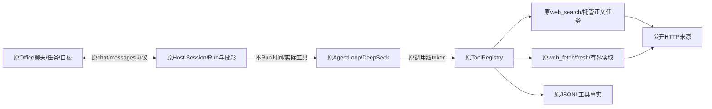

# OpenPaw Office 软件设计说明

版本：2026-10-23；基线为engine-host/master.md及Office02dbac4。T3共享Host、T4只读Office已合入（#10/37f0a35）；最新状态以0005/0006及master14.1为准。T5具体时序/迁移/文件理由为获批0006 r1，已实现并进行交付技术核查；Windows原生暂缓未验证。历史候选段保留原时点。

产品复检设计增量（2026-10-23，r2/r3已批准且已实现，交付待验收）：DES-OP-006/007/008按[0006第9.9节](../changes/CHG-2026-0006.md#t5-r2-product)引入Host运行内report_progress薄入口，复用原ToolSpec/ToolExecutor/host_events提供有证据的目标步骤；业务任务不等同于逐工具调用。无第二AgentLoop/Registry/Todo/数据库，不修改Office Schema/核心crate或放宽权限；计划不自动执行，不证明天气有效性。进度、实际started、审批、错误终态、删除及旧Run恢复按该节约束。r1旧“call子任务/unknown”段保留当时设计语境；现行设计以末尾r2/r3及本单最新验证记录为准。

## 设计清单

| 设计编号 | 职责、复用与不可越界的设计 | 关联需求 |
| --- | --- | --- |
| DES-OP-001 | AGENTS入口、CHG单事实源、profile保护范围、真实diff/测试追踪；框架原型固定哈希，项目适配修补；工具不认证人工身份 | REQ-OP-001、REQ-OP-020 |
| DES-OP-002 | 抽取无协议Provider/模型装配；每Run独立AgentLoop/token/预算；生命周期缺陷修回engine/llm/cli | REQ-OP-002、REQ-OP-003 |
| DES-OP-003 | JSONL事实、SQLite可重建；SessionReader/Writer完整工具配对、损尾修复、写入失败传播；Host仅元数据 | REQ-OP-004、REQ-OP-009 |
| DES-OP-004 | Hook最终输入→校验→分类→审批→可取消取锁→重验→执行；Environment注入和调用级授权，复用工具主体 | REQ-OP-005、REQ-OP-007、REQ-OP-013 |
| DES-OP-005 | Linux进程组/bwrap和Windows Job/受限token；挂起进程失败清理、双管道排空、取消等回收；无隔离不降级 | REQ-OP-006 |
| DES-OP-006 | Host共享Session/Run/Approval/资源/查询；同根Store复用、home单写OS锁；同Session冲突/Office多会话并行、默认4并发 | REQ-OP-008、REQ-OP-009 |
| DES-OP-007 | Office聊天和业务两适配器；严格官方DTO，历史导入/核对、完整投影/seq和有界列表；直接调用共享Rust服务 | REQ-OP-010、REQ-OP-011、REQ-OP-012 |
| DES-OP-008 | 全局单ui.next领取、action作用域与详情；审批业务/展示ID分离；场景仅反馈，不以动画成功决定Run | REQ-OP-013、REQ-OP-014、REQ-OP-015 |
| DES-OP-009 | 未完成Run→interrupted、审批失效、恢复原seq内容，不重放副作用；不同通道取消策略分开；Rx先审后改 | REQ-OP-009、REQ-OP-016、REQ-OP-019 |
| DES-OP-010 | OpenCode适配器复用同Host服务；SDK1.18.15完整类型/Basic/目录/HTTP/SSE；发布与双平台外部联合验收 | REQ-OP-017、REQ-OP-018 |

~~~mermaid
flowchart TB
    B[Office浏览器] <-->|同源四操作chat| F[Office Fastify]
    F <-->|chat.url：JSON/NDJSON| C[Host Office聊天]
    B <-->|Office自有SSE与内部UI| F[Office Fastify]
    A[Host Office业务] <-->|官方messages与原请求响应| F
    C --> S[共享Run/Session/Approval/资源/查询]
    A --> S
    O[OpenCode适配器] --> S
    S --> E[现有引擎/Provider/工具/存储]
~~~

详细请求、字段、状态图、顺序、恢复和错误表直接引用master第2—9节及contracts；本文件不复制Schema。核心crate不依赖Office DTO，Host内部不调用自己的HTTP，不增加Node bridge、第二套AgentLoop/Session/工具/审批/文件解析器。新增模块在CHG说明旧模块不能承担的职责。

数据写入：SessionWriter拥有会话事实；Host持久化绑定/Run/Approval/投影版本；投影协调器按办公室分配seq，含ui.respond.whiteboard同一路径；Office只缓存展示。审批等待不占工作区锁，取锁/执行/清理期间取消仍保留资源所有权。外部编辑器不受协作锁约束，写入另校验前置状态。

安全与部署：loopback默认监听、随机端口发现；模型密钥仅Host，Office密钥仅双方服务端，VITE_*只公开地址；允许根、会话归属和可信同源代理，不把ID当授权。Windows路径/Job/cmd与Linux根/进程组/sh分别测试。运行/存储格式变更在所属阶段设计版本中记录迁移、备份、回退，不能无版本覆写历史。

治理工具只是本地和CI技术检查；语义正确、人工授权和当前提交审核仍需真实人审。GitHub账号/CODEOWNERS/required checks在人工配置前明确未启用，不使用占位账号伪装平台保护。

## 场景实现与模块协作

本节细化DES-OP-006/007/008/009。master第1.4节给出演示，5.4给出唯一投影规则，5.5给出一次请求的协议顺序；第10节定义各Tx实现/交接。不在此复制字段Schema。

| 职责 | 输入与实现落点 | 输出/失败责任 | 复用理由 |
|---|---|---|---|
| 聊天适配 | Host接官方v1请求，调共享服务绑定/接受Run，订阅文本与最终结果 | 官方四操作JSON/NDJSON；冲突/超限/持久化失败明确错误；断开detach，显式cancel等待实际清理 | 复用Host现有Office四操作适配器；推理仍用AgentLoop |
| 共享运行服务 | T1运行/存储、T2授权/Environment/执行观察 | 稳定Session/Run/call、可靠生命周期、查询与取消 | 核心无多客户端宿主注册/恢复职责，新增Host元数据，消息事实仍用JSONL |
| 业务投影 | 共享Run与有界run_progress事实；用户目标和业务步骤，真实执行时关联功能成员 | 完整snapshot/seq，白板≤3步骤；计数基于真实成功证据，失败/取消保留实际完成项；无逐call公开卡片 | Office仅接收展示投影，不提供OpenPaw业务模型；不能复制执行/存储 |
| Office同步协调 | 持久化的seq+规范化原内容 | capabilities/initialize/read/snapshot、按操作重试、版本确认；旧回执不覆盖新状态 | 官方messages客户端是新增协议职责；不接管浏览器内部SSE |
| 审批呈现 | 共享pending审批、最终输入摘要和期限 | decision.request的展示尝试，结果回共享CAS；未知结果不授权 | 共享审批决定业务权限，Office只呈现和转达选择 |
| 操作与详情 | 单ui.next、作用域action上下文、原模块只读查询 | 新action.id的detail-v1/分页；410记录未送达，未支持业务操作说明 | 无新增管理页；原Skill/Goal/Todo/Session解析在所属模块 |
| 场景反馈 | 同Run真实分配/终态和能力查询 | 自动task.assigned拜访，有限scene.say；离线不补播，不决定业务状态 | Office现有sceneBridge/Runtime负责人物/寻路/资源；不自写动画系统 |

成员按实际使用到的功能建立稳定业务ID，绑定能力确认的office-lead/file-agent/code-agent/data-agent等场景人物；不用review-agent伪造审阅。工具未真正进入主体前不标running；审批/取锁等待明确blocked；拒绝工具子任务与最终Run结果分别记录，不能把被拒绝call随Run成功改为完成。主子关联保留在Host，不能往上游strict任务Schema塞parentId。

详情路径从actor.inspect/employee.inspect进入任务选择与六类目录，dialog.action负责后续导航。动作映射绑定team/session/query，产物路径从真实工具结果/授权记录解析，禁止把绝对路径写进按钮ID后直接信任。历史、工具结果、产物可交叉核对同call；Skill/Goal/Todo仅展示真实存储，列表查询不引起写入。

一致性按事实优先：工具与终态可靠保存后才宣称业务结果，聊天流和展示快照是两条传输链，可以短暂先后到达；展示失败只影响同步状态，不回滚或重跑已经发生的副作用。投影有界合并，审批/终态不可丢；慢动画不阻塞引擎或延长v1预算。需要持续工作的场景用snapshot表达，避免长期focus占据人物导致visit排队。

T4交付真实只读对话和任务状态；T5接入审批/写工具/详情/动画；T6注入故障和恢复；T7SDK复用同服务；T8按同一旅程原生联合验收。生产真实Provider与确定性自动化都走同一执行链，禁止以OfficeDemoSource、直接写测试快照或播放独立动画替代产品验收。

里程碑治理（DES-OP-001）：master第14节作为M状态唯一汇总，每Tx导航引用方案和对应里程碑核查章节；主CHG/验证保存追加履历和准确Office文档→master→代码/测试证据。既有CI增Tx分支push覆盖，以集成merge-base校验整个Tx，解决必须先开PR才能拿Windows证据的循环；PR事件继续验证当前head。技术核查通过后先由用户验收准确交付版本，再提交PR；非作者平台审核及实际合入才允许完成登记/下一Tx；不新增运行时状态机或自动人工批准器，不修改Office。履历登记关联准确被测SHA，登记后的最终head仍执行CI，避免合入SHA记录自指循环。

DES-OP-006的锁原语复用前置（T0/D16）：原FileLockGuard析构先显式OS解锁再关闭文件；Unix处理共享open file description继承窗口，Windows匹配LockFileEx范围调用UnlockFileEx。析构错误不能传播，仍关闭句柄兜底；不新增锁库/提前解锁API。现有私有测试验证立即重获、共享独占及子进程行为，Host取消/锁等待和恢复仍在T3实现与验收。

## T1运行与账本设计（DES-OP-002/003）

现有AgentLoop仍是唯一推理循环。`llm::assemble_provider`和`resolve_model`提供无协议装配，宿主读取密钥后注入，显式模型优先真实默认；端点只接受无内嵌凭据/query/fragment的HTTP(S)。CLI与后续Host共用，不在Host复制Provider选择。

`run_turn`保持签名并委托`run_with_context`；旧入口没有可靠观察器，不宣称自动持久化。新接口使用独立RunContext（run_id、父cancel、总预算、工具时限），同实例活动Run冲突直接Failed，不重置另一运行的预算。配置父token与本次token均保留；`cancel()`只取消当前子Run，下一Run可继续，外部已取消父范围持续有效。RunOutcome给出四种终态、停止原因、Provider已知用量和错误，迭代预算耗尽明确失败，不报EndTurn。

建连/流事件空闲为`with_stream_timeout`，每条流事件重置；Run总预算包含重试/压缩/审批等待，工具时限只计算实际call。纯查询、Provider和前置Hook等待可取消；工具调用通过兼容的`call_cancellable`通知，然后等待实际结果/清理。旧ToolExecutor默认方法等待原call，不保证即时中断；T2在原执行环境实现受控进程回收。不能把drop工具future或JoinHandle当作取消完成；宿主必须持续拥有Run并等待终态，不在断开HTTP时直接drop运行future。

~~~mermaid
sequenceDiagram
    participant C as CLI / 未来Host
    participant E as 原AgentLoop
    participant J as 可等待观察器 → JSONL
    participant P as 原Provider / ToolHost
    C->>J: 保存用户输入（接受前）
    C->>E: RunContext + Session + observer
    E->>J: run_started
    E->>P: 有效模型请求（可取消/有空闲预算）
    E->>J: usage + assistant（含tool_use）
    E->>J: tool_call_start（提议，不代表真正执行）
    E->>P: 既有校验/分类/审批 → call_cancellable
    C->>E: cancel或超时
    E->>P: 通知取消，等待真实清理
    P-->>E: 实际工具结果
    E->>J: tool_call_complete + User/tool_result
    E->>J: run_finished（取消/超时/失败/完成）
    E-->>C: RunOutcome
~~~

RunObserver是可等待事实边界，独立于同步AgentEvent显示回调。每个assistant/tool_use在工具开始前保存，所有角色消息均作为事实，不用消息数组长度或Role过滤推断新增内容；写失败停止后续副作用且不自动重放已执行工具。观察器返回的任何错误统一归为Store/Failed，即使底层错误名为Timeout或Cancelled，也不能冒充Run预算超时或用户取消；终态写入失败同样不得返回成功。工具批次仍复用原串/并行路径，D05/D06的最终输入授权、完成即发和panic关联归T2，不在T1声称已修复。CLI观察器在spawn_blocking内append+sync等待完成，SQLite只在账本成功后尽力索引，索引失败警告。

压缩复用原算法，新内部报告补齐摘要真实用量和当前模型。账本增加`context_snapshot {messages}`，只替换后续模型输入，不把摘要当新用户事实；`ReadOutcome::restore`按原事件顺序恢复快照及后续Message和Usage，原始历史仍从events查询。新`run_started/run_finished`支持未来Host识别未完成运行；T3负责interrupted恢复，不自动重放。旧JSONL原事件字段不变；旧reader可Unknown保留新类型，但不理解快照的旧引擎不可直接作为新账本的恢复执行器。回退前备份账本，恢复使用当前Store接口。

尾行处理由Reader/open_append共享同一字节扫描器。仅最后损坏行允许容忍，包含UTF-8撕裂；追加先用create_new创建同目录唯一完整备份并sync，Unix同时同步目录，再截断并sync。Windows修复句柄使用read+write取得set_len所需权限；修复后关闭并重开append句柄，避免仅FILE_APPEND_DATA导致Access denied，仍由调用方持有独占所有权。备份失败或中间损坏均不更改原账本；合法无换行尾补分隔。Writer调用方必须拥有会话/数据根的唯一写所有权；T3复用OS锁落实多进程所有权，本接口不假装具备独立多Writer并发修复保证。

Provider沿用原SSE实现修复D31—D33：OpenAI最终消息包含已显示文本，缺少finish_reason/Anthropic message_stop则错误；工具JSON组装错误不转换为空对象执行。SSE按完整行解码原始字节，跨网络块的中文不再被替换。已有显示输出后断流保留一次部分assistant文本、Run失败且不从头重试；无输出前仅按既有分类与次数重试。未报告的失败流usage不推测。权限/工具实际执行状态和新授权上下文仍属T2。

## T2工具授权与托管执行（DES-OP-004/005）

此节为CHG-2026-0003实现方案；当前验收以M2/验证记录为准，不声明Office已运行。复用原AgentLoop、HookChain、guardrail、ApprovalManager、ToolRegistry、Environment、bash AST/parser、平台sandbox/Job、FileLockGuard和Todo JSONL。新增core/invocation.rs只有协议无关绑定/观察契约，sandbox/process.rs只统一既有后端所缺的生命周期；没有新增注册表、审批器、命令解析器、存储格式或推理循环。

~~~mermaid
sequenceDiagram
    participant E as 原AgentLoop
    participant H as 原Hook/Validator/Guardrail
    participant A as 原ApprovalManager
    participant T as ToolRegistry/原工具
    participant O as T3可靠观察/资源包装
    participant P as 原Environment/Sandbox
    E->>H: Hook确定最终输入→校验→分类+metadata
    E->>A: Run/call/工具/完整JSON绑定
    A-->>E: Approved / Denied
    E->>T: 执行前重验 + ToolCallContext
    Note over T,O: T3根锁获取后重验；T2只有批次屏障与Todo原OS锁
    T->>O: execution_started（可等待，取消不drop写入）
    O-->>T: 持久化成功才允许进入工具主体
    T->>P: 原工具执行；bash用注入环境及调用token
    E->>P: 取消/超时通知
    P-->>T: 进程树终止、等待回收、双管道排空
    T-->>E: 保留call ID/实际耗时的结果
    Note over E: 开始记录失败→Store/Failed；保留配对结果，不继续Provider
~~~

`ToolCallBinding`保存run_id/call_id/tool_name/input；完整serde_json::Value精确相等，不以摘要或显示截断文本授权。上下文私有绑定和approved标记由可信引擎构造，原审批器返回Approved才标记；没有远程“approved=true”参数，Host不可将其作为防重放数据库。一个上下文可clone只为同一次异步调用传递；T3仍必须用Run/call/Approval CAS保证每个工具仅调度一次。

串并行共用prepare_tool：BeforeHook只一次，拒绝改工具名/缺input；统一validate→guardrail→requires_approval兜底→绑定请求；获批后重新validate，后续BeforeHook不再改变输入。AfterHook可调整展示/把成功降为错误，不得把失败改成成功。只有显式ParallelSafe可并行，PathScoped/NeverParallel/缺metadata保守屏障；FuturesUnordered逐个完成即发结果，耗时在任务内计算，JoinHandle外保留ID，取消/级联错误仍join全部清理。原并行测试fixture补明确声明，保留原断言。

`call_with_context`默认调用execution_started再委托原call_cancellable，保持旧第三方实现。注册表新增Environment/可等待观察器注入，Schema检查只覆盖现有内置Schema实际使用关键字，路径仍复用safety::resolve；并非新建通用JSON Schema引擎。bash危险命令仍拒绝，复杂/未知只接受准确最终输入批准；Windows实际固定cmd、Linux sh显式选分析链，不用命令外观自动猜执行shell。cmd无grammar时保守审批。旧直接call/run是可信进程内兼容入口，网络适配器必须走受控上下文，不能绕过引擎。

真正开始观察在最终校验之后、工具主体之前；Todo修改在原OS锁获取/路径重验之后观察，等待审批不持锁。观察器错误统一为Store，模型不能通过后续回复把运行改成成功；并行同批已启动调用收到取消并完成清理后，保存每个工具结果，再返回Failed。T3须将根资源锁/前置文件状态与该边界结合；T2未实现跨Session根锁。可靠观察future不可因取消drop，完成后再检查取消；若开始事实已保存但取消阻止主体，后续记录取消结果，不伪造副作用。

托管进程复用sandbox：Linux普通sh设置独立进程组，stdout/stderr同时排空，取消杀组后wait leader，正常leader结束也终止遗留后台成员，避免继承管道永久不EOF。每流保留1MiB，超出读弃；bash展示另按30000字符截断，但退出码在截断之后追加。显式清理完成后disarm Drop，避免重复向已回收组号发信号。普通进程组不防恶意setsid/daemon脱组，不宣传为安全隔离；限制执行仍由原bwrap后端负责。

Windows普通用户CreateProcessW、受限token原CreateProcessAsUserW代码复用同一创建/Job/管道入口；STARTUPINFOEX限制继承仅本次三个句柄，NUL stdin；挂起创建→Job→恢复，任一步失败RAII终止挂起进程并等待。原spawn_blocking真正轮询token、终止Job并等ActiveProcesses为零；PeekNamedPipe/ReadFile交替排空两管道，不先等进程，截断不停止读。shell固定SystemRoot/System32/cmd.exe /D /V:OFF /S /C；本地盘符规范化，UNC/device工作目录在创建前拒绝，避免cmd退回系统目录。句柄被本次Job管理，不依赖WSL/Git Bash。

隔离不降级：LocalEnvironment与SandboxedEnvironment均复用原Sandbox，工厂不在当前Tokio线程阻塞嵌套runtime，不以health_check失败回本地。Linux域名白名单无法通过bwrap保证，建目录前拒绝；bwrap不可用直接错误。Windows现token/ACL/环境提示不能保证网络限制，所以现有受限策略在ACL/进程副作用前明确拒绝，保留原token代码但不宣称可用；旧sandbox审批回调/白名单不能解除请求的隔离。启动子进程只继承必要系统环境，不包含模型/Office密钥或任意业务环境。D34修原builder字面参数转义，command仍是调用方有意脚本，env覆盖和无法安全表示的cmd args明确拒绝。

Todo保持id/title/status JSONL：原模块read只读、仅NotFound为空，坏行/重复零ID/非法状态/非普通文件/>2MiB/权限错误上报；写入原OS独占锁覆盖读改写，等待可取消，进入提交后无await直到同目录tempfile sync+原子persist，Unix目录sync后释放锁。文件占用/替换失败保留旧内容，写入同样限制2MiB，避免生成后无法读取；保留200项原有保留策略。Windows锁冲突保留WouldBlock分类，不把系统错误统统转字符串。链接/重解析点复用原路径校验，锁不防不协作外部编辑器；T3仍须所有权和前置状态协调。

测试/能力/回退：见[专用验证](../verification/CHG-2026-0003/验证记录.md)和[能力矩阵](../verification/CHG-2026-0003/执行能力矩阵.md)。不把Linux交叉检查当Windows原生通过，不把工具上下文当Office审批投递已实现；当前公共API变更更新core快照，直接ApprovalRequest结构体构造需补binding，旧new/JSON保留。Session格式不变、Todo无迁移；回退前备份，不能靠旧版本静默降级恢复受限执行。

治理修订（DES-OP-001）：项目层保留固定framework校验基础表，规范化新格式openpaw/chg-review-v2；独立字段区分原交付/当前修订、方案/交付/PR/合入。方案绑定Git提案对象的实质内容，审批元数据不反向改变方案；proposal只验可审结构，implementation验批准版本与真实范围，delivery验准确提交的用户验收和双平台证据。主CHG显式关联修订版本，各自批准/验收；历史元数据与说明迁移分别限制，旧范围/操作/必要性/保护/测试/履历不可篡改。文件重叠列职责，取更严格保护。profile仅固定可核验的历史记录，不允许自称legacy。

verify复用原26命令，统一source与stage；worktree所有检查读取当前内容（包括dirty/未跟踪），head只在匹配提交的干净检出运行。报告逐条记实际argv/退出码/source/stage与源摘要，CI沿用原13作业，push实施、PR交付，不额外赋权。工具无法认证人审身份或证明自然语言充分性；这些仍由人工审查。0001与T3经批准共同PR，不创建平行治理任务或系统。

## T3宿主设计（DES-OP-006，#7已合入）

准确实施方案和逐文件复用判定见[CHG-2026-0004第6—10节](../changes/CHG-2026-0004.md#6-api-变化)。Host集中提供Session/Run、原ApprovalManager的持久实现、根资源协调和六类只读查询；每Run独立AgentLoop，T4/T7适配器直接Rust调用。JSONL仍是消息事实，原index.db可重建，新增host.db仅保存绑定/Run/审批/生命周期引用，不能当缓存删除。接受采用accepting→JSONL输入sync→accepted，崩溃窗口对账后中断，不重放工具。

根按真实目录身份合并别名，拒绝嵌套的不同根；进程内RwLock→原OS共享/独占锁→工具自身锁，审批等待无根锁，取消后实际清理完成才释放。Skill/Goal新增checked只读入口复用原解析器，旧容错列表保留；文件预览复用工具读取校验。snapshot_and_subscribe提供一致视图/游标，关键事实先保存，落后订阅重取视图。健康HTTP仅loopback，业务DTO/路由仍T4—T7。以上T3已实现并合入，未改变Office工程；后续协议分别登记。

### T3实现落点与持久化不变量

共享服务集中`openpaw-engine-host/src`：config/types为中性入口，service为Session/Run，approval复用原trait，tool_host包裹原Registry，resource复用原OS锁，store串行调用原Writer/Reader/SessionDb，query只读复用，server只开放loopback健康。新增axum仅在Host feature启用，same-file用于真实根别名识别。没有Node bridge，也不把MCP sidecar变聊天后端。

Store使用有界Tokio命令队列和单一同步线程，关键事实等待提交；文本使用每活动Run最多4MiB展示缓冲，溢出标记text_truncated并在原账本保存后重取。通知只带全局revision或无ID文本刷新提示，实际视图每次校验scope；思考增量不展示，历史查询剔除Thinking，原模型上下文仍由原账本恢复。通知掉线不取消Run。

home/engine-host/host.db的schemaVersion=1只存host_roots/bindings/runs/approvals/events，包含原账本输入位置；Run接受顺序保持0004第9.3节。恢复验证输入位置和Session Meta，未完运行interrupted，不重放。损坏index.db可以原样备份（含WAL/SHM）后从原JSONL重建；host.db损坏或未知版本拒绝，不当缓存删除。

批准与消费在单写协调序列中执行状态/revision/完整binding校验；SQLite事务提交状态与revision，才发布通知。审批前短共享锁采集写入前置视图，用户等待不持锁；获独占后重验并复用原execution_started可靠观察。拒绝、超时和取消竞争不默认批准。shell只声明命令/根策略前置条件，普通协作锁不能隔离非协作外部进程。

关闭命令先等待Run/进程/写入清理，单写线程完成检查点并实际析构所有Writer及SQLite连接后才回复；home锁不在仍持索引句柄时提前释放。关键存储故障锁存，禁止新Run；未能保存终态时不返回虚假completed。Windows原生句柄、Job/cmd和路径验收仍独立登记，不以Linux或交叉编译替代。

## DES-OP-002 补充：统一.env配置

openpaw-llm::model_config::ModelEnvironment在可信启动入口只读加载dotenvy格式，保存系统环境快照和文件配置；不调用set_var，不创建目录，不在Debug/错误中暴露秘密。选定文件上限1MiB，支持UTF-8 BOM/CRLF，重复字段和损坏文本拒绝。默认仅查openpaw_core::openpaw_home()/.env，不搜索项目父目录。配置优先级为显式CLI/Host TOML字段、系统环境、文件、原入口默认。

CLI chat调用共用assemble再进入原AgentLoop；HostConfig::load_with_model_environment在serde默认echo前识别显式provider，保持原load行为，授权根/工具不从.env读取。Host CLI使用同一assemble并调用原Host::with_provider；原Host::start仍按原环境引用语义工作。密钥名按有效Provider选OPENAI_API_KEY/ANTHROPIC_API_KEY，显式api_key_env优先。Basic认证字段本轮不接入文件配置。

config show只在原装配验证成功后输出端点/模型和来源，凭据仅有无，错误为非零。无关命令不读取.env，不因损坏文件破坏hello或sidecar。无存储迁移、Office协议或网络代理新增。

系统环境快照保留平台语义：Linux字段名区分大小写；Windows按原生环境规则不区分大小写；.env字段按声明名称读取。Windows专用回归已加入源码，原生环境缺失时不得把该用例记为运行通过。

## DES-OP-007/009：T4 Office适配实现

~~~mermaid
sequenceDiagram
    participant B as Office浏览器
    participant H as Host Office适配器
    participant R as 原Session/Run/工具
    participant S as 原JSONL与Host元数据
    participant F as Office Fastify
    B->>F: 同源POST /api/pawoffice/chat（四操作）
    F->>H: chat.url注册的回环上游，不转Origin
    H->>R: 固定scope，预留槽/会话，核对完整历史后缀
    R->>S: 导入来源/本次输入可靠保存
    R->>R: 原AgentLoop与Provider、只读工具
    R-->>H: 有界累计文本及可重取事实
    H-->>B: status/delta，可靠终态后done或error
    R->>S: 真正开始/资源等待/结果/终态
    H->>S: 完整投影seq与内容先保存
    H->>F: capabilities、initialize、snapshot、read
    F-->>B: Office原SSE与场景投影
    B-->>F: 流断开只detach
    B->>F: 显式cancel(turnId)
    F->>H: 转发cancel
    H->>R: 取消并等实际清理
~~~

office模块集中DTO/路由/错误/CORS和业务投影；service仅增加协议无关的submit_with_history，原submit_run兼容。客户端历史严格交替且最多10完整轮次；第一轮不可信文本使用原JSONL导入，host_context_import只存偏移、数量、校验和和完成位，不存第二份消息。已写前缀逐条比对；FNV校验和仅作重试诊断，不作为认证、防碰撞授权或请求幂等标识。运行预留覆盖核对/导入/接受，避免首请求交错。后续合法短后缀从原账本及完成Run重建，不按压缩消息长度计算。

HTTP body≤512KiB；字符限制按UTF-16，业务封套按UTF-8；delta保守分片4000单元，即使全部JSON转义单行仍小于32000。有界一条待发队列、5秒写入预算，断开/慢客户端只detach；输出超限请求取消本Run；接受任务由宿主持有，不能因请求future消失丢下已接受运行。文本通知可合并，get_run重取并核对前缀；内部Thinking不投到聊天。空文本、错误、超限、持久化失败均无假done。

host.db事务迁移v1/v2→v3，JSONL格式不变；新增host_context_import、host_office_calls（原Run/call→稳定短展示ID）、host_office_projection（完整规范快照及同步状态）。迁移在事务内校验表字段，失败回滚，未知未来版本拒绝；旧二进制不能直接使用v3，回退需配合升级前完整home备份。工具主体、审批和锁仍复用原模块，tool_waiting_resource只是共享事实扩展。

每办公室一个投影worker，覆盖全部conversation。任务时间是首次观察到该状态并持久化的投影时间，不宣称模型给出真实耗时；不变任务保留时间。原调用ID不截断后作身份，使用持久唯一映射；事件稳定ID且新近优先。仅固定三类功能员工，不声称额外Agent实例。capabilities确认现有office-lead/file-agent/data-agent后发送；无额外visit重复派发动画。任务与事件按≤64KiB完整封套裁剪并保持引用，每会话最新Run、每Run最多12工具为展示范围；64KiB总预算保留目录并按需缩旧终态详情，账本不裁剪。

客户端禁重定向，15秒请求预算高于Office默认10秒确认等待，回执核对HTTP/code/data。202cached绝非applied；未知网络结果仍重发原保存版本，目录缺失重新initialize。SEQ_CONFLICT、STALE_SEQ或协议/认证错误停投并持久halted；不盲升seq覆盖外部所有者。停止顺序：拒新→取消/等Run清理→停止worker→全部最终投影保存→最多3秒投递→关Store→停监听。未投递数据保持pending，下次启动核对；halted不能因关闭或重启自动绕过。

模型仍复用原Provider及.env；Office服务密钥来自PAWOFFICE_专用系统变量，独立于模型文件密钥，不进入VITE_*。仅loopback与精确Host，有Origin时仍精确白名单，无Origin仅本机服务转发，默认单机单用户；生产同源代理仍须保留来源/访问控制，不把teamId当认证。

T4 r3旧版历史核查（2026-10-22；不覆盖新版r4）：实现提交5c039fb已通过Linux完整27项与真实Office/DeepSeek网页验证。状态/版本/恢复、严格NDJSON和只读工具均从既有引擎事实验证；Windows原生及用户交付验收不由这些结果推定。证据汇总见0005验证记录末尾，当前无Office源码修改或T5新增能力。

## T4 r4：新版Office协议设计

以master第4/5节和0005第9.7节替代旧直连/断开取消规则。office/{dto,chat,turns}处理四操作；store元数据v3新增host_requests，Accepting与稳定轮次关联同事务，JSONL仍是唯一模型历史；精确规范请求仅作幂等比较，不用于恢复。短接受锁不跨推理；同Session一个Run，Office同槽不同Session共享原根锁并发。旧v1/v2增表事务迁移，旧快照原seq不改写，新结构使用更高seq。回退必须恢复升级前完整home备份。

history由Run输入offset读取用户及原Run文本，legacy:RunID为旧轮次稳定身份；游标before:RunID限定会话，追加不漂移。resume先订阅后读取，首个全量snapshot建立文本前缀，后续只发新字符；断开仅销毁订阅。cancel任务由Host持有，实际终态后才返回stopped:true；Host重启不重放。每会话只保留最新Run的任务/白板，完整历史走history；64KiB裁剪先工具再旧终态详情，保留目录；100会话满额拒绝新绑定。

HostServer实际回环地址传给Office协调器用于chat.url运行时注册；Office重启后重注册。Node不转Origin/凭据，Host依靠本机回环、Host精确匹配和有Origin白名单，不要求Office无法发送的token。跨机不在当前信任模型内。所有Office新增UI作用域、删除/审批/详情由T5统一处理；本轮Office零源码修改。

## Office全功能覆盖设计补充（0005 r5文档规划）

详细状态/产物/验收见master第15节，本节不重复协议字段。

- DES-OP-003/006/009：T5.3删除由共享Session服务负责，适配器只映射action。持久删除意图/最小ID墓碑→拒绝新执行→失效审批/取消并等清理→关闭writer→原账本/索引/派生内容清理→完整高seq快照移除→合法result。跨存储用阶段恢复，既有delete_session仅索引，禁止误用成完整删除；不复制解析器、不删除共享工作区文件。Windows文件句柄释放有专门验证。
- DES-OP-008：审批展示ID在办公室唯一，返回校验team/conversation/decision/choice；先登记会话再发菜单，独立审批期限不绑定单次180秒接收。后台通知/队列复用Office原实现，业务CAS仍在Host。
- DES-OP-007/008：任务/白板由T4投影延展；统计口径是当前会话有界业务任务，主子任务不能包装成全量请求累计。稳定状态时间避免重启误计今日；气泡是展示进度，未知真实进度为-1。无合法产物HTTP地址则link留空，走现detail-v1文本查询，不造下载路由。
- DES-OP-007/009：多页历史/草稿/CAS复用Office IndexedDB；180秒后现有页面重新同步history/resume，不推断自动永久重连。动态创建办公室/旧存档迁移/自动续接等先候选Rx，默认不修改Office。
- DES-OP-008/010：地图/插件/人工场景控制作为原生共存回归，动画取消不改变Run、资源锁或审批。外部HTTP不能充当远端动画执行完成确认。部署默认受信loopback；代理统一保护浏览器入口，密钥不进入前端。

本文新增设计均为后续工作包约束，不声称T5删除/审批/详情已经实现；不改变T4 r4原代码和批准对象。

Office集中申请只在[office-change-requests.md](../engine-host/office-change-requests.md)记录，不改变任何运行时能力；用户已明确暂缓所有Office修改批准，候选不产生Office改动或Host新接口。

## DES-OP-007/009：r6消息展示与接受拒绝

Host types.rs私有RunText供service.live与store::get_run共用：消息内Text块和分块原样追加，可靠assistant Message成功落盘后仅设置待边界；下一条文字首个非换行字符到来时，按已有尾换行及新前导换行补足两换行。跨delta的前导换行保持待边界，避免逐块与整块恢复不同；空/Thinking/纯工具消息不追加分隔。4MiB实时字节预算包含分隔，溢出保留已接受UTF-8前缀并标记，不阻断后续账本事实。JSONL、Provider历史和SQLite格式不变；旧显示缓存可能新增段落，须真实验收官方history同步，不放松后缀校验。

Office适配器只在send/resume接受失败处映射六类可恢复HostError为单条官方error事件；内部错误类型与拒绝条件不变。白名单用户文案不包含原message/路径/密钥，没有done、成功snapshot、自动重试或新Run。传输HTTP200不表示业务已接受；JSON/schema/source/scope前置校验及存储/未知故障仍返回HTTP失败。history/cancel继续原JSON/HTTP语义。Office原转发器非2xx→502为官方约束，不能宣称所有Host状态透传；不修改Office、不发明控制事件、不增加依赖或核心事件。

## DES-OP-007及DES-OP-004/005：r7联网、时间和停止

共享Host服务为每Run采样同一chrono UTC时刻并转换系统本地RFC3339偏移，和授权工作区/实际Web工具清单共同进入原模型system；本机时区不是用户位置，不从路径或历史猜“今天”。原工具注册表仍唯一，Host默认五项不变；HostConfig与OfficeConfig同时允许显式web_search/web_fetch，写工具/shell在T4仍拒绝。网络HTTP由原tools模块实现，不经Host内部HTTP或第二套后端。

web_fetch新增可选fresh=false；省略参数维持原缓存和正文输出。fresh=true绕旧缓存，成功返回最终来源URL与本次抓取Unix毫秒时间；缓存只保存完整原正文，不缓存带旧时间的fresh头。网页日期必须另外读取，不能把抓取时间当作观测时间。HTTP正文在逐chunk追加前检查5MiB上限；读取失败、超限、取消不保存部分结果。保持原scheme/IP/DNS预查/逐跳重定向检查，DNS预查不等于连接级DNS绑定，不宣称完全阻断重绑定；当前受信单机部署边界不变。

注册表沿用原真实开始观察器；只将两个Web调用转到可取消入口，不对shell/写入drop。搜索引擎等待可取消，自动正文使用JoinSet，取消abort_all后await排空，才向Host返回Cancelled；Host保持cancelling至原调用返回并保存事实、释放资源。fetch纯HTTP future取消不启动分离任务。旧run/call入口兼容，新增取消入口只为原注册表使用，无数据库/JSONL/Office DTO迁移和新依赖。

验证分别为原Web离线回归、host_runtime真实模型请求、host_office原HTTP链、原office-product.mjs实际浏览器及独立在线DeepSeek。受控HTTP标记证明工具与UI关联，不能证明长沙当日天气。Office工程任何文件不改；关闭联网不虚报已搜索，失败不伪造工具成功/天气。

Web工具沿用现有主助手assistant→office-lead映射，任务/白板显示真实阶段，不凭联网能力虚构跨员工task.assigned。原read_file/glob/grep的员工交接映射保持；扩展主动场景反馈属于T5。

## T4旧会话当前能力上下文（DES-OP-007，0005 r8）

原AgentLoop仍只承担唯一推理循环。Host每Run创建私有RunProvider委托，在原CompletionRequest上使用已有SystemPromptBlocks，不创建第二套Provider HTTP。stable与dynamic均承载同一可信Run上下文：OpenAI把stable放历史前、dynamic放最近真实用户文本前，防止旧assistant能力自述覆盖本轮信息。只匹配该Run原system，压缩等不同system请求原样委托；原messages不改，动态上下文不进入JSONL。stream/complete、capabilities/name/model及错误均委托原Provider。重复上下文有额外输入开销，实际usage/预算仍由原引擎记录，不宣称缓存优化。

原OpenAiProvider::build_messages落实blocks优先语义；无blocks的旧CLI布局不变，空块不制造空system。纯ToolResult不是新用户文本，动态消息不能插在assistant tool_calls与tool响应之间；混合工具结果/文本时先序列化结果，再放system与用户文本。没有真实用户文本则动态块置于历史前。用户/网页/assistant内容始终保持原角色，不提升为system。原公开core类型、Office协议、权限、依赖与存储格式不变。当前DeepSeek通过该OpenAI布局验证；其他Provider保留原system行为，不宣称已完成旧历史模型行为验收。

D42在原Bing适配器完成容器内解析：复用regex/文本/实体能力，剔除script/style/注释，仅真实li.b_algo的h2/a取标题链接，摘要限本容器；未知结构返回空，重定向/域名过滤与原fallback保留。解析有效不保证远端搜索结果与问题相关，真实网络需另核实；不引入天气专用服务或Node桥接。

### r8最终实现与核查绑定（非新设计）

DES-OP-007/009既有设计在准确932e278完成原27项、固定Office产品及原会话线上核查；RunProvider只委托原Provider，原OpenAI build_messages落实blocks，不改引擎/存储/HTTP契约。实际网络结果经原JSONL→投影→官方快照，白板内容另由真实浏览器下载与快照相等校验。精确方法/证据看0005验证记录M4表及外部delivery清单。本轮只同步状态和审核交接，不改变设计、权限、依赖或数据格式；最终文档head重新完整验证。旧失败、其他Provider未证明相同历史恢复、双份系统文本的输入开销、模型天气解释问题及Windows暂缓边界继续保留。

## T5编码前设计审核入口（0006 r1，未实施）

DES-OP-004—009后续具体实现待审：[0006第9.2节](../changes/CHG-2026-0006.md#92-审批闭环用户点允许后到底发生什么)审批/展示ID与期限，第9.3节单UI领取/六类详情，第9.4节共享删除/墓碑/v4，第9.5—9.7节投影/场景/受控写工具和D37。该提案直接复用现有service/approval/query/store及原工具/进程，不改变Office或复制核心实现。尚未批准准确方案，本文不将设计视为已落地；审核通过实施后再同步实际接口/迁移与测试定位。

## T5 r1获批实施状态（2026-10-23）

本会话用户“审核通过 继续”批准8c06787:docs/changes/CHG-2026-0006.md的r1，实施授权已登记；旧待审段落保留提案时点。共享删除使用原JSONL/index与host.db v4墓碑；Office审批仅呈现原Approval/CAS，单领取器提供六类detail-v1及明确不支持按钮；快照和有限场景反馈来自真实Run/call。完整设计及I01—I14验收仍以0006第9/10节为准，不新增Office API，不改Office工程。

当前为实施和专项验证，最终完整套件、真实浏览器/模型验收及用户交付验收尚待汇总；不标M5完成、不创建PR、不进入T6。Windows原生按用户安排暂缓，不能写双平台通过。数据升级前备份完整host home，v4回退必须恢复升级前完整备份；删除或工作区写入不自动逆操作。

T5模型上下文沿用原run_system_prompt/SystemPromptBlocks：显式启用受控写工具时说明“先提出调用，由Host拦截审批；批准前无副作用”，防止模型以文字等待代替尚未建立的菜单；拒绝后不自行重试。仅解释原审批机制，不授予权限，真正批准仍是共享Approval精确输入CAS。真实DeepSeek开发失败证据与复验集中0006验证记录。

## T5实际实现定位与迁移（当前）

| 职责 | 原模块复用/新增落点 | 关键不变量 |
|---|---|---|
| 中性会话删除 | 新session_delete.rs协调原service注册表、store writer/JSONL及原SessionDb索引删除 | accepted删除不随HTTP断开丢失，shutdown等其结束；不删项目/用户备份 |
| v4控制元数据 | 延展原store.rs，不新增第二数据库 | 先墓碑，失效审批，目标Run清理后purge；恢复先于writer；旧send不能复活 |
| Office审批呈现 | 新office/approvals.rs调用原Approval精确输入CAS | 业务ID/展示ID分开；菜单前同办公室快照屏障；错误范围/未知/超时不授权 |
| 单领取/详情 | 新office/actions.rs及details.rs调用原query/存储 | 队列128/处理16；每页5字段；有作用域的有限导航，数据变更拒绝旧翻页 |
| 场景反馈 | 延展原projection，新office/scene.rs使用官方能力/命令 | tool_started后才交接；只有限say，不重复visit；forwarded非完成，离线不补播 |
| Linux进程修复 | 原sandbox/process.rs和原managed_process回归 | WNOWAIT保留leader身份，确认组无可运行成员后才回收；未知清理不放锁 |

v4只增加四张控制表，JSONL事实来源和原索引可重建规则不变。删除中部分物理移除和元数据事务失败可恢复，最小墓碑禁止复活；删除后UI410仅留短期无正文未确认状态。默认不增加写权限，显式写工具仍需每次最终输入批准。Windows原Job/路径逻辑保留但未做原生验证，不宣称与Linux结果等价。数据回退必须恢复升级前完整home；删除/真实写入不自动逆操作。详细测试、真实DeepSeek/浏览器和已知界面边界集中0006验证记录；精确文档交付HEAD由外部manifest绑定，不自批或自动提交PR。

## T5 r2/r3增量设计（实施中，尚未交付）

精确方案以0006第9.9/9.10节为准，Office固定d150b96。`task_progress`仅提供Office运行内元数据工具，复用ToolSpec/ToolExecutor和原Store `host_events(kind=run_progress)`，不增加工具执行、授权或第二套任务数据库。步骤分母固定，有效报告≤256、计划≤12步/8KiB，completed须引用同Run成功且实际started的调用；记录文件须成功写入标题指定路径。纯整理答复仅在最终文本可靠保存且正常结束后确认。取消/失败不补报成功；删除Run时清除其派生计划。工具在开始时按最近in_progress步骤形成稳定关联，之后的计划推进不将旧交接动画搬到新步骤。

`office/workspaces.rs`只做协议编排：独立分配门→选可用creation_slots→对应办公室投影门→原Host.open_session固定main会话→原host_events office_created永久归属→prepare完整快照→保持投影门直到ui.respond结束。后台同步在同门内检查激活状态，避免initialize抢先注册导致409。创建时不写项目文件；显示名称不进入路径。UI超时不回滚持久业务，重启使用事实恢复；会话删除不删除办公室归属。未配置预留槽仍立即初始化全部原办公室；预留槽在创建前不能通过猜ID发送聊天。

官方危险工具审批继续使用confirmation，确认回执字段精确匹配且禁止customText；choice仅做新版契约回归，不声称已有自动澄清。客户端不对send/resume设置新的总时限，控制请求/Host流空闲与Run预算保留。Office前端running进度可能视觉增长，Host不伪改业务状态，文字与导出快照展示事实计数。Office R11仍暂缓，默认白板锚点暂留。全部实施在主openpaw目录，缓存仅供准确版本验证/未改Office构建。

### 审批刷新恢复（D47，DES-OP-008）

Office原decision事件不对新连接重放，故Host不能把尚未结束的HTTP当作菜单仍在页面。成功且合法的history读取、活动Run查找只发送作用域内瞬时广播；当前展示任务先drop旧decision HTTP，再经原退避与pending检查发新display。Office按原连接关闭规则撤旧菜单，业务Approval、最终输入、revision和expires_at保持不变。408仍拒绝，未知不批准；取消/过期走原共享CAS，重开不执行工具。广播有界32，不新增表/依赖/Office协议；其他作用域通知被忽略，滞后只保守撤旧展示。关闭仍等待原任务，不创建脱离所有者的后台工作。实际reload回归核对完整Approval相等、新display及无审批前写入，之后原后台审批/真实写入链路不变。

### 进度错误恢复（D48，DES-OP-006/007）

元数据工具仍严格解析type/stepId/state及evidenceCallIds，不推断遗漏字段。格式错误给出准确示例；Store在原update拒绝invalid_progress时提供最近最多16项同Run、completed且有相符tool_started绑定的callId/工具名，不含执行输入、正文或凭据。模型需从提示选择与步骤匹配的真实ID重试，原更新再次验证Run、权限、状态、路径和终态，不从提示直接改进度。运行上下文要求步骤开始前in_progress，核验真实结果后立即completed；纯整理步骤仍由可靠终态确认。原AgentLoop/Provider完全复用，无新增存储/接口/权限。
