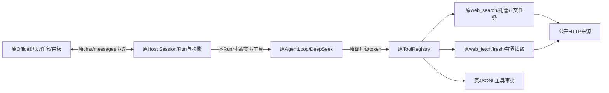
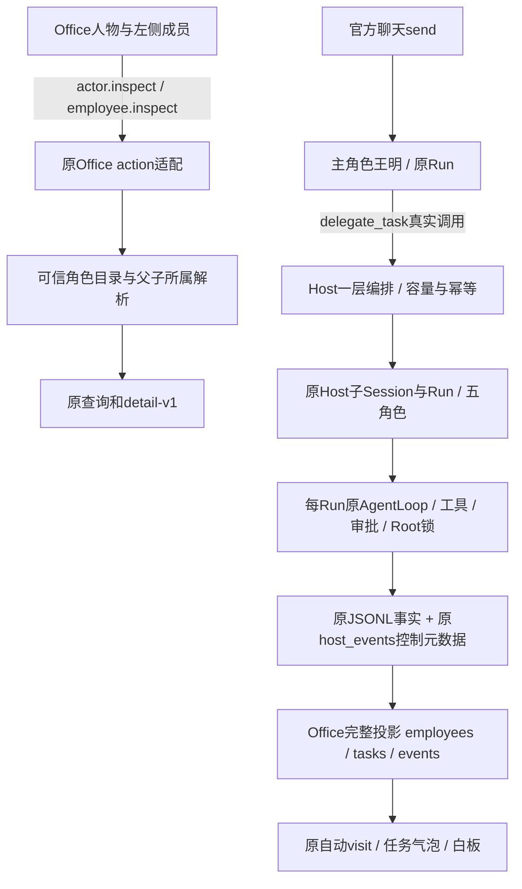

# OpenPaw Office 软件设计说明

2026-10-30 最新版适配入口（原CHG0007 §12.123 / D138）：Office main原样更新至`5d21cf2e359d7ab2100e8344d08d58a09a20fe25`，28项资料/Schema准确冻结；主开发目录及OpenPaw原开发线不变，Office两份用户架构编辑保留。已补结构化白板详情、步骤语义状态、阅读器中的真实任务/执行依据/计数；没有文件证据时只标draft，不虚构已验收成果。新增文件预览、不可变版本/历史交付已按用户批准的原CHG §12.124 r30实现Host版本存储与读取接口，当前真实UI和完整回归进行中，不能把新版Demo当已经接通。上游新增交接展示门控会在queued/running拜访期间隐藏接收人任务卡，即使后台running；与用户不要求执行等动画的边界分开，责任复核见Office台账文末R27补充。Office自定义修改仍全部暂缓。构建、完整检查、逐步网页及正式部署准确结果统一以`/home/cheng/.openpaw/verification/office-upgrade-20261030/closure.json`、`deployment.json`为准，未生成不记完成；下方旧日期为历史语境。

2026-10-29 D130（原CHG0007 §12.116，当前映射）：原projection保留业务task.title及真实动作task.summary，移除r22活动窗口的action_titles覆盖及summary重复目标前缀；原Office actorTasks已经将title/detail分别映射至这两个字段，无需改Office。保留原终态裁剪、完整白板构造、updatedAt稳定比较、容量保护及assignment去重；默认模式不变。原inline回归分别暂停review/audit的连续真实read_file阶段，核对业务标题、动作、在途状态、交接稳定性及终态退场。原真实会话、隔离HTTP模型+Host+Office+Chromium分别取证，不将确定性调度当付费模型验收或把停止后待命当在途异常。Office颜色硬编码/交接拒绝/视觉进度等仍独立记录Rx，本文下方r22标题映射保留历史语境。

D129追问兼容补充：展示附加的子错误不能阻断同一会话继续提问；原历史核对只认可原始精确正文或当前服务端从该父子账本生成的精确展示，篡改提示仍拒绝；展示说明不写成模型消息，旧浏览器原文仍兼容。原0007 §12.115记录真实UI红灯及最终重验。

2026-10-29 D128—D129（CHG0007 §12.115）：模型等待失败须区分建流、首次有效响应、后续响应及非流式阶段，显示配置阈值与实际等待信息，不将沉默断言为网络断开。子任务错误必须直接进入父聊天，明确成员与任务，父仍运行也可见；流、恢复与历史一致保留已有成果，不自动重做、不篡改主任务状态。仅复用Host私有装配及原Office snapshot/delta，无Office工程修改；实现与真实验收另记。

2026-10-29 D123交接时机补修（原CHG0007 §12.112）：委派排队卡立即公开，task.assigned只随真实接手产生，复用Run状态及必要时原JSONL的RunStarted证据；首次Provider失败不能漏记真实接手，未开工取消不能伪造交接。移除Host固定动画定时器和预计算展示队列，跨人物已开工不代表排在另一人物队列中的任务已开工。已发布事件保持ID/首次时间，预算与历史查询规则不变；不绑定动画与执行、不伪报running。准确候选、完整27项与独立真实Host/Office/Chromium结果统一见`/home/cheng/.openpaw/verification/handoff-fix-r21-20261029/closure.json`，报告未形成不记通过。Office R27终态过滤/遮挡消费仍未实施，不能承诺这些情况动画必播。

2026-10-28 DES-OP-007/009 快照预算（原CHG0007 §12.111）：复用原projection实际UTF-8封套计量、委派前缀锚点与历史压缩，48,000为正常目标、64,000为硬界；历史优先于当前说明裁剪，近期终态保留底线不保护重复摘要无限占用；首建/重建统一软目标，白板回补只使用正常预算。必要核心可超过软目标，不能超过硬界。原details沿父子Run及原进度投影查询窗口外终态委派，无新消息库/表/协议；诊断只记录seq/字节/计数/结果类别。不得将已投影或HTTP回执冒充浏览器动画完成，既有Office待审项保持。

2026-10-28 D117—D119容量投影与错误分类补充（原CHG0007 §12.110）：复用office/projection.rs的原完整封套UTF-8计量和已公开历史压缩；终态summary可省略，非终态保留最多96 UTF-16单位动作说明，超长先缩短，仍无法容纳则明确报错。无新DTO、表、持久格式或权限，不改变执行/进度事实；Office R25/R27/R28独立待审。D118复用原子Run终态派生在途任务ID，私有whiteboard_window仅对无限主目标优先在途、回补最近结果；已结束但blocked的旧卡不等于当前正在执行。普通有限计划及交接变体公开边界不变。D119在原safe_run_error仅匹配Provider明确stream read前缀，复用已有provider_stream及原turns.display_text；旧通用错误由原Store从JSONL重分类，无账本改写或执行重放。真实在途生产任务不为切换修复强停，测试候选与正式运行分别登记。

2026-10-26 本轮长任务补修（实施中，非交付通过）：原CHG0007 §12.79跟踪D93—D96。同一成员仅限制在途任务，后续任务等待前项真实清理；委派结果不得再次静默裁6000字。子Run通过原持久委派及同根/父子作用域核验报告原业务步骤，进度来自真实证据，成员任务成果分别保留，动画展示队列不作为业务未完成的依据。无步骤/新证据时不得按时间虚增百分比，活动摘要只公开已报告业务步骤/工具阶段，不公开思考正文。Office两套时间进度曲线、严格交接到达和不可用任务按钮分别见R22、R16/R17、R23，仍未批准且Office不改。当前运行配置无写工具、临时与正式数据目录不同，不能承诺已保存文档或旧会话仍在当前数据源；真实UI与完整回归结果另登记，不沿用历史绿灯。

2026-10-26 UI验证前置（DES-OP-008/011/012）：原逐轮脚本只通过公开控件等待并关闭闲聊，记录每轮/每次Pixi点击前的aria-pressed；依据最新实际场景等待单个人物入座、无motion/step/seatTransition再取坐标，仍须真实鼠标产生actor.inspect并展示同作用域详情才算通过。不注入内部动作、不重试业务请求、不改Office，不把测试前置控制解释成默认场景兼容修复；原失败、完整重跑与R16/R17边界见0007第12.74节。

2026-10-26 D92性能约束补充（REQ-OP-011/012/014、DES-OP-007/009）：单个会话绑定必须按原主键读取并核对JSON身份，保留原删除墓碑/作用域检查，不能反复解析全体成员绑定。Office裁剪保持原保护项、顺序及64KiB上限；一次完整计量后只按被修改会话的原JSON编码差额更新预算，删除时包含数组逗号，最终仍完整验证封套。无新表、索引、缓存、数据版本、协议或权限。新增200轮在第103轮发生真实60秒超时，原102轮不拼入修复后结果；精确方案、红绿、失败副本和新验证见原0007第12.72节，完整200未形成前不记通过。Office未改，R16/R17继续暂缓。

2026-10-26 真实完成与UI确认约束（REQ-OP-003/012/014/022，DES-OP-002/007/011）：Provider仅停止生成不代表成功；空、仅思考、截断或不完整结果可靠保存usage/部分正文后记失败，不自动重做工具。协作单次输出复用Provider声明值且至多8192，普通默认4096与共享组硬上限分别保持。失败后可由主角色显式有界重试，成功角色不重复。删除必须先完成原清理/墓碑/完整快照，再向Office确认成功；可信UI同步不能被自身优先标记拒绝，后台扫描仍让行。准确实现和红绿/真实UI证据见原CHG0007 §12.58—12.60；完整结果未形成不记完成。

2026-10-26 投影队列约束补充：DES-OP-007/008/009/012：交接条目复用原Run/委派事实，在内存中绑定父任务ID、真实子任务ID集合、生命周期事件、已核验可完成条件与白板归属。队列只公开已有事实，不提升未核验/失败/取消，不修改其他Run主卡或无关白板；事件沿用稳定ID并按原排序去重。事实变化时复用先前assignment、每次仅放行一位；冷启动有持久快照时恢复旧终态而不重播。无新协议、表、权限或Office改动。实施与回归见原CHG-2026-0007 §12.57，真实浏览器/完整检查结果单独登记。

2026-10-24 最新补修结果：准确1422f6f9干净原27项全部通过、真实Office浏览器74条断言/0 pageerror，并已备份部署原8765/41949；Office进程/代码不变。原0007第12.30节D68—D70已实现并用同一普通长沙两日游提示词复验：真实DeepSeek主Run 03535c5a11d643bca819823eba9544fc及5个独立子Run，五个不同角色各自完成；review/audit的实际输入均含前序真实正文，已与账本逐项对照，不再仅交审查框架。真实五次拜访等待场景记录completed后核对（使用原页面“关闭空闲闲聊”开关，默认闲聊冲突R17仍暂缓，不能泛称默认环境已修）。共同步骤不归第一人，人物首页直接给业务任务、核验进度、实际状态/结果和只读刷新。六Pixi人物、六侧栏任务详情、六成员布局均真实点击；任务中心展开、白板、普通追问运行中/结束/刷新保持同一子成果，零新增子执行、零pageerror/超时浮窗。证据根`/home/cheng/.cache/t6-agent-followup-20261024`，准确首验见final-b/{full,product}/report.json，真实模型及截图/trace/账本见live-after-c/report.json。文档登记后的最终准确候选另跑final-c，是否通过以最终实际report和closure.json为准，不借首验覆盖新提交；原live-after因draft/review同批而缺草稿的失败、live-after-b外部脚本未等待子接受而退出并准确取消清理的记录均保留；补充真实依赖规则后，isolated-order/ui真实模型及六成员48项查询通过。PR #13继续原分支，待非作者审核/合入，交付验收与技术通过独立，不自行Approve或合入、不开始T7。唯一开发目录仍Office/openpaw；生产精确版本及已提交workspace迁移见runtime-t6.json。Office全部Rx仍暂缓，R13原位Demo菜单及R19/R20前端入口差异未实施；Windows原生暂缓不计通过。

D71详情延迟补修见原0007第12.32节：原生产36次ui请求最长9.285秒，多次约6秒；已将原get_run改为按Run主键/工具事件run_id/审批run列读取，保持原JSONL、事件顺序及审批优先级，无新缓存/表/索引/协议。原inline精确跨Run、状态顺序、审批与只读回归已通过（Host31/31）；准确最终全27项/74浏览器见同证据根final-c，部署后同一已完成会话六成员48项实际点击及耗时比较见production-menus/report.json、timing-comparison.json，最终结论以closure.json绑定提交/退出码为准，未生成或失败不能视为通过。原1422真实模型及旧失败仍保留，不将首验当新Store的生产验收。

历史状态记录：保留原时点，不覆盖上方当前入口

2026-10-24 原页面最新状态：8765/41949已从旧T5升级到完整验收的853b0a1及Office fa6ae1f，六Pixi人物、六侧栏与六成员布局完整档案实际点击通过，点击不新增Run。PR #12已于12:57:48（Asia/Shanghai）合入e6a20bd；用户本轮对853b0a1作“未改Office且不影响合并”条件确认，不伪造平台Approve。真实DeepSeek在独立新会话完成五角色工作及一次审批写报告，但刘市一次失败后明确重委派暴露D59（旧失败仍占步骤，白板71%）；原失败保留。当前主目录正在修复D58容量成员丢失、D51主角色终态说明及D59明确成功重试投影，尚未把新补丁算成完整验证或已部署。原27项最终精确提交/产品结果以`/home/cheng/.cache/t6-live-final-20261024-b/{full/report.json,product/report.json,review.json}`为准，报告形成前不预填通过。旧段落均保留其当时时点，以本段/0007第12.11节及专用证据为当前入口。不同团队独立物理workspace尚需第12.12节迁移方案审核，旧共享根不直接改；Windows原生仍暂缓，Office所有Rx仍不实施。

当前执行状态（2026-10-23）：0007准确a931e50的r2已获本轮完善功能指令授权并在主目录实施；六人物/独立主子Run已编码，正在完整与真实网页验证，T6尚未交付验收或创建PR。历史“待批准/未实施”均为原提案时点。Office修改仍全部暂缓，新增R17场景通道互阻仅登记，不将关闭闲聊后的演示视为默认行为修复。
版本：2026-10-23；协议冻结/当前部署Office d150b96，观察上游76d774a不代表通过或部署。T0—T5已合入，T5 #11/f22cca1；最新实现和证据见0006及master14.1。Windows原生按用户决定暂缓、未验证。

T5现行设计：DES-OP-006/007/008复用原ToolSpec/ToolExecutor/host_events提供report_progress及有证据的目标步骤；业务任务不等同于逐工具调用。无第二AgentLoop实现、Registry、Todo或数据库，不修改Office Schema/核心crate或放宽权限。白板/审批/错误终态/删除与创建按0006 r2/r3实施并交付。

当前设计审核：同一0007修订为r2-product-agents，待准确批准；DES-OP-011/012及0007第9.6—9.11节定义新增角色/委派/配置/版本化Host控制事件，尚未实施。历史段落保留当时语境；其“待验收”等状态不覆盖上述实际合入事实。Office Rx仅统计，不授权修改。

## 设计清单

| 设计编号 | 职责、复用与不可越界的设计 | 关联需求 |
| --- | --- | --- |
| DES-OP-001 | AGENTS入口、CHG单事实源、profile保护范围、真实diff/测试追踪；框架原型固定哈希，项目适配修补；工具不认证人工身份 | REQ-OP-001、REQ-OP-020 |
| DES-OP-002 | 抽取无协议Provider/模型装配；每Run独立AgentLoop/token/预算；生命周期缺陷修回engine/llm/cli | REQ-OP-002、REQ-OP-003 |
| DES-OP-003 | JSONL事实、SQLite可重建；SessionReader/Writer完整工具配对、损尾修复、写入失败传播；Host仅元数据 | REQ-OP-004、REQ-OP-009 |
| DES-OP-004 | Hook最终输入→校验→分类→审批→可取消取锁→重验→执行；Environment注入和调用级授权，复用工具主体 | REQ-OP-005、REQ-OP-007、REQ-OP-013 |
| DES-OP-005 | Linux进程组/bwrap和Windows Job/受限token；挂起进程失败清理、双管道排空、取消等回收；无隔离不降级 | REQ-OP-006 |
| DES-OP-006 | Host共享Session/Run/Approval/资源/查询；同根Store复用、home单写OS锁；同Session冲突/Office多会话并行、默认4并发 | REQ-OP-008、REQ-OP-009 |
| DES-OP-007 | Office聊天和业务两适配器；严格官方DTO，历史导入/核对、完整投影/seq和有界列表；直接调用共享Rust服务 | REQ-OP-010、REQ-OP-011、REQ-OP-012 |
| DES-OP-008 | 全局单ui.next领取、action作用域与详情；审批业务/展示ID分离；场景仅反馈，不以动画成功决定Run | REQ-OP-013、REQ-OP-014、REQ-OP-015 |
| DES-OP-009 | 未完成Run→interrupted、审批失效、恢复原seq内容，不重放副作用；不同通道取消策略分开；Rx先审后改 | REQ-OP-009、REQ-OP-016、REQ-OP-019 |
| DES-OP-010 | OpenCode适配器复用同Host服务；SDK1.18.15完整类型/Basic/目录/HTTP/SSE；发布与双平台外部联合验收 | REQ-OP-017、REQ-OP-018 |
| DES-OP-011 | 共同角色/功能目录→同会话actor/employee解析→有目标上下文的detail-v1；未知/删除/跨会话仍拒绝，空闲/未启用准确展示；复用原query/navigation | REQ-OP-021、REQ-OP-024 |
| DES-OP-012 | 可选可信六角色和一层delegate_task；共享Host原Run/Session/Provider/ToolHost/Approval/Root，host_events版本化父子所属，原JSONL事实；全局容量内预留最小执行槽，父预算/取消/删除覆盖后代，恢复不重放 | REQ-OP-022、REQ-OP-023 |
| DES-OP-013 | 仅本机workspace plan/apply；复用Root/OS独占锁/原Store事务；版本化host_events迁移事实及可信产物映射，不改旧JSONL、不自动重放；一团队独立物理根，主子同根，完整备份回退 | REQ-OP-025 |

~~~mermaid
flowchart TB
    B[Office浏览器] <-->|同源四操作chat| F[Office Fastify]
    F <-->|chat.url：JSON/NDJSON| C[Host Office聊天]
    B <-->|Office自有SSE与内部UI| F[Office Fastify]
    A[Host Office业务] <-->|官方messages与原请求响应| F
    C --> S[共享Run/Session/Approval/资源/查询]
    A --> S
    O[OpenCode适配器] --> S
    S --> E[现有引擎/Provider/工具/存储]
~~~

详细请求、字段、状态图、顺序、恢复和错误表直接引用master第2—9节及contracts；本文件不复制Schema。核心crate不依赖Office DTO，Host内部不调用自己的HTTP，不增加Node bridge、第二套AgentLoop/Session/工具/审批/文件解析器。新增模块在CHG说明旧模块不能承担的职责。

数据写入：SessionWriter拥有会话事实；Host持久化绑定/Run/Approval/投影版本；投影协调器按办公室分配seq，含ui.respond.whiteboard同一路径；Office只缓存展示。审批等待不占工作区锁，取锁/执行/清理期间取消仍保留资源所有权。外部编辑器不受协作锁约束，写入另校验前置状态。

安全与部署：loopback默认监听、随机端口发现；模型密钥仅Host，Office密钥仅双方服务端，VITE_*只公开地址；允许根、会话归属和可信同源代理，不把ID当授权。Windows路径/Job/cmd与Linux根/进程组/sh分别测试。运行/存储格式变更在所属阶段设计版本中记录迁移、备份、回退，不能无版本覆写历史。

治理工具只是本地和CI技术检查；语义正确、人工授权和当前提交审核仍需真实人审。GitHub账号/CODEOWNERS/required checks在人工配置前明确未启用，不使用占位账号伪装平台保护。

## 场景实现与模块协作

本节细化DES-OP-006/007/008/009。master第1.4节给出演示，5.4给出唯一投影规则，5.5给出一次请求的协议顺序；第10节定义各Tx实现/交接。不在此复制字段Schema。

| 职责 | 输入与实现落点 | 输出/失败责任 | 复用理由 |
|---|---|---|---|
| 聊天适配 | Host接官方v1请求，调共享服务绑定/接受Run，订阅文本与最终结果 | 官方四操作JSON/NDJSON；冲突/超限/持久化失败明确错误；断开detach，显式cancel等待实际清理 | 复用Host现有Office四操作适配器；推理仍用AgentLoop |
| 共享运行服务 | T1运行/存储、T2授权/Environment/执行观察 | 稳定Session/Run/call、可靠生命周期、查询与取消 | 核心无多客户端宿主注册/恢复职责，新增Host元数据，消息事实仍用JSONL |
| 业务投影 | 共享Run与有界run_progress事实；用户目标和业务步骤，真实执行时关联功能成员 | 完整snapshot/seq，白板≤3步骤；计数基于真实成功证据，失败/取消保留实际完成项；无逐call公开卡片 | Office仅接收展示投影，不提供OpenPaw业务模型；不能复制执行/存储 |
| Office同步协调 | 持久化的seq+规范化原内容 | capabilities/initialize/read/snapshot、按操作重试、版本确认；旧回执不覆盖新状态 | 官方messages客户端是新增协议职责；不接管浏览器内部SSE |
| 审批呈现 | 共享pending审批、最终输入摘要和期限 | decision.request的展示尝试，结果回共享CAS；未知结果不授权 | 共享审批决定业务权限，Office只呈现和转达选择 |
| 操作与详情 | 单ui.next、作用域action上下文、原模块只读查询 | 新action.id的detail-v1/分页；410记录未送达，未支持业务操作说明 | 无新增管理页；原Skill/Goal/Todo/Session解析在所属模块 |
| 场景反馈 | 同Run真实分配/终态和能力查询 | 自动task.assigned拜访，有限scene.say；离线不补播，不决定业务状态 | Office现有sceneBridge/Runtime负责人物/寻路/资源；不自写动画系统 |

成员按实际使用到的功能建立稳定业务ID，绑定能力确认的office-lead/file-agent/code-agent/data-agent等场景人物；不用review-agent伪造审阅。工具未真正进入主体前不标running；审批/取锁等待明确blocked；拒绝工具子任务与最终Run结果分别记录，不能把被拒绝call随Run成功改为完成。主子关联保留在Host，不能往上游strict任务Schema塞parentId。

详情路径从actor.inspect/employee.inspect进入任务选择与六类目录，dialog.action负责后续导航。动作映射绑定team/session/query，产物路径从真实工具结果/授权记录解析，禁止把绝对路径写进按钮ID后直接信任。历史、工具结果、产物可交叉核对同call；Skill/Goal/Todo仅展示真实存储，列表查询不引起写入。

一致性按事实优先：工具与终态可靠保存后才宣称业务结果，聊天流和展示快照是两条传输链，可以短暂先后到达；展示失败只影响同步状态，不回滚或重跑已经发生的副作用。投影有界合并，审批/终态不可丢；慢动画不阻塞引擎或延长v1预算。需要持续工作的场景用snapshot表达，避免长期focus占据人物导致visit排队。

T4交付真实只读对话和任务状态；T5接入审批/写工具/详情/动画；T6注入故障和恢复；T7SDK复用同服务；T8按同一旅程原生联合验收。生产真实Provider与确定性自动化都走同一执行链，禁止以OfficeDemoSource、直接写测试快照或播放独立动画替代产品验收。

里程碑治理（DES-OP-001）：master第14节作为M状态唯一汇总，每Tx导航引用方案和对应里程碑核查章节；主CHG/验证保存追加履历和准确Office文档→master→代码/测试证据。既有CI增Tx分支push覆盖，以集成merge-base校验整个Tx，解决必须先开PR才能拿Windows证据的循环；PR事件继续验证当前head。技术核查通过后先由用户验收准确交付版本，再提交PR；非作者平台审核及实际合入才允许完成登记/下一Tx；不新增运行时状态机或自动人工批准器，不修改Office。履历登记关联准确被测SHA，登记后的最终head仍执行CI，避免合入SHA记录自指循环。

DES-OP-006的锁原语复用前置（T0/D16）：原FileLockGuard析构先显式OS解锁再关闭文件；Unix处理共享open file description继承窗口，Windows匹配LockFileEx范围调用UnlockFileEx。析构错误不能传播，仍关闭句柄兜底；不新增锁库/提前解锁API。现有私有测试验证立即重获、共享独占及子进程行为，Host取消/锁等待和恢复仍在T3实现与验收。

## T1运行与账本设计（DES-OP-002/003）

现有AgentLoop仍是唯一推理循环。`llm::assemble_provider`和`resolve_model`提供无协议装配，宿主读取密钥后注入，显式模型优先真实默认；端点只接受无内嵌凭据/query/fragment的HTTP(S)。CLI与后续Host共用，不在Host复制Provider选择。

`run_turn`保持签名并委托`run_with_context`；旧入口没有可靠观察器，不宣称自动持久化。新接口使用独立RunContext（run_id、父cancel、总预算、工具时限），同实例活动Run冲突直接Failed，不重置另一运行的预算。配置父token与本次token均保留；`cancel()`只取消当前子Run，下一Run可继续，外部已取消父范围持续有效。RunOutcome给出四种终态、停止原因、Provider已知用量和错误，迭代预算耗尽明确失败，不报EndTurn。

建连/流事件空闲为`with_stream_timeout`，每条流事件重置；Run总预算包含重试/压缩/审批等待，工具时限只计算实际call。纯查询、Provider和前置Hook等待可取消；工具调用通过兼容的`call_cancellable`通知，然后等待实际结果/清理。旧ToolExecutor默认方法等待原call，不保证即时中断；T2在原执行环境实现受控进程回收。不能把drop工具future或JoinHandle当作取消完成；宿主必须持续拥有Run并等待终态，不在断开HTTP时直接drop运行future。

~~~mermaid
sequenceDiagram
    participant C as CLI / 未来Host
    participant E as 原AgentLoop
    participant J as 可等待观察器 → JSONL
    participant P as 原Provider / ToolHost
    C->>J: 保存用户输入（接受前）
    C->>E: RunContext + Session + observer
    E->>J: run_started
    E->>P: 有效模型请求（可取消/有空闲预算）
    E->>J: usage + assistant（含tool_use）
    E->>J: tool_call_start（提议，不代表真正执行）
    E->>P: 既有校验/分类/审批 → call_cancellable
    C->>E: cancel或超时
    E->>P: 通知取消，等待真实清理
    P-->>E: 实际工具结果
    E->>J: tool_call_complete + User/tool_result
    E->>J: run_finished（取消/超时/失败/完成）
    E-->>C: RunOutcome
~~~

RunObserver是可等待事实边界，独立于同步AgentEvent显示回调。每个assistant/tool_use在工具开始前保存，所有角色消息均作为事实，不用消息数组长度或Role过滤推断新增内容；写失败停止后续副作用且不自动重放已执行工具。观察器返回的任何错误统一归为Store/Failed，即使底层错误名为Timeout或Cancelled，也不能冒充Run预算超时或用户取消；终态写入失败同样不得返回成功。工具批次仍复用原串/并行路径，D05/D06的最终输入授权、完成即发和panic关联归T2，不在T1声称已修复。CLI观察器在spawn_blocking内append+sync等待完成，SQLite只在账本成功后尽力索引，索引失败警告。

压缩复用原算法，新内部报告补齐摘要真实用量和当前模型。账本增加`context_snapshot {messages}`，只替换后续模型输入，不把摘要当新用户事实；`ReadOutcome::restore`按原事件顺序恢复快照及后续Message和Usage，原始历史仍从events查询。新`run_started/run_finished`支持未来Host识别未完成运行；T3负责interrupted恢复，不自动重放。旧JSONL原事件字段不变；旧reader可Unknown保留新类型，但不理解快照的旧引擎不可直接作为新账本的恢复执行器。回退前备份账本，恢复使用当前Store接口。

尾行处理由Reader/open_append共享同一字节扫描器。仅最后损坏行允许容忍，包含UTF-8撕裂；追加先用create_new创建同目录唯一完整备份并sync，Unix同时同步目录，再截断并sync。Windows修复句柄使用read+write取得set_len所需权限；修复后关闭并重开append句柄，避免仅FILE_APPEND_DATA导致Access denied，仍由调用方持有独占所有权。备份失败或中间损坏均不更改原账本；合法无换行尾补分隔。Writer调用方必须拥有会话/数据根的唯一写所有权；T3复用OS锁落实多进程所有权，本接口不假装具备独立多Writer并发修复保证。

Provider沿用原SSE实现修复D31—D33：OpenAI最终消息包含已显示文本，缺少finish_reason/Anthropic message_stop则错误；工具JSON组装错误不转换为空对象执行。SSE按完整行解码原始字节，跨网络块的中文不再被替换。已有显示输出后断流保留一次部分assistant文本、Run失败且不从头重试；无输出前仅按既有分类与次数重试。未报告的失败流usage不推测。权限/工具实际执行状态和新授权上下文仍属T2。

## T2工具授权与托管执行（DES-OP-004/005）

此节为CHG-2026-0003实现方案；当前验收以M2/验证记录为准，不声明Office已运行。复用原AgentLoop、HookChain、guardrail、ApprovalManager、ToolRegistry、Environment、bash AST/parser、平台sandbox/Job、FileLockGuard和Todo JSONL。新增core/invocation.rs只有协议无关绑定/观察契约，sandbox/process.rs只统一既有后端所缺的生命周期；没有新增注册表、审批器、命令解析器、存储格式或推理循环。

~~~mermaid
sequenceDiagram
    participant E as 原AgentLoop
    participant H as 原Hook/Validator/Guardrail
    participant A as 原ApprovalManager
    participant T as ToolRegistry/原工具
    participant O as T3可靠观察/资源包装
    participant P as 原Environment/Sandbox
    E->>H: Hook确定最终输入→校验→分类+metadata
    E->>A: Run/call/工具/完整JSON绑定
    A-->>E: Approved / Denied
    E->>T: 执行前重验 + ToolCallContext
    Note over T,O: T3根锁获取后重验；T2只有批次屏障与Todo原OS锁
    T->>O: execution_started（可等待，取消不drop写入）
    O-->>T: 持久化成功才允许进入工具主体
    T->>P: 原工具执行；bash用注入环境及调用token
    E->>P: 取消/超时通知
    P-->>T: 进程树终止、等待回收、双管道排空
    T-->>E: 保留call ID/实际耗时的结果
    Note over E: 开始记录失败→Store/Failed；保留配对结果，不继续Provider
~~~

`ToolCallBinding`保存run_id/call_id/tool_name/input；完整serde_json::Value精确相等，不以摘要或显示截断文本授权。上下文私有绑定和approved标记由可信引擎构造，原审批器返回Approved才标记；没有远程“approved=true”参数，Host不可将其作为防重放数据库。一个上下文可clone只为同一次异步调用传递；T3仍必须用Run/call/Approval CAS保证每个工具仅调度一次。

串并行共用prepare_tool：BeforeHook只一次，拒绝改工具名/缺input；统一validate→guardrail→requires_approval兜底→绑定请求；获批后重新validate，后续BeforeHook不再改变输入。AfterHook可调整展示/把成功降为错误，不得把失败改成成功。只有显式ParallelSafe可并行，PathScoped/NeverParallel/缺metadata保守屏障；FuturesUnordered逐个完成即发结果，耗时在任务内计算，JoinHandle外保留ID，取消/级联错误仍join全部清理。原并行测试fixture补明确声明，保留原断言。

`call_with_context`默认调用execution_started再委托原call_cancellable，保持旧第三方实现。注册表新增Environment/可等待观察器注入，Schema检查只覆盖现有内置Schema实际使用关键字，路径仍复用safety::resolve；并非新建通用JSON Schema引擎。bash危险命令仍拒绝，复杂/未知只接受准确最终输入批准；Windows实际固定cmd、Linux sh显式选分析链，不用命令外观自动猜执行shell。cmd无grammar时保守审批。旧直接call/run是可信进程内兼容入口，网络适配器必须走受控上下文，不能绕过引擎。

真正开始观察在最终校验之后、工具主体之前；Todo修改在原OS锁获取/路径重验之后观察，等待审批不持锁。观察器错误统一为Store，模型不能通过后续回复把运行改成成功；并行同批已启动调用收到取消并完成清理后，保存每个工具结果，再返回Failed。T3须将根资源锁/前置文件状态与该边界结合；T2未实现跨Session根锁。可靠观察future不可因取消drop，完成后再检查取消；若开始事实已保存但取消阻止主体，后续记录取消结果，不伪造副作用。

托管进程复用sandbox：Linux普通sh设置独立进程组，stdout/stderr同时排空，取消杀组后wait leader，正常leader结束也终止遗留后台成员，避免继承管道永久不EOF。每流保留1MiB，超出读弃；bash展示另按30000字符截断，但退出码在截断之后追加。显式清理完成后disarm Drop，避免重复向已回收组号发信号。普通进程组不防恶意setsid/daemon脱组，不宣传为安全隔离；限制执行仍由原bwrap后端负责。

Windows普通用户CreateProcessW、受限token原CreateProcessAsUserW代码复用同一创建/Job/管道入口；STARTUPINFOEX限制继承仅本次三个句柄，NUL stdin；挂起创建→Job→恢复，任一步失败RAII终止挂起进程并等待。原spawn_blocking真正轮询token、终止Job并等ActiveProcesses为零；PeekNamedPipe/ReadFile交替排空两管道，不先等进程，截断不停止读。shell固定SystemRoot/System32/cmd.exe /D /V:OFF /S /C；本地盘符规范化，UNC/device工作目录在创建前拒绝，避免cmd退回系统目录。句柄被本次Job管理，不依赖WSL/Git Bash。

隔离不降级：LocalEnvironment与SandboxedEnvironment均复用原Sandbox，工厂不在当前Tokio线程阻塞嵌套runtime，不以health_check失败回本地。Linux域名白名单无法通过bwrap保证，建目录前拒绝；bwrap不可用直接错误。Windows现token/ACL/环境提示不能保证网络限制，所以现有受限策略在ACL/进程副作用前明确拒绝，保留原token代码但不宣称可用；旧sandbox审批回调/白名单不能解除请求的隔离。启动子进程只继承必要系统环境，不包含模型/Office密钥或任意业务环境。D34修原builder字面参数转义，command仍是调用方有意脚本，env覆盖和无法安全表示的cmd args明确拒绝。

Todo保持id/title/status JSONL：原模块read只读、仅NotFound为空，坏行/重复零ID/非法状态/非普通文件/>2MiB/权限错误上报；写入原OS独占锁覆盖读改写，等待可取消，进入提交后无await直到同目录tempfile sync+原子persist，Unix目录sync后释放锁。文件占用/替换失败保留旧内容，写入同样限制2MiB，避免生成后无法读取；保留200项原有保留策略。Windows锁冲突保留WouldBlock分类，不把系统错误统统转字符串。链接/重解析点复用原路径校验，锁不防不协作外部编辑器；T3仍须所有权和前置状态协调。

测试/能力/回退：见[专用验证](../verification/CHG-2026-0003/验证记录.md)和[能力矩阵](../verification/CHG-2026-0003/执行能力矩阵.md)。不把Linux交叉检查当Windows原生通过，不把工具上下文当Office审批投递已实现；当前公共API变更更新core快照，直接ApprovalRequest结构体构造需补binding，旧new/JSON保留。Session格式不变、Todo无迁移；回退前备份，不能靠旧版本静默降级恢复受限执行。

治理修订（DES-OP-001）：项目层保留固定framework校验基础表，规范化新格式openpaw/chg-review-v2；独立字段区分原交付/当前修订、方案/交付/PR/合入。方案绑定Git提案对象的实质内容，审批元数据不反向改变方案；proposal只验可审结构，implementation验批准版本与真实范围，delivery验准确提交的用户验收和双平台证据。主CHG显式关联修订版本，各自批准/验收；历史元数据与说明迁移分别限制，旧范围/操作/必要性/保护/测试/履历不可篡改。文件重叠列职责，取更严格保护。profile仅固定可核验的历史记录，不允许自称legacy。

verify复用原26命令，统一source与stage；worktree所有检查读取当前内容（包括dirty/未跟踪），head只在匹配提交的干净检出运行。报告逐条记实际argv/退出码/source/stage与源摘要，CI沿用原13作业，push实施、PR交付，不额外赋权。工具无法认证人审身份或证明自然语言充分性；这些仍由人工审查。0001与T3经批准共同PR，不创建平行治理任务或系统。

## T3宿主设计（DES-OP-006，#7已合入）

准确实施方案和逐文件复用判定见[CHG-2026-0004第6—10节](../changes/CHG-2026-0004.md#6-api-变化)。Host集中提供Session/Run、原ApprovalManager的持久实现、根资源协调和六类只读查询；每Run独立AgentLoop，T4/T7适配器直接Rust调用。JSONL仍是消息事实，原index.db可重建，新增host.db仅保存绑定/Run/审批/生命周期引用，不能当缓存删除。接受采用accepting→JSONL输入sync→accepted，崩溃窗口对账后中断，不重放工具。

根按真实目录身份合并别名，拒绝嵌套的不同根；进程内RwLock→原OS共享/独占锁→工具自身锁，审批等待无根锁，取消后实际清理完成才释放。Skill/Goal新增checked只读入口复用原解析器，旧容错列表保留；文件预览复用工具读取校验。snapshot_and_subscribe提供一致视图/游标，关键事实先保存，落后订阅重取视图。健康HTTP仅loopback，业务DTO/路由仍T4—T7。以上T3已实现并合入，未改变Office工程；后续协议分别登记。

### T3实现落点与持久化不变量

共享服务集中`openpaw-engine-host/src`：config/types为中性入口，service为Session/Run，approval复用原trait，tool_host包裹原Registry，resource复用原OS锁，store串行调用原Writer/Reader/SessionDb，query只读复用，server只开放loopback健康。新增axum仅在Host feature启用，same-file用于真实根别名识别。没有Node bridge，也不把MCP sidecar变聊天后端。

Store使用有界Tokio命令队列和单一同步线程，关键事实等待提交；文本使用每活动Run最多4MiB展示缓冲，溢出标记text_truncated并在原账本保存后重取。通知只带全局revision或无ID文本刷新提示，实际视图每次校验scope；思考增量不展示，历史查询剔除Thinking，原模型上下文仍由原账本恢复。通知掉线不取消Run。

home/engine-host/host.db的schemaVersion=1只存host_roots/bindings/runs/approvals/events，包含原账本输入位置；Run接受顺序保持0004第9.3节。恢复验证输入位置和Session Meta，未完运行interrupted，不重放。损坏index.db可以原样备份（含WAL/SHM）后从原JSONL重建；host.db损坏或未知版本拒绝，不当缓存删除。

批准与消费在单写协调序列中执行状态/revision/完整binding校验；SQLite事务提交状态与revision，才发布通知。审批前短共享锁采集写入前置视图，用户等待不持锁；获独占后重验并复用原execution_started可靠观察。拒绝、超时和取消竞争不默认批准。shell只声明命令/根策略前置条件，普通协作锁不能隔离非协作外部进程。

关闭命令先等待Run/进程/写入清理，单写线程完成检查点并实际析构所有Writer及SQLite连接后才回复；home锁不在仍持索引句柄时提前释放。关键存储故障锁存，禁止新Run；未能保存终态时不返回虚假completed。Windows原生句柄、Job/cmd和路径验收仍独立登记，不以Linux或交叉编译替代。

## DES-OP-002 补充：统一.env配置

openpaw-llm::model_config::ModelEnvironment在可信启动入口只读加载dotenvy格式，保存系统环境快照和文件配置；不调用set_var，不创建目录，不在Debug/错误中暴露秘密。选定文件上限1MiB，支持UTF-8 BOM/CRLF，重复字段和损坏文本拒绝。默认仅查openpaw_core::openpaw_home()/.env，不搜索项目父目录。配置优先级为显式CLI/Host TOML字段、系统环境、文件、原入口默认。

CLI chat调用共用assemble再进入原AgentLoop；HostConfig::load_with_model_environment在serde默认echo前识别显式provider，保持原load行为，授权根/工具不从.env读取。Host CLI使用同一assemble并调用原Host::with_provider；原Host::start仍按原环境引用语义工作。密钥名按有效Provider选OPENAI_API_KEY/ANTHROPIC_API_KEY，显式api_key_env优先。Basic认证字段本轮不接入文件配置。

config show只在原装配验证成功后输出端点/模型和来源，凭据仅有无，错误为非零。无关命令不读取.env，不因损坏文件破坏hello或sidecar。无存储迁移、Office协议或网络代理新增。

系统环境快照保留平台语义：Linux字段名区分大小写；Windows按原生环境规则不区分大小写；.env字段按声明名称读取。Windows专用回归已加入源码，原生环境缺失时不得把该用例记为运行通过。

## DES-OP-007/009：T4 Office适配实现

~~~mermaid
sequenceDiagram
    participant B as Office浏览器
    participant H as Host Office适配器
    participant R as 原Session/Run/工具
    participant S as 原JSONL与Host元数据
    participant F as Office Fastify
    B->>F: 同源POST /api/pawoffice/chat（四操作）
    F->>H: chat.url注册的回环上游，不转Origin
    H->>R: 固定scope，预留槽/会话，核对完整历史后缀
    R->>S: 导入来源/本次输入可靠保存
    R->>R: 原AgentLoop与Provider、只读工具
    R-->>H: 有界累计文本及可重取事实
    H-->>B: status/delta，可靠终态后done或error
    R->>S: 真正开始/资源等待/结果/终态
    H->>S: 完整投影seq与内容先保存
    H->>F: capabilities、initialize、snapshot、read
    F-->>B: Office原SSE与场景投影
    B-->>F: 流断开只detach
    B->>F: 显式cancel(turnId)
    F->>H: 转发cancel
    H->>R: 取消并等实际清理
~~~

office模块集中DTO/路由/错误/CORS和业务投影；service仅增加协议无关的submit_with_history，原submit_run兼容。客户端历史严格交替且最多10完整轮次；第一轮不可信文本使用原JSONL导入，host_context_import只存偏移、数量、校验和和完成位，不存第二份消息。已写前缀逐条比对；FNV校验和仅作重试诊断，不作为认证、防碰撞授权或请求幂等标识。运行预留覆盖核对/导入/接受，避免首请求交错。后续合法短后缀从原账本及完成Run重建，不按压缩消息长度计算。

HTTP body≤512KiB；字符限制按UTF-16，业务封套按UTF-8；delta保守分片4000单元，即使全部JSON转义单行仍小于32000。有界一条待发队列、5秒写入预算，断开/慢客户端只detach；输出超限请求取消本Run；接受任务由宿主持有，不能因请求future消失丢下已接受运行。文本通知可合并，get_run重取并核对前缀；内部Thinking不投到聊天。空文本、错误、超限、持久化失败均无假done。

host.db事务迁移v1/v2→v3，JSONL格式不变；新增host_context_import、host_office_calls（原Run/call→稳定短展示ID）、host_office_projection（完整规范快照及同步状态）。迁移在事务内校验表字段，失败回滚，未知未来版本拒绝；旧二进制不能直接使用v3，回退需配合升级前完整home备份。工具主体、审批和锁仍复用原模块，tool_waiting_resource只是共享事实扩展。

每办公室一个投影worker，覆盖全部conversation。任务时间是首次观察到该状态并持久化的投影时间，不宣称模型给出真实耗时；不变任务保留时间。原调用ID不截断后作身份，使用持久唯一映射；事件稳定ID且新近优先。仅固定三类功能员工，不声称额外Agent实例。capabilities确认现有office-lead/file-agent/data-agent后发送；无额外visit重复派发动画。任务与事件按≤64KiB完整封套裁剪并保持引用，每会话最新Run、每Run最多12工具为展示范围；64KiB总预算保留目录并按需缩旧终态详情，账本不裁剪。

客户端禁重定向，15秒请求预算高于Office默认10秒确认等待，回执核对HTTP/code/data。202cached绝非applied；未知网络结果仍重发原保存版本，目录缺失重新initialize。SEQ_CONFLICT、STALE_SEQ或协议/认证错误停投并持久halted；不盲升seq覆盖外部所有者。停止顺序：拒新→取消/等Run清理→停止worker→全部最终投影保存→最多3秒投递→关Store→停监听。未投递数据保持pending，下次启动核对；halted不能因关闭或重启自动绕过。

模型仍复用原Provider及.env；Office服务密钥来自PAWOFFICE_专用系统变量，独立于模型文件密钥，不进入VITE_*。仅loopback与精确Host，有Origin时仍精确白名单，无Origin仅本机服务转发，默认单机单用户；生产同源代理仍须保留来源/访问控制，不把teamId当认证。

T4 r3旧版历史核查（2026-10-22；不覆盖新版r4）：实现提交5c039fb已通过Linux完整27项与真实Office/DeepSeek网页验证。状态/版本/恢复、严格NDJSON和只读工具均从既有引擎事实验证；Windows原生及用户交付验收不由这些结果推定。证据汇总见0005验证记录末尾，当前无Office源码修改或T5新增能力。

## T4 r4：新版Office协议设计

以master第4/5节和0005第9.7节替代旧直连/断开取消规则。office/{dto,chat,turns}处理四操作；store元数据v3新增host_requests，Accepting与稳定轮次关联同事务，JSONL仍是唯一模型历史；精确规范请求仅作幂等比较，不用于恢复。短接受锁不跨推理；同Session一个Run，Office同槽不同Session共享原根锁并发。旧v1/v2增表事务迁移，旧快照原seq不改写，新结构使用更高seq。回退必须恢复升级前完整home备份。

history由Run输入offset读取用户及原Run文本，legacy:RunID为旧轮次稳定身份；游标before:RunID限定会话，追加不漂移。resume先订阅后读取，首个全量snapshot建立文本前缀，后续只发新字符；断开仅销毁订阅。cancel任务由Host持有，实际终态后才返回stopped:true；Host重启不重放。每会话只保留最新Run的任务/白板，完整历史走history；64KiB裁剪先工具再旧终态详情，保留目录；100会话满额拒绝新绑定。

HostServer实际回环地址传给Office协调器用于chat.url运行时注册；Office重启后重注册。Node不转Origin/凭据，Host依靠本机回环、Host精确匹配和有Origin白名单，不要求Office无法发送的token。跨机不在当前信任模型内。所有Office新增UI作用域、删除/审批/详情由T5统一处理；本轮Office零源码修改。

## Office全功能覆盖设计补充（0005 r5文档规划）

详细状态/产物/验收见master第15节，本节不重复协议字段。

- DES-OP-003/006/009：T5.3删除由共享Session服务负责，适配器只映射action。持久删除意图/最小ID墓碑→拒绝新执行→失效审批/取消并等清理→关闭writer→原账本/索引/派生内容清理→完整高seq快照移除→合法result。跨存储用阶段恢复，既有delete_session仅索引，禁止误用成完整删除；不复制解析器、不删除共享工作区文件。Windows文件句柄释放有专门验证。
- DES-OP-008：审批展示ID在办公室唯一，返回校验team/conversation/decision/choice；先登记会话再发菜单，独立审批期限不绑定单次180秒接收。后台通知/队列复用Office原实现，业务CAS仍在Host。
- DES-OP-007/008：任务/白板由T4投影延展；统计口径是当前会话有界业务任务，主子任务不能包装成全量请求累计。稳定状态时间避免重启误计今日；气泡是展示进度，未知真实进度为-1。无合法产物HTTP地址则link留空，走现detail-v1文本查询，不造下载路由。
- DES-OP-007/009：多页历史/草稿/CAS复用Office IndexedDB；180秒后现有页面重新同步history/resume，不推断自动永久重连。动态创建办公室/旧存档迁移/自动续接等先候选Rx，默认不修改Office。
- DES-OP-008/010：地图/插件/人工场景控制作为原生共存回归，动画取消不改变Run、资源锁或审批。外部HTTP不能充当远端动画执行完成确认。部署默认受信loopback；代理统一保护浏览器入口，密钥不进入前端。

本文新增设计均为后续工作包约束，不声称T5删除/审批/详情已经实现；不改变T4 r4原代码和批准对象。

Office集中申请只在[office-change-requests.md](../engine-host/office-change-requests.md)记录，不改变任何运行时能力；用户已明确暂缓所有Office修改批准，候选不产生Office改动或Host新接口。

## DES-OP-007/009：r6消息展示与接受拒绝

Host types.rs私有RunText供service.live与store::get_run共用：消息内Text块和分块原样追加，可靠assistant Message成功落盘后仅设置待边界；下一条文字首个非换行字符到来时，按已有尾换行及新前导换行补足两换行。跨delta的前导换行保持待边界，避免逐块与整块恢复不同；空/Thinking/纯工具消息不追加分隔。4MiB实时字节预算包含分隔，溢出保留已接受UTF-8前缀并标记，不阻断后续账本事实。JSONL、Provider历史和SQLite格式不变；旧显示缓存可能新增段落，须真实验收官方history同步，不放松后缀校验。

Office适配器只在send/resume接受失败处映射六类可恢复HostError为单条官方error事件；内部错误类型与拒绝条件不变。白名单用户文案不包含原message/路径/密钥，没有done、成功snapshot、自动重试或新Run。传输HTTP200不表示业务已接受；JSON/schema/source/scope前置校验及存储/未知故障仍返回HTTP失败。history/cancel继续原JSON/HTTP语义。Office原转发器非2xx→502为官方约束，不能宣称所有Host状态透传；不修改Office、不发明控制事件、不增加依赖或核心事件。

## DES-OP-007及DES-OP-004/005：r7联网、时间和停止

共享Host服务为每Run采样同一chrono UTC时刻并转换系统本地RFC3339偏移，和授权工作区/实际Web工具清单共同进入原模型system；本机时区不是用户位置，不从路径或历史猜“今天”。原工具注册表仍唯一，Host默认五项不变；HostConfig与OfficeConfig同时允许显式web_search/web_fetch，写工具/shell在T4仍拒绝。网络HTTP由原tools模块实现，不经Host内部HTTP或第二套后端。

web_fetch新增可选fresh=false；省略参数维持原缓存和正文输出。fresh=true绕旧缓存，成功返回最终来源URL与本次抓取Unix毫秒时间；缓存只保存完整原正文，不缓存带旧时间的fresh头。网页日期必须另外读取，不能把抓取时间当作观测时间。HTTP正文在逐chunk追加前检查5MiB上限；读取失败、超限、取消不保存部分结果。保持原scheme/IP/DNS预查/逐跳重定向检查，DNS预查不等于连接级DNS绑定，不宣称完全阻断重绑定；当前受信单机部署边界不变。

注册表沿用原真实开始观察器；只将两个Web调用转到可取消入口，不对shell/写入drop。搜索引擎等待可取消，自动正文使用JoinSet，取消abort_all后await排空，才向Host返回Cancelled；Host保持cancelling至原调用返回并保存事实、释放资源。fetch纯HTTP future取消不启动分离任务。旧run/call入口兼容，新增取消入口只为原注册表使用，无数据库/JSONL/Office DTO迁移和新依赖。

验证分别为原Web离线回归、host_runtime真实模型请求、host_office原HTTP链、原office-product.mjs实际浏览器及独立在线DeepSeek。受控HTTP标记证明工具与UI关联，不能证明长沙当日天气。Office工程任何文件不改；关闭联网不虚报已搜索，失败不伪造工具成功/天气。

Web工具沿用现有主助手assistant→office-lead映射，任务/白板显示真实阶段，不凭联网能力虚构跨员工task.assigned。原read_file/glob/grep的员工交接映射保持；扩展主动场景反馈属于T5。

## T4旧会话当前能力上下文（DES-OP-007，0005 r8）

原AgentLoop仍只承担唯一推理循环。Host每Run创建私有RunProvider委托，在原CompletionRequest上使用已有SystemPromptBlocks，不创建第二套Provider HTTP。stable与dynamic均承载同一可信Run上下文：OpenAI把stable放历史前、dynamic放最近真实用户文本前，防止旧assistant能力自述覆盖本轮信息。只匹配该Run原system，压缩等不同system请求原样委托；原messages不改，动态上下文不进入JSONL。stream/complete、capabilities/name/model及错误均委托原Provider。重复上下文有额外输入开销，实际usage/预算仍由原引擎记录，不宣称缓存优化。

原OpenAiProvider::build_messages落实blocks优先语义；无blocks的旧CLI布局不变，空块不制造空system。纯ToolResult不是新用户文本，动态消息不能插在assistant tool_calls与tool响应之间；混合工具结果/文本时先序列化结果，再放system与用户文本。没有真实用户文本则动态块置于历史前。用户/网页/assistant内容始终保持原角色，不提升为system。原公开core类型、Office协议、权限、依赖与存储格式不变。当前DeepSeek通过该OpenAI布局验证；其他Provider保留原system行为，不宣称已完成旧历史模型行为验收。

D42在原Bing适配器完成容器内解析：复用regex/文本/实体能力，剔除script/style/注释，仅真实li.b_algo的h2/a取标题链接，摘要限本容器；未知结构返回空，重定向/域名过滤与原fallback保留。解析有效不保证远端搜索结果与问题相关，真实网络需另核实；不引入天气专用服务或Node桥接。

### r8最终实现与核查绑定（非新设计）

DES-OP-007/009既有设计在准确932e278完成原27项、固定Office产品及原会话线上核查；RunProvider只委托原Provider，原OpenAI build_messages落实blocks，不改引擎/存储/HTTP契约。实际网络结果经原JSONL→投影→官方快照，白板内容另由真实浏览器下载与快照相等校验。精确方法/证据看0005验证记录M4表及外部delivery清单。本轮只同步状态和审核交接，不改变设计、权限、依赖或数据格式；最终文档head重新完整验证。旧失败、其他Provider未证明相同历史恢复、双份系统文本的输入开销、模型天气解释问题及Windows暂缓边界继续保留。

## T5编码前设计审核入口（0006 r1，未实施）

DES-OP-004—009后续具体实现待审：[0006第9.2节](../changes/CHG-2026-0006.md#92-审批闭环用户点允许后到底发生什么)审批/展示ID与期限，第9.3节单UI领取/六类详情，第9.4节共享删除/墓碑/v4，第9.5—9.7节投影/场景/受控写工具和D37。该提案直接复用现有service/approval/query/store及原工具/进程，不改变Office或复制核心实现。尚未批准准确方案，本文不将设计视为已落地；审核通过实施后再同步实际接口/迁移与测试定位。

## T5 r1获批实施状态（2026-10-23）

本会话用户“审核通过 继续”批准8c06787:docs/changes/CHG-2026-0006.md的r1，实施授权已登记；旧待审段落保留提案时点。共享删除使用原JSONL/index与host.db v4墓碑；Office审批仅呈现原Approval/CAS，单领取器提供六类detail-v1及明确不支持按钮；快照和有限场景反馈来自真实Run/call。完整设计及I01—I14验收仍以0006第9/10节为准，不新增Office API，不改Office工程。

当前为实施和专项验证，最终完整套件、真实浏览器/模型验收及用户交付验收尚待汇总；不标M5完成、不创建PR、不进入T6。Windows原生按用户安排暂缓，不能写双平台通过。数据升级前备份完整host home，v4回退必须恢复升级前完整备份；删除或工作区写入不自动逆操作。

T5模型上下文沿用原run_system_prompt/SystemPromptBlocks：显式启用受控写工具时说明“先提出调用，由Host拦截审批；批准前无副作用”，防止模型以文字等待代替尚未建立的菜单；拒绝后不自行重试。仅解释原审批机制，不授予权限，真正批准仍是共享Approval精确输入CAS。真实DeepSeek开发失败证据与复验集中0006验证记录。

## T5实际实现定位与迁移（当前）

| 职责 | 原模块复用/新增落点 | 关键不变量 |
|---|---|---|
| 中性会话删除 | 新session_delete.rs协调原service注册表、store writer/JSONL及原SessionDb索引删除 | accepted删除不随HTTP断开丢失，shutdown等其结束；不删项目/用户备份 |
| v4控制元数据 | 延展原store.rs，不新增第二数据库 | 先墓碑，失效审批，目标Run清理后purge；恢复先于writer；旧send不能复活 |
| Office审批呈现 | 新office/approvals.rs调用原Approval精确输入CAS | 业务ID/展示ID分开；菜单前同办公室快照屏障；错误范围/未知/超时不授权 |
| 单领取/详情 | 新office/actions.rs及details.rs调用原query/存储 | 队列128/处理16；每页5字段；有作用域的有限导航，数据变更拒绝旧翻页 |
| 场景反馈 | 延展原projection，新office/scene.rs使用官方能力/命令 | tool_started后才交接；只有限say，不重复visit；forwarded非完成，离线不补播 |
| Linux进程修复 | 原sandbox/process.rs和原managed_process回归 | WNOWAIT保留leader身份，确认组无可运行成员后才回收；未知清理不放锁 |

v4只增加四张控制表，JSONL事实来源和原索引可重建规则不变。删除中部分物理移除和元数据事务失败可恢复，最小墓碑禁止复活；删除后UI410仅留短期无正文未确认状态。默认不增加写权限，显式写工具仍需每次最终输入批准。Windows原Job/路径逻辑保留但未做原生验证，不宣称与Linux结果等价。数据回退必须恢复升级前完整home；删除/真实写入不自动逆操作。详细测试、真实DeepSeek/浏览器和已知界面边界集中0006验证记录；精确文档交付HEAD由外部manifest绑定，不自批或自动提交PR。

## T5 r2/r3增量设计（实施中，尚未交付）

精确方案以0006第9.9/9.10节为准，Office固定d150b96。`task_progress`仅提供Office运行内元数据工具，复用ToolSpec/ToolExecutor和原Store `host_events(kind=run_progress)`，不增加工具执行、授权或第二套任务数据库。步骤分母固定，有效报告≤256、计划≤12步/8KiB，completed须引用同Run成功且实际started的调用；记录文件须成功写入标题指定路径。纯整理答复仅在最终文本可靠保存且正常结束后确认。取消/失败不补报成功；删除Run时清除其派生计划。工具在开始时按最近in_progress步骤形成稳定关联，之后的计划推进不将旧交接动画搬到新步骤。

`office/workspaces.rs`只做协议编排：独立分配门→选可用creation_slots→对应办公室投影门→原Host.open_session固定main会话→原host_events office_created永久归属→prepare完整快照→保持投影门直到ui.respond结束。后台同步在同门内检查激活状态，避免initialize抢先注册导致409。创建时不写项目文件；显示名称不进入路径。UI超时不回滚持久业务，重启使用事实恢复；会话删除不删除办公室归属。未配置预留槽仍立即初始化全部原办公室；预留槽在创建前不能通过猜ID发送聊天。

官方危险工具审批继续使用confirmation，确认回执字段精确匹配且禁止customText；choice仅做新版契约回归，不声称已有自动澄清。客户端不对send/resume设置新的总时限，控制请求/Host流空闲与Run预算保留。Office前端running进度可能视觉增长，Host不伪改业务状态，文字与导出快照展示事实计数。Office R11仍暂缓，默认白板锚点暂留。全部实施在主openpaw目录，缓存仅供准确版本验证/未改Office构建。

### 审批刷新恢复（D47，DES-OP-008）

Office原decision事件不对新连接重放，故Host不能把尚未结束的HTTP当作菜单仍在页面。成功且合法的history读取、活动Run查找只发送作用域内瞬时广播；当前展示任务先drop旧decision HTTP，再经原退避与pending检查发新display。Office按原连接关闭规则撤旧菜单，业务Approval、最终输入、revision和expires_at保持不变。408仍拒绝，未知不批准；取消/过期走原共享CAS，重开不执行工具。广播有界32，不新增表/依赖/Office协议；其他作用域通知被忽略，滞后只保守撤旧展示。关闭仍等待原任务，不创建脱离所有者的后台工作。实际reload回归核对完整Approval相等、新display及无审批前写入，之后原后台审批/真实写入链路不变。

### 进度错误恢复（D48，DES-OP-006/007）

元数据工具仍严格解析type/stepId/state及evidenceCallIds，不推断遗漏字段。格式错误给出准确示例；Store在原update拒绝invalid_progress时提供最近最多16项同Run、completed且有相符tool_started绑定的callId/工具名，不含执行输入、正文或凭据。模型需从提示选择与步骤匹配的真实ID重试，原更新再次验证Run、权限、状态、路径和终态，不从提示直接改进度。运行上下文要求步骤开始前in_progress，核验真实结果后立即completed；纯整理步骤仍由可靠终态确认。原AgentLoop/Provider完全复用，无新增存储/接口/权限。

D48补充（真实d轮漏报）：仅错误诊断不足以引导遗漏更新。Office原Host工具返回并可靠保存成功结果后，在原正文末尾追加含本次callId/工具名的有界Host执行回执及严格update示例；失败结果、非Office调用原样返回。report_progress接受后只读回显当前固定清单（id/title/state），不含工具输入。模型仍须核对内容并明确提交completed，原started、同Run、文件路径和终态校验不变，回执本身不自动推进计划。原工具结构化结果、错误和正文保留，无新增公共协议/存储/依赖。真实d报告失败保留，修后准确全量及原会话真实模型验收前仍不关闭D48。

D49只读语境修正：needs_write区分“已保存”等历史动作和当前显式保存/写入/落盘/导出，记录作为动作句首或并记录/记录到等动词搭配时仍要求写证据，不能仅因查询标题含名词记录就强制重写。所有完成仍必须引用同Run真实成功/started，新增写意图仍须匹配write_file/edit_file及产物路径。标题判别不是内容正确性的证明，无工具答复终态规则和原严格数据结构保持。原实际glob/混合读写拒绝回归及真实日期追问须补齐。

D47—D49当前实现验证：0df3282完整m为27/27、真实Office产品53记录；原8765真实模型h-resume与correlation passed，目标/3步骤100%、原期限刷新审批只写一次、日期追问100%、实际文件正文/65秒无超时。旧“待验证”段保留各轮设计时点，准确最终文档提交仍按artifacts/t5-delivery-20261023/final-review.json完整复验绑定，交付验收/PR未发生。无新增Office协议/权限/依赖/存储格式，R11继续暂缓。

2026-10-23 T5当前交付登记：准确81a9fc1完整Linux27/27、固定d150b96产品53条与原8765真实模型/账本核对通过，用户已授权复审实现完成后提交T5 PR；本轮六工作包复审无新增阻塞，交付授权见0006第1/12节。后续纯元数据登记提交仍完整复验；PR审核/合入尚未发生，不提前记M5完成或进入T6。Office全部修改继续暂缓，R11默认链接保留；Windows原生未验证、不记通过。

## DES-OP-011/012：T6产品与协作设计（待审，非已实现）

精确文件/字段/权限/生命周期/验收以[0007第4/6/7/9.6—9.11/10.4节](../changes/CHG-2026-0007.md)为准。新增agents.rs只承担可信角色和所属解析；orchestration.rs只编排既有Host生命周期。Office DTO、detail-v1和task.assigned转换留office模块；不复制AgentLoop、Provider装配、工具主体、审批、锁或Session解析器。

默认关闭协作，旧TOML/单Agent保留；配置启用时角色工具必须为Host白名单子集。默认4活动Run包含主Run，单协作最多2活动子，先预留至少1子槽再接受主协作，防所有主Run占满容量等子Run的死锁。首期一层、每父≤12委派，等待不占Root锁。父子总预算/usage与取消、共享审批、删除/重启同一生命周期，不能以父future返回提前放掉子工具资源。

数据仍schema4/原host_events，新增v1父子控制payload但不新增第二任务库/JSONL格式。跨阶段接受先意图后绑定/子Run，Store串行去重；恢复中断不重放；回退协作数据先清理并恢复升级前完整home，已写用户产物不逆操作。Office无新路由/字段；没有动画回执，不保证先到工位再执行业务，候选R16仍待统计。文字/字体/默认链接/原位菜单边界分别为Host短内容及R11/R12/R13，不向内容注CSS。

### T6 r2当前实施状态（非最终交付）

本轮准确a931e50提案后用户明确要求整理并完善，已按0007 r2实施。六角色目录与人物/成员详情、原Host上的独立父子Session/Run、可选agents工具子集、共享模型/容量预算、原审批和后代取消/删除已编码，原Host74项专项回归通过。新控制数据只延展原host_events版本1，JSONL正文和真实工具仍是原事实来源；delegate_task不持Root锁等待。真实浏览器/模型及完整27项候选验证尚待完成，不将旧待审设计、专项绿灯或模型角色对白写成T6已交付；准确状态见0007验证记录。Office工程零修改，R11—R16和Windows原生限制继续保留。

### T6当前复检：设计已实施部分与未批准增量

r2已实施的一主五子在隔离真实DeepSeek完成独立Session/Run/账本、准确子审批与实际报告，最终6步骤/100%、无重复卡；确定性原产品六人物/侧栏、五交接、断链同Run恢复通过。证据见0007验证记录，旧待审/专项待验段保留原时点，不作当前结论。8765仍原T5程序，未最终交付。

新复检D54表明RunView.text只在live、当前未完消息不落盘；第12.2节拟有界合并展示检查点的持久语义尚未批准，未改store/service，JSONL仍唯一权威消息。第12.3节拟冻结fa6ae1f、复用同快照适配成员布局与employee.create明确拒绝；尚未批准，不新增成员库、任意Agent授权或布局配置。Tokio最小补丁也独立待审。Office Rx仍集中不实施；Windows原生暂缓，不等于跨平台通过。

## 2026-10-24 DES-OP-006/007：展示检查点与新版成员布局

批准依据为0007第12.1—12.3节和本会话用户三条准确答复。service::execute将原引擎执行与run_checkpoints作为同一生命周期的两个异步future协调：约1秒合并，一次在途Store调用，无逐token队列；执行正常/异常/取消后停止并等待最终检查点，再等待后代清理并保存终态，最后释放容量。写入失败锁存原Control.fail并取消，不发虚假成功。

store::checkpoint_run复用host_runs.data已有text/text_truncated，最大4MiB，无表/字段/Schema迁移。严格Run+Session+未删除作用域UPDATE；缺失/删除不INSERT，不复活。get_run与检查点共用原JSONL展示累积规则：可靠消息优先，检查点只能补相符较长前缀；冲突或超限明确报存储错误。完整消息追上即清冗余，硬停恢复interrupted保留最后提交前缀，不把展示检查点当模型消息/工具结果。最后约1秒未提交部分和慢磁盘不保证零丢失；回退旧程序可能展示缩短，完整JSONL不改变。

Office fa6ae1f实例级layout revision独立于业务seq，Host继续唯一快照，不主动layout.set、不另存成员布局数据。dto严格识别employee.create字段、默认空role、ECMAScript trim及实际Zod Unicode码点80上限；actions复用原单领取、作用域和响应链，明确拒绝动态角色。固定六角色权限不变。新版成员布局/完整档案/运行中切换/多页和刷新均由原产品runner验证，不改Office实现。

2026-10-24最新真实DeepSeek整体failed：五子Run完成及实际报告/一次审批均有证据，但主Run因原引擎预算算法在18次调用提前失败。D56最小通用修复提案见原0007第12.5节r5，尚未批准、未改两核心文件；T6仍不可交付/提PR。该提案包含前一r4的登记归并，不需要先独立决定r4。不能以子任务成功或较早模型报告代替本轮整体失败。

## 2026-10-24 原页面与投影不变量补充（DES-OP-007/011/012）

D58：完整会话目录裁剪必须保留六角色身份及真实online，身份不能与旧任务一起删除。上游可选role/whiteboard可省略，原消息与详情仍完整；100会话及64KiB/seq约束不减少。D51：主角色终态按其真实Run显示，“运行已完成”与业务目标完成分开，仍以任务/白板为业务进度依据。

D59：同一父Run、同角色、同既有业务步骤中，只有后续成功委派被原已校验evidenceCallIds明确引用，才替代失败尝试的公开卡片和分母。历史失败子Run、子Session/JSONL及两次稳定派发事件保留，事件引用同一业务步骤；没有确认/不同角色/不同步骤不能凭标题合并，未恢复的失败仍阻止100%。无新DTO、HTTP、权限、数据版本或Office修改。

逻辑workspace.id等于teamId不代表物理目录已隔离；当前旧绑定仍共享project。0007第12.12节是待审迁移，不删除原根/绑定校验。首次未send的本地草稿没有持久业务会话；Office服务器实际在ui.next之前拒绝CONVERSATION_NOT_FOUND，不能靠改Host人物权限解决，也不能让只读history悄悄创建会话。候选方案先明确草稿登记生命周期，后续同CHG审核，不创建假Run。

DES-OP-013当前仅待审设计：0007 r6第6—10及12.12节给出准确CLI、文件清单和预检/应用/回退。只读plan不创建任何业务数据；apply摘要复核、无运行/有效审批、原home独占锁、完整备份后复制文件及单事务重绑定。原workspace_id保留历史事实，产物按可信迁移映射解析且不得继续授权旧共享根。Office协议不变，原启动防换根校验不删除。

2026-10-24最新补修核查：583e874完整27项/Office68条通过，原8765同一重试Run已恢复100%、18个人物/成员入口通过；自然语言b虽五子独立完成及一次真实写审批，但父Agent被旧回执说明误导为“未经审批”并漏报保存进度，整体75%仍失败，不能声明全部产品完成。D60的原r5范围最小上下文/证据说明修复见0007第12.14节；新准确c报告及真实模型形成前不预填通过。各团队独立物理根r6仍待准确审核，Office所有Rx暂缓，Windows原生未验。

## 2026-10-24 DES-OP-007/011/012补充：成员有限生命周期投影

D61继续只在office/projection.rs从原子Run/计划解析事实：唯一assignment事件不变，有限started/blocked/completed/note事件的稳定ID来自原委派ID和阶段，不创建新存储/协议；从原已保存快照复用首次观察时间。首次只看到终态时不回填虚假开始，子执行结束但关联业务步骤未确认时仅note，失败/取消不completed。原已观察阶段随同一Run保留并跟随可信步骤引用，原64KiB裁剪删除任务时同步删除引用事件；只有assignment触发Office自动visit。统计和当前状态继续看真实task/Run，不把历史blocked记录当当前仍阻塞。

通用clarify、真实任务控制、预授权空工位成员、样本电商故事的候选复用点及缺失职责见0007第12.16。本段不授予新工具/执行/持久语义：问题答案与文件审批必须分离，取消不可换名为可恢复暂停，动态显示名不能改system/权限，外部Host不能读取Demo本地phase当远端回执。Office不改，原r6物理根迁移仍待审核。

## DES-OP-013实施核查：原Store事务与可信历史产物（2026-10-24）

用户已准确批准0007 r6（b8fd7c4第2—11及12.12节）。代码在唯一主目录实施中，未迁移用户数据，未交付验收；最小摘要/空间依赖仍按12.18单列审核。CLI只分派离线协调器，不装配Provider、不读取模型.env；plan持有已存在home锁、immutable只读版本4数据库，遇到非空WAL/journal先拒绝，要求正常恢复/关闭，绝不删除日志或静默忽略WAL。计划绑定原配置/目标配置、稳定绑定、原事实版本、源及既有目标文件摘要；空间观察与摘要对象分离，apply重新查询，不把预检可用量当未来保证。

apply复用sandbox独占锁，拒绝活动执行/未消费审批/未完成删除、嵌套根、符号链接/Windows重解析点、文件冲突和计划漂移。先建立完整home/两配置备份与回执，再复制普通文件，不跟链接、不覆盖差异、不复制运行锁。提交前复核来源/目标和原home；最后原host.db单事务新增根、重绑同team全部父子binding、追加workspace_rebind，不改JSONL/请求/Run/审批或新建表。SQL失败保留旧绑定、原目录、完整备份及已复制项清单；不递归删除可能被用户修改的复制文件。中断后的提交事实以原审计为准，不能凭回执缺失猜测回滚；目标配置在绑定提交前仍无法启动，旧配置在提交后拒绝换回旧根。

历史绝对文件路径仅按该Session/team可信迁移事件解析到当前根，校验原清单SHA256与实际返回文本，缺失/变化明确报错；不得重新授予旧共享根。当前新相对文件仍按当前团队根查询。旧JSONL的workspace_id保留历史事实，所有Session/Run/turn/call标识不变。恢复需停新Host并恢复整套home+原配置，新根新产物单独保留。原host_recovery入口新增两条真实迁移回归（未执行不算通过），产品原入口改独立根并对照同名不同内容，原测试及Windows暂缓边界不减少。

## 2026-10-24 r7任务/成员闭环（实施中）

用户已批准不修改Office的本轮范围，准确方案见0007第12.21及9.12节。D64分开正常执行结束与业务核验：未核验blocked而非failed，真实失败保留；D65保留普通追问之前最近团队成果及成员结果。成员原六类查询增加“任务进度与结果”入口，分页5项、任务详情/返回、同作用域事实校验，无新Office协议/任务数据库。r6已用ring/fs4接通SHA256及空间查询，实际锁只增加fs4，两个真实迁移专项通过；尚未迁移用户数据。上述属于专项结果，新的完整27项、真实网页与DeepSeek尚待准确候选复验，不标交付通过。当前部署仍7fa8874，i/j原失败保留。

Office首页过滤完成卡及AI员工面板不可点分别登记R19/R20，仍待集中审核、不实施；不能用Host伪报running或绕过scope解决。Windows原生仍暂缓。原网页审计before/report.json捕获18次场景reply HTTP410、0 pageerror；原因需继续核查，不写“零异常”。证据根/home/cheng/.cache/t6-ui-closure-20261024-a。

DES-OP-011/012补充D66：主角色模型system直接复用agents::ROLES逐条提供姓名、稳定role_id与职责。运行与UI仍以role_id目录绑定，不用任务标题或用户文本猜权限/替角色改名。原Provider请求回归核对六条实际映射；重复派同一角色不代表其他人物工作。模型是否正确使用目录仍需真实网页验证，不能靠重复委派次数冒充五角色成功。

### 普通追问期间的业务成果保持

关联REQ-OP-012/021/023、DES-OP-007/011/012，沿用原Run/计划/委派投影：无新业务计划、委派或业务工具事实时，普通追问在Provider等待中和终态都保留最近业务白板；当前运行仍准确显示在其独立任务卡。新业务事实出现时白板接管，无历史时展示当前目标。不能根据用户措辞猜任务或复用旧目标100%冒充新目标完成。完成任务/成员结果仍有界保留，分页和历史不变。D67专项及完整/网页证据见0007验证记录。

### 多人共享步骤及成员详情的一致投影（DES-OP-011/012）

沿原Store/JSONL/Run/plan/delegation重建展示。开始关联仅作提示；显式完成证据若唯一对应一人一步则合并，证据指向多步、多人共用一步或未核验时保留独立委派卡。子Run结束而未确认时，保留实际100%执行及等待核验说明，不发布已核验完成动态；没有确认所有子结果不能让主目标伪报100%。失败替代仍须同父、同角色、同业务步骤及成功证据，原失败账本/派工ID保留，不重播拜访。

成员首页复用task_views而非另算业务进度；detail-v1原六类查询+任务+刷新共8按钮。刷新重新选择本角色最新真实任务，不继承旧childTaskId；任务详情同时校验卡片ID与子引用，防同ID换执行者。主角色system明确独立子角色不共享父历史：通过既有context传入实际前序结果并按acceptance验收，不能把缺材料的子回复当审查成功。不改Office格式、核心循环或权限。

## 2026-10-24 D71 最终真实验收登记

准确提交 `7675084713e420df1d86548abf2d3e30a3ee0cb3` 的 Host31/31、完整27/27、Office浏览器74/74及生产真实DeepSeek多人验收通过。五个独立子Run和review/audit正文交接、五次拜访completed、六人物/六侧栏/任务中心/白板/追问/刷新、48项人物菜单均真实验证；菜单零新增Run、账本不变，耗时1.603—3.775秒（平均3.147秒）。证据位于 `/home/cheng/.cache/t6-agent-followup-20261024/{final-c,live-after-d,production-menus-2,closure.json}`。Office源码未改，Windows原生仍按用户决定暂缓；PR #13等待非作者审核/合入，交付验收仍需用户针对准确提交确认。第一次同名会话标签严格选择器报错已由验收脚本修正，不是Office改动。

2026-10-26 D96连续修订补充：同一父Run、同角色、同业务步骤的未验收终态初稿，可以被该步骤准确验收的后续成功调用替代；已各自验收的成果、不同步骤、在途任务不能据此抹去。原账本/派发事实完整保留，文件验收仍要求实际写入。仅有最终答复不能解除blocked。实测与回归见CHG0007 §12.79及验证记录。

## 2026-10-27 DES-OP-002/007/011：参数恢复、活动与新版白板

原OpenAI Provider整批工具参数校验后才发布ToolUseStart；输出length不执行截断调用，形成原MaxTokens终态保留usage。安全诊断只记录索引/工具标识/长度/JSON位置；原引擎stream_with_retry仅对未输出任何文字/工具事件的明确参数错误至多重试一次相同上下文，已执行结果仍在历史，原期限/取消/组预算保持。当前完整响应以前不调用工具，不创建第二推理循环。

Store按同Run实际tool_started与当前running工具阶段取最新活动；排队、审批和终态不冒充执行。projection优先映射活动，只公开URL域名、文件basename。白板summary/detail复用ff9f6b7官方字段，与任务数组同源；历史压缩先裁可选详情，完整消息仍64KiB。主子执行结束、父角色验收与整体交付分开。上游FIFO不含dashboard工作态且无到达ACK，因此不能据此解除R16。

2026-10-27 D100：原task_progress::update_with_delegations对completed补报采用有界单调并集；先保留原集合，再对新旧所有证据走原成功/started/同Run/写路径校验，合并失败不保存。重复报告幂等、不能回退、不能删除已确认来源；保持现有计划JSON形状和Store事务，projection使用同一集合，不另建验收库。真实同一步review后audit的66%失败与修复见0007 §12.83。

2026-10-27 D101补修约束：保护活动/最近业务会话必须保留会话入口、六成员绑定、全部任务核心状态/进度/负责人、白板步骤与交接关联；在官方64KiB封套压力下允许压缩可选detail/职责/summary，普通及逐人变体复用原UTF-8增量计量，不允许让可选文案阻断审批菜单。原JSONL/Run/审批事实不改，不提高预算。无关revision重建时，已省略摘要不应导致updatedAt/seq抖动；核心本身无法容纳仍明确拒绝。回归红灯、52项Host及真实同会话地图册/最终完整结果统一由本轮closure.json指向，不预填通过。

2026-10-27 D102长产物交付：运行上下文按本Run实际工具白名单区分整文件与精确编辑。仅write_file时，长文续写使用有界章节文件及短入口索引、引用已有成功成果，不虚构追加参数或重复整篇；有edit_file时复用原精确替换及审批。输出额度失败须核对已保存副作用，只对未完成部分显式继续，不自动重做、不提高模型/共享预算。原Provider实际请求捕获覆盖无写、整写、整写+编辑三组合，权限不变；提示不能保证供应商永不截断，实际业务/文件/终态仍需真实网页验收。见CHG0007 §12.85及本轮closure.json。

2026-10-27 D103：真实地图册主/七子Run均正常、六文件落盘，但三个保存步骤无路径导致完成证据被严格拒绝，白板37%；原live/journey-d102c明确failed。固定计划创建前必须有可匹配目标，原工具描述要求在create时前置落实：路径外形仅作计划校验，完成仍须原同Run成功started/准确写路径证据，不授予文件权限、不自动修旧历史。原task_progress回归先红后绿，service明确先设计实际产物路径、在标题和委派中逐字一致；原数据可读/无证据拒绝不变。最终准确提交全27项及同会话真实重验以本轮closure.json绑定，不沿用此前候选通过。

## DES-OP-002/008/012通用持续执行（2026-10-27）

复用原AgentLoop按阶段接续，同主Run/Session/取消信号；StageObserver合并阶段生命周期，连续控制事实保存在原host_events，Group仅为同记录内存副本。模型start/checkpoint/finish不构成新用户消息或新权限。原Group累计配额零不限、五子Semaphore及每角色排队；自动产物批准复用准确输入记录与锁后校验。原工具注册表新增media，正式ModelEnvironment注入独立ImageService，密钥不可序列化、不导出环境；失败结果不冒充图片。正文仍原JSONL/文件，聊天为有界持久摘要；重启中断、不重放。实现/限制与验收分层见docs/engine-host/continuous-tasks.md及0007第9.12节。

### 原引擎压缩边界补修（2026-10-27 D104）

在原compaction.rs计算头部保护数量后，扫描原消息中的未闭合工具ID，向后扩展到该批真实结果全部出现；原尾部反向配对保护不变。两个保护区相交时不压缩，摘要只替换中间已闭合事实。纯文本保留数量、原API/数据格式/权限均不变。compaction_e2e补头部并行/分条结果、尾部链、反复压缩、无空间和实际OpenAI Provider HTTP配对回归；真实文章相同提示词再次验证后再做全量检查，不在Host复制压缩器。

### DES-OP-012/013 两事项交错与真实成果交接（r15）

用户要求最多两篇短稿交错展示、真实负责人交接、图文合稿和完成进度修复。复用原主子Run/原工具/审批，通过可选异步委派和结果等待、同父同事项已完成source_task_id、通用open_item/close_item上限实现，不把文章流程写入Rust。有限文本执行完成与父目标业务验收分开，未写文件仍不可伪报完成。真实活动从started及工具状态脱敏生成，媒体与最近成功动作可见。文章长度、角色分工、相对图链写入同一Markdown由示例提示词定义，并以真实文件和UI验收，不自动保证模型质量。具体逐文件设计/取消/持久兼容见0007第9.13，运行说明见continuous-tasks.md。Office不改，R16/R22/R24/R25仍待审。当前验证中，未执行不计通过。

## 2026-10-28：持续协作故障修复口径（r16）

关联REQ-OP-009/014/022/025、DES-OP-003/007/012/013及原CHG-2026-0007 §9.14。

Host发送封套保留64000字节预算（低于Office官方65536字节请求上限）；Office查询补默认字段后的快照另按524288字节relay上限及1024字节余量检查。已公开的终态历史可缩成有界展示，保留六成员、排队/在途任务、未公开交接和当前终态；原JSONL、文件和成员详情不删除。已公开FIFO前缀从保留assignment恢复，重建不能把已归档事件重新当作新交接。

同一人任务进入原Run注册表的FIFO，接受先持久化，执行等待原角色、组及全局额度。Accepted映射queued，不占执行容量，也不是完成证据；每人64项/组256项尚未清理待办（含执行项），队满明确拒绝。默认同步委派仍等待结果，显式异步才能让主Agent继续调度其他成员；单子取消、父取消与关闭均等待实际清理，重启未完成者interrupted，不重放工具。

模型网络失败经过原有限重试后真实结束，聊天正文附安全固定原因；HTTP402账户余额或额度不足须明确提醒检查模型平台余额，不能泛化为网络错误或返回成功；流、resume及刷新历史采用同一投影，已有部分文本保留。该说明只用于展示，不写成另一条模型消息、不泄露原URL/密钥、不把失败写成成功。运行与动画展示分别负责，具体文章流程和四篇/双作者仍由配置与提示词安排，无Rust场景特判。

实现、失败修正和部署记录见原CHG-2026-0007第12.102节，最终准确候选、完整退出码及正式模型/浏览器结论由原verification入口的closure定位；不沿用r15或前序候选通过替代最终验证。Office工程未改，Windows原生继续按用户决定暂缓。

## D114：详情压缩与回补的不变量（2026-10-28）

DES-OP-007/009复用office/projection.rs原快照拟合、任务数组、UTF-8 JSON差额与持久seq。受保护详情先缩为有标题、目标和真实任务状态的完整Markdown，最短版保留主项和最近成果，不整块清空；非保护旧历史沿用原可裁剪策略。详情回补只处理本算法短版，按最近优先、真实封套余量尝试完整/12/6/3项，失败恢复原字段，为seq整数增长保留16字节。普通快照与逐次交接变体共用边界，不能挤掉未公开assignment、当前/排队任务、六身份或改变执行事实。

白板属于最近业务Run，普通追问仍可拥有任务卡，但回补优先按原白板步骤ID定位所属主卡分组，无步骤旧模板才回退原标题选择同一Run任务，不改未裁剪详情，不混入后续闲聊或其他历史Run。无标题旧模板不增加新字段；完整事实仍在原Store/JSONL和detail-v1，没有新表、协议、依赖或权限。Host重启从原事实重建并更新原持久快照，空详情恢复不重放工具。D114两个私有回归覆盖四会话超限、中英文/emoji/JSON转义、真实状态、余量回补、归档入口、跨Run隔离和幂等；原D101真实Host四会话39任务/审批回归额外验证可点详情。结果见 `/home/cheng/.openpaw/verification/whiteboard-details-r17-20261028/closure.json`，不预填正式通过。

D114视觉复核补充：完整详情回补时，主任务summary可能已经按预算裁掉。原whiteboard_detail对缺失/空白summary直接使用同一白板标题作为当前目标，不能输出空段；不补造任务结果或调用模型。真实UI逐会话明确检查目标段非空；empty-goal-before与after-host-lib-goal保留红绿，最终完整结果仍以本轮closure为准。

2026-10-28 D115/D116：在DES-OP-007/009/013原私有投影按continuous.started且无completion_condition区分无终点主目标，投影不采用启动固定计划作为总分母/当前步骤，但不删改该原Store计划。子Run仍按自身计划和真实副作用核验；历史待核验不冒充成功，也不独自使持续主Run阻塞，主自身审批/资源/清理状态优先。有限任务路径保持原样。orchestration原拒绝路径只为同父同事项误用child_run_id给出对应task_id提示，不改变输入或可信依赖；其他事项/未知ID不泄露映射。原system上下文同步FIFO、异步调度和有界核验约束，无业务主题/文件名特殊判断，无新表/DTO/依赖/权限。对应代码/证据入口为原CHG0007 §12.109、live-stall-r18-20261028/closure.json；Office R25/R27/R28仍只统计。

## D124—D126：单侧装配与活动窗口（2026-10-29）

原CHG0007 §12.113；DES-OP-007/009/012。原AgentsConfig新增可选max_response_tokens，合法范围1—1048576；未配置沿用协作Provider能力min(8192)、普通Run4096。显式值进入原AgentLoop.with_max_tokens，主子请求沿同一reserve/settle受共享总预算约束，服务不支持时走原错误通道，不静默降额或重放。原OfficeConfig新增activity_window，默认false；启用后先从完整Run/计划/委派构造白板，再按真实执行态裁人物tasks。动作title来自原office_tool_activity及脱敏public_tool_activity，稳定ID/负责人/状态不变，原目标进入summary并保留白板；不新增Office字段或场景状态机。

终态Run可以仍有未核验业务，人物应空闲、业务结果在详情/白板明确未完成，不能让blocked旧卡冒充人在执行。detail-v1默认优先当前实际运行，其次FIFO已接受项，最后最近历史；显式childTaskId仍查指定原Run。窗口外任务复用原计划/委派查询，不创建新任务存储。当前模式会减少Office基于tasks计算的数量，是明示取舍；颜色映射、人物当前与累计历史双通道仍需Office独立审批。交接保持执行事实与动画独立，不增加到达门槛或补播错过动画。

### D127：当前人物窗口与终态同步的历史预算

启用activity_window后，终态卡退场不得阻塞停止/普通追问的快照同步。已公开历史可按原账本确认的终态任务集合归档，无需终态卡仍存在于当前tasks；仍可见活动卡、首次公开终态及交接锚点保持原保护。64KB完整消息边界不放宽、不删除原事实、不自动重放工具或错过动画。原CHG0007 §12.114记录真实工作坊复现、逐文件修复与实际验收；真实模型未重跑时，不将确定性HTTP回归当作模型已正确调度。

### D131—D133：人物运行身份、整体进度与正常节点（2026-10-29）

对应REQ-OP-012/014/021—025、DES-OP-007/011/012及原CHG0007 §12.119。启用真实协作时，主角色亲自调用工具不按工具名称转移给另一人物；只有实际委派才改变子任务负责人，旧未启用协作的工具展示保持兼容。只有主Run真实Completed才允许整体100%，子阶段独立100%不代表持续目标完成；阶段结束后的真实调度空档不伪报忙碌。多行请求只取首个非空行作主卡业务标题，完整约束留原会话。聊天/历史/resume复用同一只读展示，正常团队节点从原Delegation与Run生成，活动优先、最多8项，明确排队/执行/阶段结束/停止/失败，不依赖主模型主动转述；不新增模型消息、工具执行或持久状态。新增节点只使用正文与错误之外的50k余量，不因节点挤掉正文。全角色同一逻辑，不按人物或文章特判。Office未改；其独立视觉活动曲线/颜色/交接拒绝仍按集中Rx登记。专项/完整/UI及正式部署是否发生分别见本轮证据，不能互相替代。

### D134：冷启动协作校验的只读复用（2026-10-29）

对应REQ-OP-009、DES-OP-006/009及原CHG0007 §12.120。原恢复数据实测约95秒才就绪，原启停脚本约30秒等待因而误判失败。Store启动校验内按父Run复用已经由完整get_run及binding核对的拥有者，只在该次无并发写入的validate_agent_metadata作用域存活。每个不同父Run仍完整读取，逐条版本、组顺序/重复、scope及后续子引用校验不变；不增加持久缓存、协议或数据迁移，不通过延长等待隐藏重复读取。原账本与副作用恢复顺序保持。实际冷启动、原脚本和网页验收见同证据根startup优化回归与closure.json，不预填性能通过。

2026-10-29 D135设计补充（原CHG0007 §12.121）：原delegate_task结果增加由Delegation读取的title/work_item/source_task_id及原config.allowed计算的available_tools；原delegation_status从同次Store查询生成pending_task_ids，并逐项带身份/能力。原wait_for、scope/父子校验、实际Run终态、FIFO/清理和审批保持；无新持久字段、表、缓存、权限、依赖或Office协议。主模型通用上下文使用准确回执建任务表、按剩余集合等待、区分整文件/局部编辑能力和执行/验收，不能以动画判断当前执行。原生产和五角色真实网页队列分别取证，历史无墙钟只报告revision次序。文章流程仅更新现有continuous-tasks完整示例；白板特制及新的回交动画未实现。

## DES-OP-014：r30确定版本与官方成果适配

REQ-OP-026。原HostTools在真实write_file/edit_file/render_visual/generate_image成功后且Root写许可仍持有时捕获准确文件字节；沿原路径安全、父子所属与审批。host home/engine-host/artifacts使用0700目录、0600密钥/blob，SHA256内容地址，临时写入并fsync/rename；随后原host.db事务发布同call唯一索引，原revision通知投影。重启不重放工具、不从现文件回填旧版。原schema4可选扩展表及旧Host回退保留新数据。

同一scope+规范相对路径确定artifactId，每次真实写入生成immutable versionId及deliveryId，索引保留parent/child/call/turn/真实时刻/hash/MIME/大小；内容在私有blob，不放快照。当前最多8有效文件/历史目录最多20，旧版存储不随目录裁剪删除。历史JSON及原件由GET /office/artifacts/{versionId}与/delivery只读；随机私有Host密钥导出单版本HMAC，DB仅保存hash，跨版本不能复用。来源白名单、精确Host及删除墓碑均强制，能力随版本存续；固定监听端口保障不可变URL。不得把此仅loopback方案用于公网。

ready只表示准确版本已保存；没有审核证据不标verified。捕获超过8MiB或总512MiB明确提示，原成功写入仍成功，模型/聊天与成果页显示缺版本原因，不重放。已有历史文件不回填。Markdown增强预览只用捕获前已经保存的同会话图片版本替换展示相对链接，不改原文件/hash/下载；完整文件正文保留原件，复杂Markdown及增强长度边界见实际报告。网络/CORS/hash错误不回退其他版本。删除先沿原墓碑阻止访问，再清版本索引，不删workspace或共享blob。

2026-10-30 真实文章UI补修（原CHG0007 §12.125—12.126，D139/D140）：父业务验收可使用原Store已核验的独立实际工具证据，不要求重复引用每个中间委派；同事执行完成仍不能代替父计划验收，也不能拿另一同事的委派证据冒充。产物目录原最多20条须保留为按需读取入口，大图文正文仍按原快照预算裁剪；当前文件、历史原件、版本对比和图文预览来自同一不可变版本。新增反例及真实网页八文件验收进行中，准确结果见`/home/cheng/.openpaw/verification/article-ui-audit-20261030/closure.json`，未形成不记全部功能通过。Office工程未改，R22/R24/R25/R27/R28仍需分别审核。

2026-10-30 D141（原CHG0007 §12.127）：有限continuous_task finish表示本批执行收尾，不自动把原report_progress步骤变成completed。存在未核验步骤时，Host在原display中于模型摘要之后追加可信提醒及原步骤ID/标题，UI流式/历史/恢复复用原展示链；保留文件和真实blocked状态。无计划或原计划已用真实证据闭合不误报警。准确完整写入路径必须先确定，不用大括号、占位或仅文件名指代实际嵌套路径；report_progress当前只支持pending/in_progress/completed，不新增failed状态，不改变计划分母或越过证据门禁。真实Q32批次未全部通过验收，保留原失败；后续新批次不能冒充修复旧计划。

2026-10-31 D142（DES-OP-007/009；CHG0007 §12.128）：沿用prepare_internal原业务窗口及compact_business_history，只对窗口外、已终态且未受保护的业务候选取消handoff集合额外否决。旧会话退窗导致prior不再含assignment锚点，不应让重建恢复的历史钉住所有新快照；活动/最近四业务/最新项仍由protected集合保证。目录内8当前文件和20版本入口不截断，窗口外完整索引/blob保留。无新DTO、权限、表或迁移；不修改Office、不补播历史动画。新增Host版本目录压力回归及丢失进程基线的重建、在途审批、原件保留验收；准确结果读同轮closure。

2026-10-31 D143（DES-OP-007；CHG0007 §12.129）：原artifacts::preview对已捕获图片派生相对目标匹配裸路径与显式`./`两种拼写，仅替换派生展示链接。版本仍须不晚于正文捕获、同会话原目录，绝不读取工作区/外部路径或改blob/hash。扩展原版本绑定inline测试，真实网页失败保留并在准确新候选完整验证后只读复验原51版本/八产物。Office不改。

DES-OP-007/008 D144：成员首页不使用全量snapshot_and_subscribe，复用原Session元数据顺序和完整get_run按需读取，任务枚举复用单次父委派；不新增事实缓存或持久索引。短控制事务可用原优先Store通道，长历史扫描留普通队列，不改变Run/权限/动画。

D144忙碌回归补充：优先事实连续最多4项后交替服务聚焦UI读取/普通后台任务，原三通道均有界且单SQLite线程；Close先排空所有已接受通道后释放所有权。长历史仍普通通道，短控制事务和事实优先原通道。首次私有查询减量未解决priority饥饿，失败保留。

D144最终私有调度细则：UI已排队时事实突发缩为1项，其余最多4项；UI与普通读取轮换，Close排空所有已接受操作。人物/任务概况使用公平交互通道，完整聊天/工具/文件正文分页仍普通。dialog.action沿可信快照和精确按钮上下文，不重建办公室；单项复用准确子委派聚焦，当前投影未赶上时保留真实委派标题、不估算业务进度。

DES-OP-009：投影保存的source版本仍为原全局host_events revision。复用快照前，只扫描上次检查后的事实，通过原Session/Run/审批主键与绑定归属判定本办公室是否变化；仅无关变化时推进检查水位。首次、重启、相关、未知、删除/迁移或缺失关联完整重建，读取错误透传；不增表/索引/第二连接，不缓存执行真相。原Office queued/running visit隐藏接收者卡片仍属R27，执行不等待动画。

DES-OP-007/012 r31（原CHG0007 §12.132/133）：scene观察器同一次Store读取事实及全局revision，成功读取才推进水位；首帧基线后仅选新Completed的host-agent Run。复用delegation_for_child校验父子scope/根/可信角色，单Store调用核验父仍Accepted/Running/Completed并在原host_office_scene以child:completion-return认领；不新增表或事件。官方office.visit执行人作为visitor、原主分配lead作为host，queue/120秒期限，每批每办公室32项、共享10秒网络等待期限；取消可打断、失败有回执和脱敏诊断，不重试补播、不门控业务。前向分配路径不变。Client严格接受HTTP200、唯一forwarded字段的正整数/兼容true，拒绝0/false/负数/小数/字符串/额外字段；转发非播放。真实UI必须另核对runtime，Office R27排队/隐藏卡仍暂缓。

DES-OP-006/007 D149（原CHG0007 §12.135）：history先精确绑定并枚举本Session候选、保持稳定before边界，再为入选页恢复正文。get_run与get_chat_run共用私有read_run，后者只跳过工具重建和委派递归，保留原账本、安全错误、持续检查点和live尾部合并；不能将host_runs.text误作完整回答。LedgerReadCache仅限同次Store只读序列，复用原SessionReader，不跨写入/请求存续；原完整工具查询继续完整读取。团队节点复用原delegations验证及子Run主键，匹配child_session，沿原8项活动优先选择与错误/产物告警。JSON数组按逐项编码字节及逗号计算8MiB预算，裁页游标随真实保留边界移动。脱敏诊断区分排队/选页/Reader/节点/编码及读取份数；原Store通道/持久格式/协议/权限不变。

D149兼容边界复核：子Run确定状态沿原元数据，只有失败/超时/中断且错误缺失或仍为历史通用分类时，复用同一get_chat_run恢复原账本安全错误；不递归工具，不用泛化“未完成”覆盖余额/网络等已知原因。新明确分类保持原优先级。脱敏active_ms区分前置办公室激活检查等待和随后history Store等待，启动其他办公室全量投影仍可能导致冷启动长尾，不能将其解释为纯正文解析。

D150：原Client以私有Mutex保存已成功登记的可信SocketAddr，只有post确认成功才设置；失败/取消保持未登记，同地址共用，地址改变重新登记。它只代表配置操作已确认，不推断Office仍存活。原sync_internal仍逐轮发送同seq完整快照；只有post的精确office_uninitialized才恢复原offices.initialize(snapshot+chat)，随后重发相同快照验证applied/cached/STALE_SEQ。原capabilities/外发门/回执校验/重试/停写不变；不轮询完整workspace，不持久化注册状态，不读取Office内部缓存/SSE，不新增连接/Store优先级/聊天缓存。

2026-11-03，DES-OP-007/r32补充：复用原Store不可变交付和鉴权，增加同版本只读catalog视图，固定catalog-{versionId}身份、空turnId和相同版本内容；原/delivery不变。会话内倒序版本按(turn,artifact)只选最新描述挂聊天，其余挂catalog；目录仍20项、当前文件仍8项、封套64KB。读取不产生版本/Run，图片按原捕获时点解析；不修改Office。详见CHG-2026-0007 §12.141。

## 2026-11-03 工程迁移与断电前修改恢复（当前基线）

2026-11-04补修设计（DES-OP-006/013，CHG0007 §12.147）：migrated_artifact保留精确根前缀匹配；Windows别名回退仅按审计根组件深度分离目录，使用既有same-file核验目录身份，拒绝设备命名空间及非规范组件，不读取旧文件内容、不建立持久别名。团队/Session、清单、当前根和实际文本SHA256仍由原链路核验；目录身份无法证明时不猜测短名。Store空队列改为park_timeout，同一原call_on/close入队后unpark；唤醒令牌覆盖检查与等待之间的竞争，1ms超时只兜底直接测试入队及发送端丢弃，不改变串行执行和关闭排空规则。状态回归保留原5秒界限，失败诊断提供真实Provider调用数与有界Run查询，不以延长期限关闭偶发问题。

用户已批准工程迁移及按清单清理。共享规则以当前仓库根和准确版本为准，允许独立clone/worktree，不再限定任何人的绝对开发目录。旧日期章节和证据路径保留历史语境，不作为新开发路径约束。当前脚本从自身位置定位OpenPaw，Office默认取同级ai-office-react；模型.env、Host配置、会话库与工作文件仍由使用者本机配置决定，本次不迁移正式数据。

断电前r32/r33代码从原始快照与补丁严格恢复，7文件与原code-manifest SHA256一致；r32六份文档按原补丁恢复并逐一核对原manifest。r33最终文档只有hash、没有完整原件，以下为依据原实施报告重建的事实补记，不声称逐字恢复。r33顶层auto_approve_tools支持对已启用的write_file/edit_file/render_visual按可信配置持久预授权；默认为空，撤销后重启生效。准确输入、会话/工作根隔离、拒绝/取消与逐次审计保留。r32聊天每轮每文件保留最新摘要，原版本、图片、下载和比较仍从只读catalog读取。普通与持续Run复用同一审批/Store链路，无领域定制。Office产品不改，R27等申请仍以集中台账待审状态为准。

迁移验证与正式运行以本轮新证据为准，不沿用断电前绿灯；setup命令尚未实现，现有脚本仅有build/start/stop/status，不能将迁移完成当作交接向导已完成。

## 跨平台setup设计（r34）

原Shell/PowerShell入口委托同一Node标准库生成器，不复制Host/审批/模型解析器。配置仍由原ModelEnvironment和HostConfig读取；随机服务密钥私有文件自动加载，模型.env不source给Office。根和32工作区新建且分离，配置独占写，原数据不导入/覆盖；Linux私有模式、Windows用户SID ACL。权限选择映射原auto_approve_tools与continuous.auto_approve，无新授权机制。依赖预检→可选锁定Office克隆→npm ci→原build→原start健康检查，失败如实报告并保留配置供重试。

2026-11-04补修（DES-OP-004，CHG0007 §12.148 r35）：原Todo persist私有异步提交仅在Windows错误5/32/33时重用PersistError保留的同一个NamedTempFile，有界异步退避10—50毫秒，总等待最多500毫秒。读改写锁覆盖重试；取消发生在提交前则由RAII清临时文件并返回Cancelled，成功后不误报未写入。持续错误保留原系统错误和旧文件；Linux不增加重试，不创建替代存储或放宽审批。

2026-11-04验证补充（DES-OP-009，CHG0007 §12.149 D160）：异步委派回归必须用原delegate_task成功接受回执作为提交屏障，再核验组容量和排队持久状态；Provider准备返回工具请求不等于Host接受，不能以固定100ms睡眠替代协议事实。不修改产品调度或业务期限。
