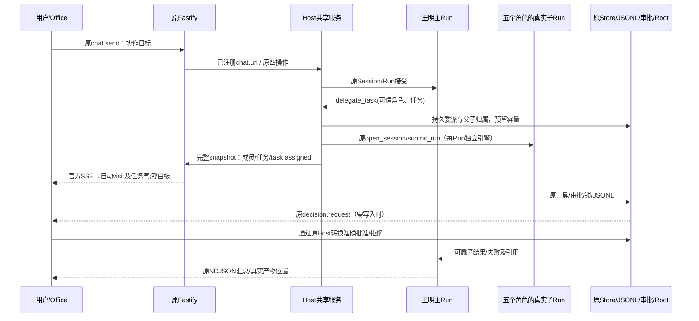

# OpenPaw 接入 Office：协议约束、交互设计与 T0—T8 实施计划

2026-10-26 当前补修入口：PR #13已合入`a26fa85a`，当前分支`fix/engine-host-t6-followup`继续D81—D91修复；T7未开始。D89绑定交接生命周期和准确父任务并修复64KiB历史阻塞；D90拒绝空/截断结果冒充完成，并在原共享硬预算内复用Provider声明的单次上限；D91修复删除动作被自身UI优先规则阻止确认。最新真实DeepSeek一主五子及六成员详情已取证，但本轮100单+100多及完整产品74条已通过，完整27项25通过、2治理项待r10准确审核，准确证据见原0007，不能沿用下方旧版本通过。原CHG0007 §12.57—12.61保存原因、方案、失败及范围归并；Office未修改，R21已由Host D91修复且真实UI通过，Office申请撤回；其他Rx仍暂缓，Windows原生未验证。

当前演示仍在`http://127.0.0.1:8765/office/`；Host为32885、PID2908616、冻结D91程序hash `f80229f1…`。已无活动任务时停写备份升级，同一真实DeepSeek原会话只读复访passed，六成员113—158ms；没有重发收费任务。部署/备份见`/home/cheng/.cache/openpaw-d91-live-20261026/runtime.json`，复访及41个REQUEST_CLOSED/410的准确分类见`/home/cheng/.cache/openpaw-d91-live-revisit-b-20261026/`。不得沿用下文历史41949进程；全部测试与准确候选状态仍见原0007。

2026-10-24 最新补修结果：准确1422f6f9干净原27项全部通过、真实Office浏览器74条断言/0 pageerror，并已备份部署原8765/41949；Office进程/代码不变。原0007第12.30节D68—D70已实现并用同一普通长沙两日游提示词复验：真实DeepSeek主Run 03535c5a11d643bca819823eba9544fc及5个独立子Run，五个不同角色各自完成；review/audit的实际输入均含前序真实正文，已与账本逐项对照，不再仅交审查框架。真实五次拜访等待场景记录completed后核对（使用原页面“关闭空闲闲聊”开关，默认闲聊冲突R17仍暂缓，不能泛称默认环境已修）。共同步骤不归第一人，人物首页直接给业务任务、核验进度、实际状态/结果和只读刷新。六Pixi人物、六侧栏任务详情、六成员布局均真实点击；任务中心展开、白板、普通追问运行中/结束/刷新保持同一子成果，零新增子执行、零pageerror/超时浮窗。证据根`/home/cheng/.cache/t6-agent-followup-20261024`，准确首验见final-b/{full,product}/report.json，真实模型及截图/trace/账本见live-after-c/report.json。文档登记后的最终准确候选另跑final-c，是否通过以最终实际report和closure.json为准，不借首验覆盖新提交；原live-after因draft/review同批而缺草稿的失败、live-after-b外部脚本未等待子接受而退出并准确取消清理的记录均保留；补充真实依赖规则后，isolated-order/ui真实模型及六成员48项查询通过。PR #13继续原分支，待非作者审核/合入，交付验收与技术通过独立，不自行Approve或合入、不开始T7。唯一开发目录仍Office/openpaw；生产精确版本及已提交workspace迁移见runtime-t6.json。Office全部Rx仍暂缓，R13原位Demo菜单及R19/R20前端入口差异未实施；Windows原生暂缓不计通过。

D71详情延迟补修见原0007第12.32节：原生产36次ui请求最长9.285秒，多次约6秒；已将原get_run改为按Run主键/工具事件run_id/审批run列读取，保持原JSONL、事件顺序及审批优先级，无新缓存/表/索引/协议。原inline精确跨Run、状态顺序、审批与只读回归已通过（Host31/31）；准确最终全27项/74浏览器见同证据根final-c，部署后同一已完成会话六成员48项实际点击及耗时比较见production-menus/report.json、timing-comparison.json，最终结论以closure.json绑定提交/退出码为准，未生成或失败不能视为通过。原1422真实模型及旧失败仍保留，不将首验当新Store的生产验收。

历史状态记录：保留原时点，不覆盖上方当前入口

状态：T0—T5已合入。2026-10-24 最新交付状态：用户已验收准确`15cc908287124a2f8dfa7c991f914e5d0e95415d`，T6 [PR #12](https://github.com/KunlunMeta-Limited/openpaw/pull/12) 已创建，目标`merge/ai-ofice-react-overagent`；OPEN、待非作者审核、未合入，T7未开始。准确交付干净原27/27通过，真实Office浏览器68条/0页面错误、五次实际交接；真实DeepSeek一主五子、一次审批后报告落盘、7张唯一任务卡及白板6/6/100%通过。验收/PR元数据登记后的准确提交另以`/home/cheng/.cache/t6-pr-20261024-m/{full/report.json,product/report.json,review.json}`完整复验，报告形成前不预填新提交通过。原失败及历史叙述保留当时语境，以本段及0007第1/12.10节为当前状态。Office冻结fa6ae1f；8765仍已部署T5/d150b96，未随PR升级；Windows原生暂缓、未执行不计通过，Office Rx全部暂缓。

本文件同时服务人工评审和 coding agent：先明确真实协议、用户行为与系统边界，再定义实现方法、产物、测试和 PR 交接。下文方案要求的实际完成状态以第14.1节及各主CHG最新履历为准；不能将设计、fixture 通过或 feature 连线描述为功能已交付。用户提供的 master-plan 仅作为参考材料。

### 当前产品复检与实际开发入口（2026-10-23）

T5 r2/r3目标/真实步骤进度、新版创建、共享审批/详情/删除及场景已通过当前Linux验收并随PR #11合入。真实模型发现的D45—D49已在该PR修复；原失败记录保留。当前开发入口为[0007 T6 r2产品/多Agent提案](../changes/CHG-2026-0007.md)，已按准确r2实施，当前证据见0007验证记录；小写r2是OpenPaw方案版本，大写Rx是[Office修改申请](office-change-requests.md)，本单P01—P08和V01—V10是T6验收场景，三者不能混同。R6已由上游覆盖撤回；R11/R12/R13/R15/R16/R17仍暂缓，不改Office；R14原失败已由新上游就绪测试覆盖，详见集中台账。六人物/左侧详情缺口及真实多Agent方案见[第16节](#office-product-agent-review)，不能把旧功能演员映射叫多Agent。

| 入口 | 实际版本/用途 | 当前限制 |
|---|---|---|
| `openpaw/` | 唯一开发目录，feat/engine-host-t6（基线f22cca1，T6已实施、未最终验收）；最新CHG/代码均在此 | 原0003/m2/m5三份用户排版改动保留、独立未提交 |
| 原artifacts内T3/T4/T5工作树 | 已核清洁并移除；分支与Git提交仍保留 | 不再作为开发入口；恢复方式见清理清单 |
| http://127.0.0.1:8765/office/ | 原会话完整备份后已升级T5；精确运行版本见runtime-t5.json | 原天气真实DeepSeek/账本已验收，见0006最终记录；不以确定性Provider代替 |
| http://127.0.0.1:8766/office/ | 历史T5隔离演示 | 历史证据保留，不能替代8765现场验收 |

CHG编号0004=T3、0005=T4、0006=T5、0007=T6。旧工作区已在备份及保留用户改动后同步；备份在`.git/agent-local-backups/20261023-primary-sync`。功能、清理及实际服务验证证据统一见[0006验证记录](../verification/CHG-2026-0006/验证记录.md)，未运行不得记通过。

### d150b96现行协议增量及人可读流程

本节覆盖下文历史02dbac4的差异；历史测试报告不改基线。新版仍使用七操作messages与同源四操作chat，新增的是`ui.next`中的`office.create`动作及`ui.respond presentation.target=office`，不是增加自定义HTTP网关。

~~~mermaid
sequenceDiagram
    participant U as 用户与Office页面
    participant F as Office官方服务
    participant H as OpenPaw Host
    participant S as 原Session与Store
    U->>F: 新建办公室（显示名称）
    F-->>H: 唯一ui.next：office.create，team/conversation为空
    H->>H: 分配门→预授权槽→该槽投影门
    H->>S: 原open_session/main + office_created持久幂等
    S-->>H: 固定根、真实Session与唯一归属
    H->>F: ui.respond：target=office +完整官方快照
    F-->>U: 新办公室目录与页面
    H->>H: 释放投影门；后续原完整同步
    U->>F: 对话与多步骤目标
    F->>H: 原chat send/history/resume/cancel
    H->>S: 原引擎/工具/审批 + 有界计划与执行证据
    H->>F: snapshot：业务目标、步骤、事实计数、真实分配事件
    F-->>U: 聊天、任务流、白板与人物工作状态
~~~

`creation_slots`默认空，旧配置所有槽仍立即初始化；显式预留槽在创建前不发布、不能凭猜ID发送聊天。空闲名额只能引用配置已授权真实根，名称不做路径；耗尽明确失败。同动作同内容返回同归属，异内容冲突；业务接受但UI410不回滚，普通同步和重启恢复唯一结果。实施/验收定位0006第9.10/10.5节和`office/workspaces.rs`，不把这些设计描述当作已通过。

任务流使用主目标及最多12个业务步骤，原call仅在账本/工具详情可查。元数据工具不执行项目工作，确认完成需本轮实际成功证据；写文件需精确获批且产物路径一致。白板显示目标、实际完成N/M与≤3个当前步骤；前端running条会视觉增长，Host快照与文字计数才是事实，不伪造blocked抑制动画。R11未批准前默认链接保留。

新版send/resume没有180秒总接收时限；history/cancel控制请求仍15秒。Host流空闲、工具、Run总预算独立生效，刷新/网络断开detach，显式停止才cancel。T6继续验证真实>180秒与故障恢复，无感自动续接仍不是本期已交付承诺。choice新增allowCustom/customText按原Schema冻结，危险工具仍用confirmation且拒绝customText，不接入新澄清或永久授权。

## 0. 授权、平台与阶段规则

现行治理采用CHG-2026-0001的获批r2修订：编码前提交可人工判断的准确方案，逐文件列原因、必要性、具体方法/复用、影响和完成标准；用户批准该版本后实施。技术核查和全量双平台验证通过后，先验收准确交付版本，再创建PR；平台审核、合入分别补登。原T0交付与治理修订履历分开，治理r2已按用户批准随T3 PR #7合入，不新建Tx/CHG，不授权后续业务或Office。用户暂缓Windows原生验收的现行安排与原delivery门禁未满足事实各自保留，不把暂缓写成通过。格式/命令以governance/README.md为准。

1. 本期一名开发者，Linux 为主要开发环境，Windows 10/11 x64 原生适配；不安排 macOS 适配与验收，不要求 WSL。ARM、安装器和签名不在本期。
2. 初期按 T0→T8 顺序实施，一 Tx 一主 CHG；每个 Tx 必须有对应 PR，当前提交经人工审核批准并合入后，才能开始下一 Tx。CI 通过不等于人工批准。T6 如果实施 Office 扩展，两个仓库的关联 PR 都通过并合入才完成该扩展。
3. 上述阶段串行门禁仅用于初期建设。T0—T8 的约定范围及最终验收完成后，转为 CHG 持续开发，不再要求建立新 Tx 或等待“上一 Tx”；需求/设计/测试/文档同步、正常 PR 审核、Office Rx 审批继续有效。
4. **Office 工程中的任何修改，都必须先提交 Rx，说明原因、方案、影响和准确修改范围，经用户明确人工批准后才能实施。** 缺陷修复、必要扩展、功能新增均可提案，但均不自动获得修改授权。
5. Office 源码、文档、测试、配置、依赖、锁文件、脚本、格式化、生成文件及重命名均受上述限制。不得以“只改测试”“顺手修复”“为联调方便”为由绕过。Office 既有用户改动不得覆盖或顺手提交。
6. 批准本总计划、批准 OpenPaw PR、允许提交 Rx、发现缺陷，都不等于批准某项 Office 修改。Rx 必须记录获批版本、范围和证据；扩大范围或实质变更后重新提交审核。
7. 未批准的 Rx 不执行、不标为已实现。优先在 OpenPaw Host 适配现有 Office；确实需要 Office 修改时，先完成可评审提案，并如实说明无修改方案的能力边界。
8. T0工程治理及其0001 r2修订已分别随原PR与T3 PR #7合入：AGENTS、需求/设计、CHG、增量注释检查、验证执行器和Linux/Windows CI持续适用。具体实现与限制见governance/README.md；各Tx仍需本次准确提交验证与人工审核，不据已存在的门禁文档宣称新阶段完成。测试产物写入OpenPaw的隔离测试区或临时目录，不改变Office工作区。

## 1. 基线与资料：以什么协议接入

### 1.1 固定基线与事实来源

| 对象 | 固定基线 | 用途与状态 |
|---|---|---|
| OpenPaw 初始审核 | 60a531a51172d14fc3db1a8e7eb6762c2c8369d8 | 引擎、Provider、工具、存储可复用；Host 当时只有占位说明 |
| OpenPaw 当前集成基线 | 37f0a35729fb64639f0e1a8b8a8a4799e1dca9d3 | T0—T4已合入（T4 #10）；T5独立分支复用此基线，Windows暂缓；当前状态见14.1 |
| Office | d150b96ff0fff59ece869da7e3dc6067c1b066e3 | 文档、公共 Schema、示例和实现的冻结来源；不得浮动拉 main 自动适配 |
| OpenCode SDK | @opencode-ai/sdk 1.18.15 | 精确版本、integrity、lockfile 和真实 v1 类型 |
| 集成分支 | merge/ai-ofice-react-overagent | OpenPaw Tx PR 的目标分支，保留现有 ofice 拼写 |

官方阅读入口：[integration/README.md](https://github.com/KunlunMeta-Limited/ai-office-react/blob/main/integration/README.md)。main 链接用于发现资料，实施依据固定提交；升级先审核差异，再修改来源锁、需求、fixtures 和实现。

| 来源编号 | 固定版本资料                                                                                                                                                                              | 本项目必须落实的内容                                 |
| ---- | ----------------------------------------------------------------------------------------------------------------------------------------------------------------------------------- | ------------------------------------------ |
| S0   | [README](https://github.com/KunlunMeta-Limited/ai-office-react/blob/d150b96ff0fff59ece869da7e3dc6067c1b066e3/integration/README.md)                                                 | 外部业务后端身份、服务模式、完整阅读链                        |
| S1   | [office-integration.md](https://github.com/KunlunMeta-Limited/ai-office-react/blob/d150b96ff0fff59ece869da7e3dc6067c1b066e3/integration/docs/office-integration.md)                 | 七类业务操作、完整流程、快照版本、审批、UI、错误与恢复               |
| S2   | [dashboard-integration.md](https://github.com/KunlunMeta-Limited/ai-office-react/blob/d150b96ff0fff59ece869da7e3dc6067c1b066e3/integration/docs/dashboard-integration.md)           | 成员、任务、事件、人物绑定、进度、白板与展示边界                   |
| S3   | [message-relay.md](https://github.com/KunlunMeta-Limited/ai-office-react/blob/d150b96ff0fff59ece869da7e3dc6067c1b066e3/integration/docs/message-relay.md)                           | 部署、认证、浏览器 SSE、容量、服务重启和访问控制                 |
| S4   | [chat-integration.md](https://github.com/KunlunMeta-Limited/ai-office-react/blob/d150b96ff0fff59ece869da7e3dc6067c1b066e3/integration/docs/chat-integration.md)                     | 聊天请求/NDJSON、长度、历史、停止、无总接收时限、IndexedDB     |
| S5   | [office-integration.ts](https://github.com/KunlunMeta-Limited/ai-office-react/blob/d150b96ff0fff59ece869da7e3dc6067c1b066e3/packages/protocol/src/office-integration.ts) 及关联 Schema | 精确字段、默认值、strictObject、枚举、引用、响应类型           |
| S6   | [plugin-runtime.md](https://github.com/KunlunMeta-Limited/ai-office-react/blob/d150b96ff0fff59ece869da7e3dc6067c1b066e3/docs/plugin-runtime.md)                                     | 场景 v2、能力、参与者、命令 ID、活动与队列                   |
| S7   | integration/clients/client.mjs、ui-client.mjs                                                                                                                                        | 外部客户端调用方法；示例数据不作为真实业务实现复制                  |
| S8   | tests/README.md、tests/integration-e2e/README.md                                                                                                                                     | 真实 HTTP/浏览器验收；现有 Docker 入口不等于 Windows 原生验收 |

[contracts/sources.json](contracts/sources.json) 已固定 26 份来源的哈希和 SDK integrity；不再手工维护第二张哈希表。S5 关联文件包括 schema.ts、dashboard.ts、office-ui.ts、chat.ts、relay.ts、index.ts、map.ts、spatial.ts。服务端核对点是 server/src/app.ts、officeState.ts、officeRequests.ts、officeUi.ts；聊天核对点是 apps/web/src/chat/ChatSession.ts、sources.ts、persistence.ts；场景投影核对 apps/web/src/dashboard/sceneBridge.ts。

协议字段按冻结 Schema，运行语义同时核对文档、实现和真实测试。若三者不一致，登记证据、最小复现和影响，停止依赖歧义的实现，不凭猜测改 Office。不得把 S7 的固定演示文案当成功能完成。

### 1.2 运行环境与关联文档

Office package.json 的 Node 范围为 ^22.13.0 || >=24.0.0；本项目契约测试固定 Node 24.19.0。Office 的实际依赖解析以其锁文件为准；契约包自己的 TypeScript 5.9.3 不等于 Office 生产 TypeScript。Rust MSRV 为 1.88，stable 和新增依赖均需实际检查。

| 文档 | 唯一职责与本次衔接 |
|---|---|
| 本文件 | 人可读交互、强制边界、Tx 产物、验收与阶段流程 |
| [audit.md](audit.md) | 复用矩阵、D01—D30、能力缺口和审核证据 |
| [contracts/README.md](contracts/README.md) | 已冻结的协议细节、SDK 差异和 fixtures 入口 |
| [r1-chat.md](r1-chat.md) | R1 历史附件；现行决定以第8节及集中台账为准 |
| [office-change-requests.md](office-change-requests.md) | Office修改申请唯一现行台账；当前全部暂缓、未批准、不实施 |
| [validation.md](validation.md) | 历史实际测试记录；旧 macOS 覆盖仅属历史，不是当前支持平台承诺 |
| [handoff.md](handoff.md) | 交接模板；T0 后续同步 CHG、Rx 审批和阶段后流程 |

audit/r1-chat/handoff 已同步为条件提案；达到扩展体验需要修改，不是授权或默认必做范围。Office 审批规则适用于所有关联文档和后续 CHG。

### 1.3 最终交付给用户的产品

本期产品是“能通过 Office 操作和观察的 OpenPaw 本机助手”。用户打开办公室，在聊天框提出工作请求；OpenPaw 使用授权工作区中的真实数据和工具处理；Office 同时展示对话、任务、白板、功能人物状态与交接；需要写文件或执行命令时由用户确认；用户可以查看结果、历史和取消任务。交付物必须包括可启动的 Host、未修改的 Office 服务、配置与双平台启动入口、可重复的演示和验收证据，不能只交付 API。

技术路线可行的依据是：Office 已提供独立聊天源、完整业务快照、确认菜单、详情对话框及场景 v2；OpenPaw 已有引擎、工具和存储。当前缺少的是 Host 及可靠的执行/持久化边界。按下面的产品验收实施完毕，可以形成基础产品；源码审核和 T0 测试不证明该产品现在已可运行，也不能保证未经实现验证的每个细节都无缺陷。

| 用户实际要做的事 | 页面可见结果及真实依据 | 协议与交付阶段 | 首期边界 |
|---|---|---|---|
| 选择办公室，开始工作 | 稳定办公室目录、成员、空闲/最近任务和白板 | capabilities → initialize → read；T3/T4 | 默认四间，各绑定配置的授权根；不新建租户 |
| 提问并继续追问 | 增量文本、同一对话上下文、停止按钮；账本可查 | 官方四操作 chat JSON/NDJSON；T1/T3/T4 | 无180秒总接收时限，刷新history→resume；显式cancel |
| 让助手阅读项目并给出结论 | 任务从等待到运行，文件功能人物工作，白板显示当前工作；回答引用真实文件 | AgentLoop/工具事实 → 完整 snapshot；T2/T3/T4 | T4只开放核实的只读工具，不用随机数据展示进度 |
| 让助手写一份报告/执行获准命令 | 审批菜单说明实际操作；批准后才执行，拒绝后文件不变；可查真实产物 | decision.request + 共享 Approval + snapshot；T2/T3/T5 | 仅开放已验收工具；不执行超出授权根或不可落实的受限操作 |
| 看人物分工和交接 | 工作/思考/空闲、任务气泡、真实功能派发产生的跨人物拜访、有限发言 | snapshot + task.assigned，由 sceneBridge 自动 visit；必要时 scene.say；T4/T5 | 人物代表功能角色，同一 Run 仍是一个 AgentLoop；不宣称多 Agent 协作 |
| 点击人物、成员查看工作依据 | detail-v1 中查看任务、历史、工具结果、文件及 Skill/Goal/Todo；能分页/返回 | ui.next → 共享只读查询 → ui.respond；T5 | 使用已有详情入口；不增加侧栏和富文本；只读数据不能借查询初始化/修改 |
| 在另一办公室同时提问，或停止一个任务 | 其他对话继续；被停止任务实际清理后结束，任务状态说明取消原因 | 共享 Run/锁/取消 + 官方cancel；T1/T2/T3/T5 | 同Session一个活动Run；同办公室可多会话并行；默认总容量四个 |
| 断网或重启后继续使用 | 保留真实记录和最新任务；未完 Run 说明中断；Office恢复最新完整快照 | JSONL/Host恢复 + initialize/snapshot/read；T3/T6 | 不自动重放工具；通过history/resume接回原Run；Host崩溃不重放执行 |
| 点击任务的开始/暂停/完成/改派 | 返回准确的能力说明与可用操作建议 | ui.next + detail-v1；T5 | 首期不实现旧 Run 重放、可恢复暂停、手动伪完成、执行所有权迁移；按钮不是已支持命令 |

里程碑状态及PR追踪统一见[第14节](#milestones)，当前T0—T3本轮批准范围已合入，Windows待补；T4 r4新版接入技术证据齐，交付验收待用户审核；[第14.2节](#protocol-checklist)给出Tx到官方文档/实施章节/验收证据的核查表。

基础版的“能展示”要求 T4 和 T5 的两条用户旅程都通过，T6 加固故障恢复，T8 完成原生双平台交付。T7 是另一客户端的 SDK 兼容工作，不是 Office 产品闭环的前提。不能以“聊天通了”或“可以播放演示动画”替代 T5 的产品验收。

Office 的地图编辑、家具互动、任意移动、独立会议、持续 focus、emote 属于已有展示能力，本期不全部接入业务。必交付动画是由真实任务驱动的工作状态/气泡、跨人物交接及有限发言；已用快照表达工作时不再叠加长期 focus 占人物资源，避免阻塞交接。将来若需开放其他能力，先在 CHG 说明用户用途、触发事实、参数验证及资源释放；涉及 Office 任意改动另走 Rx。

### 1.4 一个贯穿各阶段的真实演示

演示工作区使用临时授权目录，放入已知内容的 README.md 与 notes.txt；不得用项目源码目录做写入演示。自动化使用确定性 Provider 使工具和错误可复现，最终另有真实 Provider 验证。确定性 Provider 仍通过同一个 AgentLoop 和真实工具，不直接推送伪任务/伪动画。

| 步骤 | 用户动作 | Host必须实际完成 | Office必须呈现 / 证据 |
|---|---|---|---|
| 1 | 启动服务并打开 /office/ | 恢复配置/账本，查询能力，初始化办公室；确认在线或明确 cached | 配置的办公室、角色和白板；capabilities/initialize/read响应和页面截图 |
| 2 | 输入“读取README.md和notes.txt，比较两份内容并指出差异，先不要修改” | 绑定Session，保存请求，运行真实读工具；记录call/result | 流式回答有文件依据；任务/白板和功能人物随真实状态变化；JSONL与文件哈希证明未写入 |
| 3 | 追问“把差异整理到reports/summary.md” | 复用上下文；最终写入输入分类后创建审批，等待不持锁 | 菜单说明目标相对路径、写入/覆盖性质及输入摘要；任务blocked，文件尚不存在/未改变 |
| 4 | 先拒绝，再发起新的写报告请求并批准 | 拒绝记录为该call的结果；新请求/新call经新审批，批准取锁重验后写一次 | 拒绝有说明；批准后文件真实生成、工具子任务完成、Run最后才完成；不能重用旧菜单批准 |
| 5 | 点击人物/成员查看详情并打开关联工具结果和产物 | 单领取器路由，按team/session/call查询，生成作用域按钮 | 详情中的结果、文本预览与真实文件一致；可进入历史/Skill/Goal/Todo菜单，有数据展示数据，无数据说明为空，错误不能显示为空 |
| 6 | 在第二间办公室执行任务，停止第一间的慢命令 | 审批真实命令后执行；取消进程树并回收；Session和根锁隔离 | 第一间显示取消/清理原因，第二间继续；进程检查证明无残留，不能只看页面颜色 |
| 7 | 重启Office，再重启有活动Run的Host | 从持久化状态重建快照；活动Run变interrupted，审批失效 | 最新状态恢复、没有重复文件写入/旧菜单生效；刷新以history/resume证据恢复；Host崩溃仍为interrupted，不伪装继续执行 |

步骤1—2是T4演示；步骤3—6是T5完整演示；步骤7在T6加固；T8在Linux与Windows各执行一次完整旅程。常规演示先在180秒单连接内展示；审批期限按Run总预算和独立菜单策略安排，不绑定单次聊天连接。超过时限、刷新和断线另作边界用例。新版官方协议已提供history/resume/cancel，T4必须适配基础恢复；T6验收超过180秒和故障加固，不需要旧R1四URL扩展。

~~~mermaid
flowchart LR
    U[用户提出请求] --> C[真实对话与Session账本]
    C --> R[一个Run与独立AgentLoop]
    R --> Q[只读工具或最终写入提议]
    Q --> A{需要审批}
    A -->|是| D[Office确认菜单]
    D -->|允许且重验通过| X[真实工具执行]
    D -->|拒绝/超时| N[记录拒绝并继续解释]
    A -->|否| X
    X --> O[工具结果/文件产物/最终回答]
    N --> O
    R --> P[真实生命周期投影]
    X --> P
    O --> P
    P --> V[任务/白板/人物/交接]
    O --> I[详情/历史/文件预览]
~~~

## 2. 系统怎样交互，数据归谁

### 2.1 两条 Office 链路与共享 Host

~~~mermaid
flowchart TB
    U[用户] --> B[Office 浏览器]
    B <-->|同源 POST /api/pawoffice/chat| F[Office Fastify]
    F <-->|注册的chat.url：JSON / NDJSON| C[Host：Office 聊天适配器]
    B -->|内部 reply 与 ui| F[Office Fastify]
    F -->|Office 原有 SSE| B
    A[Host：Office 业务适配器] -->|官方 messages API| F
    F -->|同一次 HTTP 请求的响应| A
    C --> H[共享 Session / Run / Approval / 查询 / 资源协调]
    A --> H
    W[固定 SDK / 未来 OpenWork] <-->|HTTP / SSE| O[Host：OpenCode v1 适配器]
    O --> H
    H --> E[现有 AgentLoop / Provider / ToolRegistry / Store]
~~~

- OpenPaw Host 充当 S1 的“外部业务后端”，不是另建 Office 服务。
- 聊天：浏览器调用Office同源POST /api/pawoffice/chat；Fastify转发到Host通过offices.initialize.chat.url注册的/office/chat。模型仍只在Host执行，不依赖VITE_PAWOFFICE_CHAT_URL。
- 展示和操作：Host 调用 POST /api/pawoffice/messages；Office 自己管理 GET /api/pawoffice/events、POST /api/pawoffice/reply、POST /api/pawoffice/ui。Host 不伪装浏览器回报，不直接接管内部 SSE。
- Office 主入口由浏览器建立 workspace=1 订阅。仅 teams=… 的场景订阅不能接收业务快照恢复或菜单，不能当作在线业务页面。
- 文本输出不会自动更新任务/白板；Host 从真实运行事实生成投影，经 messages 同步。
- 兼容 DTO、路由、错误转换集中 openpaw-engine-host；Host 内部直接调用 Rust 服务，不绕自己的 HTTP 查询。
- 不新增 Node Bridge，不复制 AgentLoop、Session、工具注册表、审批系统、存储解析器或场景运行时。MCP sidecar 保留原用途。
- engine-host feature 默认关闭；默认 CLI、离线能力和 sidecar 保持兼容。不得引入文件/crate 行数上限；lines 仅统计，解析/读取失败仍报错。

### 2.2 数据与标识

| 数据/标识 | 所有者与约束 |
|---|---|
| teamId / workspace.id | Host 配置的稳定办公室 ID；两者相等，默认 4 个办公室，可配置 |
| conversationId | 浏览器生成；与 teamId 一起绑定 Host Session，新对话不新建办公室 |
| Session / Run / message / call ID | Host/引擎稳定标识；不拿人物 ID 代替，不用浏览器截断历史重建账本 |
| employee.id | 业务成员或功能 ID；不代表已实现多 Agent 编排 |
| sceneActorId | Office 场景人物 ID；从能力查询核实，多个成员可绑定同一人物 |
| Approval ID | Host 业务审批标识，绑定 Run/call/工具/最终输入摘要 |
| decision.id | 一次菜单展示尝试的 ID；重开菜单换 ID，仍关联原审批 |
| action.id | 本次领取操作的 ID，用作 ui.respond.interactionId |
| dialog.action.interactionId | 原详情上下文 ID，不能代替新 action.id 回应 |
| commandId / event.id | 场景命令/业务事件稳定标识；重试不生成新的历史交接 |
| 消息与工具结果 | 现有 JSONL 为事实，SQLite 索引可重建；完整工具配对与终态必须保留 |
| Host 元数据 | 绑定、Run、Approval、投影版本及恢复；不再保存一份权威消息历史 |
| Office Fastify | 单进程内存中的最新快照/等待请求；不是业务数据库 |
| 浏览器 IndexedDB | 当前浏览器聊天、草稿和临时展示；不替代 Host 持久化 |
| UI/动画回执 | 不作为工具已执行、任务成功或授权成立的事实 |

## 3. Office 通用协议与七种操作

### 3.1 通用规则

所有业务操作和场景命令发送至 POST <Office URL>/api/pawoffice/messages，携带 Authorization: Bearer <PAWOFFICE_API_KEY> 和 Content-Type: application/json。业务请求用 type 区分；场景请求是 {teamId,command}，不得混用旧 /actions gateway。

响应为 {code,msg,data}：code 与 HTTP 状态一致，data 必须为对象。Host 校验 envelope 和具体操作结果；错误读取 reasonCode/details/issues，不根据 msg 文案分支。错误结构不完整或响应类型错误视为协议故障，不能当空数据成功。

| 约束 | 必须落实 |
|---|---|
| JSON | 任意层级无 null，拒绝 __proto__、非有限数字及超深结构；最大深度 64；strict 字段不随意扩展 |
| 请求大小 | messages 请求完整 UTF-8 JSON 最大 65536 字节，含外层包装；初始化数组和菜单也受限制 |
| 服务内存 | 最多 100 办公室、最新快照总量 8 MiB；不是 Host 应主动用满的目标 |
| ID | 办公室/人物/命令/交互 ID 为 1—100 字符且符合字母数字及 _.:-；员工/任务 ID 按对应业务字符串 Schema |
| 时间 | 带时区 ISO 8601；不以跨机器时间相等作为审批成立条件 |
| 默认值 | 可选文本空串、列表空数组、online=false、未知指标/进度=-1；不能发送 null |
| 等待 | 初始化/快照/查询默认等页面 10 秒；菜单默认 60 秒；ui.next 默认 30 秒；分别设置 HTTP 超时 |
| 大小层次 | 请求 64 KiB、规范化快照/内部 SSE 上限、Host 聊天限制分别处理；server OfficeState 还检查补齐默认值后的快照大小，不把 64 KiB误当所有响应上限 |

Host 可采用更保守的展示预算，但不得截断必填 ID/关联字段或损坏 UTF-8。64 KiB 不适用于本项目独立聊天路由；聊天合法历史可能超过此值。

### 3.2 操作实施表

以下各请求体均通过同一 messages 地址。成功响应下表描述 data；外层仍包含 code/msg/data。

| 操作/来源 | 请求关键字段 | 返回与时机 | Host 实现与验收 |
|---|---|---|---|
| office.capabilities；S1/S5 | {type:"office.capabilities"} | 立即 200；scene/ui/requests/responses | 初始化前查询，核对协议 2.0、人物、所需能力、detail-v1/task-board-v1 和 Schema；缺必需能力明确不兼容 |
| offices.initialize；S1/S2 | {type:"offices.initialize",offices:[完整快照]} | 200：取得页面逻辑初始化结果；202：已缓存未确认；data 含 offices/actors/supportedMessages/sceneCommandProtocol/ui | 按 workspace.id 新增或更新，未列出办公室保留；无删除功能；runtimeReady 不等于素材全部加载 |
| office.snapshot；S1/S2 | {type:"office.snapshot",teamId,snapshot:完整快照} | 200 applied/ignored 或 202 cached，含 teamId/seq/status，部分 ignored 含 reasonCode | teamId=workspace.id；已初始化；同版内容固定；T4 真服务验证所有版本分支 |
| office.read；S1/S5 | {type:"office.read",teamId?} | 无/空 teamId 查目录；指定时返回 snapshot/scene/pendingDecisions；未初始化 404，无在线业务页面 409 | 用于连接恢复和展示核对，不能覆盖 Host 账本或复原授权；目录 200 不代表每间办公室在线 |
| decision.request；S1/S5 | {type:"decision.request",teamId,decision,timeoutMs?} | 同一个 POST 等选择后 200；到期 408；无在线页面 409 | 绑定共享审批、校验返回标识；无结果不批准；详见第 6 节 |
| ui.next；S1/S5 | {type:"ui.next",timeoutMs?} | 1000—30000ms，默认 30000；data.actions 最多 1 项，空数组是正常无操作 | 单个全局领取循环按 teamId 路由；可取消；记录领取后处理；不承诺重投 |
| ui.respond；S1/S5 | {type:"ui.respond",interactionId,presentation} | 200 {interactionId,delivered:true}；过期/已结束 410 | interactionId=新 action.id；dialog 返回 detail-v1，whiteboard 返回完整新快照；不能仅传局部白板 |

### 3.3 启动、初始化与服务重建

~~~mermaid
sequenceDiagram
    participant H as Host
    participant D as Host元数据/账本
    participant F as Office Fastify
    participant B as Office浏览器
    B->>F: Office自己建立 workspace=1 SSE
    H->>D: 恢复绑定、未终结Run、seq和原投影
    H->>F: office.capabilities
    F-->>H: 能力和Schema
    H->>H: 校验必需能力及配置
    H->>F: offices.initialize，完整快照
    alt 在线页面确认
        F->>B: SSE初始化
        B-->>F: 内部reply
        F-->>H: 200及runtimeReady
    else 未取得确认
        F-->>H: 202，已缓存
    end
    H->>F: office.read核对目录/办公室
    Note over H,F: 连接恢复或定期协调发现404时重新初始化
~~~

Host 的 Office 协调器在启动、连接失败恢复、404 和可配置的有界周期执行目录核对/重同步；请求间有退避，可取消，不持引擎全局锁。不能通过 capabilities 或 /health 成功推断服务端目录仍在；也不新增依赖浏览器内部 SSE 的恢复通道。

Office Fastify 重启丢失目录和快照；Host 使用自己保存的最新完整状态重新初始化。Office 浏览器根据其内部 stateId 自行清理旧目录，Host 不模拟该事件。Office 暂不可用时运行结果仍按真实引擎事实保存；展示待同步、网络失败与 Run 失败分开记录。

## 4. 新版聊天：四操作、历史与稳定轮次

### 4.1 单一官方转发链路

Office版本固定d150b96，虽然version仍为1.0，协议已区别于历史b221a44。浏览器调用同源POST /api/pawoffice/chat；Host在offices.initialize顶层注册chat:{url:"http://127.0.0.1:<Host实际端口>/office/chat"}。Office Node只转Content-Type/Accept，不转Origin、Cookie或Authorization。Host默认回环监听、精确Host校验；有Origin请求仍须命中配置白名单，不能以teamId当授权。首期同机单用户；跨机需另行设计受保护代理，不能直接开放私有工作区。

| type | 请求必要字段（均含version/teamId/conversationId） | 返回与用途 |
|---|---|---|
| send | turnId、messages | HTTP200 NDJSON；可靠接受一次输入，返回该轮快照/增量 |
| history | cursor默认空、limit默认20（1—50） | {code:200,msg:"OK",data:{turns,nextCursor,hasMore,activeTurnId}}；进入会话/刷新/分页使用，不启动模型 |
| resume | turnId | HTTP200 NDJSON；首条snapshot完整文本和状态，再收新增内容 |
| cancel | turnId | {code:200,msg:"OK",data:{stopped:true}}；真实清理结束后确认，已终态重复操作幂等 |

~~~json
{"version":"1.0","type":"send","teamId":"office-1","conversationId":"conversation-id","turnId":"turn-id","messages":[{"role":"user","content":"读取README.md和notes.txt并比较"}]}
~~~

### 4.2 接受、历史与取消不变量

1. (teamId,conversationId)固定绑定原Session；conversationId同时用在conversations[].id，不能换成Session/Run ID。新对话仍留在同办公室，首次成功发送后加入快照目录，空草稿/history读取不创建Run。
2. (Session,turnId)与Run及规范请求的精确关联在Accepting同一SQLite事务保存；相同键相同内容返回原Run，相同键异内容拒绝，并以官方NDJSON error说明（见4.3）；HTTP200不代表接受成功。关联只用于幂等，不作为第二模型账本；JSONL仍是事实。legacy:RunID是升级前Run的稳定历史身份，send拒绝占用该前缀，resume/cancel可读旧身份。
3. 同Session最多一个活动Run；**同办公室不同会话可并行**，全局默认四个，复用原根资源锁。超限明确拒绝。每办公室最多100个绑定，超过时拒绝新会话，不删旧账本。
4. messages最多十完整轮次加当前非空user；首次导入仅为不可信外部文本，后续核对已完成展示历史后缀，不覆盖原账本或导入工具/授权。历史按Run输入位置读取，不将tool_result(User角色)当成用户轮次。
5. history页内旧→新，游标绑定既存Run身份；新追加不移动旧页边界。仅最新页含最后一个pending，activeTurnId与之相同；旧页无活动标识。旧Run用原ID稳定映射；完整工具结果留原查询接口/T5详情。
6. resume先订阅再读同Run的完整文本快照，再按已发前缀发送增量；落后重取。快照是{text,state,message}，state只允许pending/complete/stopped/error。终态快照直接结束；不在流里发自定义runId或cursor。
7. **断开/刷新/卸载仅detach**；共享Host继续拥有Run。显式cancel才关闭授权并取消模型/等待/工具，清理结束才stopped:true；cancelling仍属pending。Host崩溃后unfinished→interrupted→聊天error，不自动执行旧工具。

### 4.3 容量、流与错误

| 边界 | 必须落实 |
|---|---|
| body/历史JSON | 请求UTF-8最多512KiB；历史响应最多8MiB，必要时缩页并保留稳定游标 |
| 当前输入/历史 | 当前输入≤4000 UTF-16单元；最多21messages交替且最后user；历史部分≤100000 |
| 回复/delta/单行 | 回复和snapshot.text≤50000，delta≤16000，JSON行≤350000 UTF-16单元；字节与字符独立检查 |
| 流事件 | status(thinking/streaming)、delta、snapshot、done、error；无null/未知字段 |
| 成功/失败 | 完整账本与终态保存后才done或complete snapshot；空输出、超限、持久失败不得假done；错误说明有界且不泄密 |
| 请求期限 | 非流操作Office转发15秒，send/resume无自动总时限；Run总预算独立；T6覆盖超过连接期限再恢复，不用心跳宣称无限连接 |
| 可恢复接受拒绝 | 仅send/resume的history_conflict/request_conflict/session_busy/slot_busy/capacity_exceeded/not_found：HTTP200/application/x-ndjson一条官方error{message}；安全白名单文案，无done/成功snapshot/新Run；不按Accept分叉 |
| HTTP错误 | 非法JSON/字段/来源/办公室仍真实4xx；存储/未知故障保留HTTP失败。history/cancel仍code/msg/data；Office将上游非2xx转通用502，不承诺原细分状态透传 |
| 消息段落 | 每条assistant消息内部原文不变，两条有文字消息间补足两换行；live/JSONL恢复同一累积器，4MiB预算含分隔；空/Thinking/纯工具不制造回复，原JSONL不回写 |

~~~mermaid
sequenceDiagram
    participant B as Office浏览器
    participant F as Office Fastify
    participant C as Host Office适配器
    participant S as 原Session/Run/JSONL
    C->>F: initialize(offices,chat.url)
    B->>F: history(team,conversation)
    F->>C: 转发history
    C->>S: 只读轮次页
    C-->>B: 经Fastify返回历史/activeTurnId
    B->>F: send(turnId,messages) 或 resume(turnId)
    F->>C: 同一POST转发
    C->>S: 幂等接受一次 或 查找原Run
    C-->>B: 经Fastify返回snapshot→delta→终态
    Note over B,S: 刷新/断网只detach，不停止Run
    B->>F: cancel(turnId)
    F->>C: 显式取消
    C->>S: 取消并等待真实工具/资源清理
    C-->>B: stopped:true
~~~

### 4.4 部署与配置

模型仍按OpenPaw原生.env读取，密钥只在Host；Office API Key只在Host/Node服务，不进VITE_*、浏览器、事件或工具环境。聊天地址运行时注册，不需修改Office构建配置。Office重启后Host重新注册地址并重发已保存完整快照。Linux/Windows使用同一配置意义，Windows不依赖WSL。使用上游隔离副本安装/构建，不改用户原Office文件。

## 5. 快照、白板与真实状态投影

### 5.1 字段与引用

| 结构 | 必填/关键约束 |
|---|---|
| 快照 | schemaVersion="1.0"，seq为正安全整数，workspace.id/name；workspace.name≤80；顶层只有conversations和system，不带employees/tasks/events/whiteboard |
| conversations | 最多100；id等于原conversationId且唯一，title≤160；各自employees/tasks/events/whiteboard，切换只投影选中会话 |
| conversation.employees | ≤200；id/name必填，name≤80；role≤80，sceneActorId默认空，online默认false；ID唯一 |
| conversation.tasks | ≤1000；id/title/status/updatedAt必填，title≤160，summary≤1000；assigneeId空或引用当前员工 |
| conversation.events | ≤500；id/kind/summary/occurredAt必填，summary≤300；kind仅 note/task.assigned/task.started/task.blocked/task.completed |
| system | 未测cpu/memory/network为-1；不能生成假监控值 |
| 时间/引用 | 时间带时区；事件引用指向当前投影中有效对象或按Schema省略/空串；Host额外维护事件ID唯一和稳定性 |

Office 固定六个人物：office-lead、code-agent、file-agent、app-agent、review-agent、data-agent；仍通过能力查询验证。多个成员可共用人物，未绑定的成员仍显示列表但不关联动画。人物主任务选择由 Office 已有规则负责：running>blocked>failed>queued>completed，同级按 updatedAt 最新，同时间按任务 ID 升序；Host 不复制该选择器，也不因人物只有六个就删除全部其他业务任务。

**本期投影选择：**Run 对应主业务任务，实际待调度的工具 call 对应可展示子任务，完整调用结果通过详情查询；工具不自动变成独立 Agent。主子关联与角色分配见第5.4节。员工表达真实运行角色/工具功能，online 不冒充网络探测。进度未知为 -1；只有可验证工作量才报告百分比。

| Host事实 | Office任务/白板状态 | 说明 |
|---|---|---|
| 接受且未执行 | queued | 不伪造执行中 |
| 模型/工具实际执行 | running | proposed/ToolUseStart不能单独证明工具已开始 |
| 等待审批/资源 | blocked | summary说明原因，不伪造暂停能力 |
| 正常完成 | completed | 与Host持久化结果一致 |
| failed/cancelled/interrupted | failed | summary/详情分别说明失败、取消、重启中断；不增加官方枚举 |
| cancelling | blocked | 说明正在清理；清理结束再进入最终映射 |

事件由真实状态变化产生并稳定保存：分配才 task.assigned，开始才 task.started，完成才 task.completed，其他不能硬塞新 kind，可用 note。events 新到旧排序；首次加载/重试不重播历史交接。同人物交接不安排额外拜访。

### 5.2 白板与有界完整投影

白板固定 task-board-v1；title≤160、tagline≤40、description≤300、note≤160；link.label≤40，url为空或HTTP(S)；steps≤3，每项id/title有效，progress为-1或0—100。title=""表示清空；省略whiteboard或传{}会补空白默认结构。保留白板必须每次完整携带。

办公室进度条/白板的平滑增长最多99%是视觉反馈，不作为Host真实进度、API查询或完成判定。仅 completed 才表示完成，不能按动画时间推算业务成功。

投影器按办公室串行生成完整状态，优先保留活动/待审批任务，再保留有界近期终态；稳定排序、明确展示范围。裁剪任务/事件时同步维护引用闭包、员工和白板，不截断ID，不丢弃Host事实。完整历史由详情查询。先执行规范化和精确UTF-8序列化，再核验整个请求大小；无论数组上限是否达到，都不能超64KiB。超限时缩小可展示内容或明确失败，不拆成多个相互覆盖的局部快照。初始化多个办公室可分合法批次，每个办公室仍是完整快照。

### 5.3 seq、持久化与恢复

每办公室一个版本分配/投递协调器，覆盖普通snapshot和ui.respond.whiteboard，避免两个入口各自加seq。新内容先生成规范化完整状态并持久化seq与内容，再发HTTP；相同版本重试使用原内容，不重新生成时间/事件ID。事务失败不消耗一个被错误复用的版本；已分配版本不倒退，溢出拒绝并诊断。

| Office收到的版本 | 结果 | Host动作 |
|---|---|---|
| 大于当前 | 缓存并同步完整快照 | 等applied或记录cached |
| 小于当前 | 200 ignored / STALE_SEQ | 核对本地版本与单写所有权；不能当成当前版本已应用 |
| 相等且规范化内容相同 | 重新同步，可200 applied或202 cached | 保留相同内容重试，不因DUPLICATE_SEQ就跳过协调 |
| 相等但内容不同 | 409 SEQ_CONFLICT | 一致性故障，停止该办公室投递并诊断，不能盲目seq+1掩盖 |

Host 序列、发送和确认状态分开；某个旧请求的晚到确认不能把新版本标成已应用。保存最新完整内容和必要待确认版本，有界回收历史。超时/断线/422等失败不证明Office回滚；只按具体原因重试。Office重启清空缓存时重新initialize，Host不重置seq。

~~~mermaid
sequenceDiagram
    participant H as Host投影协调器
    participant D as Host持久化
    participant F as Office Fastify
    participant B as Office浏览器
    H->>D: 原子保存seq与完整规范化内容
    H->>F: office.snapshot
    F->>F: 校验并缓存
    alt 页面成功应用
        F->>B: SSE快照
        B-->>F: 内部应用回报
        F-->>H: 200 applied
    else 未取得页面确认
        F-->>H: 202 cached
    else 请求失败或超时
        Note over H,F: 快照仍可能已经缓存
        H->>F: 同seq同内容重试
    end
    H->>D: 按办公室和版本保存同步结果
~~~

### 5.4 从引擎事实到可展示的任务与人物

以下是本项目新增的Host投影规则，不是Office自带的业务调度器。它只记录和表现实际执行，不让模型随意调用场景API改变任务成功状态。

| 真实事实/内部责任 | 产品任务与角色 | 完整快照/场景变化 | 不允许推断的事情 |
|---|---|---|---|
| 用户输入可靠接受，Run注册成功 | 一次Run对应一个主任务，负责人绑定office-lead | 主任务queued；白板标题取有界请求摘要，保留完整输入于账本 | HTTP连接建立不等于请求已接受 |
| AgentLoop开始处理 | 主任务running；负责人负责理解和汇总 | 人物工作状态由sceneBridge派生；白板note说明当前阶段 | 不展示ThinkingDelta的内部推理内容 |
| 工具最终输入已验证，形成实际待调度call | 用稳定call ID派生工具子任务；文件读取/写入归file-agent，检索归data-agent，命令执行归code-agent，其他归负责人 | 子任务queued；一次真实功能分配产生稳定task.assigned，引用同快照中的任务和成员 | ToolUseStart只是模型提议，不能直接变running；未用到的角色不制造工作 |
| 需要审批或等待资源 | 相应子任务blocked；Run正等待该call时主任务也blocked，summary说明等待类型 | note/summary分别写“等待确认”或“等待工作区”；不伪装暂停 | blocked不是用户可恢复暂停的实现 |
| 审批通过、拿到锁并重验，进入工具主体 | 子任务running，记录实际开始时间 | task.started；功能人物工作/气泡；跨人物task.assigned由Office自动安排visit | 不再发送重复visit；同人物不安排交接 |
| 工具返回并可靠保存 | 成功子任务completed；拒绝/工具错误/取消为failed，summary明确区别 | 完整快照保留结果摘要、稳定关联；工具结果详情可查 | 工具失败可被模型处理，不因此强制主Run失败；不能假设工具成功就代表主Run完成 |
| Run最终结果与消息可靠保存 | 主任务按第5.1节映射终态；子任务不跟随主任务被全体改为成功 | 白板最终状态与总结，有限scene.say说明“已完成/已停止/失败原因” | 只有真实成功才completed；清理中维持blocked，动画结束不触发完成 |

成员配置固定功能含义及officeActor绑定，能力查询确认后使用。表中file-agent等是场景人物ID，业务employee.id单独生成并稳定保存。review-agent/app-agent没有真实工作时不展示成已参与审阅或应用操作。资源指标没有采集实现时保持-1。

主任务ID由Run稳定派生，子任务ID由Run+call稳定派生；两者关系保存在Host元数据/查询映射中，不能给Office strict Schema添加parentId/runId/callId。Office只收到其允许的字段，详情通过Host作用域映射找到原始事实。白板最多三个展示阶段“理解请求、执行工作、汇总结果”，不是模型生成的可执行计划；无可信百分比时progress=-1。阶段说明随事实变化，不用计时器制造完成率；纯聊天允许没有工具子任务。

投影服务消费共享Run服务保存的生命周期记录。原AgentEvent只有ToolUseStart/ToolResult等，不能提供获锁后真正开始和可靠持久化边界；T1/T2在所属核心接口延展协议无关观察点，T3在可等待的工具包装/生命周期接口接入，T4/T5投影消费。保留现有同步事件用于轻量展示，不在其中阻塞HTTP或磁盘，不仅依靠可能丢失的文本广播恢复审批和终态。

动画验收必须在初始空闲快照已被页面应用后创建新任务；首次加载不会重播历史。新分配快照包含尚未终结的子任务和同一事件，才满足sceneBridge的visit条件。极快工具可能在页面接收前完成，这时只展示真实终态，不延迟工具来伪造工作；受控慢工具的端到端用例用于验证实际分配后的拜访、工作与结束。正常运行不承诺每个call都播放一遍动画，断线不补播。

### 5.5 同一次请求的协议落点与交接依据

| 顺序 | 调用/内部接口安排 | 事实保存与失败行为 | 用户看见什么 |
|---|---|---|---|
| 1 | 浏览器同源POST Office /api/pawoffice/chat → Fastify按initialize.chat.url转发Host /office/chat（S4）；聊天适配器调用共享服务接受Run | 校验办公室/历史/容量；保存输入和绑定成功后才启动；前置非法/存储故障用HTTP错误，send/resume可恢复业务拒绝用官方error事件 | 开始思考或明确错误 |
| 2 | AgentLoop的TextDelta → 聊天适配器delta；生命周期 → Office投影器 | 文本可合并，消息/工具/终态可靠保存；两通道只共享事实，不互相冒充确认 | 聊天文字与任务/白板可以先后到达，最后一致 |
| 3 | 投影器 → messages.office.snapshot（S1/S2） | 保存seq+原内容；202只缓存；失败有界恢复；不阻塞模型输出或资源清理 | 工作状态、气泡、新分配拜访；失联时不伪成功 |
| 4 | 工具授权 → messages.decision.request（S1） | pending可靠保存；等待无锁；校验原POST返回的选择并CAS；断线/过期不授权 | 审批菜单；确认后才出现写入/执行 |
| 5 | 工具上下文取得根锁 → 真实工具 → SessionWriter/运行服务 | 绑定最终输入；失败/取消等回收；结果关联call保存；展示失败不能导致再次执行 | 工具子任务与详情反映真实结果 |
| 6 | 共享服务提交终态 → NDJSON done或error；投影终态完整snapshot | done必须有合法非空回复和可靠成功；取消/超时/存储失败不发done；两个适配输出分别处理失败 | 最终回答/错误与任务终态含义一致 |
| 7 | 点击人物/成员 → Office内部ui → Host的messages.ui.next；共享查询 → ui.respond | 使用新action.id、验证作用域；410记未送达；领取丢失不自动执行业务 | 真实详情/分页；再次点击可新建查询 |

实现和验收必须同时保留聊天、messages和真实工具证据，使用team/session/run/call/seq关联；只保存curl输出或动画录像不足以证明同一请求贯穿成功。原始文件内容、完整prompt和密钥不默认进入诊断日志。

## 6. 人工审批、用户操作与详情

### 6.1 审批：业务授权不是菜单回执

decision.kind为confirmation或choice。公共字段id/title必填，title≤160，description≤2000，actorId可省略/空；confirmation有confirmLabel/rejectLabel；choice有2—8个唯一选项，每项id/label有效、description≤500。timeoutMs为1000—300000，默认60000。业务Run剩余预算、Office v1剩余连接期限与菜单时间共同约束等待；不足以安全等待时不发一个必然跨越Run期限的授权请求。

成功data必须校验teamId、conversationId、decisionId、choiceId；confirmation只接受confirm/reject，choice只接受本次选项。label只作显示。Office多页面最先到达的有效选择完成请求，Host仍用自身CAS保证授权只消费一次；后续/过期结果不得执行。HTTP客户端与代理超时应大于实际菜单timeout并留传输余量，例如300秒菜单至少按310秒通道规划，但不能因此延长Office v1聊天总时限。

~~~mermaid
sequenceDiagram
    participant E as 引擎工具流水线
    participant A as Host共享审批
    participant F as Office Fastify
    participant B as Office浏览器
    E->>A: 最终输入校验/分类，绑定Run/call/摘要
    A->>A: 保存pending，未持工作区锁
    A->>F: decision.request，teamId+conversationId+新展示ID
    F->>B: 展示菜单
    alt 有效用户选择
        B-->>F: 内部reply
        F-->>A: 原POST返回teamId/conversationId/decisionId/choiceId
        A->>A: 校验关联，CAS批准或拒绝
        A-->>E: 本次授权结果
        E->>E: 可取消取锁，重验输入/路径/前置条件后执行
    else 超时/断线/Run取消
        A->>A: 先使业务授权失效
        A-->>E: 不批准，拒绝/取消原因分别保留
    end
~~~

Office无菜单重试去重/已结束结果查询。网络未知结果不等于拒绝或批准；Host不自动重发同菜单，不从pendingDecisions推导授权。重新展示换decision.id，关联同Approval；Run取消后晚到的允许无效。批准后输入变化须重新授权。Run取消先CAS关闭审批，再取消HTTP展示；UI关闭失败不影响业务门已关闭。审批前工具零副作用，等待审批不持资源锁。

### 6.2 ui.next / ui.respond

一个全局领取器按teamId+conversationId路由，不为四个办公室各建竞争poller。ui.next空数组继续等待；503有界退避；关闭可取消。收到action后立即持久化处理记录，再查服务或执行已支持行为；查询处理不阻塞下一次领取，不让慢详情堵住全局poller。

用户操作最多128个、等待60秒，ui.next同时等待最多16个；Host只需要一个。领取即失去再次投递资格，无ACK/租约/requeue，响应丢失或收到前Host崩溃可能丢一次操作。记录后可减少后续重复/丢失，但不能宣称端到端恰好一次。R2若需改变该边界，必须先Rx批准。

| action | 本期明确行为 |
|---|---|
| conversation.delete | T5：阻止新提交→取消Run/失效审批并等待清理→删除原账本/元数据/索引和缓存→更高seq完整快照移除会话→ui.respond result成功；失败不先报成功，当前T4未支持 |
| actor.inspect | 查该办公室当前会话人物绑定成员；多成员给真实列表/分页，不假定人物=唯一Agent |
| employee.inspect | 查真实成员、任务与关联历史 |
| dialog.action | 校验原interaction上下文、optionId、办公室/会话/查询范围和有效期；处理分页/返回/详情 |
| task.start | 首期未实现“从展示任务重新启动业务”的命令，明确不支持；不自动重放旧Run |
| task.block | 未实现真实暂停/恢复，明确不支持；不改快照伪暂停 |
| task.complete | 不允许用户把运行中Run伪标完成，明确说明实际终态由Host决定 |
| task.assign | 未实现执行所有权迁移，明确不支持；不只改assigneeId |
| 未知操作 | 明确协议/能力错误，不空成功 |

对受支持查询或不支持业务操作，用合法detail-v1回复说明；UI已过期410则记录未送达，不以新ID伪装原请求。ui.respond用新action.id，即使它是dialog.action也不能用其原interactionId。收到delivered=true只说明展示结果已提交，不证明副作用执行或用户已阅读。

presentation.target=result时返回success/message，用于删除等明确处理结果；删除成功前必须已从更高seq完整快照移除会话，否则Office返回SNAPSHOT_REQUIRED。presentation.target=dialog时content必须detail-v1；target=whiteboard时snapshot必须该办公室完整新快照，并经过同一版本协调器。不能只发白板字段、跨办公室回应或绕过seq。原详情按钮产生新的action，Host为新action.id再次回应。

### 6.3 六类只读详情

| 类别 | 数据来源与边界 |
|---|---|
| 历史 | 现有SessionReader/查询服务，包含真实终态；不从Office缓存拼历史 |
| 工具结果 | 完整call ID关联，区分提出、审批、实际执行、结果；敏感内容脱敏/限量 |
| Skill | 原FsSkillStore真正只读API，不能触发生命周期写入；不宣称自动注入已接通 |
| Goal | 原ledger只读，无自动目标调度承诺 |
| Todo | T2修复后的结构化读取；损坏/权限错误不能当空列表 |
| 文件 | 授权根内普通文本，≤256KiB；校验真实路径、符号链接/重解析点、文件变化，拒绝越界/二进制 |

detail-v1标题≤160、description≤4000、fields≤30（label≤100/value≤2000）、actions≤8。每页默认5项，为上一页/下一页/返回预留按钮；正文纯文本，不能塞HTML/富文本。大结果说明裁剪范围并提供后续分页。动作ID保持协议合法字符和长度，使用Host有作用域的映射，不把绝对路径或secret直接写入按钮ID；旧作用域不能访问另一办公室/会话。

## 7. 场景命令、错误策略与可观测性

### 7.1 场景仅作反馈

~~~json
{"teamId":"office-1","conversationId":"conversation-id","command":{"protocolVersion":"2.0","sceneId":"office-1","commandId":"say-1","type":"activity.start","capability":"scene.say","participants":[{"entityId":"office-lead","role":"actor"}],"params":{"text":"开始处理任务。","durationMs":2000}}}
~~~

会话相关场景命令携带conversationId，后台会话按Office规则跳过且不补播；省略代表办公室范围。先通过capabilities/office.read核实能力、参与者角色和参数；teamId必须等于每条sceneId，不能硬编码未知能力。新命令唯一ID，重试同ID同规范化内容。batch为{mode:"sequence"或"parallel",commands:[…]}，≤32，非全有或全无事务。默认只用已验收的发言/必要反馈，不顺手开放map.edit或任意物品写入。

HTTP200含forwarded只是连接转发数，无开始/完成回执；场景runtime本地的同ID去重和执行结果不等于Host能通过HTTP查询。临时动画离线不积压、不补播。command.cancel/activity.stop是场景控制，不取消AgentLoop；Run取消由共享服务执行，场景停止是尽力反馈。持续工作状态优先用snapshot表达，不依赖动画成功。

task.assigned已触发跨人物拜访时不重复visit；同人物交接不拜访。白板只能snapshot，已初始化墙面白板用object.state.set会400 SNAPSHOT_REQUIRED。场景有限活动和队列的超时按S6语义，不拿浏览器动画时间计算Run预算。

### 7.2 错误处理矩阵

| HTTP/原因 | Host动作 | 禁止行为 |
|---|---|---|
| 200 | 校验对应data和版本，区分applied/ignored/forwarded/delivered | 统一解释为工具或动画完成 |
| 202 cached | 保存已缓存未确认；等待协调/重连 | 标记页面已应用 |
| 400/422 | 保存reasonCode/issues，修正数据或登记实现差异 | 盲目无限重试或吞成空数据 |
| 401/403 | 标记认证/访问配置故障，停止高速重试并提示 | 记录密钥或换演示密钥自动降级 |
| 404 OFFICE_NOT_INITIALIZED | 以Host完整状态重新initialize，再续同步 | 重置本地seq/账本 |
| 408/网络中断 | snapshot/initialize可同版同内容有界重试；菜单结果未知不授权 | 重放工具或把超时当默认批准 |
| 409 SEQ_CONFLICT | 停止该办公室投递，诊断所有权/内容差异 | seq+1掩盖一致性问题 |
| 409 NO_RECEIVER | 区分菜单/查询/动画不可达与Run真实结果 | 宣称业务执行失败或成功 |
| 410 | UI已结束/过期，记录未送达 | 新ID无限回应旧请求 |
| 413 | 审查完整请求和规范化投影预算，缩小展示或明确失败 | 局部快照轮流覆盖完整状态 |
| 500/503 | 有界指数退避、容量控制和可取消等待；保留诊断 | 无限队列/阻塞所有Session |

重试策略按操作制定，设置上限、抖动、取消和恢复条件；未改变配置/数据的永久错误不得循环。日志关联team/session/run/call/approval/seq，不写密钥、完整prompt或敏感文件。Office连接状态与Run状态分开；UI/动画失败不把已完成Run改失败，Run失败也不伪装Office网络断开。

## 8. Office Rx：统一归档，当前全部暂缓审核

**当前用户决定（2026-10-22）：Office修改暂时不允许通过，所有申请集中保存，合适时统一审核。**任何Office源码、文档、配置、测试、锁文件、生成文件均不得修改。OpenPaw文档/CHG/PR批准不改变此决定，旧讨论不是当前Office实施许可。

唯一现行申请入口为[Office修改申请集中台账](office-change-requests.md)。该文件保存每项Rx的原因、无修改替代、候选方向/文件符号、协议/数据/权限/双平台影响、验证回退、审核成熟度和决定。当前不创建Office实施分支或PR，不逐项催审，不因申请存在就实施。

R1旧四URL/R5旧会话列表因上游已覆盖而撤回；R3非首期。R2领取可靠性、R4测试启动器，以及R6动态创建（上游已覆盖且Host随#11合入）/R7旧草稿迁移/R8自动续接/R9累计统计/R10产物下载均在集中台账保留，未批准、不实施。原[r1-chat.md](r1-chat.md)仅历史附件，不是并行现行审批单。

恢复审核时必须先补准确单项版本、最小文件集合、接口/状态/迁移、原因/替代/影响/验证/回退和配套Host范围；用户明确批准后才可改Office。批准单项不代表整份台账或其他候选获批。缺陷同样先提供复现，不能将能力缺口改名为bug绕过审核。

首期在现有官方协议内交付：聊天四操作、完整快照、审批、详情、删除和真实工作/交接。只有确实依赖Office改动的验收才单独标受限/阻塞，不自动豁免、不假装实现。全部Rx状态/批准事实只在集中台账维护，master提供导航与本期边界。

## 9. OpenPaw共享运行、缺陷与复用不变量

### 9.1 必须复用和修复的位置

| 模块 | 判定与要求 |
|---|---|
| AgentLoop/Provider/压缩/预算 | 复用；每Run独立实例/token；模型选择和生命周期修回原crate |
| CLI/Host装配 | 抽取无协议公共能力，不维护两套Provider/模型规则 |
| JSONL/SessionReader/Writer/SQLite | 复用并修完整性，索引可重建；Host不另写历史解析器 |
| ToolRegistry/文件/搜索/执行工具 | 扩展环境与调用上下文，包装锁/授权/事件，不复制主体 |
| Environment/Linux sandbox/Windows Job Object | 复用并修失败/取消/输出，不能新写第二套执行后端 |
| OS共享/独占锁 | 复用用于数据目录所有权和跨进程协调；不是存在一个.lock文件就算锁 |
| Skill/Goal/Todo | 原模块只读接口，必要时延展；不重复解析格式 |
| Host共享服务 | 新增Run注册、审批CAS、恢复、投影与协调，属于当前缺失宿主职责 |
| Office/OpenCode适配器 | 新增Rust协议边界，内部共享服务，不带协议字段污染核心 |

### 9.2 缺陷台账

D01—D11已定位待对应阶段修复；每项独立复现、根因、测试和关键不变量注释；相关修复可按完整逻辑整合提交，提交信息优先中文。D12—D15、D17—D24为T0已发生的基线修正，须追溯登记而非伪造事前审批；D16已提前到T0查明机制并修复，待当前双平台核查；见audit与T0核查记录。新问题沿用audit编号，不混淆缺陷与能力缺口。

| ID | 必须修复/验证的内容 | 阶段 |
|---|---|---|
| D01 | CLI未传Provider默认模型，真实请求可能携带openpaw-default；显式模型优先 | T1 |
| D02 | 外部token被覆盖、超时未生效、多阶段不可取消；区分取消与正常完成 | T1 |
| D03 | 过滤User导致tool_result丢失、call关联不完整、吞写入失败 | T1 |
| D04 | 读取容忍尾损但append不修；先备份修尾，中间损坏报错 | T1 |
| D05 | 串并行校验不同、metadata未落实、Hook审批后改输入 | T2 |
| D06 | 并行全结束才发结果、耗时失真、panic丢call ID、取消清理 | T2 |
| D07 | bash内外审批脱节、固定LocalEnvironment，需调用级授权/环境注入 | T2 |
| D08 | 只杀直接子进程、Windows输出死锁风险、句柄/挂起进程清理 | T2 |
| D09 | 受限执行失败降普通执行、把环境提示当隔离；必须fail closed | T2 |
| D10 | cmd实际执行却可能按Bash分析；绑定shell与实际参数 | T2 |
| D11 | Todo无锁覆盖/吞损坏，需原模块锁、原子更新、结构化读取 | T2 |
| D16 | 继承的open file description使仅close不能结束锁所有权；显式解锁，保留确定性旧实现失败证据 | T0基线修复，双平台核查后关闭；T3复用回归 |

D12—D24具体来源、类型迁移和许可证影响继续见audit、dependency-baseline和validation；不得因改写计划丢失既有审核要求。

### 9.3 运行与资源状态

同Session最多一个active Run；同Office不同Session也可并行，全局默认4，超限明确503。默认关闭Run内工具并行，但已有并行路径仍修复。Run预算、取消、消息上下文不共享。审批/查询/取消不被长运行的全局串行锁堵住。

工作区按规范化真实根识别，读共享、写文件/Todo/shell独占；审批不持锁，取锁可取消，获批后重验最终输入、权限、路径和必要文件前置条件；实际提交/进程回收完成后才释放。外部编辑器不遵守锁，不能承诺防止其改动。同根复用Store；固定home显式注入，不能每请求new存储或改环境绕过全局OnceLock。

~~~mermaid
stateDiagram-v2
    [*] --> accepted: 持久化接受
    accepted --> running: 开始执行
    running --> awaiting_approval: 最终输入已分类
    awaiting_approval --> waiting_resource: CAS批准
    awaiting_approval --> running: 拒绝作为工具结果
    running --> waiting_resource: 无需审批的工具
    waiting_resource --> running: 获锁重验后执行
    running --> completed: 真实完成并持久化
    running --> failed: 错误或总预算耗尽
    accepted --> cancelling: 取消
    running --> cancelling: 取消
    awaiting_approval --> cancelling: 先关闭审批门
    waiting_resource --> cancelling: 可取消等待
    cancelling --> cancelled: 实际清理后持久化
    accepted --> interrupted: Host崩溃恢复
    running --> interrupted: Host崩溃恢复
    awaiting_approval --> interrupted: Host崩溃恢复
    waiting_resource --> interrupted: Host崩溃恢复
    cancelling --> interrupted: Host崩溃恢复
~~~

~~~mermaid
stateDiagram-v2
    [*] --> pending: 保存业务审批与输入摘要
    pending --> approved: CAS首次允许
    pending --> rejected: CAS首次拒绝
    pending --> expired: 到期
    pending --> cancelled: Run取消
    pending --> invalidated: Host恢复
    approved --> consumed: 绑定call和输入执行一次
~~~

approved不是无条件执行通行证；取消、输入变化、权限变化或前置状态不符时仍拒绝。启动复用OS锁限制同home单写，恢复账本/索引/元数据后把未结束Run标interrupted、旧审批失效、恢复原seq/快照，再宣告ready。不自动重放可能有副作用的工具。关键接受/审批/工具边界/终态可等待保存；token可合并，不能逐token fsync；同步事件回调不阻塞HTTP/磁盘，也不因队列满丢关键事实。

## 10. T0—T8任务卡：场景、实施细则、产物与交接

所有阶段都执行第11节完整验证和第12节PR规则，一人顺序开发。下面内部服务名为待实现职责，不是已经存在的API；各Tx开工先核对上一阶段最终接口，再在自己的CHG登记准确文件/符号和数据版本。建议按职责组织Host模块，但不要求为了目录清单逐项新建文件；能扩展现有模块的必须复用。以下所有验收目前均待对应阶段实施，T0只验收计划、治理、契约与既有基线修复；逐项实物核查见[本轮T0核查](../verification/CHG-2026-0001/T0核查.md)。

### T0：把产品目标、协议和工程规则冻结成可审核基线

**执行导航：**[产品范围与演示](#product-scope)、[官方固定来源S0—S8](#office-sources)、[全部协议操作](#office-operations)、[里程碑M0](#milestone-m0)、[提PR前核查](#milestone-gate)。

**真实用途/影响功能：**防止开发出“能聊天但任务是假数据”“会播放动画但没有执行工具”的两个分离演示。让后续开发者能够从同一份用户请求找到协议、源码责任、验证方法和交接要求。关联REQ-OP-001/002/019/020及各Office需求的契约基线。

**实施顺序与细则：**

1. 先审S0—S8及源码：聊天源/ChatSession决定浏览器请求和停止，OfficeState决定seq/缓存，officeRequests/officeUi决定确认和动作领取，sceneBridge决定人物/自动交接。记录固定提交/哈希；SDK1.18.15固定integrity/lock，不能浮动拉main。
2. 把第1.3节产品能力、第1.4节演示和第5.4—5.5节事实投影作为正式需求/设计。明确基础版、Rx条件体验、首期不支持；不能将“Office已有某按钮/动画”推导成OpenPaw已有业务处理。
3. 冻结协议矩阵：七操作的请求/响应/错误、chat v1状态/delta/done/error、完整snapshot、v2场景、UI动作和SDK。fixtures按上游真实Schema/类型验证正反例；这是未来实现的输入，不是产品验收。
4. 建立AGENTS、正式需求/设计、当前主CHG、D/R台账与交接。复用framework最小固定格式校验，登记来源/哈希/许可/修补，不改参考工程，不提供自动人工批准入口。每阶段开工先审核源码复用必要性。
5. 测试和注释落地：功能/回归测试优先扩展已有用例，专用子目录用显式Cargo入口；复杂私有逻辑保留inline。公共变更用中文Rustdoc及规定栏目；历史未触及债务不批量改写。新功能/bug影响需求设计时同步更新。
6. 扩展现有CI/xtask与证据执行器，检查默认/全feature/sidecar/MSRV1.88、Node24.19.0、Linux/Windows；lines只统计，合法管理编号精确处理。每个可交付版本完整执行，不用登记命令代替真实结果。
7. 建立Rx原因/方案/影响/范围/验证/回退模板及统一申请台账，旧R1按第8节撤回、当前Office申请全部暂缓；保留用户已有改动和历史资料。Office任何文件仍只读。T0 PR完善后重验当前提交，不开始T1。

**必须产物：**

- master产品/协议/任务卡、正式需求与设计、演示验收表；每项用户能力都有Tx和证据入口。
- AGENTS/CHG规范及模板、T0主CHG、源码复用矩阵、D/R台账、Run/Approval/资源状态图。
- 固定Office/SDK来源、真实类型fixtures和测试入口，工程治理正反用例、双平台CI及真实完整结果。
- 当前PR交接：明确“仅基线通过，Host未实现”，D01—D04复现、下一阶段可用锁文件/测试命令。

**完成标准与可审查展示：**审核人沿第1.4节步骤逐项查到需求→阶段→协议→源码职责→预期证据，没有无归属功能；Schema/类型/治理与当前双平台检查真实通过；T0 PR人工批准并合入。T0不要求播放产品演示，也不允许宣称它已存在。

**交给T1：**固定契约、默认CLI基线、缺陷复现与公共接口兼容要求；不是下一阶段已经实现的代码。

### T1：让对话、停止和历史可信（D01—D04）

**执行导航：**[D01—D04](#host-defects)、[核心复用](#host-reuse)、[对话/取消的协议影响](#office-chat)、[生命周期](#host-state)、[里程碑M1](#milestone-m1)。Office对接依据S4；本Tx只修核心，不新增协议。

**真实场景/用途：**用户在Office提问，应调用正确模型；点击停止不能继续生成；读文件/执行工具后的追问和重启不能丢工具结果。先修这些，后面的聊天适配才不会把错误包装成成功。影响对话、历史详情、停止和故障恢复；不混Office/OpenCode路由。关联REQ-OP-003/004。

**源码落点与复用：**CLI的crates/openpaw-cli/src/chat.rs、engine的agent_loop.rs/events.rs/compaction.rs、现有LLM Provider、core Session/消息类型、crates/openpaw-store/src/session.rs。模型装配抽取协议无关公共能力，CLI和未来Host共用；不复制推理循环或历史解析器。

**实施顺序与细则：**

1. D01先复现CLI组装模型字段：显式模型覆盖Provider默认值，未显式指定使用真实默认值；缺可用配置明确失败。用本地Provider HTTP捕获实际请求model，不能只断言Session里显示的名字。
2. D02建立兼容旧入口的RunContext/RunOutcome，分别表达成功、失败、取消、超时及usage；每Run外部token建立明确父子关系，不被run_turn重置。保留现有CLI调用方式，新增入口由旧入口委托。
3. 分别定义Provider流空闲、单工具执行和Run总预算。建连、stream.next、重试退避、压缩、工具等待都能响应取消；任务实际回收前不宣布结束。测试通过可控屏障进入每个等待点，不能靠随机sleep猜测。
4. 记录是否已向下游输出/产生副作用。未输出前按策略重试Provider；已输出后失败终结该次生成，不从头重复拼接；发生工具副作用不得隐式再跑工具。
5. D03以可靠追加边界记录用户、assistant/tool_use、tool_result、usage和终态；call ID完整配对。解决User过滤和压缩后数组长度失真，传播写入错误；索引失败与事实写入失败区分并给恢复诊断。不得让成功路径吞掉存储异常。
6. D04在原SessionWriter追加入口验证尾部：可修损尾先备份原字节再修复并追加；中间损坏停止并说明位置。SessionReader保持旧格式兼容；SQLite可从JSONL重建。
7. 给T2/T3提供协议无关、可等待的生命周期与保存边界。现有TextDelta可用于显示；不要把ToolUseStart重新解释成已开始执行。变更的公共接口/格式更新快照、golden及迁移说明。

**必须产物：**D01—D04逐项根因/修复注释、回归及可追溯提交（相关修复可整合为完整逻辑提交）；公共模型装配/运行结果/持久化接口说明；完整工具链、压缩恢复、磁盘失败和尾损/中损样例；CLI兼容及双平台证据。

**完成标准/演示给审核人：**在CLI或受控引擎客户端执行“读文件→追问”，重载后工具调用与结果完整；捕获真实HTTP模型字段；在每个等待点取消得到明确取消结果；注入磁盘写失败不能返回成功；原CLI/API使用通过。T1只验证核心，尚无Office页面。全量验证、独立PR批准合入。

**交给T2：**可取消上下文、明确终态和保存失败语义、完整call/result及可控Provider；说明如何在执行前/后观察真实边界。

### T2：让确认后执行、文件和命令操作可信（D05—D11）

**执行导航：**[D05—D11](#host-defects)、[授权与锁状态](#host-state)、[审批交互](#office-approval)、[工具到任务的事实边界](#office-projection)、[里程碑M2](#milestone-m2)。Office对接依据S1的确认菜单；本Tx先提供通用接口。

**真实场景/用途：**用户要求写报告，应先确认，拒绝则文件不变；批准才执行获批输入。停止命令必须清理孙进程，大输出不能卡死，Windows不要求Git Bash。影响将来的审批菜单、文件产物、执行状态、停止和Todo详情。关联REQ-OP-005/006/007。

**源码落点与复用：**engine/agent_loop.rs工具串并行路径，tools/src/lib.rs及host.rs、exec/environment.rs/bash.rs、bashast/platform.rs和cmd_parser.rs、现有sandbox平台实现、tools/src/meta/todo.rs；复用现有工具主体、ApprovalManager、Environment、Linux隔离、Windows Job/受限token和OS锁。

**实施顺序与细则：**

1. D05统一串并行流水线：Hook处理完最终输入→schema/路径校验→权限分类→审批→可取消取得资源→重验→工具主体。审批绑定Run/call/工具/最终输入摘要；任何后续输入变更重新分类和审批，不能审批A执行B。
2. D07向ToolRegistry注入Environment与本次调用授权。bash内部接受准确的调用上下文，使已获批调用可执行；不永久关闭危险命令判定，不把拒绝改为安全。默认CLI装配兼容。
3. D06落实metadata，结果完成即发送、任务内计时、panic保留call ID；取消后join实际清理。默认Host关闭Run内工具并行，核心并行路径仍有回归，不以禁用掩盖错误。增加准确进入工具主体的观察边界，供T3记录实际running。
4. D08修Linux本地进程组、复用bwrap；Windows复用挂起创建→分配Job→恢复，句柄即时RAII，Job分配失败清理挂起进程。本地/受限路径均收回进程树；取消后等待实际终止，spawn_blocking不是清理保证。
5. stdout/stderr并发持续读取；展示截断后继续排空丢弃多余输出。覆盖两管道均超过缓冲区、孙进程继承管道、超时与异常退出，保留截断标识/真实退出原因。
6. D09请求隔离不能落实就拒绝，不静默降普通执行，不把环境变量提示当隔离。D10 Windows实际cmd参数与分析策略一致；无法安全解释的语法保守审批；Linux按sh策略，不拼接未经转义的命令片段。
7. D11在原Todo模块提供真正只读结构化API与加锁原子更新；错误区分不存在、空数据、损坏、权限。Host以后直接调用，不能再写文件解析器。测试Windows占用/替换失败和并发更新。

**必须产物：**D05—D11逐项回归/关键注释（相关修复可整合逻辑提交）；调用级授权、Environment注入、真实执行观察与托管进程API；读/写工具授权清单；Linux/Windows普通/受限能力矩阵；路径/进程/输出/Todo证据。

**完成标准/演示给审核人：**测试审批器拒绝写入则哈希不变，批准最终输入只写一次；Hook改输入不能绕过；cmd/sh命令创建多层进程并双管道大量输出，取消后无残留/死锁，实际回收后才释放资源；隔离不可用明确拒绝。覆盖中文/空格/盘符/UNC/大小写/链接与重解析点/占用。全量验证、独立PR批准合入；本阶段没有Office菜单实现。

**交给T3：**可包装的统一工具入口、准确生命周期、审批上下文、根资源持有期限与跨平台进程保证；Todo只读/更新API及错误分类。

### T3：建立Office和SDK共用的宿主运行底座

**具体实施提案：**[CHG-2026-0004](../changes/CHG-2026-0004.md)：第2节绑定真实场景/Office依据，第4节逐文件改法，第6—7节接口/字段，第9.2—9.7节装配/持久化/审批/锁/查询/跨平台顺序，第10节H01—H12完成标准。T3与0001治理修订已获用户批准并随PR #7合入，集成提交d11b944；Linux准确提交验证已记录，Windows原生按用户安排暂缓、不记通过。M3本轮批准范围已完成，详细历史见0004。不新增治理任务。

**执行导航：**[架构/数据归属](#architecture)、[复用位置](#host-reuse)、[状态与恢复](#host-state)、[一次请求内部协作](#office-flow)、[里程碑M3](#milestone-m3)。S1/S4/S5决定适配器需求，内部服务不依赖Office DTO。

**真实场景/用途：**四间办公室可以各自工作；同一对话不重复启动；等待确认不挡住另一间；重启不再写一遍文件。影响并发、审批、查询、停止、数据恢复和后续所有协议。关联REQ-OP-008/009及DES-OP-006。

**源码落点与复用：**在当前占位的crates/openpaw-engine-host/src/lib.rs所属crate新增宿主职责，CLI增加feature内启动入口；使用T1/T2核心、SessionReader/Writer、同根Store、现有Skill/Goal/Todo查询。采用OS锁前核对T0的D16修复与跨进程证据；T3仍须另验Host资源所有权，不以原语回归替代宿主测试。

**实施顺序与细则：**

1. 先定义内部服务契约并测试：Session绑定/加载、接受Run/查询/取消、Approval申请/决定、资源取锁、历史与六类只读查询、生命周期订阅。返回结构带稳定ID/错误/作用域，不带Office字段；内部直接Rust调用，不自发HTTP。
2. 接受边界校验Session/Office冲突和全局默认4容量，满则明确错误；保存输入/Run后才启动后台任务。每Run独立AgentLoop/token/预算；短注册表锁只处理注册，不跨整个执行持有。
3. JSONL仍保存权威消息，Host只保存绑定、Run、审批、生命周期/投影恢复元数据。记录可等待的接受、授权、真实工具开始/结果、终态；文本广播可合并，关键状态不能丢。给投影订阅者提供当前一致视图和后续变化，不能只靠易丢广播重建状态。
4. 共享Approval实现pending到终态CAS与一次消费；等待不占根锁。资源按规范化授权根共享读/独占写，shell独占；获锁后重验路径/最终输入/文件前置条件；取消清理完才释放。统一锁顺序，避免多根死锁；同一Run执行范围固定。
5. 按根复用Store，显式固定home，单home OS写锁；启动恢复账本和索引、绑定/Run/审批。未终结Run→interrupted，旧审批失效，不重放工具；恢复成功才ready，数据损坏不假空目录。
6. CLI在feature下启动loopback/port=0服务，提供端口发现、配置验证、健康状态与优雅关闭；拒绝非法工作区/不完整认证配置。模型密钥不进入工具继承环境、日志和投影。关闭时拒收新Run，取消并等待清理、保存终态、释放锁。
7. 查询复用原模块真正只读接口；Skill不得以调用会写生命周期的方法实现列表，Goal只查不调度，Todo用T2 API；权限和文件预览范围由共享服务统一检查。准备两Session、慢Provider、慢工具、磁盘错误等确定性测试夹具。

**必须产物：**内部API/状态/错误契约与实现；启动配置和CLI入口；接受/保存/订阅一致性、CAS/锁/并发/恢复测试；版本/备份/索引重建说明；后续适配器可直接调用的测试客户端。

**完成标准/演示给审核人：**不依赖Office的宿主客户端同时启动两Session，取消一个另一个继续；同Session冲突、容量错误确定；审批时另一Session可取锁；查询/取消不被长任务阻塞；杀Host恢复不重放/不批准。默认无axum，Host与sidecar共存；Linux/Windows原生启动/锁/恢复及完整测试通过，PR批准合入。

**交给T4：**共享服务的实际接口/错误、生命周期顺序、稳定ID、只读查询/工具白名单、测试Provider和启动参数；不让T4自行发明第二套运行服务。

### T4：交付第一个真实可演示的Office只读产品

联网扩充导航：第15.2节T4.3与0005第9.10节；Office不改动，复用原Web工具，作为M4新增必验。

**执行导航：**[通用约束](#office-common)、[四操作及响应](#office-operations)、[启动恢复](#office-boot)、[聊天全部细则](#office-chat)、[完整快照/seq](#office-snapshot)、[真实任务投影](#office-projection)、[里程碑M4](#milestone-m4)。逐项对照S1/S2/S3/S4/S5。

**全功能核对：**[第15节功能覆盖矩阵](#office-function-coverage)、[T4具体工作包](#office-t4-workpackages)；任务和验收不得只引用本卡的概括。新增规划不表示已实现。

**具体实施审核单：**[CHG-2026-0005](../changes/CHG-2026-0005.md) r4固定新版02dbac4官方协议，第9.7节替代旧冲突规则；保留原r1/r2/r3历史，第4节列实际文件职责，第9节说明聊天/历史/任务/快照/关闭，第10节O01—O10对应验收。真实代码在Host src/office；独立运行方法与测试参数见handoff当前T4章节。业务连接、真实Provider和技术全量分别提供证据，交付验收/PR/合入不得混写。

**真实场景/用途：**完成第1.4节步骤1—2：打开办公室，提问读取项目并追问，聊天有真实回答，同时任务、白板和功能人物有依据。影响对话、办公室目录、工作状态、气泡、白板与历史绑定。关联REQ-OP-010/011/012；不改Office，不开放写工具。

**协议安排：**浏览器经Office同源POST转发到Host /office/chat，严格使用S4四操作；Host另用官方messages的capabilities/initialize/snapshot/read。快照schemaVersion=1.0，场景协议2.0，chat version=1.0三者不混用。此时先依靠Office原有sceneBridge呈现工作/任务状态；主动发言与交接全面验收在T5。

**实施顺序与细则：**

1. 在Host Office适配职责内建立强类型DTO/错误转换、官方messages客户端；校验无null/strict/envelope/UTF-8预算，设置不同操作的超时/退避。密钥留Host，chat.url在Host监听后动态注册；浏览器同源转发，本期只支持受信本机。
2. 实现启动协调：恢复→capabilities核对所需Schema/人物/UI→生成空闲完整投影→initialize→read核对；202记录cached，不能宣称页面就绪。Office恢复404时重新initialize，不重置本地seq；只teams订阅不算业务在线。
3. 聊天验证、接受和绑定遵守第4.1节：team来自授权配置，(team,conversation)→真实Session；首次导入标记不可信历史，后续只核对合法历史后缀；浏览器截断不覆盖账本。冲突/满载分别明确返回，不建重复Run。
4. 连接T3服务，将TextDelta切为合法NDJSON delta，输出status和正常/错误终态。按UTF-16字符/序列化单行及UTF-8 body独立约束；纯文本无工具也能回答。断开仅detach，cancel等待实际清理；不发心跳假装突破180秒、不在strict事件夹带内部runId。
5. 按第5.4节从真实Run/call建立主/子任务和功能成员，稳定ID关系留Host；投影白板最多3阶段，未知进度-1。模型内部思考不展示，副作用和任务成功不从文本推断。
6. 建每办公室单写投影协调器：保存seq+规范化完整内容→发送→记录applied/cached/ignored；重试同版同内容，旧回执不覆盖新状态，SEQ_CONFLICT停投诊断。对容量进行引用闭包裁剪，保留活动任务及有界近期记录；禁止局部快照覆盖。
7. 在OpenPaw测试目录写外部HTTP/浏览器runner，读取未修改Office隔离副本构建/启动服务，运行第1.4节步骤1—2。仅启用已核实的文件读/搜索等只读工具，未知/写/占位工具明确不支持。生成产物不得写Office工作区。

**必须产物：**Office客户端与v1适配器；办公室/根/Session配置及绑定；主/子任务/成员/白板投影；持久seq协调与恢复；连接/代理/密钥说明；Linux/Windows外部runner和对话+快照+账本证据。

**完成标准/可演示结果：**

- 页面真实读取两文件、回答和追问正确，任务与白板来自同一Run；切换办公室不串线，新对话保留旧账本，纯聊天无伪工具任务。
- 4000/50000/100000/32000/16000及中文emoji/转义边界、空输出/提前断流/存储失败有测试，不发假done；历史导入/后缀不一致拒绝，以官方NDJSON error说明，不启动Run。
- 真服务覆盖新/旧/相同seq同内容/异内容、离线202、容量cached、重启404恢复；截图对应实际seq。停止证明引擎实际结束，非只浏览器中止。
- Linux/Windows原生Node和真实浏览器通过，记录未启用写入/审批/详情的阶段边界；完整测试、独立PR批准合入。只跑Schema或curl不算T4产品完成。

**交给T5：**可启动只读产品、稳定Run/call到展示对象映射、共享审批入口、快照协调器、浏览器runner；T5沿同一服务加入菜单/详情/写工具，不重写聊天。

### T5：交付审批、真实产物、详情与任务动画的完整常规闭环

**具体编码前审核单：**[CHG-2026-0006 r1](../changes/CHG-2026-0006.md)，第4节逐文件原因/方法，第9.2—9.7节六包时序，第10节I01—I14绑定真实网页/文件/进程证据；当前仅提案待审，不据T4合入直接开发。复用边界与D37门禁详见同单。

**执行导航：**[审批细则/时序](#office-approval)、[UI支持矩阵](#office-ui)、[六类详情/分页](#office-details)、[真实任务/交接](#office-projection)、[场景v2](#office-scene)、[协议调用顺序](#office-flow)、[里程碑M5](#milestone-m5)。逐项对照S1/S2/S5/S6。

**全功能核对：**[第15节功能覆盖矩阵](#office-function-coverage)、[T5具体工作包](#office-t5-workpackages)；任务和验收不得只引用本卡的概括。新增规划不表示已实现。

**真实场景/用途：**完成第1.4节步骤3—6：请求生成报告，先拒绝再批准新请求，查看真实文件和工作依据；同时看功能交接、任务气泡和有限发言。影响人工确认、文件/命令写入、六类详情、点击反馈、任务动画和停止。关联REQ-OP-013/014/015及012。

**协议安排：**补齐messages.decision.request/ui.next/ui.respond，复用T4 snapshot；task.assigned触发Office自动visit，补充scene.say用v2命令。HTTP转发、页面展示、真实工具完成分开验证，不改Office内部SSE/reply/ui。

**实施顺序与细则：**

1. 接共享Approval，保存pending后发一次decision.request，菜单用实际工具/相对目标/写入或覆盖/摘要与分类原因，不泄露敏感原文。用actorId关联负责人物；返回team/decision/choice全部校验，CAS决定，再取锁重验执行。审批按Run剩余总预算与独立菜单期限决定，聊天连接180秒到期只detach，不把菜单期限绑在该连接上；见第15.3节T5.1。
2. 拒绝成为工具结果，助手可解释/换安全方案；网络未知/超时不得批准。重新展示新decision.id仍关联同Approval，旧菜单晚到无效；取消先关业务门后取消展示请求。共享服务消费一次，不以菜单返回200直接写文件。
3. 一个全局ui.next循环，取得action立即记录，按team路由并有界并发处理；空数组正常，领取异常有界退避。query不会堵住poller；领取前丢包仍可能丢一次操作，文档说明再次点击，不假装有ACK重投。
4. actor.inspect先查人物对应成员（可能多条）和任务，employee.inspect查指定成员。详情首页给“历史、工具结果、产物文件、Skill、Goal、Todo”六个入口，必要时经任务选择进入具体Run；dialog.action再查作用域/上下文/option，使用新action.id回复。每页5项并为翻页/返回留按钮，≤8动作，纯文本detail-v1；不可伪造不存在的task.inspect接口。
5. 六类详情直接调用共享只读查询。文件入口从该任务真实工具结果/授权工作区记录得到，不能任意信任按钮传入绝对路径；≤256KiB普通文本，真实路径/链接/重解析点/文件变化校验。Skill/Goal为空如实说明，查询失败显示错误；不把能查询解释成可自动执行。
6. 按第5.4节落实子任务分配与真正开始/结束。新task.assigned携带真实fromEmployeeId/employeeId，Office自动跨人物拜访；同人物不拜访，不重复发visit。有限scene.say只在接收/需要确认/终结等真实变化发送有界摘要，离线不补播；工作状态用快照，不叠加长期focus挤占资源。场景失败不重跑工具、不改Run结果。
7. task.start/block/complete/assign按第6.2节返回能力说明，提示从聊天发起新请求/使用停止按钮；不能只改快照响应成功。只有上述审批和取消测试通过，才按明确白名单开放write/edit/Todo更新/命令等已验证工具；网络/高危工具另核权限，plan/clarify占位不默认开放。

**必须产物：**审批菜单适配/竞争测试；单poller与动作路由；详情主页/六类查询/分页/文件预览；真实Run/call→任务/演员/事件映射；场景去重与写工具白名单；第1.4节完整常规演示及日志/截图/文件证据。

**完成标准/可演示结果：**

- 拒绝后目标文件哈希不变；新请求批准后准确写一次，详情预览与真实文件一致；旧菜单、重复点击、重开、超时、断线、重启、取消竞争不能多执行。
- 工作/等待/完成映射正确；至少一例受控真实慢工具的新跨人物分配可见拜访并关联实际call；首屏/重连不重播历史。极快工具允许只显示真实终态；不得用OfficeDemoSource替代。
- 人物/多成员/任务选择可进入六类详情，分页与作用域正确；越界/二进制/重解析点拒绝，410记未送达。未支持任务按钮明确说明且业务状态未伪改。
- 一间等审批另一间可工作；停止获准的慢命令回收全部进程。Linux/Windows浏览器与完整验证通过，独立PR批准合入。

**交给T6：**可展示的Office基础产品、完整演示runner、审批/查询/动画证据与未支持清单；明确官方四操作的180秒接收/重新同步路径和UI领取可靠性边界，附第15.3节全部工作包证据。

### T6：补齐角色交互与真实多Agent，再完成恢复加固；Office仍不改

**当前精确实施入口：**[0007第9.1节四包](../changes/CHG-2026-0007.md#91-四包按顺序实施每包先复用再验证)、[第9.3节持久边界](../changes/CHG-2026-0007.md#93-必须逐边界核对的事实)、[第10.2节V01—V10](../changes/CHG-2026-0007.md#102-t6逐项完成标准不是本轮已经完成)。新增产品实施导航为[0007第9.6—9.11节](../changes/CHG-2026-0007.md#t6-product-agents)、[第10.4节P01—P08](../changes/CHG-2026-0007.md#104-产品验收p01p08r2新增均待批准实施)及[第16节框图](#office-product-agent-review)。T5已合入；当前r2实质方案待批准，Office扩展全部仅归档，R11—R16未批准。

**执行导航：**[错误与重试](#office-errors)、[快照恢复](#office-snapshot)、[审批未知结果](#office-approval)、[核心恢复](#host-state)、[Rx边界](#office-rx)、[R1提案](r1-chat.md)、[里程碑M6](#milestone-m6)。逐项对照S1/S3/S4；旧R1自定义URL不是当前官方契约。

**全功能核对：**[第15节功能覆盖矩阵](#office-function-coverage)、[T6具体工作包](#office-later-workpackages)；任务和验收不得只引用本卡的概括。新增规划不表示已实现。

**真实场景/用途：**演示不能只成功一次。用户网络波动、Office重启、Host崩溃时不应重复写报告，旧批准不复活，任务要有可解释结果。影响恢复、运维提示和数据一致性；REQ-OP-009/016/019。默认不改Office，T7不依赖未批准R1。

**必做实施顺序：**先P01新版审查、D50/D51成员/人物详情、P04真实六角色编排、P05交接/进度、P06父子审批与生命周期，再按以下原恢复步骤执行；不能只完成新增演示而跳过原V01—V10。准确文件/产物/完成标准统一见0007。

1. 以T5演示为故障注入脚本，在请求已接受/审批等待/获批未执行/实际写入后/终态保存后等边界断连接或终止进程，核对账本、文件哈希、call与审批状态，定位真实重复/丢失窗口。
2. 针对Office失联、重启、202未知结果和旧HTTP确认晚到，验证seq+内容恢复；重连只发送最新完整业务状态，不补播临时动画。任何失败都不能用新版本掩盖同版内容冲突。
3. Host恢复未完Run→interrupted、旧审批失效；已发生副作用有证据，不能自动重试。持久化失败/损坏中段明确报错，备份/索引重建可执行；故障修复回所属模块并登记D编号，不在Host复制修补代码。
4. 真实浏览器测试刷新、切换、关闭、停止和超过190秒后的主动断网/重新同步；固定d150b96已移除180秒聊天总期限，不能等待旧超时当作故障注入。验证detach不中断、显式cancel实际清理和history/resume同Run恢复。控制请求15秒、流空闲/Run预算分层说明；只能在实际history/resume证据通过后声明续接。
5. 记录UI领取无重投、动画无远端结果查询的边界；故障后再次点击产生新查询，不能自动重放有副作用action。整理用户恢复说明和诊断关联字段，不输出密钥/全文文件。
6. 在集中申请台账更新活跃Rx的原因/方案/影响/准确文件/验证/回退及无修改替代，当前只归档，等待用户统一审核；旧R1不复活。未批准只登记；若基础产品要求变成长期后台任务，说明新版官方恢复是该体验的实现基础，未覆盖项需要另Rx，而非暗中降低验收。

**已被上游覆盖的R1/R5部分：**不再实现旧四URL或改Office会话列表。T4按第4节实现官方四操作和快照会话目录；T6验证>180秒后新连接resume、并发订阅/慢消费者、磁盘故障、崩溃中断及副作用不重放。仍需Office改动的缺陷或必要扩展另提精确Rx并人工批准。

**必须产物：**故障注入/恢复矩阵及可重跑入口、归属明确的修复和回归、官方四操作、固定文档/源码的180秒差异与备份恢复说明、Rx最新提案和真实人工决议。若批准扩展，额外交付Host接口、Office opt-in实现、双方契约/存档迁移/浏览器证据。

**完成标准/可演示结果：**第1.4节步骤7双平台通过；断线/重启不重复副作用、不复活审批；持续流>190秒后主动断网，再history/resume同Run，无重复文本或工具。未批准Rx写“提案待审/未实施”，只完成T6基础范围；已批准纳入本期的扩展须>180秒、刷新同Run、文本不重复、取消回收及两仓PR全部通过。基础PR经人工批准合入才进入T7。

**交给T7：**稳定共享服务、客户端传输取消规则、实际可用接口、恢复证据与准确Rx决定；SDK不得改变Office取消语义。

### T7：让未来OpenWork可通过固定SDK复用同一引擎

**执行导航：**[固定来源/SDK](#office-sources)、[OpenCode契约与差异](contracts/README.md)、[共享状态与取消](#host-state)、[里程碑M7](#milestone-m7)。本Tx以下SDK差异表和实施步骤为入口；Office侧保持S1/S4行为。

**全功能核对：**[第15节功能覆盖矩阵](#office-function-coverage)、[T7具体工作包](#office-later-workpackages)；任务和验收不得只引用本卡的概括。新增规划不表示已实现。

**真实场景/用途：**用户未来使用OpenWork attached时仍查看同一Host的会话/工具/审批，避免再建设一套引擎。此阶段是SDK1.18.15预兼容，不是Office界面的新增功能，也不声明OpenWork桌面已验收。影响另一客户端的认证、目录、流式消息、审批和中止；REQ-OP-017。

| 旧方案易错点 | 固定SDK要求 |
|---|---|
| permission.asked | permission.updated |
| 通用permission reply/requestID | POST /session/{id}/permissions/{permissionID}，body.response；成功boolean；回复事件permissionID/response |
| message.part.delta | message.part.updated，part及可选delta |
| Session事件平铺 | properties.info |
| global SSE直接Event | {directory,payload:Event} |
| 简化provider/message | 满足真实Provider模型元数据/default/connected及user/assistant/tool状态必填字段 |

**实施顺序与细则：**

1. 只在Host的OpenCode适配职责实现DTO/路由/事件转换，直接调用T3运行/审批/查询服务；不能复制Office状态机。header目录>query>默认，SDK编码只解码一次，限授权根，Session后续目录固定。
2. 完成Session create/list/get、messages、todo、status、provider；真实账本转换为完整user/assistant/part类型，保留Session/message/part/call稳定ID。connected只含实际可用Provider，错误/不支持内容明确返回。
3. prompt_async在可靠接受后204，交共享Run后台执行；同Session冲突不产生第二Run。实现/event和/global/event（可保留/api/event同服务别名），全局包directory/payload，实际迭代器验证类型；SSE断开只退订，查询/新订阅恢复状态与待审批。
4. 工具pending/审批/实际running/结果按照真实生命周期转换；permission.updated和回复路由使用固定SDK字段，批准仍经过共享一次消费，always本期按once并说明。abort取消同Run并等待核心清理，不影响其他Session。
5. Basic用户名密码均无仅本地无认证、只设一个启动失败、均有保护全部OpenCode路由；错误认证、越根、非文本附件/Agent part（400）、未支持写操作（501）都验证，不假204/丢内容。必要只读降级按contracts固定，不做managed spawn/v2/插件/MCP管理/新调度器。
6. 保留loopback、port=0和发现标记opencode server listening on http://127.0.0.1:<port>。提供固定SDK客户端/锁文件，以真实HTTP和事件迭代器运行全旅程；不靠curl或as unknown as隐藏字段缺失。
7. 与Office同时连接同一Host，交叉核对同Run查询视图、资源锁、审批一次消费和取消隔离。OpenWork源码到位后的桌面启动/attached/目录选择另列追加验收，不阻塞已完成Office基础产品。

**必须产物：**OpenCode适配器/兼容矩阵、完整类型fixtures、固定SDK客户端与实际请求测试、认证/目录/不支持清单、attached配置和追加桌面验收步骤。

**完成标准/可演示结果：**SDK真实create→promptAsync→事件迭代→工具→审批→abort→历史恢复；退订/重连不新建Run；Office与SDK共同使用时无串线/第二套审批；Linux/Windows原生SDK和完整测试通过，独立PR批准合入。交付声明只写固定SDK预兼容。

**交给T8：**两适配器版本和真实证据、单Host共享资源/审批规则、部署参数及剩余限制。

### T8：按产品旅程验收并交付可启动发布候选

**执行导航：**[完整演示步骤](#product-demo)、[协议调用关联](#office-flow)、[验证要求](#verification)、[里程碑M8](#milestone-m8)、[提PR核查](#milestone-gate)、[完成与交接](#milestone-close)。联合核对S0—S8和固定SDK，不省略真实页面与副作用证据。

**全功能核对：**[第15节功能覆盖矩阵](#office-function-coverage)、[T8具体工作包](#office-later-workpackages)；任务和验收不得只引用本卡的概括。新增规划不表示已实现。

**真实场景/用途：**用户按说明在Linux或Windows启动产品，能完整演示“提出任务→观察工作→确认副作用→获得文件→查看依据”，出了问题能停止和恢复。影响发布包、部署、联合行为和用户交接；REQ-OP-018。不能只汇总单元测试。

**实施顺序与细则：**

1. 在两平台原生环境，使用相同配置格式、未修改Office服务和固定SDK，完整执行第1.4节步骤1—7。每一步保存提交/平台/命令/退出码、脱敏请求和响应、关键页面截图/录像、JSONL关联及文件/进程证据。
2. 固定自动化场景：纯聊天、读两文件追问、拒绝/批准写报告、六类详情分页、真实交接与发言、多办公室并行、共享根写竞争/等待可取消、进程树/大输出取消、重启恢复。没有Skill/Goal的环境额外准备隔离的真实存储样例，覆盖有数据/空/错误三分支，不伪造业务执行。
3. 至少一轮已配置真实Provider的完整读/审批写/结果链路；确定性Provider用于稳定自动化，不替代真实模型验证。真实模型未按预期调工具时记录实际行为/修正配置，不从测试代码伪造调用。
4. 执行故障矩阵与同Run多视图一致性：Host崩溃、Office重启、浏览器刷新/断线、磁盘/损坏、旧审批、缓存和晚到确认。核对终态/副作用而非只看UI颜色；按新版四操作验证续接与Host崩溃终态，未批准Office扩展仍不实施。
5. Linux脚本与Windows PowerShell共用配置，检查端口、依赖和授权根，输出可访问页面/发现地址，关闭时回收进程。Office按npm run build:full与npm start在隔离目录运行，不要求Docker/WSL；新版服务器聊天经同源转发并由initialize.chat.url注册Host地址，不依赖VITE聊天地址；其他公开构建配置按S3，secret只留服务端。
6. 交付备份/恢复/回退说明、默认本机与同源代理样例、Host feature发布候选、版本/校验值、THIRD-PARTY-NOTICES/third-party-licenses；说明D21迁移和D22许可审核。保留CLI/sidecar/default/v1回归；发现缺陷登记修复，不趁最终验收扩功能。
7. 逐项核对需求/Tx产物/PR/D/R和当前证据，完成用户产品验收；集成分支到main最终PR人工批准后才合入。T0—T8全部约定范围验收才记录初期结束，后续转普通CHG。

**必须产物：**可重复联合验收入口与双平台报告；能启动/关闭的发布候选与配置；产品演示材料和产物文件；备份/恢复/回退手册；最终能力/未支持/Rx矩阵；最终集成PR。

**完成标准/可交付结果：**用户能按说明从干净环境完成演示；双平台原生运行、真实Provider、动画和实际副作用证据齐全；必要测试无skip/mock成功或交叉编译替代；关键缺陷关闭、Office任何修改均有有效Rx和两仓PR。若仅T4聊天通过、T5产物/动画未通过，不能发布为目标产品完成；新版官方基础恢复属于必需范围，不能以旧R1未批豁免。

## 11. 测试与需求追踪：每次交付完整验证

### 11.1 测试分组与判定

| 组 | 必测场景 | 阶段 |
|---|---|---|
| OF-BOOT | 能力缺失、初始化在线/离线、目录、仅动画订阅、服务重启重建 | T0 fixtures，T4真服务 |
| OF-CHAT | 请求/历史/绑定、NDJSON、长度/转义、空/错/断流、取消和预算 | T0/T1/T3/T4 |
| OF-SNAPSHOT | 默认值清空、引用、大小、seq四分支、202/未知缓存、旧回执、恢复 | T0/T4/T6 |
| OF-APPROVAL | 输入摘要、菜单ID、允许/拒绝/过期/断线/竞争/重开/重启 | T2/T3/T5/T6 |
| OF-UI | action矩阵、作用域、新id回应、分页、过期、领取丢失窗口 | T0/T5/T6 |
| OF-SCENE | v2、参与者、team一致、命令ID、转发非完成、白板拒绕过 | T0/T5 |
| HOST-RECOVERY | 同Session冲突、四容量、可取消锁、进程树、磁盘/崩溃 | T1/T2/T3/T6/T8 |
| SDK-COMPAT | 固定SDK类型、真实HTTP/SSE、Basic/目录/审批/abort/查询 | T0/T7/T8 |
| LEGACY | 默认CLI/离线/sidecar、旧数据、默认feature无axum | 每个交付 |
| GOVERNANCE | CHG缺失/越界/风险降级、异常表格、中文路径、未挂载测试 | T0后每个交付 |

Schema通过只证明形状；202、队列、浏览器应用、动画和断线语义必须真服务/真浏览器验证。Office已有integration-e2e当前依赖Docker，不能据此宣称Windows原生通过。Host外部runner在隔离副本运行未修改的Office生产服务，通过公开协议和浏览器测试；确需改Office runner按R4先审。

Cargo不递归发现tests/features或regressions子目录，必须顶层features.rs/regressions.rs或明确test target；根是virtual workspace，根tests下随意新增.rs不会自动运行。优先扩展现有测试，私有不变量inline，追踪表指到实际执行目标，不为了专用目录暴露实现。

每个可交付变更（包括文档）运行当前阶段所有已实现套件和门禁；开发中定向测试不代替交付完整测试。失败修复后重新完整验证最终版本。尚未实现阶段明确待验，不拿fixture冒充其成功。不能机械要求每次按键运行全套，但提交审核的版本必须有完整证据。

### 11.2 基础验证命令与平台

以下均在OpenPaw根执行，工具链与依赖安装也需记录：

~~~text
cargo fmt --all -- --check
cargo test --locked --workspace
cargo test --locked --workspace --all-features
cargo clippy --locked --workspace --all-targets -- -D warnings
cargo clippy --locked --workspace --all-targets --all-features -- -D warnings
cargo build --locked -p openpaw-cli --features engine-host,sidecar
cargo +1.88.0 check --locked --workspace --all-targets
cargo +1.88.0 check --locked --workspace --all-targets --all-features
cargo tree --locked -p openpaw-cli --edges normal --prefix none
cargo run --locked -p xtask -- lines
cargo run --locked -p xtask -- scrub --check
cargo run --locked -p xtask -- snapshot --check
cargo run --locked -p xtask -- golden
cargo run --locked -p xtask -- telemetry
cargo run --locked -p xtask -- stability
cargo run --locked -p xtask -- smoke-offline
cargo deny --workspace check
~~~

默认CLI tree必须无axum；依赖公告/许可检查不关闭或忽略。契约目录tests/engine-host-contracts使用Node24.19.0：

~~~text
npm ci --ignore-scripts --no-audit --no-fund
npm run prepare:office
npm run check
npm test
~~~

全部21来源核验使用prepare-office.mjs --office-source <Office checkout>读取固定git对象；测试快照输出在OpenPaw隔离副本，不写Office。治理命令、真实argv和证据入口见 governance/README.md、governance/commands.json 和 docs/verification/CHG-2026-0001/验证记录.md；登记不等于执行通过。

Linux本地完整验证，Windows原生CI和阶段所需真实浏览器/进程/锁验证；本机无Windows时明确未运行，不能复用历史CI证明当前提交。既有macOS历史不作当前门禁或验收目标；T0已从ci/nightly/release移除macOS矩阵；历史平台记录保留，不承担当前适配承诺。

Office若经Rx批准修改，除Host全量外在隔离工作区执行其npm ci、npm test、npm run lint、npm run build:full、packages:check/smoke、test:integration:types、test:integration、在线test:service及新增用例；保留既有生产验收，另补原生Node入口。未批准时不在Office工作区安装/生成/改测试以便“通过”。

证据记录提交/脏工作区说明、平台、工具版本、命令、起止/时长、退出码、测试数/失败/ignored、CI与日志位置。已存在ignored说明来源，新必需测试不能skip。CI artifact保存大日志，仓库摘要脱敏。当前head的CI是当前审核证据，历史绿灯不覆盖新提交；不不断提交“已通过”文字制造自指循环。

## 12. CHG、PR与单人交接

### 12.1 初期阶段流程

OpenPaw分支建议docs/engine-host-t0、fix/engine-host-t1、fix/engine-host-t2、feat/engine-host-t3…t7、test/engine-host-t8，均从最新已合入的merge/ai-ofice-react-overagent创建，不从未批准前序分支堆叠，不强推集成分支。

~~~mermaid
flowchart LR
    A[前一Tx当前提交批准并合入] --> B[本Tx主CHG与范围]
    B --> C[复用审核/实现/文档同步]
    C --> D[完整Linux与Windows验证]
    D --> V[里程碑提PR前核查：证据齐全且无阻塞]
    V --> E[创建对应PR/已有PR转Ready]
    E --> F{非作者人工审核}
    F -->|修订后重测重审| C
    F -->|批准并合入| M[登记里程碑完成与合入证据]
    M --> G[下一Tx]
~~~

一Tx一主CHG，内部D编号逐项测试/注释，相关修复可整合逻辑提交，提交信息优先中文；新功能关联REQ/DES，不为每个辅助函数新开CHG。按第14.3节先完成本地里程碑核查与分支原生CI，再创建本Tx PR；新Draft也适用，不能先开空PR占位。已经存在的T0 PR #4保留Draft并继续修订，不关闭重建以抹除历程。等待只修本PR，不开始下一Tx。DCO Signed-off-by按现有要求。作者不自批、不自动合入；CI成功不代表批准。合入采用既有约定squash，保留Tx/CHG/D/R/PR关联。

### 12.2 每个PR的交接包

1. 阶段目标、实际产物、未完成项；计划/已实现/已验收分开，关联第1.3节产品能力和第1.4节具体演示步骤。
2. REQ/DES/CHG、D/R及契约关联，新增模块必要性和源码审核依据。
3. 复用/延展/修改/新增实际清单；必改/条件允许/禁止路径与实际diff。
4. 数据/公共接口/依赖/平台兼容影响，文档影响及同步章节；不涉及给理由。
5. Linux/Windows完整命令、退出码、提交/工具链、证据和未执行原因。
6. 可复现配置/请求/步骤，错误/取消/恢复及回退方式；T4之后附同一请求的真实执行/账本、聊天/messages/seq、页面和文件/进程交叉证据。
7. 下一Tx可直接调用的接口、fixtures、已知边界。
8. 人工审核来源、最终批准提交和合入记录；Office另含获批Rx版本/范围和关联PR。

公共批准信息、CHG状态、索引应一致；不能自填“用户批准”或使用占位负责人伪造门禁。相关源代码、测试和文档实质变化后重测并请求当前版本审核。

### 12.3 初期结束后

T8与最终约定范围验收完成后，登记初期结束基线。后续按CHG驱动需求/设计/实施/测试/正常PR，不再强制T编号或上一Tx串行门禁；仍遵循受保护范围、人审、DCO、完整测试和文档同步。Office任何修改仍先Rx审核，项目进入维护期不解除该限制。未批准扩展保持独立提案，不转成默认授权。

## 13. 完成口径与不能宣称的能力

- 单机、单用户、配置授权工作区；不扩成多租户平台。
- 核心执行/会话/工具最大复用；通用缺陷独立修复，不用Host复制补丁版本。
- 默认四办公室/四Run是本项目配置，不是Office协议人物数、办公室上限或多Agent承诺。
- 技能/目标/Todo仍以真实查询及已有能力为范围，不新增目标调度/技能写管理；六角色一层多Agent编排已因用户新需求进入T6 r2待审，准确批准前不实施。
- Office新版保留180秒单连接限制，具备turn幂等/history/resume/cancel、UI领取无重投、动画无HTTP完成回执的边界。
- R1/R2/R4只有明确人工批准后才可实施；批准前不修改Office任何文件；R3本期不做。
- 官方四操作仍有180秒接收、手动重新同步与UI投递边界；不得沿用旧“无续接/断开取消”规则，也不能把能力限制伪报Office缺陷；真实缺陷仍先Rx。
- 固定SDK通过不等于OpenWork桌面通过；T0/feature构建通过不等于Host运行或Windows进程验收。
- 未完成必需项不能标完成；未批准可选扩展标未实施。所有交付结论以当前版本的实际证据和人工审核为准。

## 14. 里程碑、协议对照与PR完成追踪

### 14.1 台账与状态口径

本节是Tx里程碑的唯一汇总入口；第10节任务卡仍是实施与产物要求的权威入口，需求/设计/CHG记录各自职责。状态更新必须引用事实，不能仅因提交代码、创建PR、CI绿灯或PR关闭而标“已完成”。Tx内产物可分别记录已实现/已验证，但不据此把整个Tx提前关闭。

| 状态 | 含义与必要证据 | 是否可进入下一Tx |
|---|---|---|
| 待实施 | 未开工或前一Tx未合入 | 否 |
| 实施中 | 本阶段范围已授权，正在开发/同步文档/验证 | 否 |
| 待里程碑核查 | 产物已提交核查，尚未确认本Tx全部必需项和证据符合 | 否 |
| 阻塞 | 必需产物、协议或测试有缺口；记录D/R编号、失败证据和解除条件 | 否 |
| 待PR审核 | 提PR前核查通过，已创建PR等待非作者审核；不是已批准 | 否 |
| PR已批准待合入 | 当前实质提交已获非作者批准，仍未合入 | 否 |
| 已完成 | 必需范围验收通过、当前提交获非作者批准、所有必要PR已合入、交接可定位 | 是 |

| 里程碑/Tx | 用户或开发者应取得的成果 | 验收入口及必须满足的结果 | 当前状态 | PR与批准/合入证据 |
|---|---|---|---|---|
| M0 / T0 | 产品/协议/工程治理可直接指导后续开发 | [T0任务卡](#tx-t0)；官方Schema/SDK、治理、完整双平台基线；[提PR前核查](#milestone-gate) | 已完成：用户于2026-10-20会话确认审核通过，PR已合入 | [OpenPaw #4](https://github.com/KunlunMeta-Limited/openpaw/pull/4)，合入76e2ee2f5881afd5daab13cca3ca3460a561f023；GitHub无独立Review，审核证据为用户会话确认；[逐项核查](../verification/CHG-2026-0001/T0核查.md)、[验证记录](../verification/CHG-2026-0001/验证记录.md) |
| M1 / T1 | 正确模型、可信停止和完整历史可复用 | [T1任务卡](#tx-t1)；D01—D04回归、真实Provider请求捕获、存储/取消边界、CLI兼容 | 已完成：用户2026-10-21确认T1审核通过；PR #5已合入 | [OpenPaw #5](https://github.com/KunlunMeta-Limited/openpaw/pull/5)，最终head 383d0922eba3d069794015e1f280668a690c482c；合入ac1b58285fb6c73dce6363ce88fe62100199bb73；[最终push CI](https://github.com/KunlunMeta-Limited/openpaw/actions/runs/39416514821)13/13；PR事件另轮CI因账单未启动，保留历史失败，不虚称全部事件成功 |
| M2 / T2 | 拒绝无副作用、批准输入一致、进程树可清理 | [T2任务卡](#tx-t2)；D05—D11、D34/D35及执行矩阵 | 已完成本轮范围：用户确认审核，PR #6实际合入；Windows原生验证按原决定暂缓，未执行不算通过 | [OpenPaw #6](https://github.com/KunlunMeta-Limited/openpaw/pull/6)，head 53243079b5d969486ff72f83102b6e0fd7890f7d，merge 3a159a41c5440df6ce0cbbedb4edc7b0a87fe428；Linux完整26/26；用户会话确认审核，页面无独立Review；[0003履历](../changes/CHG-2026-0003.md#12-验证和审批记录) |
| M3 / T3 | 可运行的共享Host、并发/审批/锁/恢复 | [T3任务卡](#tx-t3)；[0004第9/10节](../changes/CHG-2026-0004.md#9-影响数据流和实现)的H01—H12 | 已完成本轮批准范围并合入；Linux准确交付与合入head均完整26/26，Windows按用户明确指示暂缓、未验证 | [OpenPaw #7](https://github.com/KunlunMeta-Limited/openpaw/pull/7)，head 825a86c624c1c3d0cee4f61584f41f48b5f09f60，merge d11b944073ea3c3bc8cf3dac308e435647e6ee52；2026-10-21 19:16:12合入；用户会话确认、API无独立Review；[0004履历](../changes/CHG-2026-0004.md#12-验证和审批记录)保留CI未启动与门禁例外冲突 |
| M4 / T4 | 第一版真实只读Office展示 | [演示步骤1—2](#product-demo)、[T4任务卡](#tx-t4)；[0005第12节](../changes/CHG-2026-0005.md#12-验证和审批记录)及真实M4证据 | 已完成本轮批准只读范围并合入；用户验收9831f59，最终e7ce707完整27/27/产品passed；Windows原生暂缓，不是双平台发布 | [PR #10](https://github.com/KunlunMeta-Limited/openpaw/pull/10)，head e7ce70700f06843c8bfa4112f0f6bfbc00971eb2，merge 37f0a35729fb64639f0e1a8b8a8a4799e1dca9d3，2026-10-23 09:43:00；用户会话确认，API reviews为空；D36/D37及天气输出限制保留 |
| M5 / T5 | 常规产品闭环：审批写产物、六类详情、删除及真实动画 | [0006第9/10/12节](../changes/CHG-2026-0006.md)、[15.3六包](#office-t5-workpackages)、[M5核查](#milestone-m5) | 当前用户批准Linux交付范围完成；准确最终head完整27/27、产品53条与原8765真实模型/账本证据；Windows原生暂缓 | [PR #11](https://github.com/KunlunMeta-Limited/openpaw/pull/11) MERGED；最终f276b00972f77d67d31e1d9b6862edb4c38111ef，合入f22cca18d3667ded5dfed35d06085b260cc5a32d，2026-10-23 20:46:12；用户确认，reviews为空 |
| M6 / T6 | 六人物/成员详情、真实六角色委派与交接、原恢复/容量 | [0007 P/V与后续补修](../changes/CHG-2026-0007.md)、[M6核查](#milestone-m6) | 原准确15cc908交付及853b0a1登记完整验证通过，#12已合入；本轮D58/D51/D59补修及r6工作区迁移分开核查，不覆盖旧验收 | [PR #12](https://github.com/KunlunMeta-Limited/openpaw/pull/12) MERGED，e6a20bd28ae9b1a065f9c98fbec49d356d716235，2026-10-24 12:57:48；Windows暂缓/Rx未实施 |
| M7 / T7 | 固定SDK可复用同一Host | [T7任务卡](#tx-t7)；真实SDK请求/事件迭代/审批/abort及Office并用 | 待实施 | 未创建；不声明OpenWork桌面已验收 |
| M8 / T8 | Linux/Windows可启动、演示、备份和恢复的交付包 | [完整演示](#product-demo)、[T8任务卡](#tx-t8)；原生双平台、真实Provider、发布候选与用户验收 | 待实施 | 未创建；T8主PR及最终集成到main的PR分别追踪 |

M4、M5是可见产品里程碑，M1—M3保护其执行正确性，M6保护重复使用的可靠性，M7是额外客户端兼容，M8是发布交付。M6基础和R1条件扩展必须分开记：基础完成不代表R1完成；未批准扩展不计为已完成，也不无限阻塞基础范围。T8主PR完成与最终main集成分开显示，初期结束须最终约定范围和用户验收均完成。

### 14.2 Tx到Office文档、实施章节与验收证据

开发每项对接前先打开[固定来源S0—S8](#office-sources)中的官方文档链接，沿其关联公共Schema/实现核对，再按下表实施。详细规范已在master时直接引用对应章节和锚点，不复制另一份字段定义；CHG交接还必须写明本次实际用到的Office文件/Schema符号、固定提交和测试位置。发现差异按第1.1节和Rx规则处理，不自己扩展strict字段。

| Tx / 对接能力 | 官方阅读位置（使用S表固定提交链接） | master具体实施位置 | 提PR前要核对的实物证据 |
|---|---|---|---|
| T0 / 全契约基线 | S0阅读链；S1七操作/恢复；S2快照；S3部署；S4聊天；S5公共Schema；S6场景；S7/S8客户端和测试 | [T0细则](#tx-t0)、[操作表](#office-operations)、[架构](#architecture) | sources.json/哈希、真实Schema正反fixtures、固定SDK类型/lock、需求/设计和演示有对应实现阶段 |
| T1 / 聊天与历史的核心边界 | S4“HTTP接入/历史与页面行为”，S5 chatRequestSchema/chatEventSchema | [T1细则](#tx-t1)、[聊天](#office-chat)、[生命周期](#host-state) | 模型字段捕获、各等待点取消、完整call/result/终态与损坏/磁盘失败回归；注明尚无Office HTTP实现 |
| T2 / 工具授权、真实开始和结果 | S1“请求用户确认或选择”、S2真实任务状态；S5菜单/任务枚举 | [T2细则](#tx-t2)、[审批](#office-approval)、[投影边界](#office-projection) | 审批输入绑定、拒绝无副作用、真正执行观察点、进程树/输出/路径、Todo读写；不把ToolUseStart作为running |
| T3 / 共享Host和查询 | S1业务持久化/权限责任、S3职责边界、S4会话归属 | [T3细则](#tx-t3)、[数据归属](#architecture)、[锁/恢复](#host-state) | 共享服务实际接口/稳定ID、接受/保存/取消语义、Session隔离、只读查询、不重放和原生启动 |
| T4 / 独立聊天流 | S4全部；S5 chat.ts；核对ChatSession/sources/persistence实现 | [T4细则](#tx-t4)、[请求/NDJSON/预算](#office-chat)、[协议顺序](#office-flow) | 真浏览器请求/流、历史核对、长度边界、停止清理；同一Run账本，不夹带runId等扩展字段 |
| T4 / 初始化与完整展示 | S1“初始化/更新/查询/固定白板/恢复”，S2全部，S3服务重启与订阅，S5 office-integration/dashboard/office-ui | [启动](#office-boot)、[四操作](#office-operations)、[快照/seq](#office-snapshot)、[事实投影](#office-projection) | 同版原内容重试、202/applied/ignored/409、引用与容量、Office重启恢复；步骤1—2页面与消息关联 |
| T5 / 人工确认 | S1“请求用户确认或选择”，S5 decision请求/结果Schema | [T5细则](#tx-t5)、[审批时序/未知结果](#office-approval) | 实际最终输入/Approval与decision ID、拒绝/批准/过期/竞争/旧菜单、写一次且文件可核对 |
| T5 / 点击、详情与分页 | S1“处理用户操作”，S2任务按钮责任，S5 ui动作/detail-v1 | [UI矩阵](#office-ui)、[六类详情](#office-details)、[T5导航/细则](#tx-t5) | 单poller、新action.id、作用域分页/返回、六类真实数据、文件授权/410；未支持任务按钮返回说明 |
| T5 / 人物和动画 | S2 sceneActorId/主任务/task.assigned；S6 v2命令/参与者/队列；核对sceneBridge | [事实到人物](#office-projection)、[场景命令](#office-scene)、[演示步骤3—6](#product-demo) | 真实call→新分配→自动visit，无重复visit；有限say、工作/等待/终态截图；forwarded非播放完成 |
| T6 / 故障恢复和条件扩展 | S1恢复/失败/重试，S3内存与在线转发，S4四操作/刷新/180秒；未覆盖Rx按准确批准版本另列 | [T6细则](#tx-t6)、[错误表](#office-errors)、[Rx](#office-rx) | 注入故障后的账本/文件/审批/seq；180秒接收后重新同步路径如实；获批Rx按双方冻结新增契约验收，不将候选误写为上游已有 |
| T7 / 固定SDK并用 | 固定SDK1.18.15真实类型/路由；Office侧仍S1/S4 | [T7差异与实施](#tx-t7)、[契约说明](contracts/README.md)、[共享状态](#host-state) | SDK真实HTTP/SSE迭代、认证/目录/审批/abort；Office并用不串线，两客户端断开策略各自正确 |
| T8 / 产品联合交付 | S0完整阅读链、S3原生Node启动、S7/S8验收入口；所有实际使用的S1/S2/S4/S5/S6 | [T8细则](#tx-t8)、[完整演示](#product-demo)、[全量验证](#verification) | 原生双平台完整旅程/真实Provider/发布包/回退，产品功能与协议/副作用交叉证据，而非仅fixtures |

### 14.3 提PR前必须完成里程碑核查

“里程碑核查”是开发者/agent针对当前交付版本做的技术与产物核查，不是作者批准自己的PR。第一次创建PR（含Draft）前完成下列检查；全部必需项满足才可提PR。已存在的T0 #4沿用历史PR继续修订，保持Draft直至核查全部通过，不能关闭重建抹掉失败记录。不得以存在旧PR为由标记M0完成。

1. 确认上一Tx已获非作者批准并合入；打开本Tx任务卡、M行、REQ/DES/主CHG，逐项核对准确范围和所有必需产物。第10节中的“完成标准”分解为本次证据表，不能只填一句“符合”。
2. 按第14.2节核查Office文档→公共Schema/实现→master方案→实际代码→测试/演示。已使用路由/字段/状态/错误都能定位；没有以demo源/假done/仅改快照伪造执行；未批准Rx零Office修改。
3. 完成当前版本全量验证和阶段运行验收。Linux/Windows分别有原生结果、准确SHA/源摘要、命令/退出码、日志；后续尚未实现的阶段写待验，不算本Tx失败，但本Tx必需项未执行/skip/失败均不能放行。原生Windows无法本机执行时先push开发分支取得CI结果，不为触发CI先创建PR。
4. 原CI已增加Tx开发分支push触发，复用同一工作流/矩阵，目标分支仍是merge/ai-ofice-react-overagent。第一次PR的代码/测试/文档实质交付必须与已核查版本一致；必要的核查结论登记提交可引用先前准确被测SHA和内容摘要，但最终PR head仍须重新全量CI。登记不是免测新行为的借口。
5. 在主CHG的第12节/专用验证记录填写下面的逐项结论和失败整改。缺陷未解决、协议歧义、产物缺失或Rx未批准且为必需范围时标阻塞；只修当前Tx，不能开始后序任务。核查通过写“技术核查通过，待非作者PR审核”，不填人工批准人。
6. 全部满足后创建PR，附核查表/证据和目标分支；现有PR则更新同一PR并在通过后转Ready。PR CI必须核对当前head；实质修改后重开核查、重验当前内容，不能沿用旧版本结论。
7. 非作者审核通过且合入后按第14.4节登记完成，才进入下一Tx。CI通过、创建PR、Ready或作者技术核查均不是人工批准。

| 必核项 | master/Office条款与实际产物链接 | 被核查SHA/内容摘要 | Linux/Windows证据 | 结论/缺口/D或Rx |
|---|---|---|---|---|
| 本Tx全部必需产物和用户场景 | 必须逐项列出，不能只链接整个master | 待实际填写 | 待实际执行 | 待核查 |
| 协议字段/行为/错误及真实链路 | 依第14.2节逐项列已使用内容 | 待实际填写 | 待实际执行 | 待核查 |
| 复用与范围、文档/注释、回归 | REQ/DES/CHG及准确代码/测试 | 待实际填写 | 待实际执行 | 待核查 |
| 全量与本阶段原生运行验收 | 报告、CI run、演示及文件/进程依据 | 待实际填写 | 待实际执行 | 待核查 |
| 阻塞/兼容/回退/Rx | 未关闭项是否妨碍必需验收 | 待实际填写 | 对应证据 | 待核查 |

本规则是项目开发约束，当前自动治理只校验已有CHG/范围/关联/命令证据；不会自动判断产品语义、动画真实性或GitHub人工身份。不得宣称新增章节已自动验证全部里程碑。后续若开发自动校验，另按CHG登记实现与回归，不以本次文档冒充工具已生效。

### 14.4 PR历程、完成登记与失效处理

按“CHG方案审核→实施/逻辑提交→完整验证与里程碑核查→用户交付验收→PR→当前提交平台审核→合入→完成补登”推进。方案实质变化在原CHG提升版本重审；方案批准不要求尚未创建的PR。0001治理修订可经批准与T3共同交付，T3主CHG显式关联版本，各自专项验证/验收，重叠文件注明职责，保护取更严格值。前序状态在下一Tx开始前补登；平台记录未核实如实保留，不把用户确认当虚构merge。T0—T8结束后取消Tx串行，CHG与正常PR、Rx、测试规则继续有效。

每个主CHG第12节及其验证记录保存追加的里程碑履历，不覆盖历史失败。使用下表，链接实际GitHub PR/审核/合入事实；尚未发生写待发生，不填示例SHA或虚构审核人。

| 日期与时区 | M/Tx、主CHG | 事件/状态变化 | 被核查/批准提交或版本 | 报告/PR/审核/合入链接 | 结论、阻塞或下一步 |
|---|---|---|---|---|---|
| 2026-10-20，Asia/Shanghai（本轮基线登记） | M0/T0、CHG-2026-0001 | 既有PR继续Draft；里程碑阻塞 | 历史f5e600a；本轮修改另验 | [PR #4](https://github.com/KunlunMeta-Limited/openpaw/pull/4)、[验证记录](../verification/CHG-2026-0001/验证记录.md) | D16尚未修复；未获批准/合入；不能进入T1 |
| 2026-10-20，Asia/Shanghai（重新核查） | M0/T0、CHG-2026-0001 | 四项缺口整改；技术核查通过，待PR审核 | df315be31b5f26fb417fe378ef270d871e5d613e | [逐项产物与证据](../verification/CHG-2026-0001/T0核查.md)、[原生push CI](https://github.com/KunlunMeta-Limited/openpaw/actions/runs/39397122771) | Linux全量26/26、双平台push13/13；D16确定性修复；最终登记head仍验CI；非作者批准/合入待发生，T1不开始 |

阶段完成时同时更新本节M行、对应Tx任务卡的“里程碑记录”链接和主CHG/验证记录，填写实际PR号、非作者审核证据、批准提交、合入SHA、日期、交接入口。登记“已完成”的后续文档提交属于完成记录维护，不为它虚构“自己已被合入”；下一Tx的开工CHG可携带前一Tx真实合入事实的同步，避免为了记录合入SHA再无限要求一个已合入PR记录自身SHA。下一阶段开始前仍须确认上一Tx的实际合入与测试事实。

PR关闭未合入、批准后又有实质变更、必需跨仓PR只合入一方，都不能标完成。审核后实质修改保留旧批准为历史，当前状态回到实施/核查，待重验和重新审核。已经完成后发现缺陷，不篡改原交付历史：追加缺陷/影响记录；若破坏下一Tx前置条件，明确阻塞后序；初期结束后走普通CHG而不重新制造永久Tx串行。

### 14.5 M0 / T0：工程与协议基线

**实施入口：**[第10节T0任务卡](#tx-t0)；[协议对照](#protocol-checklist)；[提PR前核查表](#milestone-gate)。当前状态与PR只维护[14.1台账](#milestones)，本小节不保存第二份状态。

- 产物核查：逐项查产品能力/演示到Tx归属，固定S0—S8/SDK、需求/设计、治理、缺陷/Rx、状态图、完整双平台命令和交接包。
- 通过依据：真实Schema/类型和治理用例通过；Linux/Windows基线符合任务卡。D16须有旧实现确定性失败、修复后回归与当前双平台证据；不能以重跑洗绿，不能把现有PR当完成。
- 交付边界：产品业务尚未实现；验收的是可执行计划与工程基线。

提交前在主CHG逐项填产物/测试定位及本小节核查结果；全部必需项符合后提PR。获非作者审核并合入后按[14.4](#milestone-close)登记已完成与实际提交/合入证据。

### 14.6 M1 / T1：对话执行和历史可信

**实施入口：**[第10节T1任务卡](#tx-t1)；[协议对照](#protocol-checklist)；[提PR前核查表](#milestone-gate)。当前状态与PR只维护[14.1台账](#milestones)，本小节不保存第二份状态。

- 产物核查：模型优先级、外部取消/分层预算、输出后不重拼、完整call/result、压缩恢复和尾损修复均有对应实现与回归。
- 通过依据：Provider实际HTTP捕获、可控等待取消、保存失败和损坏样例、旧CLI兼容；D01—D04逐项关闭。
- 交付边界：尚无Office聊天路由；用核心/CLI证据证明后续聊天、停止和历史的前置成立。

提交前在主CHG逐项填产物/测试定位及本小节核查结果；全部必需项符合后提PR。获非作者审核并合入后按[14.4](#milestone-close)登记已完成与实际提交/合入证据。

### 14.7 M2 / T2：授权工具和双平台执行可信

**本轮验证安排：**用户于2026-10-21明确“暂时由于环境问题，不检查windows这个部分”，本轮T2依此暂缓原生Windows验证，按Linux证据先进行0003交付验收；Windows暂缓不作为本轮第14.3节提PR前的环境阻塞，不代表验证通过、交付已获批准或T2已完成。CI/测试不改为skip，原未启动记录保留。仅本轮T2适用，不自动扩展其他Tx，不取消Windows支持目标和T8原生产品验收；原生补验项及当前准确版本见0003第12节。

**实施入口：**[第10节T2任务卡](#tx-t2)；[协议对照](#protocol-checklist)；[提PR前核查表](#milestone-gate)。当前状态与PR只维护[14.1台账](#milestones)，本小节不保存第二份状态。

- 产物核查：最终输入审批、调用上下文、Environment、真正执行观察、进程树/输出排空、shell策略/隔离fail-closed、Todo原子更新。
- 通过依据：D05—D11逐项关闭；拒绝哈希不变/批准只执行一次，原生cmd/sh大输出与孙进程回收、链接/占用/损坏实证。
- 交付边界：尚无Office菜单；测试审批器用于验证通用授权接口，不冒充OfficeUI通过。

提交前在主CHG逐项填产物/测试定位及本小节核查结果；全部必需项符合后提PR。获非作者审核并合入后按[14.4](#milestone-close)登记已完成与实际提交/合入证据。

### 14.8 M3 / T3：共享Host可运行

**实施入口：**[第10节T3任务卡](#tx-t3)；[协议对照](#protocol-checklist)；[提PR前核查表](#milestone-gate)。当前状态与PR只维护[14.1台账](#milestones)，本小节不保存第二份状态。

**本轮平台安排：**2026-10-21用户在当前T3核查中明确“windows 说了没有环境，暂时不验证”，本轮T3及同PR的0001治理修订先按Linux完整证据进行技术核查和人工交付验收；缺Windows环境不再阻塞本轮提PR前核查。Windows记未验证/暂缓，原生测试与CI保留，Windows支持与T8原生产品验收不取消，不自动豁免后续Tx。此前T2暂缓和此前T3缺口记录保留；本次有独立明确授权，交付验收与PR审核/合入仍须分别完成。

- 产物核查：Session/Run/Approval/资源/查询API、接受保存/订阅边界、同根Store和home锁、CLI配置/端口发现/关闭恢复。
- 通过依据：两Session并行/单Session冲突、可取消取锁和查询、崩溃不重放、审批失效；复用T0 D16释放语义并验Host锁所有权；feature/sidecar兼容。
- 交付边界：用真实Host客户端验证，不把占位crate或feature编译当运行服务完成。

提交前在主CHG逐项填产物/测试定位及本小节核查结果；全部必需项符合后提PR。获非作者审核并合入后按[14.4](#milestone-close)登记已完成与实际提交/合入证据。

### 14.9 M4 / T4：只读Office产品可展示

补充门禁：第15.2节T4.3联网包（O11—O15）需真实浏览器/DeepSeek来源和任务账本对账；旧r6本地只读证据不覆盖。r7已获实施授权，技术交付/用户验收/PR仍分开。

**实施入口：**[第10节T4任务卡](#tx-t4)；[协议对照](#protocol-checklist)；[提PR前核查表](#milestone-gate)。当前状态与PR只维护[14.1台账](#milestones)，本小节不保存第二份状态。

**覆盖补查：**[第15.6节](#office-coverage-gate)列本里程碑新增核查，逐项关联第15.1节功能编号；新用例未执行不能沿用旧报告标通过。

- 产物核查：实现官方chat v1及capabilities/initialize/snapshot/read，严格容量/历史/版本/错误，Run与call真实投影。
- 通过依据：演示步骤1—2，真实浏览器流/任务/白板/人物状态与账本关联；seq/202/重启分支和停止清理均真服务验证。
- 交付边界：这是只读里程碑；审批写入、六类详情和完整动画仍待M5。

提交前在主CHG逐项填产物/测试定位及本小节核查结果；全部必需项符合后提PR。获非作者审核并合入后按[14.4](#milestone-close)登记已完成与实际提交/合入证据。

### 14.10 M5 / T5：审批、产物、详情和动画闭环

**实施入口：**[第10节T5任务卡](#tx-t5)；[协议对照](#protocol-checklist)；[提PR前核查表](#milestone-gate)。当前状态与PR只维护[14.1台账](#milestones)，本小节不保存第二份状态。

**覆盖补查：**[第15.6节](#office-coverage-gate)列本里程碑新增核查，逐项关联第15.1节功能编号；新用例未执行不能沿用旧报告标通过。

- 产物核查：decision、单ui.next领取、新action响应、六类真实详情/分页/文件权限、功能派发自动拜访与有限发言、写工具白名单。
- 通过依据：演示步骤3—6；拒绝不写/新审批后写一次、真实文件预览、call与菜单竞争、慢工具交接录像、并行和进程取消证据。
- 交付边界：人物是功能角色；极快call不强制播动画；任务重启/暂停/手动完成/改派明确不支持，不能伪改状态。

提交前在主CHG逐项填产物/测试定位及本小节核查结果；全部必需项符合后提PR。获非作者审核并合入后按[14.4](#milestone-close)登记已完成与实际提交/合入证据。

### 14.11 M6 / T6：角色/多Agent产品链与恢复加固

核查范围：按0007 P01—P08核对六人物、精准成员详情、真实主/子Run、五次可观察交接及父子权限/预算/取消/删除，再检查以下原V01—V10；逐项代码、修复和实际证据在0007验证记录。当前状态单一汇总见14.1：准确15cc908交付已验收、PR #12待审核合入；Office Rx未实施不记完成，Windows原生仍暂缓。

**实施入口：**[第10节T6任务卡](#tx-t6)；[协议对照](#protocol-checklist)；[提PR前核查表](#milestone-gate)。当前状态与PR只维护[14.1台账](#milestones)，本小节不保存第二份状态。

**覆盖补查：**[第15.6节](#office-coverage-gate)列本里程碑新增核查，逐项关联第15.1节功能编号；新用例未执行不能沿用旧报告标通过。

- 产物核查：快照/审批/UI/执行故障注入、重启中断、旧回执和未知结果、v1停止/刷新/180秒、备份恢复；每项Rx状态单列。
- 通过依据：演示步骤7与故障矩阵双平台通过；无重复副作用/旧授权复活。新版官方>180秒重连接/同Run续接/显式cancel必须验证；额外Office修改仍需Rx及两仓PR。
- 交付边界：基础M6与R1分别验收；未批准Rx只记未实施，不把它标完成或偷偷修改Office。

提交前在主CHG逐项填产物/测试定位及本小节核查结果；全部必需项符合后提PR。获非作者审核并合入后按[14.4](#milestone-close)登记已完成与实际提交/合入证据。

### 14.12 M7 / T7：固定SDK预兼容

**实施入口：**[第10节T7任务卡](#tx-t7)；[协议对照](#protocol-checklist)；[提PR前核查表](#milestone-gate)。当前状态与PR只维护[14.1台账](#milestones)，本小节不保存第二份状态。

**覆盖补查：**[第15.6节](#office-coverage-gate)列本里程碑新增核查，逐项关联第15.1节功能编号；新用例未执行不能沿用旧报告标通过。

- 产物核查：真实SDK1.18.15要求的完整DTO/HTTP/SSE、provider、权限回复、目录/Basic、promptAsync/abort/恢复均映射共享服务。
- 通过依据：SDK事件迭代器与真实请求全旅程，退订不取消/不重建Run；Office并用资源锁/审批/取消不串线，原生两平台证据。
- 交付边界：只声明SDK预兼容；OpenWork桌面追加验收未通过前不作桌面支持承诺。

提交前在主CHG逐项填产物/测试定位及本小节核查结果；全部必需项符合后提PR。获非作者审核并合入后按[14.4](#milestone-close)登记已完成与实际提交/合入证据。

### 14.13 M8 / T8：联合产品交付

**实施入口：**[第10节T8任务卡](#tx-t8)；[协议对照](#protocol-checklist)；[提PR前核查表](#milestone-gate)。当前状态与PR只维护[14.1台账](#milestones)，本小节不保存第二份状态。

**覆盖补查：**[第15.6节](#office-coverage-gate)列本里程碑新增核查，逐项关联第15.1节功能编号；新用例未执行不能沿用旧报告标通过。

- 产物核查：两平台发布候选/脚本/配置/通知和校验、完整演示/故障场景、真实Provider、备份恢复回退、全部需求和D/R/PR追踪。
- 通过依据：完整演示步骤1—7、确定性自动化及至少一轮真实Provider、原生Windows非WSL；最终用户验收与集成main PR可追溯。
- 交付边界：T8主PR与最终main集成分别登记；前者合入不代表已经发布到main；阶段结束才转普通CHG。

提交前在主CHG逐项填产物/测试定位及本小节核查结果；全部必需项符合后提PR。获非作者审核并合入后按[14.4](#milestone-close)登记已完成与实际提交/合入证据。

2026-10-20前序完成登记：T0 PR #4已合入`76e2ee2f5881afd5daab13cca3ca3460a561f023`；用户在本轮会话明确确认审核通过并授权T1。GitHub页面无独立Review，不编造审核账号。历史T0报告/CHG保留当时待审状态，当前事实以本台账与CHG-2026-0002追溯。T1只实施核心与CLI，不代表Office产品已经可用。

T1实现细则与T2交接见[设计说明的T1章节](../design/软件设计说明.md#t1运行与账本设计des-op-002003)、[主CHG](../changes/CHG-2026-0002.md)及[验证记录](../verification/CHG-2026-0002/验证记录.md)。新发现的Provider断流/文本/UTF-8缺陷D31—D33阻塞可信运行与中文事实，纳入T1同一范围；不修改Office。

2026-10-20，M1/T1技术核查：实质交付`eeaeeed361ece22116850978eec64f5eff39c72c`的全部必需产物通过，[完整逐项核查与失败整改](../verification/CHG-2026-0002/验证记录.md)、[原生双平台CI13/13](https://github.com/KunlunMeta-Limited/openpaw/actions/runs/39415492490)。Linux完整26/26，默认929/全feature941通过，两项既有ignored单列；Office/Host产品功能尚待后续。最终核查登记head仍验全部套件/原生CI后才提PR；当前没有T1人审批准或合入，M1未标完成，T2未开始。

2026-10-21，前置完成与T2开工登记：用户明确“T1的PR审核通过了”，已核实[PR #5](https://github.com/KunlunMeta-Limited/openpaw/pull/5)合入集成分支，实际为merge commit `ac1b58285fb6c73dce6363ce88fe62100199bb73`，不将建议的squash方式写成事实。不修改历史待审报告；上文2026-10-20的技术核查为当时状态。当前以14.1为准。T2分支`fix/engine-host-t2`，主CHG-2026-0003；修复范围D05—D11及同一命令builder出口新发现的D34，不修改Office。T1各次CI独立记录，PR事件账单阻塞不冒充测试失败或通过。

T2详细实现与交接：见[DES-OP-004/005](../design/软件设计说明.md#t2工具授权与托管执行des-op-004005)、[执行能力矩阵](../verification/CHG-2026-0003/执行能力矩阵.md)。实际新增`core::ToolCallContext`/`ToolExecutionObserver`，复用原审批器、原工具、Environment和平台后端；最终完整JSON精确绑定，非截断摘要。`ToolUseStart`仍是提议，`execution_started`在最终校验后、Todo获取原OS锁后可等待写入真实开始，记录失败使Run失败。默认旧执行器保留；其默认取消只等待原执行，不宣称能即时中断。T3必须在Host统一资源包装中获取根锁后重验并接入观察器，不能把T2的批次metadata屏障或Todo专用锁称为跨Session调度，也不能依赖同步event callback保存事实。

Office对应依据：固定S1 `decision.request`的confirm/reject/408，以及S2任务queued/running/blocked/终态；具体对照见T2验证记录。T2只交付通用授权和实际执行缝隙，T3完成共享服务、T5映射菜单/快照/动画。Windows固定系统cmd，未知语法保守审批；UNC/device工作目录明确拒绝而不允许cmd静默切目录；普通执行复用Job并不声称隔离，当前受限组合不能验证网络限制则拒绝。M2通过、独立PR获批并合入后才进入T3，未将本段视作完成声明。

2026-10-21 M2增量核查：D35原TLS两包安全补丁与精确许可证通知同步后，70d0385干净副本Linux26/26完整通过（默认961/全feature973，既有ignored各2单列），[详细证据](../verification/CHG-2026-0003/验证记录.md)。Windows push CI [39530378011](https://github.com/KunlunMeta-Limited/openpaw/actions/runs/39530378011)13作业因付款/额度未启动，非代码失败或通过；当前原生进程/Job/路径验证缺失，M2保持阻塞。恢复Actions可用额度或提供原生Windows验证环境后验最终head；按门禁尚不提PR、不进入T3。

2026-10-21 M2当前登记：用户验收准确交付`8fa0b6dc1ad296140203e3b4845e55d87db14b5d`后，已创建[PR #6](https://github.com/KunlunMeta-Limited/openpaw/pull/6)，目标`merge/ai-ofice-react-overagent`；创建head `72fd8dc888b1be59ad9e3986aff729655c8fbb78`的Linux完整26/26，Windows本轮暂缓。当前Open、待非作者平台审核和合入，不自动进入T3。0001治理补充未纳入；上文“M2阻塞/未提PR”保留为此前事实，当前以14.1及0003首页为准。

2026-10-21 M2完成/M3提案：PR #6实际合入3a159a4，用户本轮确认审核通过，Windows暂缓仍保留待验。T3先审核0004@2026-10-21-r1及0001@2026-10-21-r3有限共同职责；无T3源码或PR。本段更新当前事实，旧待审/阻塞履历保留。

2026-10-21 M3实施登记：用户明确“批准 进行吧”，批准对象`29a688c19e3cad4db99afaa7b43ef2242bafcd01`中的0004 r1及0001 r3。Host共享服务、原Store只读延展、CLI启动/health和专用测试已开始落地，实际签名与运行命令见handoff的T3实现交接及0004第12节。T3业务HTTP、Office工程未修改，M3未验收、未创建PR；不开始T4。Windows原生结果仍需实际证据，不从T2暂缓推定通过。

2026-10-21 M3首轮核查：53e2a1c干净head完整26项中25通过，TEST-RUST-ALL在旧CLI帮助测试的命令数量断言失败（13/14）。0004 r2仅申请补该一个既有测试文件，当前保持原测试未改；已批准的Host runtime额外验证真实通知溢出及审批取消竞争，专项10项通过。Windows原生未执行，M3不标完成；不创建T3 PR、不开始T4，详见0004第12节及专用验证记录。

2026-10-21 M3 Linux核查：准确9ed545c干净head完整26/26通过，默认966/全feature1001（原有ignored各2另列），H01—H11的Linux证据已登记0004专用报告及技术核查表。只push feat/engine-host-t3，未创建PR；原生Windows结果无法核实，M3与共同治理交付仍未验收，不进入T4。最终文档同步head重新完整验证入口见0004最新履历。

2026-10-21 M3继续核查：原T3临时检出/日志已不存在，准确bb890da在持久目录恢复并重新完整26/26通过，当前报告及哈希见0004专用记录。用户本轮明确暂缓Windows原生验证，按14.8本轮安排继续技术核查及人工交付验收，未验证不写通过；0004与0001仍待验收，无T3 PR、不进入T4。本次状态登记head再完整运行，报告入口见0004最新记录。

2026-10-21 M3交付验收：本会话用户明确“审批通过”，验收提交`4263529059234ae913da3b40a3efe3eb6e9f7f56`及0004 r2/0001 r3共同交付。Linux准确版本完整26/26，Windows按本轮明确安排暂缓，不记通过。当前仅登记事实并准备T3 PR，目标merge/ai-ofice-react-overagent；平台审核、合入与M3完成仍待发生，不开始T4。

2026-10-21 M3平台登记：[PR #7](https://github.com/KunlunMeta-Limited/openpaw/pull/7)已创建，目标merge/ai-ofice-react-overagent，OPEN且非Draft；创建head b5a2c2a2a44902139ad27cf6f2cd9a2b8859e27d。0004 r2/0001 r3的用户交付验收独立保留，平台暂无Review、mergedAt=null，M3不记完成。PR CI抽查fmt steps为空且注释报账单/预算未启动；本地Linux26/26与Windows暂缓/交付门禁冲突分别记录，不混为代码失败或通过。

### M3合入与M4提案（2026-10-21）

用户确认PR完成，API核实#7于北京时间19:16:12合入d11b944，最终head825a86c，reviews为空；用户会话确认与实际合入分列，不伪填平台Approve。合入head Linux26/26复验通过，Windows暂缓未验证。0001/0004保留approved机器状态及MERGED事实，因为现有closed强制双平台passed，当前不改门禁。T4主CHG0005 r1已起草待审，当前只演示Office独立协议，Host /office/chat实测404，provider=echo；T4代码和真实产品旅程未实施。

### T4前置配置修订（2026-10-21）

用户确认统一.env六项方案，CHG-2026-0005 r2只实施共用模型配置、诊断、文档和测试；r1完整Office协议方案保留在41ca691219352126b32dbfcb77574e74480d7980，仍待审核。CLI和Host可共享模型，不代表/office/chat已存在，也不代表任务/动画已接入。M4状态仍未完成，本轮不创建PR或进入T5。

### T4 r3实施与当前运行（2026-10-21）

用户在明确T4产品缺口后指令“那继续完成T4”，恢复0005原r1范围并保留r2统一.env成果。Host新增office/{mod,dto,chat,client,projection}.rs；不改Office源码，隔离副本在build前设置VITE_PAWOFFICE_CHAT_URL。POST /office/chat直接进入共享Session/Run；后台经官方messages同步真实任务、工具与白板。首次浏览器失败记录不覆盖；真实DeepSeek页面已读取两个演示文件并追问，停止后Host终态取消。证据、准确代码提交和完整验证结果见0005专用记录，未完成项不能据现场截图标M4完成。

调用链：office/chat.rs → Host::submit_with_history → 原AgentLoop/ToolRegistry/Provider → 原JSONL；office/projection.rs → 同一Store事实 → 持久完整seq快照 → client.rs官方messages → Office自有SSE/场景。资源等待、提议与真正开始分别记录；只读工具不开放写入审批。T5菜单/详情/主动场景、R1续接均不提前实现。新增产品验收TEST-OFFICE-PRODUCT沿用原验证器，原26项保留为27项；Office/模型密钥不进入VITE_*。

### T4交付候选技术核查（2026-10-22）

实现提交5c039fb8e52046965660b14caa113c63505ca361已在Linux干净副本通过完整27项，确定性真实浏览器和用户DeepSeek网页均保留原始协议/截图/录像/账本证据。当前可展示真实对话、只读文件/检索、追问、任务/人物/白板和停止；Office/Host重启恢复及202/seq另有真实服务验收。逐项O01—O10与文件落点见[0005验证记录末尾](../verification/CHG-2026-0005/验证记录.md)。未修改Office；其原两份用户文档改动保留。Windows原生未执行，不记通过；人工交付验收、PR与合入仍待发生，不能仅以本段技术绿灯进入T5。

### T4 r4新版适配（2026-10-22，实施中）

用户批准按02dbac4适配。具体实现/验收见0005第9.7节；浏览器→Fastify→Host、每会话快照、turn幂等、history/resume/cancel取代旧直连/断开取消。新证据未生成前不标M4通过。Office本体未修改，T5删除/审批/详情仍待实施。

### T4 r4新版技术交付登记（2026-10-22）

0005第12节与专用验证记录给出a67ad97准确head的完整27/27、真实新版Node/Chromium旅程、原生.env的DeepSeek实测、截图/录像/原始NDJSON及JSONL关联。现有8765已切新版，旧home停写后完整备份，再原地迁移v3，旧11个会话绑定保留。新版不设置VITE聊天地址；Host运行时注册实际端口，聊天同源转发。任务/人物/白板来自真实Run；快速工具不声称捕获工作动画，完整主动场景仍T5。D37原Linux取消回归间歇失败如实保留，不宣称已修复，开放shell前须另审核。M4只读证据供用户验收，不填人工批准，不建PR、不进入T5；Windows按用户安排未执行。

### T4 r5功能覆盖与Office申请归档（2026-10-22）

用户批准同步本轮具体规划，并要求Office申请暂不允许通过、集中保存待统一审核。同一0005 r5方案对象见主CHG；第15节49项明确工作包/产物/验收，T5仍未实现，新增T4.2细项待补浏览器证据。唯一现行Office申请台账为office-change-requests.md，R1—R10状态分开保留，未产生Office修改。

准确提交`449c9d09a7e07e69a45832b2ffd0e1ee15807d59`完整27/27及原真实Office浏览器产品runner通过，报告和hash见0005专用验证记录；本次文档登记后最终复验固定`/home/cheng/.cache/t4-r5-docs-final-full-20261022-a/report.json`。本轮不将全功能规划标完成，不创建PR、不开始T5；Windows暂缓与D37未修状态保留。

## 15. 新版 Office 全功能覆盖与具体工作包

本节是2026-10-22用户授权同步的功能覆盖规划，不将计划写成已实现；Office修改仍全部暂缓，唯一申请台账见第8节。协议冻结Office `02dbac4419e325efda9fa6293060037bd60da5e5`；S1为office-integration，S2为dashboard-integration，S3为message-relay，S4为chat-integration，S5为公共Schema，S6为plugin-runtime与map-editor。文件入口见第1.1节。

“纳入计划”须同时回答：真实用户要做什么、已有代码能复用什么、Host还要做什么、在哪个Tx完成、如何验收。不要求把所有Office能力都改写成OpenPaw功能；原生能力纳入共存回归，未支持能力写明确反馈和后续决策。

### 15.1 功能覆盖矩阵

状态缩写：**已有接入**表示T4 r4已有对应实现，仍受当前交付验收和证据范围限制；**待适配**不是已实现；**原生复用**不要求修改Office，须与真实Host共存验收；**候选**不自动纳入实施。表内“已实现”均仍待本Tx最终交付验收；验证覆盖/未执行范围以0006最新核查为准，不能借用旧绿灯宣布通过。

| 编号 | 用户功能/场景 | Office依据/可复用实现 | 当前情况与具体安排 | 阶段/验收工作包 |
|---|---|---|---|---|
| F01 | 启动后看到办公室，而非仅预览 | S1 initialize/read；ConnectedOfficeWorkspace | 已有接入：Host配置授权根/稳定team；空状态、名称和恢复需验收 | T4.2、T8.3 |
| F02 | 切换办公室、查看空间总览 | S2目录；TeamSwitcher/目录控制器 | 原生复用：所有会话任务数、待审数量与team隔离对账；切换不取消Run | T4.2、T5.1、T8.1 |
| F03 | 在页面新建办公室 | d150b96官方office.create及ui.respond target=office | T5 r3已实现：预授权槽、原根/Session、持久幂等/容量/410恢复；不按名称造路径，不改Office | 0006第9.10/10.5节；T8联合回归 |
| F04 | 开始新的独立对话 | S2/S4 conversations；ChatWorkspace | 已有接入：本地草稿仅首个send接受后持久绑定，失败不虚建业务会话 | T4.2 |
| F05 | 查找/切换全部会话与键盘操作 | OfficeConversations搜索、左右/Home/End | 原生复用：切换任务/白板/草稿/待审计数一致，无串线 | T4.2、T5.1 |
| F06 | 保留不同会话草稿和选择 | ChatWorkspace/IndexedDB | 原生复用：刷新、A/B与跨办公室隔离；旧版单会话草稿迁移不能推定已支持 | T4.2、T6.1；候选B |
| F07 | 真实模型对话与增量回答 | S4 send/NDJSON；现AgentLoop/Provider | 已有接入：原生.env、DeepSeek真实请求；不使用PreviewChatSource冒充 | T4.1已有证据、T8.1回归 |
| F08 | 多轮上下文和较早消息 | S4 history分页；ChatSession/原JSONL | 已有接入：完整账本、稳定分页、空历史不运行模型；加载更早/错误重试补网页验收 | T4.2、T6.3 |
| F09 | Markdown、表格、代码、复制回复 | ChatMarkdown/ChatTranscript | 原生复用：禁原始HTML；显示/复制原始模型文本，未获承诺附件不静默忽略 | T4.2、T8.1 |
| F10 | 配置错误、网络错误可恢复 | S3/S4；重新同步与存储错误提示 | 已有接入+复用：未配置显示真实错误；history/resume恢复，不用假done | T4.2、T6.1 |
| F11 | 同一提交重试不执行两遍 | S4稳定turnId；Host v3 host_requests | 已有接入：同ID异内容返回官方error，丢失响应再查同Run，非只断言HTTP200 | T4.1、T6.2 |
| F12 | 刷新/关闭/断网后继续看原Run | S4 history/resume；ChatSession | 已有基础：detach不取消；刷新重连；d150b96无固定180秒总时限，真实190秒流专项；复杂网络无感自动续接仍T6 | T6.1 |
| F13 | 点停止后任务确实停止 | S4 cancel；共享Run/进程清理 | 已有只读链路；cancelling直到完成清理；写入/命令取消在T5验 | T4.1、T5.6、T6.2 |
| F14 | 删除对话及其已保存聊天历史 | S1 conversation.delete/result；新seq移除 | 已实现：共享删除、墓碑、防复活、关闭writer、清索引/元数据及恢复；待交付验收 | T5.3、T6.2 |
| F15 | 读取项目、搜索、回答真实文件 | 现读/搜索工具与T4白名单 | 已有接入：返回实际内容并关联Run/call；不把文件文本当系统指令 | T4.1、T8.1 |
| F16 | 查看首页任务流与任务中心 | S2 tasks；OfficeShell | r2已实现：用户主目标/固定业务步骤、真实计数；隐藏逐call失败卡，完整工具链走详情 | T5.4 |
| F17 | 看任务开始/阻塞/完成/改派按钮 | S1 ui actions；OfficeShell | 接口已识别但业务操作未实现；逐项明确拒绝，停止用cancel，不能将拒绝算功能完成 | T5兼容拒绝已交付；15.5候选E待独立方案，T8复核 |
| F18 | 查看成员和对应工作 | S2 employees；六成员布局 | 六角色可信目录/作用域/精准详情已部署853b0a1，原页面六侧栏和成员布局档案通过；动态添加仍明确不支持 | T6 P02/P03，0007第12.11节；D58裁剪补丁重验 |
| F19 | 多条成员绑定同一个人物 | S2主任务优先级/sceneBridge | 原生复用：ID独立，优先级/同时间排序/解绑/无绑定成员正确，无重复拜访 | T5.4、T5.5 |
| F20 | 看工作、等待、完成气泡 | S2状态/展示进度规则 | 已用受控慢真实工具验工作态；r2显示业务计数，前端running条视觉增长不作为真实百分比 | T5.4、T5.5 |
| F21 | 白板展示目标、阶段与当前结果 | S1/S2/S5 task-board-v1 | r2已实现：目标、真实完成N/M及最多3步骤，无技术说明；默认链接仍R11暂缓 | T5.4 |
| F22 | 放大白板、查看原始白板内容 | Office白板Reader/JSON导出 | 原生复用：导出与同seq内容一致；当前模板空link仍显示默认链接，R11待审，不造URL隐藏 | T5.4、T8.2 |
| F23 | 实时动态和真实派发记录 | S2 events/task.assigned | 已有基础：稳定ID新到旧，重连不重播，实际from/to/call可查 | T5.5、T6.2 |
| F24 | 查看任务/完成/员工统计 | dashboardMetrics/当前会话任务数组 | 细化：是当前投影业务任务口径，包含主/子任务，非全账本请求累计 | T5.4、T8.1；候选D |
| F25 | 查看CPU、内存、网络 | S2 system可选/未知-1 | 首期不新增采集；真实显示未提供，禁止随机填值，不影响聊天 | T8.1 |
| F26 | 写文件/执行前人工确认 | S1 decision.request；共享Approval/原工具 | 已实现：绑定最终输入，批准后取锁重验；拒绝不改文件 | T5.1、T5.6 |
| F27 | 同/不同会话审批独立排队 | DecisionSession；S1每会话期限 | 已实现：业务/展示ID分离，先snapshot登记会话再发；不因切换延时 | T5.1 |
| F28 | 后台办公室通知与直接审批 | TeamDecisionNotice/空间总览/会话待审数 | 已实现+原生复用：直接选/跳上下文都路由原会话，多页面仅一次生效 | T5.1 |
| F29 | 拒绝、超时、重开、取消审批 | S1 HTTP选择/408；共享CAS | 已实现：未知不批准；D47由history/resume撤旧HTTP/换display重开，原审批期限不变 | T5.1、T6.2 |
| F30 | 点击人物/成员看上下文 | S1 actor.inspect/employee.inspect | 原8765六Pixi人物及六侧栏真实详情通过；原scope_denied部署问题消除，陌生/越界仍拒绝；首发前本地草稿尚无业务成员 | T6 P02/P03；0007第12.11节及产品差距最新表 |
| F31 | 查历史/工具结果/Skill/Goal/Todo | 既有共享只读query和原存储 | 已实现：详情每页5项、≤8动作；空/损坏/权限错误区别；不借查询写入 | T5.2 |
| F32 | 查看真实产物文件 | detail-v1；授权根内普通文本 | 已实现：≤256KiB、原根/链接/变化重验及真实追溯；Windows重解析点原生仍暂缓 | T5.2、T5.6 |
| F33 | 详情翻页、返回、迟到结果 | S1 dialog.action、60秒、410 | 原查询/分页/返回及故障组合已验证；单poller领取无ACK，丢失边界仍R2 | T5已合入，T6恢复/真实页面补验 |
| F34 | 跨人物交接与有限发言 | S2 task.assigned自动visit；S6 scene.say | 完整确定性浏览器五次实际visit完成；真实模型五角色独立执行，快速任务仅捕获三位工作态；默认闲聊R17和到达ACK R16仍未解决 | T6 P05/P08；原准确产品与0007第12.11节 |
| F35 | 页面手动拜访、任意移动、表情 | S6 scene.move/say/office.visit/emote | 原生复用共存，不默认给模型自由控制；不改Run或审批结果 | T8.2 |
| F36 | 会议、家具、持续专注 | S6 office.meeting/furniture.use/focus | 原生复用共存；不宣称真实多Agent会议/调度；防占人物资源阻塞业务反馈 | T8.2 |
| F37 | 取消动画、停止活动、队列/资源诊断 | S6 command.cancel/activity.stop | 原生复用：场景控制只管视觉活动，不能冒充Run cancel或释放文件锁 | T8.2 |
| F38 | 手工场景状态、空闲喝咖啡 | OfficeSceneControls、idleCoffee | 原生复用：验证与真实工作快照共存；演示状态不得成为后端事实 | T8.2 |
| F39 | 布置房间、保存/取消/恢复布局 | S6 map.edit；RoomEditor/原持久化 | 原生复用：业务忙时行为、版本/碰撞、保存刷新、取消不变；不改授权根 | T8.2 |
| F40 | 地图撤销重做/导入导出/预检 | S6地图协议，部分仅源码/协议面板可用 | 作为Office原生/开发能力登记；不承诺日常界面每项有按钮，Host不增地图API | T8.2 |
| F41 | 内置插件启停、查看资源 | SceneControlPanel/plugins；可信内置插件 | 原生复用：占用时拒绝关闭；无远程安装/任意脚本，Host不复制插件注册表 | T8.2 |
| F42 | 协议面板、快照/能力导出、最小装配 | SceneControlPanel/RuntimeWorkspace | 原生开发工具回归；导出可诊断，不是Host远端动画执行回执 | T8.2 |
| F43 | 多页面/慢浏览器/窄屏可操作 | S3每页独立SSE；现布局 | 待完整验：独立播放不保证逐帧同步；选择/停止/详情在目标尺寸可达 | T6.1、T8.1 |
| F44 | Office/Host重启后恢复 | 原Store/JSONL+seq；S1/S3缓存 | 已有基础：未完Run interrupted、旧审批失效、不重放；删除中断也覆盖 | T6.2 |
| F45 | 大目录/大量记录时仍可用 | S1/S2/S3容量、共享全局4Run | 细化：100办公室/每间100会话、64KiB/8MiB、队列/503、分页与裁剪 | T6.3 |
| F46 | 一次配置模型、启动/关闭产品 | 原生.env、Host TOML、Office进程环境 | 已有模型配置；待Linux/PowerShell产品脚本、备份/回退、端口发现 | T8.3 |
| F47 | 本机/代理部署的访问与秘密隔离 | S3密钥/Origin；共享授权根 | 首期受信单用户本机；远程示例统一保护页面/SSE/chat/ui/reply等，非多租户 | T8.3 |
| F48 | 未来OpenWork共用现有引擎 | 固定SDK1.18.15、共享服务 | T7预兼容；不把Office适配复制一份、不宣称桌面已验收 | T7、T8.1 |
| F49 | 页面外其他示例/新增扩展 | Office独立examples与未提供接口 | 教室/农场/角色实验室等非Office目标；附件、管理页、远程插件等按候选边界登记 | 15.5；不新增本期Tx |

### 15.2 T4：已有界面能力也需要真实验收

**T4.1 保留当前实际交付范围与证据。**真实DeepSeek聊天、读取文件、任务/白板/账本关联、四操作、seq/202/重启分支已有证据，准确范围以0005 r4和验证记录为准；人工验收和PR没有发生就不标完成。当前补充稿不重新声明所有新增条目通过。

**T4.2 新版聊天/目录验收包。**复用现有浏览器runner、官方ChatWorkspace/IndexedDB，不另写会话UI或草稿系统。场景顺序：

1. 打开受信服务器入口，看到已配置办公室；无初始化时显示等待状态，不把示例目录当后端目录。
2. A/B两个会话分别输入不同草稿；切换标签、全部会话列表搜索及键盘选择，核对草稿、聊天、任务、白板均隔离。跨办公室重复验证。
3. 新会话在浏览器还是本地草稿时，不应产生模型请求；首次send被接受后，快照登记同conversationId。接受失败可见原因，不把失败草稿伪装为成功后端会话。
4. 同一会话积累超过一页历史，加载更早记录无重复/跳项；加载失败可重试，完整JSONL未被浏览器裁剪覆盖。
5. 真实模型回答包含Markdown标题/代码/表格，检查页面渲染和复制原文；不执行原始HTML。不以任意远端图片下载作为模型可用证据。
6. 配置缺失/非法模型/连接失败/历史冲突显示真实错误；重新同步后状态与Host一致。刷新选择行为按当前Office源码验证，不预设它跨所有浏览器持久保持同一选择。
7. 模型先给工具前说明、执行真实read_file，再给以Markdown标题开头的最终消息；检查标题/表格/代码、复制原文和delta/history/resume/重启一致；消息间段落边界不得改变原JSONL或模型上下文。旧浏览器缓存不清库，升级后用官方history同步再追问。
8. 双浏览器更新同会话，旧历史提交显示“会话历史已更新，请点击重新同步后重试”；仅一条官方error，无done/新Run/额外模型调用。明确区分接受拒绝HTTP200与实际成功，非法字段/真实离线/存储错误仍HTTP失败。

**产物：**F01—F10逐项网页证据、请求/响应与绑定对账表、没有执行/没有覆盖的明确列表。**完成标准：**每条声明由实际点击/输入得到，有team/conversation/Run关联；不通过改Office文案或测试替身模拟产品成功。若必须改Office，先单列Rx。

**T4.3 公开网页与实时信息包（0005 r7）。**用户无需修改Office即可查询天气/公开资料。Host显式配置原web_search/web_fetch，默认五项本地工具保留；模型配置继续原.env。实现导航：[0005第9.10节](../changes/CHG-2026-0005.md#910-r7让office能查询真实公开网页和天气当前待审未实施)，包含22项准确增量、来源/时间/取消/内存上限及O11—O15。原工具复用，不另写天气服务或桥接。

实施顺序：原工具D40/D41修复前复现→取消/正文回收/有界读取与fresh→Host两处工具名单及本Run时间→原HTTP/浏览器旅程→完整27项→真实DeepSeek查询/显式停止/任务白板账本对账。M4增加该包为必验，不把过去本地读取或网络可达性绿灯当作联网产品通过。实时来源无有效日期时如实失败；确定性网页测试不称天气测试成功。产物为真实网络来源/call/Run关联证据及配置说明，完成标准为O11—O15逐项可复现、准确交付提交全量通过并经用户验收；Windows原生依用户决定暂缓，不计通过。

### 15.3 T5：六个顺序工作包，同一主 CHG/PR

具体实现/逐文件审核与演示验收见[0006第9/10节](../changes/CHG-2026-0006.md#9-影响数据流和实现)，r1已批准并实施，以下为持续约束；实际验证和未执行边界见0006验证记录，不能将实现等同交付完成。

#### T5.1 审批与后台通知

用户用途：用户知道哪个办公室、哪个会话、哪个真实工具在等何种许可，能在后台通知直接选择，也能进入上下文后决定。

- 复用共享Approval、最终输入绑定与资源锁；Office decision.request只承担展示。先可靠保存pending和会话快照，再发菜单，避免CONVERSATION_NOT_FOUND。菜单ID在整个办公室唯一，展示尝试与业务Approval分离。
- 审批期限由Run剩余总预算、审批策略及Office菜单timeout共同决定，不受某一次180秒聊天接收连接绑死。HTTP通道留传输余量；切换或重开不能延长原业务授权期限。
- 一会话多条按Office队列显示，A/B及办公室之间独立；后台直接审批/进入会话审批、待审数量、倒计时和终结收敛均验证。
- 拒绝、408、断线未知、旧菜单晚到、两页面竞争都不默认批准；一次CAS消费后才取资源锁并重验。取消先关闭业务审批，再结束展示。

产物：审批映射/期限规则、菜单与真实call对账、队列/后台通知浏览器用例。完成标准：批准只执行准确输入一次；拒绝目标哈希不变；切换不重置倒计时；一间待审不挡另一间；队列与计数在终结后收敛。

#### T5.2 UI action、六类详情与不支持操作反馈

- 一个ui.next领取循环，收到后记录并按team+conversation路由；详情处理不阻塞poller。复用共享query，不自行解析Skill/Goal/Todo文件。
- actor.inspect列出该人物关联成员/任务，employee.inspect定位真实成员；详情首页和返回链明确。六类为历史、工具结果、Skill、Goal、Todo、文件；默认每页5项，≤8按钮、≤30字段及其长度按官方Schema。
- dialog.action校验上下文/option/作用域/有效期，用新action.id回应；晚到只记未送达，不覆盖已切换会话。60秒与410、领取丢失窗口如实说明。
- task.start/block/complete/assign逐项回复准确能力说明：当前不可重放旧Run、不可真实暂停、不可伪完成、不可迁移执行所有权。提供从聊天发新请求/使用停止的替代，不返回空成功。
- 文件只从真实产物记录或授权查询选取，≤256KiB普通文本；校验路径/链接/重解析点/变更。没有合法HTTP产物地址则白板link留空，使用详情预览，不把本地绝对路径变成网页链接。

产物：完整action支持矩阵、详情导航/分页、查询/权限回归、失败反馈截图。完成标准：空数据/错误可分，跨作用域拒绝；查询零写入；所有不支持按钮在有效请求期限内给说明且实际Run状态未改。

#### T5.3 删除会话是独立生命周期，不是删除索引

用户用途：删除后模型不继续输出或执行旧工具，已保存聊天历史被删除，办公室其他会话和工作区文件保留。

- 在共享Session服务增加明确删除入口，Office适配只转换conversation.delete。复用现writer/JSONL/index能力；当前delete_session只删索引，不足以完成需求。需要延展原存储接口时回原模块，不在Host写第二套解析器。
- 先持久化无正文的删除意图/墓碑并拒收目标会话的新send/resume；关闭审批、取消Run并等待工具/进程/提交清理。等待不锁住整个Host；共享工作区文件不随聊天删除。
- 清理顺序明确：禁止新执行→实际清理完成→关闭writer/释放文件句柄→删除目标账本及该会话派生历史/索引/Run输入、审批/turn映射等敏感缓存→保留最小不可复用ID墓碑。删除任务元数据不能先于阻止执行；共享数据库其他会话不受影响。
- 跨JSONL/SQLite/投影不是一个数据库事务。用可恢复删除阶段推进，任何一步失败保留意图并拒绝复活；启动恢复先处理删除阶段，不能按普通绑定重新创建旧账本。不得通过保留全文“删除日志”复制被删历史。
- 清理完成后通过原办公室投影协调器发送更高seq完整快照，保留其他会话，再ui.respond target=result success=true。Office未确认最新快照移除时不越过SNAPSHOT_REQUIRED；禁止旁路改缓存或发局部快照。
- UI请求60秒过期、快照已生效但确认丢失等，业务事实与浏览器本地记录可能暂时不同。Host不能回滚复活或重放旧请求；测试重连/重复操作的真实页面收敛。若现有Office无法表达必要恢复路径，提交精确Rx后再解决，不能宣称已保证端到端恰好一次。
- 删除不等于磁盘取证安全擦除；既有用户备份按保留策略另行管理，文档说明。使用准确文件清理断言，不只查列表为空。

产物：共享删除接口/阶段图、存储延展与必要性、Office结果映射、跨阶段故障恢复和Windows句柄用例。完成标准：活动/空闲/待审/失败/重复删除均有结果；目标Run清理、历史确实移除、旧turn/旧浏览器提交不能重建；其他会话/工作区文件哈希不变；崩溃恢复继续删除、不自动重跑。

#### T5.4 任务、人物、白板与统计口径

- 复用T4投影协调器。主任务代表真实Run，子任务代表实际call；proposed/awaiting approval/running/终态分开。task.assigned只用真实执行派发事实，功能成员不冒充独立Agent。
- 按S2对共用人物选择主任务：running>blocked>failed>queued>completed，同级updatedAt倒序/任务ID升序；验证多个成员/未绑定/解绑和数组重排。人物状态、电脑气泡、任务列表使用同一事实。
- 真实未知进度用-1。气泡活动条是Office视觉进度，最多99%，只有真实completed才100%；不能用动画时间当真实完成百分比。
- 白板最多3阶段，明确当前目标、正在做什么、需要确认/失败原因和实际产物入口；空标题清板。放大、导出、会话切换与同seq内容核对。没有合法产物链接留空，详情查看真实文件。
- 统计明确为“当前所选会话已投影业务任务”，包括主/子任务；办公室目录taskCount为所有会话已投影任务数。不是全量历史请求数或工作站数量。裁剪后不冒充全部；完整历史从详情查询。保留真实稳定状态时间，避免重启/重投把昨天完成改成今天完成。
- 首期system未采集，cpu/memory/network保持未知；在线仅表示已定义功能可用状态，不表示真实多个AI进程在线。需要全账本累计/独立统计字段或改前端文案，另提必要性/Rx，不用虚构任务填统计。

产物：Run/call/Approval→任务/员工/白板/统计映射表、容量裁剪与时间不变量用例、可读演示步骤。完成标准：同请求可对账；旧失败不抢新Run；裁剪有说明；完成统计/气泡/导出不冒充不可提供的信息。

#### T5.5 真实动画与 Office 原生运行时的边界

- 真实慢工具触发可观察工作状态和跨人物task.assigned，复用Office自动拜访；同人物不拜访，不再重复发office.visit。
- scene.say只在实际接收/需审批/终结等变化发有界非敏感摘要，使用v2命令和稳定commandId；离线不补播临时动画，首次加载不重播历史交接。
- HTTP200只表示投递给在线连接，不能证明走到工位/说完；动画执行结果和寻路诊断在浏览器运行时/导出中验，失败不影响真实Run结果。
- scene cancel/activity.stop只终止视觉活动；Run cancel由共享服务处理。已用快照表达工作，不额外长期focus占人物资源。

产物：一条可以逐步讲解的真实报告旅程，prompt、call、事件、seq、画布视频/导出、文件一一关联；去重/重连/失败用例。完成标准：不能使用OfficeDemoSource或独立假快照脚本冒充；极快工具只保证真实终态，不强行伪造持续工作动画。

#### T5.6 写工具开放及缺陷门禁

- 先按既有D台账复检最终输入审批/锁/原子写入/停止；写文件、编辑、Todo按工具逐项开放，命令最后开放。没有验收的高危/网络/占位工具继续拒绝。
- **D37在开放shell前必须定位并修复、稳定重复验证**：已有Linux取消回归出现实际清理/探针间歇失败，不能把最终某轮绿色当修复。原模块修改、独立回归和解释；不放宽测试或只改等待掩盖进程存活。D36 MockProvider空块缺陷不作为产品成功替代，若使用对应路径须先处理。
- Linux进程组与Windows Job/双管道/路径策略复用T2。Windows实现要求不删；用户暂缓原生验收意味着未验证，不得标可发布通过，也不以WSL/交叉编译替代。

产物：逐工具开放矩阵、D37原因/修复/重复回归、审批拒绝/批准/取消的真实产物和进程证据。完成标准：副作用前获批、准确输入只执行一次、取消实际回收后才终态；未通过门禁的工具不默认开放。

### 15.4 T6—T8：可长期使用与完整产品交付

**T6.1 长任务、多页面与浏览器存档。**d150b96已移除聊天180秒总时限；T5先验证190秒持续流，T6在此基础上主动注入网络中断，再通过页面“重新同步”触发history→resume，原turn/Run文本不重复、工具不重跑。不能等待已不存在的180秒总超时来冒充故障注入。验证刷新/关闭仅detach、停止才cancel；后台会话保留。复用IndexedDB版本/CAS，测试两页写冲突、存储读写失败、重试不覆盖记录。已有协议不保证自动无感恢复，不能在文案/验收中混同；要增强先Rx。

**T6.2 故障恢复。**在接受、审批等待、批准取锁、写入提交、保存终态、删除各阶段注入Host崩溃/Office重启/网络断开/磁盘错误；核对JSONL、Run、墓碑、文件哈希和完整seq。恢复不重放副作用、不复活审批/已删会话，不把已发生副作用当未执行自动重试。跨页面状态最终一致与动画独立播放分别声明。

**T6.3 容量与慢消费者。**按固定Schema验证100办公室、每办公室100后端会话、employees≤200/tasks≤1000/events≤500、单请求64KiB、Office总缓存8MiB、UI队列128/60秒与503；实际容量受文本预算限制。保留完整会话目录，引用闭包裁剪任务，活动/审批不丢；历史分页可访问完整账本。慢订阅不拖住引擎/终态保存；4个活动Run与同Session冲突明确反馈。容量压力以隔离环境执行，不能挤掉用户演示数据。

**T6.4 条件扩展。**仅将Rx候选的真实问题、无修改替代与准确文件/协议/数据影响补到集中申请台账，等待用户合适时统一审核，不逐项请求批准。未批准不实施、不把候选列入已完成。旧R1四URL/R5会话列表不复活；R2无ACK边界继续明确。

**T7 共享一致性。**固定SDK和Office并用同一授权工作区，审批、资源锁、取消/恢复相互隔离。共享删除能力不等于本期SDK所有写操作获支持；SDK契约继续按第10节T7。不为第二客户端重复引擎/存储。

**T8.1 完整产品旅程。**真实模型读取→写报告请求→拒绝→新请求批准→任务交接/白板→详情/文件→后台审批→停止慢工具→会话删除→重启恢复，逐步演示。包含搜索/复制/分页/窄屏操作与统计对账。首次全程绿色也不能抵消未解决关键缺陷。

**T8.2 原生能力共存。**在真实Host连接下操作场景控制、拜访/会议/家具/focus/emote、活动停止/资源面板、空闲咖啡、房间布局保存/取消/恢复、插件启停、协议/快照导出、最小装配/scene布局。只测当前界面实际暴露能力，不虚构按钮；地图高级协议功能列为开发能力。验证不篡改Host账本/审批/任务事实，业务快照继续正常投影；活动中的插件不能被非法关闭。修改Office才可修的问题先Rx。纯本地演示单独标识，不能成为真实产品证据。

**T8.3 启动、配置与运维。**Linux脚本与Windows PowerShell使用相同Host配置，发现实际端口、注册initialize.chat.url、展示正确服务器地址和失败原因，关闭等待实际资源回收。OpenPaw默认读取用户原生.env，Office启动器不会自动加载.env，部署脚本/服务管理器注入Office环境；浏览器不存模型/服务密钥。不靠VITE聊天地址接通新版服务器入口。提供完整home备份/升级/回退与索引重建，用户配置目录不复制进docs。

默认受信本机单用户。远程同源代理示例要统一保护页面、SSE、chat、ui、reply等入口和后端messages；API Key/Origin不代替用户身份控制，不因此扩展多租户。Windows原生暂缓期间报告未执行，保留补验清单；最终双平台发布门禁不自动豁免。

### 15.5 候选与明确边界的决策表

| 候选 | 用户价值与缺口 | 首期无Office修改替代 | 将来实施要求 |
|---|---|---|---|
| A 动态新建办公室（原候选已被上游覆盖） | d150b96已提供官方office.create，原R6撤回 | T5 r3复用预授权槽/原Session及固定根，实现持久幂等/容量/失败恢复 | 不修改Office；准确方案与真实验收见0006第9.10/10.5节，不从名称创建任意磁盘路径 |
| B 旧单会话草稿迁移 | 旧本地记录不能因为升级失去入口 | 先备份并明确新旧存档范围 | 有真实旧数据复现后Rx；只读旧数据、幂等迁移、失败保留原件 |
| C 自动无感长任务续接 | 断网后自动恢复；180秒总时限已由上游移除 | 官方重新同步/history/resume | Rx明确重试退避/退出/取消/多页、无重复、存档兼容；不新增旧四URL |
| D 累计统计/下载/附件 | 全量工作量与便捷产物读取 | 当前有界任务计数、完整历史/文本详情、真实文件 | 协议需求先CHG，必须改Office才Rx；下载需权限/内容类型/过期/安全设计，不造链接 |
| E 真正重跑/暂停/改派 | 操作执行而非视觉按钮 | 明确不支持，聊天新请求或停止 | 后续CHG定义副作用/检查点/执行所有权；新增Office行为仍先Rx |
| F 模型控制全场景/远程插件/多Agent | 多Agent已进入新需求，其余仍扩展候选 | 六角色一层委派按0007 r2；不默认授予自由场景/远程插件权限 | T6 r2准确方案待审；未授权不实施，其余候选不混入 |

原候选A对应R6（已被上游覆盖撤回，Host实施转T5 r3）、B对应R7、C对应R8，D拆为R9统计/R10下载；E/F先明确OpenPaw业务需求，不预设必须修改Office。编号用于统一归档，不是批准编号；全部现行状态及成熟度见[集中申请台账](office-change-requests.md)。现有R1—R5保留历史事实。教室/农场/角色实验室等独立示例不属于本Office产品交付。

### 15.6 里程碑补充核查与开发交接

| 里程碑 | 必须新增的核查 | 缺失时如何处理 |
|---|---|---|
| M4 | F01—F13适用的T4基础项及T4.2实际界面覆盖；已有证据与本次新增用例分开 | 不称全覆盖，不因计划已写就创建PR |
| M5 | T5.1—T5.6全部明确产物，尤其删除/后台审批/按钮反馈/统计范围/真实慢工具动画；shell受D37门禁 | 未实现列阻塞；不把粗略“ui路由完成”代替会话删除 |
| M6 | 手动续接与自动续接的真实区别、删除中断恢复、多页存档/容量故障 | Rx状态单列，未批准候选不冒充已完成也不暗中扩大必需范围 |
| M7 | SDK真实请求与Office共享运行一致性 | SDK兼容不代替Office界面验收 |
| M8 | 全产品脚本/用户操作手册、原生共存、部署保护、真实模型、备份回退及平台证据 | Windows按用户安排暂缓不记通过；未补原生验收不称双平台发布完成 |

每个Tx仍一个主CHG与独立主PR；工作包不另开Tx/审核总单。进入实现前在该Tx主CHG列准确文件、复用理由、方法、影响、产物和证据；当前新增细化仅用于规划，不能越过前一PR批准合入或Office Rx审批。T0—T8完成后恢复普通CHG开发流程。

### T4 r6当前实施登记（2026-10-22）

用户已批准0005 r6完整提案（准确Git对象见主CHG）。本轮仅修D38消息段落和D39接受错误传输，并延展原真实浏览器入口；原27/27不作新版本结果。M4仍待精确提交完整验证、在线DeepSeek复验及用户交付验收，无T4 PR；D36/D37、Windows暂缓与Office全部申请未批准保持不变。

r6技术结果：实现6530dec完整27/27与原入口扩充的真实Office网页passed；在线DeepSeek同浏览器旧缓存同步/追问与新工具读取passed。当前M4仍待用户验收准确最终交付版本和PR合入；证据、旧失败与剩余边界集中0005验证记录，不宣称T5审批/写入/完整主动动画已交付。

### T4 r7联网实际核查（2026-10-22）

0005准确r7提案已获用户批准，Office工程绝对不改。实现8ad8f1c复用原Web工具、原引擎/账本、原Office任务/白板，干净提交完整27/27及扩展原真实浏览器旅程通过。线上8765使用同一稳定Host，显式tools开启web_search/web_fetch；DeepSeek实际抓取长沙当日气象数据并显示来源/时间，Run/call/任务/白板/主助手映射有专用对账。Web沿用主助手，不宣称新增跨员工交接动画。O11—O15的逐项证据与原失败集中0005验证记录。

真实搜索发现D42结果头部脚本污染，audit开放登记，后续需在同一0005修订准确适配器/测试方案并审核；不因天气抓取成功宣布搜索质量全部达标。M4仍待最终版本全量、用户验收与PR合入，T5未开始。Windows原生按用户决定暂缓；未修改Office任何文件，Rx集中待审状态不变。

### T4.3旧会话补充门禁（0005 r8，D42—D44）

实现及逐文件方案定位：0005第9.11节，用户已批准准确对象ceffe709。原会话连续旧能力否定是必验场景：直接短句“长沙天气”→刷新后“再查一下长沙天气”→“今天是几号”，不换conversation、不删旧回复、不先发引导性长提示。校验本次新Run实际工具调用及结果、来源日期、同call的任务/白板；日期依据本轮时间，不能从工作目录名推断。还须同Session禁网→启用→再次禁网，动态事实只在模型请求、不写会话消息，工具调用链不可被system拆断。

复用原CompletionRequest.system_blocks、原OpenAiProvider及Host私有委托，通用Bing污染修原适配器；不修改Office/.env/HTTP协议/权限/存储/依赖。旧新会话演示和27项绿灯不能替代原失败对话验收；额外模型输入开销与其他Provider兼容边界见DES-OP-007。候选真实8765已恢复工具及当前日期，最终准确HEAD完整测试/部署证据另见0005验证记录及仓库外交付清单。M4仍待最终技术核查和用户交付验收，无T4 PR、不进入T5；Windows原生继续按用户决定暂缓。

### T4 r8最终技术核查与当前交接（2026-10-22）

准确实现932e278已完成原27项全量、真实Office/Chromium回归及用户原失败会话的三轮在线DeepSeek。当前代码仍只读，Office工程零修改；部署二进制与产品测试SHA256一致，旧17份JSONL前缀保留。当前M4以14.1行和0005专用验证记录新增逐项表为准，不再把r7或r8候选当现行状态；以前各段保留历史时点。墙面远景截图不替代白板验收，本轮另真实点击原生白板、下载JSON并与官方read完整内容核对。

本轮状态/核查文档形成准确提交后再执行原全部27项，外部最终清单`artifacts/t4-r8-handoff-delivery-20261022-a/manifest.json`记录真实head与结果；未存在或未通过不能宣称新提交已验证。当前仅技术核查通过，尚无用户对准确交付对象的明确验收，不创建T4 PR、不进入T5。原生Windows按用户多次决定暂缓，不记通过；D36/D37及模型天气术语/建议的证据边界保留。Office所有Rx仍集中待审。

### T4交付验收登记（2026-10-23）

用户在收到准确9831f59技术复审、真实浏览器证据和剩余限制后明确“继续往下进行，通过”，已验收本轮只读交付并授权创建T4 PR。0005首页绑定完整提交/人/日期/证据，原27项与产品报告均绑定该提交，新增复审详见`artifacts/t4-review-20261023-a/T4复审报告.md`。当前先验证登记提交，再提PR到merge/ai-ofice-react-overagent；不是平台Approve或合入，不开始T5。Windows原生暂缓、云端CI账单/额度未执行和天气措辞/建议边界不变，Office所有Rx仍待统一审核。

### T4 PR创建登记（2026-10-23）

[PR #10](https://github.com/KunlunMeta-Limited/openpaw/pull/10)已按用户交付验收授权创建，目标merge/ai-ofice-react-overagent，创建head4a88473在干净检出完整27/27和真实产品passed；原始失败及云端账单/额度未启动另存。当前OPEN待非作者审核/合入，M4不标已完成，T5仍待实施。创建head之后只同步审批/PR元数据与交接，再完整验证，不改变已验收源码或Office。

### T4合入与T5提案交接（2026-10-23）

PR #10最终e7ce707已于北京时间09:43:00合入37f0a35；用户会话确认通过，平台reviews为空。M4本轮只读范围完成；历史各段“未验收/未创建/未合入”保留当时时点，以本页首页、14.1及0005第12节最新登记为准。最终Linux27/27报告hash/PR事实见0005，Windows暂缓和云端未启动不改记通过。新T5分支从已合入37f0a35创建，0006为唯一主CHG，仅提交人可审的提案，待准确版本批准后实施；不改变Office、原生.env或现运行服务。

### T5 r1实施登记（2026-10-23）

用户已明确批准0006 r1准确提案8c06787。当前M5处于实施/验证，未完成、未建PR；具体六包仍导航[0006第9节](../changes/CHG-2026-0006.md#9-影响数据流和实现)，I01—I14和M5证据导航[验证记录](../verification/CHG-2026-0006/验证记录.md)。Office任何修改仍待独立Rx人工批准，Windows原生继续暂缓。T6不得提前启动。

### T5 r1实现核查与验收入口（2026-10-23）

共享删除、原审批呈现、单UI领取/六类详情及真实场景反馈已落地；准确c951b2b原27项全部通过，固定Office/Node/Chromium产品42项验收记录通过。逐功能协议→源码/测试→真实网页、账本/磁盘/进程证据集中[0006验证记录的M5逐项核查](../verification/CHG-2026-0006/验证记录.md#m5逐项核查与交付边界)，不新建第二份里程碑审核总单。最终文档HEAD的全量原始结果由该节指定的外部manifest绑定；不能只凭文档文字视为通过。

默认仍只读，启用写入/命令须在Host配置中明确列出并走原共享审批；拒绝/过期/未知结果不执行。Office从未改动，展开聊天可能遮挡决策按钮，先收起再操作；多页同时处理同一会话可能触发原本地存档保护，按原提示刷新/重开，不能绕过保护。原8765保持T4现场，T5使用隔离数据/示例工作区验收，不删除用户原天气会话。Windows按用户要求暂缓，D36未修；系统级故障组合及最终原生联合验收仍分别属T6/T8。当前没有用户对准确T5交付提交的验收或T5 PR，不进入T6。

### T5 r2/r3最终实现与准确交付核查（2026-10-23）

实现0df3282已完成完整27/27及固定Office d150b96产品53条记录；原8765天气Run ab9e301e1ed5412f9e18d463530d7d99的目标/3步骤100%、刷新同一审批/一次写入6145字节、日期追问100%、新建办公室独立Session和真实文件正文均有网页/JSONL/DB/磁盘对账，详情3015ms、观察65249ms无超时浮窗。功能事实、严格校验/失败/恢复边界及截图定位统一见[0006最终验证章节](../verification/CHG-2026-0006/验证记录.md#r2r3最终linux实现原8765真实模型与交付绑定)，不新增里程碑审核总单。

最终文档提交须完整复验，准确HEAD、完整/产品报告hash、运行程序hash和真实模型证据统一由仓库外artifacts/t5-delivery-20261023/final-review.json绑定，未passed不得提前提PR。M5仍待用户对该准确交付提交验收、PR审核及合入；Windows原生暂缓，T6未开始。Office工程没有新增修改，R11默认白板链接仍保留，集中申请单继续待人工审核。主开发目录为/Office/openpaw，用户5份原改动保留，清理与必要备份用途见0006专用清理说明。

### T5交付复审与提PR授权（2026-10-23）

用户针对准确81a9fc1交付明确要求复审实现、完成即可提交PR；六工作包及I01—I14、r2/r3验收均已核对，Linux完整27/27、产品53条、原8765真实模型与账本证据通过，详见0006第1/12节及专用验证记录。Office修改仍全部暂缓，R11默认链接继续保留；Windows原生未执行，不修改门禁或假记双平台通过。本次仅同步验收/PR交接事实，准确登记提交另完整复验后创建T5 PR到merge/ai-ofice-react-overagent。创建、平台审核及合入分别登记，M5尚未完成，不开始T6。

### T5 PR创建登记（2026-10-23）

[PR #11](https://github.com/KunlunMeta-Limited/openpaw/pull/11)于北京时间20:27:28创建，目标merge/ai-ofice-react-overagent，创建head b4f431d在干净传输检出完整27/27、真实Office产品53条通过；原8765真实模型与账本证据继续有效。方案批准引用的可移植性问题已保持原批准正文修正并实测，详见0006第12节。当前OPEN待非作者审核及合入，不能标M5完成；后续元数据提交的准确测试/当前PR head由artifacts/t5-pr-20261023-a/review.json与平台绑定，不要求文档预知自身SHA。云端push CI13作业因账单/额度未启动，Windows原生继续暂缓、不改门禁；Office所有修改继续集中暂缓，R11保留。T6尚未开始。

### 2026-10-23 T5合入与T6提案准备（当前事实）

PR #11最终f276b00于20:46:12（Asia/Shanghai）合入f22cca1；本会话用户确认通过，平台reviews为空，不能写成平台Approve。M5当前批准的Linux交付范围完成，Windows原生未验证不计通过；原27/27及产品53条是T5结果，不替代T6故障矩阵。主目录/Office/openpaw现从实际最新集成基线建立feat/engine-host-t6，用户五份原文件保持字节不变。T6唯一主CHG为0007；当前r2的P01—P08、44份精确必改/条件范围及V01—V10验收待人工审核；本轮不改生产/测试代码。Office仍全部暂缓，请查看集中申请单R11（默认白板链接仍保留）。artifacts本轮清理原始清单与保留用途见0006专用清理说明，当前8765/41949服务持续可用；旧时点记录保留，不能据旧“待PR”段回退当前合入事实。

## 16. 本轮产品复审：六角色、人物详情与真实交接

**当前事实与入口：**最新Office76d774a已拉取，26份固定接入资料hash不变；新版构建通过、全792测试790通过2失败（显式focus），旧基线同机对应4测试全过。运行演示仍d150b96/Host0df3282。六人物实际点击与左侧成员/Demo对照见[产品差距审查](../verification/CHG-2026-0007/产品差距审查.md)，实现方案见[0007 r2第9.6—9.11节](../changes/CHG-2026-0007.md#t6-product-agents)。这次是待审计划扩充，不改T5已合入履历，也不把新能力写已完成。

### 16.1 用户实际得到什么

- 点人物/左侧成员：同会话显示该人的姓名、职责、启用状态、当前任务/进度与最近结果；未启用明确说明，不报无由来的scope_denied，不把别人会话的数据带过来。修复D50/D51，原六类查询继续用。
- 发一个协作目标：王明作为主Agent，五同事各有真实Session/Run/原AgentLoop与工作输出；不是单模型改五个名字或播固定对白。默认不启用时保持原单Agent兼容，不假报六个AI进程在线。
- 看过程：官方任务卡/成员绑定/稳定task.assigned让浏览器自动拜访；当前任务气泡和白板反映同一子任务/事实进度。长原提示/文件路径放详情，白板短标题；字体/默认链接仍分别受R12/R11限制。
- 确认与停止：子Agent写文件仍由父会话展示精确审批；主任务取消/删除清理所有后代后才完成；一个失败不把全目标画成100%。

框图中的审批返回由Host校验父子所属再调用原CAS，不让浏览器直接访问Store。Office无动画回执，不能据forwarded认定到达；离线/快完成/首次加载可能不播拜访。可复现演示保存真实画布录像；“必须走到且确认后才执行业务”的强承诺仅R16候选，不在未批准能力中。

### 16.2 不增加Tx的递进安排与里程碑

| 同一T6内工作包 | 真实产物与方案导航 | 完成标准导航 |
| --- | --- | --- |
| P01 上游/协议/资料审核 | 三版本、26hash、Demo/792测试与Rx；0007第9.10节 | 0007 P01；旧失败保留，新版未绿不假升级 |
| P02/P03 人物和成员修复 | 共同目录/目标详情/有作用域导航，原Host query；第9.6节 | 六人物+左侧逐个真浏览器，D50/D51修前后对比 |
| P04 真实一层编排 | agents/orchestration薄服务、原Run/Session/工具/Store；第9.7节 | 主+5真实子Run，幂等/容量/权限/预算均验 |
| P05/P06 任务交接与完整生命周期 | 稳定子任务/assignment/气泡/白板，父会话审批；第9.8/9.9节 | 五次可观察交接，准确写入一次，失败/取消不假100% |
| P07/V01—V09 故障与边界 | 原恢复四包加入父子Run/删除/审批；第9.1—9.5节 | 真子进程、网络、磁盘/seq、根锁与文件hash对账 |
| P08/V10 交付 | 原27全量、确定性浏览器+真实DeepSeek、提示词/录像/对账 | 用户准确交付验收→唯一T6 PR→获批合入→T7 |

T7仍实现固定SDK1.18.15，不复制编排/审批；T8仍做原生平台、Office原生场景共存、脚本/发布。Windows按用户决定暂缓不计通过，不适配macOS。任务暂停/重跑/改派、通用clarify、附件/目标调度等保留能力清单，不借本次六角色实现包揽全部；细分缺口见产品审查第4节。

### 16.3 模拟提示词与证据要求

可直接输入的完整提示词见[产品差距审查第6节](../verification/CHG-2026-0007/产品差距审查.md#6-演示提示词与验收不是现在已经可用)。其中主角以官方实际姓名“王明”为准，本轮不改Office人名。先用受控HTTP Provider让真实子Run各阶段可观察，随后真实DeepSeek独立验收；模拟模型是验证可重复性，不把假快照/静态demo任务当业务完成。

必须同时给出：每角色模型请求/Session/Run/工具账本；同任务employee/actor/task/event/seq关联；真实画布录像/截图/详情/白板；批准与文件hash；取消/失败/恢复证据。主Run+5个子Run不能只用UI员工数证明，模型prompt也不能自行产生缺失的委派工具。

### 16.4 Office修改提醒与批准边界

请查看[统一Rx台账](office-change-requests.md)：R11空链接、R12字体、R13原位人物菜单、R14新版focus缺陷、R15过期文档、R16强视觉回执。全部暂缓，当前只统计，不请求现在批准Office。Host人物详情/真实委派方案独立在0007 r2审核；批准它也不批准任何Office文件修改。

### 16.5 其余能力如何继续，而不是默认为已接入

主动澄清/choice工具、可恢复暂停/改派、Skill注入/管理、Goal调度、准确累计/系统统计、附件下载、旧草稿迁移和自动重接的最小方案/验收/优先顺序，统一见[产品差距审查第8节](../verification/CHG-2026-0007/产品差距审查.md#8-未纳入当前编码范围的能力待办不能从demo推定已接入)。其中T7 SDK、T8发布/原生场景共存仍按既定任务执行；未批准增强不以“能力清单已写”冒充实现。九阶段结束后的普通CHG无需继续Tx串行，但仍需事前准确人审、完整验证和正常PR。

### T6 r2本轮实施导航

0007准确r2已获本轮完善功能授权，实施仍在本主CHG。六人物身份/精准详情与真实一主五子代码及原Host专项74项已通过；P02/P03真实网页、P05五次可见交接、真实DeepSeek及V01—V10完整恢复验收继续执行。最新可追踪结果集中[0007验证记录](../verification/CHG-2026-0007/验证记录.md)，未完成不打勾，M6/PR不提前完成。原8765仍是已验证T5服务，不能因为主目录代码已更新便宣称线上具备新协作功能；候选在隔离home/根/端口实测。Office改动仍看集中Rx单并全部待审。

### 2026-10-23 T6产品验收进展（非M6完成）

准确9d728b1已在隔离真浏览器验证六人物/六侧栏与五次交接，真实DeepSeek五个独立子Run、准确审批后的报告写入和最终100%/6步骤；D50—D53有原失败及修后证据。主目录为唯一开发源，原8765仍T5程序未升级。完整c为25/27，断网助手尚未真正关闭活连接及Tokio安全公告均保留；实际断链/未消费HTTP补验继续。V01—V10/P01—P08当前核查和原证据见[0007验证记录](../verification/CHG-2026-0007/验证记录.md)。字体/链接/人物原位菜单/默认闲聊互阻仍请看集中R11—R17，Office不改；Windows暂缓不计通过，不能提T6 PR或进入T7。

### 2026-10-24 T6已批准增量与实现导航

原0007第12.1—12.3节三项均已获用户明确批准，具体对象与时间见该单第12节末尾。实现：service::run_checkpoints/execute→store::checkpoint_run/get_run复用原Run元数据恢复展示前缀；recovery原实际进程kill增加独立SQL提交屏障，复验官方history/resume同一文本、interrupted及零重放；office原HTTP验收增加检查点写失败真实取消及删除无复活。Tokio只锁定1.53.3补丁。

Office当前冻结升级到fa6ae1f，来源26份及实际变化3Schema同步；DTO/action严格识别employee.create后明确不支持动态角色，固定可信六角色不变。classic/members仍共用原快照、实例布局revision与业务seq无关；原产品runner增加六成员完整档案、运行中布局切换/刷新/跨页及无重复Run/模型验证。原8765仍T5/d150b96，源码和冻结升级不代表线上演示已升级。完整准确候选、最终实际模型/部署、T6交付验收与PR仍待完成，不能进入T7。Office R11/R12/R13/R15/R16/R17继续统一台账暂缓，R14已由上游覆盖撤回；Windows暂缓不计通过。

2026-10-24最新真实DeepSeek整体failed：五子Run完成及实际报告/一次审批均有证据，但主Run因原引擎预算算法在18次调用提前失败。D56最小通用修复提案见原0007第12.5节r5，尚未批准、未改两核心文件；T6仍不可交付/提PR。该提案包含前一r4的登记归并，不需要先独立决定r4。不能以子任务成功或较早模型报告代替本轮整体失败。

### 2026-10-24 r5及D57最终交付核查入口

原0007准确r5已获本会话用户明确批准；预算先消费再扩容，保持固定/弹性/共享限额。真实DeepSeek r5-a完成一主五子但任务卡8≠7，不能作为通过；D57在原r2允许Store/投影范围内以准确已校验完成证据补未关联委派，正反例通过。r5-b准确6a6a974真实主3d8d5132289b46ec8de381788845150c和五子全部completed，一次审批后真实报告，7卡、白板6/6、100%、零页面错误；完整原账本/文件hash/截图trace见0007验证记录。确定性门控负责精确预算/五次到达，真实模型验收不替代压力和场景ACK保证。

最终候选所有代码、文档和最新Office原浏览器旅程的原27项结果以`/home/cheng/.cache/t6-agents-20261024-l/full/report.json`、`product/report.json`和同根review.json为准；预登记入口不代表已执行或已通过，查看complete/results/commit/sourceDirty。前轮k的三条日志编号scrub失败保留，已只移除内部日志前缀、原断言与门禁不变。最终源提交和模型6a6a974的全部生产Rust/Cargo对象一致性由review.json单独核对，不借旧提交全量代替当前候选。

M6仍待本会话用户对准确最终候选交付验收；批准后才创建到merge/ai-ofice-react-overagent的T6唯一主PR，PR获批合入才进入T7。8765原T5服务保持，不把隔离截图宣称原页面已升级。Windows原生按用户决定暂缓未通过；R11白板链接/R12字体/R13原位菜单/R15文档/R16到达ACK/R17默认闲聊互阻等继续集中暂缓，申请单不等于Office修改授权。

### 2026-10-24 T6准确交付验收与PR事实更新

2026-10-24 原页面最新状态：8765/41949已从旧T5升级到完整验收的853b0a1及Office fa6ae1f，六Pixi人物、六侧栏与六成员布局完整档案实际点击通过，点击不新增Run。PR #12已于12:57:48（Asia/Shanghai）合入e6a20bd；用户本轮对853b0a1作“未改Office且不影响合并”条件确认，不伪造平台Approve。真实DeepSeek在独立新会话完成五角色工作及一次审批写报告，但刘市一次失败后明确重委派暴露D59（旧失败仍占步骤，白板71%）；原失败保留。当前主目录正在修复D58容量成员丢失、D51主角色终态说明及D59明确成功重试投影，尚未把新补丁算成完整验证或已部署。原27项最终精确提交/产品结果以`/home/cheng/.cache/t6-live-final-20261024-b/{full/report.json,product/report.json,review.json}`为准，报告形成前不预填通过。旧段落均保留其当时时点，以本段/0007第12.11节及专用证据为当前入口。不同团队独立物理workspace尚需第12.12节迁移方案审核，旧共享根不直接改；Windows原生仍暂缓，Office所有Rx仍不实施。

### 16.6 原8765部署、成员点击与剩余能力（2026-10-24）

本节取代第16.1—16.5节各轮“尚未部署/待批准”等历史时点作为当前入口。原页面已部署853b0a1与fa6ae1f，原home/官方.env/账本保留；六人物、六侧栏、六成员布局完整档案均真实点击通过。部署清单与回退在artifacts/live-office-20261024-t6/runtime-t6.json；D58/D51/D59当前新补丁以最终准确完整报告及更新runtime判定是否上线，不能因主目录文件改变就宣称服务已更新。

整体功能矩阵与明确实施顺序见[产品差距审查最新入口](../verification/CHG-2026-0007/产品差距审查.md#current-product-audit)。原T6允许范围先完成成员/明确成功重试/容量投影修复和原页面对账；一个团队独立物理workspace需要原0007第12.12节迁移审批。动态增加Agent、真正暂停/改派/手工完成、模型通用clarify、系统资源采集、附件/产物下载及首发前草稿就绪均不是“识别协议就已完成”，逐项保留具体候选/验收，不绕原审批扩大功能。T7 SDK真实路由和T8发布/共存仍按原阶段顺序，原T6 #12已合入；本轮仍集中当前产品补修，尚不启动T7。

Office R11默认链接、R12字体、R13原位菜单、R15文档、R16到达ACK、R17默认闲聊互阻均集中暂缓；详见[Office修改申请](office-change-requests.md)。没有修改Office或用取消作用域校验掩盖人物问题。Windows原生继续暂缓，不适配macOS。

2026-10-24最新补修核查：583e874完整27项/Office68条通过，原8765同一重试Run已恢复100%、18个人物/成员入口通过；自然语言b虽五子独立完成及一次真实写审批，但父Agent被旧回执说明误导为“未经审批”并漏报保存进度，整体75%仍失败，不能声明全部产品完成。D60的原r5范围最小上下文/证据说明修复见0007第12.14节；新准确c报告及真实模型形成前不预填通过。各团队独立物理根r6仍待准确审核，Office所有Rx暂缓，Windows原生未验。

### 16.7 最新Demo对照与继续完善的真实顺序（2026-10-24）

Office远端/冻结/运行仍fa6ae1f，无新提交。原717补修已完成全量与真实模型部署；本轮对照完整电商Demo、新成员布局、原生场景和九种messages后发现D61成员动态仅派发，无开始/核验完成。原批准范围内修projection，新增原产品断言，不新增协议或第二运行时；准确结果见0007验证记录，不沿用旧c报告。

**完整功能表**见[产品差距审查第11节](../verification/CHG-2026-0007/产品差距审查.md#11-2026-10-24-最新demo逐层再审当前)，逐个Demo功能分已支持/本轮补修/缺口/原生复用/Office申请。**具体后续方案、文件理由、完成标准与依赖**见[原0007第12.16节](../changes/CHG-2026-0007.md#1216-最新demo功能全表及后续实施方向审查产物不自行批准新能力)：A r6安全workspace迁移 → B真实clarify/自定义选择 → C真实任务控制及D预授权空工位成员 → F标注样本的真实电商协作故事；E成员动态本轮先行；G原生共存/发布、H其他查询管理边界对应T8/后续。它们是同一产品的递进工作包，不额外新建Tx，也不把未来候选当已批准实现。

当前F17任务控制、F25系统采集、F49附件等仍未实现，不能因为已返回明确拒绝就标完成。F23/成员最近动态由D61补实际观察与核验；F34交接只能证明实际已观察的visit，不保证离线必播或先到再执行。电商Demo值为虚构，当前没有真实店铺发布/支付/销售API；真实演示要基于明确样本和产物，不能把局部脚本当产品执行。原“七种业务操作”标题是旧基线；最新还包括office.layout.read/set，共九种，已按12.3复用真实布局测试，不另建第二快照格式。

Office仍不改；R11默认链接、R12字体、R13人物原位菜单、R15文档、R16/R17交接仍集中暂缓，详见唯一Rx台账第8节。r6尚未获准确批准，先plan/apply设计审核，不直接改真实root/DB。Windows原生继续暂缓且不计通过。

原始静态Demo本轮9项实跑8通过/1手机视口失败，独立重复2次仍失败；Office R18已登记但未实施，见唯一Rx台账。Demo审查不是全功能已通过。

### 第16.7节后续状态更新（2026-10-24，r6已批准）

A安全workspace迁移已获用户对b8fd7c4原0007第2—11/12.12节准确批准，正在原模块实施/测试。此前本节“待审”保留原时点，以本段为准；未验证或未应用真实数据前不标一团队一物理根已交付。摘要与空间查询最小依赖独立见原0007第12.18节，尚待决定；B真实clarify/custom choice、C业务任务控制、D预授权空工位激活及F真实电商业务示例仍按12.16候选，不能写成已实现。D62在原快照64KiB预算职责内修复，原g真模型失败不掩盖；新准确h全量/原页面实测独立记录。Office工程零修改，Rx仍集中暂缓。

## 2026-10-24 D71 最终真实验收登记

准确提交 `7675084713e420df1d86548abf2d3e30a3ee0cb3` 的 Host31/31、完整27/27、Office浏览器74/74及生产真实DeepSeek多人验收通过。五个独立子Run和review/audit正文交接、五次拜访completed、六人物/六侧栏/任务中心/白板/追问/刷新、48项人物菜单均真实验证；菜单零新增Run、账本不变，耗时1.603—3.775秒（平均3.147秒）。证据位于 `/home/cheng/.cache/t6-agent-followup-20261024/{final-c,live-after-d,production-menus-2,closure.json}`。Office源码未改，Windows原生仍按用户决定暂缓；PR #13等待非作者审核/合入，交付验收仍需用户针对准确提交确认。第一次同名会话标签严格选择器报错已由验收脚本修正，不是Office改动。

### 2026-10-27 现行上游与现场六项闭环入口

Office 已原样快进到 `ff9f6b7d6447665be459f077109c6224789e5f3c`，不是实施 Office 修改申请；用户两份架构文档保持。最新场景 FIFO 只覆盖远端单条场景消息，不能推导 Dashboard 直接工作状态也有到达回执。新版白板摘要/详情契约由 Host 同源任务投影接入。

原 CHG-2026-0007 §12.82（r13）登记 D97 Provider 坏参数安全诊断/无输出至多一次恢复、D98 实际开始工具的脱敏活动摘要、D99 新白板详情。代码/完整验证/真实 DeepSeek 网页分别记录于验证记录的本日入口，未执行不计通过。人物/墙面前端曲线、首页已完成过滤、侧栏忙色和严格动画到达仍见集中申请 R22/R19/R24/R16；不以 Host 完成宣称这些前端行为已修复。Windows 原生按用户决定暂缓，T6/T7/T8完成门禁不变。
